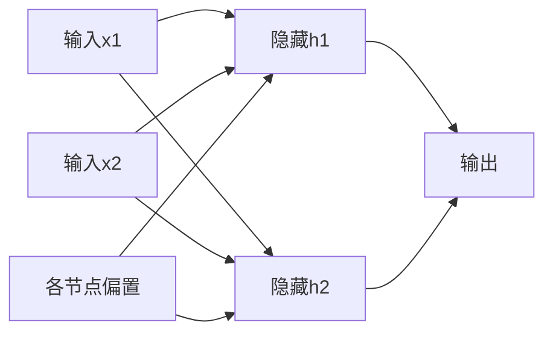
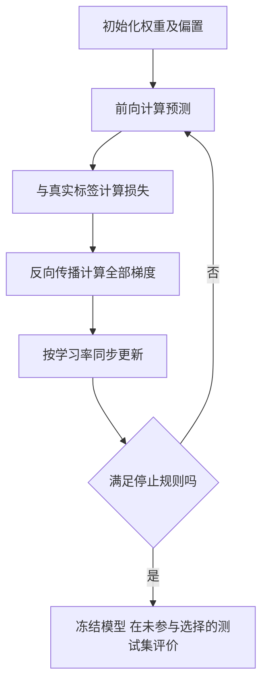
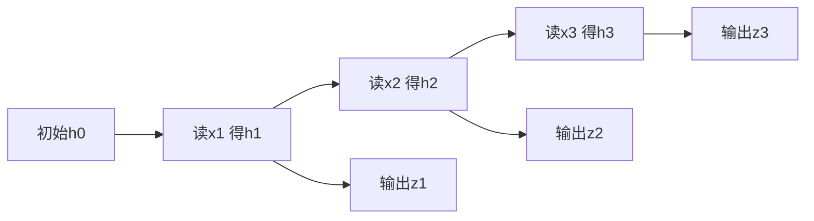
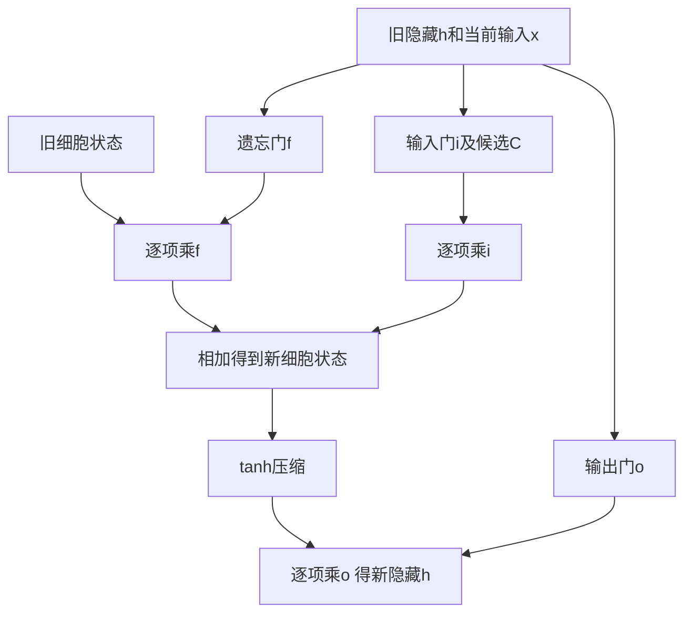
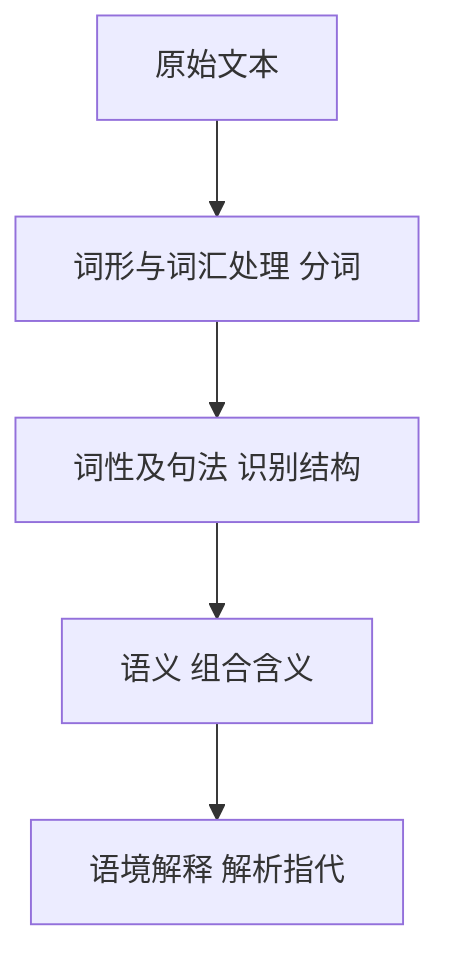

# M09 · 深度学习：从一个神经元到序列与文本分析

## 0. 三分钟速览

神经网络把“给输入算输出”的小步骤连接起来，再用预测误差调整连接参数。本讲先完整算一个小网络，再把同一思路扩展到时间序列和文本。

- 能计算加权和、激活和输出，并看懂矩阵只是批量记账。
- 能区分 AND、OR、XOR、XNOR，并发现原课件对后两者的错标。
- 能从一次预测误差反推参数调整方向，完成一步训练。
- 能按时间追踪 RNN 隐藏状态与 LSTM 的旧记忆、新信息和输出。
- 能把词频变成 TF-IDF，并区分分词、词性、句法、语义和上下文。

## 1. 开始之前 · 知识衔接

### 1.1 用到哪些已有想法

[[IS6400_Business_Data_Analytics/notes/M02-预测分析-线性回归|M02]] 的预测是“输入乘系数再相加”；神经元先做相同动作，再接一个函数。[[IS6400_Business_Data_Analytics/notes/M04-特征工程-特征重要性与降维|M04]] 的特征是描述记录的数值；网络隐藏层会从数据学习新的中间特征。[[IS6400_Business_Data_Analytics/notes/M06-分类-决策树集成SVM与不平衡学习|M06]] 的分类把记录分组，仍要分训练与测试、检查过拟合；深度网络不例外。

### 1.2 数学起点

向量（Vector）在本讲是一列按固定顺序排的数，例如两个输入组成 $x=(x_1,x_2)^\top$。上标 $\top$ 只表示转置，把横排改成竖排；不改变里面的值。矩阵（Matrix）是一张数表，一行可以存一个神经元的权重。

求和号 $\sum$ 表示把若干项相加。导数／梯度的必要读法在 §2.7 现教，不默认读者会微积分；本讲用到的概率、对数、指数和逐元素乘法也在首次计算旁解释。

### 1.3 编号、顺序和材料状态

库内前一篇为 M08，所以本篇按 M09 编号；原文件名、Canvas Week 10 和课件 Lecture 11 均保留，不据此推定授课日期。先解释神经元与网络，再学习训练、RNN/LSTM，最后文本表示。98 页均在 §2 有对应内容；封面、分段目录及结尾在 §8 说明。无转录，材料为 v0.9。

## 2. 正文

### 2.1 为什么需要神经网络（讲义 p.2–9）

识别图片时，一行记录可能有几百个像素；语音又包含前后顺序。只靠人先手写每种有用特征会很困难。人工神经网络（Artificial Neural Network，ANN）将多层简单运算连接起来，学习对当前任务有用的表示。深度学习（Deep Learning）属于机器学习中的神经网络方法，不等于整个 AI。

p.3、9 用生物神经元说明“接收多个信号、组合、再传出”的灵感；数学神经元不是对真实脑细胞的完整复制。p.4 是“在深水里学习”的双关图片，不是深度学习定义。p.5 的图从局部对比、脸部特征到人脸表示，说明后层把前层输出再组合；不能由漂亮示意图断定所有训练出的单元都可解释为眼睛或鼻子。

p.6 提到维度灾难（Curse of dimensionality）：特征增多后，在每个维度都细分空间，可能需要的组合数量急剧增加。若每维只分 10 档，两维已有 100 格，十维有 $10^{10}$ 格；有限样本会变稀疏。这是困难来源，不是“用深度学习就必然消除”的证明。

p.7 的聊天、驾驶、医疗和图像识别是应用方向，p.8 的工具图是市场背景；没有实验数据支撑“需求大就一定成功”。p.6 的“传统算法不能处理这些任务”过于绝对：本讲应理解为复杂表示学习带来的优势，不是其他方法一概不能使用。

### 2.2 一个神经元怎样算（讲义 p.10–13、23）

先做一个明确输入的例子。两个输入为 1 和 2，两个权重（Weight）为 0.5 和 −1，偏置（Bias）为 1。权重决定输入怎样影响分数，偏置让整体阈值能移动。

先乘再加，预激活分数 $z=1+0.5\times1-1\times2=-0.5$。接下来激活函数（Activation function）把这个分数转换成输出 $a=g(z)$。同一个分数若接不同激活，输出含义不同。

$$
z=b+\sum_{j=1}^{d}w_jx_j,\qquad a=g(z).
$$

下面逐行解释当前神经元公式中的对象和例值。

| 符号 | 当前意思 | 本例 |
|---|---|---|
| $x_j$ | 第 $j$ 项输入 | 1、2 |
| $w_j$ | 对应输入的权重 | 0.5、−1 |
| $b$ | 与输入无关的偏移 | 1 |
| $z$ | 激活前分数 | −0.5 |
| $a$ | 激活后输出 | 由函数决定 |

p.13 过渡问句“How to deal with this ‘s’?”问的是如何处理加权分数；本节的阶跃、恒等和Sigmoid三种选择就是有条件的回答。

p.11–12 用 $-W_0+W_1a_1+W_2a_2$，与本篇 $b+w_1x_1+w_2x_2$ 相容，只是把偏置记作 $-W_0$。p.23 又用输入 $x_0=1$ 配偏置权重，这两套符号不能把符号负号重复算一次。

阶跃函数（Step function）按阈值输出类别。此处约定 $z\ge0$ 为 1、否则 0，原 p.11 未明确等于 0 的边界，应自行说明。恒等函数 $g(z)=z$ 保留连续分数，适合相应回归输出。Sigmoid 为 $\sigma(z)=1/(1+e^{-z})$，把实数压到 0 与 1 之间；$e$ 是约 2.718 的常数，指数表示连续的乘方关系。例中 $\sigma(-0.5)\approx0.3775$。

如果把 Sigmoid 输出解释为正类概率，常用 0.5 阈值分类；但输出位于 0–1 不自动保证概率已校准。p.13 的输出范围写法有倒序和类别标签混乱，复习以函数和明确阈值为准。

### 2.3 AND、OR 与课件错标的 XOR（讲义 p.14–20）

这组练习输入都是 0／1。AND 要两项都为 1 才输出 1；OR 只要任一项为 1 即输出 1。讲义给 AND 分数 $-30+20x_1+20x_2$，OR 分数 $-10+20x_1+20x_2$，都接 Sigmoid；以下按 0.5 阈值显示类别。

原问题（p.14）：“How perceptron can achieve AND?” 中文：怎样让一个感知机实现“两个都满足”？直接答案是使用所给权重，使只有双 1 时分数为正。

| $x_1,x_2$ | AND 分数 | AND 类别 | OR 分数 | OR 类别 |
|---|---:|---:|---:|---:|
| 0,0 | −30 | 0 | −10 | 0 |
| 0,1 | −10 | 0 | 10 | 1 |
| 1,0 | −10 | 0 | 10 | 1 |
| 1,1 | 10 | 1 | 30 | 1 |

读最后一行：$-30+20+20=10$，Sigmoid 约 0.99995，阈值后为 1；它不是数学上精确等于 1。英文参考答案：“Use a bias of −30 and weights of 20 for both inputs. Only the input (1,1) produces a positive score, so thresholding the sigmoid output at 0.5 implements AND.”

原 p.18 的问题是：“Why single layer fails?” 它标 “XOR function: y=1 only when two x are same”，表却是 00→1、01→0、10→0、11→1；又标“XNOR function: y=1 only when two x are different”。**名称与标准定义对调**，不能把错标背进考试。

标准 XOR 是不同为 1，标准 XNOR 是相同为 1。对 XOR 的四个角，两个正类位于对角，无法用一条直线同时把它们与另外两角分开。按本篇非负判为1的约定，若正类 10、01 的分数都大于或等于 0，两分数相加为 $2b+w_1+w_2\ge0$；负类 00、11 的分数若都小于 0，同样相加却要求 $2b+w_1+w_2<0$，冲突。同一表达式不能同时非负且严格小于零，因此也覆盖边界情况。

英文参考答案：“A single linear threshold cannot separate the opposite positive corners from the opposite negative corners. A hidden layer can combine intermediate regions to represent XOR or XNOR.”

p.19–20 实际把 AND、NOR 再 OR，算的是 **XNOR**。NOR 是“两个都不是 1”：分数 $10-20x_1-20x_2$。保留这套原网络，不能为修标题偷偷改权重。

$$
h_1=\sigma(-30+20x_1+20x_2),\quad
h_2=\sigma(10-20x_1-20x_2),\quad
\widehat y=\sigma(-10+20h_1+20h_2).
$$

下面每行是一种完整输入，隐藏列按逻辑近似显示两个中间结果。

| 输入 | 隐藏层的逻辑近似 $h_1,h_2$ | 最终阈值类别 |
|---|---|---:|
| 0,0 | 0,1 | 1 |
| 0,1 | 0,0 | 0 |
| 1,0 | 0,0 | 0 |
| 1,1 | 1,0 | 1 |

例如 00 先由 NOR 检出，再使输出 OR 为真。变成标准 XOR 可取最终类别的逻辑补，但不把这个补充当成 p.20 原网络。原图的连续值只是接近逻辑 0／1，表为阈值近似。

### 2.4 多层网络及矩阵读法（讲义 p.16–17、21–30）

前馈网络（Feed-forward network）只把本层输出传向下一层；输入层放特征，隐藏层（Hidden layer）产生中间表示，输出层给当前任务的预测。p.21 的行人、汽车、摩托车、卡车例有四个输出，目标可写为 one-hot（独热向量）：正确类别位置是 1，其余是 0。

p.22 的建模选择要分清：层数、每层节点数、激活及输出形式是事前设置；连接权重和偏置由训练估计。神经元数量不是样本数量。

p.17 的通用逼近定理（Universal Approximation Theorem）说，在相应激活与条件下，有足够节点的一个隐藏层可把紧集上的连续函数逼近到任意精度。紧集可先理解为有界且含边界的输入范围。它是表达能力结论，不证明有限数据训练一定找到好权重，也不保证样本外预测；“一个隐藏层够表达”与“深层网络训练和表示更合适”并不矛盾。

图从左到右读，每条边表示乘一个可训练权重，圆框内先加总再激活。这里是补充小网络，不照数课件示意圈数。



💡 完整前向例：输入 $x=(1,2)^\top$，第一隐藏单元权重为 $(1,-1)$、偏置 0，第二个为 $(0.5,1)$、偏置 −1。分别得到分数 −1、1.5；这里的 ReLU 保留正数、把负数改成 0，即 $g(z)=\max(0,z)$；§2.5 再比较其他激活。因此激活后为 0、1.5。输出按 $2h_1+h_2+0.5$ 得到 2。这是回归分数，不擅自当概率。

把两行权重记在同一矩阵，只是同时执行刚才两次乘加：

$$
W=\begin{bmatrix}1&-1\\0.5&1\end{bmatrix},\quad
b=\begin{bmatrix}0\\-1\end{bmatrix},\quad
z=Wx+b=\begin{bmatrix}-1\\1.5\end{bmatrix}.
$$

矩阵乘法的每行与输入逐项相乘后求和，不是把同位置的两个二维表逐格相乘。本例 $W$ 为 2×2，输入为 2×1，结果为 2×1，维度中的内侧两个 2 必须一致。

p.24–28 的 $a_i^{(j)}$ 是第 $j$ 层第 $i$ 个单元输出；$\Theta_{ki}^{(j)}$ 是从第 $j$ 层单元 $i$ 连到下层单元 $k$ 的权重。

若本层有 $s_j$ 个真实单元，额外加一个恒为 1 的偏置输入，下层有 $s_{j+1}$ 个单元，则权重矩阵尺寸为 $s_{j+1}\times(s_j+1)$。

多出的 1 是偏置列，不是多出一个真实输入特征。


原 p.25 问：“What if $h_\theta(x)=a_1^{(3)}$?” 中文是输出等于第三层第一个单元时怎样展开。直接答案是把第三层的输入写清：$a_1^{(3)}=g(\Theta_{10}^{(2)}+\Theta_{11}^{(2)}a_1^{(2)}+\Theta_{12}^{(2)}a_2^{(2)}+\Theta_{13}^{(2)}a_3^{(2)})$，各个二层激活又由第一层输入计算。英文参考：“The final output is the activation of unit 1 in layer 3, computed from a bias and a weighted sum of the preceding layer's activations.”

p.29 加第二隐藏层，就是把相同动作再做一遍；p.30 的猫图和边缘／纹理／物体图说明多层表示逐级组合。训练目标会影响学出的特征，不能把此图当成每个网络都自动学到同样结构的保证。

### 2.5 激活函数：输出范围为何重要（讲义 p.31–35）

如果每层只做线性乘加，层层相接仍能合并成一次线性乘加；因此需要非线性（Nonlinearity）改变可表达的函数。激活不是给模型加一个装饰性开关。

下表以同一分数 $z=-1$ 或 0、1 说明四种常见函数。对数／指数都采用自然底数，数值为笔记补充。

| 函数 | 定义／范围 | 具体读法 |
|---|---|---|
| Sigmoid | $1/(1+e^{-z})$，(0,1) | −1、0、1 对应约 0.269、0.5、0.731 |
| 双曲正切 tanh | $(e^z-e^{-z})/(e^z+e^{-z})$，(−1,1) | 0 输出 0；−1 约 −0.762 |
| ReLU | $\max(0,z)$ | −1 变 0，1 保持 1 |
| Softmax | 见下式，整组和为 1 | 把多个类别分数变为互相竞争的比例 |

Sigmoid 在分数很大或很小时输出变化很小；tanh 也可能饱和。这会使训练信号沿长链缩小。ReLU 的正侧斜率为 1，但负侧不传局部梯度；长期停在负侧的单元可能失活。它的稀疏表示指一部分激活恰为 0；计算简单不等于在所有任务上更好。

Softmax 对第 $k$ 类的分数 $z_k$ 先取指数，再除以各类指数总和：

$$
p_k=\frac{e^{z_k}}{\sum_{j=1}^{K}e^{z_j}}.
$$

这里 $K$ 是类别数，$p_k$ 是该类输出比例。若三个分数为 $\log2,0,0$，指数为 2、1、1，总和 4，输出为 0.5、0.25、0.25。只看第一分数而不看其余分数，无法确定第一类概率。互斥多类可用 Softmax；多个标签可同时为真时，通常需要分别建概率，不能机械要求它们和为 1。

#### 2.5.1 用局部斜率解释饱和（讲义 p.23、32–33）

局部斜率表示输入微小改变时输出怎样改变，下一节训练会用它把误差往回传。讲义给定的两条导数是：

$$
\sigma'(z)=\sigma(z)(1-\sigma(z)).
$$

Sigmoid 输出为 0.5 时斜率为 0.25；输出靠近 0.99 时为 $0.99\times0.01=0.0099$。输入改变同样一点，饱和端输出改变得更少。

$$
\tanh'(z)=1-\tanh^2(z).
$$

tanh 输出为 0 时斜率为 1，输出为 0.9 时为 $1-0.9^2=0.19$。这把“曲线变平”接到反向信号乘以较小因子的机制，不能只看函数名字说会遗忘。


### 2.6 损失怎样告诉模型“错多少”（讲义 p.36–37、43）

训练样本有输入 $x$ 和真实标签 $y$。损失函数（Loss function）把预测与真实之间的不符合变成一个数，训练要减小它。p.36 区分二分类的一输出和多类的 $K$ 输出，标签形式要与输出含义匹配。

p.37 单输出使用二元交叉熵（Binary cross-entropy）。$m$ 为训练记录数，$p_i$ 是第 $i$ 条正类预测概率，$y_i$ 为 0 或 1：

$$
J=-\frac1m\sum_{i=1}^{m}[y_i\log p_i+(1-y_i)\log(1-p_i)]
+\frac{\lambda}{2m}\sum_j w_j^2.
$$

对数 $\log$ 是指数的反运算，$\log(e^u)=u$。真实为 1 时，单条误差只剩 $-\log p$；$p=0.8$ 得约 0.2231，$p=0.2$ 得约 1.6094。更自信地报错会受到更大损失。训练不是只看最后阈值类别对不对，也看预测概率。

后半项为 L2 正则化（Regularization）：权重平方和越大，惩罚越大；$\lambda$ 控制对拟合和权重大小的取舍，通常不把偏置计入同一项。若 $m=2,\lambda=1$，两个被惩罚权重为 1、2，正则项为 $(1^2+2^2)/4=1.25$。这会改变训练目标，并不保证完全消除过拟合。

p.37 的 $K$ 输出公式，是把每个输出的二元交叉熵对 $k$ 再求和，并对所有层的非偏置连接权重求平方和。它与多独立 Sigmoid 输出相容。**不能把这条 BCE 求和式不加说明地叫作 Softmax 多类损失**；Softmax 配 one-hot 标签的常用式为 $-\sum_k y_k\log p_k$。本篇同时保留来源两种输出语境，避免混用。

p.43 对比小网络的欠拟合和大网络的过拟合：前者表达能力可能不足，后者可能把训练噪声也记住。训练损失低只是训练内表现；正则权重、结构和停止时机应在验证段比较，最终测试保持未参与选择。

### 2.7 反向传播与梯度下降：完整做一次训练（讲义 p.38–42、44）

先理解斜率：若把某个权重加一个很小的量，损失会改变多少？损失改变量除以权重改变量，就是局部变化率的近似；步长足够小时，对应导数。偏导数（Partial derivative）指只改一个参数，先固定其他参数；梯度（Gradient）把所有参数的这些变化率排成向量。

梯度下降（Gradient descent）沿使损失局部下降的反方向更新：

$$
w^{\mathrm{new}}=w^{\mathrm{old}}-\eta\frac{\partial J}{\partial w}.
$$

$\eta>0$ 是学习率（Learning rate），决定一次走多远。导数为正，就减小权重；导数为负，减负数即增大。p.39 的山地／切线图只帮理解局部方向，网络损失未必是简单凸碗。

反向传播（Backpropagation）利用链式法则高效计算这些导数：若参数先改变中间量，中间量再改变损失，总变化率把沿路各段的局部变化率相乘。多条路径通向同一个参数时，把各条路径贡献相加；它是算梯度的方法，梯度下降才是用梯度更新参数的方法。

💡 同一输入的完整补充例：一个隐藏单元，输入 $x=2$，隐藏分数 $z=wx+b$，激活 $h=\max(0,z)$，输出 $\widehat y=vh+c$。

给定 $w=1,b=0,v=3,c=0$，真实目标为 4，先得到 $z=2,h=2,\widehat y=6$。

本例用平方损失 $L=(\widehat y-4)^2/2=2$，是回归演示，不冒称 p.37 的交叉熵。


先补最关键的一步：令当前输出为 $q$，目标为 $y$，平方损失为 $(q-y)^2/2$。

若输出多一个很小的量 $\delta$，损失改变量为 $(q-y)\delta+\delta^2/2$；除以 $\delta$ 得到 $(q-y)+\delta/2$。

当 $\delta$ 越来越小，局部变化率趋向 $q-y$，所以本例损失对输出的导数才是 2。

换损失函数必须重算这一步。


局部链条如下：输出误差为 2；输出对 $v$ 的斜率为 $h=2$，所以 $\partial L/\partial v=2\times2=4$。隐藏单元位于 ReLU 正侧，斜率为 1；损失对隐藏输出的斜率为 $2v=6$，继续乘输入 2，得到 $\partial L/\partial w=12$。

| 参数 | 本步梯度 | 学习率 0.01 的同步更新 |
|---|---:|---:|
| $w$ | 12 | 0.88 |
| $b$ | 6 | −0.06 |
| $v$ | 4 | 2.96 |
| $c$ | 2 | −0.02 |

偏置直接以加法进入对应分数，局部变化率为 1。因此 $b$ 的梯度为隐藏侧误差信号 6 乘 1，$c$ 的梯度为输出误差 2 乘 1。

全部梯度都用**更新前**参数算，再一起更新；不能先改 $v$，又用新 $v$ 算同一步的 $w$ 梯度。更新后 $z=0.88\times2-0.06=1.70$，新输出为 $2.96\times1.70-0.02=5.012$，新损失约 0.5121，确实低于原来 2。

从图中的初始化进入，每轮先预测、再算损失、再反推梯度，最后更新。判断出口包括验证表现、梯度变化和迭代上限；不是永远循环。



p.41 的学习率过小会进步慢，过大可能震荡或发散；p.44 的随机初始化说明初值可能改变优化结果。梯度为 0 可能是局部最优、平坦区或鞍点，不能据此保证全局最小。p.42 写的是“Need code to compute”，演示对象是带正则的交叉熵目标、其梯度与更新，不是另给一道平方损失英文问句。具体代码计算见下节，不能以“调用训练 API”代替机制。

p.39 原问：“What if p is large? (e.g., n/2)”。中文：参数很多时怎么办？原页没有充分解释 p、n 的具体统计对象，保留其问法，不假装这两个字母已经定义。就当前训练任务，实际回应是高效计算所有参数梯度，再迭代更新。

英文参考答案（p.39 原问与 p.42 演示任务）：“With many parameters, compute the gradient efficiently by backpropagation and update all parameters using gradient descent. Backpropagation applies the chain rule through the network; the learning rate controls each update. A stationary point is not necessarily a global minimum.”

#### 2.7.1 回到 Sigmoid、交叉熵与正则的真实训练目标（讲义 p.37、42）

前面的平方损失是为看清链条而补的回归例；现在用本讲给定的分类目标做同一件事。单条记录的目标 $y$ 为 0／1，分数 $z=wx+b$，预测概率 $p=\sigma(z)$。

对数的局部变化规则是 $d\log p/dp=1/p$。据此，二元损失对概率的变化率为：

$$
\frac{\partial L}{\partial p}=-\frac y p+\frac{1-y}{1-p}.
$$

再乘上一节 Sigmoid 的局部斜率，化简得到分数侧的误差信号：

$$
\frac{\partial L}{\partial z}=\left(-\frac y p+\frac{1-y}{1-p}\right)p(1-p)=p-y.
$$

若 $y=1,p=0.8$，损失对概率的变化率是 −1.25，激活局部斜率为 0.16，乘积为 −0.2。负号说明提高分数能在局部降低该条损失；不能把回归例的“输出减目标”无条件套到任意输出函数。

单条输入取 $x=2,w=0.5,b=\log4-1$，使分数为 $\log4$、概率为 0.8。取正则权重 $\lambda=0.1$、样本数 $m=1$，权重梯度为 $(-0.2)\times2+0.1\times0.5=-0.35$；偏置不加这项平方惩罚，所以梯度为 −0.2。

下面代码对应 p.42 所需的“目标→梯度→更新”计算，是笔记补充，可直接运行，没有重训大图片网络。

```python
import math
x, y, w = 2.0, 1.0, 0.5
b = math.log(4) - w * x
lam, eta = 0.1, 0.01
p = 1 / (1 + math.exp(-(w * x + b)))
loss = -math.log(p) + lam * w * w / 2
dw = (p - y) * x + lam * w
db = p - y
w_new, b_new = w - eta * dw, b - eta * db
print(loss, dw, db, w_new, b_new)
```

输出依次为当前总损失、权重梯度、偏置梯度和同步更新后的两个参数。`lam` 控制正则惩罚，`eta` 控制更新步长，是不同设置。对多记录先汇总／平均各记录梯度，多层权重再沿计算图传回；正则梯度只加到相应受惩罚权重。

英文参考说明：“For sigmoid and binary cross-entropy, the score-level gradient is p−y. Multiply it by each input to obtain the data contribution to a weight gradient, then add the applicable regularization gradient. Biases are updated from their own paths without the same weight penalty.”


### 2.8 图像分类例：哪些超参数能从课件知道（讲义 p.45–49）

p.45 是服饰图片分类例；p.46 每幅 28×28 像素，若灰度每像素一个输入，展平成 784 个数。p.47 给出 60,000 张带标签训练图片；这是课件给定，不表示本次下载并训练过这套数据。

p.48 又放人脸网络示意图，与前面的服饰图片不同。不能从图里画了多少圆就推定一个实际训练架构。

原题：“Identify the following parameters: Input layer dimension (for features input); Number of hidden layers; Number of nodes in hidden layers; Activation function; Loss function (objective function).”

中文是逐一识别输入维度、隐藏层数、每层单元数、激活和损失。⚪ 参考作答分清可知与不可知：

1. 若承接 p.46 的灰度服饰输入，维度为 $28\times28=784$；若专指 p.48 人脸图，图未给图像尺寸，不能借服饰尺寸代填。
2. p.48 标出了 Hidden Layer 1 和 Hidden Layer 2 两个表示阶段；它不是带明确逐层尺寸的实现规格。
3. 每层实际节点数没有明确数值，不能将示意图的圈数当真实超参数。
4. 该图未给激活；可以提出 ReLU 隐藏层／Softmax 输出的**补充方案**，不能说是图中指定答案。
5. 该图未给损失；互斥服饰类别配 Softmax 可用多类交叉熵，这是条件式方案；p.37 的独立二元损失又是另一种输出口径。

英文参考答案：“For the 28×28 grayscale example, the flattened input dimension is 784. The face diagram labels two hidden representation stages, but it does not specify an implementable unit count, activation or loss. ReLU hidden units and a softmax/categorical-cross-entropy output are a possible design for mutually exclusive classes, not an answer explicitly supplied by that diagram.”

p.49 将新图片送入冻结网络，输出十个类别值 $(p_0,\ldots,p_9)$，选择最大值对应类别；该服饰表中 0–9 是 T-shirt/top、Trouser、Pullover、Dress、Coat、Sandal、Shirt、Sneaker、Bag、Ankle boot。最大值是“模型选了哪类”，不是本次正确率或置信度校准证明。

### 2.9 序列为何需要状态（讲义 p.50–58）

p.52 的原过渡问题是“What if I want to analyze something in a sequence?”及“What if I want to analyze human speech?”，即怎样保留序列顺序。下面的状态递推回应这两个任务。

p.51 的前馈分类把一张图片当静态输入；p.52 的视频／语音有顺序，“I Will Pass”三个片段不能只当无序集合。循环神经网络（Recurrent Neural Network，RNN）在读每一步时，保留对过去输入的摘要，称隐藏状态（Hidden state）。

$$
h_t=\tanh(W_{hh}h_{t-1}+W_{xh}x_t+b_h),\qquad
z_t=W_{hy}h_t+b_y.
$$

$x_t$ 是本步输入，$h_{t-1}$ 是上一步摘要，$h_t$ 是更新后的摘要。

$W_{xh}$ 把输入变成状态贡献，$W_{hh}$ 把旧状态变成本步贡献，$W_{hy}$ 把状态变成输出分数。

p.58 的简式省略偏置，本篇补充列出一般形式，并不改变其旧状态＋当前输入的机制。


按时间展开图，每个框重复使用同一组权重。箭头传状态，不传“已经知道的未来答案”。



💡 标量补充例：初始 $h_0=0$，每步按 $h_t=\tanh(0.5h_{t-1}+0.2x_t)$，输入为 1、0、1。三步依次得到约 0.1974、0.0984、0.2442。第二步虽输入为 0，仍保留上一状态的影响；把每步状态重置 0 就失去了这种记忆。真实多维状态只是把这套乘加同时在多行进行。

p.54 展开后形成有向无环图（Directed Acyclic Graph，DAG）：按时间从早到晚没有返回过去的计算边，因此能沿展开链做反向传播；图变长不表示每个时间都有独立权重。p.55–57 强调参数共享，它让可训练参数数量不随序列长度等比例增长，计算量仍随步数增加。

### 2.10 “hello”例：独热输入、状态和分数（讲义 p.59–61）

词表顺序是 `[h,e,l,o]`，所以 h 编为 $(1,0,0,0)^\top$，e 编为 $(0,1,0,0)^\top$，l、o 类推。这里的 1 是类别位置，不表示字母大小。

图输入 h、e、l、l，用来预测下一字符 e、l、l、o。第 60 页隐藏向量有 3 个分量，输入有 4 个，故无偏置简式中 $W_{xh}$ 为 3×4、$W_{hh}$ 为 3×3，输出 $W_{hy}$ 为 4×3。相同字母 l 读入两次，旧状态不同，所得新状态可不同。

p.60 给出四步示例状态：$(0.3,-0.1,0.9)$、$(1.0,0.3,0.1)$、$(0.1,-0.5,-0.3)$、$(-0.3,0.9,0.7)$。这是四舍五入显示值；没有给出完整权重数值，不能倒造一组矩阵声称已复算每个分量。

p.61 第一步输出为 $(1.0,2.2,-3.0,4.1)$，含负数且和不为 1，所以是分数（Logits），不能直接叫概率。目标字符 e 对应第二个位置 2.2，但本步最高分是 o 的 4.1，说明这个示例状态还不是全部预测正确的模型。训练要提高真实下一字符的相对得分。

若需要概率，可把四个分数送入 Softmax，仍按同一词表顺序解释；不能只因目标字符在图中绿色就把它说成当前最大输出。课堂未给全套权重和训练过程，保留其展示与推算能力的边界。

#### 2.10.1 原示例四步分数读全（讲义 p.60–61）

先将输入、下一个目标与给定状态对齐；状态分量均为来源的舍入值。

| 步 | 输入→目标 | 给定隐藏状态 |
|---|---|---|
| 1 | h→e | (0.3, −0.1, 0.9) |
| 2 | e→l | (1.0, 0.3, 0.1) |
| 3 | l→l | (0.1, −0.5, −0.3) |
| 4 | l→o | (−0.3, 0.9, 0.7) |

下表每行按词表 h/e/l/o 给分数，最后一列按最大分数选类。

| 步 | 四个给定输出分数 | 最大分数的类别 | 与目标是否一致 |
|---|---|---|---|
| 1 | (1.0, 2.2, −3.0, 4.1) | o | 否，目标 e |
| 2 | (0.5, 0.3, −1.0, 1.2) | o | 否，目标 l |
| 3 | (0.1, 0.5, 1.9, −1.1) | l | 是 |
| 4 | (0.2, −1.5, −0.1, 2.2) | o | 是 |

例如第二步仍是 o 得分最高，不能把绿色的目标 l 误读成当前胜出类。完整权重未知，因此这是保留并解释给定演示，不是从权重重算了来源四步。


### 2.11 序列输入输出的五种配对（讲义 p.62–65）

先数输入和输出的步数，再选择结构；一张图和一句话都可视作一次或多次输入，取决于任务表示。

| 配对 | 任务例 | 时间含义 |
|---|---|---|
| 一对一 | 静态图片分类 | 一项输入得一项标签 |
| 一对多 | 图片描述 | 图片后连续产生词 |
| 多对一 | 句子情感分类 | 读完整段再输出情感 |
| 多对多、不同长度 | 机器翻译 | 输入和输出词数可不同 |
| 多对多、逐步对齐 | 视频逐帧动作识别 | 每个时间步有输出 |

p.64 的句子 “Professor Liu’s IS6400 course is so popular, it’s hard to get a seat.” 是翻译例，不是本课真实招生统计。p.65 的 Angry／Refuse／Satisfied 是视频标签示例；图示不证明表情可以无误推断人的内心状态。

### 2.12 为什么 RNN 会遗忘，LSTM 怎样保留（讲义 p.66–76）

训练信号沿长时间链反传，要连续乘多段局部变化率。若连续十段都乘 0.5，总比例为 $0.5^{10}\approx0.000977$，远处参数收到的信号很小，这叫梯度消失（Vanishing gradient）。若连续乘大于 1 的因子，也可能梯度爆炸。隐藏状态能传递，不代表久远信息总能有效学到。

长短期记忆网络（Long Short-Term Memory，LSTM）另设细胞状态（Cell state）$C_t$，让旧记忆有一条可受控保留的加法通路。p.69 把名称写成 Long Term Short Term Memory，标准展开应是 Long Short-Term Memory。

p.67 的图形记号先读清：圆圈乘号是同位置逐元素相乘（$\odot$），不是矩阵乘；分叉是复制同一数列，合并是拼接（Concatenation），把两列接成长列，不是相加。门（Gate）输出 0–1 的数，控制相应分量通过比例。

按 p.72–75 的四步走同一时点：

1. 遗忘门 $f_t=\sigma(W_f[h_{t-1},x_t]+b_f)$：看旧状态与当前输入，决定旧记忆保留多少。
2. 输入门 $i_t=\sigma(W_i[h_{t-1},x_t]+b_i)$，候选记忆 $\widetilde C_t=\tanh(W_C[h_{t-1},x_t]+b_C)$：分别决定写多少、写什么。
3. 更新细胞状态 $C_t=f_t\odot C_{t-1}+i_t\odot\widetilde C_t$：保留的旧值与选择的新值相加。
4. 输出门 $o_t=\sigma(W_o[h_{t-1},x_t]+b_o)$，新隐藏状态 $h_t=o_t\odot\tanh(C_t)$：选择多少记忆用于当前输出及下一步计算。

$[h,x]$ 是拼接，$W$ 和 $b$ 是训练出的不同门参数，$f,i,o$ 是每一步动态算出的门值，不能把门值当恒定超参数。$C$ 可以超出 −1 到 1，输出前的 tanh 再压缩它。

下面按从上到下读，旧细胞记忆经保留分支，新候选经写入分支，两条在更新处汇合。



💡 已给门值的完整标量例：旧 $C=2$，遗忘门 0.8，输入门 0.25，候选 0.4，输出门 0.5。先留 $0.8\times2=1.6$，再写 $0.25\times0.4=0.1$，新 $C=1.7$；新 $h=0.5\tanh(1.7)\approx0.4677$。这里门值为说明状态更新而给定，前两步怎样由输入得到门值已由上方 Sigmoid／tanh 公式规定。

若把遗忘门改成 0，同一例新 $C$ 只剩 0.1；改成 1 则旧值完整保留。LSTM 提供更有利的梯度路径，但门仍可关闭，不能保证永久记住所有远处信息。p.68 的普通 RNN 单层重复模块与 p.69–76 的四交互模块差异，正是这个状态控制结构。

#### 2.12.1 用同一套参数算动态门与两个时点（讲义 p.72–76 的笔记补充）

为把“当前输入改变，门会怎样改变”算完整，采用一个标量隐藏状态与一个标量细胞状态。初始旧隐藏为 0.1、旧细胞为 0.2，当前输入为 0.5；所有偏置取 0。下表每对权重按“旧隐藏、当前输入”的顺序，沿本节公式做乘加。

| 分支 | 权重对 | 第一步代入的分数 | 激活后结果 |
|---|---|---|---:|
| 遗忘门 | (0.5, 0.4) | 0.5×0.1+0.4×0.5=0.25 | 0.562177 |
| 输入门 | (−0.3, 0.2) | −0.3×0.1+0.2×0.5=0.07 | 0.517493 |
| 候选记忆 | (0.2, 0.6) | 0.2×0.1+0.6×0.5=0.32 | 0.309507 |
| 输出门 | (0.1, −0.2) | 0.1×0.1−0.2×0.5=−0.09 | 0.477515 |

门分支接 Sigmoid，候选分支接 tanh。用未舍入值计算，新的细胞状态约为 $0.562177\times0.2+0.517493\times0.309507=0.272603$；新隐藏约为 $0.477515\tanh(0.272603)=0.127041$。

下一步把输入改为 −0.5，仍用同一权重；旧隐藏现在是 0.127041、旧细胞是 0.272603。重新计算得到遗忘门约 0.465933、输入门约 0.465527、候选约 −0.267892、输出门约 0.528146，新的细胞状态约 0.002304、隐藏约 0.001217。不能把第一步的四门原封不动搬到第二步，也不能把隐藏 0.127041 当成细胞记忆。

这组数值是为学习提供的完整补充参数，不是 hello 来源模型的权重；逐步未舍入值见本篇计算资产。


### 2.13 文本挖掘先把“文字”变成可计算对象（讲义 p.77–86）

文本挖掘（Text mining）从文件里的文字提取结构、主题或可供决策的信息。p.78 提到分类、聚类、关联分析等旧任务，现在输入先要表示成数字。p.79 的情感例将一串词归为正面／中性／负面，p.80 的股票情绪图只是业务应用示例，不是已验证的可获利策略。

<details><summary>讲义 p.81 Text Data 英文原段落全文</summary>

> COVID-19 is the infectious disease caused by the most recently discovered coronavirus. This new virus and disease were unknown before the outbreak began in Wuhan, China, in December 2019. The most common symptoms of COVID-19 are fever, tiredness, and dry cough. Some patients may have aches and pains, nasal congestion, runny nose, sore throat or diarrhea. These symptoms are usually mild and begin gradually. Some people become infected but don’t develop any symptoms and don't feel unwell. Most people (about 80%) recover from the disease without needing special treatment. Around 1 out of every 6 people who gets COVID-19 becomes seriously ill and develops difficulty breathing. Older people, and those with underlying medical problems like high blood pressure, heart problems or diabetes, are more likely to develop serious illness. People with fever, cough and difficulty breathing should seek medical attention.

</details>

p.81 是从给定旧文本抽答案的演示，原文里的健康描述只作为当时材料，不当成当前医疗建议。原题与给定答案如下：

| 原英文问题 | 中文题意 | 讲义文本给定的英文答案 |
|---|---|---|
| What is COVID-19? | 按该段文本解释它是什么 | the infectious disease caused by the most recently discovered coronavirus |
| What are symptoms of COVID-19? | 按该段文本提取症状 | fever, tiredness, and dry cough |
| How many people recover from COVID? | 按该段文本找比例 | about 80% |

中文解析：第一问定位定义句；第二问定位列出常见症状的句子；第三问定位“Most people (about 80%) recover ...”并保留原文的条件“without needing special treatment”。材料没有当前样本、时间及流行变异株口径，因此不拿 80% 推算现在某群体康复人数。

英文参考说明：“These answers are extracted from the supplied passage. They demonstrate text-based question answering and are not independently verified current medical guidance.” 完整题面所用原段落已在上方折叠保留，正文解读已明确限定为旧文本抽取。

p.82 的“世界约 90% 数据非结构化”只给 Oracle 署名，没有采样日期或定义；可用来解释需求背景，不当成本次核实的当前统计。

p.83 区分信息检索（Information retrieval，找相关文档）和信息提取（Information extraction，抽实体及关系）。例如从“AOL buys Time-Warner”提取公司实体与收购方向；把主客体对调就会改变关系。句法（Syntax）关注结构，语义（Semantics）关注含义，本体（Ontology）组织概念及关系，语境（Context）帮助解歧义。

p.84 提醒词项维度很高、文档长短和结构不相同，互相转载的文档也不独立。“automobile/car/vehicle/Toyota”有同义、上位概念和品牌等不同关系，不是四词处处可替换；Apple 的公司／水果要看上下文。

p.85 的文档—词项矩阵，每行是一篇文档，每列是一种词，格子为出现次数。原小表保真如下，省略号代表课件没显示的其他词。

| 文档 | Camera | Digital | Memory | Print |
|---|---:|---:|---:|---:|
| Document 1 | 3 | 2 | 0 | 1 |
| Document 2 | 0 | 4 | 0 | 3 |

读第一格：Camera 在第一篇出现三次，不代表 Camera 这个词总共出现三篇。p.86 的词干化（Stemming）将 Taxes、taxation 等归到词根；停用词（Stop words）去除某些常见功能词。是否删词取决于任务，例如情感任务中的 not 可能很关键，不能删完就把“不好”变成“好”。

### 2.14 TF-IDF：常出现又有区分力（讲义 p.87–89）

直接次数会让长文看起来每个词都更重要。词频（Term frequency，TF）先把当前词次数除以当前文档总词数：

$$
\mathrm{TF}(i,j)=\frac{\mathrm{count}(i,j)}{\text{文档}j\text{的总词数}}.
$$

$i$ 是词，$j$ 是文档；次数和总词数必须用同一分词／停用词口径。原 p.85 有未显示词，不能仅把可见四列相加就假装知道文档真实总长度。

在同一语料库（Corpus，一组被共同分析的文档）里，若一个词每篇都有，它不太能区分主题。令 $N$ 为总文档数，$df_i$ 为含词 $i$ 的文档数，逆文档频率（Inverse document frequency，IDF）为：

$$
\mathrm{IDF}(i)=\log\frac{N}{df_i},\qquad
\mathrm{TFIDF}(i,j)=\mathrm{TF}(i,j)\mathrm{IDF}(i).
$$

同一词在某篇重复十次，$df$ 仍只对这篇计 1；p.88 把 IDF 文字定义写成“含词文档数”，实际那个数量是 $df$，不是 IDF，须以其公式及本解释区分。

💡 完整补充例：语料有 3 篇，词 camera 出现在其中 1 篇；该篇共 4 词、camera 出现 2 次。TF 为 $2/4=0.5$，IDF 为 $\log3\approx1.0986$，乘积约 0.5493。若另一个词三篇都有，则 IDF 为 $\log1=0$，该简式权重为 0。实际软件可能加平滑及归一化，数值不能与本未平滑公式混用。

p.89 把加权矩阵送给聚类、分类、主题模型或回归。它保留词频线索，不保留所有语序；“dog bites man”和“man bites dog”词集合相同，关系却不同。这引出下一节为什么还需要语言结构。

### 2.15 NLP：词、结构、意义和语境（讲义 p.90–97）

自然语言处理（Natural Language Processing，NLP）处理人类语言的识别、理解与生成；p.90 的任务包括语音识别、理解和生成。其图灵文章标题写成“Machine and Intelligence”，标准标题为“Computing Machinery and Intelligence”；本篇不扩成图灵测试历史课。

按 p.91–96 的传统分析链，先把文本划成单位，再分析结构和含义。图表示教学分工，现代系统不一定把它实现成四个独立程序。



- 分词（Word segmentation）：p.92 把“浦东开发与建设”分成“浦东／开发／与／建设”；英文示例 Michael Jordan / is / a / professor / at / Berkeley，还标出人物与机构实体。切词与识别实体有关但不是同一任务。
- 词性标注（Part-of-speech tagging，POS）：给每个词附名词、动词等类别。p.93 “This is a sentence.” 对应限定词、动词、限定词、名词；同一单词换语境可能换词性，所以不仅查词典。
- 句法分析（Syntactic analysis）：p.94 “My dog also likes eating sausage.” 用句法树区分主语名词短语和动词短语，说明谁做什么、修饰接在哪里；S 是句子，NP 是名词短语，VP 是动词短语。
- 语义分析（Semantic analysis）：词汇语义区分 bank 的河岸／银行，组合语义解释词合起来的意思。p.95 “Colorless green ideas sleep furiously”语法结构像正常英语，但常规字面含义不协调；文学语境仍可能赋予比喻，不能说电脑一律必须拒绝这句。
- 上下文解释（Context processing）：p.96 的“she wanted it”里 it 指什么，要查前后句。该页“the girl the go to the school”的词序／语法例与“colorless blue idea”的语义例，是故意用于说明结构和含义的不同检查。

p.97 列 Dialog Flow（ex API.ai）、Wit.ai、Luis、Lex、Watson Assistant，说明语言理解接到应用的一类历史平台。图里 NLP 层接到查询生成、知识库和输出生成：自然语言先变为意图／结构，再查询所需信息，再形成回答。这里不认证品牌当前产品名、可用性或定价，也不把一张框图称为已经部署的系统。

## 3. 一图看懂

本表把三条主线对齐到可执行任务，阅读时先选任务，再回到相应机制图。

| 输入及任务 | 中间表示怎样变化 | 终点 |
|---|---|---|
| 静态图片分类 | 像素→隐藏特征→类别分数 | §2.4、2.8 |
| 序列预测 | 本步输入＋旧状态→新状态 | §2.9–2.12 |
| 文本分析 | 词项／结构→加权数值／语义 | §2.13–2.15 |

## 4. 速查表

每行是一项容易混淆的操作，不把它们全叫训练。

| 操作 | 做什么 | 不保证什么 |
|---|---|---|
| 前向传播 | 给定参数算输出 | 预测正确 |
| 反向传播 | 给定损失算梯度 | 已更新参数 |
| 梯度下降 | 沿梯度改参数 | 全局最优 |
| 正则化 | 改目标、约束权重倾向 | 永不泛化失败 |
| RNN 状态更新 | 传递历史摘要 | 无限期记忆 |
| LSTM 门控 | 选择保留、写入、输出 | 梯度永不消失 |
| TF-IDF | 结合局部词频与跨文档区分力 | 理解完整语序 |

## 5. 双语术语卡

以下定义为笔记自拟的英文答法；正文先教具体操作。

| 中文 | English | 英文参考定义 | 首现 |
|---|---|---|---|
| 激活函数 | Activation function | A function that transforms a neuron's weighted input into its output. | §2.2 |
| 隐藏层 | Hidden layer | An intermediate layer that learns representations between inputs and outputs. | §2.4 |
| 反向传播 | Backpropagation | Efficient gradient computation through a network using the chain rule. | §2.7 |
| 学习率 | Learning rate | The scale of a parameter update along the negative gradient. | §2.7 |
| 隐藏状态 | Hidden state | A learned representation carrying information from previous sequence steps. | §2.9 |
| 梯度消失 | Vanishing gradient | The shrinking of a training signal through repeated small derivative factors. | §2.12 |
| 独热向量 | One-hot vector | A categorical encoding with one active position and zeros elsewhere. | §2.4 |
| 逆文档频率 | Inverse document frequency | A weight based on how rare a term is across documents. | §2.14 |
| 句法 | Syntax | The structural organization of words in a sentence. | §2.15 |

## 6. 考点预判与答题框架

🟡 笔记推断：神经元前向、XOR 不可线性分割、反向传播与优化分工、隐藏状态共享、LSTM 门控、TF/df 区别和 NLP 层次。无转录，不能标教授明示。

英文框架：“The model first computes a weighted sum and applies an activation. Training compares the prediction with the target, backpropagates the loss gradient, and updates the parameters. The architecture and evaluation protocol must match the task; low training loss alone does not demonstrate generalization.”

## 7. 自测

### 7.1 多堆几层纯线性变换能解决 XOR 吗

<details><summary>答案</summary>

不能。线性／仿射变换合并后仍是一次仿射变换，单一阈值仍是线性边界。需要合适的非线性中间表示；§2.3 的两隐藏单元演示了区域组合。

</details>

### 7.2 LSTM 的 f=0、i=0 时发生什么

<details><summary>答案</summary>

旧细胞值乘 0，新候选也乘 0，新细胞状态为 0；即使上一时点存了很多信息也被门关闭。新隐藏状态还按输出门乘 tanh(0)，因此为 0。

</details>

### 7.3 一个词重复十次，df 就是十吗

<details><summary>答案</summary>

不一定。df 按包含该词的文档数计，一篇重复十次仍只贡献一篇；TF 才在该篇内部计次数及长度。把两者交换会把“局部常见”和“全局常见”混淆。

</details>

## 8. 物理页码映射

正文按学习任务合并重复页；图示页均已查看，不能因抽取文字少而跳过。

| 物理页 | §2 实质内容／非内容页说明 |
|---|---|
| 封面 p.1 | 目标见 §0、§1.3 |
| 2–9 | §2.1 定位、脑启发、双关、特征层次、维度与应用 |
| 10–13 | §2.2 神经元、阈值与三种输出 |
| 14–15 | §2.3 AND、OR 全输入复算 |
| 16–17 | §2.4 前馈结构与逼近定理 |
| 18–20 | §2.3 错标、分割原因、原权重网络与完整真值表 |
| 21–30 | §2.4 四类输出、结构选择、索引、矩阵尺寸和特征组合 |
| 31–35 | §2.5 四种激活与边界 |
| 36–37 | §2.6 标签、二元／多输出损失和正则 |
| 38–42 | §2.7 梯度、链式法则、学习率、完整训练小例 |
| 43–44 | §2.6–2.7 欠／过拟合及局部优化 |
| 45–49 | §2.8 服饰图、784 输入、60,000 训练数、五问与未知规格 |
| 50 | RNN 分段目录，对应 §2.9 目标 |
| 51–58 | §2.9 静态／序列、展开、共享与方程 |
| 59–61 | §2.10 hello、独热、给定状态及 logits |
| 62–65 | §2.11 五类输入输出与各应用 |
| 66–76 | §2.12 长链、图记号、RNN/LSTM 结构与四步门控 |
| 77 | NLP 分段目录，对应 §2.13 目标 |
| 78–84 | §2.13 任务、三类应用、QA、规模背景与挑战 |
| 85–89 | §2.13–2.14 原词频表、预处理及 TF-IDF |
| 90–97 | §2.15 历史、分词、POS、句法、语义、语境及平台框图 |
| 结尾封面 p.98 | 三条学习线回顾于 §3 |

## 9. 延伸与勘误

### 9.1 课件有但课上略过

无转录，无法判断。

### 9.2 课上讲了但课件没有

待转录，不伪造讲授、问答或考试暗示。

### 9.3 课件自身的口径问题

p.13 输出范围与阈值边界不清；p.18–20 XOR/XNOR 错标；p.37 独立二元损失与 p.35 Softmax 不可直接混同；p.48 人脸示意与服饰实例规格混杂；p.61 分数不是概率；p.69 LSTM 展开有误；p.88 把 df 与 IDF 的文字解释混淆；p.90 图灵文章标题有误。各处已就地说明，原件保持不变。

### 9.4 笔记补充的性质

数值前向、单步训练、RNN 标量、LSTM 门值与 TF-IDF 小例均为笔记补充，并保存可重复计算脚本。没有重训 60,000 图片或原 hello 网络；产品可用性和旧健康文本未作现况核验，本篇也不据它们给医疗或采购建议。

### 9.5 待核

授课日期、课堂转录、p.48 实际架构设置和 hello 完整权重未知。五个参数识别问题已按可知／不可知逐项答，不把材料缺失变成虚构官方数值。完整题面及图义证据随源题／视觉记录保存。
