# M09 · 深度学习：从神经元到序列、文本与图像分类

## 0. 三分钟速览

神经网络把“给输入算输出”的小步骤连接起来，再用预测误差调整连接参数。本讲先完整算一个小网络，再把同一思路扩展到时间序列、文本与图像。

- 能计算加权和、激活和输出，并看懂矩阵只是批量记账。
- 能区分 AND、OR、XOR、XNOR，并发现原课件对后两者的错标。
- 能从一次预测误差反推参数调整方向，完成一步训练。
- 能按时间追踪 RNN 隐藏状态与 LSTM 的旧记忆、新信息和输出。
- 能把词频变成 TF-IDF，并区分分词、词性、句法、语义和上下文。

- 能追踪 RGB／灰度图的形状、PCA/SVM 评估边界及 CNN 的局部共享。

## 1. 开始之前 · 知识衔接

### 1.1 用到哪些已有想法

[[IS6400_Business_Data_Analytics/notes/M02-预测分析-线性回归|M02]] 的预测是“输入乘系数再相加”；神经元先做相同动作，再接一个函数。[[IS6400_Business_Data_Analytics/notes/M04-特征工程-特征重要性与降维|M04]] 的特征是描述记录的数值；网络隐藏层会从数据学习新的中间特征。[[IS6400_Business_Data_Analytics/notes/M06-分类-决策树集成SVM与不平衡学习|M06]] 的分类把记录分组，仍要分训练与测试、检查过拟合；深度网络不例外。

### 1.2 数学起点

向量（Vector）在本讲是一列按固定顺序排的数，例如两个输入组成 $x=(x_1,x_2)^\top$。上标 $\top$ 只表示转置，把横排改成竖排；不改变里面的值。矩阵（Matrix）是一张数表，一行可以存一个神经元的权重。

求和号 $\sum$ 表示把若干项相加。导数／梯度的必要读法在 p.38 现教，不默认读者会微积分；本讲用到的概率、对数、指数和逐元素乘法也在首次计算旁解释。

### 1.3 编号、顺序和材料状态

主源为新《L10-IS6400-DeepLearning.pdf》，137 个物理页。旧《L11-IS6400-DeepLearning.pdf》98 页保留，少数被新源删去的有用图与理论在正文明确标“旧源 L11”。其余不带前缀的 p.X 一律指 L10 物理页；页脚仍有 /97 的旧分母，不是页数依据。M09 是笔记编号，不能从文件名推断授课日期或周次；两份源都没有本次课堂转录，材料仍为 v0.9 / pending。

- 预习沿 §2 顺读，先算 p.10 的单神经元、p.39 的训练、p.72 的状态更新、p.88 的 TF-IDF，再走 p.125–137 的图像链。
- 课中从 §8 查任意 L10 物理页，直达当前页入口和原图；旧源补充单列来源，不能把旧图当当前投影片。
- 复习用 §3–§6 找任务，再做 §7。代码教程另见 [[IS6400_Business_Data_Analytics/notes/T10-深度序列预测实战-从窗口到LSTM|T10]]，它是天气序列教程，与图像分类源的代码截图分开。

## 2. 正文

### 2.1 深度学习怎样表示信息（L10 p.1–9）

#### p.1 · IS6400 Business Data Analytics

封面将 Lecture 10 分为 Intro-Deep Learning（ANN、RNN/LSTM、NLP）与 Image Mining。Reading Material 栏为空，不能自行填写书目。正文先沿 p.1–97 保留三条基础主线，再按 p.98–137 进入图像分类与 CNN。

#### p.2 · What is Deep Learning?

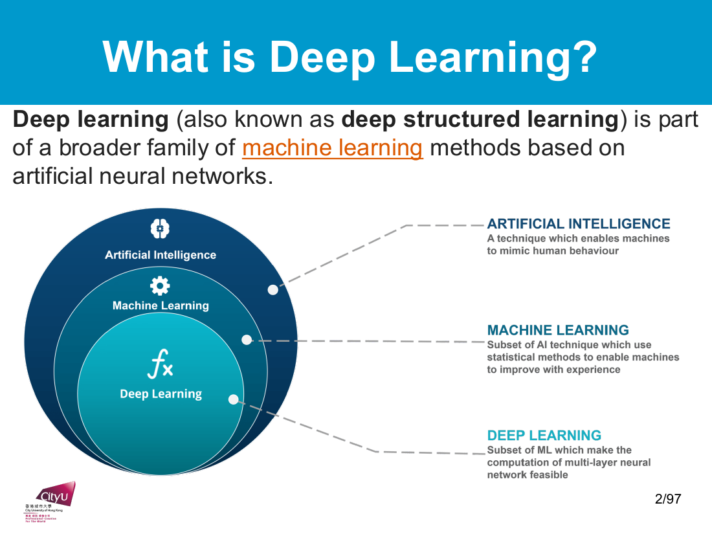

先看三个嵌套的圆。人工智能（Artificial Intelligence，AI）在外，机器学习（Machine Learning，ML）在中，深度学习（Deep Learning）在内，表示方法的包含关系。神经网络可用多层运算把原始输入逐步变成有用的表示。

#### p.3 · Artificial Neural Networks

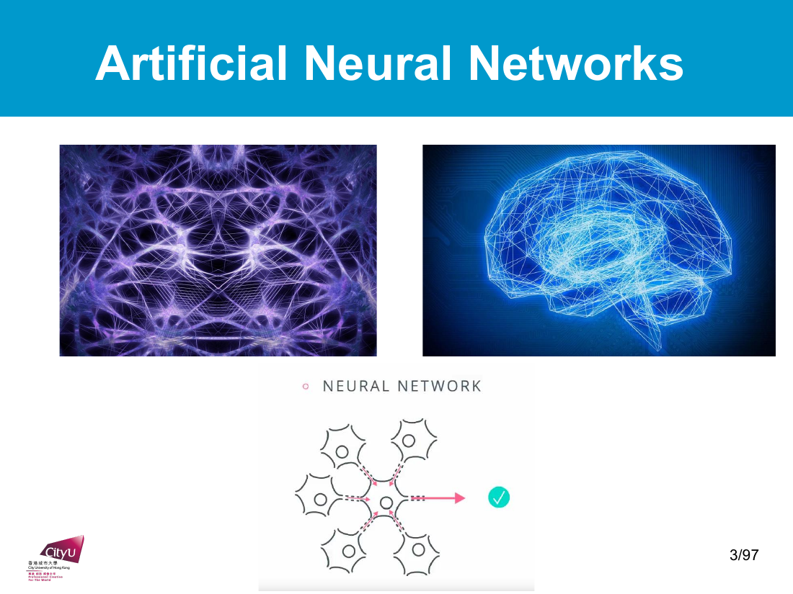

上方两张图联想生物神经与大脑，下方示意多个信号汇到同一节点，再沿粉红箭头输出。人工神经网络（Artificial Neural Network，ANN）借用了信号汇合的思路，p.10 会把中间动作写成可计算的公式。

#### p.4 · What is Deep Learning?

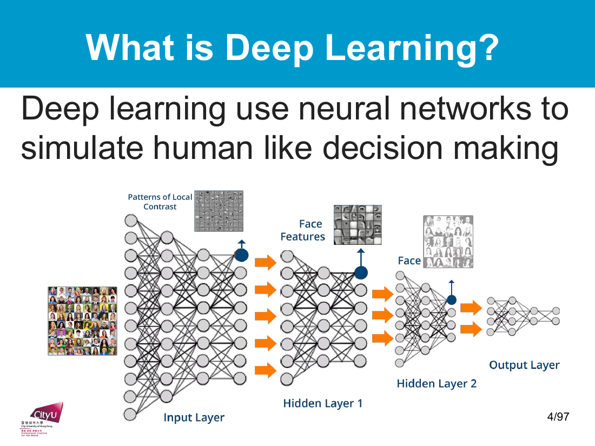

从左边输入的照片沿橙箭头往右。Patterns of Local Contrast 指局部明暗变化，Face Features 指组合出的面部特征，Face 指更整体的人脸表示。蓝点向上的箭头对应各阶段可视化示意。节点的具体含义取决于训练任务。

#### p.5 · Why Deep Learning?

新源本页列维度、数据量与手工特征提取的挑战，未保留旧源 L11 p.6 的维度示意。维度灾难（Curse of dimensionality）指维数增加后样本覆盖组合空间变得困难：每维只分 10 档，两维是 100 格，十维已有 $10^{10}$ 格。

本页把传统方法写成不能解决图像／语音／NLP，是教学简化；后面 p.115–120 本身就演示传统 SVM 图像分类。应读作复杂感知任务推动学习表示的需求，而非所有传统方法在这些领域都无效。

旧源 L11 p.6 的图仍供理解维度变化：

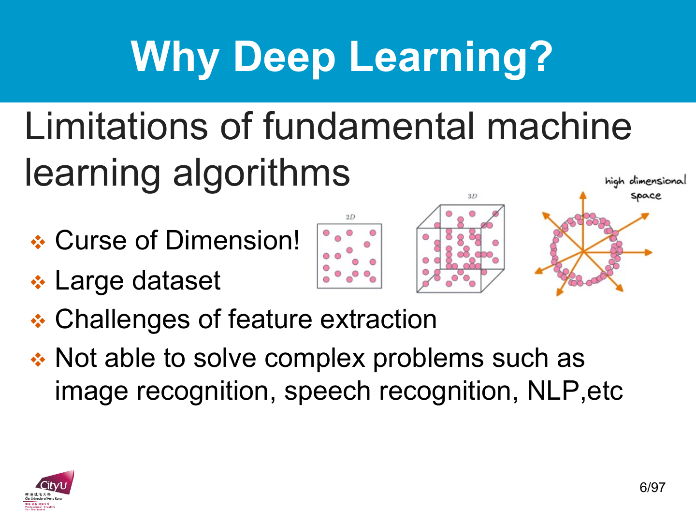

从右侧 2D、3D 到 high dimensional space，格子／组合数随轴数增长；它不是证明深度网络自动消除维度灾难。

#### p.6 · Why Deep Learning · 特征提取由谁完成

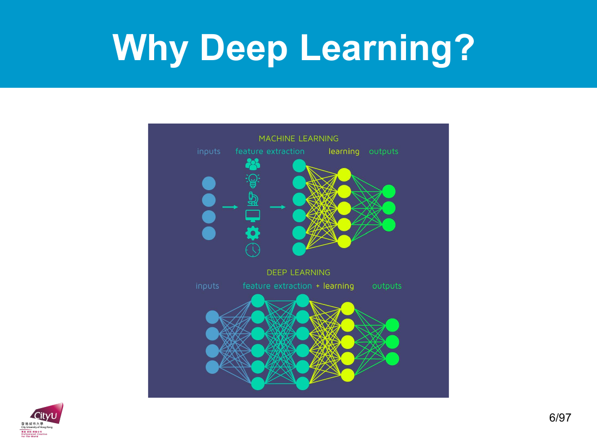

从上半图的 inputs 向右读：先用人为决定的特征提取（Feature extraction）把原始资料变成几个数，再交给 learning 模块。下半图把 feature extraction + learning 放进同一个可训练网络，前层与后层一起根据任务误差调整。

💡 例如识别衣服，上半路线可先人工计算轮廓和纹理；下半路线可以让网络从像素学习中间表示。图中的人、灯泡等小图标代表输入类型，不是一层的实际神经元。深度学习仍要选择数据、结构和目标；PCA 也能从数据学习方向，所以这张图是典型流程对比，不能读成传统方法都完全不会学习特征。

#### p.7 · Why Deep Learning?

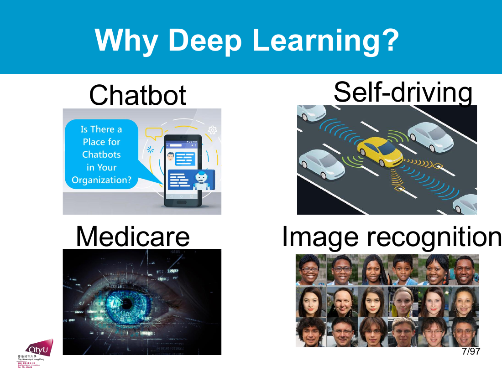

按四个标签区分输出。Chatbot 要接收消息并给回复，Self-driving 图画的是用周围物体和距离帮助驾驶判断，Medicare 是医疗用途示意，Image recognition 是图像识别。四张图没有给模型表现。

#### p.8 · Why Deep Learning and NN?

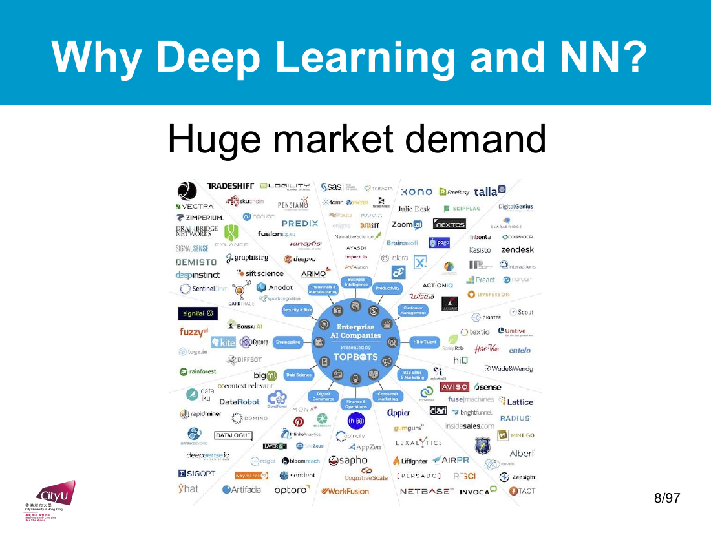

从中心 Enterprise AI Companies 顺着左侧的 Data Science（数据科学）分支，可看到该类示例公司的标志。别的分支包括 Customer Management（客户管理）和 Finance & Operations（财务与运营）。原图展示一份企业 AI 应用分类，课件未给市场规模的统计口径。

#### p.9 · Biological Background

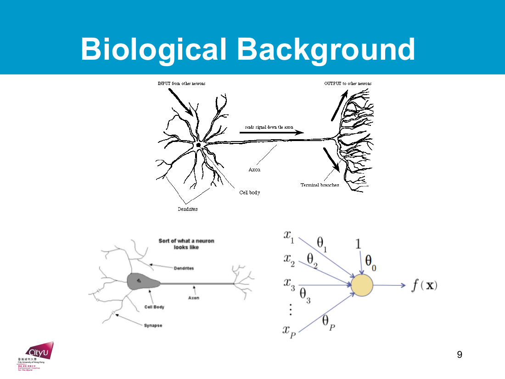

上图从左侧树突（Dendrites）收信号，经细胞体（Cell body），再沿轴突（Axon）送出。右下抽象图把每条支路写成输入 $x_j$ 与权重 $\theta_j$，恒为 1 的线携带偏置 $\theta_0$，最后输出 $f(x)$。

### 2.2 从神经元到逻辑网络（L10 p.10–19）

#### p.10 · Artificial Neuron

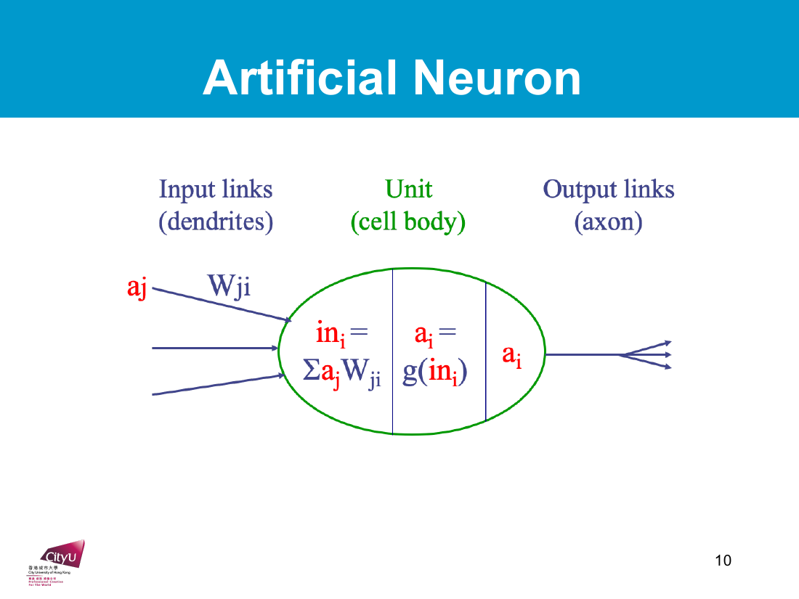

从椭圆左边看入线。上一单元传来的 $a_j$ 在边上乘 $W_{ji}$，在单元 $i$ 把各条乘积相加。

相加结果 $in_i$ 是下例的激活前分数 $z$。沿着绿色椭圆从左格走到中格，激活函数 $g$ 把它变成 $a_i$。最右格只把这个 $a_i$ 送出去；右边分成三根箭头，是把同一个数送给三个后续单元，每个接收端可以用自己的权重。原图的求和格没有单列偏置，下面的补充例把偏置 $b$ 单独写出来。

先做一个明确输入的例子。两个输入为 1 和 2，两个权重（Weight）为 0.5 和 −1，偏置（Bias）为 1。权重决定输入怎样影响分数，偏置让整体阈值能移动。

先乘再加，预激活分数 $z=1+0.5\times1-1\times2=-0.5$。接下来激活函数（Activation function）把这个分数转换成输出 $a=g(z)$。同一个分数若接不同激活，输出含义不同。

$$
z=b+\sum_{j=1}^{d}w_jx_j,\qquad a=g(z).
$$

下面逐行解释当前神经元公式中的对象和例值。

| 符号 | 当前意思 | 本例 |
|---|---|---|
| $x_j$ | 第 $j$ 项输入 | 1、2 |
| $w_j$ | 对应输入的权重 | 0.5、−1 |
| $b$ | 与输入无关的偏移 | 1 |
| $z$ | 激活前分数 | −0.5 |
| $a$ | 激活后输出 | 由函数决定 |

#### p.11 · Class I: Perceptron

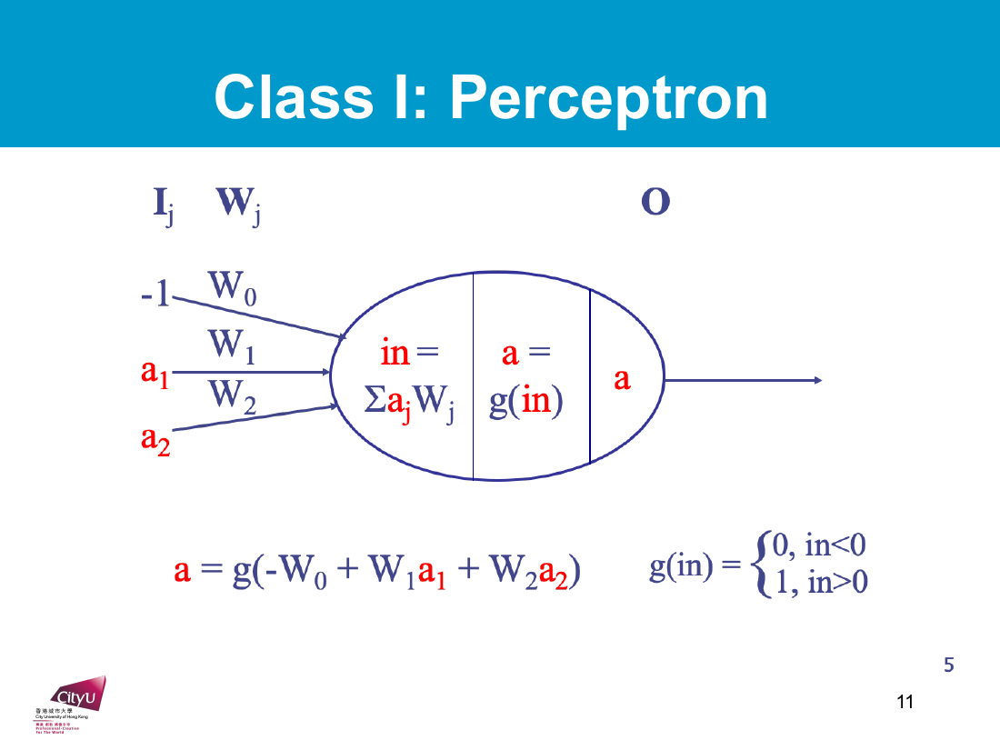

感知机（Perceptron）图的第一根线输入固定为 −1，所以偏移项是 $-W_0$。先算 $-W_0+W_1a_1+W_2a_2$，再按阶跃函数（Step function）把负数判 0、正数判 1。图漏写等于 0，本篇需要边界时约定非负判 1。

#### p.12 · Class II: Multi-layer Feed-forward Networks

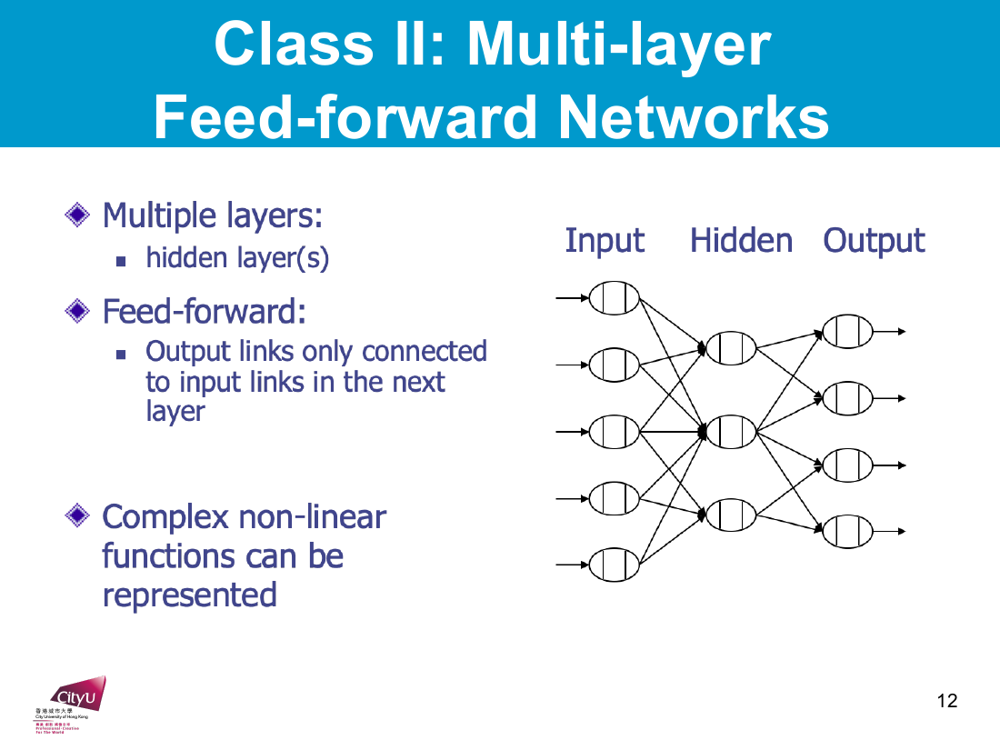

先按原图上方标签把椭圆分成三列：左边 Input 有 5 个节点，中间 Hidden 有 3 个，右边 Output 有 4 个。沿一条真实连线走：最上面的输入 → 最上面的隐藏节点 → 最上面的输出。这个输出还有一条入线来自中间那个隐藏节点；最下面的隐藏节点没有线接到这个输出。只沿图上接通的边传数。

每个隐藏节点按 p.10 的读法，给自己的每条入线乘一个权重，加总后做激活，再把得到的数送往下一列。隐藏层（Hidden layer）存放的就是这些中间结果。前馈（Feed-forward）表示箭头从左往右进入下一层，不从输出折返回来。原图未写权重值，也没有单独画偏置，p.22 再示范怎样计入。

左下说网络可以表示复杂的非线性关系，关键是节点可使用非线性激活。若各层只做乘加，就像把 $2x+1$ 再变成 $3(2x+1)+4=6x+7$，仍可写成一次乘加。下方旧源 L11 p.17 的 ReLU 折线例与 p.33 的 ReLU 曲线说明怎样改变这个结果。

#### 旧源 L11 p.17 · Universal Approximation Theorem

仅旧源含此页，保留为相邻机制补充，不冒充 L10 当前页。

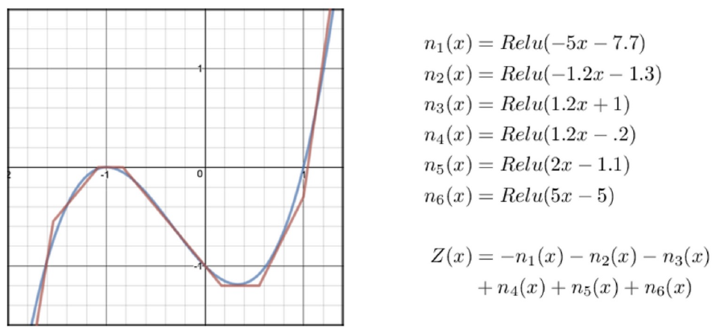

左图横轴是输入 $x$，蓝色光滑曲线是目标形状，红色折线是右侧六个 ReLU 单元（负分数置零，正分数保留）的有符号和。以 $x=0$ 为例，只有 $n_3$ 为 1，其他单元为 0，组合得 $Z(0)=-1$。不同单元在不同位置折转，叠起来便可逼近曲线。

旧源 L11 p.17 的通用逼近定理（Universal Approximation Theorem）说，在相应激活与条件下，有足够节点的一个隐藏层可把紧集上的连续函数逼近到任意精度。紧集可先理解为有界且含边界的输入范围。它是表达能力结论，不证明有限数据训练一定找到好权重，也不保证样本外预测；“一个隐藏层够表达”与“深层网络训练和表示更合适”并不矛盾。

#### p.13 · Use a trained model

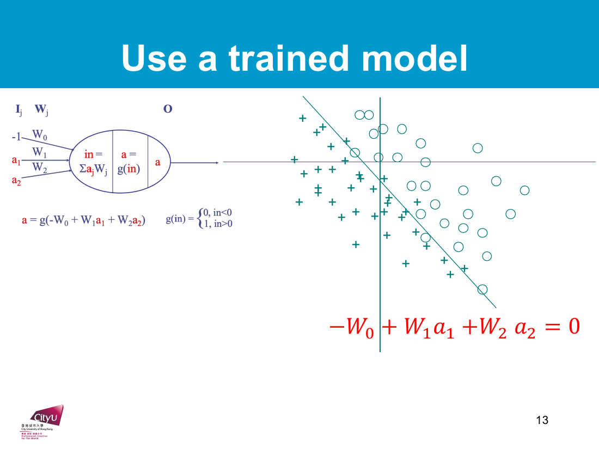

从左图的固定 −1、$a_1$、$a_2$ 三根入线算分数 $s=-W_0+W_1a_1+W_2a_2$。右图把 $a_1,a_2$ 当平面上的两个坐标，红式写出斜边界 $s=0$；十字坐标轴只是位置参照。边界两侧的分数符号相反，图用十字点和空心圆区分两组，未说明哪个符号对应 1。

用已训练的模型预测时，各 $W$ 固定。沿用 p.11 的 0/1 约定，先代新点坐标算 $s$，例如 $s=-0.5$ 就输出 0；若正好 $s=0$，按本篇约定输出 1。这里 −0.5 是说明操作的补充值，原图没给具体权重。

#### p.14 · Perceptron · Linear models

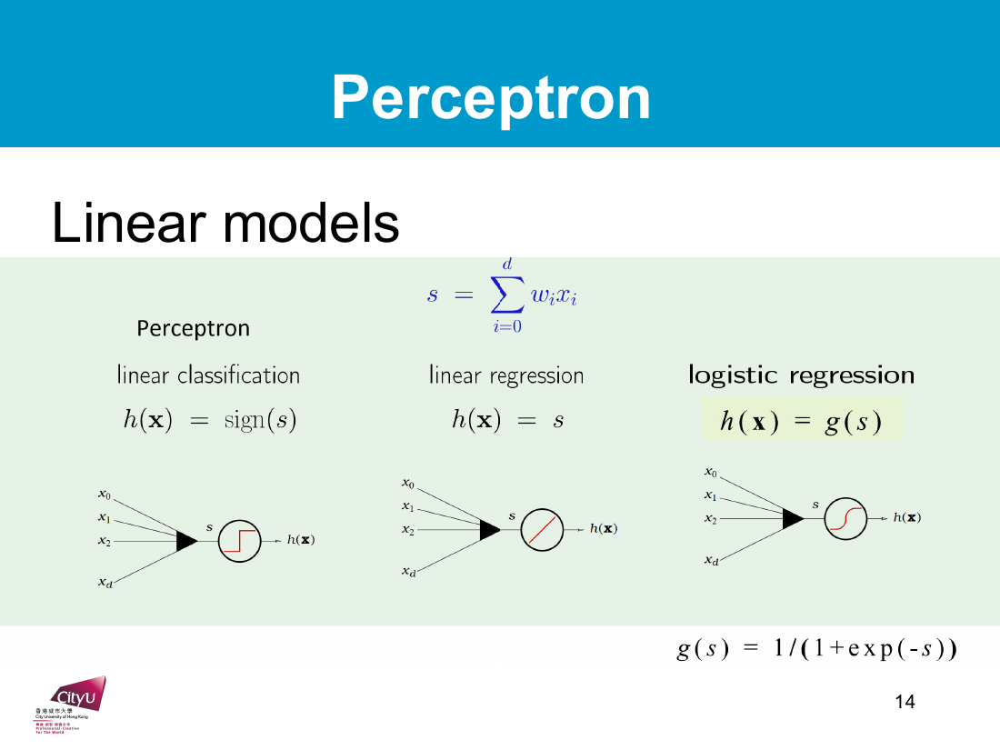

旧源 L11 p.13 的原问 “How to deal with this ‘s’?” 指先算出的加权分数 $s$。从左到右分别把它变为硬类别、连续预测值、0 到 1 之间的输出。中栏恒等函数的范围是全体实数，新源没有再印旧源的倒序范围。第一栏的类别标签应按模型约定，p.11 用 0/1。⚪ 英文参考作答 “Apply a step function for hard classification, keep the score for linear regression, or apply a sigmoid for a probability-based binary model.”

阶跃函数（Step function）按阈值输出类别。此处约定 $z\ge0$ 为 1、否则 0，原 p.11 未明确等于 0 的边界，应自行说明。恒等函数 $g(z)=z$ 保留连续分数，适合相应回归输出。Sigmoid 为 $\sigma(z)=1/(1+e^{-z})$，把实数压到 0 与 1 之间；$e$ 是约 2.718 的常数，指数表示连续的乘方关系。例中 $\sigma(-0.5)\approx0.3775$。

如果把 Sigmoid 输出解释为正类概率，常用 0.5 阈值分类；但输出位于 0–1 不自动保证概率已校准。旧源 L11 p.13 的输出范围曾有倒序与标签混乱，新源未保留该行；复习仍以函数和明确阈值为准。

#### p.15 · Perceptron · Logical functions · AND

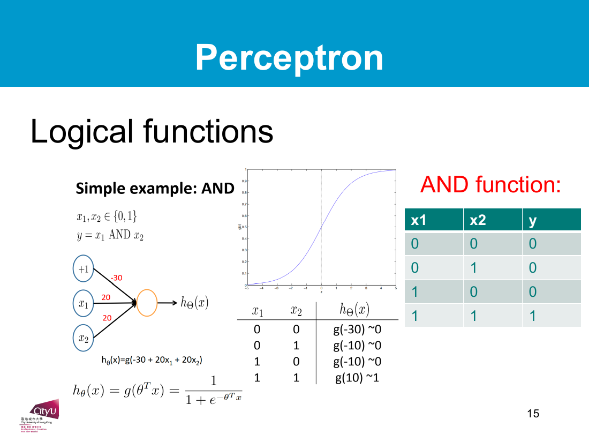

从原图的 $+1$ 边读出偏置 −30，两条输入边都乘 20。两项都为 1 才得到正分数。新源已去掉旧源 L11 p.14 那条指数漏负号的展开式；本页 $1/(1+e^{-\theta^T x})$ 与给定输出一致。

这组练习输入都是 0／1。AND 要两项都为 1 才输出 1；OR 只要任一项为 1 即输出 1。讲义给 AND 分数 $-30+20x_1+20x_2$，OR 分数 $-10+20x_1+20x_2$，都接 Sigmoid；以下按 0.5 阈值显示类别。

旧源 L11 p.14 的原问题（此处保留练习）：“How perceptron can achieve AND?” 中文：怎样让一个感知机实现“两个都满足”？直接答案是使用所给权重，使只有双 1 时分数为正。

| $x_1,x_2$ | AND 分数 | AND 类别 | OR 分数 | OR 类别 |
|---|---:|---:|---:|---:|
| 0,0 | −30 | 0 | −10 | 0 |
| 0,1 | −10 | 0 | 10 | 1 |
| 1,0 | −10 | 0 | 10 | 1 |
| 1,1 | 10 | 1 | 30 | 1 |

读最后一行：$-30+20+20=10$，Sigmoid 约 0.99995，阈值后为 1；它不是数学上精确等于 1。英文参考答案：“Use a bias of −30 and weights of 20 for both inputs. Only the input (1,1) produces a positive score, so thresholding the sigmoid output at 0.5 implements AND.”

#### p.16 · Example · OR function

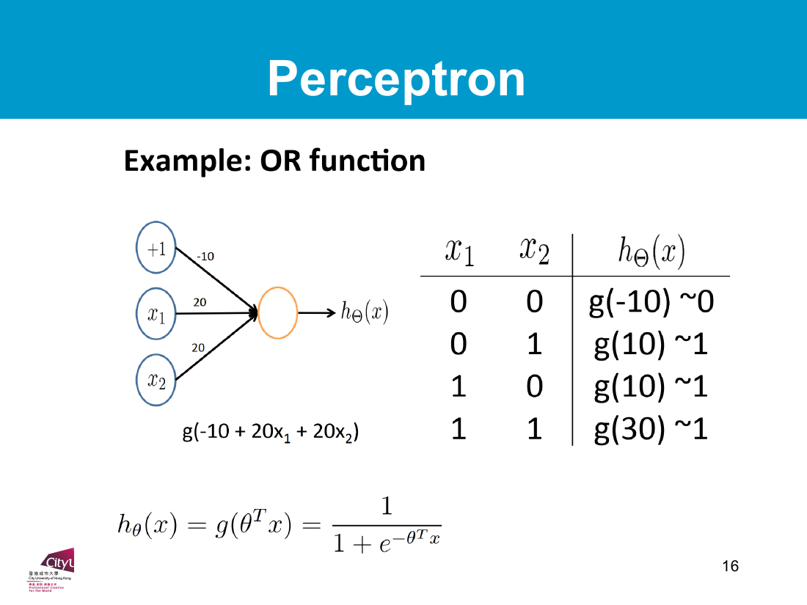

同 p.15 比较左图的 $+1$ 边，偏置从 −30 改为 −10。只有一项为 1 时，加 20 已能跨过 0，右表的 01 和 10 因此都接近 1。

[[#p.15 · Perceptron · Logical functions · AND|p.15 手算表]]的 OR 列列全了四个输入。试代 00 得 −10，只有这一行在 0.5 以下。

#### p.17 · A complex case · XOR 与 XNOR

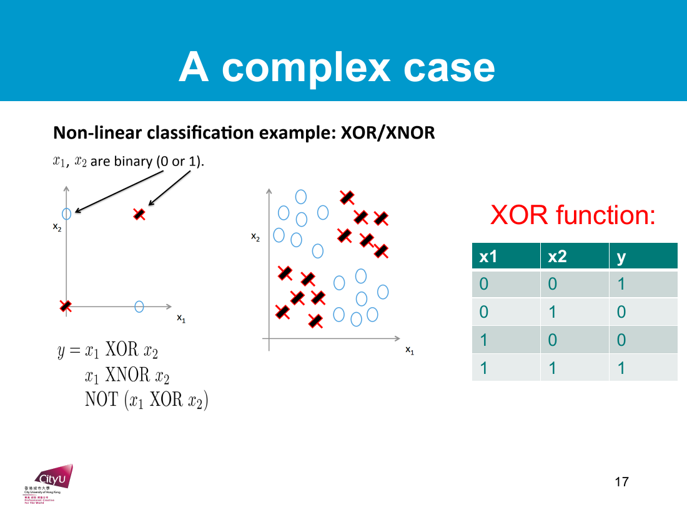

左图四角是四种 0/1 输入，红叉在同值的两个对角点，空心圆在异值的两个对角点。右图把相同困难画成两组交错点。新源右表的 XOR 标签仍不符合真值表，按真值表把左图的红叉理解为 XNOR 的正类。

新源右表仍标 “XOR function” 却给 00→1、01→0、10→0、11→1，实际为 XNOR。旧源 L11 p.18 另外问 “Why single layer fails?”，并把 same/different 的两段名称对调；新源删去了这两个文字解释，本处保留问题用于理解线性边界。

标准 XOR 是不同为 1，标准 XNOR 是相同为 1。对 XOR 的四个角，两个正类位于对角，无法用一条直线同时把它们与另外两角分开。按本篇非负判为1的约定，若正类 10、01 的分数都大于或等于 0，两分数相加为 $2b+w_1+w_2\ge0$；负类 00、11 的分数若都小于 0，同样相加却要求 $2b+w_1+w_2<0$，冲突。同一表达式不能同时非负且严格小于零，因此也覆盖边界情况。

英文参考答案：“A single linear threshold cannot separate the opposite positive corners from the opposite negative corners. A hidden layer can combine intermediate regions to represent XOR or XNOR.”

#### p.18 · A complex case · 分开算三种逻辑

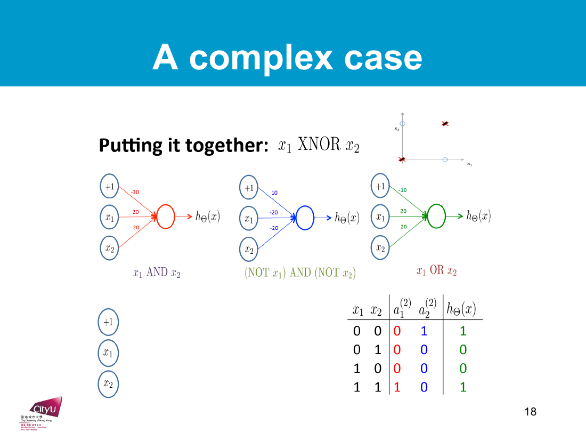

先沿红、蓝、绿三支读图。红支 AND 查双 1，蓝支查双 0（两个 NOT 再 AND，即 NOR），绿支查两个隐藏输出中是否至少一项为 1。把红、蓝两个结果交给绿支，右下表只在 00 与 11 给 1。

#### p.19 · A complex case · 接成一个网络

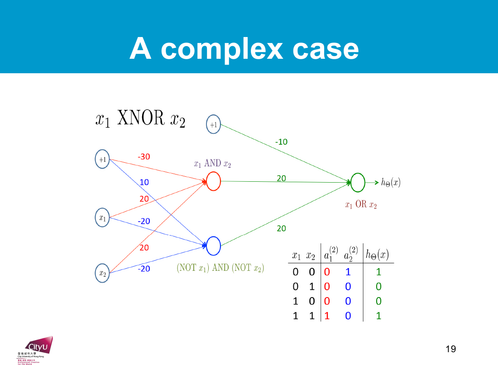

这一页把三套运算接起来。红线与蓝线各汇到一个隐藏单元，绿线把这两个输出各乘 20，再加来自上方独立 $+1$ 的 −10。沿 00 输入追踪，蓝单元被激活，绿单元因此输出接近 1。

p.18–19 实际把 AND、NOR 再 OR，算的是 **XNOR**。NOR 是“两个都不是 1”：分数 $10-20x_1-20x_2$。保留这套原网络，不能为修标题偷偷改权重。

$$
h_1=\sigma(-30+20x_1+20x_2),\quad
h_2=\sigma(10-20x_1-20x_2),\quad
\widehat y=\sigma(-10+20h_1+20h_2).
$$

下面每行是一种完整输入，隐藏列按逻辑近似显示两个中间结果。

| 输入 | 隐藏层的逻辑近似 $h_1,h_2$ | 最终阈值类别 |
|---|---|---:|
| 0,0 | 0,1 | 1 |
| 0,1 | 0,0 | 0 |
| 1,0 | 0,0 | 0 |
| 1,1 | 1,0 | 1 |

例如 00 先由 NOR 检出，再使输出 OR 为真。变成标准 XOR 可取最终类别的逻辑补，但不把这个补充当成 p.19 原网络。原图的连续值只是接近逻辑 0／1，表为阈值近似。

### 2.3 多层网络及矩阵读法（L10 p.20–29）

#### p.20 · A more complex case – multi output

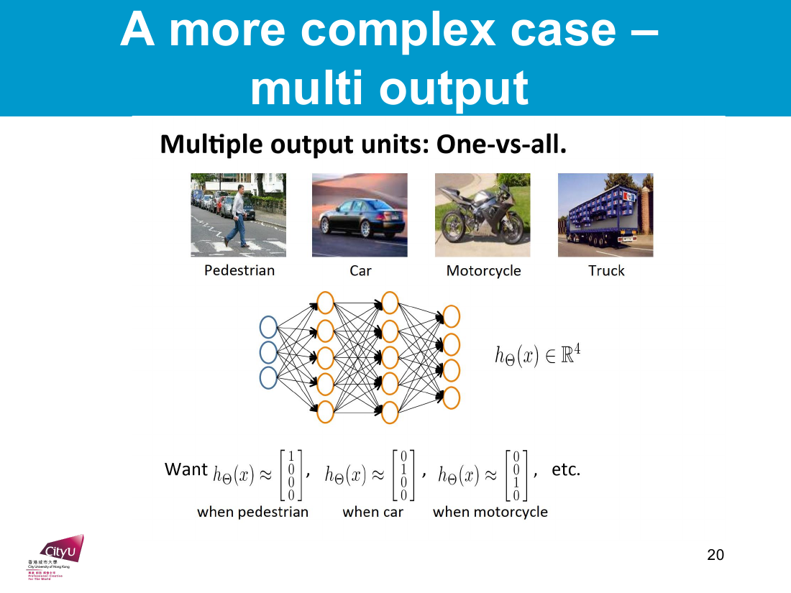

上方照片顺序就是右端四个输出的约定顺序。行人的目标写成 $(1,0,0,0)^\top$，汽车把 1 放到第二格。独热向量（One-hot vector）中只有真类的格子是 1。原图标 one-vs-all，含义是逐类对其余类看待，输出之间是否归一化取决于输出层设计。

#### p.21 · Summary of implementation

先定输入和目标，再定隐藏层数、宽度及激活。训练时再从数据估计层间连接参数。若所选激活自身含可训练参数，仍需在训练中估计。神经元数量和训练样本数量分别描述网络和数据。

#### p.22 · ANN Model Representation

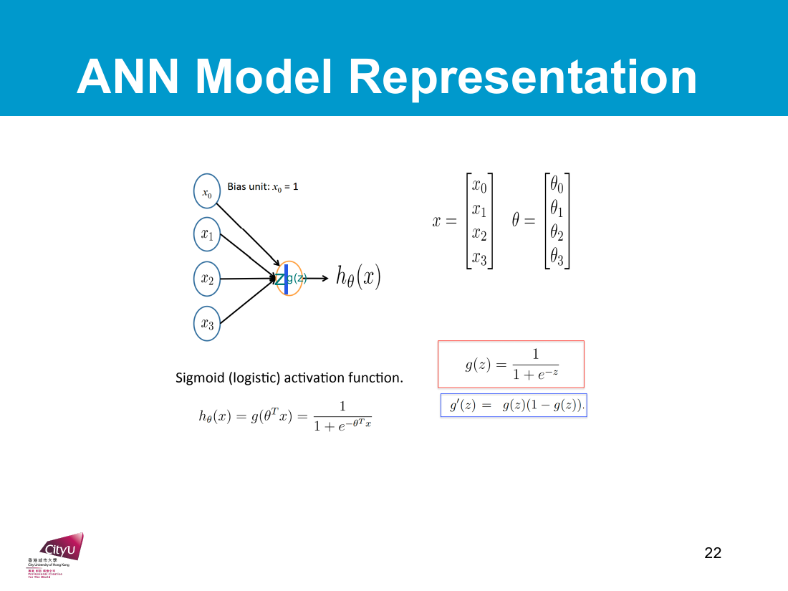

图左 $x_0=1$，其余 $x_1,x_2,x_3$ 是真实特征。右侧两列按同一顺序逐项乘加即 $\theta^\top x$，第零项就贡献 $\theta_0$。与 p.11 的 $-W_0$ 比较，这里用固定 1，偏置正负已包含在 $\theta_0$。

右下额外给出导数 $g'(z)=g(z)(1-g(z))$，它表示分数微变时输出的变化比例；在 p.31 用具体数算这个比例，训练时再用来传递误差信号。

#### p.23 · Model Representation · 红线是哪条边

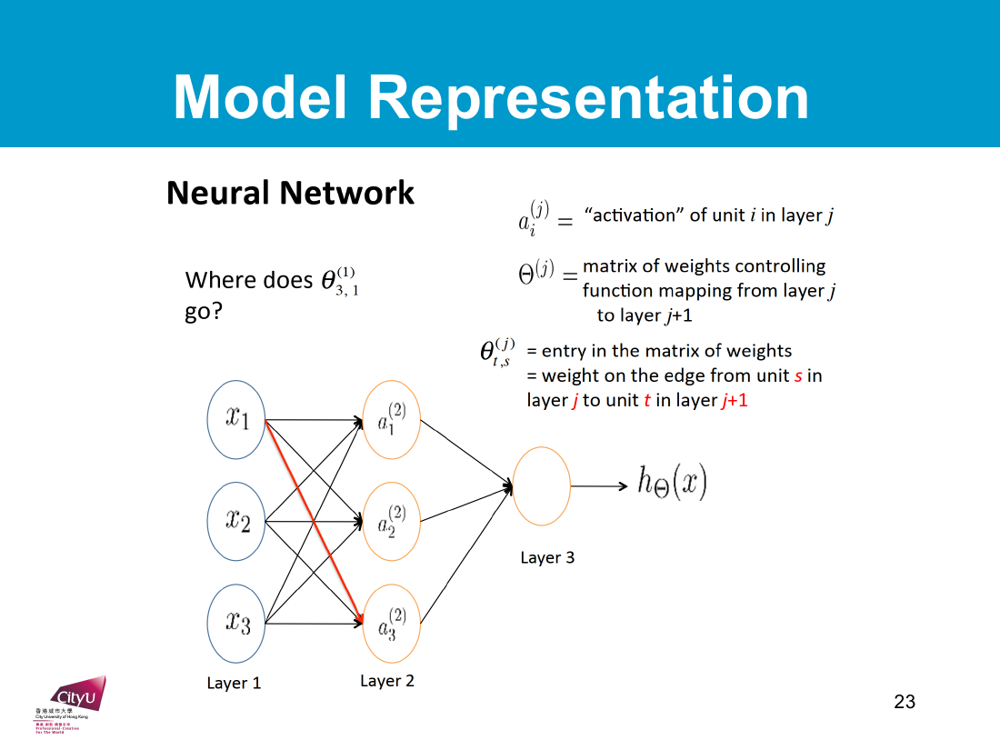

⚪ 原问 “Where does $\theta^{(1)}_{3,1}$ go?” 中文是找出这一项对应的边。沿左侧第一层 $x_1$ 到第二层第 3 个橙圈 $a^{(2)}_3$。上标 1 指出发层，下标按「终点，起点」读，图中红线正好标出此边。英文参考 “It is the weight from unit 1 in layer 1 to unit 3 in layer 2.” 新源图只画三个实际特征圈，没有单独画 $x_0$；偏置的代数写法在 p.22 与 p.25。

红线对应第 1 层到第 2 层的权重矩阵 $\Theta^{(1)}$ 中，第 2 层第 3 个接收节点（第三个橙圈）所用的那一行、第 1 个特征所用的那一列（偏置另记为第 0 项）。p.10 的 $W_{ji}$ 下标先写起点、后写终点；本页的 $\theta^{(j)}_{t,s}$ 则先写终点、后写起点。

沿这条边进入橙圈的是 $\theta^{(1)}_{3,1}x_1$；另外两根黑线各带来 $x_2,x_3$ 的一项。把三项和偏置相加，再做激活，才得到整个橙圈的结果 $a_3^{(2)}$。

#### p.24 · Model Representation · 读输出节点

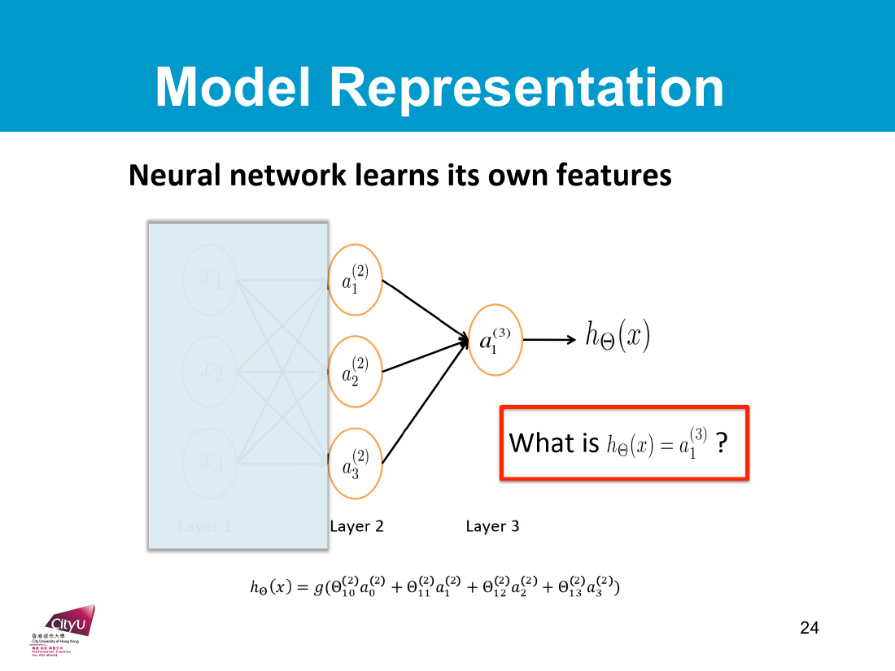

浅蓝覆盖第一层，强调计算最后一个节点时可把第二层的三个激活当成新特征。从这三个橙圈的入边数起，再加上公式里的偏置边 $a_0^{(2)}=1$。

⚪ 原 p.24 问：“What is $h_\theta(x)=a_1^{(3)}$?” 中文是输出等于第三层第一个单元时怎样展开。直接答案是把第三层的输入写清：$a_1^{(3)}=g(\Theta_{10}^{(2)}+\Theta_{11}^{(2)}a_1^{(2)}+\Theta_{12}^{(2)}a_2^{(2)}+\Theta_{13}^{(2)}a_3^{(2)})$，各个二层激活又由第一层输入计算。英文参考：“The final output is the activation of unit 1 in layer 3, computed from a bias and a weighted sum of the preceding layer's activations.”

#### p.25 · Model Representation · 权重矩阵的尺寸

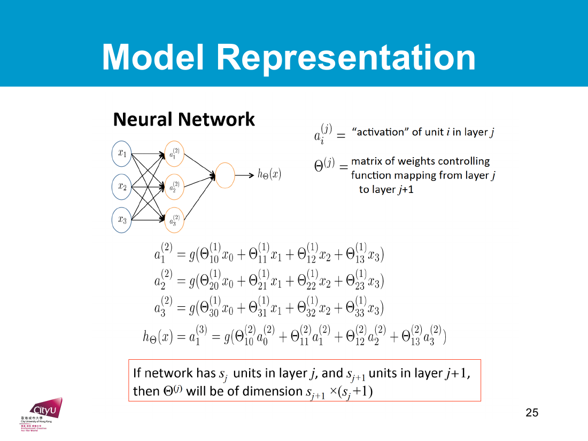

比 p.24 多写出了第二层三个神经元各自的公式。先看每行开头带下标 0 的项，再看三个特征项。把同一个接收节点的系数放在一行，这张图的第一层到第二层矩阵就是 3 行 4 列，最后一层的矩阵是 1 行 4 列。

p.23–27 的 $a_i^{(j)}$ 是第 $j$ 层第 $i$ 个单元输出；$\Theta_{ki}^{(j)}$ 是从第 $j$ 层单元 $i$ 连到下层单元 $k$ 的权重。

若本层有 $s_j$ 个真实单元，额外加一个恒为 1 的偏置输入，下层有 $s_{j+1}$ 个单元，则权重矩阵尺寸为 $s_{j+1}\times(s_j+1)$。

多出的 1 是偏置列，不是多出一个真实输入特征。

#### p.26 · Model Representation · 批量算隐藏层

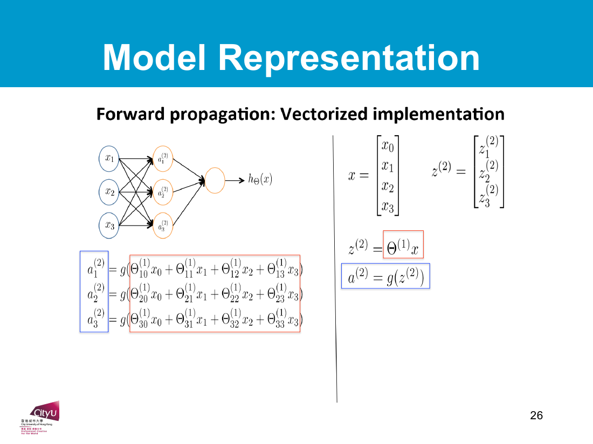

红框的三个乘加合为 $\Theta^{(1)}x$，依次产出 $z_1^{(2)},z_2^{(2)},z_3^{(2)}$。蓝框才对三个分数分别做 $g$。向量化（Vectorization）只是把等价计算集中写出来，输入列中保留了偏置位置。

#### p.27 · Model Representation · 补偏置再算输出

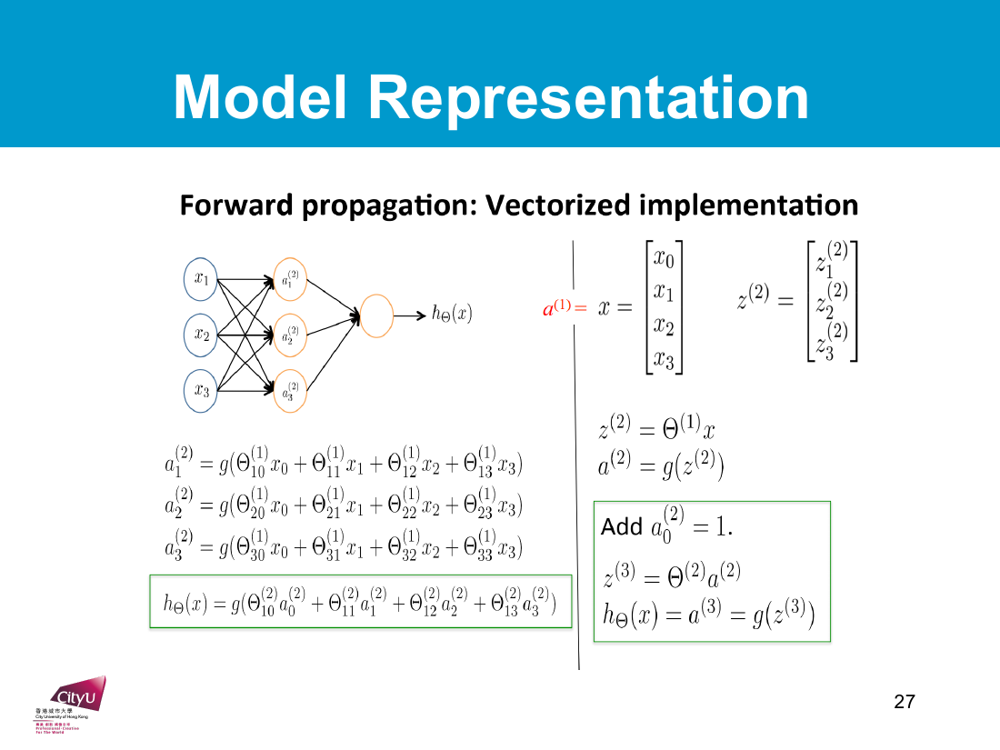

新出现的绿框做第二次矩阵乘。取 p.26 的三项激活，加一个恒为 1 的 $a_0^{(2)}$，再用 $\Theta^{(2)}$ 得 $z^{(3)}$，最后激活成 $h_\Theta(x)$。

**笔记补充 · 逐步手算一个小网络**

图从左到右读，每条边表示乘一个可训练权重，圆框内先加总再激活。这里是补充小网络，由两个输入、两个隐藏单元和一个输出组成。

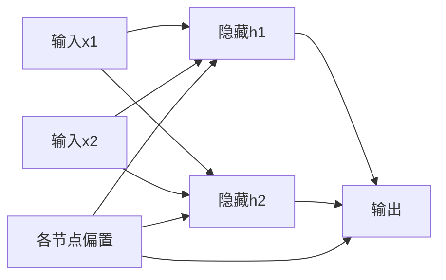

💡 完整前向例：输入 $x=(1,2)^\top$，第一隐藏单元权重为 $(1,-1)$、偏置 0，第二个为 $(0.5,1)$、偏置 −1。分别得到分数 −1、1.5；这里的 ReLU 保留正数、把负数改成 0，即 $g(z)=\max(0,z)$；p.30–34 再比较其他激活。因此激活后为 0、1.5。输出按 $2h_1+h_2+0.5$ 得到 2。这是回归分数，不擅自当概率。

把两行权重记在同一矩阵，只是同时执行刚才两次乘加：

$$
W=\begin{bmatrix}1&-1\\0.5&1\end{bmatrix},\quad
b=\begin{bmatrix}0\\-1\end{bmatrix},\quad
z=Wx+b=\begin{bmatrix}-1\\1.5\end{bmatrix}.
$$

矩阵乘法的每行与输入逐项相乘后求和，不是把同位置的两个二维表逐格相乘。本例 $W$ 为 2×2，输入为 2×1，结果为 2×1，维度中的内侧两个 2 必须一致。

#### p.28 · NN with 2 hidden layers

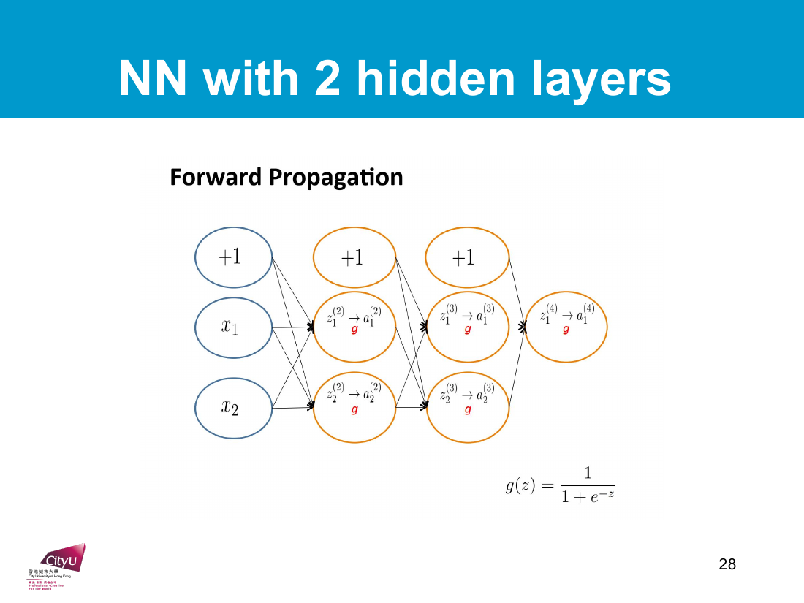

数左到右的实质计算列。第一列是两个输入加偏置，第二、第三列各有两个隐藏单元加各自的偏置输入，第四列给一个输出。箭头标出先线性乘加、再激活。第二隐藏层重复同一类操作，用它自己的权重接收第一隐藏层输出。

#### p.29 · NN learn complex features

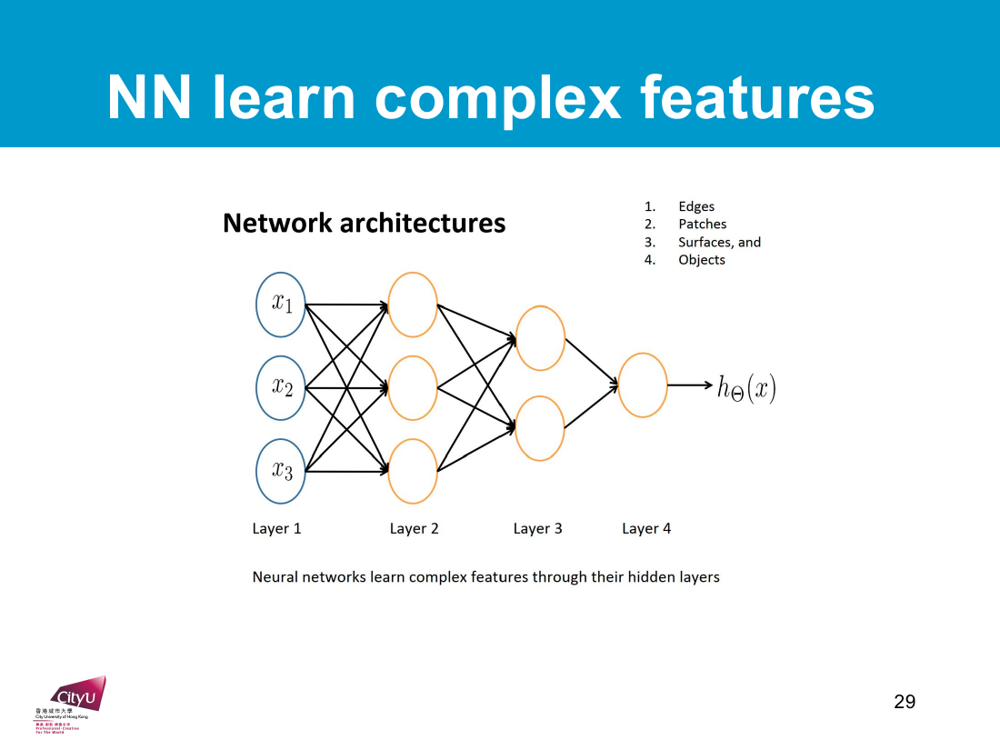

先看左下网络：第 1 层是三个蓝圈 $x_1,x_2,x_3$，第 2 层有三个橙圈，第 3 层有两个，第 4 层有一个。从 $x_1$ 沿黑箭头走过第 2 层最上面的橙圈、第 3 层最上面的橙圈，最后到第 4 层，右侧的 $h_\Theta(x)$ 就是这个网络的输出。每到一个橙圈，都把它收到的各条入线加权组合再做激活；它收到的是上一层算出的数，因此较后面的层可以继续组合前面学到的表示。

新源右上只列四层表示名称；旧源 L11 p.30 还给另一幅猫图，保留如下。

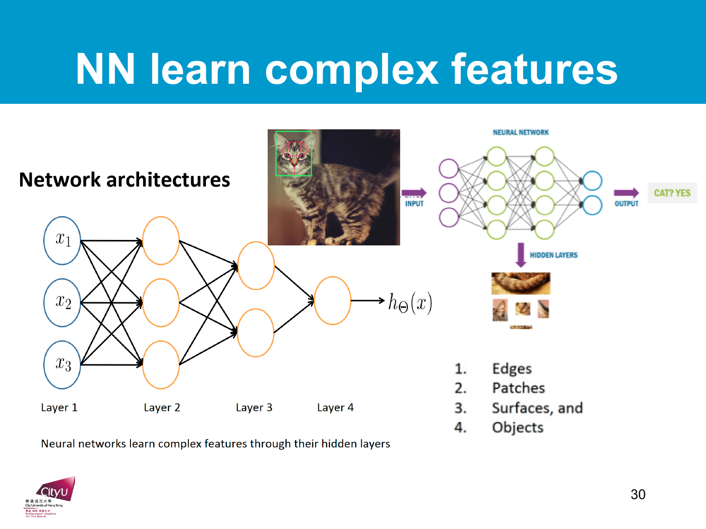

沿旧图紫色 INPUT 箭头从猫的照片进入网络；中间绿圈属于隐藏层，向下的 HIDDEN LAYERS 箭头用局部图块帮助理解中间表示；最右 OUTPUT 箭头给出 “CAT? YES”。课件列的边缘（Edges）、小块（Patches）、表面（Surfaces）到物体（Objects），可想成先找明暗边界，再把相邻边界组合成耳朵轮廓之类的形状，最后用这些线索判断整张照片。左右两图的节点数不对应；右图没有指定某个圈一定负责认耳朵，实际学到的表示由数据和任务决定。

### 2.4 激活、目标与训练（L10 p.30–47）

#### p.30 · Activation Function

本页只给激活函数的文字说明：它把当前神经元收到的分数转成送往下一层的输出。沿用 p.10 的分数 $z=-0.5$，Sigmoid 给约 0.3775，ReLU 给 0；不同函数使同一分数产生不同表示。

旧源 L11 p.31 的函数形状图保留为补充：

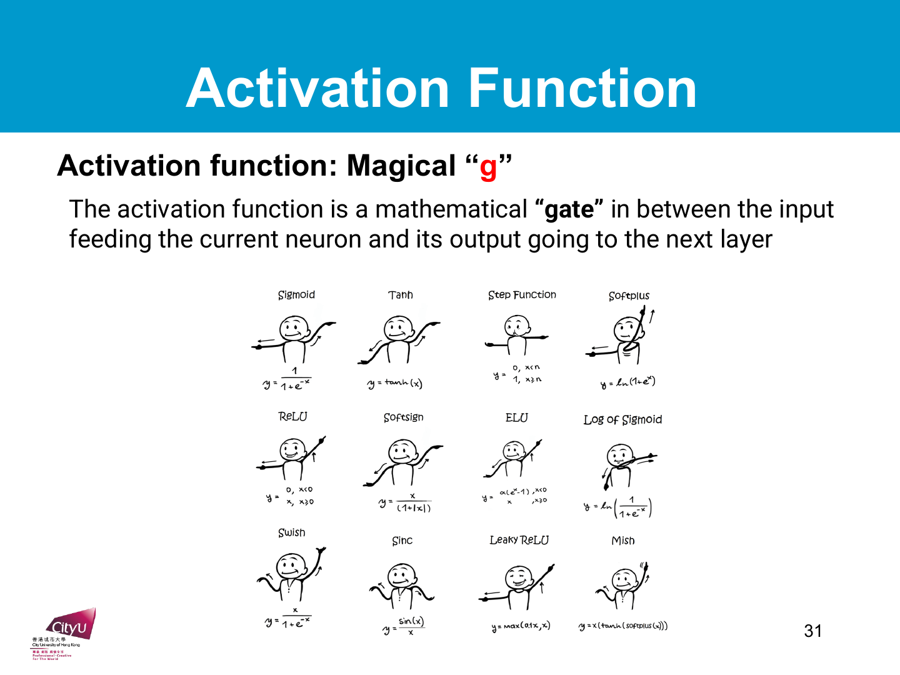

先找 Step Function、Sigmoid、ReLU 三格，横向为输入分数、纵向为输出；前者跨阈值跳变，Sigmoid 平滑，ReLU 负侧为零、正侧上升。其余格为背景候选，本讲不要求逐一计算。仅乘加的多层可合成一次乘加，须有合适非线性才能改变表达能力。

#### p.31 · Sigmoid Activation Function

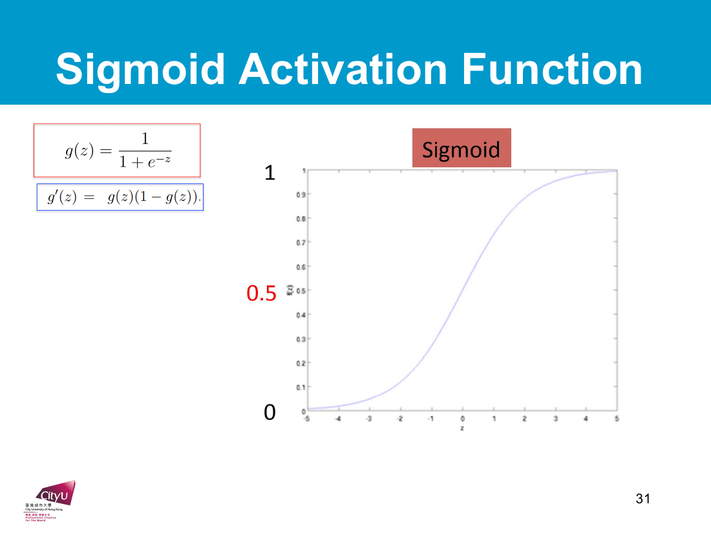

原图横轴是输入分数，纵轴是 $g(z)$。沿中间红标 0.5 找到 $z=0$，再向两端看曲线如何变平。实际有限输入只会得到严格介于 0 与 1 的值。

局部斜率表示输入微小改变时输出怎样改变，下一节训练会用它把误差往回传。课件给出 Sigmoid 的导数：

$$
\sigma'(z)=\sigma(z)(1-\sigma(z)).
$$

Sigmoid 输出为 0.5 时斜率为 0.25；输出靠近 0.99 时为 $0.99\times0.01=0.0099$。输入改变同样一点，饱和端输出改变得更少。

#### p.32 · Tangent activation function

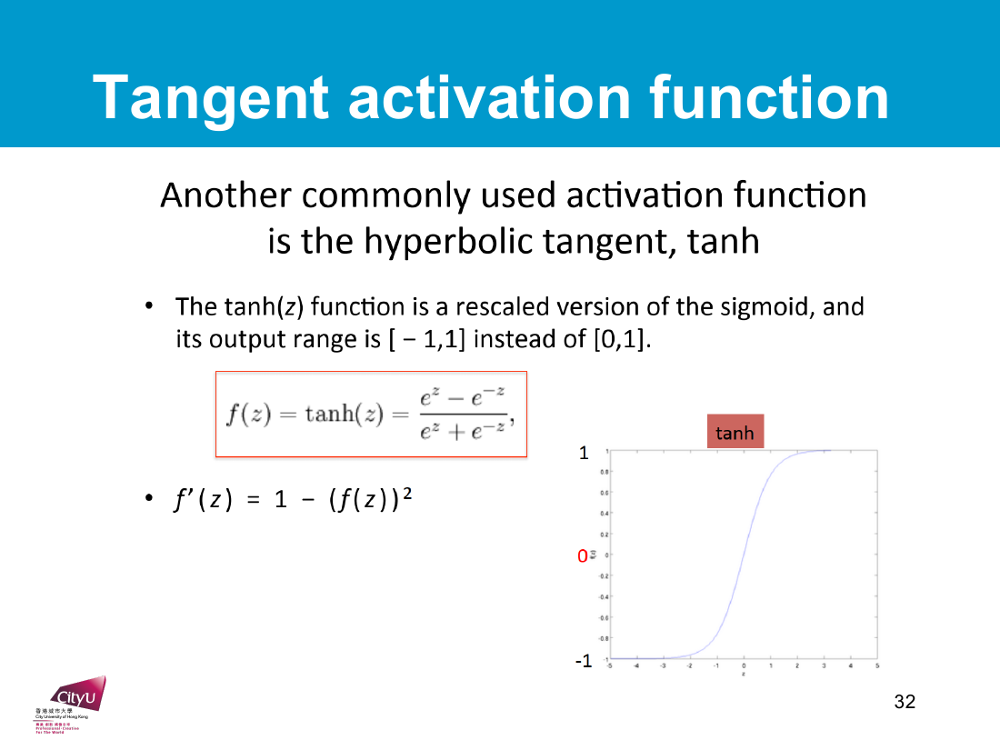

tanh 的中点从 Sigmoid 的 0.5 改成 0，纵轴两端趋向 −1、1，有限输入达不到端点。它可把负分数保留为负输出，后面会用于 RNN 状态和 LSTM 候选记忆。

$$
\tanh'(z)=1-\tanh^2(z).
$$

tanh 输出为 0 时斜率为 1，输出为 0.9 时为 $1-0.9^2=0.19$。这把“曲线变平”接到反向信号乘以较小因子的机制，不能只看函数名字说会遗忘。

#### p.33 · ReLU activation function

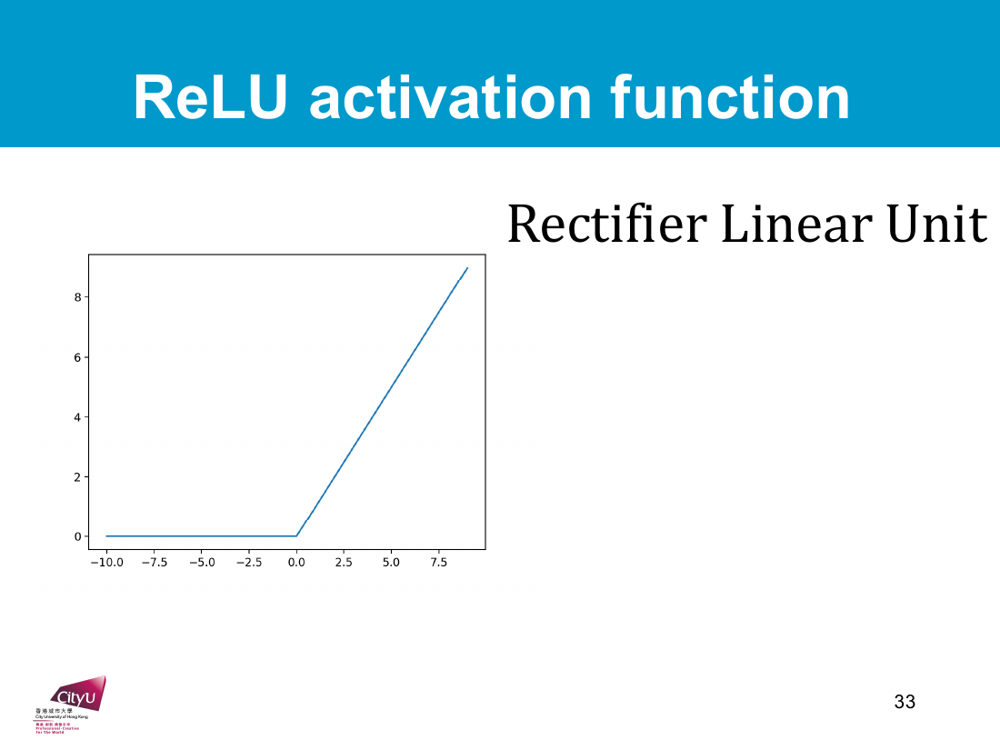

从原图的折角 $z=0$ 看两侧。左侧水平，所有负输入均变成 0，所以一部分激活会刚好为零，称稀疏表示（Sparse representation）。右侧斜率 1，正数原样通过。折角没有普通导数，实现会约定该点的梯度值。

训练时 ReLU 正侧可传递局部梯度，负侧的局部梯度为 0。如果某个单元在所有训练输入上长期落在负侧，它可能失活。

#### p.34 · Softmax Activation

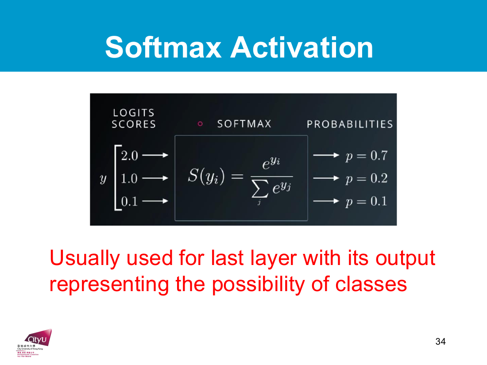

左边三项是分数（Logits），中间指数归一化，右边才是总和为 1 的比例。用原图分数 2.0、1.0、0.1 实算约得 0.659、0.242、0.099，图中 0.7、0.2、0.1 是粗略示意。旧源 L11 p.35 下方还有 One-vs-all 例图，新源删去了；“每类分别与其余类比较”与 Softmax 的整体归一化要分清。上方 Softmax 将全部类别分数一起归一化，产生总和为 1 的一组输出。p.36 的独立 Sigmoid 输出各自计算概率，通常没有这条总和约束。

Softmax 对第 $k$ 类的分数 $z_k$ 先取指数，再除以各类指数总和：

$$
p_k=\frac{e^{z_k}}{\sum_{j=1}^{K}e^{z_j}}.
$$

这里 $K$ 是类别数，$p_k$ 是该类输出比例。若三个分数为 $\log2,0,0$，指数为 2、1、1，总和 4，输出为 0.5、0.25、0.25。只看第一分数而不看其余分数，无法确定第一类概率。互斥多类可用 Softmax；多个标签可同时为真时，通常需要分别建概率，不能机械要求它们和为 1。

**用相同的分数比较四种激活**

下表以同一分数 $z=-1$ 或 0、1 说明四种常见函数。对数／指数都采用自然底数，数值为笔记补充。

| 函数 | 定义／范围 | 具体读法 |
|---|---|---|
| Sigmoid | $1/(1+e^{-z})$，(0,1) | −1、0、1 对应约 0.269、0.5、0.731 |
| 双曲正切 tanh | $(e^z-e^{-z})/(e^z+e^{-z})$，(−1,1) | 0 输出 0；−1 约 −0.762 |
| ReLU | $\max(0,z)$ | −1 变 0，1 保持 1 |
| Softmax | 见上式，整组和为 1 | 把多个类别分数变为互相竞争的比例 |

#### p.35 · Model Training

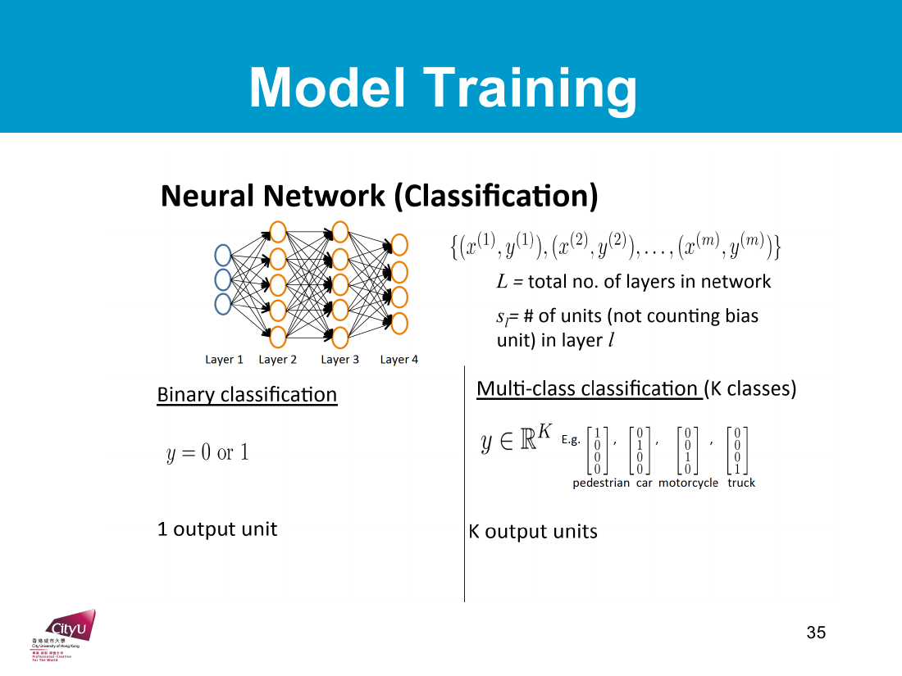

对照下方两栏。二分类可只输出正类的一个分数或概率，标签用 0 或 1。互斥的 $K$ 类可用 $K$ 个输出，四类示意就有四个标签位置。页中的 $L$ 是总层数，$s_l$ 是第 $l$ 层真实单元数，偏置位不计。

训练样本有输入 $x$ 和真实标签 $y$。损失函数（Loss function）把预测与真实之间的不符合变成一个数，训练要减小它。p.35 区分二分类的一输出和多类的 $K$ 输出，标签形式要与输出含义匹配。

#### p.36 · Cost Function (Objective)

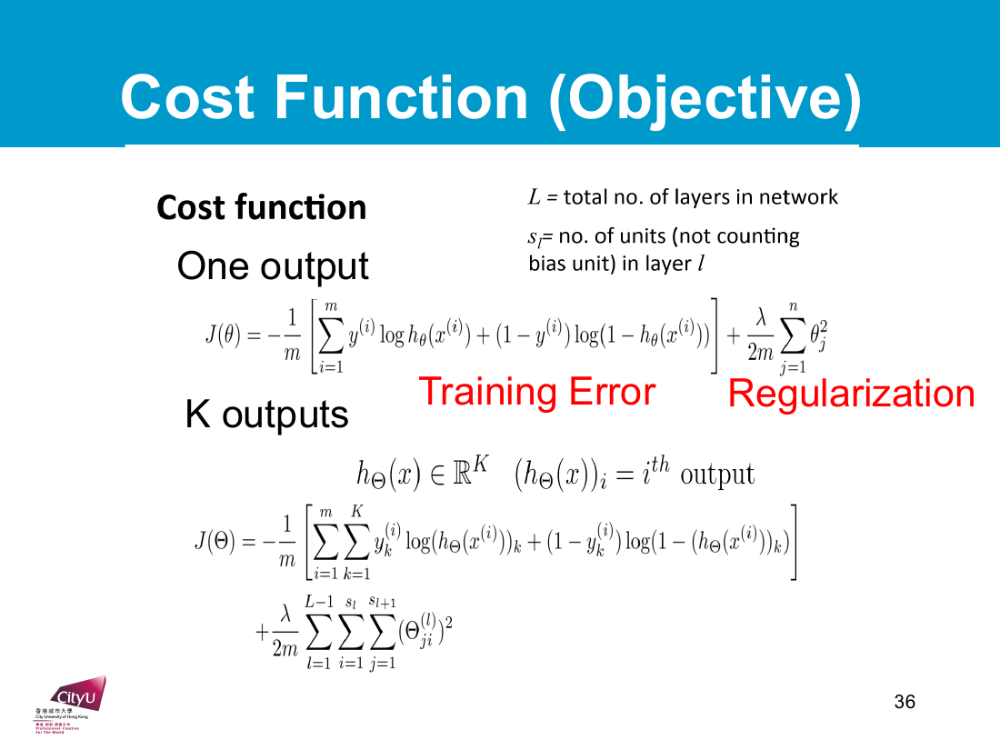

先看红标 Training Error 与 Regularization。前者惩罚预测偏离标签，后者按权重平方增加成本。下半部把单输出的损失扩到 $K$ 个独立 Sigmoid 输出，需与 p.34 的互斥 Softmax 区分。

p.36 单输出使用二元交叉熵（Binary cross-entropy）。$m$ 为训练记录数，$p_i$ 是第 $i$ 条正类预测概率，$y_i$ 为 0 或 1：

$$
J=-\frac1m\sum_{i=1}^{m}[y_i\log p_i+(1-y_i)\log(1-p_i)]
+\frac{\lambda}{2m}\sum_j w_j^2.
$$

对数 $\log$ 是指数的反运算，$\log(e^u)=u$。真实为 1 时，单条误差只剩 $-\log p$；$p=0.8$ 得约 0.2231，$p=0.2$ 得约 1.6094。更自信地报错会受到更大损失。训练不是只看最后阈值类别对不对，也看预测概率。

后半项为 L2 正则化（Regularization）：权重平方和越大，惩罚越大；$\lambda$ 控制对拟合和权重大小的取舍，通常不把偏置计入同一项。若 $m=2,\lambda=1$，两个被惩罚权重为 1、2，正则项为 $(1^2+2^2)/4=1.25$。这会改变训练目标，并不保证完全消除过拟合。

p.36 的 $K$ 输出公式，是把每个输出的二元交叉熵对 $k$ 再求和，并对所有层的非偏置连接权重求平方和。它与多独立 Sigmoid 输出相容。**不能把这条 BCE 求和式不加说明地叫作 Softmax 多类损失**；Softmax 配 one-hot 标签的常用式为 $-\sum_k y_k\log p_k$。本篇同时保留来源两种输出语境，避免混用。

#### p.37 · Back propagation

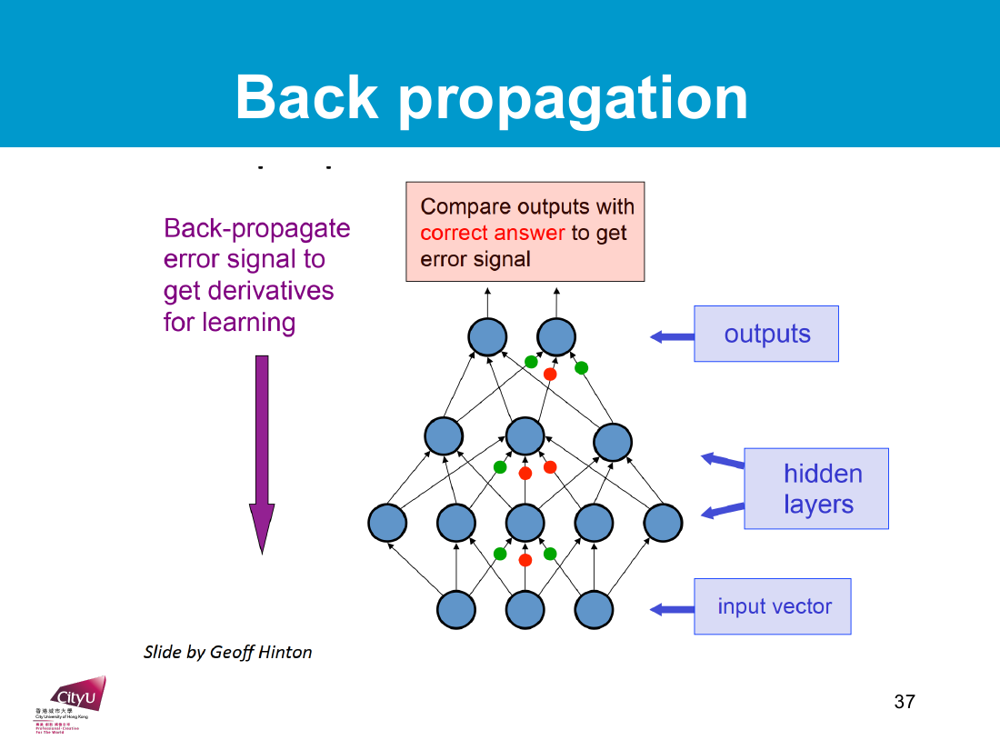

按图从底部输入沿黑色连接到顶部输出，再把预测与真实标签比较，沿紫箭头往回算各边权重的导数。倒着传的是损失对中间量的变化率，更新参数是接下来的独立动作。

先理解斜率：若把某个权重加一个很小的量，损失会改变多少？损失改变量除以权重改变量，就是局部变化率的近似；步长足够小时，对应导数。偏导数（Partial derivative）指只改一个参数，先固定其他参数；梯度（Gradient）把所有参数的这些变化率排成向量。

反向传播（Backpropagation）利用链式法则高效计算这些导数：若参数先改变中间量，中间量再改变损失，总变化率把沿路各段的局部变化率相乘。多条路径通向同一个参数时，把各条路径贡献相加；它是算梯度的方法，梯度下降才是用梯度更新参数的方法。

#### p.38 · Gradient Descent · 多参数时怎么办

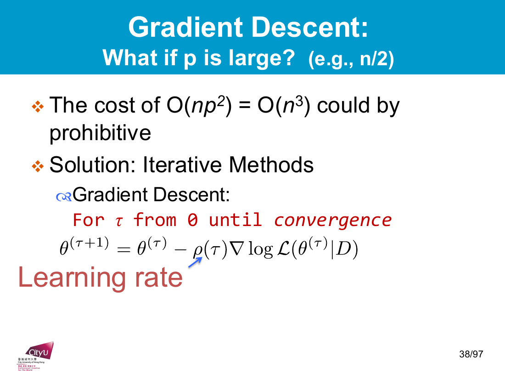

原问 “What if p is large? (e.g., n/2)” 问本页字母 $p$ 所表示的规模变大时怎样处理。原件没有定义 $n$、$p$ 分别数什么，也未给所指直接求解算法，所以两项具体对象保持未知。

💡 先学会读本页的运算增长式。把它当两个正的规模数，按原例代入 $p=n/2$：

$$
np^2=n(n/2)^2=n^3/4.
$$

大 O 记号（Big-O notation）在此用来比较规模增大时的主导增长量级，固定常数 $1/4$ 不改变立方级，所以写为 $O(n^3)$。它不是精确运行秒数，也不是说 $np^2$ 在所有 $p$ 下都等于 $n^3$。

在同一关系 $p=n/2$ 下，若 $n$ 翻倍，$p$ 也翻倍，该运算主项变为原来的约 8 倍。例如 $n=4,p=2$ 时该项为 16，改为 $n=8,p=4$ 时为 128。若固定 $p$ 只把 $n$ 翻倍，就只翻倍；因此先讲清哪项跟着改变，才能比较。

本页建议用迭代法，逐次计算梯度并修改参数；它没有给特定算法的完整成本，不能据这行式子声称所有神经网络训练都固定需要立方时间。

原图把更新写为减去 $\nabla\log\mathcal L$，而下一页纵轴是 $-\log\mathcal L$。若 $\mathcal L$ 表示通常要最大化的似然，应沿正的 $\nabla\log\mathcal L$，等价于沿负的 $\nabla(-\log\mathcal L)$。

本篇统一用“减小损失 $J$”的写法，避免符号歧义。$\tau$ 是迭代编号，$\rho(\tau)$ 是本轮学习率，$D$ 是训练资料。

⚪ 英文参考答案：“Use an iterative method to reduce the chosen loss. Compute parameter gradients efficiently and update them with a suitable learning rate; the sign must match whether the objective is a loss to minimize or a likelihood to maximize.”

#### p.39 · Gradient Descent · 反复更新

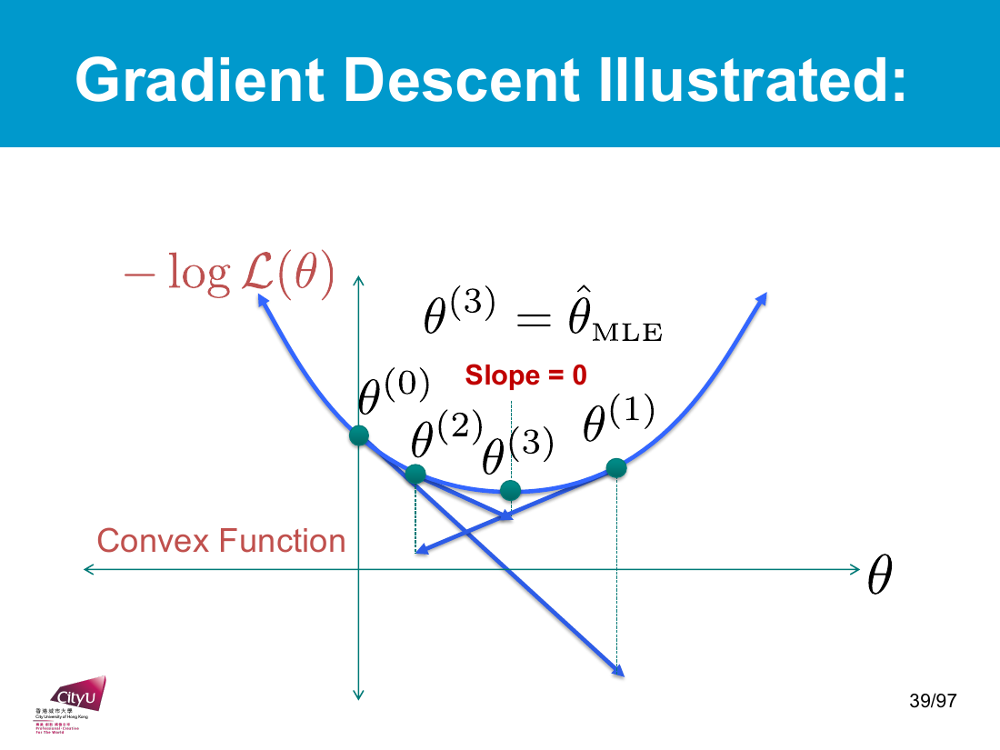

新源用蓝色凸碗曲线展示迭代点 $\theta^{(0)}$ 到 $\theta^{(3)}$：横轴是参数，纵轴是负对数似然，跨谷的箭头示意更新。谷底 Slope=0，但神经网络目标未必是这种凸碗。用当前位置算梯度，各参数同步更新，再用新位置重算。

梯度下降（Gradient descent）沿使损失局部下降的反方向更新：

$$
w^{\mathrm{new}}=w^{\mathrm{old}}-\eta\frac{\partial J}{\partial w}.
$$

$\eta>0$ 是学习率（Learning rate），决定一次走多远。导数为正，就减小权重；导数为负，减负数即增大。旧源 L11 p.39 的山地／切线示意与新源凸碗都只帮助理解下降方向，不能证明实际网络目标是凸函数。

从图中的初始化进入，每轮先预测、再算损失、再反推梯度，最后更新。判断出口包括验证表现、梯度变化和迭代上限；不是永远循环。

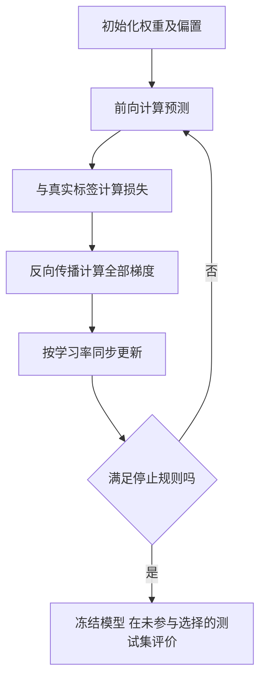

**笔记补充 · 完整手算一次反向传播和同步更新**

💡 同一输入的完整补充例：一个隐藏单元，输入 $x=2$，隐藏分数 $z=wx+b$，激活 $h=\max(0,z)$，输出 $\widehat y=vh+c$。

给定 $w=1,b=0,v=3,c=0$，真实目标为 4，先得到 $z=2,h=2,\widehat y=6$。

本例用平方损失 $L=(\widehat y-4)^2/2=2$，是回归演示，不冒称 p.36 的交叉熵。


先补最关键的一步：令当前输出为 $q$，目标为 $y$，平方损失为 $(q-y)^2/2$。

若输出多一个很小的量 $\delta$，损失改变量为 $(q-y)\delta+\delta^2/2$；除以 $\delta$ 得到 $(q-y)+\delta/2$。

当 $\delta$ 越来越小，局部变化率趋向 $q-y$，所以本例损失对输出的导数才是 2。

换损失函数必须重算这一步。


从损失往回跟四步。输出多一点时，损失按当前误差 2 的比例变化。隐藏输出多一点时，模型输出按 $v=3$ 的比例变化，因为 $q=vh+c$。此时 ReLU 位于正侧，分数变化原样传到隐藏输出，比例是 1。最后，输入为 2，所以权重多一点使分数多两倍。四段相乘是 $2\times3\times1\times2=12$，即 $w$ 的梯度。

要算输出权重 $v$，只走两步：损失对输出的变化率为 2，输出对 $v$ 的变化率为 $h=2$，所以梯度是 4。若隐藏分数改为负，ReLU 把该处变化挡住，$w$ 和 $b$ 的数据梯度都为 0。输出偏置仍直接改变预测，因此仍可能有梯度。

| 参数 | 本步梯度 | 学习率 0.01 的同步更新 |
|---|---:|---:|
| $w$ | 12 | 0.88 |
| $b$ | 6 | −0.06 |
| $v$ | 4 | 2.96 |
| $c$ | 2 | −0.02 |

偏置直接以加法进入对应分数，局部变化率为 1。因此 $b$ 的梯度为隐藏侧误差信号 6 乘 1，$c$ 的梯度为输出误差 2 乘 1。

全部梯度都用**更新前**参数算，再一起更新；不能先改 $v$，又用新 $v$ 算同一步的 $w$ 梯度。更新后 $z=0.88\times2-0.06=1.70$，新输出为 $2.96\times1.70-0.02=5.012$，新损失约 0.5121，确实低于原来 2。

#### 旧源 L11 p.41 · Gradient Descent: Learning Rate

仅旧源含此页，保留为相邻机制补充，不冒充 L10 当前页。

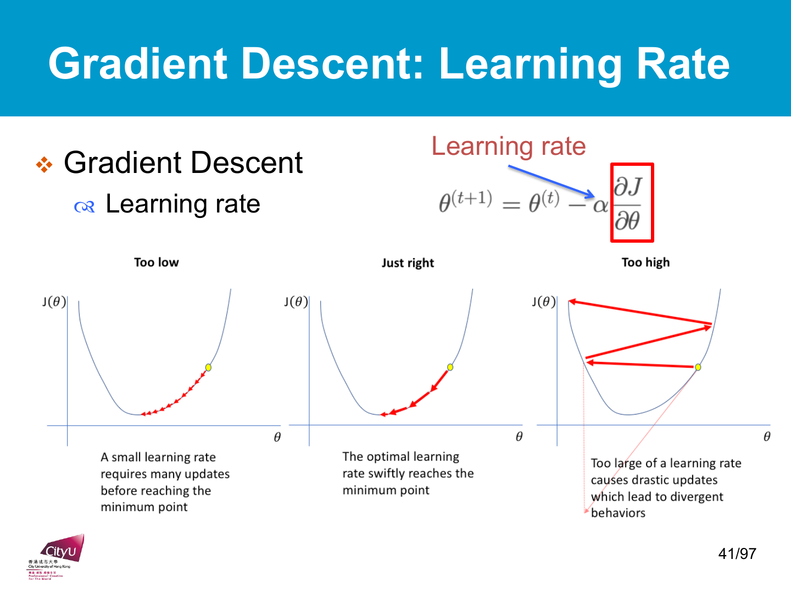

三幅图从同样的起点出发。小学习率的红步密而短，适中的步子较快接近谷底，过大的步子来回跨谷且可能越跨越远。这里的横轴是参数，纵轴是损失。

#### p.40 · Gradient computation given cost function

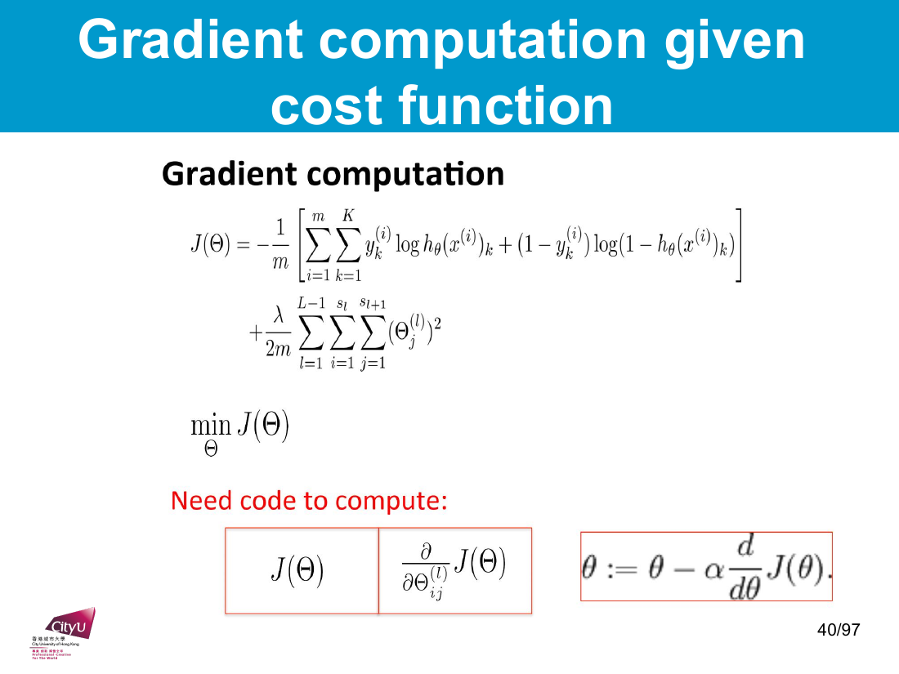

左侧红框列实现需要得到的两个量，目标 $J$ 和各参数的梯度，右侧红框把梯度用于更新。先算同一组旧参数下的所有导数，再统一更新，避免前一项新权重混入后一项的计算。

**笔记补充 · 用 Sigmoid 和带正则的二元交叉熵跑一次更新**

前面的平方损失是为看清链条而补的回归例；现在用本讲给定的分类目标做同一件事。单条记录的目标 $y$ 为 0／1，分数 $z=wx+b$，预测概率 $p=\sigma(z)$。

对数的局部变化规则是 $d\log p/dp=1/p$。据此，二元损失对概率的变化率为：

$$
\frac{\partial L}{\partial p}=-\frac y p+\frac{1-y}{1-p}.
$$

再乘上一节 Sigmoid 的局部斜率，化简得到分数侧的误差信号：

$$
\frac{\partial L}{\partial z}=\left(-\frac y p+\frac{1-y}{1-p}\right)p(1-p)=p-y.
$$

若 $y=1,p=0.8$，损失对概率的变化率是 −1.25，激活局部斜率为 0.16，乘积为 −0.2。负号说明提高分数能在局部降低该条损失；不能把回归例的“输出减目标”无条件套到任意输出函数。

单条输入取 $x=2,w=0.5,b=\log4-1$，使分数为 $\log4$、概率为 0.8。取正则权重 $\lambda=0.1$、样本数 $m=1$，权重梯度为 $(-0.2)\times2+0.1\times0.5=-0.35$；偏置不加这项平方惩罚，所以梯度为 −0.2。

下面代码对应 p.40 所需的“目标→梯度→更新”计算，是笔记补充，可直接运行，没有重训大图片网络。

```python
import math
x, y, w = 2.0, 1.0, 0.5
b = math.log(4) - w * x
lam, eta = 0.1, 0.01
p = 1 / (1 + math.exp(-(w * x + b)))
data_loss = -y * math.log(p) - (1 - y) * math.log1p(-p)
loss = data_loss + lam * w * w / 2
dw = (p - y) * x + lam * w
db = p - y
w_new, b_new = w - eta * dw, b - eta * db
print(loss, dw, db, w_new, b_new)
```

输出依次为当前总损失、权重梯度、偏置梯度和同步更新后的两个参数。此例约为 0.235644、−0.35、−0.20、0.5035、0.388294。

试把标签改成 0，预测仍是 0.8。数据损失改为 $-\log(1-0.8)\approx1.609438$，带正则的总损失约 1.621938，两个梯度变为 1.65 和 0.8。代码中的 log1p(-p) 计算 $\log(1-p)$。课件的目标对 $K$ 个独立输出求和，本例演示其中一个输出的计算。`lam` 控制正则惩罚，`eta` 控制更新步长，是不同设置。对多记录先汇总／平均各记录梯度，多层权重再沿计算图传回；正则梯度只加到相应受惩罚权重。

英文参考说明：“For sigmoid and binary cross-entropy, the score-level gradient is p−y. Multiply it by each input to obtain the data contribution to a weight gradient, then add the applicable regularization gradient. Biases are updated from their own paths without the same weight penalty.”

#### p.41 · Overfitting of NN

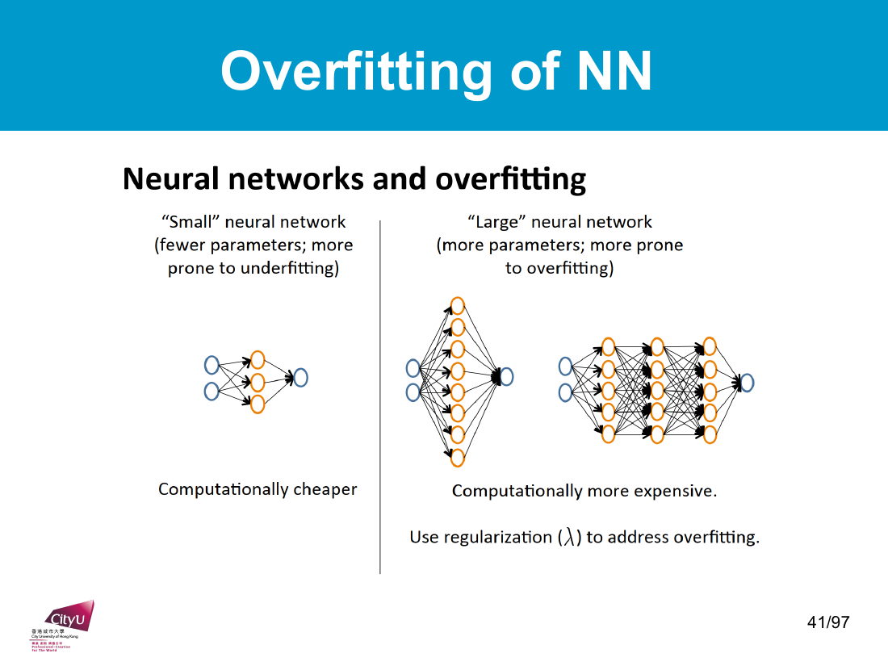

从左图数较少的隐藏单元和连线，再看右侧两种扩充：第一种把一层加宽，第二种叠更多层。连线和参数通常随之增加，也增加计算量。小模型可能连训练规律都拟合不足，称欠拟合（Underfitting）；大模型能表示更复杂的关系，也可能把训练噪声学进去，称过拟合（Overfitting）。图中说的是风险，没有说模型大小能单独决定结果。

回到 p.36 的两个红色标签：Training Error 衡量预测与标签的差异，Regularization 还要付权重平方的代价。新源本页未再画该式。若两组参数的训练误差一样而后一组权重平方和更大，$\lambda>0$ 时后一组的总成本更高。是否需要更宽／更深、选多大的 $\lambda$，都用验证数据比较，最终测试不参与选择。

#### p.42 · Local Optimal Parameters

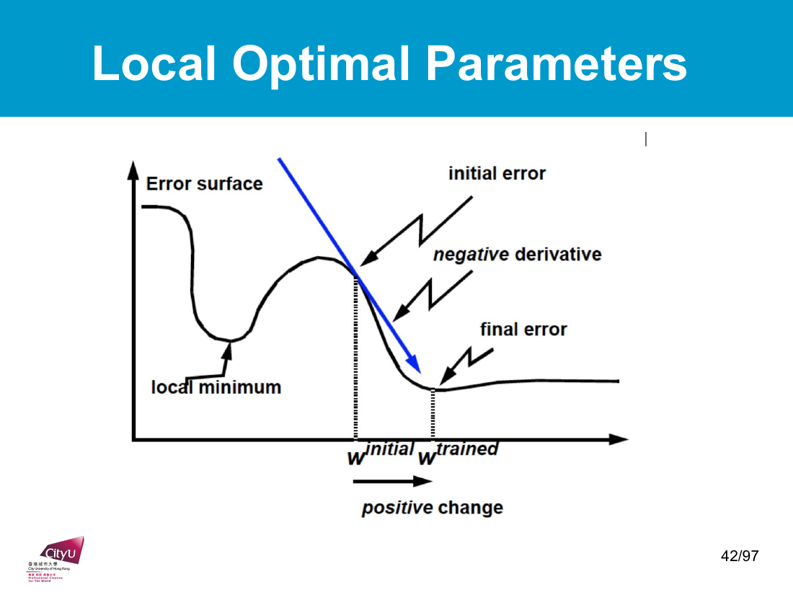

左图横轴是权重 $w$、纵轴是误差。先找 $w^{\mathrm{initial}}$ 的虚线：该点的切线往右下，斜率为负。按 p.39 的更新式，从 $w$ 减去正学习率乘负斜率，$w$ 就向右增大，蓝箭头趋向 $w^{\mathrm{trained}}$。左侧还有一个谷底；若从另一个斜坡出发，下降可能走进另一个谷底，这说明初始化可能影响到达的结果；新源未保留旧源图底的 Random initialization 文字。

旧源 L11 p.44 另有凸形对照图，新源只保留左侧多谷曲线；凸形的直观定义是两点连线不低于中间曲线，可与 p.39 的凸碗对照。训练停在低点附近并不证明找到了全局最低值，零斜率也可能出现在鞍点或平坦处。

#### p.43 · Example · 服饰类别

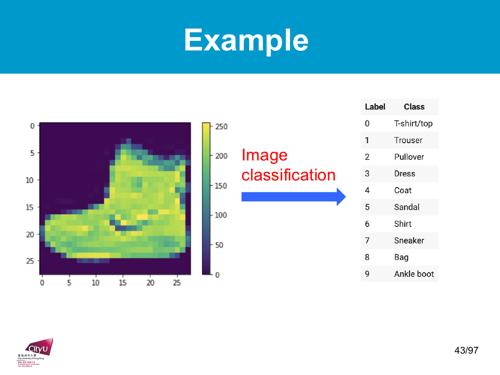

左边色条是像素强度，颜色用来显示灰度数值。右表定义 0–9：T-shirt/top、Trouser、Pullover、Dress、Coat、Sandal、Shirt、Sneaker、Bag、Ankle boot。图像分类输出一个类别编号，再查表读类别。

#### p.44 · Example · 像素怎样进入模型

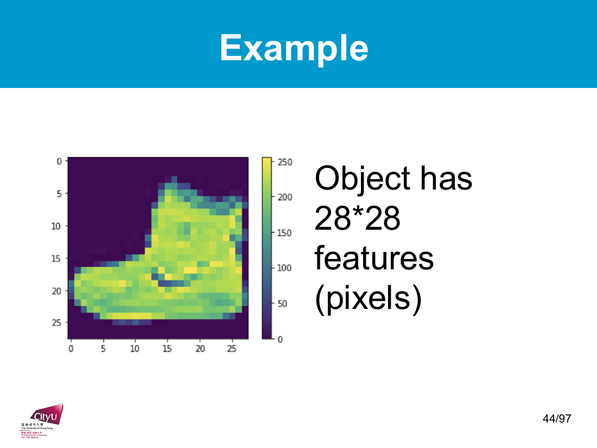

图沿行、列各取 28 个位置，每个灰度像素取一个数。按固定次序逐行连接可得到 $28\times28=784$ 维输入，训练与测试必须使用同一顺序。

#### p.45 · Example · 训练集合

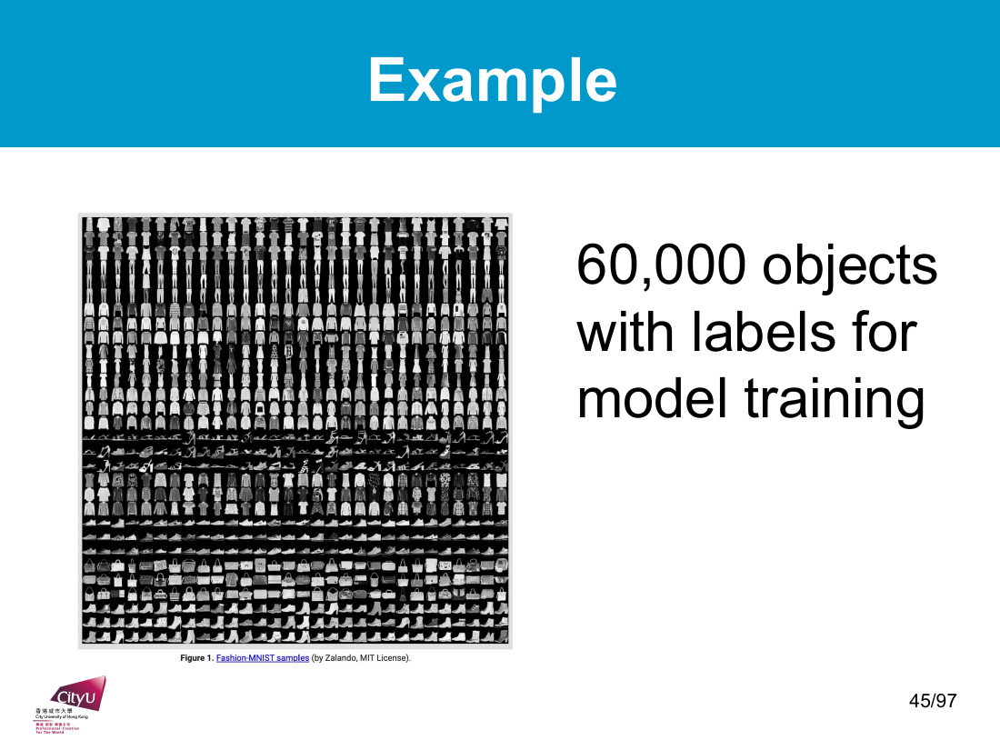

左侧拼图展示服饰样本的差异，右侧给出训练用的 60,000 张带标签图片。单张输入仍是 784 维，60,000 是记录数。

#### p.46 · Example · 识别五项设定

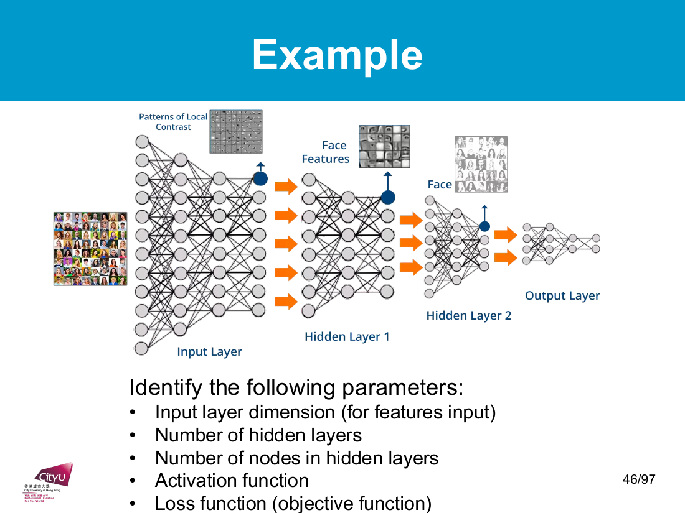

原图橙箭头从人脸输入经过两段有标签的隐藏表示到输出。这与 p.43 的服饰输入是不同示意。能从图认出的阶段和能供代码复现的架构信息要分开。

原题：“Identify the following parameters: Input layer dimension (for features input); Number of hidden layers; Number of nodes in hidden layers; Activation function; Loss function (objective function).”

中文是逐一识别输入维度、隐藏层数、每层单元数、激活和损失。⚪ 参考作答分清可知与不可知：

1. 若承接 p.44 的灰度服饰输入，维度为 $28\times28=784$；若专指 p.46 人脸图，图未给图像尺寸，不能借服饰尺寸代填。
2. p.46 标出了 Hidden Layer 1 和 Hidden Layer 2 两个表示阶段；它不是带明确逐层尺寸的实现规格。
3. 每层实际节点数没有明确数值，不能将示意图的圈数当真实超参数。
4. 该图未给激活；可以提出 ReLU 隐藏层／Softmax 输出的**补充方案**，不能说是图中指定答案。
5. 该图未给损失；互斥服饰类别配 Softmax 可用多类交叉熵，这是条件式方案；p.36 的独立二元损失又是另一种输出口径。

英文参考答案：“For the 28×28 grayscale example, the flattened input dimension is 784. The face diagram labels two hidden representation stages, but it does not specify an implementable unit count, activation or loss. ReLU hidden units and a softmax/categorical-cross-entropy output are a possible design for mutually exclusive classes, not an answer explicitly supplied by that diagram.”

#### p.47 · Example · 用模型给新图片分类

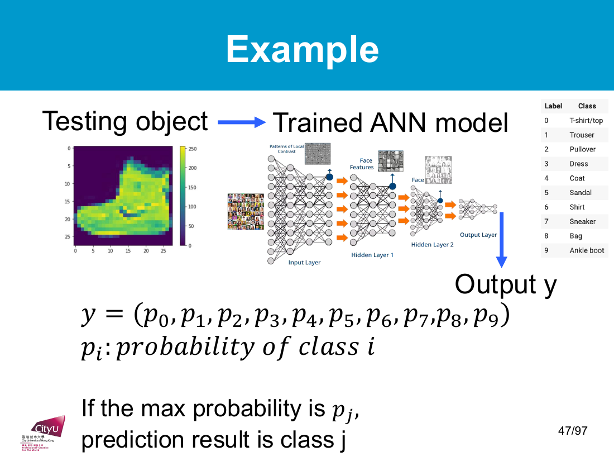

沿蓝箭头从测试图送入已训练 ANN，再到 $p_0,\ldots,p_9$。选择最大概率所在的编号 $j$，用右表译回标签。比如 $p_9$ 最大就输出 Ankle boot，单张选择结果无法说明整体正确率。中间仍沿用 p.46 的人脸示意。

把新图和 [[#p.45 · Example · 训练集合|p.45 的训练集合]]区分。此处只前向计算，训练参数已经冻结。

### 2.5 序列状态与参数共享（L10 p.48–63）

#### p.48 · IS6400 Business Data Analytics · RNN 与 LSTM

目录此处点亮 RNN、LSTM。先在 p.51–56 跟一条隐藏状态的箭头，再在 p.68–74 跟两条不同的状态通道。

#### p.49 · FFNN


复用 p.20 的四类网络。新增红字 Static Input and Static Output，强调一张图对应一组分类分数，没有前一时点的状态输入。下一页把输入改成有顺序的资料。

#### p.50 · NN for Sequence Analysis


上方图示从图片中的物件生成描述词。下方按时间排出 “I Will Pass” 三段语音波形。

1. ⚪ 原问 “What if I want to analyze something in a sequence?” 中文题意：输入前后顺序有意义时，怎样让当前一步利用之前的信息？依序读入每项，把到目前为止的摘要作为隐藏状态传给下一步。英文参考：“Keep the inputs in order and pass a state from each step to the next.”
2. ⚪ 原问 “What if I want to analyze human speech?” 中文题意：怎样保留语音的时间信息？将音频切成依时间排列的小帧，让当前帧的判断参考前面帧留下的状态。英文参考：“For speech, process successive audio frames so the model can use earlier context when interpreting the current frame.”

#### p.51 · Recurrent Neural Networks


红方块表示循环神经网络（Recurrent Neural Network, RNN）的一次计算。左侧 $x_t$ 是当前输入，右侧 $y_t$ 是本步输出，下面的虚线标 One-step delay，表示本步的隐藏状态（Hidden state）$h_t$ 要到下一步才作为旧状态进入。

#### p.52 · Unrolling RNNs · 展开三个时点


右边按从上到下展开。第一框收到 $x_0$，把 $h_0$ 沿绿色线传给处理 $x_1$ 的框，再传 $h_1$ 给 $x_2$。时间展开形成有向无环图（Directed Acyclic Graph，DAG），计算边没有返回早先时点，损失梯度可在训练时沿图回传。

#### p.53 · Unrolling RNNs · 参数共享


右图横着展开时间，每个红框都执行同一个带共享参数的函数 $f_W$。首框写成 $f_W(x_0,1)$，这里的 1 是示意初始旧状态，输入是 $x_0$。

次框把 $x_1$ 与上一框输出的状态 $h_0$ 一起读入。实际模型须定义自己的初始状态，例如 p.56 的补充例从 $x_1$ 开始，把初始状态记为 $h_0=0$。处理更多时点会增加运算次数，共享参数数目无需随之增加。

#### p.54 · RNN


从底部粉色 $x$ 沿黑箭头进入绿色 RNN 框，右侧弯箭头把这一步生成的隐藏状态 $h$ 带到下一步，顶部箭头接输出端。课件把蓝色 $y$ 标成 Target（目标）；训练时应另分模型算出的预测和真实目标，再比较两者。弯箭头传的是模型的状态，不是把真实目标当下一步输入。

#### p.55 · RNN for Time Series


四色框可直接按 $h_t=f_W(h_{t-1},x_t)$ 读。蓝框是新状态，紫框是带参数 $W$ 的函数，绿框是上一状态，红框是当前观测。这一页把旧状态写在前、当前输入写在后。p.53 的图框则把当前输入写在前。按各自图的角色读，旧状态和当前输入仍是同两类量。

#### p.56 · (Vanilla) RNN for Time Series


原图把上一页的 $f_W$ 展开。用 $W_{hh}$ 处理旧状态、用 $W_{xh}$ 处理新输入，两项相加再做 tanh。

随后 $W_{hy}$ 把隐藏状态变成输出分数。原图把这条输出标为 $y_t$，本篇把它记为 $z_t$，以便与训练时的真实标签区分。

$$
h_t=\tanh(W_{hh}h_{t-1}+W_{xh}x_t+b_h),\qquad
z_t=W_{hy}h_t+b_y.
$$

$x_t$ 是本步输入，$h_{t-1}$ 是上一步摘要，$h_t$ 是更新后的摘要。

$W_{xh}$ 把输入变成状态贡献，$W_{hh}$ 把旧状态变成本步贡献，$W_{hy}$ 把状态变成输出分数。

p.56 的简式省略偏置，本篇补充列出一般形式，并不改变其旧状态＋当前输入的机制。

**笔记补充 · 三个时点用同一参数算状态**

按时间展开图，每个框重复使用同一组权重。箭头传状态，不传“已经知道的未来答案”。


💡 标量补充例：初始 $h_0=0$，每步按 $h_t=\tanh(0.5h_{t-1}+0.2x_t)$，输入为 1、0、1。三步依次得到约 0.1974、0.0984、0.2442。第二步虽输入为 0，仍保留上一状态的影响；把每步状态重置 0 就失去了这种记忆。真实多维状态只是把这套乘加同时在多行进行。

#### p.57 · Example · hello 独热输入


词表按 h、e、l、o 排列，右下四列每列只有一个 1。读到 h 就点亮第一格，读到 e 就点亮第二格。左下补全 “morni” 的小图说明可以利用已输入字符预测后续字符。

词表顺序是 `[h,e,l,o]`，所以 h 编为 $(1,0,0,0)^\top$，e 编为 $(0,1,0,0)^\top$，l、o 类推。这里的 1 是类别位置，不表示字母大小。

图输入 h、e、l、l，用来预测下一字符 e、l、l、o。第 58 页隐藏向量有 3 个分量，输入有 4 个，故无偏置简式中 $W_{xh}$ 为 3×4、$W_{hh}$ 为 3×3，输出 $W_{hy}$ 为 4×3。相同字母 l 读入两次，旧状态不同，所得新状态可不同。

#### p.58 · Example · hello 隐藏状态


粉色输入列沿红箭头乘 $W_{xh}$，上一绿色隐藏列沿横箭头乘 $W_{hh}$，相加再做 tanh 后得到本列绿色状态。末两列都读 l，状态不同，因为它们的旧状态不同。图中数字是给定的舍入展示。

先将输入、下一个目标与给定状态对齐；状态分量均为来源的舍入值。

| 步 | 输入→目标 | 给定隐藏状态 |
|---|---|---|
| 1 | h→e | (0.3, −0.1, 0.9) |
| 2 | e→l | (1.0, 0.3, 0.1) |
| 3 | l→l | (0.1, −0.5, −0.3) |
| 4 | l→o | (−0.3, 0.9, 0.7) |

#### p.59 · Example · hello 输出分数


这一页新增蓝色四维输出。每列由同列绿色隐藏状态乘共享 $W_{hy}$ 得到；按 h、e、l、o 查四行。原图公式里的 $y_t$ 是网络算出的四项分数，对应本篇的 $z_t$。绿色字表示目标字符所在位置，例如第一列目标是 e 的 2.2，最高分却是 o 的 4.1。

p.59 第一步输出为 $(1.0,2.2,-3.0,4.1)$，含负数且和不为 1，所以是分数（Logits），不能直接叫概率。目标字符 e 对应第二个位置 2.2，但本步最高分是 o 的 4.1，说明这个示例状态还不是全部预测正确的模型。训练要提高真实下一字符的相对得分。

若需要概率，可把四个分数送入 Softmax，仍按同一词表顺序解释；不能只因目标字符在图中绿色就把它说成当前最大输出。课件这组图未给出完整权重和训练过程。

下表每行按词表 h/e/l/o 给分数，最后一列按最大分数选类。

| 步 | 四个给定输出分数 | 最大分数的类别 | 与目标是否一致 |
|---|---|---|---|
| 1 | (1.0, 2.2, −3.0, 4.1) | o | 否，目标 e |
| 2 | (0.5, 0.3, −1.0, 1.2) | o | 否，目标 l |
| 3 | (0.1, 0.5, 1.9, −1.1) | l | 是 |
| 4 | (0.2, −1.5, −0.1, 2.2) | o | 是 |

例如第二步仍是 o 得分最高，不能把绿色的目标 l 误读成当前胜出类。完整权重未知，因此这是保留并解释给定演示，不是从权重重算了来源四步。

#### p.60 · Recurrent Networks Offer Flexibility · 一对多


从左到右数粉色输入、绿色计算框和蓝色输出。第二组只输入一张图，沿绿色状态链连续输出多个词。第四组的第一根蓝箭头在第三个粉色输入所在的时点出现，后两根蓝箭头上升时底下已没有新粉色输入；第五组则从第一步起，每个粉色输入都有对应的蓝色输出。两组都叫多对多，差别在于输入与输出何时对齐。

先数输入和输出的步数，再选择结构；一张图和一句话都可视作一次或多次输入，取决于任务表示。

| 配对 | 任务例 | 时间含义 |
|---|---|---|
| 一对一 | 静态图片分类 | 一项输入得一项标签 |
| 一对多 | 图片描述 | 图片后连续产生词 |
| 多对一 | 句子情感分类 | 读完整段再输出情感 |
| 多对多、不同长度 | 机器翻译 | 输入和输出词数可不同 |
| 多对多、逐步对齐 | 视频逐帧动作识别 | 每个时间步有输出 |

#### p.61 · Recurrent Networks Offer Flexibility · 多对一


同一套五种结构本页新增指向第三组的箭头。情感分类先读多个词，最后一个绿色框才向上发出唯一的情感标签。例如要读完整句子才知道转折后表达的态度。

#### p.62 · Recurrent Networks Offer Flexibility · 翻译


本页箭头改指第四组。前三个绿色框依序读三个粉色输入；第一个蓝色输出从第三个框向上送出，之后右边还有两个生成步骤但不再读新的粉色输入。这个结构示意先积累源语信息再生成译文，首个输出在图上和最后一个输入同列。旧源 L11 p.64 的补充原例 “Professor Liu’s IS6400 course is so popular, it’s hard to get a seat.” 译成中文后，词数无需与英语一致。

#### p.63 · Recurrent Networks Offer Flexibility · 逐帧识别


箭头指最右多对多结构：每个粉色输入时点经绿色状态计算，都有一个蓝色输出，可用于逐帧标签。原页称 Video classification，是这套逐步配对的示意；若整段视频只需一个标签，应选多对一而非机械照搬。

旧源 L11 p.65 另画三帧人物画面与 Angry、Refuse、Satisfied 标签，本处保留其学习边界：这些词只用来认结构，单帧表情未必能说明人的内心状态。

### 2.6 LSTM 的细胞状态与门控（L10 p.64–74）

#### p.64 · Problems of RNN


新源本页仅列长期依赖与梯度消失问题，旧源 L11 p.66 另有激活／导数曲线。按已讲的链式法则，局部导数接近零时，训练误差信号每反传一段就可能缩小。十段若各乘 0.5，结果只剩 $0.5^{10}\approx0.000977$，称梯度消失（Vanishing gradient）。远处线索虽能经状态传递，训练仍可能难以学到该依赖。

如果反向链上的乘数持续大于 1，信号也可能变得过大，称梯度爆炸（Exploding gradient）。

#### p.65 · LSTM 图例


黄色矩形是网络层，粉色圆形是逐元素运算，直箭头传向量，两线并成一线表示拼接，分叉是复制。底部粉色乘号把门值与同位置分量相乘。例如门值 0.2 让该分量只保留 20%。

#### p.66 · RNN Model


中间绿色框内只有一个 tanh 变换层。下方 $x_t$ 与左侧旧状态进入，结果一份向上成为 $h_t$，一份向右成为下一框的旧状态。tanh 的输出范围已在 p.32 的曲线说明；新源本页只保留循环结构。

#### p.67 · LSTM Model


从左到右是 $t-1,t,t+1$ 三个时点的同一种绿色模块；这页只把中间时点的内部画深。蓝圈 $x_t$ 是本步输入，紫圈 $h_t$ 是本步生成的隐藏状态。

模块之间的上横线传细胞状态 $C$，下横线传隐藏状态 $h$。本步的 $x_t$ 和左侧来的 $h_{t-1}$ 在下方汇合，供四个黄色框使用。

先沿上横线读记忆更新。最左黄色 $\sigma$ 给遗忘门 $f_t$，向上接到第一个粉色乘号，让旧细胞状态 $C_{t-1}$ 保留一部分。

中间黄色 $\sigma$ 给写入门 $i_t$，黄色 tanh 给候选内容 $\widetilde C_t$；这两条支路先在下方的粉色乘号相乘，再到上方的加号，与保留的旧内容相加。加号右边的 $C_t$ 沿上横线送到下一时点。

再从加号右边沿分支向下走：粉色 tanh 把新状态 $C_t$ 变成可供输出的数，右侧黄色 $\sigma$ 给输出门 $o_t$。两路在最右的粉色乘号相乘，得到 $h_t$；同一个 $h_t$ 向上到紫圈，也沿下横线送往下一时点。黄色 tanh 产生待写入的候选，粉色 tanh 处理已经更新的状态，两者输入不同。

$$
C_t=f_t\odot C_{t-1}+i_t\odot\widetilde C_t,\qquad
h_t=o_t\odot\tanh(C_t).
$$

$\odot$ 表示同一位置的数相乘；例如第一个门值只乘对应的第一项记忆。接下来的 p.68–73 会逐条高亮这些路径。LSTM 的标准全名是长短期记忆（Long Short-Term Memory），课件印成 “Long Term Short Term Memory”。

#### p.68 · LSTM 两条跨时点状态线


上部全图有上下两条横线。上面传细胞状态（Cell state）$C$，下面传隐藏状态 $h$。下部深色高亮只追踪 $C_{t-1}$ 到 $C_t$；这条线经一次乘和一次加，因此既能保留旧内容也能写入新内容。

#### p.69 · LSTM Cell State


从左端的 $C_{t-1}$ 走过粉色 × 和 +。× 控制旧内容留下多少，+ 加上已筛选的新内容。右下小图将 Sigmoid 框连到乘号，解释门值如何成为保留比例。

#### p.70 · LSTM Walk-through · 遗忘门


先追左下两根黑线：横着进来的是上一时点的隐藏状态 $h_{t-1}$，竖着进来的是当前输入 $x_t$。把它们排在一起送进第一个黄色 $\sigma$ 框，得到遗忘门（Forget gate）$f_t$：

$$
f_t=\sigma(W_f[h_{t-1},x_t]+b_f).
$$

$W_f$ 决定两种输入如何影响每个门值，$b_f$ 加上偏移，$\sigma$（Sigmoid）把分数变成 0 到 1 之间的保留比例。再沿 $f_t$ 的黑色竖线向上，到顶部第一个乘号；乘号横向收到的是旧细胞状态 $C_{t-1}$。旧记忆本身没有进黄色框，它是在乘号这里才按比例留下。

💡 单独的小例：若顶部旧值是 2、这项门值是 0.25，乘号右边只留下 $2\times0.25=0.5$。课件红字用 1 和 0 示意完全保留和完全丢弃的两端。这里的 0.5 只是留下的旧记忆，还没走到 p.72 的加号；新内容如何算，先看 p.71。

#### p.71 · LSTM Walk-through · 新记忆


黑线分到两个黄色框，Sigmoid 给写入比例 $i_t$，tanh 给候选内容 $\widetilde C_t$。计算分别为 $i_t=\sigma(W_i[h_{t-1},x_t]+b_i)$、$\widetilde C_t=\tanh(W_C[h_{t-1},x_t]+b_C)$。两条支路读取同一份拼接输入，参数各自训练。跟两条线的末端：输入门只说写入多少，候选框才提出要写的值，候选也可以是负数。下一页两者在下方乘号处相乘；到本页高亮路径末尾，还没有写进顶部细胞状态。

#### p.72 · LSTM Walk-through · 更新细胞状态


原图上方黑线先把旧 $C_{t-1}$ 乘 $f_t$，下方把候选乘 $i_t$，再在粉色 + 汇合。图中的星号在这里表示逐元素乘法，所以 $C_t=f_t\odot C_{t-1}+i_t\odot\widetilde C_t$。例如旧值 2、保留 0.8，候选 0.4、写入 0.25，得到 $C_t=1.6+0.1=1.7$。

#### p.73 · LSTM Walk-through · 输出隐藏状态


此页高亮右侧黑线。新 $C_t$ 先经 tanh，再乘右侧 Sigmoid 框算出的 $o_t$，所以 $o_t=\sigma(W_o[h_{t-1},x_t]+b_o)$，$h_t=o_t\odot\tanh(C_t)$。

沿用 p.72 的 $C_t=1.7$，若 $o_t=0.5$，得到 $h_t\approx0.4677$。这条路径读取细胞值来生成隐藏输出，细胞状态仍沿上方传递。

#### p.74 · LSTM 四步对照


左边从上到下对应保留比例、写入比例与候选、更新细胞、输出隐藏。右上完整图把四张高亮拼回同一个时点。按这四步算完才进入下一时点，下一时点会由新输入与旧隐藏重新计算各门。

$[h,x]$ 是拼接，$W$ 和 $b$ 是训练出的不同门参数，$f,i,o$ 是每一步动态算出的门值，不能把门值当恒定超参数。$C$ 可以超出 −1 到 1，输出前的 tanh 再压缩它。

下面按从上到下读，旧细胞记忆经保留分支，新候选经写入分支，两条在更新处汇合。


若把遗忘门改成 0，同一例新 $C$ 只剩 0.1；改成 1 则旧值完整保留。

沿原图上方的细胞状态线看梯度怎样传回去。暂时固定本步的门值和候选内容，如果旧细胞状态的某一项多一点，新状态在这条直接路径上只增加这点变化的 $f_t$ 倍。它不必每步穿过 tanh。

若十步的遗忘门都取 0.97，直通比例约 0.737，若都取 0.5，只剩约 0.000977。实际还有经隐藏状态影响门和候选的其他梯度路径。p.66 的普通 RNN 单层重复模块与 p.67–74 的四交互模块差异，正是这个状态控制结构。

**笔记补充 · 用同一套门参数算两个时点**

为把“当前输入改变，门会怎样改变”算完整，采用一个标量隐藏状态与一个标量细胞状态。初始旧隐藏为 0.1、旧细胞为 0.2，当前输入为 0.5；所有偏置取 0。下表每对权重按“旧隐藏、当前输入”的顺序，沿本节公式做乘加。

| 分支 | 权重对 | 第一步代入的分数 | 激活后结果 |
|---|---|---|---:|
| 遗忘门 | (0.5, 0.4) | 0.5×0.1+0.4×0.5=0.25 | 0.562177 |
| 输入门 | (−0.3, 0.2) | −0.3×0.1+0.2×0.5=0.07 | 0.517493 |
| 候选记忆 | (0.2, 0.6) | 0.2×0.1+0.6×0.5=0.32 | 0.309507 |
| 输出门 | (0.1, −0.2) | 0.1×0.1−0.2×0.5=−0.09 | 0.477515 |

门分支接 Sigmoid，候选分支接 tanh。用未舍入值计算，新的细胞状态约为 $0.562177\times0.2+0.517493\times0.309507=0.272603$；新隐藏约为 $0.477515\tanh(0.272603)=0.127041$。

下一步把输入改为 −0.5，仍用同一权重；旧隐藏现在是 0.127041、旧细胞是 0.272603。重新计算得到遗忘门约 0.465933、输入门约 0.465527、候选约 −0.267892、输出门约 0.528146，新的细胞状态约 0.002304、隐藏约 0.001217。不能把第一步的四门原封不动搬到第二步，也不能把隐藏 0.127041 当成细胞记忆。

这组数值是为学习提供的完整补充参数，不是 hello 来源模型的权重。

### 2.7 文本表示与语言结构（L10 p.75–97）

#### p.75 · IS6400 Business Data Analytics · NLP

目录切到 NLP。先从 p.76–88 学怎样从文字得到数值表示，再从 p.89–97 学词、结构、含义和语境。新源没有附本讲课堂转录，仍不能推断实际讲授／略过页。

#### p.76 · What is Text Mining

文本挖掘（Text mining）从文档、评论等资料里提取结构、主题或能支持分析的信息。比如先把评论变成词项表，再复用分类、聚类或关联分析。

#### p.77 · Examples of Text Mining 1


左图三个颜色对应 Negative、Neutral、Positive。模型从一段词序列得出一个情感标签，和 p.61 的多对一相呼应。右栏以 Stanford 情感分析和 NCSU 推文情感可视化为课程例子。

#### p.78 · Examples of Text Mining 1 · 词的褒义不等于全句褒义


原输入完整保留：“This movie doesn't care about cleverness, wit or any other kind of intelligent humor.” 中文意思是“这部电影根本不在意机智、妙语或任何聪明的幽默”，整体是在批评电影。

从底部词语往上看树。intelligent humor 所在的小分支可为蓝色正面，但它被放进 doesn't care 的结构后，上方整句成为橙色负面。蓝色与橙色分别标出局部／整体的情感，圆里的 0、+、− 是示意标签。这里是给定演示，不是要求每个词多数投票；否定作用于哪个短语会改变整体意思。课件图是组合结构的示意，不提供训练权重。

⚪ 英文参考说明（笔记自拟）：“Positive words such as intelligent humor occur inside a negative statement about the movie. The sentence structure and the scope of doesn't care determine the overall negative sentiment.”

#### p.79 · Examples of Text Mining 2


读三种量时先找各自的位置：上方 Social Sentiment 饼图是意见类别的占比，例如标注日期上 Strong Buy 为 64%；下图蓝柱按左侧 Stock Chatter 轴表示讨论量，折线按右侧美元轴表示股价，悬浮标注明示当日价格。柱子高不能读成股价高，饼图的 64% 也不是股价上涨概率。若要检验能否预测下一时点，只能用预测当时已经取得的讨论，再用之后的价格验证；这张历史仪表盘本身没给出预测结果。

#### p.80 · Examples of Text Mining 3


从右侧 QA System 选一个问题，回到左侧黄色高亮找定义、症状或比例。比如第三问取文本里的 about 80%，该比例带有原文条件，只作为本页给定文本的抽取结果。

> [!quote]- 讲义 p.80 Text Data 英文原段落全文
>
> > COVID-19 is the infectious disease caused by the most recently discovered coronavirus. This new virus and disease were unknown before the outbreak began in Wuhan, China, in December 2019. The most common symptoms of COVID-19 are fever, tiredness, and dry cough. Some patients may have aches and pains, nasal congestion, runny nose, sore throat or diarrhea. These symptoms are usually mild and begin gradually. Some people become infected but don’t develop any symptoms and don't feel unwell. Most people (about 80%) recover from the disease without needing special treatment. Around 1 out of every 6 people who gets COVID-19 becomes seriously ill and develops difficulty breathing. Older people, and those with underlying medical problems like high blood pressure, heart problems or diabetes, are more likely to develop serious illness. People with fever, cough and difficulty breathing should seek medical attention.

p.80 是从给定旧文本抽答案的演示，原文里的健康描述只作为当时材料，不当成当前医疗建议。原题与给定答案如下：

| 原英文问题 | 中文题意 | 讲义文本给定的英文答案 |
|---|---|---|
| What is COVID-19? | 按该段文本解释它是什么 | the infectious disease caused by the most recently discovered coronavirus |
| What are symptoms of COVID-19? | 按该段文本提取症状 | fever, tiredness, and dry cough |
| How many people recover from COVID? | 按该段文本找比例 | about 80% |

中文解析：第一问定位定义句；第二问定位列出常见症状的句子；第三问定位“Most people (about 80%) recover ...”并保留原文的条件“without needing special treatment”。材料没有当前样本、时间及流行变异株口径，因此不拿 80% 推算现在某群体康复人数。

#### p.81 · Why Text Analytics/Mining?


红饼图把资料按结构化数值／编码信息和非结构化／半结构化信息分为 10% 与 90%。这是课件署名 Oracle 的估计，缺少统计口径或时期。业务动机是从找到整份文档进一步抽取能分析的信息。

#### p.82 · Text Analytics/Mining Methods (1)

信息检索（Information retrieval）先表示文档、建索引再排序，输出相关文档。信息提取（Information extraction）先找实体，再判定实体之间的关系。比如读到 “Lin works at CityU”，先把 Lin 标成人、CityU 标成机构，再输出「Lin → 任职于 → CityU」。本体（Ontology）是预先组织好的对象类型和关系，帮助系统区分「人任职于机构」和其他关系。句法、语义与语境还能帮助确定方向。

#### p.83 · Challenges of Text Analytics

候选词或短语种类多，文档结构各异，转载也可能使记录不独立。“AOL merges with Time-Warner” 与 “Time-Warner is bought by AOL” 用不同句式表述关系，抽取时仍要辨认谁买谁。Apple 可能指公司或水果，Toyota 则是品牌，不能把 automobile、car、vehicle、Toyota 一律互换。

#### p.84 · How to represent a document?


左括号框的是文档行，上方 Terms 是词项列。交叉格是出现次数。比如 Camera 第一篇 3、第二篇 0，Digital 第二篇 4。省略号说明图只展示了部分词项。

p.84 的文档—词项矩阵，每行是一篇文档，每列是一种词，格子为出现次数。原小表保真如下，省略号代表课件没显示的其他词。

| 文档 | Camera | Digital | Memory | Print |
|---|---:|---:|---:|---:|
| Document 1 | 3 | 2 | 0 | 1 |
| Document 2 | 0 | 4 | 0 | 3 |

#### p.85 · Some Basic Information Retrieval Techniques

词干化（Stemming）可将 Taxes 和 taxation 都归到 tax。停用词（Stop words）是按任务决定是否剔除的常见词；情感分析中的 not 不能一概删除。把一起分析的一组文档叫语料库（Corpus）。词项加权会优先考虑本篇常见、在整组文档里较少见的词。

#### p.86 · Term Frequency (TF)

词频（Term Frequency，TF）把一个词在本文档的出现次数除以本文档总词数，使不同长度文档可比较。若改用筛选后的关键词总次数作分母，分子也须采用相同口径。

$$
\mathrm{TF}(i,j)=\frac{\mathrm{count}(i,j)}{\text{文档}j\text{的总词数}}.
$$

$i$ 是词，$j$ 是文档；次数和总词数必须用同一分词／停用词口径。原 p.84 有未显示词，不能仅把可见四列相加就假装知道文档真实总长度。

#### p.87 · Inverse Document Frequency (IDF)

先数这组语料库中不同文档的总数 $N$，再数包含该词的不同文档数 $df_i$。某篇文档出现十次仍只计一篇。课件第一条用文字把 $df_i$ 说成 IDF，下面的公式才是逆文档频率 $\log(N/df_i)$。

#### p.88 · The Mighty TF-IDF


对照红色乘式和左下原始词频表。先用 TF 与 IDF 的乘积替换对应格子，再将加权后的表示用于右侧分类、聚类、主题模型或回归。左下仍印着 p.84 的原始计数，用作要改造的输入，未给出数值加权结果。

把前两页合起来，对每个词 $i$、每篇文档 $j$，算 $\mathrm{TFIDF}(i,j)=\mathrm{TF}(i,j)\,\mathrm{IDF}(i)$。

💡 完整补充例：语料有 3 篇，词 camera 出现在其中 1 篇；该篇共 4 词、camera 出现 2 次。TF 为 $2/4=0.5$，IDF 为 $\log3\approx1.0986$，乘积约 0.5493。若另一个词三篇都有，则 IDF 为 $\log1=0$，该简式权重为 0。实际软件可能加平滑及归一化，数值不能与本未平滑公式混用。

p.88 把加权矩阵送给聚类、分类、主题模型或回归。它保留词频线索，不保留所有语序；“dog bites man”和“man bites dog”词集合相同，关系却不同。这引出下一节为什么还需要语言结构。

#### p.89 · What is Natural Language Processing (NLP)?


自然语言处理（Natural Language Processing，NLP）包含语音识别、语言理解与语言生成，分别可把声音变成文字、从文字辨识含义、用语言形成输出。

从右侧漫画的两个说话气泡开始看：左侧人物的气泡使用日文字符，右侧人物的英文是 “Good morning Mr. Jones. How are you today?”，中间的小设备把画面放进跨语言沟通场景。它为本页的语言处理任务提供引子；图没有给设备内部模型或完整翻译链，不能由外观断言采用了哪种神经网络。原图在课件中署名 Data Science Central，本处保留 L10 物理 p.89 的原貌与页码。

课件把图灵 1950 年文章题名简写为 “Machine and Intelligence”，文章题名是 “Computing Machinery and Intelligence”。

#### p.90 · Fundamental Tasks

四项任务依次解决词的切分、词的语法类别、整句结构与含义。用 p.91–94 同一顺序逐项检查，每项的输入与输出均不同。

#### p.91 · Word Segmentation


上图先分段，蓝色标人名 Michael Jordan，黄色标机构 Berkeley，白色为未赋实体标签。下图将「浦东开发与建设」切成「浦东／开发／与／建设」。分词决定边界，实体标签说明分出的范围指哪类对象。

#### p.92 · POS tagging


先读句子下方的四个词性标签，This 和 a 标 DET（限定词），is 标 VERB（动词），sentence 标 NOUN（名词）。弧线额外示意词之间的句法依赖，例如右侧 det 弧连着 sentence 和它前面的 a，表示 a 限定哪个名词；而词下 DET 说的是 a 自身的类别。词性标注（Part-of-speech tagging，POS）可以把每个时点的词映到一个标签，同一个词换句子可能换类别。

#### p.93 · Syntactic Analysis


原例句是 “My dog also likes eating sausage.” 从右侧树顶 S 沿分支走。名词短语 NP 收起 “My dog” 作主语，副词短语 ADVP 给 “also”。动词短语 VP 含 “likes” 及其后的 “eating sausage”。

右图的 VBZ 下漏画 likes，sausage 与页码重叠。My 的标记在左侧括号中是 PRP$，在右侧树中印为 PRP。读这一句时，可依左侧括号结构把 My 对上所有格、把 likes 放回 VBZ 下。

#### p.94 · Semantic Analysis

词汇语义（Lexical semantics）区分 bank 的河岸和银行。组合语义（Compositional semantics）研究这些词怎样构成整体意义。旧源 L11 p.95 的例句 “Colorless green ideas sleep furiously” 结构可解析，日常字面意义却不协调，特定文学语境可另有解释。句法（Syntax）处理结构，语义（Semantics）处理含义。

#### p.95 · NLP Example · 同一句话的四层读法


原句是 “A dog is chasing a boy on the playground.” 中文是“一只狗正在操场上追一个男孩”。先从最上行按词读，Det 标限定词 A/a/the，Noun 标名词 dog/boy/playground，Aux 标助动词 is，Verb 标动词 chasing，Prep 标介词 on；这是词法／词性分析。

往下看灰线：A dog 合成名词短语，is chasing 合成动词组，a boy 合成另一名词短语，on the playground 合成介词短语，再形成整句结构。这是句法分析（Parsing），确定谁追谁，不能把词袋里同时出现 dog 和 boy 当成已经确定方向。

左框用 Dog(d1)、Boy(b1)、Playground(p1)、Chasing(d1,b1,p1) 表示对象及关系：d1 是这只狗的编号，b1 是这个男孩的编号，p1 是操场的编号。课件再给规则 “Scared(x) if Chasing(_,x,_)”，把被追的对象推成害怕，得到 Scared(b1)。这是额外规则下的推断（Inference），原句本身没有断言男孩害怕。

右下说这句话“may be reminding another person to get the dog back”。语用分析（Pragmatic analysis）还考虑说话者是否在提醒旁人把狗牵回；may 表示可能，须有场景才能确定意图。换成男孩追狗，关系参数顺序和规则推出的对象都要重算。

#### p.96 · Process of NLP


沿左列从词形／词汇处理，经句法、语义到语境解释。右列示范 “the girl the go to the school” 的结构异常和 “colorless blue idea” 的字面语义冲突；“she wanted it” 则要靠前文找 it 指什么。此图是传统任务拆分。

#### p.97 · Some NLP Platforms


从左边聊天渠道向中间 NLP Layer 跟箭头。右上 Knowledge Base 是供查询的内容，右下 Data Storage 是交互历史与分析存储，图上各有双向箭头。左栏 Dialog Flow（ex API.ai）、Wit.ai、Luis、Lex、Watson Assistant 是课件列举的历史工具名。

### 2.8 图像如何变成数值（L10 p.98–111）

#### p.98 · Image Mining · 本单元路线

这一页是新图像挖掘单元的目录：先认识图像的数字表示，再比较传统机器学习与网络，最后引出卷积神经网络。当前文件到 p.137 的 CNN 汇总为止，没有后续逐架构详细材料。

#### p.99 · Image Classification · 电脑怎样知道是猫


先看猫的整张照片，再看红问句 “But how does a computer identify it?” 中文是电脑怎样把这张图认成猫。人看见物体，电脑得到的是像素数组；训练先让很多数组与正确类别配对，再学出分类规则。

⚪ 参考作答（笔记推断）：“Represent the image numerically, learn a mapping from labelled training images to classes, and apply the learned mapping to a new image.” 仅存一张猫图不能证明模型会识别其他猫，后面要检验未参与训练的图片。

#### p.100 · Computer Vision · 像素、通道和颜色空间


计算机视觉（Computer Vision，CV）研究怎样从数字图像／视频取得更高层含义。左下网格把图像拆成像素（Pixel），每一格是一个位置；右边放大的一格给出 R:249、G:180、B:0。红绿蓝三项数是该位置的三个通道（Channel），分别记录不同颜色分量。

颜色空间（Color space）规定如何用数字描述颜色，RGB 就是一种常用表示。图中的 #F9B400 是同一组三个数的十六进制写法，不是第四个通道。像素是位置，通道是该位置记录的数的种类，两者不能混为总像素数。

#### p.101 · Gray-Scale Image · 先只留明暗


鸟的灰度图（Gray-scale image）没有红绿蓝色相，仍可从亮度差看出鸟、树枝和背景。灰度图每个位置只需一个强度值；“灰度”不等于只有黑和白两个值，中间有很多灰阶。

#### p.102 · Gray-Scale Image · 放大后看小方格


这一页把上一张鸟图放大，右侧 Pixel 箭头指向图像的小方格。图像在文件里有有限个采样位置；放大显示不会凭空增加原有细节。截图中编辑器的工具栏和 298% 是显示环境，既不是模型特征，也不是图片的原始尺寸。

#### p.103 · Pixel · 一格为什么是一个数


左边数表与右边灰度脸图是同一套位置：一行对应图的一行，一列对应图的一列，红框展示一个数与一个位置的对应。此处采用 8 位灰度：0 表黑，255 表白，中间数表示亮度。

原问 “What's a color image?” 中文是彩色图要怎样存。⚪ 参考答案是每个位置存多个颜色分量，RGB 用红、绿、蓝三项，而灰度只存一项。英文：“An RGB colour image stores three channel values at each pixel, whereas this grayscale representation stores one intensity value.”

课件末句写 black intensity，但按本页 0 黑／255 白，数越大应读作越亮。0–255 是本例编码范围；标准化后的浮点数组不再必须落在这个范围。

#### p.104 · Color Images · 三通道一起决定颜色


从下方三个相交色圆读：红、绿、蓝是加色表示，红加绿可显黄，三者足够强可显白。💡 在本例 8 位 RGB 中，(255,0,0) 是纯红，(0,0,0) 是黑，(255,255,255) 是白。

原文 “any imaginable shade” 是课堂简化；有限位数和设备可表示的色域有限，不能推出显示器能呈现任意物理光谱。

#### p.105 · RGB vs Gray-Scale · 数组的三条轴


左图 m 是横向位置数，n 是纵向位置数，第三方向叠了红、绿、蓝三个平面；右图只保留一个平面。于是同样高 n、宽 m 的 RGB 需存 $n\times m\times3$ 个通道数，灰度需 $n\times m$ 个。

左图像素表里可见 276，超过本节 0–255 编码上限，是原示意图的异常值，不能当合法 8 位像素照抄。右图不是把三个原数并排留着，而是按某种转换得到亮度；课件没指定转换权重，不能从这张示意表反推唯一灰度算法。

#### p.106 · Why Gray-Scale Images · 何时可以省颜色

原问 “WHY Gray-scale images?” 中文是为什么有时用灰度。课件给两条理由：人类视觉对亮度信息敏感，许多任务可直接利用灰度；把三通道改为一通道还可减少计算与存储。

⚪ 英文参考答案：“Grayscale can reduce computational cost while retaining useful brightness and shape information for a suitable task.” 前提是颜色不承担关键判别信息。若任务要区别红灯与绿灯，去色可能丢掉答案所需信息；X-ray 例子只说明一种图像类型，不构成医疗判断。

#### p.107 · Why RGB · 三类视锥细胞的直觉


左图由眼球指向视网膜，再放大到 Rod cell 与 Cone cell。右栏把三种视锥（Cone）按短、中、长波段写成 S、M、L，并用蓝、绿、红帮助辨认。这给 RGB 三分量表示提供视觉直觉。

原问 “WHY RGB?” 的参考答法：“RGB is a useful three-component representation motivated by human trichromatic vision.” S/M/L 是感光响应类型，显示器 RGB 是编码／发光通道；它们不是三个互不重叠的颜色开关，图也没给每种细胞的完整光谱曲线。

#### p.108 · CV Tasks · 类别、框和轮廓分别回答什么


从左到右逐个看输出。分类（Classification）只给整图 CAT；分类加定位（Localization）还给包住猫的矩形。目标检测（Object detection）在同一张图为猫、狗、鸭分别画框；实例分割（Instance segmentation）沿每个对象的实际区域画轮廓。

矩形里通常还含背景，分割区域则试图逐像素界定对象。颜色只是帮助区分输出，不是图中物体原本的颜色。若只需知道是否有猫，类别可够用；要数出几只猫，就需区分多个对象。

#### p.109 · Semantic Segmentation · 每像素类别与每个实例


第二图给 GRASS、CAT、TREE、SKY 等每个像素的类别，叫语义分割（Semantic segmentation）。最右实例图把两只狗涂成不同色，再把猫单独分出；它回答“这是哪一个对象”。

按图下方的两只狗读：语义分割可将两只都标 dog；实例分割还要给两只不同身份。页下蓝箭头实际从最右实例图附近指向 Semantic Segmentation 文字，容易错认；以文字“Predict the class of each pixel”及第二图为语义分割定义，不能据箭头把两种任务互换。

#### p.110 · Describe It · 张量表示


黑框圈出猫身上的一小块，放大后显示整数表，表示电脑先接收数值而不是“猫”这个词。张量（Tensor）在这里就是能有多条索引轴的数表：一条找行，一条找列，一条找颜色通道。

原问 “How does the computer classify images?” 本页先回答第一步描述：把图像表示成数值，下一页才说明学习映射。⚪ 英文参考：“First represent each image as numerical pixel values with a consistent shape; a learned classifier then maps that representation to a class.”

课件例 $800\times600\times3$ 共存 1,440,000 个通道值。它不是 1,440,000 张图片，也不是三个独立标签。实际代码须说明轴顺序；PyTorch 常用通道在前的形式，图里按空间尺寸再写通道只是说明元素数。

#### p.111 · Remember It · 学的是规则而非一张照片


相比前页，新箭头把数组连到 cat 标签，并问 “How to learn?” 中文是怎样从像素和标签学到分类。⚪ 参考过程是：用多张带标签训练图作前向预测，计算误差，再更新参数，最后用新图评价。

英文参考：“Use labelled images to define a loss, update model parameters from that loss, and evaluate the resulting classifier on unseen images.” remember it 是引子；只背住训练图会过拟合，不等于已经学到可泛化的猫特征。

### 2.9 PCA 与 SVM 图像分类（L10 p.112–121）

#### p.112 · From Traditional ML to CNN · 先建比较基准

目录本页点亮 Machine Learning for Image Classification。接下来的输入是 CIFAR-10 彩色小图，输出为十类之一；p.122 后会换成灰度服饰例。两种数据的表现不能直接当同任务竞赛。

#### p.113 · CIFAR-10 · 一张图为什么是 3072 维


每张图 $32\times32$ 像素、3 通道，展平后是 $32\times32\times3=3072$ 个特征。右表每行是一类、多列是不同样本，依次 airplane、automobile、bird、cat、deer、dog、frog、horse、ship、truck；同一类有不同姿态与背景。

输入维度是每张图的数的个数，十类是标签可取的值数。别把十类当成输入十维，也不要把 CIFAR-10 的 RGB 3072 维与前面的服饰灰度 784 维混用。

#### p.114 · Traditional Machine Learning · SVM 与 KNN

本页列支持向量机（Support Vector Machine，SVM）与 K 近邻（K-nearest neighbours，KNN），红框选中 SVM。SVM 用训练资料确定分类边界，KNN 则按邻近样本投票。此处正式演示 SVM；KNN 只是候选方法名，没有给 K 值、距离或实验结果。SVM 机制回顾见 [[IS6400_Business_Data_Analytics/notes/M06-分类-决策树集成SVM与不平衡学习|M06]]。

#### p.115 · SVM Pipeline · 读入、成批、展平


第一块 `CIFAR10(...train=True/False...)` 分别取得训练／测试资料。`download=True` 表示可能下载，本次只读代码截图，没有执行。第二块 `DataLoader` 把一个数据集按批取出，图中 `batch_size=len(trainset)` 把整个训练集作为一大批，`shuffle=False` 保留顺序；它可能占用大量内存。

第三块调用 `convert_to_numpy`，把图像和标签转成数组。源输出给训练形状 (50000,3072)、标签 (50000,)；测试 (10000,3072)、标签 (10000,)。每一行是一张展平图，每一列是固定位置和通道，标签数组每个样本有一个类别。`transform` 与 `convert_to_numpy` 的完整定义没有出现在这几页，不能声称仅复制本页就可运行。

#### p.116 · PCA · 用少量方向记录主要变化

主成分分析（Principal Component Analysis，PCA）先从训练图学习变化最大的方向，再把每张图投影为少量坐标。不是选出少量原像素，而是把像素按权重组合成新特征。

💡 用两维补充例搭桥：训练点 (−1,−1)、(0,0)、(1,1)，均值为 (0,0)。两个坐标一起变化，沿斜方向的单位向量 $(1,1)/\sqrt2$ 记录的坐标为 $-\sqrt2,0,\sqrt2$，只用一个数就能在这个特殊例子还原两维。与它垂直的方向没有变化，可去掉。真实图片去掉低方差方向会有信息损失，而且大方差不保证最有利于区分类别。


图中三个点就是上述输入，蓝色 PC1 线穿过它们，沿线投影的位置能区分三点；橙虚线 PC2 与它垂直，三点到这条轴的投影都落在原点。因此本小例去掉 PC2 不损失数值信息，真实图像通常不能完全无损。

原问 “How PCA works?” 的英文参考：“Fit principal directions from the training data, then project images into a lower-dimensional coordinate system. Retained variance measures reconstruction information, not guaranteed classification accuracy.” 具体二维图与计算可回 [[IS6400_Business_Data_Analytics/notes/M04-特征工程-特征重要性与降维|M04 的 PCA]]；下一页把这项动作放进真实训练／测试边界。

#### p.117 · PCA Pipeline · 只在训练集拟合


原代码三行如下；先说明任务：从训练图选足够方向保留 95% 的方差，再用同一变换处理测试图。

```python
pca = PCA(n_components=0.95, whiten=True)
train_images_pca = pca.fit_transform(train_images)
test_images_pca = pca.transform(test_images)
```

`0.95` 是累计方差比例，不是 0.95 个方向。`fit_transform` 学训练均值和方向并转换训练图；测试只 `transform`，不重选方向。`whiten=True` 再把保留坐标按训练尺度缩放，使不同主成分尺度更接近；不是在测试集重算标准差。

右下曲线横轴为主成分数，纵轴为累计解释方差，向右保留更多信息。本页文字说 “200 components retain more than 95%” 又写 “200+”；图和代码没有可核的 `pca.n_components_` 输出，不能把 200 当作严格核定个数。实际数量由训练数据与实现决定，本次未重跑该大图像实验。

#### p.118 · Train SVM · 降维之后拟合分类器


上方再次列 PCA 三行，说明后续 SVM 收的是主成分坐标，不是原 3072 维图像。下方原代码：

```python
svm_classifier = SVC(kernel='rbf', gamma='scale', C=1.0)
svm_classifier.fit(train_images_pca, train_labels)
```

`rbf` 核用距离刻画相似性，允许非直线边界；`gamma='scale'` 依据特征数和训练输入方差设置距离影响尺度。`C=1.0` 控制对训练错分的惩罚：越大通常越不容忍训练错分，也可能更贴住噪声。这三项是本页明确参数，不代表最佳配置；要选择它们须在训练内部再留验证资料。

本条完整数据流为原图→展平→训练集拟合 PCA→同变换→SVM→新图类别。PCA 和 SVM 的 `fit` 都只看训练部分，测试不参与选择。SVM 的内部数值求解在本单元是背景，机制详见 M06；本页学习终点是追踪输入、参数和评估边界。

#### p.119 · Evaluate · 四个数的分母


`predict(test_images_pca)` 得每张测试图的类别，再与 `test_labels` 比较。来源保存结果为 Accuracy 0.5553、Precision 0.5559、Recall 0.5553、F1 0.5547，均为课件给定输出，本次未重新训练复现。

准确率（Accuracy）是全部测试样本中判对的比例。逐类精确率（Precision）问“预测为这类的样本有多少是真这类”；逐类召回率（Recall）问“真实这类有多少被找出来”。F1 是两者的调和平均 $2PR/(P+R)$，分母为零时要说明实现约定。

本页 `average='weighted'` 按各真实类别样本数加权。例如两类的样本数为 3 和 1，某项逐类指标 0.5 和 1，其加权值为 $(3\times0.5+1\times1)/4=0.625$；宏平均则为 0.75。源注释写 macro & weighted，但实际这一行只算 weighted。总体 weighted F1 不是先将加权 P、R 代入 F1，须先逐类算再平均。单标签且每条有一个预测时，加权召回率等于准确率，解释了两个 0.5553。

#### p.120 · SVM Predictions · 识别具体错分


每张小图上方的 True 是真实类别，Pred 是模型类别，按行从左到右读。第一行第二张 True: Ship、Pred: Truck，是把船认成卡车；第四行第三张 True: Horse、Pred: Automobile，又是一个错误。红框突出若干错误，但不是完整混淆矩阵。

小图仅为最前 36 张测试样例，不能用红框数代替上一页整套测试指标。观察错例可以提出背景、分辨率或形状相似的待检解释；这张图没有证明每个错误的原因，不能把猜测当实验结论。

#### p.121 · Traditional ML Summary · 哪些限制属于这条管线

本页批评手工特征、忽略空间结构及难捕捉边缘纹理。针对本例，展平再 PCA/SVM 没有显式规定相邻像素必须共享一个局部检测器，因此不善于利用图像网格先验。

但原句把 PCA 与 SVM 一概说成 “cannot automatically learn features” 太绝对：本例 PCA 方向恰由训练图学习，SVM 边界也由标签学习。准确说法是这条管线没有端到端学习与图像局部结构相配的多层特征；这不证明所有传统方法无效，也不保证 CNN 在任意资料上胜出。

### 2.10 用服饰网络走完一次训练（L10 p.122–132）

#### p.122 · ANN for Image Classification · 阅读与边界

目录点亮 ANN，列阅读 “PML Chapter 14.1”。原页没有给书籍全名与版次，保留缩写，不擅自补配教材。下面采用灰度服饰的 784→128→10 结构，最后三页说明它为何要转向 CNN。

#### p.123 · Recall · 十类服饰


同 p.43，左边为一张灰度鞋图，伪彩色仅帮助看强度，右表标签 0–9 对应十种服饰。本页重新作为 ANN 案例入口，没有新增数据结果。图像标签是 9: Ankle boot；后面给定损失的标签 0/5 是另设算例，不改这张图的真实类别。

#### p.124 · Flatten · 28 行接成 784 项


先选一张 $28\times28$ 灰度图，按固定行列顺序取出全部 784 个数，叫展平（Flatten）。例如 $\begin{bmatrix}1&2\\3&4\end{bmatrix}$ 可按行变成 (1,2,3,4)，每项数值不变，但二维相邻关系不再由数组的两条轴直接表示。

训练与预测必须同样展平。RGB 图还需包含通道，不能仍按 784 项送入此模型。

#### p.125 · Define Model · 784→128→10


左蓝条是 784 项输入，中绿条是一个有 128 单元的隐藏层，右粉条是 10 个类别输出。圆圈中间的空隙表示省略很多单元，不是只有图里画出的几个。

第一层每个隐藏单元用 784 个权重和 1 个偏置，故 $128\times(784+1)=100480$ 个参数；第二层用 $10\times(128+1)=1290$，合计 101770。这个具体结构是新源本页明确的，不能拿来填成 p.46 人脸示意的原定答案。输出先是十项分数，转换成概率时才用 Softmax。

#### p.126 · FeedForward · 先调用模型


从左网络走到右端十项，再对上代码红框 `outputs = model(images)`。一个 batch（批）含多张图，每张都按同一参数计算。图中训练外循环 `epochs=10` 表示计划重复遍历训练资料十轮，内循环依次取每个 batch。

网络定义依序为 Flatten、Linear(784,128)、ReLU、Dropout(0.2)、Linear(128,10)。下面两页分开看两个乘加层。`model.train()` 开启训练模式；`optimizer.zero_grad()` 先清上一步梯度，避免这次梯度与旧梯度相加。图中代码是流程演示，完整数据加载与运行环境未提供，本次没有重训。

#### p.127 · Linear and ReLU · 先乘加再截掉负数


红框指 `nn.Linear(28 * 28, 128)` 及 `nn.ReLU()`，对应左边输入到隐藏层。对每个隐藏单元，先把 784 项各乘本单元权重、求和加偏置，再将负分数置零。若某单元分数为 −2，ReLU 输出 0；若为 3，就保留 3。

下一行 `Dropout(0.2)` 在训练时，对每个激活以 0.2 的概率置零，存活的值除以 $1-0.2=0.8$。这里随机决定的是本次哪些激活留下，不是固定删去指定单元。

💡 沿用刚才 ReLU 输出的 3：它可能以 0.2 的概率变成 0，也可能以 0.8 的概率保留并放大为 $3/0.8=3.75$。把许多次同样输入的这一步取平均，得到 $0.2\times0+0.8\times3.75=3$；缩放是为了抵消随机丢弃造成的平均尺度下降，单次输出并不总等于 3。

调用 `model.train()` 时执行上述随机规则；调用 `model.eval()` 后，这个 Dropout 直接把 3 原样传出，不再随机置零，也不再除以 0.8。这样推理使用的是稳定输出，平均尺度与训练相接。这里只解释 Dropout 这一层，不表示整个网络的平均预测一定完全相同。

🔗 [PyTorch Dropout 官方说明](https://docs.pytorch.org/docs/2.15/generated/torch.nn.Dropout.html)（获取日期：2026-11-05）明确训练时置零、存活缩放与评价时恒等传递。数值例为笔记补充，未重新训练模型。

#### p.128 · Final Linear Layer · 十项仍是分数


本页红框移到隐藏→输出及 `nn.Linear(128,10)`。每张图的 128 个隐藏值分别组合成十个分数，所以批输入可记 (B,784)，隐藏为 (B,128)，最终为 (B,10)，B 是批内图片数。

原代码最后没有 Softmax。这与下面的 `CrossEntropyLoss` 配套：把原始分数交给损失，损失内部处理所需的归一化；推理若只选最大类别，分数和 Softmax 概率的最大位置相同。若需要报告概率，再另做 Softmax，不能把任意十项实数直接叫十类概率。

#### p.129 · Calculate Loss · 分数与真实类别比较


红框 `loss = loss_function(outputs, labels)` 接收上一页分数和每张图的真实类别。下方指定 `nn.CrossEntropyLoss()`，默认对批内损失取平均。这里标签可以是整数编号，不必先手工把标签改成十维独热；编号 j 让损失挑出第 j 类的概率。

交叉熵（Cross-entropy）的当前任务是惩罚给真实类的概率太低。它与 p.36 的独立二元交叉熵和式不同；这里十类互斥，采用 Softmax 多类形式。

#### p.130 · CrossEntropyLoss · 同一组分数，两种真实标签


原给定分数是 $\widehat y=[5,1,1,1,1,1,1,1,1,1]$。先求每项指数，第一项 $e^5$，其余九项各为 $e$，总和 $e^5+9e$。第一类概率 $e^5/(e^5+9e)\approx0.858486$，每个其他类约 0.015724。

原演示两种条件：真实标签为 0，损失是 $-\log(0.858486)\approx0.152584$；真实标签为 5，挑第六格，损失为 $-\log(0.015724)\approx4.152584$。中文读法是模型强烈偏向 0 类；真为 0 时罚得小，真为 5 时罚得大。两者相差恰好 4，是 logits 分差导致，不是类别编号 5 比 0 距离更远。

⚪ 英文参考说明：“The same logits give a small loss when the true class is 0 and a much larger loss when the true class is 5. Cross-entropy uses the probability assigned to the true class, not the numerical distance between class IDs.”

课件先把概率舍入到 0.8585／0.0157，再写损失 0.153…／4.154…；后者由先舍入再取对数而来。本笔记给未舍入计算，保留原图以便对照。上方通式的样本数记号 n 与求和 N 不统一，本例单条无需混用。

#### p.131 · Loss Backward · 求梯度与更新是两步


`loss.backward()` 让损失沿计算链反传，各参数取得自己的梯度；`optimizer.step()` 才修改参数。下方给 Adam 优化器 `optim.Adam(model.parameters(), lr=0.001)`：`model.parameters()` 指全部可训练参数，学习率 0.001 控制更新尺度。

Adam 会利用梯度历史调整各参数步幅，属于此处已选的优化工具；本页不提供它的全部内部状态计算。若只 backward 不 step，参数没更新；若不在下一批前 zero_grad，梯度会累积。完整单步数值链已在 p.39 的笔记补充算过，本页将动作对齐到库函数。

#### p.132 · Summary · 把一轮训练闭合起来


沿左图像→784 输入→128 隐藏→10 输出，再读右侧循环：每批先清梯度，前向得分，计算损失，反传求梯度，优化器更新。每轮要处理多批；十轮是设置，不保证收敛或泛化。


图的返回边是下一批／下一轮，测试只在模型选择结束后评价。源页没有给这套 ANN 的测试指标，不能拿 p.119 的 SVM 0.5553 当作 ANN 正确率。

### 2.11 为什么引出 CNN（L10 p.133–137）

#### p.133 · Problems 1 · 输入长度固定


红框固定 `Linear(28*28,128)`，每个输入必须恰有 784 项。若把 $32\times32$ 灰度图展平为 1024 项，原权重没有匹配的列，不能直接相乘。

原式 $x\in\mathbb R^{WHC}$ 中 W 是宽、H 是高、C 是通道；把图像统一缩放／裁剪可以让此 ANN 接收，但会有变形或丢信息代价。问题属于当前固定全连接入口；不能说所有神经网络都永远不能接受变尺寸。

#### p.134 · Problems 2 · 参数随像素数增长

课件写 “# of parameters = W*H*C*D”，其中 D 是类别数。这只计从全部像素直接连到 D 个输出的权重，不计偏置，也不是任意隐藏网络的总参数。

💡 沿 p.110 的 $800\times600\times3$ 图，若直接连十类，权重达 14,400,000，另有十个偏置。若先连 128 个隐藏单元，仅第一层就要 $1,440,000\times128$ 个权重。前面小服饰网络的总参数则是 p.125 的 101770；比较时必须说明同一层／全部网络以及是否计偏置。

#### p.135 · Problems 3 · 图案平移为何换了分数


先读图声称的演示：左边十字图案给 5，右边平移一格后给 1。但必须再核“展平”的位置：左侧 4×4 图按行展平，1 应在 0 起的第 1、4、5、6、9 项；原图中间那列却将 1 放在第 1、3、4、5、8 项，有多处位置不一致，所以它与旁边权重刚好算出 5。

右侧输入列的 1 在第 2、5、6、7、10 项，和图给定权重只在第 5 项重合，确实算出 1；问题在左图二维到一维的对应不一致。若忠实按两个 4×4 图逐行展平，并把未移动十字作为匹配权重，左右加权和应是 5 和 2。此处给出勘误，不把来源的 1 悄悄改到原图上。图中没有偏置或激活，小红格只是此次乘加值。

平移不变性（Translation invariance）指图案换位置后最终判断仍相同。此例的全连接位置权重各自独立，没有内置“同一个检测器到处用”的约束，故同图案移动就可能漏认；不是说训练充分的 ANN 绝无可能学会某些平移。

#### p.136 · A Better Architecture · 卷积网络的动机

原问 “The better Architecture?” 给出 Convolutional Neural Network。中文是：怎样利用局部像素邻近和位置间重复的图案，减少每个位置都重新学习的负担？卷积神经网络（Convolutional Neural Network，CNN）让同一小权重模板在图像各位置滑动，提取局部特征。

⚪ 英文参考：“A CNN uses local receptive fields and shared filters to exploit image structure and reduce independent parameters.” 这是架构动机，不是对所有任务的优劣保证。共享滤波器先使响应随图案位置一起移动（平移等变），分类是否对移动稳定还受池化、边界和后续层影响。

#### p.137 · CNN Architecture Summary · 一个小例走到类别


从左侧鸟图顺着橙箭头看：多组特征图先做卷积（Convolution）、ReLU 和最大池化（Max pooling），再展平，进入全连接层（Fully connected layer），右侧 Bird 被突出。叠起来的平面是多个特征通道，小方框和虚线表示一个局部区域如何影响后续响应，不能当成每幅图有一个独立类别。

💡 笔记补充的小例展示这条路径。输入为三行 $(1,2,0)$、$(0,1,3)$、$(2,1,0)$；滤波器为两行 $(1,0)$、$(0,-1)$，步长 1，不补边、偏置为 0。

每到一处把 2×2 输入与模板逐格相乘后相加：左上 $1-1=0$，右上 $2-3=-1$，左下 $0-1=-1$，右下 $1-0=1$。

得到两行 $(0,-1)$、$(-1,1)$。

深度学习库通常把这个不翻转模板的运算也称卷积。ReLU 之后为两行 $(0,0)$、$(0,1)$；2×2 最大池化取这四项最大值 1，得到一项。展平成向量 (1)，若补充的两类输出权重为 2、−1、偏置为 0，分数为 (2,−1)，Softmax 约为 (0.9526,0.0474)，选择第一类。此处两类只是算例，不冒充原鸟图的三类模型。

滤波器四个参数在四个位置反复用，叫权重共享（Weight sharing）。ReLU 与普通最大池化本身不新增可训练权重；卷积与全连接层有权重／偏置，正对应原页两条总结。滤波器若改成 3×3，本小输入在不补边时只剩一个位置；空间尺寸变化要随步长和边界重算。

这一页是架构概览，课件没有给鸟图网络的具体滤波器、池化尺寸或测试成绩。上面参数和计算明确属于补充，学习后应能解释局部模板为何复用，而不凭一张结构图声称 CNN 已达到某准确率。

## 3. 一图看懂

本表把三条主线对齐到可执行任务，阅读时先选任务，再回到相应机制图。

| 输入及任务 | 中间表示怎样变化 | 终点 |
|---|---|---|
| 静态图片分类 | 像素→隐藏特征→类别分数 | [[#p.27 · Model Representation · 补偏置再算输出\|前向计算]]、[[#p.47 · Example · 用模型给新图片分类\|服饰分类]] |
| 序列预测 | 本步输入＋旧状态→新状态 | [[#p.56 · (Vanilla) RNN for Time Series\|RNN 状态]]、[[#p.74 · LSTM 四步对照\|LSTM 四步]] |
| 文本分析 | 词项／结构→加权数值／语义 | [[#p.88 · The Mighty TF-IDF\|TF-IDF]]、[[#p.96 · Process of NLP\|NLP 流程]] |

## 4. 速查表

每行是一项容易混淆的操作，不把它们全叫训练。

| 操作 | 做什么 | 不保证什么 |
|---|---|---|
| 前向传播 | 给定参数算输出 | 预测正确 |
| 反向传播 | 给定损失算梯度 | 已更新参数 |
| 梯度下降 | 沿负梯度更新参数 | 全局最优 |
| 正则化 | 改目标、约束权重倾向 | 永不泛化失败 |
| RNN 状态更新 | 传递历史摘要 | 无限期记忆 |
| LSTM 门控 | 选择保留、写入、输出 | 梯度永不消失 |
| TF-IDF | 结合局部词频与跨文档区分力 | 理解完整语序 |

## 5. 双语术语卡

以下定义为笔记自拟的英文答法；正文先教具体操作。

| 中文 | English | 英文参考定义 | 首现 |
|---|---|---|---|
| 激活函数 | Activation function | A function that transforms a neuron's weighted input into its output. | [[#p.10 · Artificial Neuron\|p.10]] |
| 隐藏层 | Hidden layer | An intermediate layer that learns representations between inputs and outputs. | [[#p.12 · Class II: Multi-layer Feed-forward Networks\|p.12]] |
| 反向传播 | Backpropagation | Efficient gradient computation through a network using the chain rule. | [[#p.37 · Back propagation\|p.37]] |
| 学习率 | Learning rate | The scale of a parameter update along the negative gradient. | [[#p.39 · Gradient Descent · 反复更新\|p.39]] |
| 隐藏状态 | Hidden state | A learned representation carrying information from previous sequence steps. | [[#p.51 · Recurrent Neural Networks\|p.51]] |
| 梯度消失 | Vanishing gradient | The shrinking of a training signal through repeated small derivative factors. | [[#p.64 · Problems of RNN\|p.64]] |
| 独热向量 | One-hot vector | A categorical encoding with one active position and zeros elsewhere. | [[#p.20 · A more complex case – multi output\|p.20]] |
| 逆文档频率 | Inverse document frequency | A weight based on how rare a term is across documents. | [[#p.87 · Inverse Document Frequency (IDF)\|p.87]] |
| 句法 | Syntax | The structural organization of words in a sentence. | [[#p.94 · Semantic Analysis\|p.94]] |

## 6. 考点预判与答题框架

🟡 笔记推断：神经元前向、XOR 不可线性分割、反向传播与优化分工、隐藏状态共享、LSTM 门控、TF/df 区别和 NLP 层次。无转录，不能标教授明示。

英文框架：“The model first computes a weighted sum and applies an activation. Training compares the prediction with the target, backpropagates the loss gradient, and updates the parameters. The architecture and evaluation protocol must match the task; low training loss alone does not demonstrate generalization.”

## 7. 自测

### 7.1 多堆几层纯线性变换能解决 XOR 吗

<details><summary>答案</summary><p>不能。线性／仿射变换合并后仍是一次仿射变换，单一阈值仍是线性边界。需要合适的非线性中间表示。</p></details>

回看 [[#p.19 · A complex case · 接成一个网络|p.19 的两隐藏单元]]，那里演示了如何组合区域。

### 7.2 LSTM 的 f=0、i=0 时发生什么

<details><summary>答案</summary><p>旧细胞值乘 0，新候选也乘 0，新细胞状态为 0；即使上一时点存了很多信息也被门关闭。新隐藏状态还按输出门乘 tanh(0)，因此为 0。</p></details>

回看 [[#p.72 · LSTM Walk-through · 更新细胞状态|p.72 细胞状态]] 和 [[#p.73 · LSTM Walk-through · 输出隐藏状态|p.73 隐藏状态]]。

### 7.3 一个词重复十次，df 就是十吗

<details><summary>答案</summary><p>不一定。df 按包含该词的文档数计，一篇重复十次仍只贡献一篇；TF 才在该篇内部计次数及长度。把两者交换会把“局部常见”和“全局常见”混淆。</p></details>

回看 [[#p.86 · Term Frequency (TF)|p.86 的 TF]] 与 [[#p.87 · Inverse Document Frequency (IDF)|p.87 的 IDF]]。

### 7.4 RGB、标签和输出分数有何区别

<details><summary>答案</summary><p>32×32 RGB 图每张有 3072 个输入数。十类编号是目标，ANN 最后十项是分数；需要概率时另按整组做 Softmax。把输入通道数 3 误当输出类别数会定义错任务。</p></details>

### 7.5 图案移到别处，CNN 就保证分类不变吗

<details><summary>答案</summary><p>不保证。共享模板使同一局部图案移动时响应位置跟着移动；最终分类的稳定还受边界、池化和全连接部分影响。p.135 显示固定位置权重为何容易失效，p.137 的补充例展示共享模板而不是普遍不变性证明。</p></details>

## 8. 源页映射

下表每行一个 L10 物理页，正文 p.X 均按它定位。旧源 L11 的对应页另列，破折号表示新增或重组内容，没有一一对应旧页；不是未处理。

| L10 物理页 | 原页标题／定位 | 正文 | L11 旧页／图处置 |
|---:|---|---|---|
| 1 | IS6400 Business Data Analytics | [[#p.1 · IS6400 Business Data Analytics\|本页]] | 1；目录／文字讲解 |
| 2 | What is Deep Learning? | [[#p.2 · What is Deep Learning?\|本页]] | 2；原图 |
| 3 | Artificial Neural Networks | [[#p.3 · Artificial Neural Networks\|本页]] | 3；原图 |
| 4 | What is Deep Learning? | [[#p.4 · What is Deep Learning?\|本页]] | 5；原图 |
| 5 | Why Deep Learning? | [[#p.5 · Why Deep Learning?\|本页]] | 6；目录／文字讲解 |
| 6 | Why Deep Learning · 特征提取由谁完成 | [[#p.6 · Why Deep Learning · 特征提取由谁完成\|本页]] | —；原图 |
| 7 | Why Deep Learning? | [[#p.7 · Why Deep Learning?\|本页]] | 7；原图 |
| 8 | Why Deep Learning and NN? | [[#p.8 · Why Deep Learning and NN?\|本页]] | 8；原图 |
| 9 | Biological Background | [[#p.9 · Biological Background\|本页]] | 9；原图 |
| 10 | Artificial Neuron | [[#p.10 · Artificial Neuron\|本页]] | 10；原图 |
| 11 | Class I: Perceptron | [[#p.11 · Class I: Perceptron\|本页]] | 11；原图 |
| 12 | Class II: Multi-layer Feed-forward Networks | [[#p.12 · Class II: Multi-layer Feed-forward Networks\|本页]] | 16；原图 |
| 13 | Use a trained model | [[#p.13 · Use a trained model\|本页]] | 12；原图 |
| 14 | Perceptron · Linear models | [[#p.14 · Perceptron · Linear models\|本页]] | 13；原图 |
| 15 | Perceptron · Logical functions · AND | [[#p.15 · Perceptron · Logical functions · AND\|本页]] | 14；原图 |
| 16 | Example · OR function | [[#p.16 · Example · OR function\|本页]] | 15；原图 |
| 17 | A complex case · XOR 与 XNOR | [[#p.17 · A complex case · XOR 与 XNOR\|本页]] | 18；原图 |
| 18 | A complex case · 分开算三种逻辑 | [[#p.18 · A complex case · 分开算三种逻辑\|本页]] | 19；原图 |
| 19 | A complex case · 接成一个网络 | [[#p.19 · A complex case · 接成一个网络\|本页]] | 20；原图 |
| 20 | A more complex case – multi output | [[#p.20 · A more complex case – multi output\|本页]] | 21；原图 |
| 21 | Summary of implementation | [[#p.21 · Summary of implementation\|本页]] | 22；目录／文字讲解 |
| 22 | ANN Model Representation | [[#p.22 · ANN Model Representation\|本页]] | 23；原图 |
| 23 | Model Representation · 红线是哪条边 | [[#p.23 · Model Representation · 红线是哪条边\|本页]] | 24；原图 |
| 24 | Model Representation · 读输出节点 | [[#p.24 · Model Representation · 读输出节点\|本页]] | 25；原图 |
| 25 | Model Representation · 权重矩阵的尺寸 | [[#p.25 · Model Representation · 权重矩阵的尺寸\|本页]] | 26；原图 |
| 26 | Model Representation · 批量算隐藏层 | [[#p.26 · Model Representation · 批量算隐藏层\|本页]] | 27；原图 |
| 27 | Model Representation · 补偏置再算输出 | [[#p.27 · Model Representation · 补偏置再算输出\|本页]] | 28；原图 |
| 28 | NN with 2 hidden layers | [[#p.28 · NN with 2 hidden layers\|本页]] | 29；原图 |
| 29 | NN learn complex features | [[#p.29 · NN learn complex features\|本页]] | 30；原图 |
| 30 | Activation Function | [[#p.30 · Activation Function\|本页]] | 31；目录／文字讲解 |
| 31 | Sigmoid Activation Function | [[#p.31 · Sigmoid Activation Function\|本页]] | 32；原图 |
| 32 | Tangent activation function | [[#p.32 · Tangent activation function\|本页]] | 33；原图 |
| 33 | ReLU activation function | [[#p.33 · ReLU activation function\|本页]] | 34；原图 |
| 34 | Softmax Activation | [[#p.34 · Softmax Activation\|本页]] | 35；原图 |
| 35 | Model Training | [[#p.35 · Model Training\|本页]] | 36；原图 |
| 36 | Cost Function (Objective) | [[#p.36 · Cost Function (Objective)\|本页]] | 37；原图 |
| 37 | Back propagation | [[#p.37 · Back propagation\|本页]] | 38；原图 |
| 38 | Gradient Descent · 多参数时怎么办 | [[#p.38 · Gradient Descent · 多参数时怎么办\|本页]] | 39；原图 |
| 39 | Gradient Descent · 反复更新 | [[#p.39 · Gradient Descent · 反复更新\|本页]] | 40；原图 |
| 40 | Gradient computation given cost function | [[#p.40 · Gradient computation given cost function\|本页]] | 42；原图 |
| 41 | Overfitting of NN | [[#p.41 · Overfitting of NN\|本页]] | 43；原图 |
| 42 | Local Optimal Parameters | [[#p.42 · Local Optimal Parameters\|本页]] | 44；原图 |
| 43 | Example · 服饰类别 | [[#p.43 · Example · 服饰类别\|本页]] | 45；原图 |
| 44 | Example · 像素怎样进入模型 | [[#p.44 · Example · 像素怎样进入模型\|本页]] | 46；原图 |
| 45 | Example · 训练集合 | [[#p.45 · Example · 训练集合\|本页]] | 47；原图 |
| 46 | Example · 识别五项设定 | [[#p.46 · Example · 识别五项设定\|本页]] | 48；原图 |
| 47 | Example · 用模型给新图片分类 | [[#p.47 · Example · 用模型给新图片分类\|本页]] | 49；原图 |
| 48 | IS6400 Business Data Analytics · RNN 与 LSTM | [[#p.48 · IS6400 Business Data Analytics · RNN 与 LSTM\|本页]] | 50；目录／文字讲解 |
| 49 | FFNN | [[#p.49 · FFNN\|本页]] | 51；原图 |
| 50 | NN for Sequence Analysis | [[#p.50 · NN for Sequence Analysis\|本页]] | 52；原图 |
| 51 | Recurrent Neural Networks | [[#p.51 · Recurrent Neural Networks\|本页]] | 53；原图 |
| 52 | Unrolling RNNs · 展开三个时点 | [[#p.52 · Unrolling RNNs · 展开三个时点\|本页]] | 54；原图 |
| 53 | Unrolling RNNs · 参数共享 | [[#p.53 · Unrolling RNNs · 参数共享\|本页]] | 55；原图 |
| 54 | RNN | [[#p.54 · RNN\|本页]] | 56；原图 |
| 55 | RNN for Time Series | [[#p.55 · RNN for Time Series\|本页]] | 57；原图 |
| 56 | (Vanilla) RNN for Time Series | [[#p.56 · (Vanilla) RNN for Time Series\|本页]] | 58；原图 |
| 57 | Example · hello 独热输入 | [[#p.57 · Example · hello 独热输入\|本页]] | 59；原图 |
| 58 | Example · hello 隐藏状态 | [[#p.58 · Example · hello 隐藏状态\|本页]] | 60；原图 |
| 59 | Example · hello 输出分数 | [[#p.59 · Example · hello 输出分数\|本页]] | 61；原图 |
| 60 | Recurrent Networks Offer Flexibility · 一对多 | [[#p.60 · Recurrent Networks Offer Flexibility · 一对多\|本页]] | 62；原图 |
| 61 | Recurrent Networks Offer Flexibility · 多对一 | [[#p.61 · Recurrent Networks Offer Flexibility · 多对一\|本页]] | 63；原图 |
| 62 | Recurrent Networks Offer Flexibility · 翻译 | [[#p.62 · Recurrent Networks Offer Flexibility · 翻译\|本页]] | 64；原图 |
| 63 | Recurrent Networks Offer Flexibility · 逐帧识别 | [[#p.63 · Recurrent Networks Offer Flexibility · 逐帧识别\|本页]] | 65；原图 |
| 64 | Problems of RNN | [[#p.64 · Problems of RNN\|本页]] | 66；原图 |
| 65 | LSTM 图例 | [[#p.65 · LSTM 图例\|本页]] | 67；原图 |
| 66 | RNN Model | [[#p.66 · RNN Model\|本页]] | 68；原图 |
| 67 | LSTM Model | [[#p.67 · LSTM Model\|本页]] | 69；原图 |
| 68 | LSTM 两条跨时点状态线 | [[#p.68 · LSTM 两条跨时点状态线\|本页]] | 70；原图 |
| 69 | LSTM Cell State | [[#p.69 · LSTM Cell State\|本页]] | 71；原图 |
| 70 | LSTM Walk-through · 遗忘门 | [[#p.70 · LSTM Walk-through · 遗忘门\|本页]] | 72；原图 |
| 71 | LSTM Walk-through · 新记忆 | [[#p.71 · LSTM Walk-through · 新记忆\|本页]] | 73；原图 |
| 72 | LSTM Walk-through · 更新细胞状态 | [[#p.72 · LSTM Walk-through · 更新细胞状态\|本页]] | 74；原图 |
| 73 | LSTM Walk-through · 输出隐藏状态 | [[#p.73 · LSTM Walk-through · 输出隐藏状态\|本页]] | 75；原图 |
| 74 | LSTM 四步对照 | [[#p.74 · LSTM 四步对照\|本页]] | 76；原图 |
| 75 | IS6400 Business Data Analytics · NLP | [[#p.75 · IS6400 Business Data Analytics · NLP\|本页]] | 77；目录／文字讲解 |
| 76 | What is Text Mining | [[#p.76 · What is Text Mining\|本页]] | 78；目录／文字讲解 |
| 77 | Examples of Text Mining 1 | [[#p.77 · Examples of Text Mining 1\|本页]] | 79；原图 |
| 78 | Examples of Text Mining 1 · 词的褒义不等于全句褒义 | [[#p.78 · Examples of Text Mining 1 · 词的褒义不等于全句褒义\|本页]] | —；原图 |
| 79 | Examples of Text Mining 2 | [[#p.79 · Examples of Text Mining 2\|本页]] | 80；原图 |
| 80 | Examples of Text Mining 3 | [[#p.80 · Examples of Text Mining 3\|本页]] | 81；原图 |
| 81 | Why Text Analytics/Mining? | [[#p.81 · Why Text Analytics/Mining?\|本页]] | 82；原图 |
| 82 | Text Analytics/Mining Methods (1) | [[#p.82 · Text Analytics/Mining Methods (1)\|本页]] | 83；目录／文字讲解 |
| 83 | Challenges of Text Analytics | [[#p.83 · Challenges of Text Analytics\|本页]] | 84；目录／文字讲解 |
| 84 | How to represent a document? | [[#p.84 · How to represent a document?\|本页]] | 85；原图 |
| 85 | Some Basic Information Retrieval Techniques | [[#p.85 · Some Basic Information Retrieval Techniques\|本页]] | 86；目录／文字讲解 |
| 86 | Term Frequency (TF) | [[#p.86 · Term Frequency (TF)\|本页]] | 87；目录／文字讲解 |
| 87 | Inverse Document Frequency (IDF) | [[#p.87 · Inverse Document Frequency (IDF)\|本页]] | 88；目录／文字讲解 |
| 88 | The Mighty TF-IDF | [[#p.88 · The Mighty TF-IDF\|本页]] | 89；原图 |
| 89 | What is Natural Language Processing (NLP)? | [[#p.89 · What is Natural Language Processing (NLP)?\|本页]] | 90；原图及翻译器漫画读法 |
| 90 | Fundamental Tasks | [[#p.90 · Fundamental Tasks\|本页]] | 91；目录／文字讲解 |
| 91 | Word Segmentation | [[#p.91 · Word Segmentation\|本页]] | 92；原图 |
| 92 | POS tagging | [[#p.92 · POS tagging\|本页]] | 93；原图 |
| 93 | Syntactic Analysis | [[#p.93 · Syntactic Analysis\|本页]] | 94；原图 |
| 94 | Semantic Analysis | [[#p.94 · Semantic Analysis\|本页]] | 95；目录／文字讲解 |
| 95 | NLP Example · 同一句话的四层读法 | [[#p.95 · NLP Example · 同一句话的四层读法\|本页]] | —；原图 |
| 96 | Process of NLP | [[#p.96 · Process of NLP\|本页]] | 96；原图 |
| 97 | Some NLP Platforms | [[#p.97 · Some NLP Platforms\|本页]] | 97；原图 |
| 98 | Image Mining · 本单元路线 | [[#p.98 · Image Mining · 本单元路线\|本页]] | —；目录／文字讲解 |
| 99 | Image Classification · 电脑怎样知道是猫 | [[#p.99 · Image Classification · 电脑怎样知道是猫\|本页]] | —；原图 |
| 100 | Computer Vision · 像素、通道和颜色空间 | [[#p.100 · Computer Vision · 像素、通道和颜色空间\|本页]] | —；原图 |
| 101 | Gray-Scale Image · 先只留明暗 | [[#p.101 · Gray-Scale Image · 先只留明暗\|本页]] | —；原图 |
| 102 | Gray-Scale Image · 放大后看小方格 | [[#p.102 · Gray-Scale Image · 放大后看小方格\|本页]] | —；原图 |
| 103 | Pixel · 一格为什么是一个数 | [[#p.103 · Pixel · 一格为什么是一个数\|本页]] | —；原图 |
| 104 | Color Images · 三通道一起决定颜色 | [[#p.104 · Color Images · 三通道一起决定颜色\|本页]] | —；原图 |
| 105 | RGB vs Gray-Scale · 数组的三条轴 | [[#p.105 · RGB vs Gray-Scale · 数组的三条轴\|本页]] | —；原图 |
| 106 | Why Gray-Scale Images · 何时可以省颜色 | [[#p.106 · Why Gray-Scale Images · 何时可以省颜色\|本页]] | —；目录／文字讲解 |
| 107 | Why RGB · 三类视锥细胞的直觉 | [[#p.107 · Why RGB · 三类视锥细胞的直觉\|本页]] | —；原图 |
| 108 | CV Tasks · 类别、框和轮廓分别回答什么 | [[#p.108 · CV Tasks · 类别、框和轮廓分别回答什么\|本页]] | —；原图 |
| 109 | Semantic Segmentation · 每像素类别与每个实例 | [[#p.109 · Semantic Segmentation · 每像素类别与每个实例\|本页]] | —；原图 |
| 110 | Describe It · 张量表示 | [[#p.110 · Describe It · 张量表示\|本页]] | —；原图 |
| 111 | Remember It · 学的是规则而非一张照片 | [[#p.111 · Remember It · 学的是规则而非一张照片\|本页]] | —；原图 |
| 112 | From Traditional ML to CNN · 先建比较基准 | [[#p.112 · From Traditional ML to CNN · 先建比较基准\|本页]] | —；目录／文字讲解 |
| 113 | CIFAR-10 · 一张图为什么是 3072 维 | [[#p.113 · CIFAR-10 · 一张图为什么是 3072 维\|本页]] | —；原图 |
| 114 | Traditional Machine Learning · SVM 与 KNN | [[#p.114 · Traditional Machine Learning · SVM 与 KNN\|本页]] | —；目录／文字讲解 |
| 115 | SVM Pipeline · 读入、成批、展平 | [[#p.115 · SVM Pipeline · 读入、成批、展平\|本页]] | —；原图 |
| 116 | PCA · 用少量方向记录主要变化 | [[#p.116 · PCA · 用少量方向记录主要变化\|本页]] | —；目录／文字讲解 |
| 117 | PCA Pipeline · 只在训练集拟合 | [[#p.117 · PCA Pipeline · 只在训练集拟合\|本页]] | —；原图 |
| 118 | Train SVM · 降维之后拟合分类器 | [[#p.118 · Train SVM · 降维之后拟合分类器\|本页]] | —；原图 |
| 119 | Evaluate · 四个数的分母 | [[#p.119 · Evaluate · 四个数的分母\|本页]] | —；原图 |
| 120 | SVM Predictions · 识别具体错分 | [[#p.120 · SVM Predictions · 识别具体错分\|本页]] | —；原图 |
| 121 | Traditional ML Summary · 哪些限制属于这条管线 | [[#p.121 · Traditional ML Summary · 哪些限制属于这条管线\|本页]] | —；目录／文字讲解 |
| 122 | ANN for Image Classification · 阅读与边界 | [[#p.122 · ANN for Image Classification · 阅读与边界\|本页]] | —；目录／文字讲解 |
| 123 | Recall · 十类服饰 | [[#p.123 · Recall · 十类服饰\|本页]] | —；原图 |
| 124 | Flatten · 28 行接成 784 项 | [[#p.124 · Flatten · 28 行接成 784 项\|本页]] | —；原图 |
| 125 | Define Model · 784→128→10 | [[#p.125 · Define Model · 784→128→10\|本页]] | —；原图 |
| 126 | FeedForward · 先调用模型 | [[#p.126 · FeedForward · 先调用模型\|本页]] | —；原图 |
| 127 | Linear and ReLU · 先乘加再截掉负数 | [[#p.127 · Linear and ReLU · 先乘加再截掉负数\|本页]] | —；原图 |
| 128 | Final Linear Layer · 十项仍是分数 | [[#p.128 · Final Linear Layer · 十项仍是分数\|本页]] | —；原图 |
| 129 | Calculate Loss · 分数与真实类别比较 | [[#p.129 · Calculate Loss · 分数与真实类别比较\|本页]] | —；原图 |
| 130 | CrossEntropyLoss · 同一组分数，两种真实标签 | [[#p.130 · CrossEntropyLoss · 同一组分数，两种真实标签\|本页]] | —；原图 |
| 131 | Loss Backward · 求梯度与更新是两步 | [[#p.131 · Loss Backward · 求梯度与更新是两步\|本页]] | —；原图 |
| 132 | Summary · 把一轮训练闭合起来 | [[#p.132 · Summary · 把一轮训练闭合起来\|本页]] | —；原图 |
| 133 | Problems 1 · 输入长度固定 | [[#p.133 · Problems 1 · 输入长度固定\|本页]] | —；原图 |
| 134 | Problems 2 · 参数随像素数增长 | [[#p.134 · Problems 2 · 参数随像素数增长\|本页]] | —；目录／文字讲解 |
| 135 | Problems 3 · 图案平移为何换了分数 | [[#p.135 · Problems 3 · 图案平移为何换了分数\|本页]] | —；原图 |
| 136 | A Better Architecture · 卷积网络的动机 | [[#p.136 · A Better Architecture · 卷积网络的动机\|本页]] | —；目录／文字讲解 |
| 137 | CNN Architecture Summary · 一个小例走到类别 | [[#p.137 · CNN Architecture Summary · 一个小例走到类别\|本页]] | —；原图 |

旧源已删改页的有用补充：L11 p.6 维度图在 L10 p.5 旁；L11 p.17 通用逼近在 L10 p.12 后；L11 p.30 层级猫图在 L10 p.29；L11 p.31 激活图在 L10 p.30；L11 p.41 学习率在 L10 p.39 后。旧封面／泳池双关／结束页的处置及逐页对应清单保存在本批审查证据，不继续把旧页序当新页序。

## 9. 延伸与勘误

### 9.1 课件有但课上略过

无转录，无法判断。新版本变化不等于老师实际略过。

### 9.2 课上讲了但课件没有

待转录，不伪造讲授、问答或考试暗示。

### 9.3 新旧源问题分开记录

L10 p.11 阶跃等于零的边界未给；p.17 仍将 XNOR 真值表标成 XOR；p.36 独立二元损失与 p.34 的 Softmax 不可混同；p.38 似然梯度与 p.39 负对数似然的符号须统一；p.46 人脸示意缺架构，p.125 的新服饰规格不能倒填旧图；p.59 分数不是概率；p.67 的 LSTM 全名有误；p.87 将 df 与 IDF 的文字定义混淆；p.89 图灵文章题名有误；p.93 树图漏 likes、遮住 sausage、My 标记不一致。

新增图像部分：p.103 “black intensity” 与 0 黑／255 白读法不符；p.104 可表示任意颜色过于绝对；p.105 表有 276 的越界像素；p.109 蓝箭头容易混淆语义／实例分割；p.117 主成分个数只有约数与曲线，未给准确输出；p.119 注释称 macro & weighted 而代码只算 weighted；p.121 “不能自动学习特征”过于绝对；p.125 的输出在实际代码 p.128 是 logits；p.130 先舍入概率导致展示损失略差；p.134 参数式只适用于直接像素→类别权重、不含偏置；p.135 左侧二维图和展平向量的位置不一致。均在对应页解释，原件不改。

旧 L11 p.13 的倒序范围、p.14 的指数漏负号以及 p.18 的 same/different 对调文字已被新源删去；这是版本差异，不继续当作新页错误。

### 9.4 笔记补充与执行边界

单神经元／单步训练、RNN 标量、LSTM 门值、TF-IDF、PCA 小点、参数计数与 CNN 小矩阵都是笔记补充。此次复核重要算例，未重训 60,000 图像、CIFAR-10、hello 或鸟图网络，没有执行截图内下载代码。源指标作为给定结果，不作当前实跑成绩。产品名和旧健康文本保留历史课程语境。

### 9.5 待核

授课日期、课堂转录、p.46 人脸图的实际架构、hello 完整权重、CIFAR-10 完整转换函数与真实 PCA 维数、ANN 测试成绩、后续具体 CNN 架构材料均未知。天气序列与原 Notebook 的索引、泄漏和时间频率问题另见 T10，不能把本篇图像演示当正式作业或本人提交。
