# M10 · 模型评估：怎样选择真正适合未来使用的方案

> 本篇对应 Canvas Week 11 的 Model Assessment，源文件 84 页；不是旧版 L11 深度学习。仅有讲义，尚无本讲转录，实际授课日期未核。课堂是否讲到、略过或给了考试提示均不据课件推断。文中“原题／给定结果”来自讲义，“参考答案／笔记补充”由笔记推导，不冒充教师答案。

## 0. 三分钟速览

<!-- cityu-nav:opening -->
> [!abstract] 阅读导航
> **预习**：[[#1. 开始之前 · 知识衔接|前置]] → [[#2. 按讲义物理页逐页学习|逐页／逐格正文]]。
> **课中**：[[#8. 讲义页码映射|按页码／Cell 定位]]。
> **复习**：[[#4. 速查表|速查]] → [[#5. 双语术语卡|英文术语]] → [[#7. 自测 · 先作答，再核理由|自测]]，点表中位置回正文。
> **返回**：正文关键位置可点“回速查／回术语”，不必滚回页首。
> [[#9. 延伸与勘误|来源／勘误]] · [[IS6400_Business_Data_Analytics/00-课程总览|课程入口]]
<!-- cityu-nav:opening:end -->

模型评估不是把分数算出来就结束，而是说明分数来自什么数据、用于哪次选择，以及能否支持未来使用。

- 能从同一批预测计算 MAE、RMSE、Precision、Recall，并说明分母和错误代价。
- 能列出留出法、K 折与滚动预测的训练／验证角色，找出泄漏。
- 能区分内层调参与外层评价，解释为什么不能把选出的最高 CV 分数当独立最终成绩。
- 能复算树的复杂度惩罚与剪枝，并解释 Lasso／Ridge 的区别。
- 能把聚类、深度结构和整个业务管线放在同一公平协议下比较，说明 A/B 结论的范围。

## 1. 开始之前 · 知识衔接

### 1.1 先唤醒哪些旧知识

下表只帮助找前文，不表示读者已经掌握；本讲要用的计算会在对应页重新搭桥。

| 前文 | 一句话唤醒 | 当前用途 |
|---|---|---|
| [[IS6400_Business_Data_Analytics/notes/M02-预测分析-线性回归\|M02 回归]] | 用输入的系数加权和预测连续目标，训练拟合系数 | 误差、损失、正则化 |
| [[IS6400_Business_Data_Analytics/notes/M05-聚类-Kmeans层次与DBSCAN\|M05 聚类]] | 无标签分组，K-means 用点到中心的平方和 | 评价簇数、凝聚与分离 |
| [[IS6400_Business_Data_Analytics/notes/M06-分类-决策树集成SVM与不平衡学习\|M06 分类]] | 树把记录逐条件送到叶，分类错误方向可能有不同代价 | 混淆矩阵、剪枝 |
| [[IS6400_Business_Data_Analytics/notes/M08-时间序列II-自相关差分与ARIMA\|M08 时间序列]] | 预测起点只能使用当时已知历史 | 滚动与多步验证 |
| [[IS6400_Business_Data_Analytics/notes/M09-深度学习-神经网络与文本分析\|M09 深度学习]] | 训练网络会逐步改变权重，LSTM 在时点间传状态 | 早停、结构消融 |

### 1.2 本讲新操作与边界

交叉验证在 p.25–32，时间评价在 p.33–35，内外隔离在 p.45–52，结构惩罚／剪枝在 p.59–64，簇内／簇间平方和在 p.66–69，A/B 与整管线在 p.71–84。这些是需要能计算或设计的核心；原图中的具体深度架构和自适应学习名称只作比较背景，不假装本讲给了完整训练算法。

### 1.3 三条使用路线与页码

- 预习：按 §2 的物理页序读，先追踪“哪些记录参与过拟合或选择”，再算对应指标。
- 课中：从 §8 任一页直达该页标题；原图与解释放同一页单元，标题中的 p. 是 PDF 物理页，不跟随 p.61／64 错写的 `/45` 页脚。
- 复习：先看 §3 的角色链，再用 §4 选协议、§5 找英文、§7 做有条件的题，卡住时回到精确页。

本篇 M10 是本库讲义顺序编号，源内写 Lecture 11；配套代码笔记 T11 按 Canvas 教程编号另建，源 Notebook 与本讲页码不共用编号。原课件无完整代码／数据的图只读给定结果；所有新增数例与脚本复算分别注明，未重新训练原图全部模型。

## 2. 按讲义物理页逐页学习

### 2.01 封面与阅读范围（讲义 p.1）

这是 Lecture 11 的模型评估（Model Assessment），本库顺序编号为 M10。不要把文件名里的 L11 与旧 `L11-IS6400-DeepLearning.pdf` 混同：本源是新下载的 84 页评估课件。红色目录先指向 Model Testing，随后依次转入正则化、无监督评价和管线评价。阅读材料入口只写 “See Canvas Week 11”，没有给额外必读文章清单。

### 2.02 评估的业务终点（讲义 p.2）

已经能训练一个模型，还要回答“将来真用它，是否比另一个方案好”。模型评估包含选模型（Model selection）、调参（Parameter tuning）、辨认欠拟合／过拟合（Underfitting / Overfitting）及类别不平衡（Imbalanced dataset）。自适应学习（Adaptive learning）在本页仅列名称，后续没有独立算法，不能据此补造该算法的教学内容。

本讲终点是为未来实施选择合适模型。比较须固定任务、评价对象、数据划分和指标；只报一个训练分数还没有完成这件事。管线评价则把预处理、特征和部署效果也列为比较对象。

### 2.03 商店需求的模型选择（讲义 p.3）

商店要预测未来需求，手头有 ARIMA、LSTM、RNN 三种候选。前者用时间序列结构，后两者用循环网络学习序列；本页不重教它们的内部训练，而是问怎样在同一任务上比较它们。

英文原题（讲义给定）：

> Store demand prediction: We have 3 regression models: ARIMA, LSTM, RNN to choose. Which model should we choose? How to choose the best parameters for ARIMA or RNN?

中文读题：第一问选模型家族；第二问在某一家族里选阶数、隐藏规模等超参数。不能仅因名字更新就选 LSTM。先固定未来预测步长与误差指标；在过去的多个预测起点分别拟合候选，只预测当时尚未知的未来，按验证误差选配置，再留独立未来区间作最终评价。源页没给实际数据与成绩，无法确定哪个候选胜出。

英文参考答案（笔记自拟）：Compare the candidate models on the same forecasting horizons and validation periods. Tune their hyperparameters using historical training data and rolling validation, then evaluate the selected procedure on an untouched future test period. No winner can be identified from the model names alone.

### 2.04 树的层数与结构（讲义 p.4）

树的深度（Depth）是根到叶经过多少层分裂；树越深，通常能把训练样本切得更细。但“层数”和“最优结构”不是同一个数：结构还包括每个节点使用哪个特征、阈值和分支。

英文原题：

> Decision tree – based model structure. How many levels of trees do we need? How to determine the optimal tree-based structure

中文解析：给不同最大深度训练树，用相同验证分折比较。节点上的特征与阈值由训练数据拟合；最大深度等限制由验证选择。训练误差一直下降并不能证明加深有益。源页无验证成绩，所以只能给选择方法，不能给具体层数。

英文参考答案（笔记自拟）：Treat the maximum depth as a hyperparameter and compare candidate depths using the same validation protocol. Fit split features and thresholds on the training data. Choose a structure with good validation performance rather than the smallest training error.

### 2.05 90%准确率够不够（讲义 p.5）

“90% 准确率”只说明预测正确的记录占 90%，没有说明错的是哪类，也没有说明结果来自训练还是独立数据。欺诈很少时，全部报正常也可能有很高准确率。

英文原题：

> Bank fraud detection: A model built to identify if a bank transition is a fraud transition. Your engineer reported an accuracy of 90%. Is this model performing very well? Do we have a better model? Will this model perform well in the future?

中文解析：这里的 transition 按上下文指交易 transaction，原措辞保留。三问分别需要基准／分类错误结构、同协议候选比较、未来泛化证据。💡 笔记补充：100 笔中 10 笔欺诈，全部报正常就有 90% 准确率、欺诈召回率却为 0。需核混淆矩阵、漏报与误报成本，并在代表未来的数据上测试。现有信息不足以说模型很好、有更好模型或未来必好。

英文参考答案（笔记自拟）：Accuracy alone is insufficient, especially for rare fraud. Compare against a majority-class baseline, inspect false negatives and false positives, and evaluate alternatives under the same protocol. Future performance requires representative out-of-sample evidence and is not guaranteed by a reported accuracy of 90%.

### 2.06 文档聚类怎样评价（讲义 p.6）

文档聚类（Document clustering）把相似文档归到一组；没有给定正确类别时，不能直接套分类准确率。簇数（Number of clusters）影响粒度：每篇文档各自一簇虽然簇内很紧，却不一定有整理价值。

英文原题：

> Document Clustering: We want to use KMeans or Hierarchical clustering to group documents. How many clusters should we choose? Is this a good clustering result?

中文解析：先固定文字表示和距离，再在候选簇数下比较簇内凝聚、簇间分离、重复运行稳定性与业务可解释性。本讲 p.68–69 给 SSE、WSS、BSS；若有人工主题标签，还能另作外部核验，但本源没有提供标签或分数，不能替文档选定唯一簇数。

英文参考答案（笔记自拟）：Choose the number of clusters using a fixed representation, internal quality measures, stability and the intended document-organizing task. A small within-cluster error alone does not prove that the clustering is useful. The slide does not provide enough evidence to select a unique number of clusters.

### 2.07 分析全流程总览（讲义 p.7）

原图从左边的数据准备／探索（Data Preparation and Exploration）开始，向上分到监督学习（Supervised）、向下分到无监督学习（Unsupervised）。监督分支列数值预测、分类与时间序列，进入 Model Assessment；无监督分支列关联与细分，进入 Deriving Insight。两者之间有竖向联系，说明洞见也可帮助模型评价。

沿监督路径读：准备数据→训练候选→评估→部署给新数据打分（Score new data）。图中 A/B testing 的蓝箭头连接评估与部署，提醒离线误差和真实业务效果是两层证据。这个图是方法总览，不表示每项任务都必须训练所有家族。

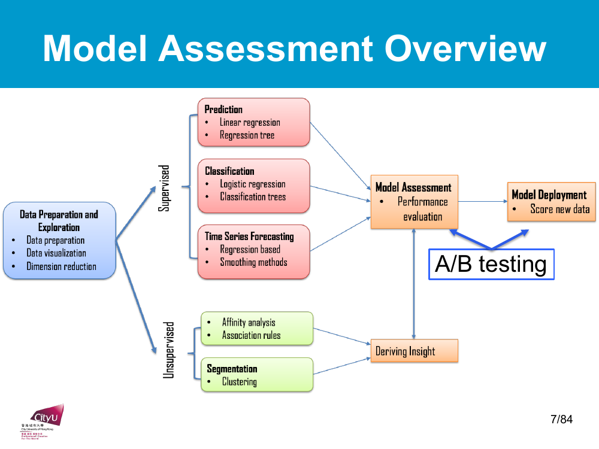

原页图保留教师的标注与给定结果；上述中文按同一页解释，原错另作具名勘误。

### 2.08 监督学习比较什么（讲义 p.8）

监督学习拿已有答案的样本学习输入到输出的关系。答案是离散类别时做分类（Classification），如欺诈／正常；答案是连续数量时做预测／回归（Prediction / Regression），如明天销量。

英文原题：

> However, how to judge the usefulness of a classifier or predictor and how to compare different ones?

中文解析：先确定用途，再选能反映该用途的损失或指标，最后在相同未参与拟合的数据上比较。销售误差 10 件与漏掉 10 笔欺诈并非同一种损失。比较模型还需固定同一批对象、同一时间窗口及相同信息可得性。

英文参考答案（笔记自拟）：Define the prediction task and an appropriate performance measure, then compare models on the same independent evaluation observations. The measure should reflect the intended use and the consequences of errors.

### 2.09 线性回归回顾（讲义 p.9）

原图横轴 X 是协变量／输入（Covariate），纵轴 Y 是响应变量（Response variable）。蓝点是观测，红线是模型；斜率（Slope）控制 X 增加 1 时预测 Y 改变多少，截距（Intercept / bias）是 X 为 0 的预测起点。

一元直线写成 $\hat y=mX+b$。💡 笔记补充：取 $m=3,b=4$，输入 $X=2$，先乘得 6，再加 4 得预测 10。真实值可以偏离这条线，偏离不是又一个需要在预测时偷看的输入。该图回顾 [[IS6400_Business_Data_Analytics/notes/M02-预测分析-线性回归|M02]] 的拟合含义，本讲关心用哪些记录来评价这条线。

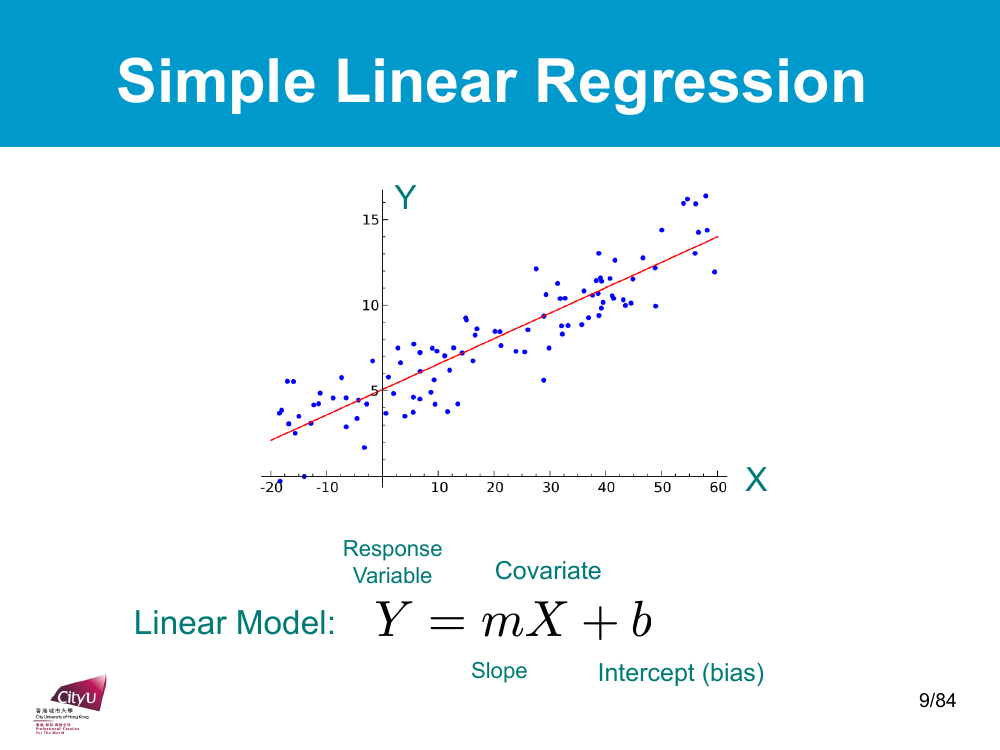

原页图保留教师的标注与给定结果；上述中文按同一页解释，原错另作具名勘误。

### 2.10 真实值与预测值之差（讲义 p.10）

本页问题是 “Measure difference?”，即怎样把真实值与预测值的偏离合成一个可比较的数。设第 i 条真实值为 $y_i$，预测为 $\hat y_i=\theta^\top x_i$；转置符号 $\top$ 在这里表示把对应特征乘对应系数再相加，常数项可并入输入的一列 1。

平方误差和（Sum of squared errors，SSE）为 $\sum_{i=1}^{n}(y_i-\hat y_i)^2$。平方让正负偏离不抵消，并对大偏离付更高代价。$\arg\min_\theta$ 的意思是“返回使这个总和最小的那组系数”，不是返回最小误差本身。

💡 笔记补充：两条真实值 10、20，预测 12、16，误差为 −2、4；平方后是 4、16，总和为 20。本例所有误差指标在下一页表中统一复算。原图把系数记作 MLE（Maximum likelihood estimate，极大似然估计）；它等同普通最小二乘需要独立、同方差正态误差等模型条件，平方和本身不自动证明这些条件。

英文参考答案（笔记自拟）：Compute the residuals on a specified set of observations and aggregate their squared values. The least-squares estimate minimizes this sum; a maximum-likelihood interpretation requires additional assumptions about the errors.

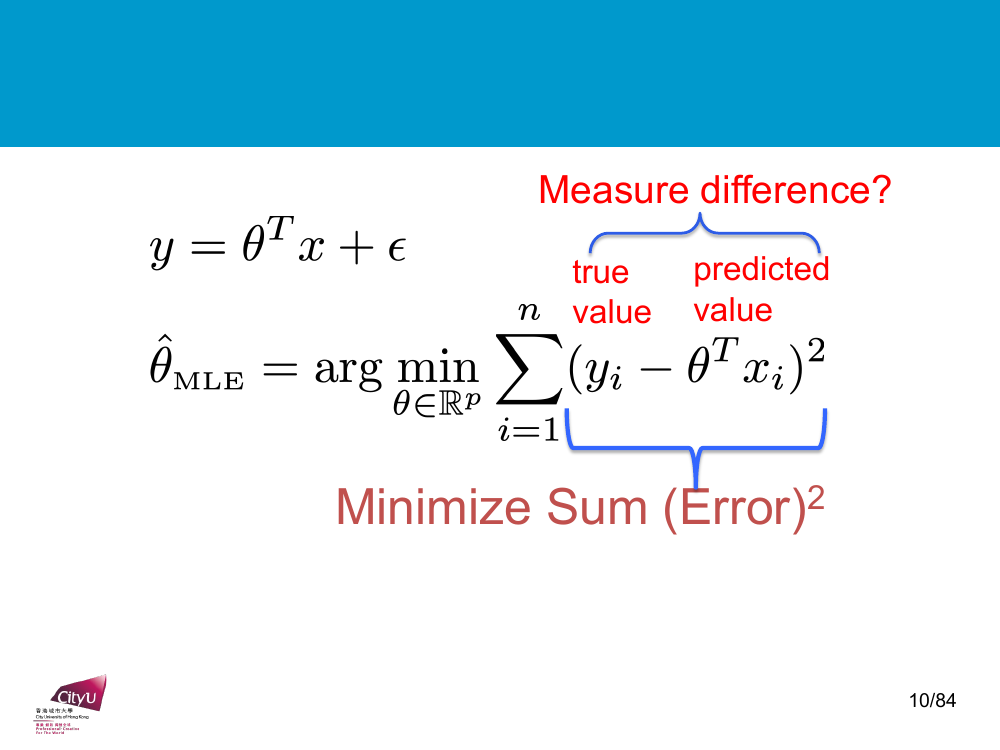

原页图保留教师的标注与给定结果；上述中文按同一页解释，原错另作具名勘误。

### 2.11 分类与回归指标分工（讲义 p.11）

这页左右两列按目标类型列指标。分类先数混淆矩阵（Confusion matrix）的四种结果，再算精确率（Precision）、召回率（Recall）、F-measure 与误分类率（Misclassification error）。数值预测则比较真实与预测的差，使用 MAE／MAD、平均误差、MAPE、RMSE 与总 SSE。

“误差 3”没有单位和分母就无法读。分类误分类率是错误记录数除总记录数；销量 MAE 为 3 表示平均绝对偏差 3 件。F-measure 需声明具体版本，本讲 p.14 使用精确率与召回率的调和平均 F1。

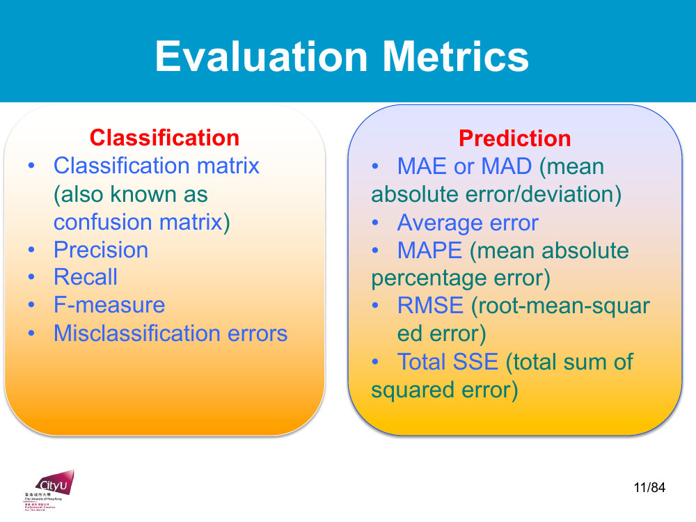

原页图保留教师的标注与给定结果；上述中文按同一页解释，原错另作具名勘误。

### 2.12 五类连续误差指标（讲义 p.12）

这张表每行是一种连续目标指标。先固定 $e_i=y_i-\hat y_i$，n 为当前评价记录数，$y_i$ 为真实目标；同一份数据上才比较数值。沿用 p.10 的真实值 10、20 与预测 12、16，下表都是💡笔记补充算例，非课件给定成绩。

| 指标 | 算法与单位 | 本例计算／读法 |
|---|---|---|
| 平均绝对误差 MAE（Mean absolute error）／本页 MAD | $\frac1n\sum_i\lvert e_i\rvert$，目标原单位 | $(2+4)/2=3$，平均偏离 3 |
| 平均误差（Average error） | $\frac1n\sum_i e_i$，原单位 | $(-2+4)/2=1$，按本页符号约定整体偏低 1 |
| 平均绝对百分比误差 MAPE（Mean absolute percentage error） | $\frac{100\%}{n}\sum_i\lvert e_i/y_i\rvert$ | $(2/10+4/20)/2=20\%$ |
| 均方根误差 RMSE（Root mean squared error） | $\sqrt{\frac1n\sum_i e_i^2}$，原单位 | $\sqrt{20/2}\approx3.1623$ |
| 总平方误差 SSE | $\sum_i e_i^2$，原单位的平方 | $4+16=20$ |

读第一行：先取每条误差的绝对值，再相加，最后除以记录数。平均误差会正负抵消，所以值为 0 也可能每条都错。MAPE 的真实值若为 0 则此式无定义，接近 0 时会被放大；需换合适指标，不静默删行。RMSE 比 MAE 更放大大误差，SSE 还随样本数变化。本页称 RMSE “computed on validation data”是当前用途，RMSE 这个公式也可以用于训练或测试，必须标明评价集。

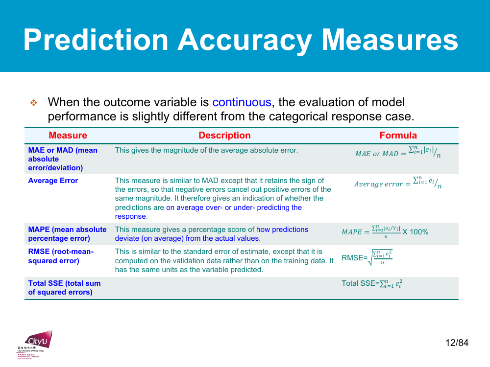

原页图保留教师的标注与给定结果；上述中文按同一页解释，原错另作具名勘误。

### 2.13 类别不平衡（讲义 p.13）

类别不平衡指某类记录远多于另一类。本页列信用卡欺诈、入侵检测和生产线残次品：共同点是重要的异常可能很稀少。p.5 的全报正常反例说明，高准确率可能只反映多数类占比。

因此先声明正类（Positive class）是什么。本讲以欺诈为 Yes；随后分别看真实欺诈漏掉多少、报警中误报多少。把正常改记正类会改变 Precision／Recall 的问题与分母，不能混报。训练时重采样的比例也不能直接冒充部署时真实基率。

### 2.14 混淆矩阵与反欺诈指标（讲义 p.14）

先按原图的行与列读矩阵：行是实际类别（Actual），列是预测类别（Predicted）。a／TP 为真实欺诈且报警；b／FN 为真实欺诈却漏报；c／FP 为正常却误报；d／TN 为正常且未报警。

精确率 $P=TP/(TP+FP)$ 在“所有报警”里数真的；召回率 $R=TP/(TP+FN)$ 在“所有真实欺诈”里数抓到的。F1 为 $2PR/(P+R)=2TP/(2TP+FP+FN)$，要求兼顾两者；相关分母为 0 时要说明无定义或软件约定。

💡 笔记补充：100 笔中 TP=8、FN=2、FP=4、TN=86。12 次报警中 8 次真欺诈，P=2/3；10 笔真欺诈中抓住 8 笔，R=0.8；F1=16/22≈0.7273。准确率为 94%，但仍需说明漏掉的 2 笔损失与 4 次误报的处理成本。

英文原题：

> Which term is the most important for bank fraud transaction detection?

中文解析：若重点是少漏欺诈，关注召回率／FN；若人工核验或冻结误伤代价很大，精确率也重要。本页没给成本，不能声称一个指标在所有银行永远最重要。

英文参考答案（笔记自拟）：Recall is especially important when missing fraud is costly. Precision and the cost of false alarms must also be considered. The most suitable objective depends on the relative consequences of false negatives and false positives.

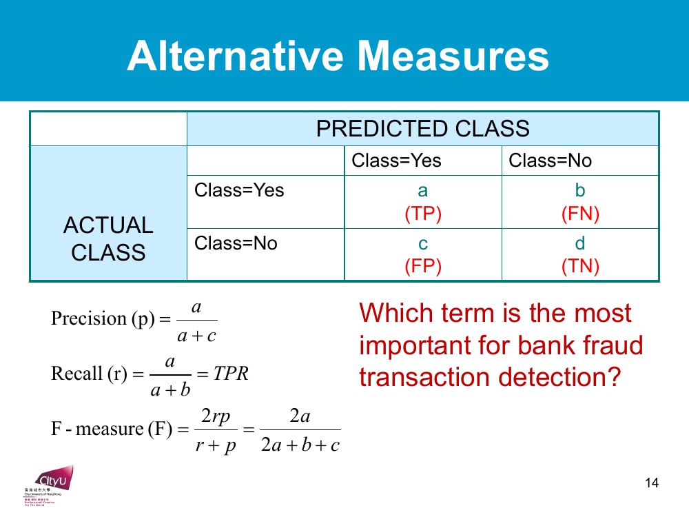

原页图保留教师的标注与给定结果；上述中文按同一页解释，原错另作具名勘误。

### 2.15 ROC与AUC（讲义 p.15）

ROC（Receiver operating characteristic）曲线把不同报警阈值对应的错误取舍画出来。纵轴真阳性率 $TPR=TP/(TP+FN)$，横轴假阳性率 $FPR=FP/(FP+TN)$；阈值降低通常报更多正类，两者都可能升高。左上角意味着少误报且多抓到欺诈。

原图 M1 红线在小 FPR 区间较好，M2 虚线在较大 FPR 区间较好；曲线交叉，所以不能说其中一个在所有工作点都占优。对角线是随机排序的基准。曲线下面积 AUC（Area under the ROC curve）总结排序能力，但不是指定阈值下的准确率，也不包含真实损失。

原文 “AUC by definition is between 0.5 and 1” 范围过窄：一般 ROC AUC 在 0 与 1 之间，反向排序可以低于 0.5。💡 笔记补充：两正类得分 0.9、0.4，两负类 0.6、0.1；四对正负比较中正类得分更高的有三对，因此 AUC=3/4=0.75。把全部分数方向反过来得 0.25。

ROC 使用各真实类别内部比例，固定两类的条件得分分布时不直接随样本中的类占比改变；现实分布漂移仍可能改变曲线，罕见事件下还须看报警精确率／负担。🔗 公式与排序解释参见 [scikit-learn ROC AUC](https://scikit-learn.org/stable/modules/generated/sklearn.metrics.roc_auc_score.html)，获取于 2026-11-18。

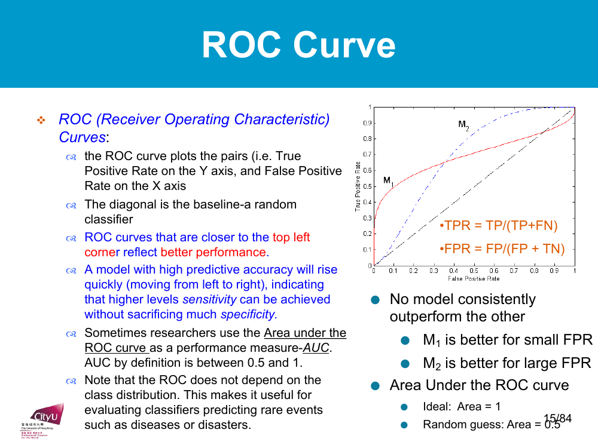

原页图保留教师的标注与给定结果；上述中文按同一页解释，原错另作具名勘误。

### 2.16 训练验证测试与上线（讲义 p.16）

原图四行从训练（Training data）、验证（Validation data）、测试（Test data）走到新数据（New data）。训练用于拟合候选；验证把候选放在相同尺度上选择；配置冻结后，测试评价这套选择过程的结果；新数据是实际使用对象。

测试箭头旁写 optional，是源图措辞。若已经用验证集反复选模型，就不能把该验证分数再当未受选择影响的最终成绩；要保留独立测试，或采用后文外层评估。三种角色取决于数据怎样被使用，不取决于文件叫 `test.csv` 还是 `valid.csv`。

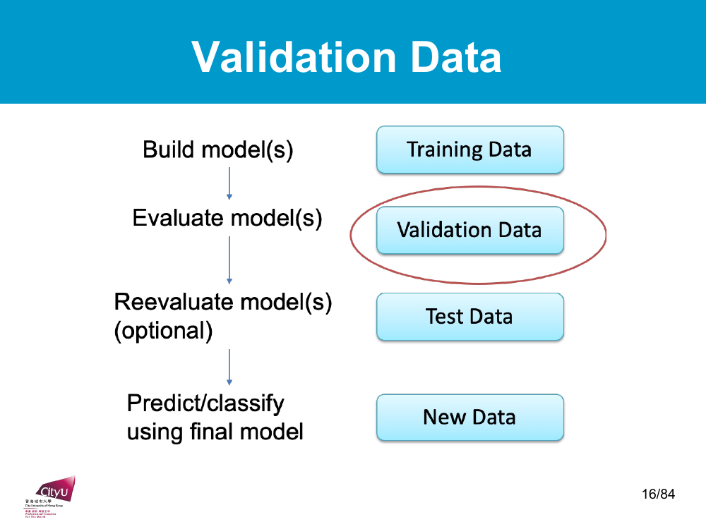

原页图保留教师的标注与给定结果；上述中文按同一页解释，原错另作具名勘误。

### 2.17 线性关系的独立验证（讲义 p.17）

原图真实生成关系写 $y=3x+4+\epsilon$：3 是斜率，4 是截距，$\epsilon$ 表示每条观测的随机偏离。蓝点用于训练，黄星用于验证，黑点标在预测线上。先看同一横坐标处的纵向距离，才是该条预测误差，不是两点间横向距离。

若 x=1，模型不含未来噪声的预测为 7；某条真实值可以为 7.6，此时误差为 0.6。这个数字例是💡笔记补充，原图未给全部底层点和噪声种子，不能声称重新复现了图中精确误差。

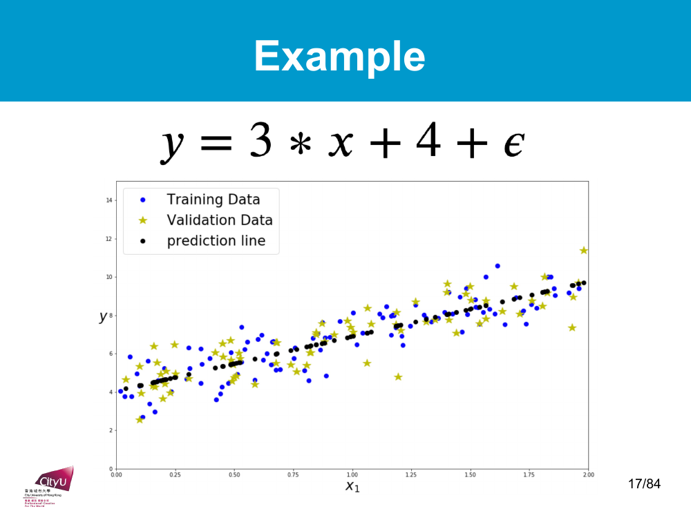

原页图保留教师的标注与给定结果；上述中文按同一页解释，原错另作具名勘误。

### 2.18 欠拟合与过拟合（讲义 p.18）

欠拟合（Underfitting）是候选能力或训练不足，连训练中的规律也抓不住；左图平直预测无法跟上起伏，训练误差较大。过拟合（Overfitting）是对训练细节过度适配；右图弯曲曲线追逐蓝点，却在右侧新数据处偏离。

读图要把“训练很小”和“泛化很好”拆开。复杂模型可以通过记住噪声减小训练误差，但将来噪声未必同样出现。训练与验证都差优先查欠拟合、特征或数据问题；训练好验证差要查过拟合与分布差异，单凭两分数不能唯一定位原因。

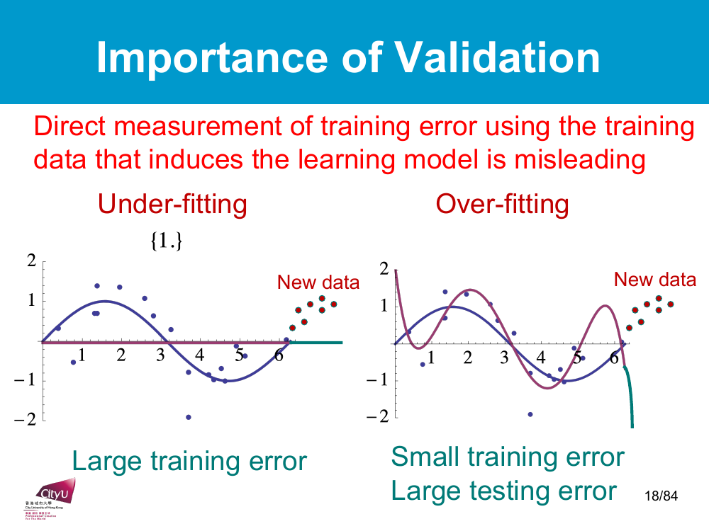

原页图保留教师的标注与给定结果；上述中文按同一页解释，原错另作具名勘误。

### 2.19 验证集的用途与代价（讲义 p.19）

英文原题是 “Detect and prevent overfitting?”。本页做法是从可开发的数据中留出验证集：训练部分拟合模型，验证部分估计模型在未拟合记录上的误差，并用于选复杂度。验证集不是最终测试集。

验证会减少每次可训练的记录数，这是估计可信度与拟合数据量的取舍。若看过验证结果再调深度、特征或阈值，验证就已经参与选择。数据填补、标准化、特征筛选也要只在当前训练部分估计，再原样应用到验证；否则标签或分布信息可能提前流入训练。

英文参考答案（笔记自拟）：Use a separate validation set to compare candidate complexities and detect a gap between training and validation performance. Fit preprocessing on the training subset only. Validation supports model selection; an independent test set is needed for the final assessment after selection.

### 2.20 留出法的第一阶段（讲义 p.20）

留出法（Hold-out）先把数据 D 分成训练部分 $D_T$ 与验证部分 $D_V$。原图 $D=\{(X_i,Y_i)\}_{i=1}^n$ 表示 n 对输入和已知答案；下标 T／V 表示用途。候选类别 $\mathcal H_\lambda$ 由配置 $\lambda$ 决定，例如最大深度 2 的树。

对每个配置，用 $D_T$ 找到训练经验风险 $\hat R_T(f)$ 最小的候选，记为 $\hat f_\lambda$。“经验风险”是这批有限记录上的平均损失，不是已知的未来真实风险；帽子表示由数据估计。先固定切分再比较，避免给喜欢的模型挑容易的验证集。

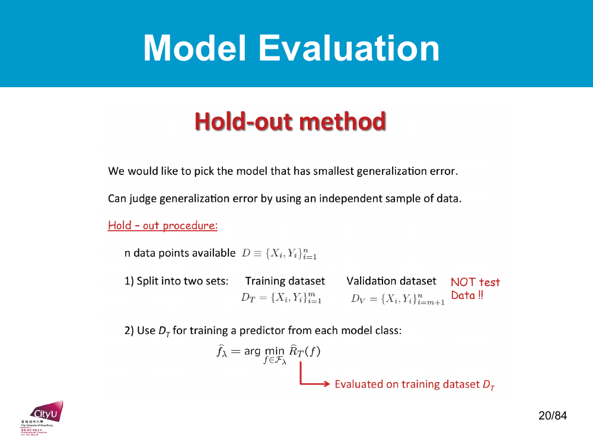

原页图保留教师的标注与给定结果；上述中文按同一页解释，原错另作具名勘误。

### 2.21 留出法的选择阶段（讲义 p.21）

下一步把每个训练好的 $\hat f_\lambda$ 用于相同的 $D_V$，比较验证损失，选 $\hat\lambda=\arg\min_{\lambda\in\Lambda}\hat R_V(\hat f_\lambda)$。$\Lambda$ 是候选配置集合，输出是配置编号，再取对应模型作留出法的赢家。

💡 笔记补充：深度 2 和 8 的树在训练集错误率分别为 0.12、0.02，在验证集为 0.15、0.22。若按错误率越低越好，应选深度 2；它训练分数稍差，但验证更好。原图末句提醒：一份数据误差小不意味着第二份也小。此处还没有使用最终测试结果。

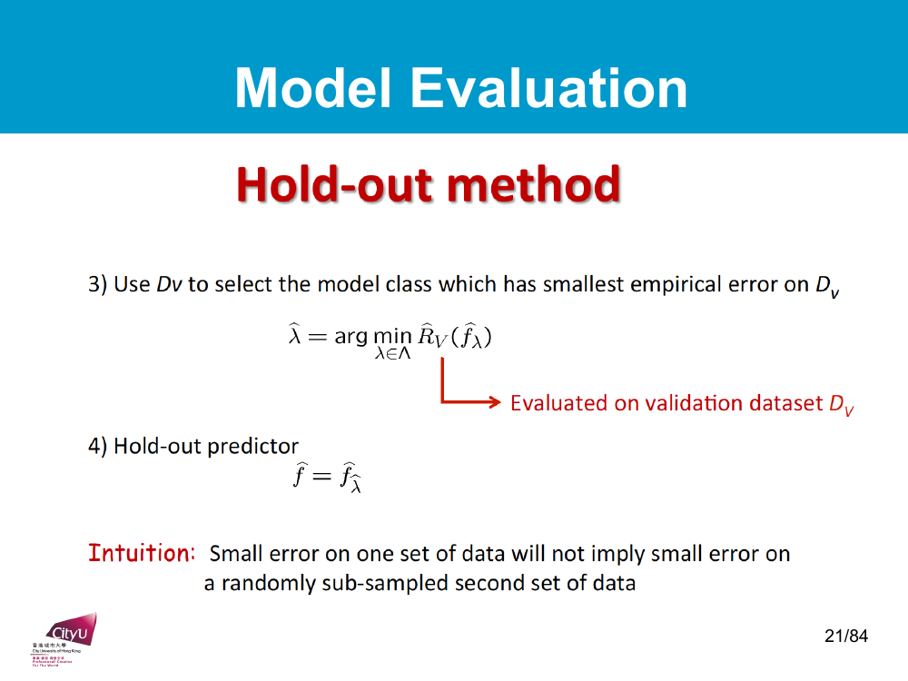

原页图保留教师的标注与给定结果；上述中文按同一页解释，原错另作具名勘误。

### 2.22 同一选择框架可换模型族（讲义 p.22）

本页在前页公式下加深度遍历例。$\lambda=1,2,\ldots,N$ 可表示候选层数，也可扩展为算法家族／配置标识。这里的 $\lambda$ 是泛指选择标记，并不在每页都代表正则化强度。

原步骤 3 写 “Use trained data to evaluate performance”；按上方明确标注的 $D_V$ 和本节目标，应读为用训练好的模型在验证数据上评价，不能用训练数据的最小误差选赢家。否则更复杂的树通常占便宜。

英文原题：

> What if λ: decision tree, random forest?

中文解析：相同框架也可比较树与随机森林：各自只在相同训练部分拟合，使用同一验证指标比较，再做独立最终评价。

英文参考答案（笔记自拟）：Let the candidate set contain both decision-tree and random-forest configurations. Train each candidate on the training subset and select it using the same validation observations and metric, not training error.

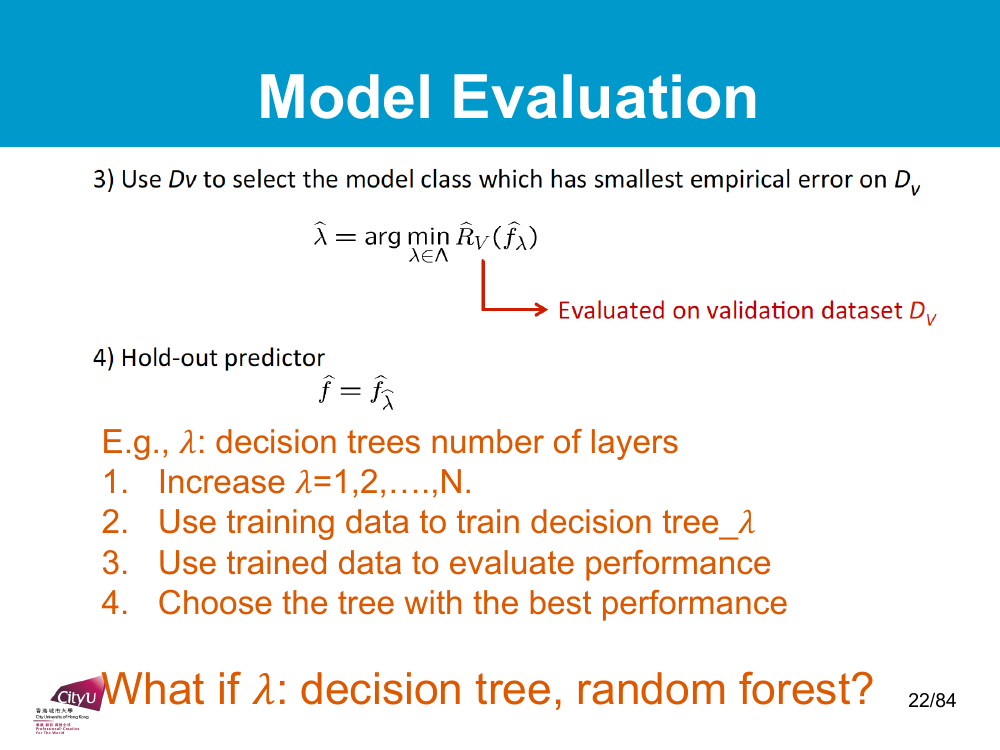

原页图保留教师的标注与给定结果；上述中文按同一页解释，原错另作具名勘误。

### 2.23 20条数据的80/20划分（讲义 p.23）

原例有 20 对 X、Y。按从上到下 1 起编号，图中红色验证行是 4、6、7、12，对应 (4.9,14.8)、(6.3,19.8)、(7.2,21.8)、(12.8,38.7)；其余 16 行训练。红色只是本次划分，不是错误样本。

80% 训练与 20% 验证的计算是 16／20 与 4／20；比例不是所有任务的固定标准。原数据按 X 排序展示，不说明它们是时间序列。若真有时间先后且目标是预测未来，应改用 p.33–35 的时间划分，不能照本页随机抽。

💡 笔记补充的可复做结果：按这 16 行拟合带截距的一元最小二乘，斜率约 3.004894、截距约 0.429960；在四条验证记录上算 MAE≈0.312739、RMSE≈0.326192。输入是原表，模型与计算是笔记补充，不冒称课件给定答案；精确结果以本批 `calculations.json` 为准。

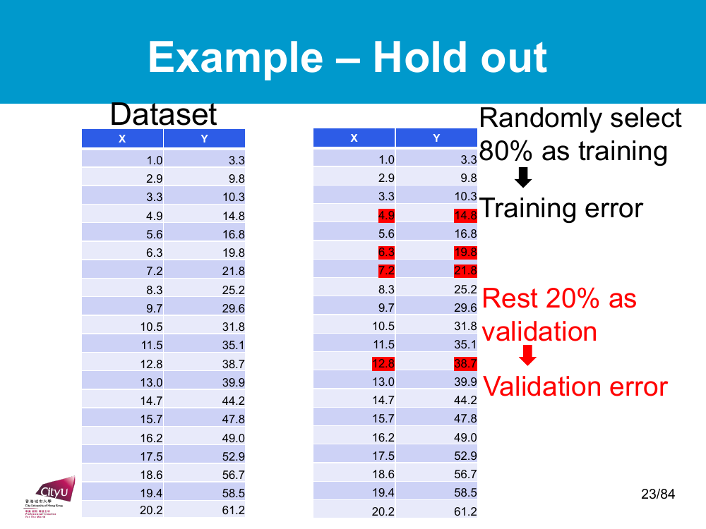

原页图保留教师的标注与给定结果；上述中文按同一页解释，原错另作具名勘误。

### 2.24 单次留出的局限（讲义 p.24）

单次留出有两项代价：数据少时，划出验证会削弱训练；碰上不具代表性的划分时，验证分数可能偶然特别高或特别低。“独立”并不保证每次有限样本都具有完美代表性。

原图提出用随机子抽样家族缓解划分偶然性，代价是更多训练计算。重复评价不会创造新的独立人群；同一用户、同一主体或相邻时点若跨训练和验证仍可能泄漏，需要按组或时间划分。

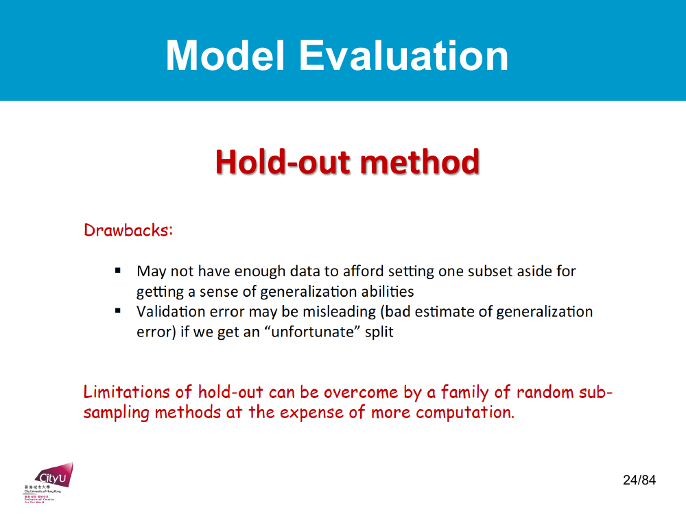

原页图保留教师的标注与给定结果；上述中文按同一页解释，原错另作具名勘误。

### 2.25 K折交叉验证机制（讲义 p.25）

<!-- cityu-nav:landing-25 -->
[[#4. 速查表|↩ 回速查]] · [[#5. 双语术语卡|回术语]] · [[#0. 三分钟速览|阅读导航]]
<!-- cityu-nav:landing:end -->

K 折交叉验证（K-fold cross-validation，CV）把开发数据分成 K 个互不重叠的折（Fold）。每轮拿一折验证、其余 K−1 折训练；重新拟合 K 次，让每条记录恰好验证一次。原图每行一次运行，灰块向右轮换，白块是该轮训练；每轮得到一个 $e_k$。

比较候选配置时，固定同一套折。均值 $\bar e=\sum_{k=1}^K e_k/K$ 描述平均误差；标准差描述折间变化，须声明分母约定。💡 笔记补充：五折误差为 2、3、4、3、3，均值为 3；逐个减均值后得到 −1、0、1、0、0，平方再相加得 2。以 K−1 为分母的样本标准差为 $\sqrt{2/4}\approx0.7071$。折间分数相关，不能直接把标准差当作严格独立样本置信区间。

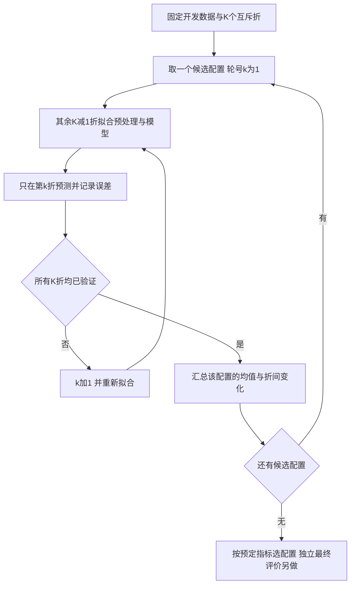

从一轮沿图走：验证折不能参与填补或标准化的拟合；下一轮验证折更换后，预处理也跟着重新拟合。循环结束是所有候选按固定规则比较完毕，不是不断换分折直到出现高分。

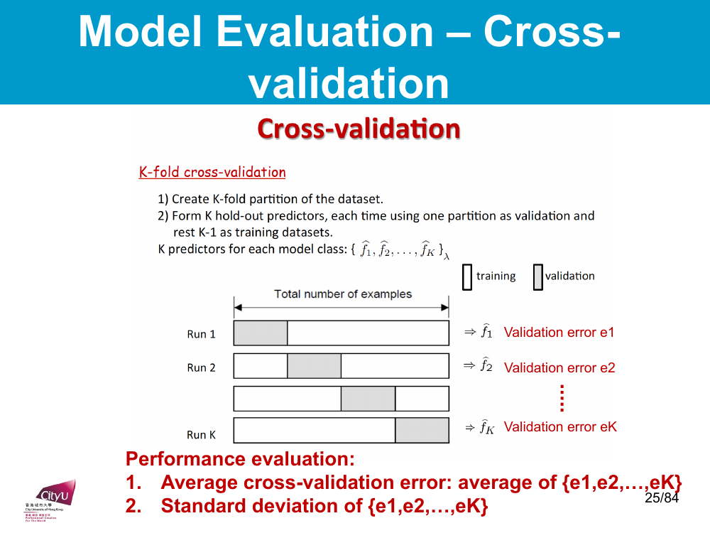

原页图保留教师的标注与给定结果；上述中文按同一页解释，原错另作具名勘误。

### 2.26 五折第1轮（讲义 p.26）

五折例共 20 行，每折 4 行。第 1 轮红色为第 1–4 行，X 为 1.0、2.9、3.3、4.9；其余 16 行训练。先用这 16 行拟合，再预测红色四条，才得到第一个验证误差。

页底 “K=1” 表示当前第 1 轮，不是把五折法变成只有一个折。左表是完整数据，右表颜色是本轮角色；同一行的 X 和 Y 必须一起移动，不能把答案单独分开。

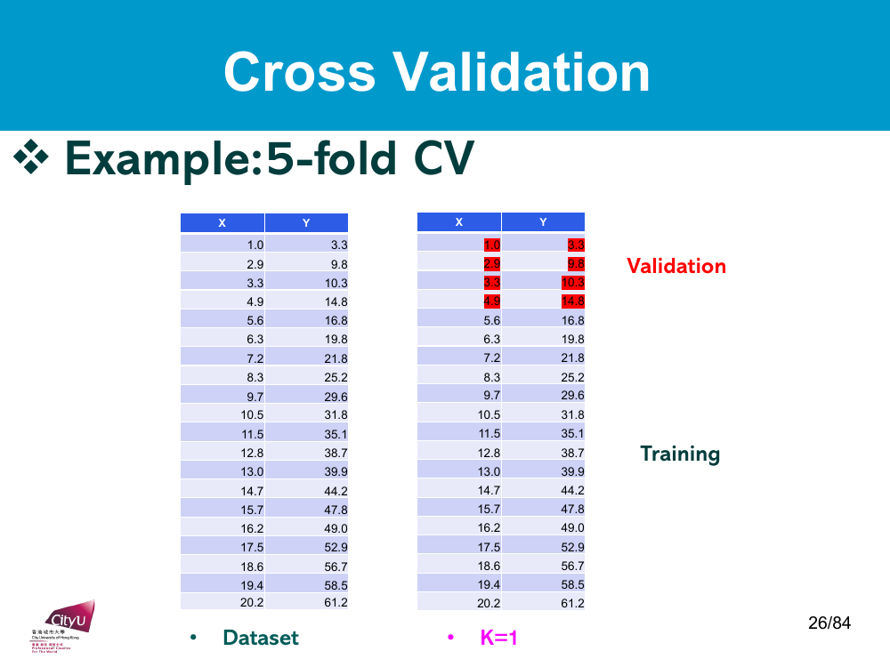

原页图保留教师的标注与给定结果；上述中文按同一页解释，原错另作具名勘误。

### 2.27 五折第2轮（讲义 p.27）

第 2 轮红色移到第 5–8 行，X 为 5.6、6.3、7.2、8.3。第 1–4 行这次成为训练的一部分，后 12 行也训练。因此不是只拿红块上面的记录训练。

重新拟合后得到第二个误差；不能沿用第 1 轮已经见过本轮验证数据的模型。原图蓝色括号把前后两段训练合并指向 Training，红箭头只指当前四行验证。

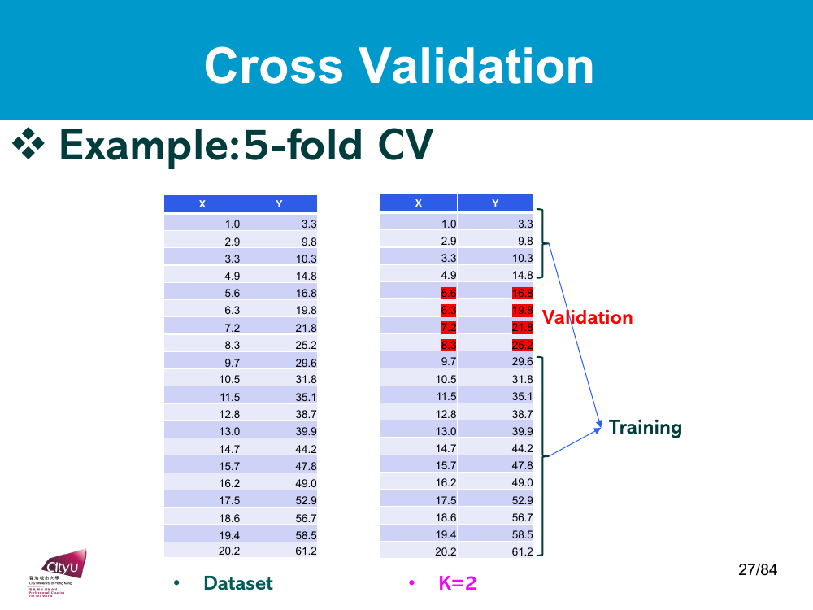

原页图保留教师的标注与给定结果；上述中文按同一页解释，原错另作具名勘误。

### 2.28 五折第3轮（讲义 p.28）

第 3 轮验证第 9–12 行，X 为 9.7、10.5、11.5、12.8；第 1–8 与第 13–20 行合成 16 条训练。两侧蓝箭头汇向 Training，是不连续行号仍组成一份训练集的提示。

每个候选在同一折上比较才能减少“划分不同”的影响。这个排序演示没有随机化说明，不能自动当作对所有任务最合适的划分；分布分层、主体分组或时间条件仍要另定。

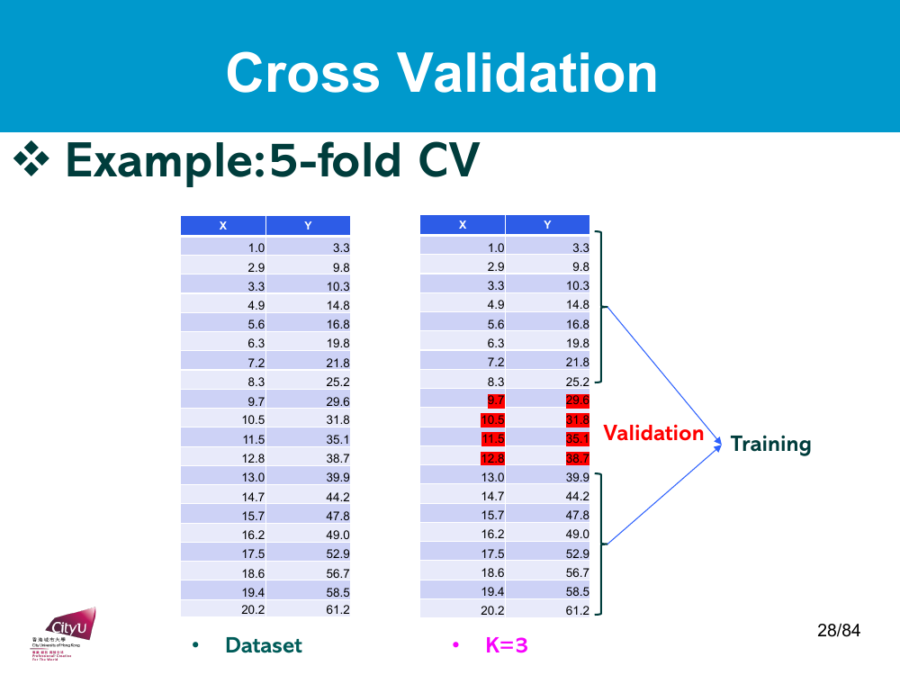

原页图保留教师的标注与给定结果；上述中文按同一页解释，原错另作具名勘误。

### 2.29 五折第4轮（讲义 p.29）

第 4 轮红块为第 13–16 行，X 为 13.0、14.7、15.7、16.2，其余训练。相较前页唯一角色变化是验证折向下移动；任务、指标和每轮重新拟合的规则不变。

读者应能不靠颜色说出训练 ID：1–12 与 17–20。若只拿 1–12 训练，就漏掉最后四行，也已不再是原图五折流程。

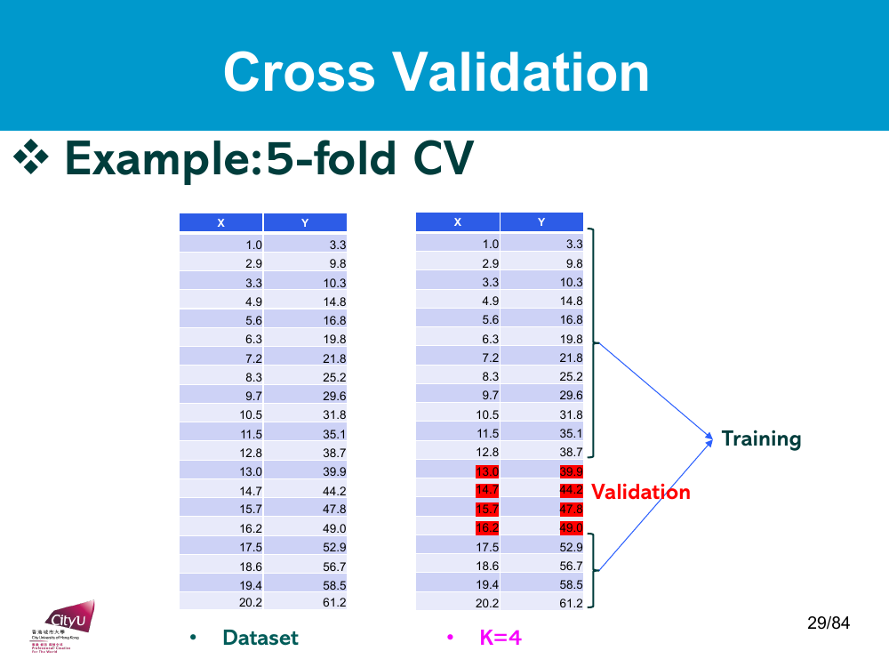

原页图保留教师的标注与给定结果；上述中文按同一页解释，原错另作具名勘误。

### 2.30 五折第5轮（讲义 p.30）

第 5 轮最后四行验证，X 为 17.5、18.6、19.4、20.2，前 16 行训练。至此五个验证折互斥且并集覆盖 20 条记录，每条在四轮中训练、另一轮验证。

汇总的是五次验证误差，不把五次训练误差平均后冒充验证成绩。若要比较配置，所有配置都走完这五轮；选定以后，通常按约定在完整开发数据上重拟合，最终测试集仍保持未用于选择。

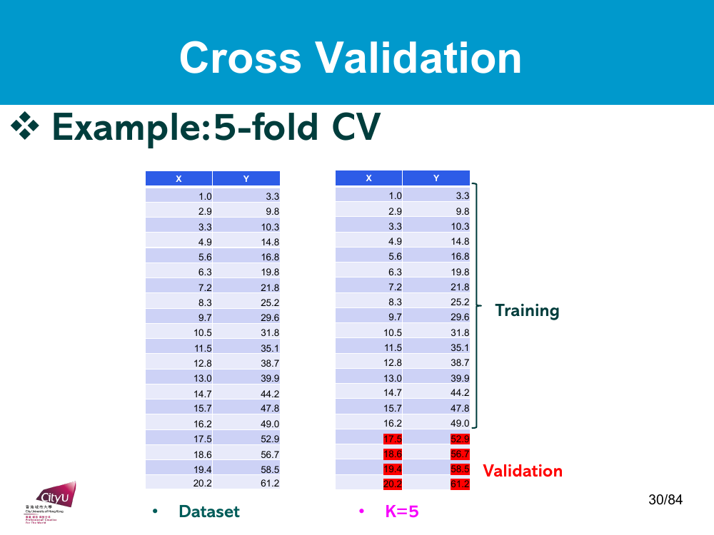

原页图保留教师的标注与给定结果；上述中文按同一页解释，原错另作具名勘误。

### 2.31 Quiz I三折划分（讲义 p.31）

本题要求设计三折划分，不是要求找最佳预测模型。RID（Record ID）只是记录编号；X、Y 必须按同一 RID 配对。

英文原题与给定数据（完整保留，讲义 p.31）：

> Design a 3-fold CV training-validation split and write down the Record ID list of each fold.
>
> e.g.:
> Fold 1: Training RID: (1,2,3,…) Validation RID: (5,6,…)
>
> Fold 2: Training RID: (…) Validation RID: (…)
>
> Fold 3: Training RID: (…) Validation RID: (…)

下表一行是一条给定记录：RID 为编号，X 为输入数值，Y 为该记录已知答案；源题没有指定业务单位。

| RID | X | Y |
|---|---|---|
| 1 | 2.9 | 9.8 |
| 2 | 3.3 | 10.3 |
| 3 | 4.9 | 14.8 |
| 4 | 5.6 | 16.8 |
| 5 | 6.3 | 19.8 |
| 6 | 7.2 | 21.8 |
| 7 | 8.3 | 25.2 |
| 8 | 9.7 | 29.6 |
| 9 | 10.5 | 31.8 |

中文读题：每轮分成训练与验证，要求写清三轮双方 ID；三折应互斥、大小相近且并集覆盖全部记录。原 e.g. 只是写法占位，不约束必须按那个未写完的列表分组。

⚪ 参考作答（笔记推断，一种合法划分）：

| 轮次 | 训练 RID | 验证 RID |
|---|---|---|
| 1 | 4,5,6,7,8,9 | 1,2,3 |
| 2 | 1,2,3,7,8,9 | 4,5,6 |
| 3 | 1,2,3,4,5,6 | 7,8,9 |

先把 9 条切成三组各 3 条，再让每组轮流验证，训练取另外 6 条。逐轮交集为空，三个验证集的并集为 1–9；所以没有一条漏验或在同一轮又训又验。划分不唯一；本题没有时间约束或随机种子要求，以上是确定性教学示例。

英文参考答案（笔记自拟）：For fold 1, train on RIDs (4,5,6,7,8,9) and validate on (1,2,3). For fold 2, train on (1,2,3,7,8,9) and validate on (4,5,6). For fold 3, train on (1,2,3,4,5,6) and validate on (7,8,9). Each record is used for validation exactly once and is excluded from training in that fold.

💡 改条件检查：若 RID 代表按时间排序的观测、任务又要求预测未来，上表第 1 轮用未来训过去就不合适，需改滚动评价。为了复做机制，本批额外在这三轮分别拟合一元回归，MAE≈0.361980、0.384741、0.382425；这些不是本题要求，也不是官方给定成绩。

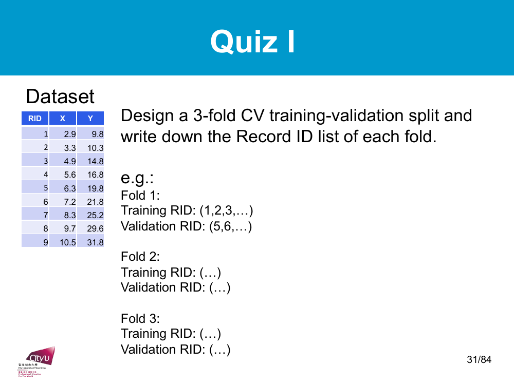

原页图保留教师的标注与给定结果；上述中文按同一页解释，原错另作具名勘误。

### 2.32 随机重复留出（讲义 p.32）

随机重复留出（Repeated random subsampling）每次从全部开发记录随机抽固定比例 $\alpha$ 用于验证，其余训练，再重复 K 次。$0<\alpha<1$；若有 100 条、$\alpha=0.2$，一轮验证 20 条，训练 80 条。

原图每行细灰条散落的位置都可能不同，表示不同轮重新抽样。同一条可能多次验证，也可能一次没被抽中，这与互斥 K 折恰好验证一次不同。每轮仍要重新拟合模型和预处理；报告误差均值及变化，不把重复轮数当新增独立样本量。

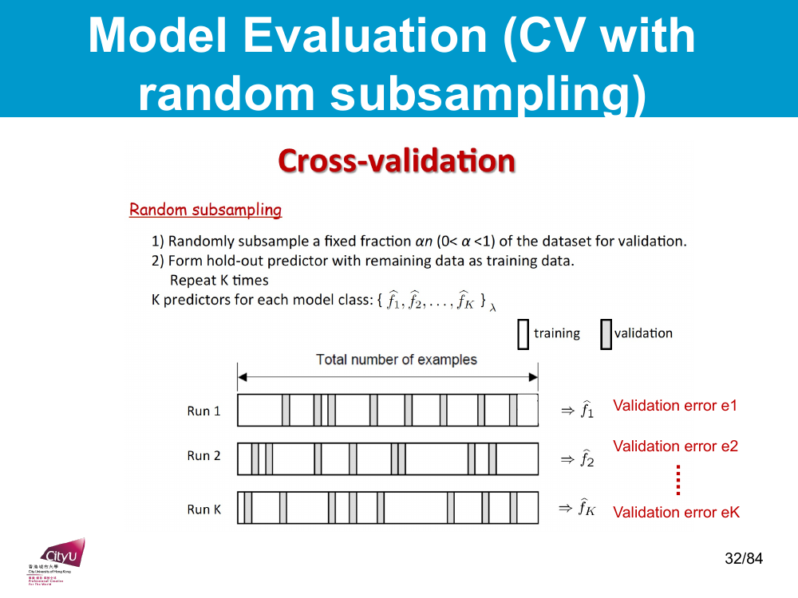

原页图保留教师的标注与给定结果；上述中文按同一页解释，原错另作具名勘误。

### 2.33 未来预测的评价边界（讲义 p.33）

英文原题：

> What if we care about the model performance for future forecasting ONLY?

中文意思是只关心向未来预测，不关心把混在历史里的未知点补出来。随机 K 折可能让训练看到验证时点之后的数据，与实际部署不一致。需要先确定预测起点 t 当时知道什么，再用这些历史拟合，预测 t 之后的目标。

英文参考答案（笔记自拟）：Use rolling-origin evaluation with training observations available before each forecast origin and validation targets after that origin. Match the forecast horizon and information availability to the intended deployment, instead of randomly mixing past and future records.

### 2.34 扩展窗口滚动预测（讲义 p.34）

原图第一列 T 是时点，橙色是当轮已知历史，红色是下一条待预测。第 1 轮用 T=0–5 训练、T=6 验证；第 2 轮用 0–6 训练、T=7 验证；最后一轮用 0–18 训练、T=19 验证。这是扩展窗口（Expanding window）：训练历史越积越长。

从第一轮到第二轮，只有当 T=6 的真实值已经到达，才能把它纳入历史。预测产生后保存，再等真实值计算误差，不能提前把答案带进特征。日期缺失时“下一条”不必然等于“明天”，需要核记录频率。

💡 笔记补充的最小例：观测为 10、12、14、16，先用前两条训练；若候选是“最近值预测下一条”，第一次预测 12，真实 14，绝对误差 2；真实 14 到达后再预测下一条为 14，真实 16，误差 2。两次都先预测后见答案，平均绝对误差为 2。

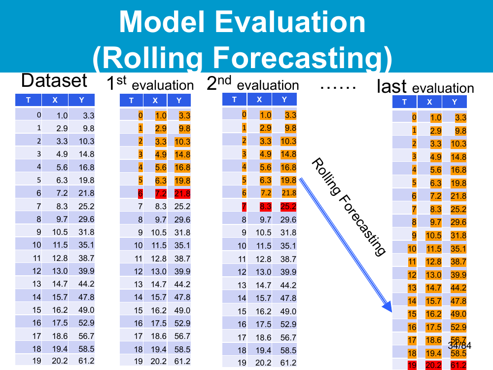

原页图保留教师的标注与给定结果；上述中文按同一页解释，原错另作具名勘误。

### 2.35 多步与固定窗口（讲义 p.35）

本页在滚动法上增加两个独立选择：多步预测（Multi-step forecasting）把未来多条放入验证，例如下一至第三天；固定长度训练（Fixed-sized training）每次移除最老记录，只保留最近 L 条。扩展／固定窗口决定训练量，预测步长决定看多远，不能混成一个参数。

例如起点 T=5，未来三步目标是 6、7、8。必须用当时可得信息同时形成三步预测；若递推法需要上一目标，应使用先前预测值，而不能偷用尚未知的真实值。若选择逐天更新的一步预测，那是另一种协议，成绩不能直接冒充三步提前预测。

### 2.36 早停与最佳复杂度（讲义 p.36）

早停（Early stopping / Early termination）用验证表现选择停止训练的时机。原图红虚线训练 RMSE 持续降，蓝线验证 RMSE 先降后升，箭头落在蓝线最低附近；横轴标 Model Complexity，不是已确认的训练 epoch，所以不能把约 250 直接解释为本课固定最佳轮数。

实际操作不能预知未来最低点。💡 笔记补充：验证误差依次为 5、3、2、2.2、2.4，保存第 3 轮模型；若约定连续两轮不改善就停，则在第 5 轮停止并恢复第 3 轮权重。停止耐心值（Patience）、改善阈值与最大轮数要预先定义，最终测试不能拿来选停止轮数。

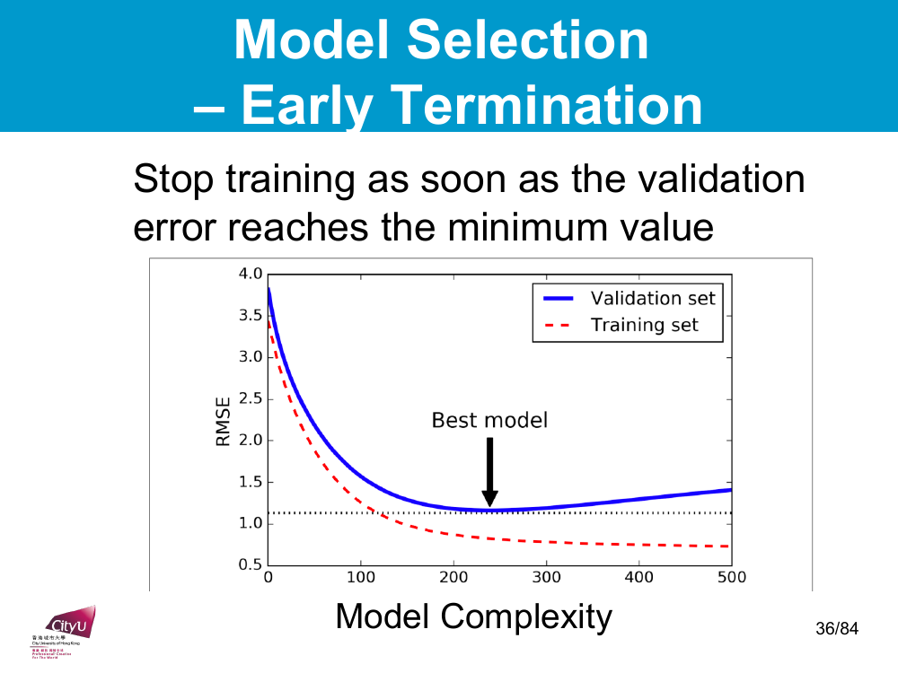

原页图保留教师的标注与给定结果；上述中文按同一页解释，原错另作具名勘误。

### 2.37 树示例的数据生成（讲义 p.37）

原例有两类各 5,200 条：蓝色“+”中 5,000 条来自以 (10,10) 为中心的高斯分布（Gaussian distribution），另加 200 条噪声；红色“o” 5,200 条来自均匀分布（Uniform distribution）。蓝点集中在中央，红点遍布方形区域，二者存在重叠，所以规则不必能把每点完全分开。

课件用 10% 训练、90% 测试，合计 10,400 条，即 1,040 条训练、9,360 条测试。这是该示例设定，不是通用推荐比例。原源没给种子、完整数据和拟合实现，本篇读已给图，不声称重训这些树。

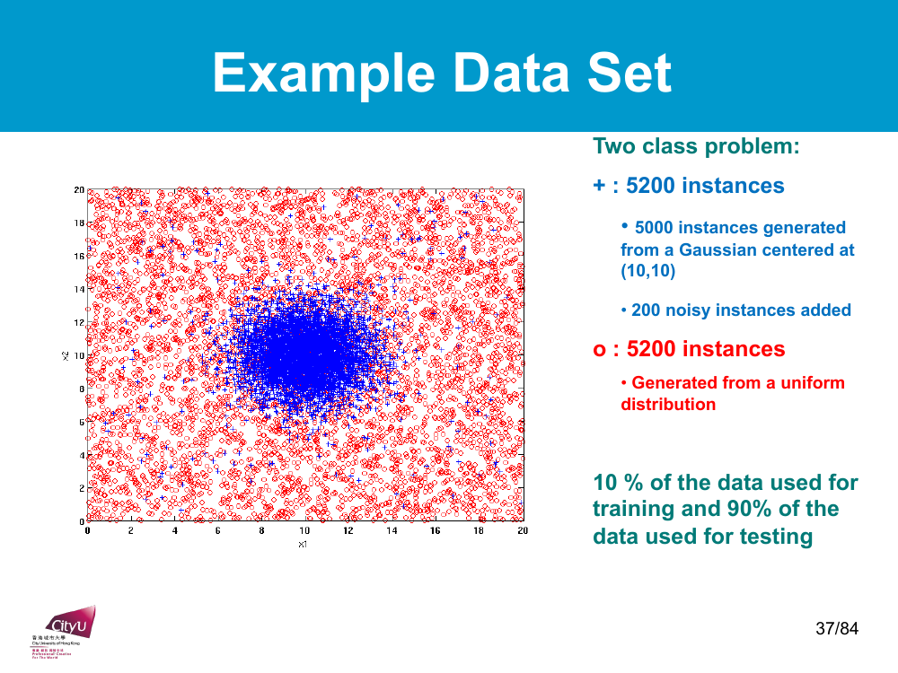

原页图保留教师的标注与给定结果；上述中文按同一页解释，原错另作具名勘误。

### 2.38 训练误差随节点增多（讲义 p.38）

横轴节点数（Number of nodes）从小到大，纵轴错误率（Error），唯一蓝线是训练误差（Train Error）。起初增加分裂迅速改善，之后继续细化可把训练错误压得接近零。

这张图没有测试线，因此不能从“最右边最低”推断最大树最好。拟合原本参与建树的记录容易受益于复杂度，是否值得增加节点要等同协议的验证／测试证据。这里节点数的计数口径也不能不经核实直接换成深度。

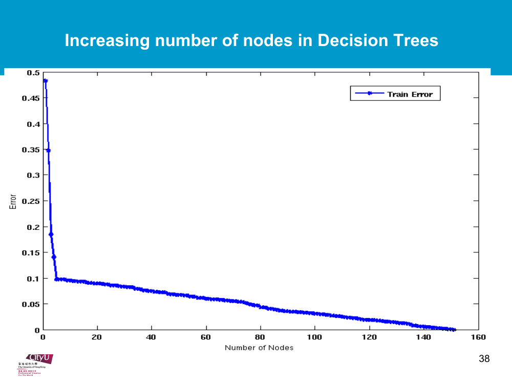

原页图保留教师的标注与给定结果；上述中文按同一页解释，原错另作具名勘误。

### 2.39 4节点树与分区（讲义 p.39）

本页把标作 “4 nodes” 的树与它的空间分区叠到训练曲线。图中实际可辨认 4 个分裂判断（内部节点），所以原标题不是“总节点仅 4 个”的完整二叉树计数。纵横空间轴是 x2、x1，中央矩形预测为“+”，外侧为“o”。

按树从根读一个补充输入 (x1,x2)=(10,10)：10 不小于 6.45956，进入下一判断；10 小于 13.1086；x2=10 不小于 7.03548、又小于 14.3129，落入中央“+”叶。图上的四条轴向阈值形成一个矩形边界。若 x1=3，则第一步就落到外侧“o”叶，不需走后面判断。

树图的左右线是条件分支，不是时间流；部分边没有显式 True／False，以上按图中空间区域与阈值联合解释。当前训练误差约为 0.10 是图上读数，不是精确原始计算输出。

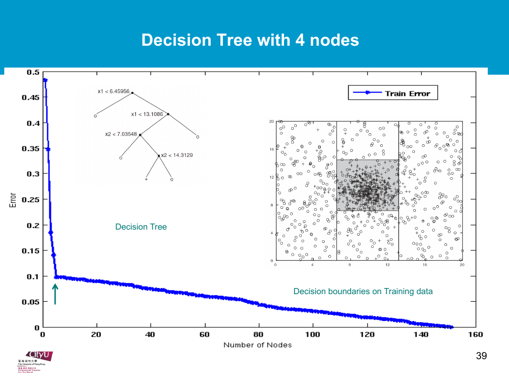

原页图保留教师的标注与给定结果；上述中文按同一页解释，原错另作具名勘误。

### 2.40 50节点树与分区（讲义 p.40）

“50 nodes” 树的分支明显增多，右侧空间图出现更多细小矩形，试图把中央点群及零散异常分别切开。相较前页，训练曲线的标记移到节点数约 50、错误率更低处。

读图重点是分裂复杂度与边界颗粒度对应：多加阈值能包住更小的训练子区域，也可能记住噪声。原图密集细枝的全部阈值未提供独立可复制表，不能声称复现整棵树；本页不是逐阈值执行题。它仍保留原图供课中对照，比较判断在下一页进行。

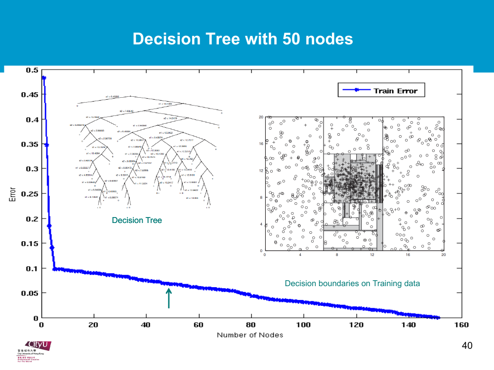

原页图保留教师的标注与给定结果；上述中文按同一页解释，原错另作具名勘误。

### 2.41 哪棵树更好（讲义 p.41）

英文原题与图中标签为 “Which tree is better?”、“Decision Tree with 4 nodes” 和 “Decision Tree with 50 nodes”。任务是比较两种复杂度，不是仅指出谁在训练曲线上更低。

⚪ 参考作答（笔记推断）：50 节点树的训练误差较小；是否更适合未来记录，须看独立评价数据、错误成本与复杂度。若其验证误差更大，应优先简单树；本页只给训练线，不能选定未来赢家。

英文参考答案（笔记自拟）：The 50-node tree has a lower training error, but this does not establish better generalization. Compare the trees using independent validation data and the relevant error costs. The training curve alone is insufficient to determine which tree is better.

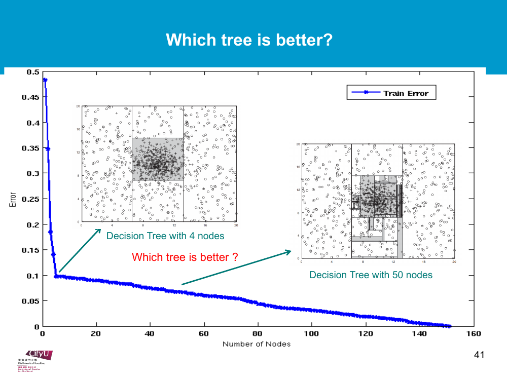

原页图保留教师的标注与给定结果；上述中文按同一页解释，原错另作具名勘误。

### 2.42 样本量与泛化（讲义 p.42）

左图同时画训练蓝线与测试红线：节点增多后蓝线下降，红线缓慢上升，训练／测试差距扩大。右图标题说样本量加倍，两线更接近，展示更多有代表性的训练数据可能减轻过拟合。

“数据增多会缩小差距”是该例观察，不保证任何新增数据都有用；错误标签、相同主体重复或分布改变都可能破坏预期。若反复用图中的 Test Error 挑节点数，这批数据实际已扮演验证角色，仍需另外的最终测试。

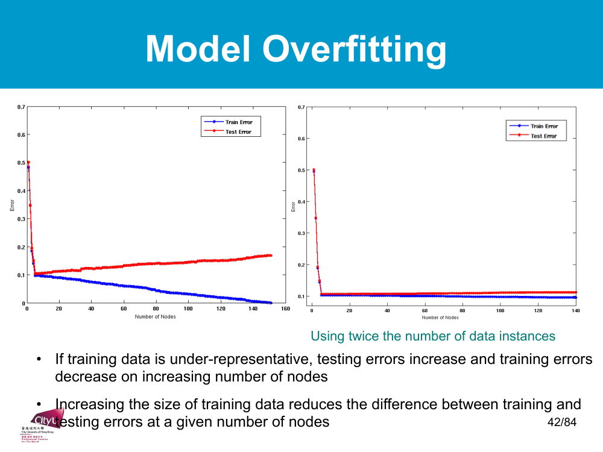

原页图保留教师的标注与给定结果；上述中文按同一页解释，原错另作具名勘误。

### 2.43 超参数与参数（讲义 p.43）

超参数（Hyperparameter）在拟合前约定学习过程的限制，例如最大深度、叶子最少样本数。模型参数（Model parameter）则由训练过程估计，例如回归系数，以及训练树在限制内选出的特征和阈值。两者都要根据来源地位区分，不能因都叫 parameter 就共用评价数据。

原图例从婚姻状态（MarSt）分：Married→NO；Single／Divorced→Home Owner；有房→NO，无房再看 Income；低于 80K→NO、高于 80K→YES。原图未定义 Income 恰为 80K 的分支，不补造原规则。YES／NO 的目标业务含义在本页也未交代，不能擅自写成是否欺诈。

英文原问题：

> Number of layers? Attribute nodes?

中文解析：可以把最大层数和允许特征数等设为候选限制，再验证选择；图中具体分裂节点则由训练拟合。并非要求人为凭图指定所有节点。

英文参考答案（笔记自拟）：Tune structural constraints, such as maximum depth, through validation. Fit the actual split features and thresholds on the training data under those constraints. The slide does not identify the target meaning or the equality branch at 80K.

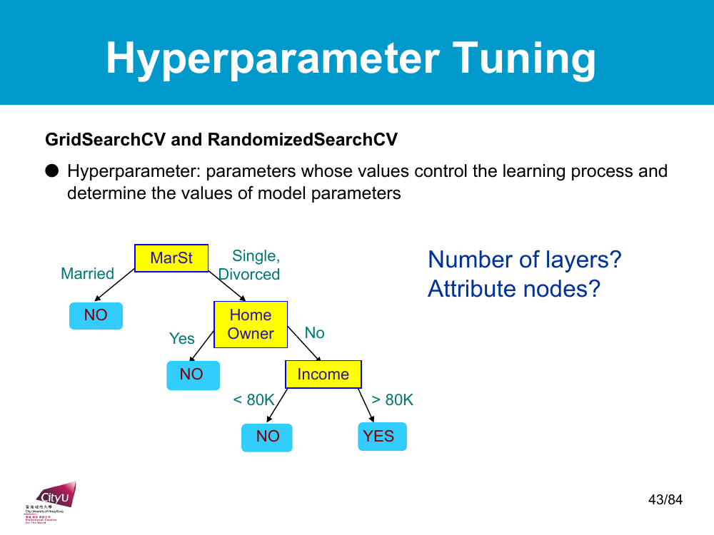

原页图保留教师的标注与给定结果；上述中文按同一页解释，原错另作具名勘误。

### 2.44 网格与随机搜索（讲义 p.44）

网格搜索（Grid search）枚举事先列出的超参数组合；随机搜索（Randomized search）按预定分布抽指定数量组合。两者每个组合都应配相同交叉验证，而不是直接拿训练分数排序。

原图横轴 Important parameter，纵轴 Unimportant parameter。相同九个格点把大量尝试花在重复横坐标；随机点在重要横轴上试到更多不同位置。这是预算分配示意，不证明随机搜索在所有问题必然更好。

💡 笔记补充：深度候选 {2,4,8} 与最少叶样本 {1,5} 共有 3×2=6 个网格组合；五折需 30 次候选拟合，若胜者在全开发集重拟合再加 1 次。随机抽 4 组、同样五折则 20 次加重拟合。预处理必须放入每折内；搜索分布、预算、种子和指标都要记录。

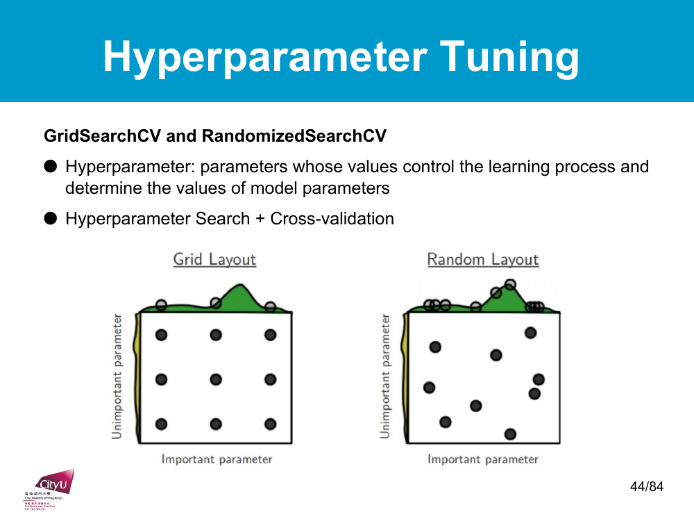

原页图保留教师的标注与给定结果；上述中文按同一页解释，原错另作具名勘误。

### 2.45 三份数据的角色（讲义 p.45）

原图把总数据切成黄 TRAIN、浅色 VALIDATION、绿 TEST 三段，分别向下连 Train multiple Models、Validate Models、Evaluate Model。三段不是三个同义名称：训练拟合多个候选，验证选其中一个，测试只评价冻结结果。

💡 笔记补充：100 条可先留 20 条测试，余 80 条中分 60 条训练、20 条验证；比例仅为示例。若选定配置后用 80 条开发数据重新拟合，原来的验证记录可参与最终训练，但 20 条测试仍不能参与参数、特征或阈值选择。

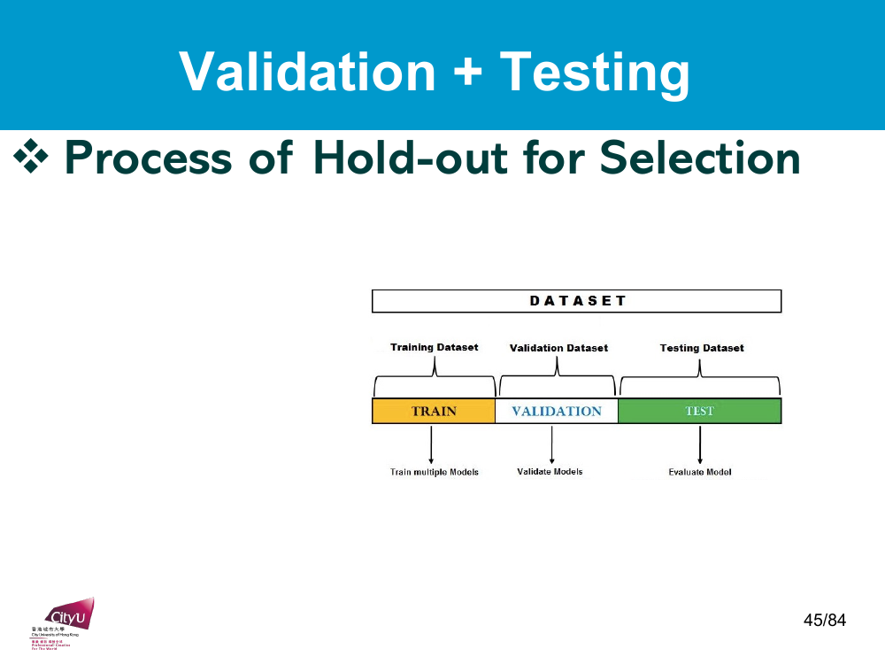

原页图保留教师的标注与给定结果；上述中文按同一页解释，原错另作具名勘误。

### 2.46 选择与最终测试的隔离（讲义 p.46）

这页进一步把原始集合先切出 Test set，左边 Training set 内再留 Validation set。中间 Training, tuning, and evaluation 的循环只在开发侧运行；右侧测试箭头直接通向 Final performance estimate。

沿箭头追踪：候选在训练侧拟合→验证反馈选配置→形成预测模型→用测试得到最终估计。如果看完测试分数又换算法，右箭头已经向选择反馈，这份 Test set 就不再独立。此时应如实标成开发证据并重新安排未用测试，不能改文件名挽回独立性。

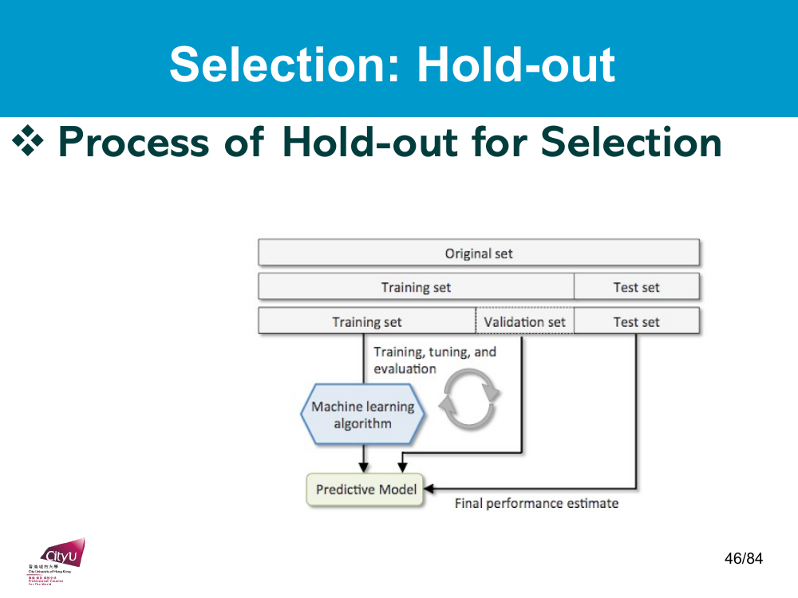

原页图保留教师的标注与给定结果；上述中文按同一页解释，原错另作具名勘误。

### 2.47 为什么普通CV不够（讲义 p.47）

英文原题：

> Why Nested-Cross Validation? How about just using a standard CV for hyperparameter tuning?

中文读题：普通 CV 当然可以调参；问题是同一 CV 选出的最高分，能否同时充当这套选模过程未受选择影响的最终成绩。试的组合越多，越可能选中偶然适合这些验证折的配置。

英文参考答案（笔记自拟）：Standard cross-validation can tune hyperparameters, but the best score selected from that search can be optimistic as a final performance estimate. Use evaluation data that did not influence the search, such as an independent hold-out test set or outer folds in nested cross-validation.

### 2.48 选择偏差与数据泄漏（讲义 p.48）

本页给出前页问题的原因：验证成绩参与了选超参数，所以赢家已间接适应该验证数据。这里的“看见”是通过分数反馈，不需要把验证标签直接塞进梯度；这也会带来选择偏差（Selection bias）。数据泄漏（Data leakage）还包括全表标准化、提前筛特征或时间穿越等情形。

💡 笔记补充：两个实际上相近的候选在这次 CV 得 0.80 和 0.84，不能因此断言赢家真实能力就是 0.84。外层留出的数据只评价内层挑选后的流程；这样才能把调参与评价职责分开。不是禁止 CV 调参，而是禁止把参与选择的数据伪装为独立证明。

### 2.49 课件所称嵌套流程（讲义 p.49）

<!-- cityu-nav:landing-49 -->
[[#4. 速查表|↩ 回速查]] · [[#5. 双语术语卡|回术语]] · [[#0. 三分钟速览|阅读导航]]
<!-- cityu-nav:landing:end -->

原流程从 Dataset 分出 Training data 与 Test data。Training data 和 Parameters 一同进入 Cross-validation，输出 Best parameters；这组配置与全部训练数据进入 Retrained model，最后模型和测试数据共同进入 Final evaluation。箭头没有从最终评价回流调参。

本页标题称 Nested-Cross Validation，但图实际画“单次外部留出＋内部 CV”。它体现内外隔离原则，却没有画外层 K 折轮换。通常完整嵌套交叉验证（Nested cross-validation）在每个外层训练折内重新内层搜索，再仅在该外层测试折评价，最后汇总外层分数。不能把内层五折误写成五个独立最终测试。

💡 笔记补充小例：外层三折各留 3 条，剩 6 条再做内层二折，比较深度 2／4；内层选好配置后，用这 6 条重训，再预测外层 3 条。三个外层各重复完整选模，各自可以选出不同深度。🔗 区别参见 [scikit-learn 嵌套与非嵌套 CV](https://scikit-learn.org/stable/auto_examples/model_selection/plot_nested_cross_validation_iris.html)，获取于 2026-11-18。

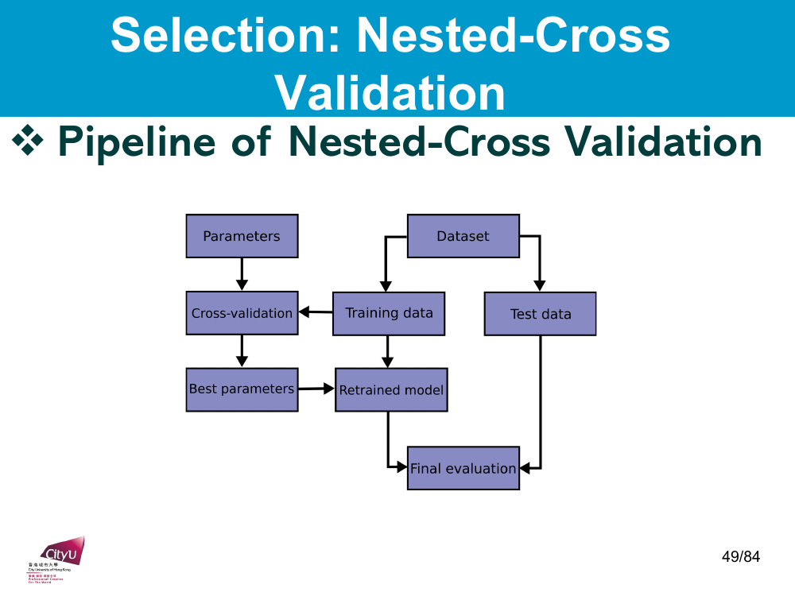

原页图保留教师的标注与给定结果；上述中文按同一页解释，原错另作具名勘误。

### 2.50 课件嵌套总览（讲义 p.50）

原图上方先留蓝色 Test data；下方只把绿色 Training data 分五折。每行一个蓝色内层验证折，其余绿色训练折；右侧大括号 Finding Parameters 覆盖五次内层运行，最底 Final evaluation 才接外部测试。

具体读第 1 行：Fold 1 内验，Fold 2–5 拟合；第 2 行换 Fold 2 内验。五折选好配置以后，用完整绿色开发集重拟合，不拿某一轮只见过四折的模型直接当全部数据最终模型。本页仍是单次外层留出的图，完整外层轮换见前页的笔记补充。

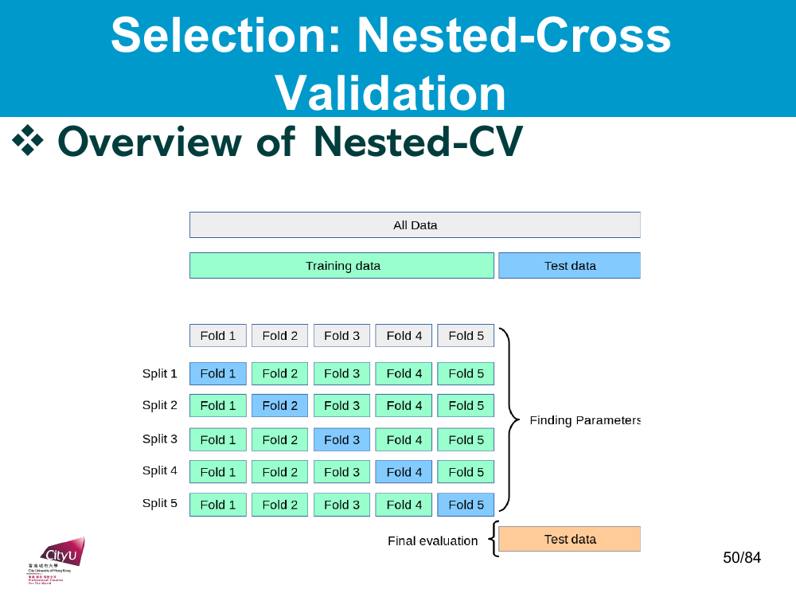

原页图保留教师的标注与给定结果；上述中文按同一页解释，原错另作具名勘误。

### 2.51 内层步骤1至6（讲义 p.51）

本页六步给内部循环的展开：1 先分开发／测试；2 开发侧分 K 折；3 取 K−1 折训练；4 余一折验证；5 对指定超参数记录该轮表现；6 轮换直到每折都验证过一次。

原文步骤 5 的 “trained with training data (K-1 folds) and validation data as 1 fold” 容易误读成双方一起训练。按步骤 3／4 与图，应是仅 K−1 折拟合，另 1 折用于评价。任何预处理也先在 K−1 折估计，否则即使模型 fit 没见标签也可能泄漏。

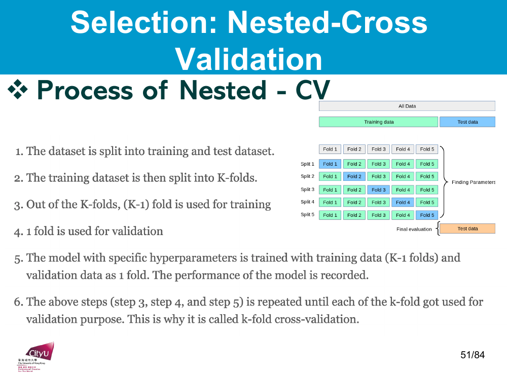

原页图保留教师的标注与给定结果；上述中文按同一页解释，原错另作具名勘误。

### 2.52 内层步骤7至10（讲义 p.52）

<!-- cityu-nav:landing-52 -->
[[#4. 速查表|↩ 回速查]] · [[#5. 双语术语卡|回术语]] · [[#0. 三分钟速览|阅读导航]]
<!-- cityu-nav:landing:end -->

后四步是：7 汇总同一配置 K 个验证分数的均值与标准差；8 为其他配置重复；9 按预定性能准则选配置；10 用全部开发数据重拟合，再在外部测试上评价。标准差用于看稳定性，不是同时把均值／标准差都机械最小化；若指标是准确率，均值越高越好，若是损失则越低越好。

💡 笔记补充：两个候选各做二折，A 的 MAE 为 2、4，B 为 3、3，均值都为 3；A 的折间变化较大，但没有通用规则保证 B 未来必胜。应事先约定平局与复杂度偏好，不能看测试后再决定怎样打破平局。

💡 **把同一份数据从选配置走到外层分数（笔记补充，非课件实测）。** 上面深度 2／4 的例子只有流程，尚不能从原始记录重算分数。下面换成不用训练树也能手算的玩具预测规则，只为了看清内外层的数据去向；它不是推荐的业务模型。

九条记录只有待预测数值 $y$，单位为元。事先按记录编号固定三个组，不按本次模型误差改分组：G1 为记录 1–3，$y=(0,0,0)$；G2 为记录 4–6，$y=(2,2,2)$；G3 为记录 7–9，$y=(4,4,4)$。

每次拟合先算**本次训练记录**的平均值，再把所有待预测记录都预测为“训练均值乘 $c$”。候选设置事先定为 $c=1$ 和 $c=0.5$。$c$ 是内层要选的配置，训练均值则每次重新计算。用平均绝对误差（MAE）：每条预测与真实值之差取绝对值，再求平均，越小越好。因每组的三个真实值相同，本例每组三条误差相同，所以一条的绝对误差也等于该组 MAE。

**第一步，每次只在外层剩下的六条里做二折选择。** 表中“G3→G2”表示只用 G3 的三条训练，再预测 G2 的三条；本轮外测组完全不进入这一行。

| 外测暂留 | 内层训练→验证 | $c=1$ 的验证 MAE | $c=0.5$ 的验证 MAE |
|---|---|---|---|
| G1 | G3→G2 | $\lvert4-2\rvert=2$ | $\lvert2-2\rvert=0$ |
| G1 | G2→G3 | $\lvert2-4\rvert=2$ | $\lvert1-4\rvert=3$ |
| G2 | G3→G1 | $\lvert4-0\rvert=4$ | $\lvert2-0\rvert=2$ |
| G2 | G1→G3 | $\lvert0-4\rvert=4$ | $\lvert0-4\rvert=4$ |
| G3 | G2→G1 | $\lvert2-0\rvert=2$ | $\lvert1-0\rvert=1$ |
| G3 | G1→G2 | $\lvert0-2\rvert=2$ | $\lvert0-2\rvert=2$ |

读第一行：外测 G1 的三个 0 暂时不看；训练 G3 的均值为 4，所以两个候选预测分别是 4 和 2。验证 G2 的真实值为 2，得到误差 2 和 0。第二行交换训练与验证，**不是继续沿用第一行拟合出来的均值**。

**第二步，各外层分别汇总两次内验，然后重拟合、只评分本轮外测。** 外测 G1 时，两候选内验均值为 $(2+2)/2=2$ 与 $(0+3)/2=1.5$；外测 G2 时为 4 与 3；外测 G3 时为 2 与 1.5。因此三个外层在本例都选 $c=0.5$，但这个结果来自三次独立重做内层选择，不是先全数据选一次后复制。

| 本轮外测 | 全部本轮开发记录的均值 | 按本轮所选 $c=0.5$ 重拟合后的预测 | 本轮外测 MAE |
|---|---|---|---|
| G1，真实值 0 | G2+G3：$(3\times2+3\times4)/6=3$ | $3\times0.5=1.5$ | $\lvert1.5-0\rvert=1.5$ |
| G2，真实值 2 | G1+G3：$(3\times0+3\times4)/6=2$ | $2\times0.5=1$ | $\lvert1-2\rvert=1$ |
| G3，真实值 4 | G1+G2：$(3\times0+3\times2)/6=1$ | $1\times0.5=0.5$ | $\lvert0.5-4\rvert=3.5$ |

三个外测组等大，每条记录恰好作外测一次，最终外层平均 MAE 为 $(1.5+1+3.5)/3=2$ 元。它评价的是“内层选配置→用六条重拟合→预测未参与本轮选择的三条”的**整个程序**。不能把较好看的内验 1.5 元当成最终 2 元，也不能用外测 3.5 元回头改候选后还说它未参与选择。外层训练集彼此有重叠，这三个分数不因此成为三个独立实验；本例只计算协议分数，不据三折构造独立样本显著性结论。

每次新外层开始，原先暂留的组可能转成训练资料；关键是**本轮**外测没有参与**本轮**选择。已有下方流程图正对应上述两个表，无需把每个配置误当成一份不同原始数据。

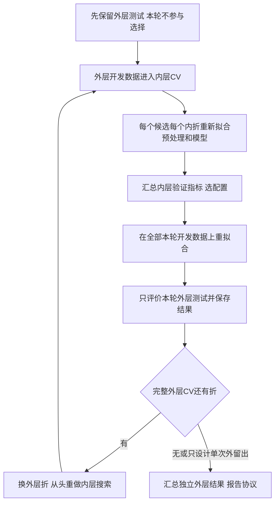

该补充图比原图多画了外层可选轮换。换外层后内层搜索重新开始，不能复用先前用过本轮外测记录选出的配置。要训练最终部署模型，可在最终确定的开发协议上再搜索／重拟合；外层平均分估计的是整个选模流程，不是某一个固定权重文件的“已知真分数”。

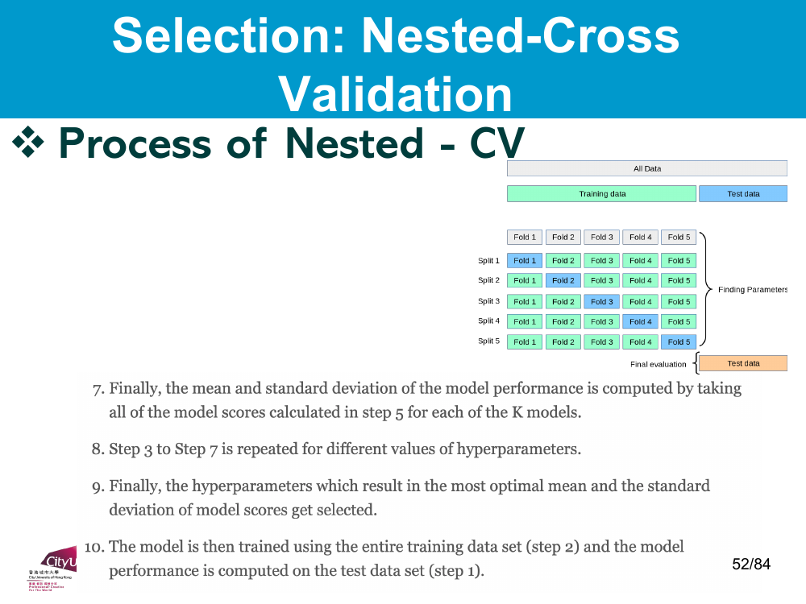

原页图保留教师的标注与给定结果；上述中文按同一页解释，原错另作具名勘误。

### 2.53 正则化分隔（讲义 p.53）

这是正则化部分的目录分隔页，红框移到 Regularization，前面 Model Validation 变灰。无独有公式或例题；后续 p.54–64 解释怎样惩罚参数或树结构，减少不必要的复杂度。

### 2.54 复杂度为何要付代价（讲义 p.54）

正则化（Regularization）在拟合目标中增加约束或惩罚，让模型为复杂度付出代价。训练误差更小并非唯一目标；若两种拟合同样解释主要规律，较温和的系数或结构可能对噪声更稳健。

英文原题：

> How it works? We make some constraints when training our model! Prevent an unnecessary complex model. How to control model complexity while ensuring a good performance?

中文解析：将“拟合误差＋复杂度惩罚”共同最小化，再用独立验证选惩罚强度；保证的是按协议选择，不能保证任何数据上都提升。惩罚过大也会欠拟合。

英文参考答案（笔记自拟）：Add an appropriate complexity penalty or constraint to the training objective and select its strength using validation. This trades fit against complexity; it does not guarantee better performance for every dataset, and excessive regularization may underfit.

### 2.55 Lasso与超参数（讲义 p.55）

Lasso 用绝对值惩罚（L1 penalty）。设 b 为不惩罚的截距，p 个斜率为 $a_j$，第 i 条输入为 $x_{ij}$。预测是 $b+\sum_j a_jx_{ij}$，目标为

$$\min_{a,b}\;\sum_{i=1}^{n}\left(y_i-b-\sum_{j=1}^{p}a_jx_{ij}\right)^2+\lambda\sum_{j=1}^{p}|a_j|.$$

前半是训练平方误差，后半对每个斜率的绝对值收费；$\lambda\ge0$ 控制收费强度。$\lambda=0$ 回到普通最小二乘；在常见设置中，足够强的 L1 惩罚可把部分斜率精确压到 0，形成稀疏（Sparsity）模型。它不是“哪个系数方差大就直接删哪个”的固定规则；结果依赖尺度、特征相关性与损失收益。通常在训练折内标准化以使惩罚尺度可比较。

💡 笔记补充的单参数推演：把一维已缩放的目标写成 $(a-2)^2+\lambda|a|$；a 是要选的斜率，没有惩罚时取 2。若 a 为负，第一项已经大于 4，再加非负惩罚，会差于 a=0，所以本例只需在非负数中找。

先看 $\lambda=2$：目标为 $(a-2)^2+2a=a^2-2a+4=(a-1)^2+3$。平方最小只能为 0，所以取 a=1。这是配方，把一次项并进一个平方，不用微积分。

再看 $\lambda=6$：目标为 $a^2+2a+4=(a+1)^2+3$。a 必须非负，离 −1 最近的可选值是 0，所以最佳取 a=0。这说明绝对值惩罚能把最优解推到零点；它是本标量约定下的例子，不套用到任意未缩放多变量数据，也不能混用软件损失里的 1/n 系数。

英文原题 “Is λ a hyperparameter?”：是；它在每次训练前指定，通常由验证选择，斜率才由该次训练拟合。

英文参考答案（笔记自拟）：Yes. Lambda controls the strength of the L1 penalty and is selected through validation, while the coefficients are fitted on the training data for each specified lambda. With this objective, lambda zero recovers unpenalized least squares.

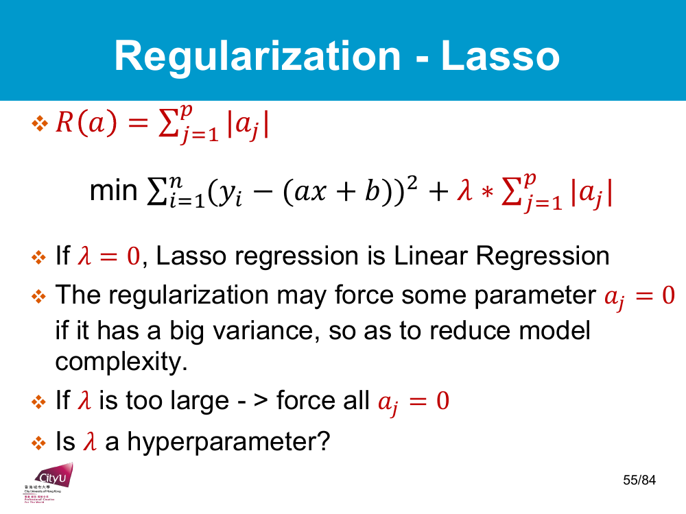

原页图保留教师的标注与给定结果；上述中文按同一页解释，原错另作具名勘误。

### 2.56 Ridge与原图勘误（讲义 p.56）

Ridge 用平方惩罚（L2 penalty）$R(a)=\sum_{j=1}^p a_j^2$。本页目标在训练平方误差后加 $\frac\lambda2\sum_j a_j^2$；乘 1/2 是这里的缩放约定，相同数值 lambda 在另一损失缩放中未必同强度。

💡 笔记补充：用 $(a-2)^2+\frac\lambda2a^2$。当 $\lambda=2$，展开并配方为 $2a^2-4a+4=2(a-1)^2+2$，最佳取 a=1。惩罚改为 6 时，目标变为 $4a^2-4a+4=4(a-0.5)^2+3$，最佳取 a=0.5，仍不为 0。

同样配方可得本例一般最佳值 $a=4/(2+\lambda)$。有限正惩罚让它连续缩小，而非像 Lasso 那样形成精确零阈值。零信号等特殊数据当然可能得到零系数。

原图写 “Force some coefficients to be 0”，容易把 Ridge 与 Lasso 混淆，按上例应勘误为通常缩小系数。也不惩罚截距 b；标准化的均值／尺度必须在当前训练折拟合。🔗 目标与区别参见 [scikit-learn Ridge](https://scikit-learn.org/stable/modules/generated/sklearn.linear_model.Ridge.html)，获取于 2026-11-18。

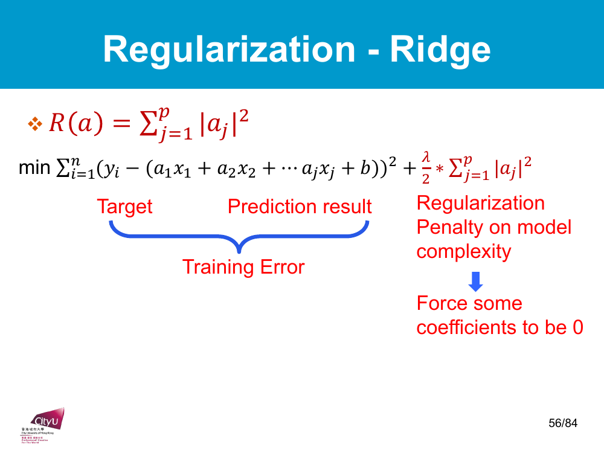

原页图保留教师的标注与给定结果；上述中文按同一页解释，原错另作具名勘误。

### 2.57 15阶多项式的输入（讲义 p.57）

原散点从左侧约 1 下降到右侧约 −1，页面拟用十五阶多项式回归（Polynomial regression）拟合：$\hat y=a_0+a_1x+a_2x^2+\cdots+a_{15}x^{15}$。每个幂是一列特征，对系数仍是线性组合；“线性回归”不必只是一条关于 x 的直线。

高次幂可让曲线更灵活，但不同幂在给定 x 范围的数值差异可能很大，系数比较受尺度影响。课件未提供本图完整点表、噪声种子或训练代码，因此本篇只能读已给拟合图，不能算出原图精确参数或验证优劣。

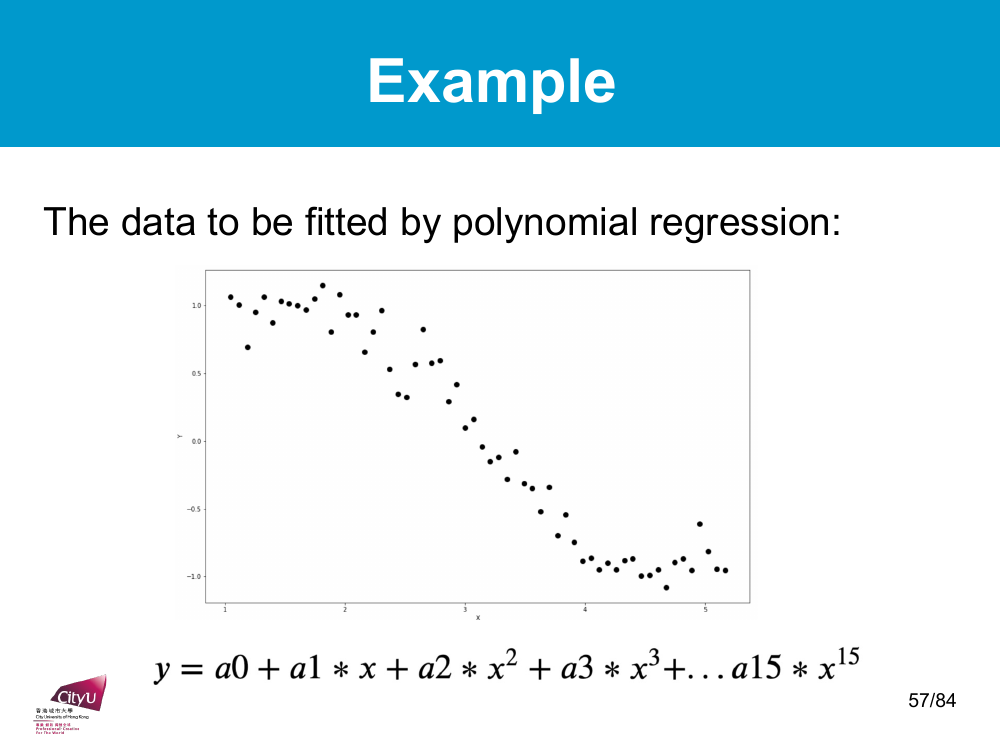

原页图保留教师的标注与给定结果；上述中文按同一页解释，原错另作具名勘误。

### 2.58 正则化的曲线和系数（讲义 p.58）

左图标题写 Simple linear regression，但小标题明确 “Polynomial regression of power: 15”，实际是十五阶多项式的未惩罚拟合；蓝线沿橙点起伏。右图标 “penalty lambda: 0.1”，曲线更平滑，是 Ridge 结果。上页同批点在这里作对照，图中没有独立测试误差。

原系数表左侧截距约 −36,247.81543、a1≈243,862.2、a2≈−745,882.84；Ridge 截距约 1.392827、a1≈−0.224699、a2≈−0.033668。先看量级与符号，再看它们如何通过多项式相互抵消，不能只因单个系数大就断言预测一定坏。表后部 Ridge 多项显示为 0，显示精度或实现细节未给，不能据此证明 Ridge 一定选特征。

原图与表保留全部参数供对照；当前没有完整输入、算法、尺度与高精度输出，不能从图片逐位复算整条曲线，也不能宣布右侧测试更好。源图支持“惩罚改变曲线与系数量级”的演示，泛化结论仍需独立评价。

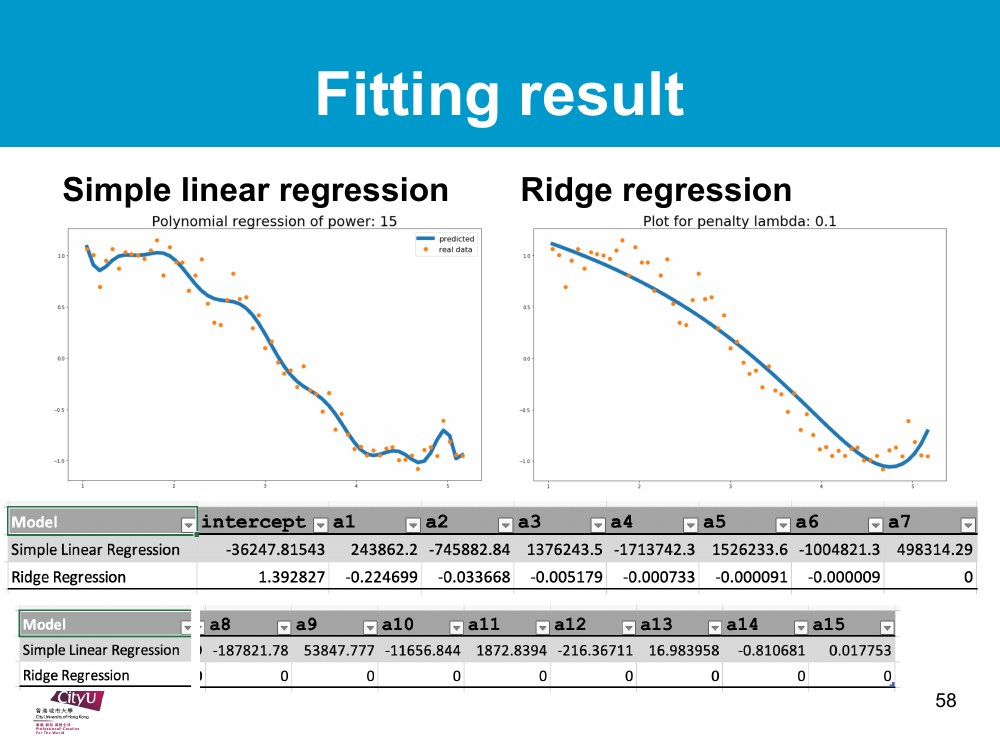

原页图保留教师的标注与给定结果；上述中文按同一页解释，原错另作具名勘误。

### 2.59 一般模型复杂度惩罚（讲义 p.59）

英文原题：

> How about we add a model-complexity penalty for a general model?

中文意思是：模型不一定由回归斜率表示，能否也为它的复杂度收费？对树可以用叶子数作为结构复杂度代理，把训练错误与叶子成本相加。它是选择准则，不是把真实未来误差凭空算出来。

英文参考答案（笔记自拟）：Yes. Define a suitable complexity measure, such as the number of leaves in a decision tree, and add a weighted penalty to the training error. Validate the trade-off rather than treating the penalized value as the known true generalization error.

### 2.60 悲观误差定义（讲义 p.60）

悲观误差估计（Pessimistic error estimate）在训练错误率上加结构惩罚。本页定义树 T、叶子数 k、训练记录数 $N_{train}$，以及每多一叶的相对代价 $\Omega$：

$$err_{gen}(T)=err(T)+\Omega\frac{k}{N_{train}}=\frac{\text{训练错分条数}+\Omega k}{N_{train}}.$$

分母是一整棵树的训练记录数；k 数叶子，不数内部判断节点。$\Omega$ 是预定或验证选择的超参数。左右树若用不同训练样本就不能只凭此值公平比较。本式是课件给定的启发式惩罚准则，不保证等于未来总体错误率；[[#2.61 左右树的24条算例（讲义 p.61）|下一页 p.61]] 用同样 24 条记录完成逐叶错数、代入与选择。

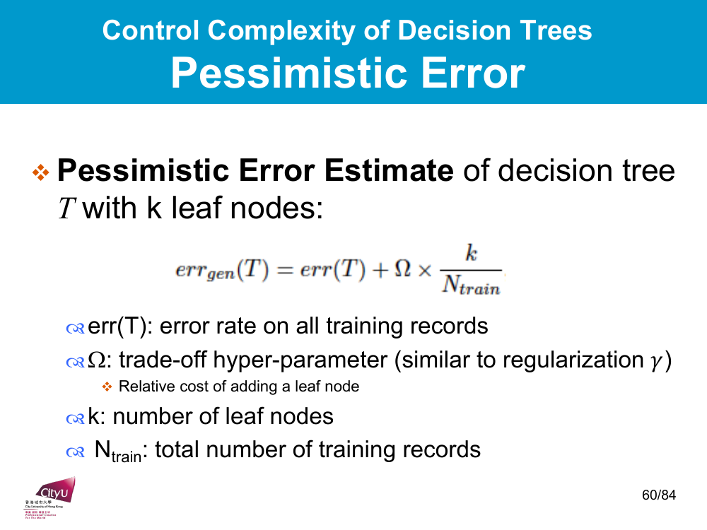

原页图保留教师的标注与给定结果；上述中文按同一页解释，原错另作具名勘误。

### 2.61 左右树的24条算例（讲义 p.61）

原图两棵树都覆盖 24 条记录，每个叶框列“+”与“−”条数。叶子预测该框多数类，因此错分数为框内较少的一类；例如左图叶 (3,1) 预测“+”，错 1 条；叶 (0,2) 预测“−”，错 0 条。红线表示分支，不表示人数。

把源图逐叶展开，以下每行是一个叶子的正／负计数与少数类错误数：

| 树 | 叶计数（正,负） | 各叶错数 | 叶数／合计错数 |
|---|---|---|---|
| 左 $T_L$ | (3,1),(2,1),(0,2),(1,2),(3,0),(3,1),(0,5) | 1,1,0,1,0,1,0 | 7／4 |
| 右 $T_R$ | (5,2),(1,4),(3,0),(3,6) | 2,1,0,3 | 4／6 |

先核每树所有框的记录数相加都为 24，再按 p.60 规则、给定 $\Omega=1$ 计算：左为 $(4+7)/24=11/24\approx0.4583$；右为 $(6+4)/24=10/24\approx0.4167$。右树多错两条，但省三片叶子，综合代价更小，故该准则选右树。原课件给出的两行结果与本批复算一致。

💡 改条件：若 $\Omega=0$，只看训练错率，左树较好。平局条件为 $4+7\Omega=6+4\Omega$，移项得 $3\Omega=2$，即 $\Omega=2/3$；小于此值选左，大于选右，平局按预先规则处理。惩罚强弱可以改变选择，不能背“树越小越好”。

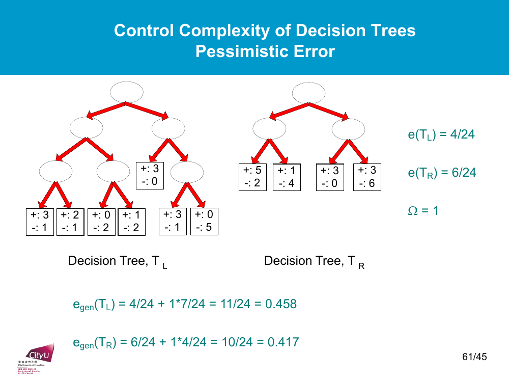

原页图保留教师的标注与给定结果；上述中文按同一页解释，原错另作具名勘误。

### 2.62 预剪枝的全部停止条件（讲义 p.62）

预剪枝（Pre-pruning）在树还没完全长大前停止某个节点继续分裂。本页先列两种自然停止：节点里全同类，已无分类混杂；或所有可用属性值相同，当前特征没有区分能力。后者即使类别仍混杂，也只能以多数类等约定作叶子。

另外四类限制分别是：样本数小于用户阈值；类别分布与可用特征没有足够关联证据（原文举卡方检验 $\chi^2$）；继续切分不改善 Gini 或信息增益等不纯度；估计泛化误差已低于预定阈值。最后一项是源页列的停止策略，不意味着小训练误差就已知未来错误够低。卡方检验只是一个可选停止工具，本讲未给列联表，不伪造检验结果。

要处理一个节点，先看当前是否可分，再判断用户限制；停止就保存叶子类别，否则只用训练数据选择分裂，再对子节点重复。阈值太严格会过早停而欠拟合；太宽松可能追噪声，因此仍用验证选择。预剪枝不同于 p.36 按验证曲线停止网络训练，但都用限制避免无用复杂度。

### 2.63 后剪枝与子树提升（讲义 p.63）

后剪枝（Post-pruning）先把树长到既定终止条件，再自底向上评价能否删分支。子树替换（Subtree replacement）将一整段子树换成单叶，该叶预测原子树所含训练样本的多数类；比较的是替换前后的统一估计误差或验证误差，不要求训练错误也下降。

子树提升（Subtree raising）则用某个子分支的子树提升替代当前子树。源页概括为“most frequently used branch”，即使用最频繁的分支；提升后原来走其他分支的样本也会被重新路由，须重新评价，不等同于直接删除低频客户。当前源没有详细提升算法和算例，本讲只要求区分该操作与换成多数类叶子。

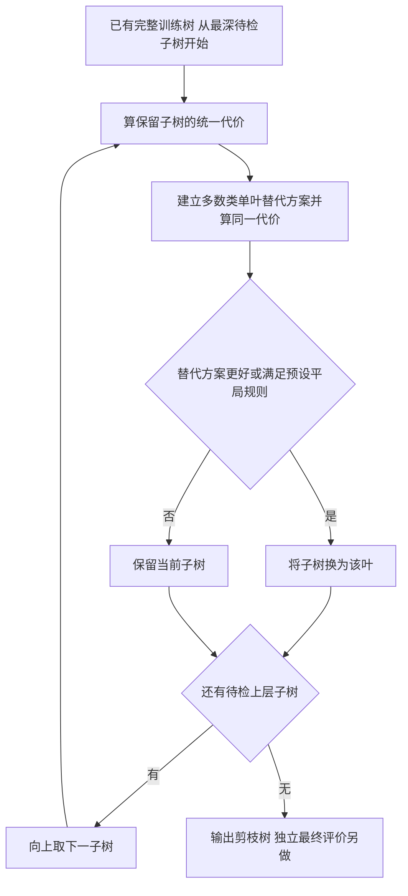

该图专门描述子树替换，不把子树提升混入同一分支。沿箭头执行下页算例时，只比较同样 30 条与相同每叶代价；不是拿分裂后 9 条错就直接宣布保留。

### 2.64 后剪枝30条算例（讲义 p.64）

<!-- cityu-nav:landing-64 -->
[[#4. 速查表|↩ 回速查]] · [[#5. 双语术语卡|回术语]] · [[#0. 三分钟速览|阅读导航]]
<!-- cityu-nav:landing:end -->

原图根节点有 Yes=20、No=10，若不分裂，预测 Yes，错 10 条。按每叶 0.5 条等效惩罚，单叶代价为 $(10+0.5)/30=0.35$。注意 0.5 加在错分条数上，最后统一除 30。

分裂成 A1–A4 后，各叶给定计数如下。按多数类作预测，四叶错误为 4、3、1、1，合计 9：

| 叶 | Yes／No | 预测类 | 错分条数 |
|---|---|---|---|
| A1 | 8／4 | Yes | 4 |
| A2 | 3／4 | No | 3 |
| A3 | 4／1 | Yes | 1 |
| A4 | 5／1 | Yes | 1 |

分裂后虽然训练误差从 10/30 降到 9/30，惩罚代价却为 $(9+4\times0.5)/30=11/30\approx0.3667$，大于不分裂的 0.35，所以按本规则剪回单叶。原图 “PRUNE!” 是给定结论；本批已逐叶复算，不把它改写为独立测试的真实成绩。💡 若每叶惩罚为 0，则训练错误更少的分裂方案获选，说明结论依赖所定准则。

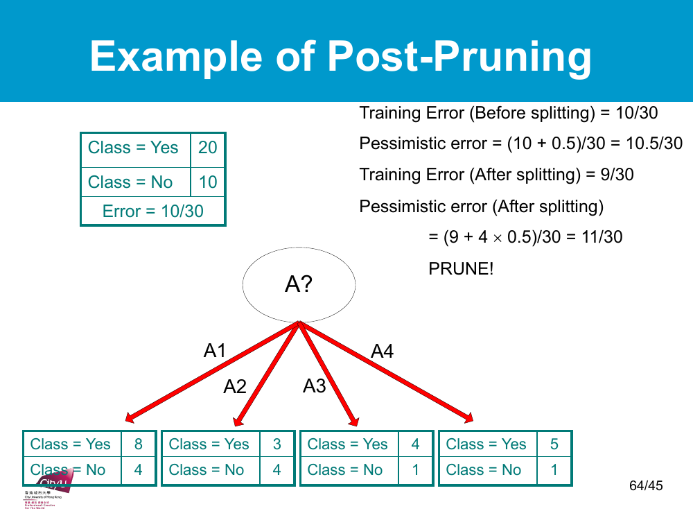

原页图保留教师的标注与给定结果；上述中文按同一页解释，原错另作具名勘误。

### 2.65 无监督评价分隔（讲义 p.65）

目录红框转到 Assessment of unsupervised learning，进入无监督评价。纯分隔页没有新增题目或独有图形；下一页先把“簇内近／簇间远”的目标讲清，再给平方和指标。

### 2.66 簇内近与簇间远（讲义 p.66）

聚类评价先看选定表示和距离下，同簇对象是否接近、不同簇是否分开。原图三团点以红圈标簇，左侧橙箭头指同一红圈内部，右侧橙箭头跨两个不同红圈；不要把红圈理解成已提供的真实类别边界。

簇内距离（Intra-cluster distance）希望小，簇间距离（Inter-cluster distance）希望大。这适合本讲紧凑簇的评价直觉，复杂形状／密度下不能只用质心距离判断全部聚类方法。比如两条月牙的质心可近，但按沿形状的连接结构仍可能是有用分组。

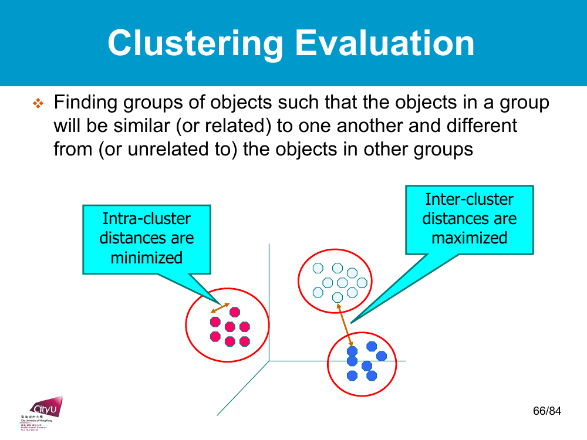

原页图保留教师的标注与给定结果；上述中文按同一页解释，原错另作具名勘误。

### 2.67 初始中心改变聚类（讲义 p.67）

上图原始点云为上方一团、左下一团、右下一团。左箭头标 “Best initial centroids”，得到左下图的三个自然团；右箭头标其他初始化，右下图把上团切成两组、又把底部两团并在一起。

这说明 K-means 的初始中心会影响最终局部解（Local solution）。本页的 “Optimal” 是源图对这组演示的标签；没有全部点坐标、初始中心与优化证明，不能据图独立认证全局最优。评价时须固定数据、尺度、距离和 K，再比较目标值、重复运行与解释；颜色不同本身不是优劣证明。


原页图保留教师的标注与给定结果；上述中文按同一页解释，原错另作具名勘误。

### 2.68 Kmeans的SSE（讲义 p.68）

K-means 的平方误差和为 $SSE=\sum_{i=1}^{K}\sum_{x\in C_i}\lVert x-m_i\rVert^2$。$C_i$ 是第 i 簇，$m_i$ 是它的均值中心，内层先累加该簇每点到中心的距离平方，外层再加所有簇。欧氏范数 $\lVert\cdot\rVert$ 表示先逐坐标求差再按平方和开根；平方后正好剩坐标差的平方和。

💡 笔记补充：一维点 0、2 分一簇，均值为 1；点 8、10 分另一簇，均值为 9。每点离中心 1，四个平方相加 SSE=4。同一组成员用均值使平方误差和最小，故中心不能凭目测任放。

把全部点各自分一簇时 SSE 可为 0，但失去归纳用途。对于同一数据、尺度和欧氏目标，各 K 的全局最优 SSE 随 K 增加不升；实际软件可能落入较差局部解，因而某次大 K 运行反而比小 K 大。不同 K 不能只凭 SSE 越小直接选，须兼顾粒度与用途。


原页图保留教师的标注与给定结果；上述中文按同一页解释，原错另作具名勘误。

### 2.69 凝聚度与分离度（讲义 p.69）

凝聚度（Cohesion）问同簇点有多近，本页用簇内平方和 WSS（Within-cluster sum of squares），等同这里的 SSE；分离度（Separation）问各簇中心有多远离整体中心，用簇间平方和 BSS（Between-cluster sum of squares）。原页标题 “Inner distance & intra distance” 用词不规范，正文以 within／between 及公式为准。

设 $m_i$ 为第 i 簇均值，$m$ 为全体均值，$|C_i|$ 表示该簇的点数而非绝对值；多维时平方使用欧氏距离平方：

$$WSS=\sum_i\sum_{x\in C_i}\lVert x-m_i\rVert^2,\qquad BSS=\sum_i |C_i|\lVert m_i-m\rVert^2.$$

沿用 0、2／8、10 两簇：整体均值 5，WSS=4；两中心分别 1、9，各簇 2 点，所以 BSS=$2(1-5)^2+2(9-5)^2=64$。全体对总均值的总平方和 TSS=$25+9+9+25=68$，恰有 TSS=WSS+BSS。这个分解要求均值中心、平方欧氏距离、互斥穷尽的分组；不直接套到任意密度噪声标签或非欧氏距离。


原页图保留教师的标注与给定结果；上述中文按同一页解释，原错另作具名勘误。

### 2.70 管线评价分隔（讲义 p.70）

目录转入 Evaluate BDA pipeline。前面选单个模型的办法仍有用，但此后比较对象扩大为从业务、数据到部署的整条分析管线，不能把更低离线误差自动等同业务收益。

### 2.71 CRISP-DM管线（讲义 p.71）

标题问题是 “How to evaluate a good design”。原图六块为：1 业务理解（Business Understanding）、2 数据理解（Data Understanding）、3 数据准备（Data Preparation）、4 模型构建（Model Building）、5 测试与评价（Testing and Evaluation）、6 部署（Deployment），中央圆柱为 Data。

沿绿色实线看推进：业务与数据理解相互对照，再到准备、建模、评价、部署。红色虚线回到前面环节，表示评价可暴露业务定义或数据处理的问题，流程并非一次直走。比如需求预测 MAE 下降，却因订货延迟仍缺货，问题可能要返回业务和部署环节，而非继续堆模型层数。

英文参考答案（笔记自拟）：Evaluate a design across the full business-data-model-deployment pipeline. Use consistent offline comparisons and, where appropriate, controlled evaluation of the deployed business outcome. Feedback may require changing earlier stages, not only the predictive model.


原页图保留教师的标注与给定结果；上述中文按同一页解释，原错另作具名勘误。

### 2.72 深度结构怎样比较（讲义 p.72）

英文原题：

> How to evaluation the goodness of deep model learning structure?

左图下方数据源含气象、事件、销量、库存等，输入 $x_1\ldots x_t$ 进入编码器（Encoder）的 LSTM 状态链；时间注意力（Temporal attention）给不同历史表示分配读取权重。未来外生因素经嵌入（Embedding，转成可供网络使用的数值表示），再拼接（Concat，把数值表示接成一份输入）送到上方解码器（Decoder），逐步产生 $y_1\ldots y_T$。天气预报、节假日等未来因素必须是预测起点已能获得的输入，未来实际天气不能冒充当时已知。

右图是 LSTM 单元的内部状态通道：旧记忆 $C_{t-1}$ 经忘记门控制保留，输入门控制候选写入，得到 $C_t$，输出门控制传出的 $h_t$。这是结构辨认入口，门的逐步算例见 [[IS6400_Business_Data_Analytics/notes/M09-深度学习-神经网络与文本分析|M09]]；本页没有给完整参数与训练数据，不能按图算模型成绩。

⚪ 参考作答（笔记推断）：固定切分、指标、输入可得时点与训练预算；比较完整结构和删去注意力／外生输入等变体，重复必要运行并观察验证与独立测试。若只改一个组件，较容易归因该组件；同时换数据与模型则只能评价整个方案差异。

英文参考答案（笔记自拟）：Compare the architecture with suitable baselines and ablated variants under the same data splits, information constraints, metrics and training budget. Evaluate forecasts on independent future observations. The diagram alone does not establish that a component improves performance.


原页图保留教师的标注与给定结果；上述中文按同一页解释，原错另作具名勘误。

### 2.73 A/B的定义与随机分组（讲义 p.73）

A/B 测试（A/B testing）把旧版／控制（Control，A）与新版／处理（Treatment / Variation，B）比较。原定义为 “comparing two versions of designs against each other to determine which one performs better.” 原示意左 23%、右 37%，下方写 Random evaluators；它没有给样本数、时间或误差，所以不能据此算显著性。

随机分配让两组在分配机制上可比较，目的是减少用户差异混杂，不保证一次有限样本每个特征完全相同。同一用户应按约定保持一个版本，避免跨版本污染；有干扰或共享资源时可能要按店铺／群组随机，不能忽略实验单位。


原页图保留教师的标注与给定结果；上述中文按同一页解释，原错另作具名勘误。

### 2.74 时间走势与终点评估（讲义 p.74）

本页红色 Control 与绿色 Variation 随时间变化：开始红线较高，短期后绿线抬升并逐渐稳定。标题 “2-stage analysis vs trending analysis” 提醒一次前后差值和一段趋势会提供不同信息。源图没有横轴时间单位、指标单位、样本量或置信区间，不能编造具体日期或说两线差异已经显著。

按预先约定的运行窗口比较同期 A／B，避免刚有优势就停。若仅拿上线前与上线后比，季节、用户构成或营销同时变化也可能解释差异；趋势图本身不排除这些因素。不能从多次查看中挑最好的一天作为最终效果。


原页图保留教师的标注与给定结果；上述中文按同一页解释，原错另作具名勘误。

### 2.75 五阶段实验环（讲义 p.75）

原环图中心写 “THE FIVE STAGES TO THE EXPERIMENTAL FRAMEWORK”，顺时针为确定要改善的转化（Determine conversion to improve）→提出改变假设（Hypothesize change）→识别变量并建变体（Identify the variables and create variations）→运行实验（Run experiment）→测结果（Measure results）。箭头回到起点，表示一轮结果可启发下一轮。

后面课件另列六个讲解步骤，是把目标、假设、变量、运行、检验与结论细拆；不因五阶段原图就漏掉最终结论，也不把后续测试数据回流当前调参后仍称盲测。图是实验流程，不是统计检验公式。


原页图保留教师的标注与给定结果；上述中文按同一页解释，原错另作具名勘误。

### 2.76 先固定KPI与版本（讲义 p.76）

原英文步骤 1：

> Which key performance indicator are you tracking and which variation is being tested.

中文意思：先确定关键绩效指标（Key performance indicator，KPI）和被测试版本。💡 笔记补充：若目标是减少客服等待，可以固定主指标为每位进入队列用户的等待秒数，A 为现行路由、B 为新路由；分母、观察窗口、超时／放弃规则与日志缺失处理要两组一致。若只统计成功接通者，可能漏掉最久而放弃的人。

英文参考答案（笔记自拟）：Specify the primary KPI, its denominator and observation window, and define the control and treatment versions before running the test. For example, compare user waiting time under the current and new routing rules using the same inclusion criteria.


原页图保留教师的标注与给定结果；上述中文按同一页解释，原错另作具名勘误。

### 2.77 提出可检验假设（讲义 p.77）

原英文步骤 2：

> Hypothesize treatment is better than control? Why?

中文意思：提出新版本为何可能改善指标的可检验解释。沿用等待时间例，假设新路由能更快把用户分到可处理的坐席，所以 B 的平均等待低于 A；这是假设，不是已证实结果。

零假设（Null hypothesis）可设两组总体均值相同；备择假设（Alternative hypothesis）依研究目标预定为不同，或有充分事前理由时单向更低。不能看结果方向后临时改单侧检验。本篇后面的演示使用双侧差异检验，避免把方向选择藏起来。

英文参考答案（笔记自拟）：State a testable mechanism and hypothesis before observing the outcome. The new routing rule may lower mean waiting time by assigning users to available agents sooner. Predefine whether the statistical comparison is one-sided or two-sided.


原页图保留教师的标注与给定结果；上述中文按同一页解释，原错另作具名勘误。

### 2.78 识别真正改变的部件（讲义 p.78）

原英文步骤 3：

> Identify the key variants that can lead to a difference in KPI

中文意思：说清本轮到底改了什么。若只想检验路由规则，就固定页面、价格与客服人员培训，只让随机组使用不同路由；否则即使 B 改善，也不能把改善全归给路由。要比较完整方案也可以，但结论就应针对完整方案。

英文参考答案（笔记自拟）：Identify the component being changed and keep other relevant conditions comparable when attributing an effect to that component. If multiple components change together, interpret the result as a comparison of the full packages rather than of one component alone.


原页图保留教师的标注与给定结果；上述中文按同一页解释，原错另作具名勘误。

### 2.79 随机实验与统计方法区别（讲义 p.79）

原英文步骤 4：

> Run randomized experiment, i.g., DID. T-test.

这句把实验设计与分析方法混列，须拆清：随机分配决定谁看 A／B；t 检验（t-test）是在相应假设下比较均值的分析工具；双重差分（Difference-in-differences，DiD）比较两组前后变化，常用于非随机政策评估，不是随机实验的同义词。单独使用任一检验名称都不能保证因果识别。

💡 笔记补充的 DiD 算例：处理组指标从 20 到 25，控制组从 20 到 22；处理组变化 5，控制组变化 2，差中之差为 3。把 3 解释成处理效应，需要无处理时两组趋势可比等额外假设；仅有这四个均值不能验证平行趋势。随机 A/B 则依随机分配与执行完整性进行因果比较，仍要检查污染、失访与实验单位。

英文参考答案（笔记自拟）：Random assignment is a design choice; a t-test and difference-in-differences are analysis methods. Run and document the random assignment when conducting an A/B experiment, then use an analysis appropriate to the outcome and experimental unit. A DiD estimate requires additional identifying assumptions such as parallel untreated trends.


原页图保留教师的标注与给定结果；上述中文按同一页解释，原错另作具名勘误。

### 2.80 检验差异及不确定性（讲义 p.80）

<!-- cityu-nav:landing-80 -->
[[#4. 速查表|↩ 回速查]] · [[#5. 双语术语卡|回术语]] · [[#0. 三分钟速览|阅读导航]]
<!-- cityu-nav:landing:end -->

原英文步骤 5：

> Evaluate the significance of difference in KPIs between the two groups

中文意思：观察差异有多大，还要衡量随机波动能否合理解释它。对独立实验单位的连续均值，Welch 双样本 t 检验用“均值差／均值差标准误”衡量信号相对于波动。标准误（Standard error）是均值差估计的不确定性尺度，不是单个用户波动的标准差。

💡 笔记补充，使用一组完整小数据说明，单位为秒：A=(8,9,10,11,12)，B=(10,11,12,13,14)。两组各 5 人，均值 10 与 12；各组离均值的偏差平方和为 10，样本方差为 $10/(5-1)=2.5$。均值差的标准误为 $SE=\sqrt{2.5/5+2.5/5}=1$，按 B−A 记差，$t=(12-10)/1=2$。

💡 **SE 这一步为什么不是“把两个标准差相加”（笔记补充）。** 单个用户的秒数会波动；若重复抽取同样人数的一组用户，每次算出的**平均秒数**也会波动。标准误估计的是后者的幅度。这里独立用户的偶然偏高、偏低会在平均时部分抵消：单个观测方差估计为 $s^2$、独立人数为 $n$ 时，样本均值的方差估计是 $s^2/n$，标准误才是 $s/\sqrt n$。除以 $n$ 发生在**方差**这一步，不是把标准差直接除以 $n$。

回到上面的十名**不同**用户：A 均值的不确定性方差贡献为 $2.5/5=0.5$ 秒平方；B 也为 0.5 秒平方。两组由互相独立的实验单位组成时，取 B 均值减 A 均值，这两份方差仍相加，因为减去一个随机估计也会带来不确定性，而不是消掉它。合计为 1 秒平方，最后开根才得到 $SE=1$ 秒。所以观察差 2 秒是其标准误的 2 倍，得到后面的 $t=2$。只有“同一组均值自己的标准误”才单用一项；本页比较两组，要把两项都算入。

**同一人前后各量一次，则先配对作差。** 下面另给三人的小例，单位仍为秒，不是把上面十名用户擅自配成五对：

| 同一人 | A时点 | B时点 | 个人差值 B−A |
|---|---|---|---|
| 甲 | 8 | 9 | 1 |
| 乙 | 9 | 11 | 2 |
| 丙 | 10 | 13 | 3 |

同一个人的前后值通常相关，不能当六个互不相关的人套两组独立公式。先得到差值 1、2、3，平均差为 2；差值离平均的平方和为 2，差值样本方差为 $2/(3-1)=1$ 秒平方。若三名用户之间独立，平均差的标准误为 $\sqrt{1/3}\approx0.577$ 秒。此时 $n=3$ 数的是三名独立用户，不是六次测量。是否可作配对 t 推断还要查差值分布等条件；本段只展示怎样选对不确定性计算对象，不报告虚构的实验显著性。

若每个用户重复产生很多点击/请求，不能把所有事件都当独立用户来使 SE 人为变小；先依据随机分配单位、配对或群组结构确定分析方式。本页后续 p 值继续使用原先**十名不同用户的独立两组例子**，不混用三人配对例的 SE。

本页每组只有 5 人，小样本演示假设两组观测独立、各组分布近似正态且没有明显离群值，再用 t 分布作参考。两组人数与样本方差相等，本身不足以保证这个参照适用。

接下来要回答“若总体均值其实相等，t 绝对值达到 2 有多常见”。参考分布横轴是可能得到的 t 统计量，曲线下的面积表示该零假设及上述抽样模型下的概率。自由度（Degrees of freedom，df）控制参考曲线的形状和尾部厚度；它反映均值和波动估计带来的不确定性，不是两组均值的差，也不总是把人数相加减 2。

对本次 Welch 方法，先记两组均值方差贡献为 $v_A=s_A^2/n_A$、$v_B=s_B^2/n_B$。这里 n 为各组人数，s² 为该组样本方差，所以两项都为 $2.5/5=0.5$。Welch 的自由度计算规则是

$$\nu=\frac{(v_A+v_B)^2}{v_A^2/(n_A-1)+v_B^2/(n_B-1)}.$$

代入本例，分子为 $(0.5+0.5)^2=1$，分母为 $0.5^2/4+0.5^2/4=0.125$，所以自由度为 $\nu=1/0.125=8$。本例恰好等于 5+5−2，因为人数和样本方差都相等；一般 Welch 输入不具备这两条件，自由度可能不是整数。

双侧（Two-sided）检验把两个方向都算入：均值差为 0 时，出现 $T\ge2$ 的右尾面积，加上 $T\le-2$ 的左尾面积。t 分布关于 0 对称，本例每尾约 0.040258，合计 p≈0.080516。这个面积通过统计软件或 t 分布表取得，不是拿 1−t 或 1/df 算出来。

下面是本批实际运行的概率复算，输入只有本页手算的 t=2 和 df=8；`sf`（Survival function）返回右侧尾部面积，`abs` 取绝对值，再乘 2 得两尾合计。

```python
from scipy.stats import t
right_tail = t.sf(abs(2), df=8)
two_sided_p = 2 * right_tail
print(right_tail, two_sided_p)
```

输出约为 `0.04025811898 0.08051623796`。如查表时没有对应精确 t 值，只能按表给范围，不编造精确小数。若交换 A／B，把差改成 A−B，t 从 2 变成 −2，左右尾互换，绝对值与双侧 p 不变；单侧问题的方向则必须在看结果前约定。

p 值（p-value）是假定总体均值相等及检验模型成立时，出现至少同样极端统计量的概率；不是“零假设为真的概率”。若事先定显著性水平 0.05，本例不足以拒绝均值相等，且观察到 B 等待更长；不能报告 B 显著改善。小样本教学例不是这门课真实实验。

英文参考答案（笔记自拟）：Assess the effect size and its uncertainty using a method consistent with the assignment and outcome. In the illustrative independent two-sample example, the mean difference B minus A is 2 seconds, the standard error is 1 second, and the two-sided p-value is about 0.0805. This is not significant at a pre-specified 0.05 level.

🔗 均值差与检验公式参见 [NIST 双样本 t 检验](https://www.itl.nist.gov/div898/handbook/eda/section3/eda353.htm)，获取于 2026-11-18。点击率等比例指标、重复用户或按群随机需另按其数据结构选分析，不把本页独立均值公式直接套过去。


原页图保留教师的标注与给定结果；上述中文按同一页解释，原错另作具名勘误。

### 2.81 结论与业务意义（讲义 p.81）

原英文步骤 6：

> Conclude whether the variant can lead to a better KPI

中文解析：结论必须同时回答效果方向、大小、不确定性与业务可接受性。显著改善 0.01 秒未必值得切换；不显著也不等于两版本相等，可能只是样本不足。沿用前页例，B 平均多等 2 秒，双侧证据也未达预设 0.05，不能用它支持 B 更好。

英文参考答案（笔记自拟）：Report the direction and size of the effect, the uncertainty, and the practical costs or guardrails. Statistical significance alone does not establish practical value, and a non-significant result does not prove equivalence. The illustrative waiting-time data do not support claiming that version B is better.


原页图保留教师的标注与给定结果；上述中文按同一页解释，原错另作具名勘误。

### 2.82 消融与全管线变化（讲义 p.82）

原图在六步管线上列可变项：选择／创建哪些属性、预处理质量、混合模型（Hybrid models）、新结构和消融测试（Ablation test）。评价对象不限某个分类器的参数；数据表示和预处理也会改变最终性能。

消融通常指从完整方案移除或替换某一组件，再用同协议比较贡献。例如完整需求网络含注意力与天气输入，分别删注意力、删天气，保持切分、指标和训练预算一致；若删天气性能下降，是该数据／协议下的贡献证据，不是天气永远有用的定律。每次折内只用训练数据拟合整个管线；给 B 偷用验证数据清洗会使比较失真。

离线消融检验预测差异，随机线上 A/B 检验实际部署结果；两者可以互补，不能把“换结构”都叫随机实验，或把一次相关比较直接说成因果收益。


原页图保留教师的标注与给定结果；上述中文按同一页解释，原错另作具名勘误。

### 2.83 客户细分与赌场案例（讲义 p.83）

原页用赌场会员数据举“无监督细分＋监督预测”组合：会员卡记录行为→按行为细分→预订时依会员号定位群→对高下注且输钱的高价值客户提供免费／赠送客房（Complimentary rooms），其他客户收费。这里的免费不是仍需付费的折扣房。示例某群每晚下注 500–600，原图美元符号未指定币种，不能改称港币；下注额、客户损失与经营者利润也不是同一个量。

英文原题与必要情境（原图另含中文“看人下菜碟儿”）：

> Customer “discrimination”. Treat the customers differently based on some criteria. But how could Casino treat the right customer in the right way?
>
> 1. The detailed behaviors of customers can be tracked, via their membership cards, so that Casino can create a large database of individual customers’ gambling patterns.
> 2. Casino segments customers based on their behavioral data. For instance, one segment may contain all customers who bet between \$500-\$600/night.
> 3. When a customer calls for a room reservation, the Casino can immediately locate the customer’s segment based on the membership #.
> 4. For valuable customers (who bet a lot per night and losing money), provide complimentary rooms. For the others, charge a certain rate.

中文解析：这是源页的商业细分情境，说明如何把客户群接到后续需求／收益模型，不构成按某个属性差别收费的合规认证。实施仍需检验数据使用、客户保护与业务约束；本讲没有给现行政策或法律依据，不推断授权。

英文参考答案（笔记自拟）：Use historical customer behavior to form segments and assign a customer to a segment using information available at the reservation time. Evaluate whether the resulting reservation or pricing policy improves the intended business outcome under the relevant customer-protection and operational constraints. Segmentation alone does not establish the policy's effectiveness or acceptability.


原页图保留教师的标注与给定结果；上述中文按同一页解释，原错另作具名勘误。

### 2.84 三种收益管理方案（讲义 p.84）

整体收益管理（Revenue management，RM）先收集数据、细分客户，再预测各群订房需求。本页列三个候选：(a) 针对各群分别建回归；(b) 用全部客户建一份回归，把群 ID 编成虚拟变量（Dummy variable）；(c) 不使用群信息的一份整体回归。源表 (a) 写 “for one segment”，实际对整体使用要为相关群分别建模并覆盖所有评价对象。

英文原任务（讲义 p.84，保留 1–6 原编号及 (a)／(b)／(c) 的对应）：

> 1. Data collection and customer segmentation,
> 2. Forecasting demand for reservations from each customer segment,
> 3. (a) A regression model for one segment of customer sample
> 4. (b) A regression model for all customers with segment ID modeled as dummy variable.
> 5. (c) A regression model without segment information.
> 6. Evaluate overall performance among (a) (b) (c).

虚拟变量不能把群号 1、2、3 当有等距含义的连续数。若三群且模型带截距，可用两列指示第二／第三群，第一群作基准：第一群编码 (0,0)，第二群 (1,0)，第三群 (0,1)。(b) 只加群截距时仍共享斜率，不等同于各群各自一套系数。小群单独拟合可能样本不足；整体模型信息共享较多但可能掩盖差异。两者应由独立证据选择。

原最后一步 “Evaluate overall performance among (a) (b) (c).” 要求整体比较。固定同一批未来客户、同一目标／单位，先对每条生成预测，再统一算误差；不能把每群 MAE 不加权平均后与整体客户 MAE 混比。💡 补充：若群一 90 人 MAE=1、群二 10 人 MAE=9，按客户整体 MAE 为 $(90\times1+10\times9)/100=1.8$，等权群均值为 5，二者回答不同问题。

分群本身也必须只在开发／训练数据拟合，再把新客户按同一规则分配，避免全表聚类把未来信息带回训练。最终若关心利润或房间利用率，还需评价预订决策、容量与成本，而不仅是回归误差。原页未给数据，不能替 (a)／(b)／(c) 判定赢家。

英文参考答案（笔记自拟）：Compare segment-specific models, a pooled model with segment indicators, and a pooled model without segments on the same future customers and outcome scale. Fit segmentation and other preprocessing on training data only. Aggregate errors with weights consistent with the business objective, and evaluate the resulting reservation policy where relevant. No winning option is determined by the slide alone.

<!-- cityu-nav:return-3 -->
[[#0. 三分钟速览|↑ 阅读导航]] · [[#8. 讲义页码映射|页／Cell 索引]] · [[#4. 速查表|复习速查]]
<!-- cityu-nav:return:end -->

## 3. 一图看懂 · 数据角色决定分数用途

先把“开发选择”和“独立评价”分开，下面同一流程同时适用于模型、预处理和特征组合。


沿箭头读：A 先决定“好”指少漏欺诈、少预测偏差还是多业务收益；C 的反馈进入 D，因此 C 不能又冒充 F。H 若引发改动，就属于下一轮开发，不能继续把上一轮测试称未见过。具体 CV 循环见 [[#2.25 K折交叉验证机制（讲义 p.25）|p.25]]，内外循环见 [[#2.52 内层步骤7至10（讲义 p.52）|p.52]]，剪枝循环见 [[#2.63 后剪枝与子树提升（讲义 p.63）|p.63]]。

## 4. 速查表

每行是一个当前决策，先看任务条件，再选证据；右列可回到具体计算或图。

| 任务／疑问 | 应用规则 | 回指 |
|---|---|---|
| 连续预测偏差有多大 | 固定评价集与单位，MAE／RMSE；平均误差只看有符号偏差 | [[#2.12 五类连续误差指标（讲义 p.12）\|p.12]] |
| 稀少欺诈是否识别得好 | 明确正类，分别看 FN／FP、Recall／Precision 与成本 | [[#2.14 混淆矩阵与反欺诈指标（讲义 p.14）\|p.14]] |
| 分类分数排序好不好 | ROC 比 TPR／FPR 取舍，AUC 不替代阈值成本 | [[#2.15 ROC与AUC（讲义 p.15）\|p.15]] |
| 少量独立同分布记录选配置 | 固定留出或 K 折，折内拟合整个管线 | [[#2.25 K折交叉验证机制（讲义 p.25）\|p.25]] |
| 预测未来 | 起点之前训练、之后评价，步长与更新方式固定 | [[#2.34 扩展窗口滚动预测（讲义 p.34）\|p.34]] |
| 最高 CV 分数能否最终报 | 该分数参与选择；另用独立外留出或外层 CV | [[#2.49 课件所称嵌套流程（讲义 p.49）\|p.49]] |
| 正则化控制什么 | 验证选择强度：L1 可精确归零，L2 通常连续收缩 | [[#2.55 Lasso与超参数（讲义 p.55）\|p.55]]、[[#2.56 Ridge与原图勘误（讲义 p.56）\|p.56]] |
| 树是否剪枝 | 同样数据上比较错误加叶子代价，不只看训练错数 | [[#2.64 后剪枝30条算例（讲义 p.64）\|p.64]] |
| 聚类是否越多越好 | 固定尺度，兼顾 WSS／BSS、K 与用途 | [[#2.69 凝聚度与分离度（讲义 p.69）\|p.69]] |
| 组件有没有贡献 | 同协议消融；线上随机实验另问业务效果 | [[#2.82 消融与全管线变化（讲义 p.82）\|p.82]] |
| A/B 有差异能否上线 | 报方向／大小／不确定性、成本与预设规则 | [[#2.80 检验差异及不确定性（讲义 p.80）\|p.80]]、[[#2.81 结论与业务意义（讲义 p.81）\|p.81]] |

## 5. 双语术语卡

表中英文定义是笔记自拟的应试表达，不是教师逐字引文。这里做检索，首次推理所需解释仍在正文。

| 中文 | English | 英文参考定义 | 首次展开 |
|---|---|---|---|
| 泛化误差 | Generalization error | Expected prediction loss on new observations from the target setting. | [[#2.19 验证集的用途与代价（讲义 p.19）\|p.19]]–[[#2.21 留出法的选择阶段（讲义 p.21）\|21]] |
| 留出法 | Hold-out | A protocol that separates observations used for fitting from observations used for validation or final testing. | [[#2.20 留出法的第一阶段（讲义 p.20）\|p.20]]–[[#2.24 单次留出的局限（讲义 p.24）\|24]] |
| 交叉验证 | Cross-validation | Repeated fitting and evaluation across predefined data splits. | [[#2.25 K折交叉验证机制（讲义 p.25）\|p.25]] |
| K 折 | K-fold | A partition into K folds, each used once for validation while the others train the model. | [[#2.25 K折交叉验证机制（讲义 p.25）\|p.25]] |
| 随机重复留出 | Repeated random subsampling | Repeated random train-validation splits whose validation subsets may overlap. | [[#2.32 随机重复留出（讲义 p.32）\|p.32]] |
| 滚动预测起点 | Rolling forecast origin | An evaluation origin that moves forward while using only information available at each origin. | [[#2.34 扩展窗口滚动预测（讲义 p.34）\|p.34]] |
| 超参数 | Hyperparameter | A setting that controls the learning procedure and is specified before a particular fit. | [[#2.43 超参数与参数（讲义 p.43）\|p.43]] |
| 嵌套交叉验证 | Nested cross-validation | An outer evaluation loop containing a separate inner model-selection loop. | [[#2.49 课件所称嵌套流程（讲义 p.49）\|p.49]]–[[#2.52 内层步骤7至10（讲义 p.52）\|52]] |
| 选择偏差 | Selection bias | Optimism caused by selecting a configuration using the same performance estimates later reported as final evidence. | [[#2.48 选择偏差与数据泄漏（讲义 p.48）\|p.48]] |
| 悲观误差估计 | Pessimistic error estimate | A training-error criterion augmented by a model-complexity penalty. | [[#2.60 悲观误差定义（讲义 p.60）\|p.60]] |
| 预剪枝／后剪枝 | Pre-pruning / Post-pruning | Limiting tree growth before completion / simplifying a grown tree using a comparison criterion. | [[#2.62 预剪枝的全部停止条件（讲义 p.62）\|p.62]]–[[#2.64 后剪枝30条算例（讲义 p.64）\|64]] |
| 凝聚度／分离度 | Cohesion / Separation | Within-cluster closeness / distinctness between clusters under a specified representation and measure. | [[#2.69 凝聚度与分离度（讲义 p.69）\|p.69]] |
| 消融测试 | Ablation test | A controlled comparison that removes or changes a component to study its contribution. | [[#2.82 消融与全管线变化（讲义 p.82）\|p.82]] |
| 零假设 | Null hypothesis | The reference claim under which the sampling distribution of a test statistic is assessed. | [[#2.77 提出可检验假设（讲义 p.77）\|p.77]]、[[#2.80 检验差异及不确定性（讲义 p.80）\|80]] |
| 标准误 | Standard error | The estimated sampling uncertainty of a statistic, such as a difference in means. | [[#2.80 检验差异及不确定性（讲义 p.80）\|p.80]] |

## 6. 考点预判与答题框架

### 6.1 来源与可信度

无本讲转录，教授明示考点为 0。下列为 🟡 课程目标／课件题型反推或 ⚪ 笔记推断，不能升级为“肯定会考”。M09 S29 关于当天深度学习 lecture/tutorial 的期末范围不扩展到本讲。

| 主题 | 依据／可信度 | 应能完成的动作 |
|---|---|---|
| 三折划分 | p.31 明确 Quiz I，🟡 课件题型反推 | 列全三轮训练／验证 ID 并核互斥与覆盖 |
| 指标与不平衡 | p.5、14 提问，🟡 | 解释 90% 不足、算正确分母及错误方向 |
| 选择与评价隔离 | p.20–52 的主线，🟡 | 分清 fit／select／test，指出偷看路径 |
| 正则化与剪枝 | p.55、61、64，🟡 | 复算惩罚、比较结构、辨 Ridge 原错 |
| 管线／A/B／混合方案 | p.71–84，🟡 | 定义 KPI 与对照，说明效果边界和公平比较 |

### 6.2 英文答题顺序

先说对象与目标，再说数据角色、指标、比较步骤和边界。例如：

> Define the target outcome and the information available at prediction time. Fit each candidate and its preprocessing on the training data, select configurations using validation, and evaluate the frozen procedure on independent test observations. Use the same metric and observations for comparison, and report relevant error costs and limitations.

这段为自拟框架，需按题目替换具体对象。解释欺诈时补 FN／FP；解释未来预测时补滚动起点与步长；解释聚类时不能把准确率作为无标签情况下已知结果。

## 7. 自测 · 先作答，再核理由

### 7.1 90% 正确却一笔欺诈都没抓到，可能吗？

100 笔中 10 笔欺诈。模型把全部判正常，算准确率和欺诈召回率，说明为什么不能选它作“好模型”。

<details><summary>答案</summary>

90 笔正常判对，准确率 90%；TP=0、FN=10，召回率为 0。它达到多数类基准但没有抓欺诈，是否可用还需按漏报／误报成本评价。原理见 [[#2.05 90%准确率够不够（讲义 p.5）|p.5]] 和 [[#2.14 混淆矩阵与反欺诈指标（讲义 p.14）|p.14]]。英文参考：The model achieves 90% accuracy by predicting the majority class but has zero fraud recall. Accuracy alone does not establish usefulness.

</details>

### 7.2 第三折能否沿用第一折的模型？

20 条数据五折，第 3 折验证 9–12。第一折模型训练时见过 9–12，直接拿它评价行不行？

<details><summary>答案</summary>

不行。第 3 轮训练必须排除当前验证的 9–12，重新拟合模型及训练侧预处理；否则验证记录已参与拟合。正确训练集为 1–8、13–20。见 [[#2.28 五折第3轮（讲义 p.28）|p.28]]。英文参考：Refit the model and preprocessing without the current validation fold. Reusing a model that trained on those observations invalidates that fold's validation estimate.

</details>

### 7.3 网格试了 100 组，最高 CV 分数 0.91，就能报独立测试 0.91 吗？

<details><summary>答案</summary>

不能。CV 已用于从 100 组中选择，赢家可能适应该分折的偶然性。保留独立测试，或外层每折重新内搜并在外测汇总，才能评价整个选择流程。见 [[#2.48 选择偏差与数据泄漏（讲义 p.48）|p.48]]。英文参考：The best CV score is a selected estimate, not an independent test score. Assess the selected procedure on untouched test data or through an outer cross-validation loop.

</details>

### 7.4 三步预测时，第二步能直接用第一步未来真实值吗？

<details><summary>答案</summary>

若协议是在同一个起点提前预测三步，则不能；该真实值在起点尚未知。递推方法应使用先前预测。逐天等真实值到达再更新属于滚动一步的另一协议，需另报，见 [[#2.35 多步与固定窗口（讲义 p.35）|p.35]]。英文参考：A three-step forecast made at one origin cannot use future realized targets as inputs. Updating after each observed target is a different one-step protocol.

</details>

### 7.5 p.61 若每叶代价改为 0.5，选哪棵树？

<details><summary>答案</summary>

左 $(4+0.5\times7)/24=7.5/24=0.3125$；右 $(6+0.5\times4)/24=8/24\approx0.3333$，选左。因为省叶带来的收益不足以抵消多错两条。临界值为 2/3，不是固定偏爱右树，见 [[#2.61 左右树的24条算例（讲义 p.61）|p.61]]。英文参考：With a penalty of 0.5 per leaf, the left tree has the smaller penalized error, so the criterion selects the left tree.

</details>

### 7.6 四个点各成一簇，SSE=0，是否证明最好？

<details><summary>答案</summary>

只证明该表示下簇内平方误差为 0，不证明分组有压缩或业务价值。比较 K 时还需考虑粒度、分离、稳定性和用途；同一任务下尺度必须固定，见 [[#2.68 Kmeans的SSE（讲义 p.68）|p.68]]。英文参考：Zero SSE from singleton clusters does not establish useful clustering. The number of clusters and the intended use must also be considered.

</details>

### 7.7 A/B 的 p=0.08，是否有 92% 概率新版更好？

<details><summary>答案</summary>

不是。p 值在零假设及模型假设下评价数据的极端程度，不能取 1−p 当“新版为真”的概率。本例 B 反而平均多等 2 秒；在预设 0.05 双侧规则下不足以拒绝均值相等，也不证明相等。见 [[#2.80 检验差异及不确定性（讲义 p.80）|p.80]]。英文参考：A p-value is not the probability that a version is better. Report the effect direction, uncertainty and the pre-specified decision rule.

</details>

## 8. 讲义页码映射

以下每行一个 PDF 物理页，点正文直达当前页；课堂覆盖一律未核，不写略过。源图指长期保存的原页图，其中密集页可打开原图放大；纯文字页以正文及原 PDF 对照，目录页说明具体处置。

| 物理页 | 原页内容／定位 | 正文精确入口 | 图／处置 | 课堂覆盖 |
|---|---|---|---|---|
| 1 | 封面与阅读范围 | [[#2.01 封面与阅读范围（讲义 p.1）\|p.1 正文]] | 目录分隔，导航说明 | 未核：无本讲转录 |
| 2 | 评估的业务终点 | [[#2.02 评估的业务终点（讲义 p.2）\|p.2 正文]] | 纯文字／无独有教学图，正文展开 | 未核：无本讲转录 |
| 3 | 商店需求的模型选择 | [[#2.03 商店需求的模型选择（讲义 p.3）\|p.3 正文]] | 纯文字／无独有教学图，正文展开 | 未核：无本讲转录 |
| 4 | 树的层数与结构 | [[#2.04 树的层数与结构（讲义 p.4）\|p.4 正文]] | 纯文字／无独有教学图，正文展开 | 未核：无本讲转录 |
| 5 | 90%准确率够不够 | [[#2.05 90%准确率够不够（讲义 p.5）\|p.5 正文]] | 纯文字／无独有教学图，正文展开 | 未核：无本讲转录 |
| 6 | 文档聚类怎样评价 | [[#2.06 文档聚类怎样评价（讲义 p.6）\|p.6 正文]] | 纯文字／无独有教学图，正文展开 | 未核：无本讲转录 |
| 7 | 分析全流程总览 | [[#2.07 分析全流程总览（讲义 p.7）\|p.7 正文]] | [原图](figures/m10-source/p-07.png) | 未核：无本讲转录 |
| 8 | 监督学习比较什么 | [[#2.08 监督学习比较什么（讲义 p.8）\|p.8 正文]] | 纯文字／无独有教学图，正文展开 | 未核：无本讲转录 |
| 9 | 线性回归回顾 | [[#2.09 线性回归回顾（讲义 p.9）\|p.9 正文]] | [原图](figures/m10-source/p-09.png) | 未核：无本讲转录 |
| 10 | 真实值与预测值之差 | [[#2.10 真实值与预测值之差（讲义 p.10）\|p.10 正文]] | [原图](figures/m10-source/p-10.png) | 未核：无本讲转录 |
| 11 | 分类与回归指标分工 | [[#2.11 分类与回归指标分工（讲义 p.11）\|p.11 正文]] | [原图](figures/m10-source/p-11.png) | 未核：无本讲转录 |
| 12 | 五类连续误差指标 | [[#2.12 五类连续误差指标（讲义 p.12）\|p.12 正文]] | [原图](figures/m10-source/p-12.png) | 未核：无本讲转录 |
| 13 | 类别不平衡 | [[#2.13 类别不平衡（讲义 p.13）\|p.13 正文]] | 纯文字／无独有教学图，正文展开 | 未核：无本讲转录 |
| 14 | 混淆矩阵与反欺诈指标 | [[#2.14 混淆矩阵与反欺诈指标（讲义 p.14）\|p.14 正文]] | [原图](figures/m10-source/p-14.png) | 未核：无本讲转录 |
| 15 | ROC与AUC | [[#2.15 ROC与AUC（讲义 p.15）\|p.15 正文]] | [原图](figures/m10-source/p-15.png) | 未核：无本讲转录 |
| 16 | 训练验证测试与上线 | [[#2.16 训练验证测试与上线（讲义 p.16）\|p.16 正文]] | [原图](figures/m10-source/p-16.png) | 未核：无本讲转录 |
| 17 | 线性关系的独立验证 | [[#2.17 线性关系的独立验证（讲义 p.17）\|p.17 正文]] | [原图](figures/m10-source/p-17.png) | 未核：无本讲转录 |
| 18 | 欠拟合与过拟合 | [[#2.18 欠拟合与过拟合（讲义 p.18）\|p.18 正文]] | [原图](figures/m10-source/p-18.png) | 未核：无本讲转录 |
| 19 | 验证集的用途与代价 | [[#2.19 验证集的用途与代价（讲义 p.19）\|p.19 正文]] | 纯文字／无独有教学图，正文展开 | 未核：无本讲转录 |
| 20 | 留出法的第一阶段 | [[#2.20 留出法的第一阶段（讲义 p.20）\|p.20 正文]] | [原图](figures/m10-source/p-20.png) | 未核：无本讲转录 |
| 21 | 留出法的选择阶段 | [[#2.21 留出法的选择阶段（讲义 p.21）\|p.21 正文]] | [原图](figures/m10-source/p-21.png) | 未核：无本讲转录 |
| 22 | 同一选择框架可换模型族 | [[#2.22 同一选择框架可换模型族（讲义 p.22）\|p.22 正文]] | [原图](figures/m10-source/p-22.png) | 未核：无本讲转录 |
| 23 | 20条数据的80/20划分 | [[#2.23 20条数据的80/20划分（讲义 p.23）\|p.23 正文]] | [原图](figures/m10-source/p-23.png) | 未核：无本讲转录 |
| 24 | 单次留出的局限 | [[#2.24 单次留出的局限（讲义 p.24）\|p.24 正文]] | [原图](figures/m10-source/p-24.png) | 未核：无本讲转录 |
| 25 | K折交叉验证机制 | [[#2.25 K折交叉验证机制（讲义 p.25）\|p.25 正文]] | [原图](figures/m10-source/p-25.png) | 未核：无本讲转录 |
| 26 | 五折第1轮 | [[#2.26 五折第1轮（讲义 p.26）\|p.26 正文]] | [原图](figures/m10-source/p-26.png) | 未核：无本讲转录 |
| 27 | 五折第2轮 | [[#2.27 五折第2轮（讲义 p.27）\|p.27 正文]] | [原图](figures/m10-source/p-27.png) | 未核：无本讲转录 |
| 28 | 五折第3轮 | [[#2.28 五折第3轮（讲义 p.28）\|p.28 正文]] | [原图](figures/m10-source/p-28.png) | 未核：无本讲转录 |
| 29 | 五折第4轮 | [[#2.29 五折第4轮（讲义 p.29）\|p.29 正文]] | [原图](figures/m10-source/p-29.png) | 未核：无本讲转录 |
| 30 | 五折第5轮 | [[#2.30 五折第5轮（讲义 p.30）\|p.30 正文]] | [原图](figures/m10-source/p-30.png) | 未核：无本讲转录 |
| 31 | Quiz I三折划分 | [[#2.31 Quiz I三折划分（讲义 p.31）\|p.31 正文]] | [原图](figures/m10-source/p-31.png) | 未核：无本讲转录 |
| 32 | 随机重复留出 | [[#2.32 随机重复留出（讲义 p.32）\|p.32 正文]] | [原图](figures/m10-source/p-32.png) | 未核：无本讲转录 |
| 33 | 未来预测的评价边界 | [[#2.33 未来预测的评价边界（讲义 p.33）\|p.33 正文]] | 纯文字／无独有教学图，正文展开 | 未核：无本讲转录 |
| 34 | 扩展窗口滚动预测 | [[#2.34 扩展窗口滚动预测（讲义 p.34）\|p.34 正文]] | [原图](figures/m10-source/p-34.png) | 未核：无本讲转录 |
| 35 | 多步与固定窗口 | [[#2.35 多步与固定窗口（讲义 p.35）\|p.35 正文]] | 纯文字／无独有教学图，正文展开 | 未核：无本讲转录 |
| 36 | 早停与最佳复杂度 | [[#2.36 早停与最佳复杂度（讲义 p.36）\|p.36 正文]] | [原图](figures/m10-source/p-36.png) | 未核：无本讲转录 |
| 37 | 树示例的数据生成 | [[#2.37 树示例的数据生成（讲义 p.37）\|p.37 正文]] | [原图](figures/m10-source/p-37.png) | 未核：无本讲转录 |
| 38 | 训练误差随节点增多 | [[#2.38 训练误差随节点增多（讲义 p.38）\|p.38 正文]] | [原图](figures/m10-source/p-38.png) | 未核：无本讲转录 |
| 39 | 4节点树与分区 | [[#2.39 4节点树与分区（讲义 p.39）\|p.39 正文]] | [原图](figures/m10-source/p-39.png) | 未核：无本讲转录 |
| 40 | 50节点树与分区 | [[#2.40 50节点树与分区（讲义 p.40）\|p.40 正文]] | [原图](figures/m10-source/p-40.png) | 未核：无本讲转录 |
| 41 | 哪棵树更好 | [[#2.41 哪棵树更好（讲义 p.41）\|p.41 正文]] | [原图](figures/m10-source/p-41.png) | 未核：无本讲转录 |
| 42 | 样本量与泛化 | [[#2.42 样本量与泛化（讲义 p.42）\|p.42 正文]] | [原图](figures/m10-source/p-42.png) | 未核：无本讲转录 |
| 43 | 超参数与参数 | [[#2.43 超参数与参数（讲义 p.43）\|p.43 正文]] | [原图](figures/m10-source/p-43.png) | 未核：无本讲转录 |
| 44 | 网格与随机搜索 | [[#2.44 网格与随机搜索（讲义 p.44）\|p.44 正文]] | [原图](figures/m10-source/p-44.png) | 未核：无本讲转录 |
| 45 | 三份数据的角色 | [[#2.45 三份数据的角色（讲义 p.45）\|p.45 正文]] | [原图](figures/m10-source/p-45.png) | 未核：无本讲转录 |
| 46 | 选择与最终测试的隔离 | [[#2.46 选择与最终测试的隔离（讲义 p.46）\|p.46 正文]] | [原图](figures/m10-source/p-46.png) | 未核：无本讲转录 |
| 47 | 为什么普通CV不够 | [[#2.47 为什么普通CV不够（讲义 p.47）\|p.47 正文]] | 纯文字／无独有教学图，正文展开 | 未核：无本讲转录 |
| 48 | 选择偏差与数据泄漏 | [[#2.48 选择偏差与数据泄漏（讲义 p.48）\|p.48 正文]] | 纯文字／无独有教学图，正文展开 | 未核：无本讲转录 |
| 49 | 课件所称嵌套流程 | [[#2.49 课件所称嵌套流程（讲义 p.49）\|p.49 正文]] | [原图](figures/m10-source/p-49.png) | 未核：无本讲转录 |
| 50 | 课件嵌套总览 | [[#2.50 课件嵌套总览（讲义 p.50）\|p.50 正文]] | [原图](figures/m10-source/p-50.png) | 未核：无本讲转录 |
| 51 | 内层步骤1至6 | [[#2.51 内层步骤1至6（讲义 p.51）\|p.51 正文]] | [原图](figures/m10-source/p-51.png) | 未核：无本讲转录 |
| 52 | 内层步骤7至10 | [[#2.52 内层步骤7至10（讲义 p.52）\|p.52 正文]] | [原图](figures/m10-source/p-52.png) | 未核：无本讲转录 |
| 53 | 正则化分隔 | [[#2.53 正则化分隔（讲义 p.53）\|p.53 正文]] | 目录分隔，导航说明 | 未核：无本讲转录 |
| 54 | 复杂度为何要付代价 | [[#2.54 复杂度为何要付代价（讲义 p.54）\|p.54 正文]] | 纯文字／无独有教学图，正文展开 | 未核：无本讲转录 |
| 55 | Lasso与超参数 | [[#2.55 Lasso与超参数（讲义 p.55）\|p.55 正文]] | [原图](figures/m10-source/p-55.png) | 未核：无本讲转录 |
| 56 | Ridge与原图勘误 | [[#2.56 Ridge与原图勘误（讲义 p.56）\|p.56 正文]] | [原图](figures/m10-source/p-56.png) | 未核：无本讲转录 |
| 57 | 15阶多项式的输入 | [[#2.57 15阶多项式的输入（讲义 p.57）\|p.57 正文]] | [原图](figures/m10-source/p-57.png) | 未核：无本讲转录 |
| 58 | 正则化的曲线和系数 | [[#2.58 正则化的曲线和系数（讲义 p.58）\|p.58 正文]] | [原图](figures/m10-source/p-58.png) | 未核：无本讲转录 |
| 59 | 一般模型复杂度惩罚 | [[#2.59 一般模型复杂度惩罚（讲义 p.59）\|p.59 正文]] | 纯文字／无独有教学图，正文展开 | 未核：无本讲转录 |
| 60 | 悲观误差定义 | [[#2.60 悲观误差定义（讲义 p.60）\|p.60 正文]] | [原图](figures/m10-source/p-60.png) | 未核：无本讲转录 |
| 61 | 左右树的24条算例 | [[#2.61 左右树的24条算例（讲义 p.61）\|p.61 正文]] | [原图](figures/m10-source/p-61.png) | 未核：无本讲转录 |
| 62 | 预剪枝的全部停止条件 | [[#2.62 预剪枝的全部停止条件（讲义 p.62）\|p.62 正文]] | 纯文字／无独有教学图，正文展开 | 未核：无本讲转录 |
| 63 | 后剪枝与子树提升 | [[#2.63 后剪枝与子树提升（讲义 p.63）\|p.63 正文]] | 纯文字／无独有教学图，正文展开 | 未核：无本讲转录 |
| 64 | 后剪枝30条算例 | [[#2.64 后剪枝30条算例（讲义 p.64）\|p.64 正文]] | [原图](figures/m10-source/p-64.png) | 未核：无本讲转录 |
| 65 | 无监督评价分隔 | [[#2.65 无监督评价分隔（讲义 p.65）\|p.65 正文]] | 目录分隔，导航说明 | 未核：无本讲转录 |
| 66 | 簇内近与簇间远 | [[#2.66 簇内近与簇间远（讲义 p.66）\|p.66 正文]] | [原图](figures/m10-source/p-66.png) | 未核：无本讲转录 |
| 67 | 初始中心改变聚类 | [[#2.67 初始中心改变聚类（讲义 p.67）\|p.67 正文]] | [原图](figures/m10-source/p-67.png) | 未核：无本讲转录 |
| 68 | Kmeans的SSE | [[#2.68 Kmeans的SSE（讲义 p.68）\|p.68 正文]] | [原图](figures/m10-source/p-68.png) | 未核：无本讲转录 |
| 69 | 凝聚度与分离度 | [[#2.69 凝聚度与分离度（讲义 p.69）\|p.69 正文]] | [原图](figures/m10-source/p-69.png) | 未核：无本讲转录 |
| 70 | 管线评价分隔 | [[#2.70 管线评价分隔（讲义 p.70）\|p.70 正文]] | 目录分隔，导航说明 | 未核：无本讲转录 |
| 71 | CRISP-DM管线 | [[#2.71 CRISP-DM管线（讲义 p.71）\|p.71 正文]] | [原图](figures/m10-source/p-71.png) | 未核：无本讲转录 |
| 72 | 深度结构怎样比较 | [[#2.72 深度结构怎样比较（讲义 p.72）\|p.72 正文]] | [原图](figures/m10-source/p-72.png) | 未核：无本讲转录 |
| 73 | A/B的定义与随机分组 | [[#2.73 A/B的定义与随机分组（讲义 p.73）\|p.73 正文]] | [原图](figures/m10-source/p-73.png) | 未核：无本讲转录 |
| 74 | 时间走势与终点评估 | [[#2.74 时间走势与终点评估（讲义 p.74）\|p.74 正文]] | [原图](figures/m10-source/p-74.png) | 未核：无本讲转录 |
| 75 | 五阶段实验环 | [[#2.75 五阶段实验环（讲义 p.75）\|p.75 正文]] | [原图](figures/m10-source/p-75.png) | 未核：无本讲转录 |
| 76 | 先固定KPI与版本 | [[#2.76 先固定KPI与版本（讲义 p.76）\|p.76 正文]] | [原图](figures/m10-source/p-76.png) | 未核：无本讲转录 |
| 77 | 提出可检验假设 | [[#2.77 提出可检验假设（讲义 p.77）\|p.77 正文]] | [原图](figures/m10-source/p-77.png) | 未核：无本讲转录 |
| 78 | 识别真正改变的部件 | [[#2.78 识别真正改变的部件（讲义 p.78）\|p.78 正文]] | [原图](figures/m10-source/p-78.png) | 未核：无本讲转录 |
| 79 | 随机实验与统计方法区别 | [[#2.79 随机实验与统计方法区别（讲义 p.79）\|p.79 正文]] | [原图](figures/m10-source/p-79.png) | 未核：无本讲转录 |
| 80 | 检验差异及不确定性 | [[#2.80 检验差异及不确定性（讲义 p.80）\|p.80 正文]] | [原图](figures/m10-source/p-80.png) | 未核：无本讲转录 |
| 81 | 结论与业务意义 | [[#2.81 结论与业务意义（讲义 p.81）\|p.81 正文]] | [原图](figures/m10-source/p-81.png) | 未核：无本讲转录 |
| 82 | 消融与全管线变化 | [[#2.82 消融与全管线变化（讲义 p.82）\|p.82 正文]] | [原图](figures/m10-source/p-82.png) | 未核：无本讲转录 |
| 83 | 客户细分与赌场案例 | [[#2.83 客户细分与赌场案例（讲义 p.83）\|p.83 正文]] | [原图](figures/m10-source/p-83.png) | 未核：无本讲转录 |
| 84 | 三种收益管理方案 | [[#2.84 三种收益管理方案（讲义 p.84）\|p.84 正文]] | 纯文字／无独有教学图，正文展开 | 未核：无本讲转录 |

<!-- cityu-nav:return-9 -->
[[#0. 三分钟速览|↑ 阅读导航]] · [[#8. 讲义页码映射|页／Cell 索引]] · [[#4. 速查表|复习速查]]
<!-- cityu-nav:return:end -->

## 9. 延伸与勘误

### 9.1 课堂覆盖仍未知

84 页均已按讲义制作，不因无转录删页。当前没有本讲课堂来源，无法区分“详细讲过／一句带过／略过／顺延”；任何一页均不可仅凭没有录音而降权。实际授课日期也不按周次推算。

### 9.2 课上讲了但课件没有

本讲转录待补，暂无可登记的纯课堂内容。已有 S29 对应 M09 深度学习，不能移作 M10 的教师原话或考试范围证据。将来来源到位后须全文对齐及核首尾／时钟，再处理全部新增与受影响单元。

### 9.3 原课件的口径问题

| 页 | 原表述／问题 | 当前处理 |
|---|---|---|
| 10 | 最小平方和系数下标 MLE | 需要正态等误差条件才有对应极大似然解释 |
| 15 | AUC “by definition”在 0.5–1 | 一般为 0–1，反向排序可低于 0.5；原图保留 |
| 22 | “Use trained data to evaluate” | 按同页 $D_V$ 和留出逻辑，在验证数据上评价训练好的模型 |
| 26–30 | 页底 K=1…5 | 是五折中的当前轮号，不是折数从 1 变为 5 |
| 43 | 收入分支只有 <80K 和 >80K | 等号分支未给、目标 YES／NO 含义未给，不猜 |
| 49–52 | 标作 Nested-CV，图只画单次外留出 | 区分外留出＋内 CV 与完整外层 CV，另给真实外层循环补图 |
| 51 | 步骤 5 容易读成训练含验证折 | 按前后步骤／原图明确 K−1 训练、1 验证 |
| 55 | 方差大就迫使某系数为零的口语化 | Lasso 稀疏取决于整体目标、尺度和相关性，不是逐个看系数方差删项 |
| 56 | Ridge “Force some coefficients to be 0” | 一般收缩而不作 L1 式精确零筛选，补标量推演 |
| 58 | “Simple linear regression”对应十五阶图 | 对参数线性、对 x 为十五阶，不称简单一元直线；显示零不证明高精度真零 |
| 61、64 | 页脚 `/45` | 一律按 84 页物理页定位，不补造缺页 |
| 69 | “Inner distance & intra distance”标题 | 以正文 WSS／BSS 区分 within／between |
| 74 | 趋势图缺时间／单位／样本 | 不编精确日期／显著性；只读变化形态 |
| 79 | 随机实验、DiD、t-test 混列 | 分清分配设计与统计分析；DiD 另有识别假设 |

### 9.4 课外核对与计算来源

标量正则化、误差指标、三折 ID／回归复做、树剪枝、WSS/BSS 与 A/B 小数据均为笔记补充，由本批 `calculations.py` 及持久 `calculations.json` 留输入与结果。原图散点／完整模型缺数据的部分没有假装复现。

🔗 外部核对均获取于 2026-11-18：[scikit-learn 嵌套 CV](https://scikit-learn.org/stable/auto_examples/model_selection/plot_nested_cross_validation_iris.html)、[Ridge](https://scikit-learn.org/stable/modules/generated/sklearn.linear_model.Ridge.html)、[ROC AUC](https://scikit-learn.org/stable/modules/generated/sklearn.metrics.roc_auc_score.html)、[NIST 双样本 t 检验](https://www.itl.nist.gov/div898/handbook/eda/section3/eda353.htm)。这些用于核对定义和原错，不作教师考试声明。

### 9.5 反方视角与来源限制

- 最薄弱的原材料：p.40 密集树的细阈值、p.57–58 拟合原点／完整训练实现、p.72 深度网络全部参数、p.74 真实实验样本均未独立提供。图义可解释，不足以逐项重建原实验。
- 如果要求在真实数据中选赢家：本源未给全部候选预测／独立成绩，需要数据与固定协议才能作答；不能用自拟小例填成官方结论。
- 推断在哪里：所有英文参考答案、额外数例、完整外层嵌套流程与 A/B 统计桥梁均为笔记补充；条件写在对应页，不把经验准则写成普遍保证。

### 9.6 变更记录

| 日期 | 变更 |
|---|---|
| 2026-11-18 | 依据新 84 页 Model Assessment 建立 M10 讲义版；逐页入口、原图、完整原题与中英参考、误差／剪枝／实验算例；材料 v0.9，课堂转录待补，实际课日未核。教学独审、最终显示、写回与各端同步各以本批实际回执分别记录。 |
