# T02 · 回归实战：从合成数据到 Airbnb 定价

> **本讲一句话**：这个 notebook 实现 [[M02-预测分析-线性回归]] 中的回归训练、预测与部分评估流程 —— 先用自己造的干净数据验证"回归确实能还原真实参数"，再用15阶多项式研究复杂度、病态数值与样本外表现，再考察Ridge的惩罚如何改变拟合，最后把整套流程搬到 **68,133 行真实 Airbnb 数据**上。**原材料有 19 个代码 cell（含 1 个空 cell）；本篇区分源码错误、协议限制和学习补充。**
> **原始材料**：`Week 2 Regression Analysis_With Prompt.ipynb`（39 cells）｜ **配套讲义**：[[M02-预测分析-线性回归]]｜ **数据**：[[IS6400_Business_Data_Analytics/_meta/数据集卡片#Airbnb.csv|数据集卡片 › Airbnb.csv]] ｜ **转录**：`merged`
>
> 🎙️ **这一段课是谁讲的**：`01:48:15` 教授介绍 co-instructor，`01:48:41` 结束 lecture，`01:48:45` 进入 tutorial。**tutorial 该时段由助教（co-instructor）带跑**；转录记录了**代码讲解、颜色冲突修正、Python 基础与项目建议**。
> **本笔记的 🎙️ 全部来自 `01:48:45–02:34:37` 这 46 分钟。** 讲义部分的课堂内容在 [[M02-预测分析-线性回归]]。
>
> ⚠️ **录音在 `02:34:37` 讲到 cell 35 时截断** —— cell 36 的 Summary 只讲到 statsmodels 一条，这份录音未覆盖cell38的Week2作业说明，不能据此断言课上从未宣布。见 [[#10.5 待核对|§10.5]]。

---

> **本次版本说明（2026-10-27）**：原 notebook、保存图、官方参考 HTML 与个人历史 HTML 只读核对；未重跑拟合、未制作新评分提交。正文引用 `verify_t02_current.py` 的数值来自 2026-10-01 旧批保存结果，不是本次重新运行。材料 `v1.0` 保留，本次全篇教学独审另行记录。

## 0. 这个 notebook 在教什么

notebook 自己在 cell 2 列了四条：

> #### You will learn:
> 1. Linear regression models
> 2. Linear regression models with **regularizations**
> 3. Linear regression for **real data analysis**
> 4. **Evaluation metrics** for regression analysis

结构是**三段递进**，难度和"脏"的程度逐段上升：

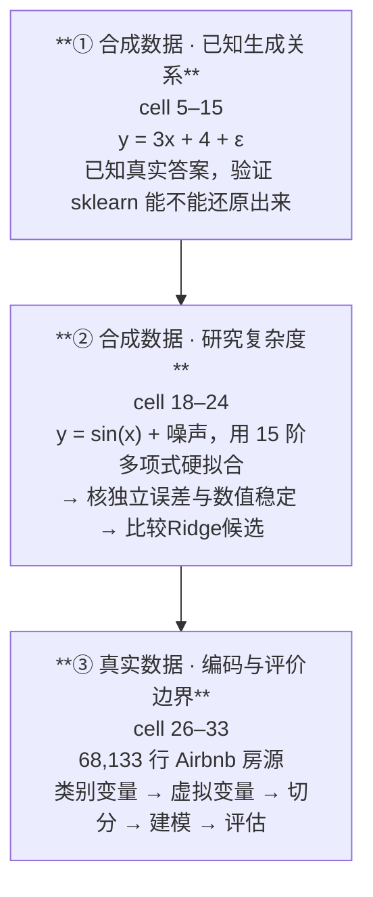

**原教学三段怎样递进**：
- 第 ① 段你**知道正确答案**（真实斜率 = 3、截距 = 4），所以能验证工具靠不靠谱
- 第 ② 段你**知道真实生成函数是sin**，可以用它构造独立检查；训练图和系数本身不证明样本外过拟合
- 第 ③ 段没有已知真实函数，可用观察标签和独立评价检验预测 —— 这才是真实工作的样子

**cell 2 还给了一张"工具箱清单"**（notebook 原文，写着 "for review purposes"）：

| # | 用途 | 库与文档 |
|---|---|---|
| 1 | 可视化 | `matplotlib` — [plot types](https://matplotlib.org/stable/plot_types/index.html) |
| 2 | 线性回归（OLS 与 Ridge） | `from sklearn.linear_model import LinearRegression` — [linear_model 文档](https://scikit-learn.org/stable/modules/linear_model.html) |
| 3 | 类别变量处理 | `from sklearn.preprocessing import OneHotEncoder` |
| 4 | 数据切分 | `from sklearn.model_selection import train_test_split`（notebook 写 "to be continued in **week 10**"，⚠️ 但 Syllabus 的 Model Selection 在 **W11**） |

---

**🎙️ 课堂实况（来源边界）**：本篇仅负责M02整份录音的tutorial子区间，助教在合成数据、Python语法/绘图、类别表示、路径与统计输出建议上展开。

原M02全源631段不等于本篇独占631段。

机器首/末起始戳子区间01:48:45–02:34:37为45:52，映射细区间并集41:54。

最后是AI Prompt说明，评分cell38/空39未录到，不能降权或据此判断从未布置。

课堂用词把test/validation混称，正文按是否参与选择区分。

所有新增机制均标笔记补充。

时间分配详§9，未覆盖部分不凭推测补造。

## 1. 前置

### 1.1 需要哪些库

| 库 | 用途 | Anaconda 自带？ |
|---|---|---|
| `numpy` | 生成随机数、数值运算 | ✅ |
| `pandas` | 读 CSV、处理 DataFrame | ✅ |
| `matplotlib` | 画散点图与拟合线 | ✅ |
| **`scikit-learn`（sklearn）** | **本讲的主角**：回归、Ridge、编码、切分、评估 | ✅ |

安装包名是 `scikit-learn`，导入名是 `sklearn`。上表是旧环境记录，不保证你的当前环境已有这些库；运行前检查实际 kernel，缺包时先说明精确依赖并取得安装许可。

⚠️ 本篇原码使用相对路径，Airbnb.csv须位于kernel实际工作目录，或使用明确路径；不要求文件必与.ipynb同目录，因为cell26写的是相对路径 `pd.read_csv('Airbnb.csv')`。用 Colab 的话要先上传这个文件。

### 1.2 对应哪一讲的理论

| notebook 段落 | 对应 [[M02-预测分析-线性回归]] |
|---|---|
| cell 3 标题 "Linear regression using the **Normal Equation**" | §2.8.3 正规方程 $\hat{\theta} = (X^{\top}X)^{-1}X^{\top}Y$（讲义 p.34） |
| cell 5–11 拟合 y = 3x + 4 | §2.5.1 简单线性回归（讲义 p.14） |
| cell 13 用新数据预测 | §2.9.4 留出法（讲义 p.45 **就是这个 cell 生成的图**） |
| cell 15 R² / MAE | §2.9 模型评估 |
| cell 18–20 多项式 → 过拟合 | §2.9.2 欠拟合 vs 过拟合（讲义 p.40）、§2.10.5（讲义 p.51–52） |
| cell 21–24 Ridge | §2.10.3 Ridge 回归（讲义 p.50） |
| cell 27–30 类别变量 → 虚拟变量 | §2.7.2 虚拟变量与 n−1 规则（讲义 p.25） |
| cell 31 `train_test_split` | §2.9.4 留出法（讲义 p.43–44） |
| cell 31 系数解读 | §2.7.3 解读虚拟变量系数（讲义 p.26） |

### 1.3 sklearn 的两条铁律（第一次接触 sklearn 必读）

**本讲回归接口：`fit` 学参数，`predict` 用已学状态**

```python
model = SomeModel(超参数=...)     # ① 建模型，只填「超参数」（如 alpha）
model.fit(X, y)                   # ② 用数据学「参数」（如 coef_）
y_pred = model.predict(X_new)     # ③ 预测
```

**参数 vs 超参数**（[[M02-预测分析-线性回归#2.9.4 留出法 Hold-out（讲义 p.43 → p.42 → p.44–45）|M02 §2.9.4]] 的两层优化）：

| | 谁定的 | 例子 | 在哪一步 |
|---|---|---|---|
| **超参数** | **你定**（或用验证集选） | `Ridge(alpha=0.1)` 的 `alpha` | 建模型时填进括号 |
| **参数** | **数据学出来** | `coef_`、`intercept_` | `fit()` 之后才有 |

**铁律二：学出来的东西，属性名带一个尾随下划线 `_`**

```python
lin_reg.coef_          # ✅ 系数（fit 之后才存在）
lin_reg.intercept_     # ✅ 截距
lin_reg.n_features_in_ # ✅ 见过几个特征
lin_reg.fit_intercept  # ← 没有下划线：这是你设的超参数，不是学出来的
```

> 💡 **这个命名约定是 sklearn 全库统一的。** 尾随`_`通常表示fit后的属性；不带下划线还可能是方法或其他配置，不能一概当超参数。cell 10 的 `print(lin_reg.__dict__)` 把两类混在一起打印出来了，正好可以对照。

**另一个输入要求：X 必须是二维的**

sklearn 要求特征矩阵 `X` 的形状是 **`(n_samples, n_features)`**，**即使只有一个特征**也必须是 `(100, 1)` 而不是 `(100,)`。

这就是 cell 5 写 `rnd.rand(100, **1**)` 而不是 `rnd.rand(100)` 的原因。

---

### 1.4 先读懂代码里的“名字、表、位置与重复”

💡 以下是笔记补充。你只需要用这些语法追踪本篇的输入和输出，不必先学完一门编程课。

`=` 是保存结果：`a = 2` 把 2 放在名字 `a` 下；`a = a + 1` 先读旧值，再保存 3。它不同于数学里声称两边恒等的等号。`#` 后是注释，不执行。

代码需要先取得工具，再调用工具完成动作。`import numpy as np` 把 NumPy 库简称为 `np`；点号表示从对象中取工具或状态。`np.array([2, 4])` 调用函数，括号里是输入；`model.coef_` 读取训练后的系数，不带调用括号。`alpha=0.1` 在函数括号里表示把名为 `alpha` 的参数设为 0.1。

下面用一个最小例解释位置。方括号中的 0 指第一个元素，1 指第二个元素；Python 从 0 编号。

```python
values = [2, 4, 8]
first = values[0]
count = len(values)
```

这一段输入三个数，输出 `first=2`、`count=3`。列表（list）按顺序保存元素。二维数组像一张表，`[[2], [4]]` 有两行一列；`[2, 4]` 只有一个方向，不带列维度。后面 `X.shape` 的 `(100, 1)` 因此读成“100 行、1 列”。

数据表（DataFrame）同时保存行标签和列名。`data['x']` 取名为 `x` 的一列，得到一维 Series；`data[['x']]` 的内层列表说明“选择这一组列”，外层仍取表，得到二维一列表。`data[predictors]` 则按 `predictors` 中的列名和顺序取多列。这不是给 `x` 加两次括号来算平方。

本篇需要重复造幂次列。先看三个数的循环，缩进的两行对每个 `i` 都做一次：

```python
names = []
for i in range(2, 5):
    name = 'x^%d' % i
    names.append(name)
```

`range(2, 5)` 依次给 2、3、4，不含右端 5；`%d` 把整数填进字符串，因此结果依次是 `'x^2'`、`'x^3'`、`'x^4'`。`append` 每次加一个元素，最终 `names` 有三个名字。原 cell 18 用相同循环，`data['x'] ** i` 把每行的 x 取 i 次幂；`**` 是幂，`*` 是乘法。

列表推导式（list comprehension）把“逐个计算再收集”写成一行。`[i * 2 for i in range(3)]` 先取 0、1、2，各乘 2，再收成 `[0, 2, 4]`。原 cell 18 的角度转弧度就是这种写法；cell 20 的 `extend` 把新列名列表中的各项接到旧列表后面。

原 cell 11 用 `%f` 输出小数：`'b=%f' % 2.8` 显示 `b=2.800000`。它只改变显示精度，不修改保存的数。格式字符串 `f'b={2.8:0.4f}'` 的花括号也会填值，`0.4f` 指保留四位小数。列名字符串里的 `x^2` 是名字，不是 Python 求幂语法。

字典（dictionary）把名字映射到内容，例如 `{'Actual': [10, 20], 'Predicted': [11, 19]}` 的两个键会成为表格列名。两列第一个数必须属于同一条记录。后文的 `join` 还会按行标签对齐；长度相同不保证对象相同。

运行顺序也属于输入。Jupyter 的 kernel 是保存变量和已导入工具的运行进程；先跑 cell 23 却没跑 cell 15，`r2_score` 尚不存在就会报 `NameError`。本篇“原码”按原 cell 顺序读；“笔记补充”是独立解释或示例，不能混到原码中冒充教师保存版本。


## 2. 逐块讲解 · 第一段：合成数据（cell 5–15）

### 2.1 【cell 5】造一批已知答案的数据

**这块在干什么**：人工生成 100 个点，真实关系是 `y = 3x + 4`，再加上正态噪声。

```python
import numpy.random as rnd # This is a library for random number generation
X = 2 * rnd.rand(100, 1)
y = 4 + 3 * X + rnd.randn(100, 1)
```

**逐行**

| 部分 | 说明 |
|---|---|
| `rnd.rand(100, 1)` | 生成 100×1 的**均匀分布** [0, 1) 随机数 |
| `2 * rnd.rand(100,1)` | 乘 2 → X 落在 **[0, 2)** ⚠️ **记住这个范围，cell 13 会出问题** |
| `rnd.randn(100, 1)` | **标准正态分布** N(0,1) 的随机数 —— 就是 [[M02-预测分析-线性回归#2.5.1 公式与三个符号（讲义 p.14–15）\|M02 §2.5.1]] 的噪声项 **ε** |
| `y = 4 + 3*X + …` | 真实模型：**截距 β₀ = 4，斜率 β₁ = 3** |

**⚠️ `rand` 与 `randn` 的差别（一个字母，完全不同）**

| 函数 | 分布 | 取值 | 用途 |
|---|---|---|---|
| `rnd.rand(n, 1)` | 均匀 Uniform[0,1) | 0 到 1 | 生成**自变量 X** |
| `rnd.randn(n, 1)` | 标准正态 N(0, 1) | 可正可负，多数在 ±3 内 | 生成**噪声 ε** |

**为什么这么写 · 为什么要先用合成数据**

因为**你知道正确答案**。真实斜率是 3、真实截距是 4。跑完回归如果得到 3.09 和 3.88，你可以检查这次有限样本估计是否接近生成关系。接近是一个合理现象，但一次结果不能认证工具在所有输入下都正确，也不能据此规定所有后续实验的“正常偏差”。

**🔴 ⚠️ 最大的坑：这个 cell 没有设随机种子**

```python
np.random.seed(42)     # ← notebook 里没有这一行
```

**后果**：未固定生成器状态时，重复运行通常会得到不同的数据，系数与 R² 也可能变化。notebook 里保存的 `3.088464 / 3.876417` 是某一次运行的结果，不是每次必得或每次必不同的保证。

⚠️ 这会造成两个具体问题：
1. 你以为自己写错了（其实只是随机数不同）
2. 不同运行的数字可能不同；先核代码、生成关系与随机状态，再说明实际条件，不能只凭差异判错或判对

> 💡 **对比**：cell 18 就**设了种子** `np.random.seed(10)`。同一份notebook有的段固定种子、有的未固定，材料未说明这一差异的设计意图。自己做新实验时可先固定种子，并记录生成器算法/版本与调用顺序；复现条件见 §3.1。

**🎙️ 课堂补充**（转录 `01:49:32–01:52:22`）

助教从生成直线数据开始，并示范用 `help()` 查函数说明。ASR 的库名和函数名噪声较多，下列英文保留原词，校词放方括号；中文按原 cell 的书面代码解释，本次未重听原音。

> *"You can see here [rand] represents the uniformly distributed values."*（`01:50:41`）

`rand` 生成均匀输入，原 cell 5 的 `randn` 才生成标准正态噪声。助教在 `01:51:19` 把 `(100, 1)` 解释成行数乘列数：100 个样本、每个样本 1 个特征。形状不会因“只有一列”就自动省掉这一维。

转录 `01:51:58` 提到 error term，对应代码里的随机噪声。未设种子仍是源码的可复现性限制；课堂到 `02:08:52` 才解释项目为什么希望固定随机状态，见 §3.1。

**逐行核对**：rand建100×1输入，randn建同形噪声，再按4+3X相加。

**为什么这么写**：已知生成关系便于检验API，噪声仍会使有限样本估计波动。

**输出与来源**：本cell没有print；输出状态是X/y各100×1，原保存系数是后续fit结果。

**⚠️ 易错点**：生成器状态与调用顺序影响可复现，shape100不能替代100×1。

**所以呢**：数据造好了（真实答案是斜率 3、截距 4），下一步在真正拟合之前，先按老规矩把它画出来看一眼。

---

### 2.2 【cell 7】画散点图

**这块在干什么**：拟合之前先睁眼看看数据长什么样——把 cell 5 造出来的 100 个点画成散点图，横轴 X、纵轴 y。

```python
import matplotlib.pyplot as plt
from matplotlib.pylab import rcParams
rcParams['figure.figsize'] = 10, 8
## "b." blue dots
plt.plot(X, y, "b.")
#plt.plot(X, y, color="blue", marker=".")
# $...$ tells Matplotlib to interpret the text as mathematical notation using its mathtext system
plt.xlabel("$x_1$", fontsize=18)
plt.ylabel("$y$", rotation=0, fontsize=18)
plt.axis([0, 2, 0, 15])
plt.savefig("generated_data_plot.png")
plt.show()
```

**逐行**

| 行 | 说明 |
|---|---|
| `rcParams['figure.figsize'] = 10, 8` | 后续新建 Figure 的默认尺寸为 10×8 英寸；显式 figsize 可覆盖 |
| **`"b."`** | **格式串**：`b` = blue（蓝），`.` = point marker（点）。注释里给了等价写法 `color="blue", marker="."` |
| `"$x_1$"` | 美元符号包起来 = **mathtext**，让 matplotlib 按数学公式排版，显示成下标的 x₁ |
| `rotation=0` | y 轴标签**不旋转**（默认会转 90°竖着写） |
| `plt.axis([0, 2, 0, 15])` | 手动设定坐标范围：**x ∈ [0,2]，y ∈ [0,15]** ⚠️ **记住这行，cell 13 会因为它出问题** |
| `plt.savefig("…png")` | 存成图片文件 |
| `plt.show()` | 显示 |

rcParams 的 figure.figsize 只影响之后新建 Figure 的默认值。显式 figsize 可覆盖它，已经建立的 Figure 不会随这次设置自动改尺寸。

**⚠️ 易错点**

1. **该notebook先savefig再show的顺序稳妥**。阻塞式show结束可能注销当前Figure，之后用plt.savefig可能保存新空白图；非阻塞显示或持有Figure并用fig.savefig不同，不能一概说show清空画布。
2. **`plt.axis` 是"我只看这个范围"，不是"数据只有这个范围"**。范围外的点会被裁掉，**你会以为它们不存在**
3. matplotlib 的格式串很省事但可读性差。`"b."`、`"r--"`、`"g^"` 分别是"蓝点""红虚线""绿三角"

**🎙️ 课堂补充**（转录 `01:52:22–01:55:56`）

助教比较统一默认图尺寸与单张图尺寸。下面保留 ASR 原句，仅校正 API 名；“所有图都改”需要按软件实际行为加上限制。

> *"But the difference that for the [rcParams], it will set all the figure [sizes] for all the graphs."*（`01:53:22`）

技术读法：`rcParams['figure.figsize']` 影响之后新建 Figure 的默认尺寸；已经建好的图不会自动变，单张图显式 `figsize` 也可覆盖默认。`plt.figure(figsize=(10, 8))` 则建立一张明确尺寸的新图。

`01:54:06–01:54:48` 的做法是改颜色和点型，看显示如何变。`01:55:16` 解释 `axis` 的前两数管 x、后两数管 y；这些只是窗口边界，不会删除数组中的数据。`01:55:31` 说图片在 notebook 旁生成，只适用于当时 kernel 工作目录也在那里；相对路径依实际工作目录解析。

**逐行核对**：plot把同序X/y配为蓝点；xlabel/ylabel给轴名；axis限制显示区；savefig写图片。

**为什么这么写**：拟合前先看支持范围与异常；先保存再阻塞显示可避免当前Figure已注销。

**输出与来源**：原cell输出散点图，横轴显示0–2、纵轴0–15，并保存generated_data_plot.png；不是模型评分。

**⚠️ 易错点**：图坐标范围可能裁掉点；颜色/marker只是显示，不能证明点正确或模型有效。

**所以呢**：图看过了（散点图上大致有条下降/上升的趋势），下一步让 sklearn 把这条线真正拟合出来，看它学出来的数字准不准。

---

### 2.3 【cell 9–11】拟合模型，取出系数

**这三个 cell 在干什么**：正式让 sklearn 拟合这条线——建一个模型、喂数据训练、把学出来的截距和斜率读出来打印成人话。因为 §2.1 已经知道真实答案是斜率 3、截距 4，这里能直接验证 sklearn 有没有学对。

这里的残差是同一行实际 y 减模型预测值，单位与 y 相同。训练会比较残差平方总和，预测则使用已保存参数。

**💡 fit究竟做了什么：从目标到保存状态（笔记补充）**

输入是训练X的$n\times p$数值表、同序y、是否拟合截距；输出是已拟合对象的系数/截距/列数，predict输出与新行同序的预测。先看一列小例：$x=[0,1,2,3]$、$y=[4,8,9,13]$，不把它冒称原随机100点。

1. 选择直线$\hat y_i=a+bx_i$，最小化$SSE=\sum_i(y_i-a-bx_i)^2$；$a/b$是待学参数，x/y已知。
2. 平均值$\bar x=1.5,\bar y=8.5$；x偏差$-1.5,-0.5,0.5,1.5$，y偏差$-4.5,-0.5,0.5,4.5$。
3. 配对偏差乘积$6.75,0.25,0.25,6.75$合14；x偏差平方$2.25,0.25,0.25,2.25$合5。所以$b=14/5=2.8$，$a=8.5-2.8\times1.5=4.3$。
4. 全部预测$4.3,7.1,9.9,12.7$，残差$-0.3,0.9,-0.9,0.3$，SSE1.8。保存a/b及原列序；新$x=1.5,4$直接得到$8.5,15.5$，不重新fit。

**为什么用这个斜率规则**：先以均值为中心看各点。x 高于均值而 y 也高于均值时，偏差乘积为正，会把拟合斜率推向正值；x 的偏差平方和衡量输入变化幅度。用乘积和除以平方和，得到每单位 x 对应的拟合变化。该规则精确最小化平方误差，前提是分母非零。

<details><summary>补充推导：用导数说明为什么这个比值使平方误差最小（不要求先会微积分）</summary>

这里的导数表示参数微调时目标改变的速率；最小点附近，向任一方向微调都不能继续降低目标。平方误差对截距的导数为$-2\sum_i(y_i-a-bx_i)$，零点要求残差和零，故$a=\bar y-b\bar x$；再对b求导，得到$-2\sum_i(x_i-\bar x)[(y_i-\bar y)-b(x_i-\bar x)]$。令零得$b=\sum(x_i-\bar x)(y_i-\bar y)/\sum(x_i-\bar x)^2$。分母正时这是凸二次函数的唯一最小点；导数是参数作微小变化时误差的一阶变化率，不是随便选一个“相关”系数。

</details>

多列时把这些条件写成矩阵最小二乘。矩阵就是按行列存数的表；转置 $X^\top$ 把行列交换，矩阵乘法用左表的一行与右表的一列，逐位置相乘再相加。

正规方程求逆式需满列秩，即没有重复的线性方向；sklearn 可用分解求解，不要求显式求逆。列重复时系数可能不唯一；全常数一列的中心化分母为零，有截距时可用均值预测，但不能识别斜率。

形状另读：n 是训练行数，p 是输入列数，n_new 是新输入行数。

- 二维一目标 y 的形状为 $n\times1$；coef 为 $1\times p$，预测为 $n_{new}\times1$。
- 一维 y 的 coef 为长度 p 的向量，预测也为一维。

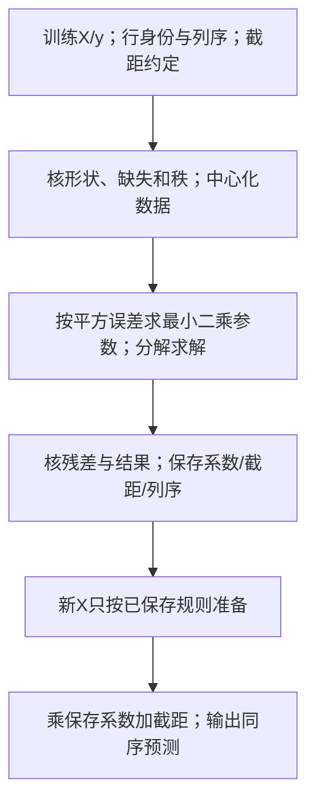

这是直接求解数据流，没有虚构“每次predict重新迭代”；若另选迭代估计器，才按其solver检查容差/最大迭代。两类失败：错误行配对会拟合另一任务；近共线会放大参数不稳定。修配对或比较正则/列选择需重新训练验证，也有模型偏差/丢信息的代价。脚本verify_t02_current.py对照手算、sklearn及statsmodels。

<details><summary>迁移与诊断：x=[0,2,4]、y=[1,5,8]，求参数与新x3预测；predict前拿新一行fit是否正确？</summary>

均值2与14/3，Sxy14、Sxx8，b1.75、a7/6；x3预测77/12≈6.416667，三行残差−1/6、1/3、−1/6，SSE1/6。新一行重新fit会改参数并破坏训练状态，且不能从单个样本识别斜率；正确是保持已学参数。若新输入列顺序错或超训练范围，应先纠正列/报告外推边界，不保证线性趋势持续。

</details>

**cell 9 · 建模并训练**

```python
from sklearn.linear_model import LinearRegression
lin_reg = LinearRegression() # Define your model
lin_reg.fit(X, y)  # Fit your model using the data
```

输出：`LinearRegression()` —— 这是模型对象的 repr，**不是结果**。真正的结果在属性里。

**cell 10 · 把模型内部全打印出来**

```python
print(lin_reg.__dict__)
```

输出：
```text
{'fit_intercept': True, 'copy_X': True, 'n_jobs': None, 'positive': False,
 'n_features_in_': 1, 'coef_': array([[3.08846435]]), 'rank_': 1,
 'singular_': array([5.78736847]), 'intercept_': array([3.87641727])}
```

**逐项**（⭐ 这个 cell 是理解 §1.3 两条铁律的最好教材）

| 键 | 有没有 `_` 后缀 | 是什么 |
|---|---|---|
| `fit_intercept: True` | 无 | **超参数**：要不要拟合截距（详见表后） |
| `copy_X: True` | 无 | 超参数：是否复制 X（不改动原数据） |
| `n_jobs: None` | 无 | 超参数：用几个 CPU 核 |
| `positive: False` | 无 | 超参数：是否强制系数为正 |
| **`n_features_in_: 1`** | ✅ 有 | **学到的**：训练时见过 1 个特征 |
| **`coef_: [[3.08846435]]`** | ✅ 有 | **学到的斜率**（真实值 3 ✓） |
| `rank_: 1` | ✅ 有 | 设计矩阵 X 的秩 |
| `singular_: [5.787]` | ✅ 有 | 中心化设计的奇异值诊断；求解路线另见表后 |
| **`intercept_: [3.87641727]`** | ✅ 有 | **学到的截距**（真实值 4 ✓） |

**`fit_intercept: True` · 是什么**

**超参数**：要不要拟合截距。

`True` 表示 sklearn 会**拟合截距**。

统计记号可表示为一列1，但这不等于sklearn必须在内部物理追加该列（[[M02-预测分析-线性回归#2.8.1 记号翻译表（讲义 p.30）|M02 §2.8.1]] 讲的截距约定）

**诊断名最小唤醒**：秩是列中独立线性方向的数量，例如两列完全倍数只给一个方向；中心化常数列秩为0。奇异值衡量矩阵沿各独立方向的伸缩，本段四点中心化一列的唯一非零奇异值为√5≈2.236068；很小的相对奇异值提示敏感方向。SVD（奇异值分解）把矩阵分解为正交方向与这些伸缩，便于数值最小二乘；它在本篇只作求解实现背景，参数目标/残差条件已完整展开，不能仅凭一个属性就断定所有数据类型使用同一内部solver。

**cell 11 · 用人话打印出来**

```python
print('Slope is %f, Intercept is %f'%(lin_reg.coef_[0][0], lin_reg.intercept_[0]))
print('Linear Function is y=%f * x + %f'%(lin_reg.coef_[0][0], lin_reg.intercept_[0]))
```

输出：
```text
Slope is 3.088464, Intercept is 3.876417
Linear Function is y=3.088464 * x + 3.876417
```

**⚠️ 为什么是 `coef_[0][0]` 两层方括号？**

因为 cell 5 里 `y = 4 + 3*X + rnd.randn(100, **1**)` 生成的 y 是 **二维的 `(100,1)`**。sklearn 会认为"你有 1 个输出目标"，于是 `coef_` 的形状是 **`(1, 1)`**（1 个目标 × 1 个特征），必须 `[0][0]` 才能取到那个数。

| 如果 y 的形状是 | `coef_` 的形状 | 取值写法 |
|---|---|---|
| `(100, 1)` 二维 ← **本 notebook** | `(1, 1)` | **`coef_[0][0]`** |
| `(100,)` 一维 | `(1,)` | `coef_[0]` |

这里按接口形状取值：一维 y 的系数是特征向量，二维多目标 y 的系数是“目标 × 特征”表。不能把“y 是几维就随意多套几层”当成通用索引规则。

（对比：cell 20 的多项式回归里 `data['y']` 是**一维** Series，所以那里写的是 `linreg.coef_[i]`，只有一层。）

**结果解读**

| | 真实值 | 拟合值 | 差距 |
|---|---|---|---|
| 斜率 β₁ | **3** | 3.088464 | +2.9% |
| 截距 β₀ | **4** | 3.876417 | −3.1% |

✅ 这次保存参数接近给定真实值；一个运行不能证明工具在所有条件下正确。 差的这几个百分点来自 100 个样本上的随机噪声 —— 这就是 §2.1 说的"建立正常偏差的感觉"。

**🎙️ 课堂补充**（转录 `01:55:56–01:58:20`）

助教先定义模型，再用 X/y 训练；`01:56:29–01:57:17` 读系数、截距、特征数量等输出，并指出不同电脑显示模型对象的形式可能不同。显示样式不等于拟合数值或形状正确。

> *"Here I have the coefficients. The coefficients of your features."*（`01:56:29`）

`01:57:25–01:58:02` 解释随机生成会使系数不同；口述例约 3.055，原保存为 3.088464。它们是不同运行的记录，不能由“都接近 3”直接认证任一份代码正确。

> *"So it's okay."*（`01:58:02`）

这句针对随机运行的差异，不构成作业可不披露随机状态或无需核生成式的规则。

**逐行核对**：构造回归对象→fit→读coef/intercept；原二维y用两层索引取单系数，再用%f格式化。

**为什么这么写**：把参数学习与后续预测分开，保存状态；不是把每次predict当再训练。

**输出与来源**：原保存Slope3.088464/Intercept3.876417；新四行补充实跑2.8/4.3，来源及数据不同不混。

**⚠️ 易错点**：fit_intercept是估计截距约定；二维y与一维y的coef形状不同，rank不足参数可能不唯一。

**所以呢**：模型学出来的斜率、截距都验证过了（和真实值 3、4 很接近）。光看两个数字还不够直观，下一步把预测结果画出来，顺便检验模型在没见过的新数据上表现如何。

---

### 2.4 【cell 13】用新数据做预测

**这块在干什么**：造一批模型**没见过**的新数据，让模型对这批新数据做预测，再把"真实值"和"预测值"画在一起对比——这是在检验模型能不能推广到训练时没用过的数据上。

```python
X_new = 3 * rnd.rand(100, 1)      # 生成新的 X
Y_new = 4 + 3 * X_new + rnd.randn(100, 1)   # 生成对应的真实 Y

Y_new_predict = lin_reg.predict(X_new)      # 用模型预测

plt.plot(X, y, "b.", markersize=16)                              # 训练数据：蓝点
plt.plot(X_new, Y_new, "*", color='y', markersize=16)            # 新数据真实值：黄星
plt.plot(X_new, Y_new_predict, "b.", color='black', markersize=16)  # 预测值：黑点
plt.xlabel("$x_1$", fontsize=26)
plt.ylabel("$y$", rotation=0, fontsize=26)
plt.axis([0, 2, 0, 15])
plt.legend(['Training Data','Validation Data','prediction line'], fontsize=26)
plt.show()
```

> 🔗 **这个 cell 生成的图，就是讲义 p.45 那张图**（蓝点 Training Data、黄星 Validation Data、黑点 prediction line）。

**⚠️ 这个 cell 有三个坑**

**坑 1 · 一个警告**

notebook 保存的输出里有一条：
```text
UserWarning: color is redundantly defined by the 'color' keyword argument
and the fmt string "b." (-> color='b'). The keyword argument will take precedence.
```

因为第三行同时写了格式串 `"b."`（蓝）和 `color='black'`（黑）—— **两个颜色互相打架**。matplotlib 选了 `color='black'`。⚪ 不影响结果，但正确写法应该是 `"."` 或 `"k."`。

**坑 2 · axis范围可能裁掉新数据，约三分之一只是分布期望**

`X_new = 3 * rnd.rand(100,1)` → X_new ∈ **[0, 3)**，但坐标轴只画到 **2**。按均匀生成分布，落在 [2,3) 的比例期望为 1/3。原随机数组未保存，实际被裁点数未知；不能把期望当这次 100 点的精确计数。

**🔴 坑 3（最重要）：这里违反了讲义自己的外推警告**

见下面 §3.3。

**🎙️ 课堂补充**（转录 `01:58:20–02:00:21`）

助教在 `01:58:55–01:59:32` 发现第三个 plot 的重复颜色设置，并把格式串里的 b 改为 k、移去重复 `color`。技术上这是 UserWarning，不是阻止预测完成的异常；关键字颜色在原调用中优先。

> *"That means the K represents black so you don't need to [set] color again."*（`01:59:32`）

`01:59:42` 把 X/y 称 training data，把新 X/y 混称 testing/validation data。按实际用途，新数据若仅评价已固定模型，可作留出测试；一旦用于选择配置，就承担验证角色。原图例不能替代该判断。

该片段未解释 x 生成支持 `[0, 3)` 与窗口 `[0, 2]` 的差别，也未交代外推设计意图。因此正文把输入范围、可视范围和已知合成关系分别说明，不推断教师疏漏或评分倾向。

**逐行核对**：生成新X/Y→按保存参数predict→把训练、真实新值、预测同序画出。

**为什么这么写**：真实新Y只用于评价，不能进入predict；已拟合状态才是新输入的规则。

**输出与来源**：原随机新X/Y/预测各100×1；保存图的黑点是预测，不是另一次训练标签。

**⚠️ 易错点**：新X支持[0,3)但axis只显示到2，图可隐藏外推区；随机值每次可能不同。

**所以呢**：图画出来了，但"看着挺准"不是一个能写进报告的结论。下一步把"准不准"换算成两个具体数字。

---

### 2.5 【cell 15】评估：R² 与 MAE

**这块在干什么**：光看图还不够，这段代码把"模型预测得准不准"变成两个具体的数字——R² 和 MAE，方便量化比较。

先把本节指标的对象和单位对齐，再代入同一预测表。

| 记号 | 算什么 | 单位 |
|---|---|---|
| 残差 e | 同行实际值减预测值 | y 的单位 |
| MAE（平均绝对误差） | 残差绝对值之和除有效评估行数 | y 的单位 |
| RMSE（均方根误差） | 残差平方的平均再开根 | y 的单位 |
| SSE / SSres | 模型残差平方和 | y 单位的平方 |
| SST / SStot | 实际 y 偏离本评估均值的平方和 | y 单位的平方 |

例如两行残差都为 0.5：SSE=0.5、MAE=0.5、RMSE=0.5。R² 再比较 SSE/SST，是无量纲比例。

**💡 同一预测表走到三个指标（笔记补充）**

输入是同一批评估行的真实y、预测值与可核行序，输出单位明确的MAE/RMSE及相对基准的R²。用上一例的新x1.5/4，给定真实y9/16，预测8.5/15.5：两残差均0.5，绝对值0.5/0.5、平方0.25/0.25；MAE=0.5，RMSE=$\sqrt{(0.25+0.25)/2}=0.5$。真实评估均值12.5，偏差平方12.25/12.25，所以$SS_{tot}=24.5$，$SS_{res}=0.5$，$R^2=1-0.5/24.5=48/49\approx.979592$。

公式中的n是这批有效评估行数；$SS_{tot}$的均值来自该批评估标签，只用于定义指标，不把它偷装进预测器。可部署的常量基线参数仍须从训练学。MAE的绝对值让每次偏离按幅度计，RMSE平方后平均再开根因而对大残差更敏感；同一残差集RMSE≥MAE，但RMSE与“√MAE”没有普遍顺序。$R^2$衡量相对此评估标签均值的平方误差，不自动表示因果解释比例。

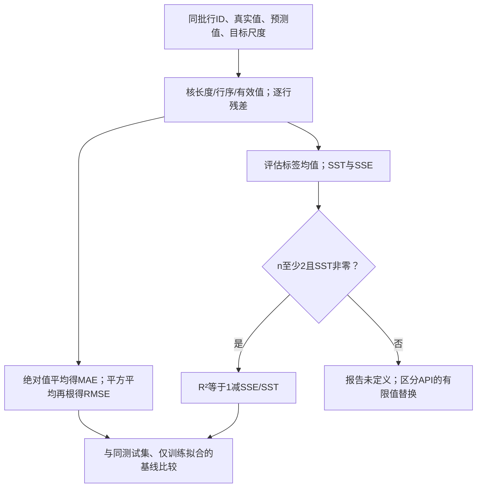

边界：只有一个样本时R²不定义，sklearn给NaN；真实标签全相同时分母零，数学指标未定义，sklearn默认force_finite会把完美/不完美预测替为1/0，不能误认为公式没有零分母。多输出须说明逐目标还是统一加权；缺失/非有限输入先按明确政策处理，不能静默缩短一列后算误差。log指标和美元指标不是同单位。🔗 [r2_score官方文档](https://scikit-learn.org/stable/modules/generated/sklearn.metrics.r2_score.html)，获取2026-10-01；本机核1.5.1。

<details><summary>迁移与纠错：真实[1,3,5]，预测[2,2,5]；再解释为什么误差[0.01,0.01]的√MAE不是RMSE。</summary>

残差−1/1/0，绝对和2、平方和2、n3：MAE2/3，RMSE√(2/3)≈0.816497；真实均值3，SST8，R²=0.75。第二例MAE=0.01、√MAE=0.1、RMSE=0.01，单位也不同。若反把另批标签与当前预测配对，即使长度相同也在评另一个问题；先核行ID。任一指标单独好看都不能替代业务成本与样本外协议。

</details>

```python
from sklearn.metrics import r2_score
from sklearn.metrics import mean_absolute_error
evaluation_result=r2_score(Y_new, Y_new_predict)
print('R2=%f' %evaluation_result)
evaluation_result=mean_absolute_error(Y_new, Y_new_predict)
print('Mean absolute error=%f' %evaluation_result)
```

输出：
```text
R2=0.870716
Mean absolute error=0.828464
```

**两个指标是什么**

| 指标 | 公式 | 范围 | 怎么读 |
|---|---|---|---|
| **R²**（决定系数） | $1-\sum_i(y_i-\hat y_i)^2/\sum_i(y_i-\bar y_{\mathrm{eval}})^2$ | (−∞, 1] | 比较平方误差相对这批评估标签的均值基准（详见表后） |
| **MAE**（平均绝对误差） | $\frac1n\sum_i\lvert y_i-\hat y_i\rvert$ | [0, ∞) | **平均每次预测偏了多少**。**单位与 y 相同**，直观 |

**R²（决定系数） · 怎么读**

比较平方误差相对这批评估标签的均值基准。

标签非恒定且n≥2时，1为零误差、0与该均值基准相同，负数更差。

常数/单样本另见下方边界

**这两个数字怎么解读**

- **R² = 0.87**：相对“统一预测这批评价标签均值”的平方误差，模型减少约 87%。剩余平方误差包含随机噪声和有限样本参数误差等，不能将13%全部认定为不可解释噪声（[[M02-预测分析-线性回归#2.5.1 公式与三个符号（讲义 p.14–15）|M02 §2.5.1]] 的 ε 项）
- **MAE = 0.83**：平均每次预测偏了 0.83。MAE除以y范围不是平均相对误差；若需要相对误差，应先声明各观察的分母及零值政策

> 💡 **已知数据生成过程下的参照**：若用真实直线预测，X均匀[0,2)的信号方差为3²×(2²/12)=3，噪声方差1，总体参照R²=3/4=0.75；评估X均匀[0,3)则信号方差6.75，参照6.75/7.75≈0.871。有限样本拟合/评估会波动，原保存0.870716不能称严格理论上限或噪声份额。

**⚠️ 常见误区**

- ❌ **"R² 越高模型越好。"** —— R² 只衡量**训练/评估这批数据上**的拟合。过拟合的模型训练 R² 可以到 0.99
- ❌ **"MAE 和 RMSE 差不多。"** —— RMSE 会**放大大误差**（平方），MAE 一视同仁。有离群点时两者差距很大
- ⚠️ **notebook 用的评估数据 `Y_new` 是"验证集"还是"测试集"？** 按 [[M02-预测分析-线性回归#2.9.3 验证集 ≠ 测试集（讲义 p.41）⭐ 容易混|M02 §2.9.3]] 的定义，它更像**测试集**（只用一次、不参与选模型）。但 cell 13 的 legend 写的是 "Validation Data"。⚪ notebook 在这个术语上不严谨

**🎙️ 课堂补充**（转录 `02:00:21–02:01:56`）

助教把 MAE 解释成预测与实际相差多远，随后总结指标方向。英文按 ASR 校正指标名，不冒称原音逐字核实。

> *"So what we want is like we want the r square is higher but we want a smaller like [mean absolute error]."*（`02:01:32`）

中文意思：在同样评价对象和协议下，希望 $R^2$ 较高、MAE 较低。前者比较平方误差相对均值基准，后者衡量平均绝对偏离；不能跨不同数据集只比大小。`02:00:43` 的口头“解释多少变异”不推出因果比例或“多少点预测正确”。

该片段没有给公式、负 $R^2$ 和零分母边界；这些在本节标为笔记补充。所供 tutorial 转录也未解释 RMSE，原变量名 `rmse` 不足以证明实现了正确指标。

**逐行核对**：对同序Y_new与预测依次r2_score/mean_absolute_error，再格式化输出。

**为什么这么写**：同集平方误差相对基准与绝对误差幅度提供不同证据，不能拿不同集分母比较。

**输出与来源**：原保存R²0.870716/MAE.828464；2026-10-01 旧批固定迷你评估例分别48/49与0.5，非原随机数据重建。

**⚠️ 易错点**：常数y/单样本R²有未定义边界；log误差和美元误差不是同单位。

**所以呢**：第一段（合成的直线数据）走完了一整套"造数据 → 拟合 → 预测 → 评估"的流程，而且模型表现符合预期。下一段换一批更刁钻的数据——真实关系是曲线，看看同样的方法会不会翻车。

---

## 3. 逐块讲解 · 第二段：过拟合与 Ridge（cell 18–24）

### 3.1 【cell 18】造一个非线性数据集 + 造多项式特征

**这块在干什么**：第一段用的是"一条直线就能描述"的干净数据；这段代码换一批**真实关系是曲线（sin 函数）**的数据，再手工造出 $x^2$ 到 $x^{15}$ 共 14 个新列，为下一步用多项式表示曲线、检查复杂度与数值风险做准备。

**💡 原行如何变成15列（笔记补充）**

输入一个x、声明最高次数d，输出固定列序$[x,x^2,\ldots,x^d]$；此映射自身不从y学习参数，d的选择却不能偷看最终测试。原61行的x从60°到300°、步4°转弧度；data有x/y加14个新列，共16列，真正fit取15个predictors，y另给。

以新x2、d3示范，表示为[2,4,8]；若已fit得到$a_0=1,a_1=0.5,a_2=-0.1,a_3=0.01$，预测$1+0.5(2)-0.1(4)+0.01(8)=1.68$。新x必须用同d与同列序，然后复用参数；不把次数放到“第几条样本”。原d15对x2末列32768，而原最大x的15次幂约60,950,789,390.33，说明列尺度悬殊。真实拟合仍按§2.3的SSE学习系数，对参数线性、对原x可非线性。

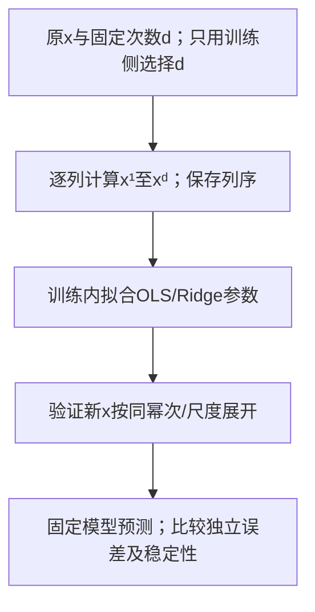

系数大/交替只提示相消与病态可能，不能独自证明过拟合；要看同支持范围的新数据或训练内验证误差是否恶化。数值病态是微小运算/数据变化造成解敏感，过拟合是拟合了不能泛化的样本变化，两者可同时或分别出现。标准化可改列尺度但不消除高次列的相关性；降d、正则或更稳定的基函数都需验证且可能增偏差。超原角度范围的预测还叠加外推，不能把该误差全归过拟合。

<details><summary>迁移：x3、d2，已学a0=2/a1=1/a2=−0.2，预测多少？只因a2为负能断定过拟合吗？</summary>

表示[3,9]，预测2+3−1.8=3.2；负号只是此函数曲率，不能证明过拟合。须独立误差比较、支持范围和数值诊断；另造[x²,x]列顺序会让系数误乘，应按训练序输入。

</details>

```python
import numpy as np
import pandas as pd
import random
import matplotlib.pyplot as plt

#Define input array with angles from 60° to 300°, converted from degrees to radians.
x = np.array([i*np.pi/180 for i in range(60,304,4)])
np.random.seed(10)  #Sets the random seed for NumPy's random-number generator.
# np.random.normal(mean, standard_deviation, number_of_values)
y = np.sin(x) + np.random.normal(0,0.15,len(x))
#column_stack() combines the two arrays side by side as columns.
data = pd.DataFrame(np.column_stack([x,y]),columns=['x','y'])

plt.plot(data['x'],data['y'],"k.",markersize=16)
plt.xlabel('X'); plt.ylabel('Y'); plt.show()

#Create polynomial variables (x^2, x^3, ..., x^{15}) in your DataFrame.
for i in range(2,16):  #power of 1 is already there
    colname = 'x^%d'%i      #new var will be x_powerb
    data[colname] = data['x']**i
print(data.head())
```

**逐部分**

| 部分 | 说明 |
|---|---|
| `range(60, 304, 4)` | 60, 64, 68, …, 300 → **61 个角度**（度） |
| `i*np.pi/180` | 度 → 弧度。x 范围 **[1.047, 5.236]** |
| **`np.random.seed(10)`** | 这里固定生成器初始状态；同生成器算法/版本、初态与调用顺序下噪声可复现 |
| `np.random.normal(0, 0.15, len(x))` | 均值 0、标准差 **0.15** 的噪声 |
| `y = np.sin(x) + 噪声` | **真实函数是 sin，不是多项式** —— 记住这点 |
| `np.column_stack([x, y])` | 把两个一维数组并成 61×2 的二维数组 |
| `for i in range(2,16)` | 造 $x^2$ 到 **`x^15`** 共 14 列（加上原来的 `x`，一共 **15 个自变量**） |

**⚠️ 一个数值上的隐患**

x 最大是 **5.236**，那么 $x^{15} = 5.236^{15} \approx 6.1 \times 10^{10}$。

**同一张表里，`x` 这一列的量级是 1，`x^15` 那一列的量级是 10¹⁰ —— 相差一百亿倍。** 这会导致：
1. $X^{\top}X$ 严重**病态（ill-conditioned）**，求逆时数值误差巨大 → cell 22 会跳出 `LinAlgWarning`
2. **Ridge 的惩罚项对不同尺度的特征是不公平的**（惩罚 $\sum a_j^2$ 里，量级大的特征系数天然小，被罚得轻）

⚠️ 原码没有标准化；可比较仅训练侧估计尺度后的Ridge，但尺度定义会改变惩罚目标，仍可能病态。完整机制见 §3.4，不能把缩放当普适保证。

**🎙️ 课堂补充**（转录 `02:02:47–02:14:35`）

助教在 `02:03:17–02:06:11` 补循环、函数调用、`range` 和列表推导式。ASR 原句说明循环的用途：

> *"So we use a for loop to just to do the repetitive tasks."*（`02:03:35`）

中文意思是：逐个取输入，对每个输入重复相同动作。§1.4 的 `range(2, 5)` 补例给出 2、3、4；原 `range(60,304,4)` 因此包含 300，且不包含右端 304。原 61 个角度各乘 $\pi/180$，就变成 `sin` 所需的弧度。

`02:08:30–02:09:50` 解释随机种子。助教希望研究或项目中的随机资料可以重现；固定种子只设置特定生成器的起始状态，仍要保持生成器算法/版本与后续调用顺序。

> *"But when we're doing our like research or your project actually we want this kind of result more stable"*（`02:08:52`）

`02:11:12–02:12:17` 建议项目特征需由问题决定，必要时可加入平方项；并不建议直接照搬三次、四次等高次项。原 notebook 的 15 次表示用于演示复杂度；代码目标不能变成已证明过拟合的实验结论。ASR 的 `electrical project` 未听原音，具体项目修饰词保持不确定。

> *"the x square is okay."*（`02:12:08`，截取本条 ASR 的明确片段）

`02:12:57–02:14:04` 说明 `%d` 是整数占位、`**` 是幂、循环从 2 到 15 共重复 14 次。这些操作在 §1.4 已给最小例，回到原 cell 可逐列追踪，不要求读者先会 Python。

**逐行核对**：按角度转弧度→seed10生成61个噪声→column_stack成x/y→逐次造2至15次幂。

**为什么这么写**：多项式用固定非线性表示配线性参数模型，次数与列序要在训练及新输入一致。

**输出与来源**：data形状61×16，predictors选61×15；最大15次幂约6.09508×10¹⁰，2026-10-01 旧批实算。

**⚠️ 易错点**：高次列尺度和相关性可使数值病态；系数大本身不证明样本外过拟合。

**所以呢**：数据和 15 个多项式特征都造好了。下一步真的把它们全塞进一个不加约束的线性回归，观察高次模型的训练拟合、数值尺度和独立误差，不预先把图称为过拟合。

---

### 3.2 【cell 20】15 阶多项式：训练拟合与风险诊断

**这块在干什么**：把上一步造好的 15 个多项式特征全部塞进普通线性回归（不加任何约束），研究复杂度增加的效果；先看训练拟合，再用独立误差判断是否过拟合。

```python
from sklearn.linear_model import LinearRegression
power=15
predictors=['x']
predictors.extend(['x^%d'%i for i in range(2,power+1)])
linreg = LinearRegression()
linreg.fit(data[predictors],data['y'])
y_pred = linreg.predict(data[predictors])

plt.plot(data['x'],y_pred,linewidth=8)
plt.plot(data['x'],data['y'],'.',markersize=16)
plt.title('Polynomial regression of power: %d'%power,fontsize=30)
plt.legend(['predicted','real data'],fontsize=16)
plt.show()

print('Lets take a look at the coefficients:')
print('intercept=%f' %linreg.intercept_)
for i in range(len(linreg.coef_)):
    print('a%d=%f' %(i+1,linreg.coef_[i]))
```

**输出的系数**：
```text
intercept=12.367975
a1=-13.257106   a2=-7.140650    a3=5.535653    a4=9.289331    a5=-0.529531
a6=-9.011442    a7=0.253921     a8=8.954160    a9=-8.142741   a10=3.699555
a11=-1.021597   a12=0.179302    a13=-0.019634  a14=0.001228   a15=-0.000034
```

**逐部分**

| 部分 | 说明 |
|---|---|
| `predictors = ['x']` 然后 `.extend([...])` | 造出列名清单 `['x','x^2',…,'x^15']` |
| `linreg.fit(data[predictors], data['y'])` | ⚠️ 注意 X 是 **DataFrame**（15 列），y 是 **Series**（一维）。sklearn 两者都接受 |
| `linreg.predict(data[predictors])` | ⚠️ **在训练数据自己身上预测** —— 这是"训练误差"，不是泛化误差 |
| `linreg.coef_[i]` | **一层索引**（对比 cell 11 的 `[0][0]`），因为这里 y 是一维的 |
| `a%d' % (i+1)` | `coef_[0]` 对应 `x`（一次项）→ 打印成 `a1` ✅ 编号是对的 |

**⭐ 系数能提示什么，不能证明什么**

看这串系数的**符号和量级**：

```text
a1 = -13.26    a2 = -7.14    a3 = +5.54    a4 = +9.29    a5 = -0.53
a6 =  -9.01    a7 = +0.25    a8 = +8.95    a9 = -8.14   a10 = +3.70
```

**正负来回横跳，量级在 10 上下。** 而真实函数 sin(x) 的值域只有 [−1, 1]。

**预测是各幂次项相加**：先给每项系数乘对应的幂，再累加；不能直接把 a4 的 +9.29 与 a6 的 −9.01 当作同单位数字相减。

在具体 x 上，不同项可能很大而总和很小，这叫相消。高次列尺度悬殊又高度相关，微小数值差就可能改变系数。原保存图多处预测不通过观察点，不能说它插值全部点。

相消提示数值诊断；过拟合须在独立数据上看误差。两件事都可能发生，却不能由系数正负或量级直接证明。原系数完整保留，未重跑此 15 阶实验。

**⚠️ 它和讲义 p.52 那张表的数字完全不同**（讲义 intercept = −36,247.8，这里 = 12.37）；原sin段固定seed10，不能仅凭差异断定用了不同随机数据。来源/求解环境未同协议核实；本机病态设计重跑OLS截距约−315.700837而保存12.367975，说明数值实现也可能改变解。应在同数据/尺度/solver下核对预测与残差，而不只比较大系数。

**逐行核对**：按power组成predictors→fit OLS→在同训练表predict→画线/点→逐系数打印。

**为什么这么写**：固定列序将原x映射成学习输入；对参数线性仍可拟合曲线。

**输出与来源**：原保存图与系数是训练内拟合输出；不能由它单独确定未知样本性能。

**⚠️ 易错点**：power变量在cell20；独立误差、数值稳定和外推须分别诊断，不能仅看曲线扭动。

**所以呢**：已看到训练内拟合与大系数相消，但是否过拟合还须独立误差证据。在讲Ridge怎样改变目标之前，先插一段题外话：第一段 cell 13 那张"预测图"其实也埋了一个坑，而且和"训练范围之外不可信"这个道理是同一件事。

---

### 3.3 ⚠️ 这里违反了讲义自己的外推警告

**是什么**

训练范围内也要验证，范围外更需要额外结构假设、领域依据或新数据；不因超范围就断言预测必错——这是 [[M02-预测分析-线性回归#2.6.3 外推警告（讲义 p.21）|M02 §2.6.3]] 讲过的外推风险。**这个 notebook 自己的 cell 13 就踩了这个坑**，回头看一眼那两行代码：

```python
X     = 2 * rnd.rand(100, 1)   # 训练数据：x ∈ [0, 2)
X_new = 3 * rnd.rand(100, 1)   # 评估数据：x ∈ [0, 3)  ← 超出训练范围！
```

新输入分布在 [2,3) 的概率为 1/3；实际 100 点计数会波动，原数组未保存。这一区间在训练生成支持 [0,2) 之外。

**三个范围为什么要分开看？** 下图只画原代码的输入支持与显示窗口，不画无法恢复的随机曲线。

![[IS6400_Business_Data_Analytics/notes/figures/t02-readability/input-ranges.svg]]

横轴是合成 x 的单位；三条横线分别表示训练生成支持、新输入支持和原图窗口。空心端点表示右端不含，实心端点表示含；纵向位置只分行，不是 y。标注箭头只指向教学值 2.5。

走 x=2.5：它落在新输入支持，却超训练支持；模型可以算预测，但这是外推。原窗口只到 2，因此它也不会显示。扩大显示窗口只能让点可见，不能提供额外训练证据。

文字替代：训练 [0,2)、新输入 [0,3)、窗口 [0,2]。图只据原代码范围；2.5 是明确补充的教学输入，不是声称旧随机样本有这一点。

<details><summary>读图自测：把 x 轴扩到 3 就消除了外推吗？</summary>

没有。只改变窗口，不改变训练输入与模型状态。[2,3) 的预测仍需要额外结构假设或数据。

</details>

而讲义 p.21 用一个红色警告三角明确写着：

> ⚠️ "**don't use any values of X that aren't contained in the sample data**; otherwise the results are subject to a great deal of uncertainty"

原代码允许模型在训练支持之外输出数值。按讲义警告，需要把这部分称为外推并说明结构假设，不能只看图上可见点。

这个合成实验事先规定所有新输入都服从同一条真实直线，所以可使用该已知结构讨论外推。有限样本估计仍有误差；保存图又裁掉了部分范围，不能由它断言外推误差没有增大。

**但这掩盖了外推的危险性**。如果真实关系在 x > 2 处改变形状，原线性模型可能偏离；偏离大小取决于改变程度和预测位置。

> 💡 若任务是评价相同输入支持下的新数据，可另用 `X_new = 2 * rnd.rand(100, 1)`；若任务刻意研究外推，则保留新范围并单独报告。不能只因范围不同就擅自改变原题或推断作者意图。
>
> 🎙️ **✅ 转录已核实：课上没有任何人点破这一点。**
> - **教授**在讲义部分把外推警告讲得很重（`37:48–40:23`，还举了"价格降到 10 元""价格为 0"两个反例，见 [[M02-预测分析-线性回归#2.6.3 外推警告（讲义 p.21）|M02 §2.6.3]]）
> - **助教**在讲 cell 13 时**只指出了颜色冲突那个 bug**（`01:58:55`），**对 $X_{\text{new}} \in [0,3]$ 超出训练范围 `[0,2]` 只字未提**
> - 两人**都没有把讲义 p.21 和这个 cell 联系起来**
>
> ⚪ 录音未出现对此输入范围设计意图的说明，无法确认是疏漏或有意安排；外推与裁图边界仍需说明。
> 💡 这是可以在报告里明确说明的数据边界，不是保证加分的规则。

**逐行核对**：本节读取cell13的训练/新输入范围及axis，不新训练模型；核被裁点与支持差。

**为什么这么写**：让图的显示范围、训练支持和预测输入区间互相对上，避免可视化隐藏风险。

**输出与来源**：训练[0,2)、新输入[0,3)，axis[0,2,0,15]只显示部分新点；超界数量是随机观察，不保证恰1/3。

**⚠️ 易错点**：理论预计约1/3在[2,3)，实际100点数可波动；合成真实线性设定不意味着所有真实数据外推可信。

**所以呢**：外推的坑说完了，回到 15 阶多项式过拟合那条主线——下一步看正则化怎样改变目标和训练拟合。

---

### 3.4 【cell 22】Ridge 出场

**这块在干什么**：换掉普通的 `LinearRegression`，用 `Ridge`（岭回归）重新拟合同一组 15 阶多项式特征，看加了正则化惩罚之后，训练曲线与系数怎样变化。

**💡 惩罚如何改变解：目标、单位与停止（笔记补充）**

sklearn目标是$J(a,b)=\sum_i(y_i-a-bx_i)^2+\alpha b^2$，多列则$\alpha\sum_jb_j^2$；截距不受此惩罚。α≥0是你声明/训练内验证选择的强度，a/b仍由训练学。对截距求导仍得$a=\bar y-b\bar x$；对b求导使$-2S_{xy}+2(S_{xx}+\alpha)b=0$，所以一列解$b=S_{xy}/(S_{xx}+\alpha)$。它在数据项之外增加抵抗大系数的成本，不是把预测残差直接剪成零。

沿同四行原单位例，Sxy14/Sxx5：α0→b2.8/a4.3；α1→b7/3/a5；α5→b1.4/a6.4。α1对新x4预测$5+(7/3)4=43/3$。缩小范数会改变偏差/方差取舍，不保证每一个分量都按同幅度减、验证一定更好或所有有限α系数必非零；若中心化x与y正交，Sxy0，b也可精确0。

若先按训练总体标准差缩放，mean1.5/std√1.25≈1.118034，新x4得z√5≈2.236068。此时Sz²4、Szy14/√1.25，α1得bz≈2.504396，截距8.5，新预测14.1。和未缩放的43/3不同，因为被罚参数的单位改变；若要保持同一原单位惩罚，须相应换α，而不是说标准化后同α仍同目标。保存mean/std及系数，新数据只transform，不用测试拟合尺度。常数列scale按接口约定处理；尺度合理不等于相关性/数值问题都消失。

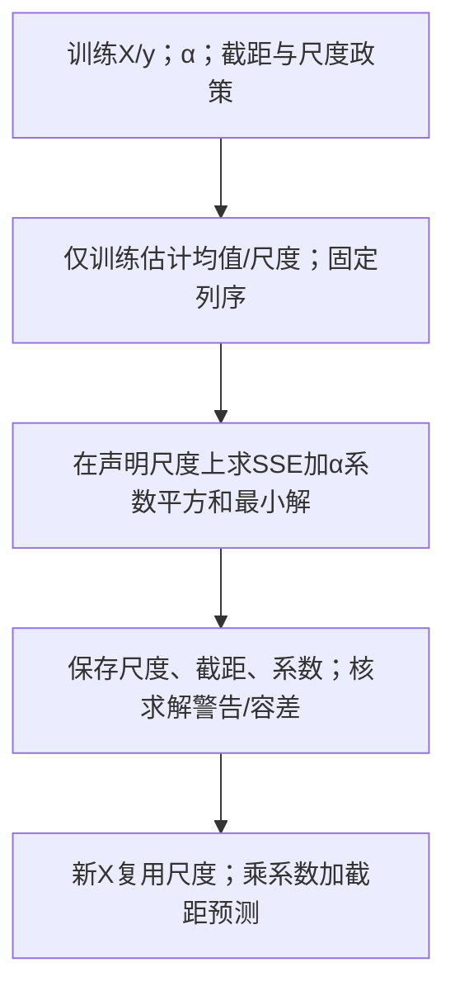

小例为直接线性代数求解，无需人为编循环次数；若使用迭代solver才检查tol/max_iter与不收敛提示。本机原61×15病态设计上，Ridge(alpha0,solver=svd)与LinearRegression预测最大差约0.85855，即目标等价也不保证有限精度输出一致。不能靠默认solver无报错宣称可靠。🔗 [Ridge官方目标](https://scikit-learn.org/stable/modules/generated/sklearn.linear_model.Ridge.html)，获取2026-10-01；原notebookcell21写α乘平方和，与本段sklearn口径相符。

<details><summary>迁移/诊断：一列Sxx8、Sxy12，α4、均值x2/y5，求参数和新x3预测；若软件使用平均SSE，λ仍可直接抄成alpha吗？</summary>

b=12/(8+4)=1、a5−2=3，新x3预测6。若目标改成SSE/(2n)+λb²/2，乘2n后软件alpha=nλ；缩放系数不同须先同倍数化整个目标。新x自己fit scaler会改坐标，不能复用原bz；训练缩放、罚项定义和列顺序都须保持。α大也可能欠拟合，不保证改善验证。

</details>

```python
from sklearn.linear_model import Ridge
alpha=0.1
#Fit the model
ridgereg = Ridge(alpha=alpha)
ridgereg.fit(data[predictors],data['y'])
y_pred = ridgereg.predict(data[predictors])

plt.plot(data['x'],y_pred,linewidth=8)
plt.plot(data['x'],data['y'],'.',markersize=16)
plt.title('Plot for penalty lambda: %.3g'%alpha,fontsize=30)
plt.show()
print('Lets take a look at the coefficients:')
print('intercept=%f' %ridgereg.intercept_)
for i in range(len(ridgereg.coef_)):
    print('a%d=%f' %(i+1,ridgereg.coef_[i]))
```

**输出**：
```text
LinAlgWarning: Ill-conditioned matrix (rcond=4.47936e-24): result may not be accurate.

intercept=0.788751
a1=-0.021043   a2=0.006600    a3=0.063724    a4=0.101482    a5=0.063904
a6=-0.050368   a7=-0.115335   a8=-0.010430   a9=0.172735   a10=-0.149777
a11=0.062788   a12=-0.015190  a13=0.002171   a14=-0.000171 a15=0.000006
```

**⭐ 把两组系数并排看，正则化的作用一目了然**

| | 无正则化（cell 20） | **Ridge α=0.1（cell 22保存输出）** |
|---|---|---|
| intercept | **12.37** | **0.79** |
| a1 | **−13.26** | **−0.021** |
| a4 | +9.29 | +0.101 |
| a8 | +8.95 | −0.010 |
| **系数量级** | **~10** | **~0.1** |
| 曲线形状 | 保存图两端有局部波动 | 保存图稍平滑，非样本外改善证明 |

保存系数的部分量级变小、曲线稍平滑；原图没有画真实sin线或独立样本，不能据此宣称泛化改善，须另按同支持与目标评价。

**⚠️ 两个坑**

**坑 1 · alpha与λ须先对齐目标函数缩放**

sklearn 管正则化强度叫 **`alpha`**，讲义和大多数教科书叫 **`λ`（lambda）**。都表示惩罚强度，但数值只有在目标函数系数相同时才相等。sklearn Ridge最小化SSE+alpha×系数平方和；M02原讲义SSE+λ/2×平方和对应alpha=λ/2；若另用SSE/(2n)+λ/2×平方和，则alpha=nλ。
notebook 的图标题写的是 `'Plot for penalty **lambda**: %0.3g' % **alpha**`。

**坑 2 · `LinAlgWarning: Ill-conditioned matrix`**

这个警告的根源是 §3.1 说的：`x` 和 `x^15` 相差一百亿倍，`XᵀX` 病态。`rcond = 4.48 × 10⁻²⁴` 极小，意味着矩阵几乎奇异。

⚠️ **正确做法**：若希望各列按相同标准差单位承担惩罚，可仅在训练侧估计尺度再用Ridge；标准化是所选目标的定义，不是所有正则模型的必做命令：

```python
from sklearn.preprocessing import StandardScaler
from sklearn.pipeline import make_pipeline
model = make_pipeline(StandardScaler(), Ridge(alpha=0.1))
model.fit(data[predictors], data['y'])
```

**为什么本例值得比较缩放**：Ridge 的惩罚是 $\lambda \sum a_j^2$，**对不同量级的特征不公平**。`x^15` 的取值到 10¹⁰，它对应的系数天然只需要 10⁻¹⁰ 量级就能起作用，于是几乎不受惩罚；而 `x` 的系数要大得多，被罚得很重。是否按原单位惩罚是建模选择；若希望按相同标准差单位比较，应声明训练侧缩放。

> 💡 **一句话记住**：**先说明量纲与惩罚对象，再决定是否按训练尺度标准化。** 这是笔记补充的比较方案；原材料没有承诺采用它就加分。

**🎙️ 课堂补充**（转录 `02:14:35–02:18:47`）

`02:16:53` 说多项式 “exactly fitted”，但原保存图并未穿过全部观察点。课堂口述与实际保存图须区分；不能将口述当作插值或泛化证明。

助教在 `02:17:09–02:18:05` 强调 alpha 不设时用默认 1，要复现这里的配置应明确设为 0.1。

> *"Remember to set your [alpha]"*（`02:18:05`）

`02:18:21` 口述曲线较平滑，`02:18:38–02:19:04` 建议试不同 alpha，并用指标比较。训练图较平滑仍不等于独立误差改善。本段转录未解释病态警告、StandardScaler 或 Lasso；本节的尺度与单位分析为笔记补充，不推定评分加分。

**逐行核对**：构造Ridge并给alpha→fit当前15列→predict→画曲线与逐参数打印。

**为什么这么写**：按SSE加惩罚定义取舍；选择缩放时仅训练估计尺度，让罚项单位明确。

**输出与来源**：原保存含Ill-conditioned警告/参数；2026-10-01 旧批一列alpha1得b7/3/a5，缩放目标同alpha则新x4预测14.1。

**⚠️ 易错点**：alpha换算取决于目标缩放；标准化不保证相关性消失或所有求解器警告解除。

**所以呢**：原保存 Ridge 曲线较平滑，但还没有独立泛化证据，但 α=0.1 是怎么选出来的？下一步试几个不同的 α 值，比比看谁更好——顺带看这段代码本身有没有问题。

---

### 3.5 【cell 23】比较三个 alpha —— ⚠️ 这个 cell 有两处问题

**这块在干什么**：既然 alpha（讲义里的 λ）是一个要自己定的超参数，这段代码就试三个不同的值（0.001 / 0.01 / 0.1），用 R² 和一个"RMSE"给它们打分，想找出哪个最好。

**先修唤醒**：CV（交叉验证）将训练资料分成数份fold（折），轮流留一折评价、其余拟合；每折须重新fit预处理和模型。嵌套验证是外层评价整个内层选择过程，成本是更多拟合。本节给固定训练/验证/测试教学小例，CV在这里作为替代方案预告，不伪称本小例已经执行交叉验证。

**💡 Pipeline与调参从头走到最终测试（笔记补充）**

训练四行x0/1/2/3、y4/8/9/13；验证两行x1.5/4、y9/16；最后测试x2.5/5、y11.5/18。三份身份事先固定，最终测试不参加选α。此处沿原单位Ridge目标比较α0/1/5：验证MAE分别0.5、13/12≈1.083333、2.25；取0。重新用训练+验证六行fit最终OLS等价目标，b≈2.88163265/a≈4.31020408；最终两行预测11.51428571/18.71836735，MAE≈0.36632653。最终训练参数已变，不能沿旧a4.3/b2.8号称完成重拟合。

若选择训练尺度Pipeline，则每个候选都在自己的训练表fit scaler再fit Ridge，验证/测试只predict；同α数值不与上面的原单位目标混为同次实验。Pipeline不是一个自动识别数据身份的安全开关；你在分割前对全表fit，它同样会学测试统计量。CV时每个训练fold必须另fit整条Pipeline，不能先一次全表标准化再做CV。

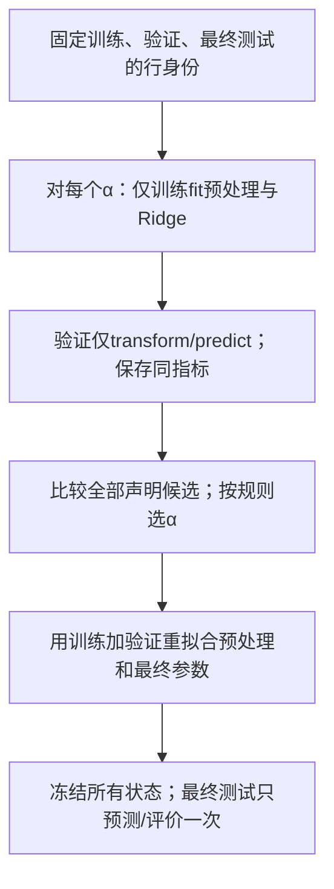

这条链的输出含选定α、最终参数/预处理、列名及最终测试指标。终点是声明候选全部评价后选定、最终测试完成；若边看测试边改候选，该表就不再是未参与选择的测试。单次小验证仍有抽样波动，多试候选可对验证过拟合；可用训练内CV或嵌套方案增加稳健性，代价是更多拟合。本例测试x5超训练+验证最大4，须报告外推，不把输入支持改变隐去。数据与全部数值由verify_t02_current.py核，均为教学补充，不是个人评分作业答案。

<details><summary>诊断变式：学生先用8行全数据fit scaler，再把最后2行命名test，是否安全？如果验证选α后仍用四行旧模型，哪一步未完成？</summary>

不安全，最后2行已影响尺度；应先固定边界、只用训练fit，再按政策训练+验证重拟合。第二种没有执行最终重拟合，若方案声称用6行训练就与实际状态不符；也可以事先声明只保持4行训练，但必须如实报告方案与样本，不把未做的操作写成做过。

</details>

```python
alphas = [0.001, 0.01, 0.1]

for alpha in alphas:
    ridge = Ridge(alpha=alpha)
    ridge.fit(data[predictors],data['y'])
    y_pred = ridge.predict(data[predictors])
    r2 = r2_score(data['y'], y_pred)
    rmse = np.sqrt(mean_absolute_error(data['y'], y_pred))
    print(alpha, r2, rmse)
```

**输出**：
```text
0.001  0.9758496554501757  0.3058679023154275
0.01   0.9726869604648501  0.3241968215625607
0.1    0.9750721154612126  0.30773850648704004
```

原 cell 23 还保存以下两条求解警告（仅省去本地用户名路径，不改警告值）：

```text
LinAlgWarning: Ill-conditioned matrix (rcond=7.32267e-26): result may not be accurate.
LinAlgWarning: Ill-conditioned matrix (rcond=4.47936e-24): result may not be accurate.
```

**🔴 问题 1：`rmse = np.sqrt(mean_absolute_error(...))` 是错的**

**RMSE = Root Mean Squared Error = `sqrt(MSE)`**，不是 `sqrt(MAE)`。

正确写法：
```python
from sklearn.metrics import mean_squared_error
rmse = np.sqrt(mean_squared_error(data['y'], y_pred))
# 跨版本写法：np.sqrt(mean_squared_error(y_true, y_pred))
```

**原最后一列是 $\sqrt{\mathrm{MAE}}$，不是 RMSE 或 MAE。** 其单位是目标单位的平方根；若要 MAE 应直接报告原 `mean_absolute_error` 的值。

⚠️ **W02 作业第 2 题要求"Use MAE to evaluate"** —— **别抄这一行**。

**协议限制：训练内比较只说明对已见样本的贴合**

`ridge.fit(data[predictors], data['y'])` 然后 `ridge.predict(data[predictors])` —— **训练和评估用的是同一批数据**。

若目标是比较训练拟合，这样计算有明确含义；若目标是选择面向未见数据的配置，应使用验证资料。留出法见 [[M02-预测分析-线性回归#2.9.4 留出法 Hold-out（讲义 p.43 → p.42 → p.44–45）|M02 §2.9.4]]。

同一设计/尺度下精确求解的Ridge训练SSE对alpha通常不减，故只按训练拟合比较会倾向弱惩罚；平局、退化与有限精度须区分。训练分数不提供最优泛化alpha的证据，也不能把任何最小alpha自动叫过拟合。

看输出确实印证了：**alpha = 0.001 的 R²（0.97585）最高。**

> ⚠️ **W02 作业第 3 题（40 分）就是"试这三个 alpha，找出哪个表现最好"。**
> 按原保存训练指标，0.001 最好；这个带协议的描述成立。不能把它写成“未来数据上必然最好”，也不能据此推断教师会判错。官方参考与个人验证协议对照见 §8.1 Q3。
>
> ✅ **正确做法**：先 `train_test_split` 切出验证集，在**训练集上 fit、在验证集上评估**，再比较三个 alpha：
> ```python
> from sklearn.model_selection import train_test_split
> Xtr, Xva, ytr, yva = train_test_split(data[predictors], data['y'],
>                                       test_size=0.3, random_state=0)
> for a in [0.001, 0.01, 0.1]:
>     m = Ridge(alpha=a).fit(Xtr, ytr)
>     print(a, r2_score(yva, m.predict(Xva)), mean_absolute_error(yva, m.predict(Xva)))
> ```
> 此代码是另一个验证方案，并非原 cell 23；保留数据、尺度、指标与划分记录，才能解释结果差异。没有教师加分承诺。

**运行依赖：cell 23 沿用 cell 15 的指标导入**

它们靠的是 cell 15 的 import。**如果你只跑这个 cell（比如重启 kernel 之后），会 `NameError`。** 按完整 notebook 顺序执行有定义；只孤立运行该格时须先导入。它是执行顺序依赖，不自动构成原 notebook 缺陷。

**⚠️ 另一个值得注意的现象**：三个 R² 不是单调的（0.9758 → 0.9727 → 0.9751）。按理说 alpha 越大 R² 应该越低。非单调与病态警告都已保存；应核数值稳定性，不能凭三个显示数唯一断定原因或保证标准化能解决。

**🎙️ 课堂补充**（转录 `02:18:47–02:19:24`）

该片段建议用两个指标评价不同 alpha，随后转到真实 Airbnb 数据。以下短句按源码校正 ASR 的指标误词：

> *"The r squared and also the mean absolute [error]."*（`02:19:04`）

中文意思是用 $R^2$ 和 MAE 进行比较。所供片段未解释原 `rmse` 实际是 $\sqrt{\mathrm{MAE}}$，也未区分训练内比较和面向未见数据的选择。不能从这段沉默推断教师要求唯一验证方案、认定 0.001 选错，或保证另用验证集加分。后取得的官方参考与个人历史方案已在 §8.1 Q3 分别列出。

**逐行核对**：按声明alphas逐fit/predict/算同指标；原码误以sqrt(MAE)命名rmse。

**为什么这么写**：用于选alpha的评价需训练内验证，最终测试不能反复参与选择；所有候选应同协议比较。

**输出与来源**：保留原保存三个训练分数为历史输出；新增完整4/2/2行例选alpha0、6行重拟合、最终测试MAE.36632653。

**⚠️ 易错点**：训练内最高分不是泛化证明；RMSE必须sqrt(MSE)，sqrt(MAE)可能巧合相同，需能区分的检查例。

**所以呢**：前两段（合成的直线数据、合成的曲线数据）都是"知道正确答案"的练习赛。下一段换成 68,133 行的真实 Airbnb 房源数据——没有人告诉你真实系数是多少，这才是真正的实战。

---

## 4. 逐块讲解 · 第三段：Airbnb 真实数据（cell 26–33）

> 📌 数据的完整六项概览见 [[IS6400_Business_Data_Analytics/_meta/数据集卡片#Airbnb.csv|数据集卡片 › Airbnb.csv]]（68,133 行 × 15 列，实跑统计）。这里只讲**代码**。

### 4.1 【cell 26】读数据

**这块在干什么**：前两段用的都是自己造的数据；从这里开始换成 68,133 行的真实 Airbnb 房源数据，第一步永远是把 CSV 读进来、看一眼长什么样。

```python
import pandas as pd
ResearchData=pd.read_csv('Airbnb.csv') #load data as pandas dataframe
ResearchData.head()
```

`head()` 显示前 5 行、全部 15 列。⚠️ **注意第 4 行（index 3）的 `review_scores_rating` 是 `NaN`** —— 真实数据的缺失值第一次露面。

**⚠️ 路径问题**：`'Airbnb.csv'` 是**相对路径**，相对路径实际从kernel工作目录解析；同notebook目录仅在kernel cwd也指那里时方便。用 Colab 的话先上传文件，或改成完整路径。

**🎙️ 课堂补充**（转录 `02:19:24–02:21:15`）

助教解释她把 CSV 与 notebook 放在同一目录，并示范将文件拖入终端取得完整路径。拖入只是取路径，不应直接执行该文件或修改原件。

> *"Since a lot of people like fail to read it. The data is because your address is not correct."*（`02:21:00`）

中文意思是路径不正确会使读文件失败；这句没有调查报错频次，不能写成“所有错误中最高频”。实际排查先查 kernel 工作目录，再确认文件存在和路径拼写。Windows 完整路径可用原始字符串 `r'...'` 或正斜杠，避免反斜杠被解释为转义。

**逐行核对**：read_csv按路径解析文件→保存在ResearchData→head展示前5行。

**为什么这么写**：先核shape/字段/缺失与数据卡，路径相对于kernel工作目录而非永远是.ipynb目录。

**输出与来源**：本源68133×15，head显示5行；index3评分缺失的历史展示不等于所有选列有缺。

**⚠️ 易错点**：FileNotFoundError先核实际cwd/路径；不应为解决路径复制或改原件。

**所以呢**：数据读进来了，15 列里也已经看到了缺失值和文字列。下一步要从这 15 列里挑出真正能喂给回归模型的那几列。

### 4.2 【cell 27】选特征与目标

**这块在干什么**：Airbnb 数据有 15 列，不是每一列都能直接喂进回归模型；这段代码手动挑出 5 列当自变量、`log_price` 当因变量，再看一眼那个类别列有哪些取值。

```python
feature=['property_type','accommodates','bathrooms','bedrooms','beds']
target='log_price'
x=ResearchData[feature]
y=ResearchData[target]
x['property_type'].drop_duplicates()
```

输出：
```text
0     Apartment
3         House
15         Loft
16    Townhouse
Name: property_type, dtype: object
```

**逐部分**

| 部分 | 说明 |
|---|---|
| `feature = [...]` | **手动白名单**：只用 5 个特征。**这一步同时把 `id` 排除掉了** —— 见 [[IS6400_Business_Data_Analytics/_meta/数据集卡片#5.7 `id` 不是特征\|数据集卡片 › 5.7 `id` 不是特征]]，`id` 是行身份，不能只因数字形式就当有测量意义的特征 |
| `target='log_price'` | 因变量。**它是价格的自然对数**，见 [[IS6400_Business_Data_Analytics/_meta/数据集卡片#4.1 它到底是什么\|数据集卡片 › 4.1 它到底是什么]] |
| `x = ResearchData[feature]` | 取出 5 列，得到一个新 DataFrame |
| `.drop_duplicates()` | 去重，用来**看这一列有哪些取值**。输出保留了原始索引（0/3/15/16），说明这四类第一次出现的位置 |

> 💡 **这 5 个字段的缺失状况**：它们在此文件**全都是零缺失列**（见 [[IS6400_Business_Data_Analytics/_meta/数据集卡片#3. 缺失率|数据集卡片 › 3. 缺失率]]）。如果加上 `review_scores_rating`（缺失 22.4%），`LinearRegression` 会直接抛 `ValueError: Input contains NaN`。此文件所选五原字段零缺失，但材料未给动机，不能据此替作者解释为何选它们。

**统计读法唤醒**：均值是有效观察和除以数量；样本标准差是偏差平方和除n−1再开根，和本讲StandardScaler的分母n区分。四分位是有序有效值的25%/50%/75%位置；线性插值例[1,2,3,4]得到1.75/2.5/3.25。这里用它们读describe输出，不因字段出现在表中就说它有模型价值；真实运行机制另见T01/T03。

**🎙️ 课堂补充**（转录 `02:21:15–02:24:39`）

`02:21:53` 明说五个字段是示例，项目应自己考虑选哪些；`02:22:09–02:22:39` 区分四个数值字段与房型类别，类别要转换成数值表示。它没有给出“五字段是因零缺失才入选”的设计动机。

> *"Just to give you a simple example"*（`02:21:53`，原条首句片段）

`02:23:18–02:23:47` 建议数值先看 describe，类别可看 unique；`02:26:55` 说明 drop_duplicates 在此也用于展示类别。技术补充：类别 Series 的 `describe()` 仍可给 count/unique/top/freq，不是完全没有信息。`unique()` 给有哪些类别；`value_counts()` 还给各类行数，二者用途不同，不能用“更好”一概替代。

**逐行核对**：feature取property_type加四个数值列，target取log_price；drop_duplicates只看类别。

**为什么这么写**：X与y角色分离；原5字段仅示例，任务相关价值要验证，不靠名称猜。

**输出与来源**：原X68133×5、y68133；property_type四类，编码后是7列而非仍5数值列。

**⚠️ 易错点**：drop_duplicates用于展示类别不等于对整表清洗；类别describe也能给count/unique/top/freq。

**所以呢**：5 个特征选好了，但其中 `property_type` 是文字类别，回归模型看不懂文字。下一步把它转换成模型能吃的 0/1 数字列。

### 4.3 【cell 29】OneHotEncoder：把类别变成 0/1

**这块在干什么**：`property_type` 是文字（"Apartment"、"House"…），线性回归只认数字。这段代码把这一列文字类别转换成几列 0/1 数字，好塞进模型。

**💡 固定字典、秩与未知分支（笔记补充）**

先固定编码字典与输出列，而不是给类别随意编号。原出现 Apartment / House / Loft / Townhouse，drop first 以 Apartment 为参照。

一行是一种已知类别，后三列是固定字典中保留的指示位。

| 类别 | House | Loft | Townhouse |
|---|---:|---:|---:|
| Apartment | 0 | 0 | 0 |
| House | 1 | 0 | 0 |
| Loft | 0 | 1 | 0 |
| Townhouse | 0 | 0 | 1 |

后三列分别回答是不是该房型；1 是、0 否，无测量单位。读 House 行：只有 House 位为 1。接四个数值字段后，每行 7 列。

编码器保存 categories_ 与 drop_idx_，与回归系数一起保留。名义类别没有天然 1/2/3/4 的顺序距离。

若不drop，则每行四dummy之和恒为1；有截距的设计中“截距列=四dummy之和”，故列线性相关。把每个类别系数同时加c、截距减c，所有预测不变，参数因此不唯一。删除一dummy建立参照，令其他系数表示相对基准的拟合差；无惩罚、有截距且同一列空间时换参照可保预测。正则对特定编码系数施罚，换参照一般改变目标，不保证预测不变。

**原调用与补充路线分开**：原 cell 29 在 split 前对全表 fit，未知类别默认报错。下图展开编码状态，并允许声明 ignore / 未知桶；这些额外出口不能冒称原调用已有。

箭头表示 fit 后保存字典，再用字典编码新行。House 从 C2 到 C4 输出 (1,0,0)，C6 按同房源 ID 拼数值字段。Castle 在 C3 走否；原默认进入 C7 报错。ignore 的全零须标未知，不能改叫 Apartment。

文字替代：先冻字典，再编码；未知策略必须先声明。下方既有 Castle 自测检查这条分支。

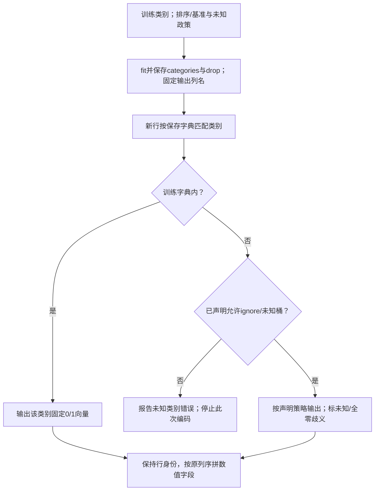

原OneHotEncoder默认未知类别报错。

设handle_unknown=ignore时未知可能全零，与drop基准全零混淆，无法据此认定为Apartment。

未知桶/单独标记需预先声明，不能偷偷新增列破坏模型宽度。

若训练中有类别缺失而测试才出现，应按同一政策报告。

本文件原split四类恰均在训练，不推广为所有切分都无问题。

删drop时原硬编码三列名会先报长度不符，须同步列名。

现代接口用get_feature_names_out更稳妥。

完整原数据fit encoder发生在split前，2026-10-01 旧批补充流程改为训练fit、测试transform，保留原码并标协议限制。

🔗 [OneHotEncoder官方文档](https://scikit-learn.org/stable/modules/generated/sklearn.preprocessing.OneHotEncoder.html)，获取2026-10-01。

新代码应按已核本机1.5.1选sparse_output，原码.toarray保持原样。

<details><summary>迁移：训练仅Apartment/House，新Castle，drop first，默认与ignore各怎样？全dummy加截距为何不是“有更多信息”？</summary>

固定输出House一列：Apartment0、House1；默认Castle报错，ignore为0但与Apartment有歧义，应报告未知而非自动判公寓。全dummy的和就是截距列，是重复表示，增加列不增加可识别自由度；OLS预测可定义而系数不唯一，解释各系数需参照约定。

</details>

```python
from sklearn.preprocessing import OneHotEncoder
enc = OneHotEncoder(drop='first')
enc_f=enc.fit(x[['property_type']])
print(enc_f.categories_)
# It will generate four dummies, alphabetically sorted ['Apartment', 'House', 'Loft', 'Townhouse']
# The first category "Apartment" will be dropped.

enc_df = pd.DataFrame(enc_f.transform(x[['property_type']]).toarray())
enc_df.columns = ['House', 'Loft','Town House']
#columns=enc_f.get_feature_names_out(['property_type'])
enc_df.head()
```

输出：
```text
[array(['Apartment', 'House', 'Loft', 'Townhouse'], dtype=object)]

   House  Loft  Town House
0    0.0   0.0         0.0
1    0.0   0.0         0.0
2    0.0   0.0         0.0
3    1.0   0.0         0.0
4    0.0   0.0         0.0
```

**⭐ 这个 cell 是 [[M02-预测分析-线性回归#2.7.2 虚拟变量与 n−1 规则（讲义 p.25）|M02 §2.7.2]]（虚拟变量与 n−1 规则）的直接实现。逐点对应：**

| 讲义说的 | 代码怎么做的 |
|---|---|
| "Variable with **n** cases can be represented with **n−1** dummy variables" | **`drop='first'`** —— 4 个类别只输出 3 列 |
| "The value **without** a dummy variable is **base level**" | 被丢掉的 **Apartment** 就是基准水平 |
| "indicated with all dummy variables are zero" | 第 0/1/2/4 行三列全 0 → 它们都是 Apartment ✓ |
| （讲义没说：为什么丢的是 Apartment） | **`categories_` 按字母序排**：Apartment < House < Loft < Townhouse。`drop='first'` 丢掉字母序第一个 |

**逐部分**

| 部分 | 说明 |
|---|---|
| `x[['property_type']]` | ⚠️ **双层方括号**（详见表后） |
| `enc.fit(...)` | **学习**有哪些类别（存进 `categories_`） |
| `enc_f.transform(...)` | **转换**成 0/1 矩阵 |
| **`.toarray()`** | OneHotEncoder 默认返回**稀疏矩阵**（省内存），要转成普通数组才能塞进 DataFrame |
| `enc_df.columns = ['House','Loft','Town House']` | **手动改列名**。注释里给了更好的写法 `enc_f.get_feature_names_out(['property_type'])`（自动生成 `property_type_House` 这样的名字），但被注释掉了 |

**`x[['property_type']]` · 说明**

⚠️ **双层方括号**！

sklearn 要二维输入（[[T02-回归实战-从合成数据到Airbnb定价#1.3 sklearn 的两条铁律（第一次接触 sklearn 必读）|§1.3]] 铁律三）。

写成 `x['property_type']` 是一维 Series，会报错

**⚠️ 两个小问题**

1. **列名硬编码**：输出仍为 3 列但类别语义变了，三个手填名字可能静默对应错列。

若输出列数不等于 3，给三列名会显式报 Length mismatch。用 get_feature_names_out() 随拟合字典生成列名，并核原类别与顺序。
2. **`'Town House'` 有空格，而原始类别是 `'Townhouse'`（没空格）**。纯命名不一致，不影响运行，但看输出时容易困惑

**💡 换个说法**

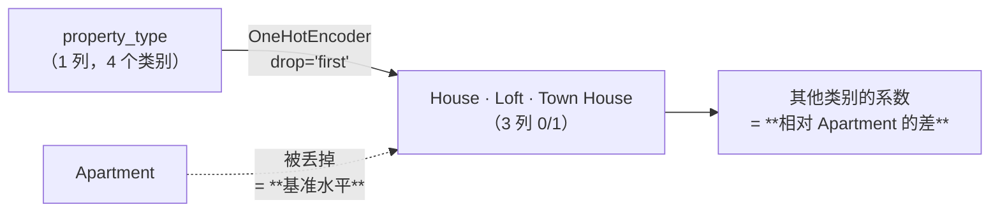

**🎙️ 课堂补充**（转录 `02:24:39–02:28:10`）

`02:25:20–02:26:24` 逐类说明四个指示位，随后解释留三个已能识别第四类。这里必须以当前已知四类为前提；未知类别走原默认报错，不由三列全零认定为 Apartment。

> *"if the house and the loft and townhouse [dummies are] zero. It's definitely [indicating the] apartment dummy as well."*（`02:26:24`）

`02:26:36–02:26:45` 说项目可以选择丢任意一个基准，不必丢第一类。中文解释：在有截距、无惩罚、同列空间的精确 OLS 中，换基准可保预测，但系数比较对象随之改变；不能推广为惩罚模型一定不变。

`02:27:45–02:27:59` 说明此调用实际 drop 第一个并保留 House、Loft、Townhouse。程序输出列应从拟合字典取得，避免硬编码名字与实际类别不符。

**逐行核对**：fit保存类别/基准→transform成稀疏表示→toarray→DataFrame→赋三列名。

**为什么这么写**：固定字典把名义类别表示成同语义列；参照编码配有截距OLS避免线性依赖。

**输出与来源**：原enc类别Apartment/House/Loft/Townhouse，三dummy输出68133×3；与正文四类编码表一致。

**⚠️ 易错点**：默认未知报错；ignore全零有基准歧义；去drop后必须同步原硬编码列名。

**所以呢**：类别列变成三列 0/1 数字了，但它现在还是一张独立的表，没有和其余 4 个数值特征放在一起。下一步把两张表拼成一张完整的特征表。

### 4.4 【cell 30】把虚拟变量拼回去

**这块在干什么**：上一步造出来的三列虚拟变量（`enc_df`）还是一张单独的表，这段代码把它拼回主特征表 `x`，再把原来的文字列删掉——模型才能拿到一张干净的、全是数字的表。

**💡 行身份从房源到预测不能丢（笔记补充）**

下图为补充的训练内fit规范顺序；原cell29–31先全表fit再切分的代码保留作来源，不能当已经符合该协议。固定外部字典的纯transform可更早进行，但本篇学习类别字典时先划训练身份。

先确认每个编码向量属于哪个房源。下面三行是笔记补充小表，原输入顺序不变。

| 房源 ID | 房型 | 容量 | 编码向量 |
|---|---|---:|---|
| 31 | House | 4 | [1,0,0] |
| 12 | Apartment | 2 | [0,0,0] |
| 50 | Loft | 3 | [0,1,0] |

第一列是身份而非测量，容量单位为人，向量列依 House/Loft/Townhouse 排列。读 ID31：容量 4 人，编码 House=1；join 后这两项仍须属于同一房源。

1. 编码器先返回无行标签数组，顺序与输入相同。
2. 构造 DataFrame 时赋同序 index 31/12/50，再按标签 join。
3. 默认 index 0/1/2 会造成缺失或错配；只复制 index 也不能修已经独立排序的数组。
4. X/y 同次 split，预测第 i 项对应 x_test 第 i 行。评价时一起保存这些 ID。

反例区别：Actual Series(index7/3,values10/20)与等长Predicted ndarray(11/19)构造DataFrame，结果index7/3、成对(10,11)/(20,19)，不会全NaN；另一个Predicted Series若index0/1，才与Actual按标签并集形成缺失。使用tolist会舍弃身份但不修正已经乱序的预测。安全补充写法可用`pd.Series(y_pred,index=x_test.index,name='Predicted')`，再与同ID真实值核对；若y是二维，先按目标形状取列，不凭ravel吞多个目标。

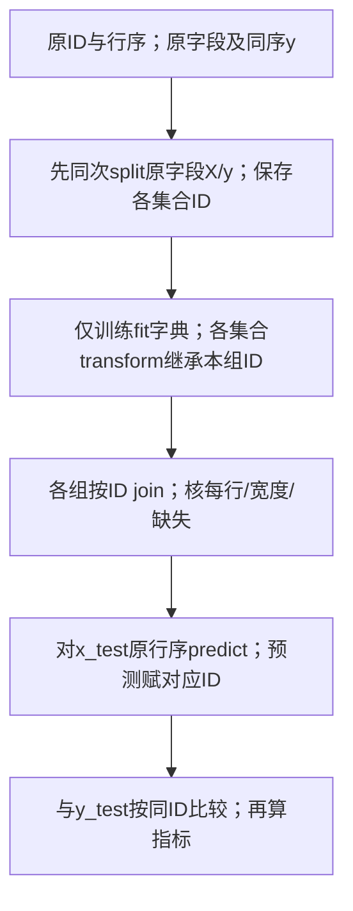

<details><summary>迁移/诊断：原y的ID[50,12]，数值[8,3]；预测数组[7,4]按同x_test顺序，MAE多少？若先单独排序真实值，为什么不能仍算同一指标？</summary>

成对误差1/1，MAE1。若把真实值排序为[3,8]而预测仍[7,4]，误差4/4、MAE4，是错配导致另一计算；先保留ID并在相同对象上对齐。长度相等不保证对象一致。编码unknown、缺失、重复ID也须按政策处理，不让join悄悄改变行数。

</details>

```python
# merge with main df on key values, this will be used as IV
x = x.join(enc_df)
x = x.drop('property_type', axis=1)
x.head()
```

输出：
```text
   accommodates  bathrooms  bedrooms  beds  House  Loft  Town House
0             3        1.0         1     1    0.0   0.0         0.0
1             7        1.0         3     3    0.0   0.0         0.0
...
```

**逐部分**

| 部分 | 说明 |
|---|---|
| `x.join(enc_df)` | **按索引**把两张表横向拼接 |
| `x.drop('property_type', axis=1)` | 删掉原来的类别列（`axis=1` = 按列删）。**必须删** —— 它已经被三个虚拟变量替代了，留着模型也用不了字符串 |

**🔴 `.join()` 的致命陷阱**

**`join` 是按 index 对齐的，不是按行的物理位置。**

这里能正常工作，纯粹因为 `x` 和 `enc_df` **恰好都是默认的 0,1,2,…,68132 索引**。

**如果上游筛选后保留原index而编码表另建默认index**（比如 `x = x[x['bedrooms'] > 0]`），`x` 的索引会变成不连续的（0, 1, 3, 7, …），而 `enc_df` 仍是 0,1,2,3,…，join可能出现缺失或错配，应核具体行身份，而不只长度：某个房源的 `accommodates` 会配上另一个房源的 `property_type`。

错配有时会产生 NaN 并导致拟合报错，有时会保留数值却配错对象。先核每行身份、缺失和行数，不能把“能跑”当正确。

💡 若 `encoded_array` 是刚对当前 x 做 transform 的同序数组，`encoded_names` 是该编码器输出列名，可按下例保留标签。它是说明性代码，不是可独立执行的原 cell：
```python
enc_df = pd.DataFrame(encoded_array, index=x.index, columns=encoded_names)
x = x.join(enc_df)
# 前提：encoded_array 仍保持刚才输入 x 的行顺序
```

**🎙️ 课堂补充**（转录 `02:28:10–02:30:45`）

助教给出 join，并在 `02:28:36–02:29:07` 补充 `pd.concat(..., axis=1)` 横向拼表的写法。ASR 对 API 拼写不可靠，下面只引明确的 join 片段：

> *"you can use the join. To join the X"*（`02:28:36`，原条片段）

两种写法都可能按标签对齐，不能靠换函数名解决错配。本节给出的同序编码数组与原 index 对应，是笔记补充的安全前提；若数组早已独立排序，后来复制 index 也不能恢复身份。

`02:30:30` 解释删去原 property_type：文本信息已编码为 dummy，当前 LinearRegression 输入需要数值列。这里删的是进入模型的特征表列，不是删除只读 CSV 中的原始信息。

**逐行核对**：无标签编码数组先带原ID成DataFrame，再join原数值表，最后drop文字property_type。

**为什么这么写**：保证编码和目标来自同一房源；join按标签不是按当前位置拼。

**输出与来源**：原完整RangeIndex下join后X68133×7；补充ID31/12/50示范非默认标签及错配分支。

**⚠️ 易错点**：复制index不能修已乱序的数组；核行数、每行对象和缺失，不能只看长度。

**所以呢**：特征表现在是一张干干净净、全是数字的表了。下一步终于可以做第三段真正的重点——把数据切成训练集和测试集，正式训练模型。

### 4.5 【cell 31】切分 + 训练

**这块在干什么**：特征表处理干净了，这一步才真正做第三段最关键的一件事——把数据切成训练集和测试集，只用训练集拟合模型；回归系数只用训练行估计，编码器的全表 fit 限制另见下方。

```python
from sklearn.linear_model import LinearRegression
from sklearn.model_selection import train_test_split
x_train, x_test, y_train, y_test = train_test_split(x, y, test_size=0.30, random_state=0)

lin_reg = LinearRegression() # define your model
lin_reg.fit(x_train, y_train)

print(lin_reg.coef_)
print(lin_reg.intercept_)
```

输出：
```text
[ 0.17000603  0.13795161  0.12490194 -0.05628411 -0.19173624  0.12103869 -0.17429126]
4.057529625004383
```

**逐部分**

| 部分 | 说明 |
|---|---|
| `train_test_split(x, y, ...)` | **必须同时传 x 和 y**，函数会用**同一套随机索引**切它们，保证行对得上 |
| **返回值顺序** | ⚠️ **`x_train, x_test, y_train, y_test`** —— 赋错对象可能报形状错误，也可能悄悄训练另一个问题；须核 X/y 身份与形状 |
| `test_size=0.30` | 测试比例 30%，取整说明见下方 |
| **`random_state=0`** | **固定随机切分方式**，保证可复现。⚪ 与 cell 5 不设种子形成鲜明对比 |
| `lin_reg.fit(x_train, y_train)` | **只用训练集拟合** ✅ 这次做对了 |
| `coef_` | 这次是**一维数组**（7 个数），因为 `y` 是一维 Series → 用 `coef_[i]` 取值 |

**测试人数怎么得到**：68,133×0.30=20,439.9，API 向上取整为 20,440 行，训练为 47,693 行。比例、乘积与整数行数是三种不同表示。

**🔴 最大的问题：这串裸数字，谁是谁？**

```text
[ 0.17000603  0.13795161  0.12490194 -0.05628411 -0.19173624  0.12103869 -0.17429126]
```

`coef_` **不带列名**（[[T01-Jupyter入门与Pandas基础#3. 完整流程串讲|T01 §3]] 说过：转成数组就丢了列名）。**必须靠 `x` 的列顺序去对应。**

见 §5.3。

**🎙️ 课堂补充**（转录 `02:30:45–02:31:43`）

ASR 在 `02:30:59` 把 test 与 validation 混称：

> *"Training data and also the test [set] also which is also called the validation data."*（`02:30:59`）

中文意思是切成训练和一批留出资料；但两个名称在评估中承担不同角色。验证集参与选配置，最终测试集评价冻结结果。判断角色要看实际使用，不能由变量名或口述混称抹去这条边界。

`02:31:05–02:31:13` 说明全数据训练后就没剩未用资料作评价；`02:31:25–02:31:43` 说比例由分析设计决定。70/30 是本源选择，不是所有任务通用要求；无论比例多少，预处理也须遵守声明的数据边界，原 encoder 先全表 fit 的限制不因此消失。

**逐行核对**：同次train_test_split给X/y的训练测试组，固定random_state0；OLS只fit训练。

**为什么这么写**：先固定对象边界，评估对象不进入参数估计；预处理也应仅训练fit。

**输出与来源**：2026-10-01 旧批原协议47693训练/20440测试，coef7项/截距4.057529625；输出完整数组非只最优数。

**⚠️ 易错点**：原encoder在全表fit的协议局限已标；本源四类都在训练使本次数值相同不推出全量fit普遍安全。

**所以呢**：模型用训练集拟合好了，`coef_` 也打印出来了，但这串裸数字谁对应哪个特征还没有说清楚（见上面"最大的问题"）。下一步先用测试集验证模型准不准，"哪个系数是哪个特征"留到 §5.3 专门讲。

### 4.6 【cell 32–33】预测与评估

**这块在干什么**：用刚训练好的模型对**测试集**（回归系数拟合未用到的 20,440 行；编码器曾见过其类别集合）做预测，把预测值和真实值摆在一起看，再算一个 MAE 给整个第三段收尾。

**💡 statsmodels 输出的每列从哪里来（笔记补充）**

继续用 §2.3 的四行表。拟合得到 a=4.3、b=2.8，四个残差为 −0.3、0.9、−0.9、0.3，平方和 SSE=1.8。现在要问：系数只是这四行估出来的，抽样变动有多大？

1. 训练 n=4 行，已经用数据估了截距和斜率两个数，残差自由度为 $4-2=2$。用它除 SSE，得到噪声方差估计 $s^2=1.8/2=0.9$；这里不同于预测指标除以 n。
2. 标准误（standard error，SE）衡量系数估计的抽样波动尺度。单列且有截距时，斜率标准误为 $\mathrm{SE}(b)=\sqrt{s^2/S_{xx}}$；本例 $S_{xx}=5$，所以 $\sqrt{0.9/5}\approx0.424264$。
3. 截距标准误为 $\mathrm{SE}(a)=\sqrt{s^2(1/n+\bar x^2/S_{xx})}$。代入均值 1.5，得到 $\sqrt{0.9(1/4+1.5^2/5)}=\sqrt{0.63}\approx0.793725$。
4. 检验假设（null hypothesis）是“总体系数为 0”。t 统计量把估计与 0 的差除以标准误：斜率 $t=2.8/0.424264\approx6.599663$，截距约 5.417491。
5. 在下述误差条件成立时，用自由度 2 的 t 分布作参照，计算离 0 至少同样远的两侧尾概率，得到 p 约 0.022198、0.032424。p 不是假设为真的概率。具体尾概率由分布函数求值，不能只凭 t 大小猜精确 p。
6. 95% 置信区间（confidence interval）按“估计 ± 临界倍数 × 标准误”形成。自由度 2 的临界倍数为 4.302653，斜率区间 $2.8\pm4.302653\times0.424264$，约 [0.974539, 4.625461]。

95% 指这种构造程序在假设成立、重复抽样时的覆盖率，不是给已经固定的总体斜率赋 95% 概率。本例的两侧 p 与区间按经典独立、等方差、正态误差模型计算；四个观察不能认证这些假设。多列时推广为参数协方差矩阵，这里给出一列公式，是为了让当前数字能手算追踪。

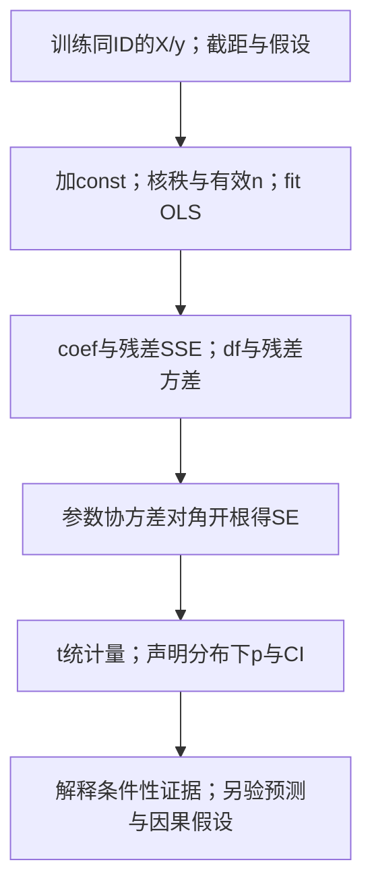

上述经典SE/t有限样本口径依赖误差独立、等方差、正态等条件；四个教学观察不能证明这些条件。秩不足、n≤参数数、缺失或异方差时不能照抄此推断链，应报告限制/合理协方差估计方案，仍需其对应假设。p<0.05不表示有95%概率为真、因果成立或独立预测一定改善；重复筛列会改变推断协议。脚本verify_t02_current.py公开coef/SE/t/p/CI；本段核心推断就地展开，VIF仅是背景诊断扩展，不把“唯一一个库”当统计原理。

<details><summary>迁移/诊断：同模型斜率2、SE.5时t多少？学生把p=0.02写成“98%概率有因果作用”，错在哪里？</summary>

针对H0斜率0，t=4，但还须有效自由度与对应分布才能确定p/CI；不能仅凭4给任意分布的尾概率。p是H0及假设成立下至少如此极端统计量的概率，不是因果概率；还需研究设计、遗漏变量和数据生成证据，预测表现另在不参与训练的数据检验。

</details>

```python
y_pred=lin_reg.predict(x_test)
comparison_df = pd.DataFrame({"Actual":y_test.tolist(),"Predicted":y_pred})
comparison_df
```

这段输出每行真实值与预测值，顺序沿 x_test；下一格把同一对 y_test/y_pred 的逐行绝对差取平均。

```python
from sklearn.metrics import mean_absolute_error
MAE = mean_absolute_error(y_test,y_pred)
print(MAE)
```

输出：`0.4389203843146883`，`comparison_df` 有 **20,440 行**。

**⚠️ 注意 `y_test.tolist()`**

`y_test` 是一个 Series，它的**索引是原始数据的乱序索引**（比如 40631, 12043, …）。`y_pred`是无标签的普通数组，行序对应调用predict时的x_test行序。

如果直接写 `pd.DataFrame({"Actual": y_test, "Predicted": y_pred})`，这个字典构造不会因此全NaN：等长ndarray没有索引，会按位置放到Series索引上。`.tolist()`会丢行身份，但不是避免此处NaN的必需条件；真正风险是两个带不同标签的Series/DataFrame按标签对齐，或预测顺序已被打乱。下方非连续索引例会展示两者。

这里关键是保留对象身份；tolist 只是丢标签的转换，不是修复乱序的办法。

**🎙️ 课堂补充**（转录 `02:31:43–02:34:18`）

助教在 `02:32:28` 提到可算误差和 R²；原 cell 33 实际只保存 MAE。可另给同集 R²作学习补充，不改写原程序已算哪些指标。

`02:33:01–02:34:18` 建议项目先试线性回归，并用 statsmodels 之类工具看统计输出。下面一句只说明 sklearn 这个对象没有直接提供 p 值：

> *"you didn't give you anything about the p values."*（`02:33:25`，ASR 原片段）

`02:33:38` 的 ASR 库名为 `the on stage models`，按 cell 36 的书面链接校为 `[statsmodels]`，不当作逐声确认。`02:34:18` 建议用统计输出考察特征，是课堂建议；它不是强制更换库的正式评分规则。

统计推断量也可按上方公式计算。使用 `sm.OLS` 时须在训练 X 明确加入截距列，拟合后看系数、标准误、t、p、区间；显著性与预测价值、因果作用分别判断。不能只靠 p 值筛列后，就把重复选择产生的结果当未经选择的推断证据。

**逐行核对**：predict x_test原行序→比较真实与预测→MAE；统计推断补充另加const拟合训练矩阵。

**为什么这么写**：把预测误差与经典coef/SE/t/p/CI分开，df和分布条件不能靠模型名称保证。

**输出与来源**：原测试log-MAE.4389203843；同测试R²0.3595036289；四行推断toy斜率SE.424264/p.022198，原notebook没给此统计表。

**⚠️ 易错点**：Series加无标签等长ndarray不会自动全NaN；不同标签Series或独立排序会错配；p不是因果概率。

**所以呢**：三段代码（合成直线、合成曲线+Ridge、真实 Airbnb 数据）逐块讲解到此结束。下一节把三段串成一条统一的流程，并且把 Airbnb 那组系数真正翻译成能写进商业报告的话。

---

## 5. 完整流程串讲 + 结果解读

### 5.1 三段流程的统一形状

下图是笔记补充的评估规范流程；箭头表示数据身份与模型状态的先后依赖，原 notebook 的实际次序另在下表逐段列出。

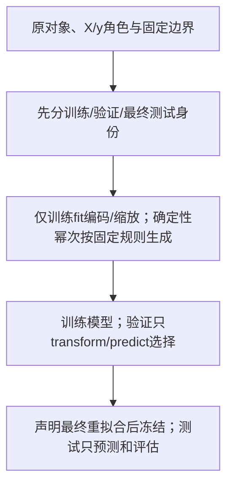

用 §3.5 已有 4/2/2 行补例走图：S1–S2 固定训练 x=0/1/2/3、验证 x=1.5/4、测试 x=2.5/5。对应目标分别为 4/8/9/13、9/16、11.5/18。

S3–S4 只用四行训练比较原单位 alpha=0/1/5，验证 MAE 为 0.5、13/12、2.25，选 0。S5 按预定协议合并六行重拟合，参数约 b=2.88163265、a=4.31020408。

冻结后测试两行预测约 11.51428571/18.71836735，MAE≈0.36632653。测试 x=5 超过重拟合最大输入 4，外推边界保留。这是补充规范例，原 Airbnb 编码先全表 fit 的次序未因此变成合规。

上图是补充的规范流程；下表保留原notebook实际顺序与欠项，不能把原次序当已经防泄漏。

| 步 | 第一段（合成） | 第二段（sin + 多项式） | 第三段（Airbnb） |
|---|---|---|---|
| ① 数据 | cell 5 自己造 | cell 18 自己造 | cell 26 读 CSV |
| ② 特征处理 | 无 | cell 18 造 x²…x¹⁵ | cell 29–30 OneHotEncoder |
| ③ 切分 | cell 13 另造新数据 ⚠️ | **❌ 没切！**（原协议仅描述训练拟合） | cell 31 `train_test_split` ✅ |
| ④ 训练 | cell 9 | cell 20 / 22 | cell 31 |
| ⑤ 评估 | cell 15（R², MAE） | cell 23（R², ⚠️ 假 RMSE） | cell 33（MAE） |

> ⭐ 第一段另造独立随机数据，第三段留出20,440行，第二段原码只评训练；第三段encoder先全量fit仍有协议局限，不能笼统称全部做对。真实任务也可取得新的后续数据，留出切分不是唯一取样方式。

### 5.2 OneHotEncoder 的参照编码与 n−1 规则

| 讲义 p.25 | notebook cell 29 | Airbnb 的具体情况 |
|---|---|---|
| n 个类别 | `categories_` 有 4 个 | Apartment, House, Loft, Townhouse |
| 造 n−1 个虚拟变量 | `drop='first'` → 输出 3 列 | House, Loft, Town House |
| 基准水平 base level | 被丢掉的第一个 | **Apartment**（占 71.58%） |
| 全 0 表示基准 | 在训练字典内三列全0表示Apartment；ignore未知的全0有歧义 | cell 29 输出第 0/1/2/4 行 ✓ |
| 系数 = 相对基准的差 | — | 见 §5.4 |

原字典中三列全零才可解释为Apartment；unknown ignore也会零，必须保留未知状态。

> 💡 **基准选 Apartment 是个好选择**（虽然是字母序碰巧选中的）：它占了 71.58% 的样本，作为"默认状态"最自然。见 [[IS6400_Business_Data_Analytics/_meta/数据集卡片#2.2 类别列的分布（实跑，含占比）|数据集卡片 › 2.2 类别列的分布（实跑，含占比）]]。

### 5.3 系数和特征怎么对上号

**`x` 的列顺序**（cell 30 的输出）：

```text
accommodates | bathrooms | bedrooms | beds | House | Loft | Town House
```

**`coef_` 的顺序与之一一对应**：

| # | 特征 | 系数 |
|---|---|---|
| 0 | `accommodates` | **+0.17000603** |
| 1 | `bathrooms` | +0.13795161 |
| 2 | `bedrooms` | +0.12490194 |
| 3 | **`beds`** | **−0.05628411** ⚠️ |
| 4 | `House` | −0.19173624 |
| 5 | `Loft` | +0.12103869 |
| 6 | `Town House` | −0.17429126 |
| — | `intercept_` | **4.057529625** |

✅ **让 sklearn 帮你对号入座的写法**（强烈建议作业里用）：

```python
import pandas as pd
pd.Series(lin_reg.coef_, index=x.columns).sort_values()
```

### 5.4 ⭐ 系数怎么翻译成生意话

**⚠️ 关键前提：因变量是 `log_price`，不是 `price`。**

先声明：固定其他输入列，b描述该模型的条件性log预测差；指数给逆变换预测倍率，不是现实因果涨幅或条件均价保证。下表“涨/降”均按此限定读，不把观察回归当干预实验。

$$\text{X 每加 1 单位} \;\Longrightarrow\; \text{价格变化约 } (e^{b} - 1) \times 100\%$$

| 特征 | 系数 b | e^b − 1 | **业务含义** |
|---|---|---|---|
| `accommodates` | +0.17001 | **+18.53%** | **每多能住 1 个人，房价约涨 18.5%** |
| `bathrooms` | +0.13795 | **+14.79%** | 每多 1 个卫生间，约涨 14.8% |
| `bedrooms` | +0.12490 | **+13.30%** | 每多 1 间卧室，约涨 13.3% |
| **`beds`** | **−0.05628** | **−5.47%** | ⚠️ **每多 1 张床，约降 5.5%** ← **反常识！见下** |
| `House` | −0.19174 | **−17.45%** | House **比 Apartment（基准）便宜 17.5%** |
| `Loft` | +0.12104 | **+12.87%** | Loft **比 Apartment 贵 12.9%** |
| `Town House` | −0.17429 | **−16.00%** | Townhouse **比 Apartment 便宜 16.0%** |
| `intercept_` | 4.05753 | e^b = **\$57.83** | 所有特征为 0 且是 Apartment 时的价格（**无业务含义**：住 0 人、0 卫生间的房源不存在） |

> 💡 **系数较小时可以直接近似**：0.17 → 约 17%（真实 18.5%，误差 1.5 个百分点）。b 越大误差越明显。**报告里最好写精确值 `(e^b − 1)`。**

**用表中舍入系数算一个近似预测（笔记补充）**：一间 Apartment，能住 4 人、1 个卫生间、2 间卧室、2 张床：

$$\begin{aligned}
\text{log\_price} &= 4.05753 + 0.17001\times 4 + 0.13795\times 1 + 0.12490\times 2 - 0.05628\times 2 \\
&= 5.01276 \\
\text{price} &= e^{5.01276} \approx \$150.32 / \text{晚}
\end{aligned}$$

对照 [[IS6400_Business_Data_Analytics/_meta/数据集卡片#4.1 它到底是什么|数据集卡片 › 4.1 它到底是什么]]：中位价 \$110、75 分位 \$180 —— **\$150 落在合理区间** ✓

### 5.5 🔴 beds 负系数的条件关系与诊断

负系数是该数据与模型的条件性拟合关系，不能据此断言原因就是多重共线性，更不能把它当增加床会降价的因果效果。

**💡 log倍率与共线敏感性各是一条链（笔记补充）**

设已拟合模型为 $\widehat{\log P}=a+\sum_jb_jx_j$。比较两行时只让第 j 列相差 $\Delta$，其余列保持相同。

1. 两次 log 预测相减，其余项抵消，得到 $b_j\Delta$。
2. 对预测差取指数，得到逆变换价格倍率 $\exp(b_j\Delta)$。
3. 倍率减 1 再乘 100%，才是该模型逆变换预测的百分比差。

例如 b=0.2、Δ=2，log 差 0.4，倍率约 1.491825，百分比差约 +49.1825%。加两单位不等于必涨 40%；条件均价还须处理重变换偏差，指数与期望通常不交换。

这条链是模型条件关系，不是现实干预的因果效应。下面另用小表解释共线敏感性，两个问题分开。

近共线教学例固定两列，只有最后一行 y 发生微小扰动。

| 行 | x1 | x2 | 原 y | 扰动后 y |
|---|---:|---:|---:|---:|
| 1 | 0 | 0 | 0 | 0 |
| 2 | 1 | 2 | 1 | 1 |
| 3 | 2 | 4 | 2 | 2 |
| 4 | 3 | 6.001 | 3 | 3.01 |

原模型 a=0、b1=1、b2=0 已精确表达。扰动后 a=0、b1=−19、b2=10 也精确表达：前三行 −19x1+10(2x1)=x1；最后一行额外 10×0.001=0.01。

逐列读法：x1/x2 是固定输入；原/新 y 是拟合目标，两列只差末行 0.01。读第四行：x2−2x1 只有 0.001，大系数 10 才能承接新增目标差。

y 变化很小，系数却变化很大；近训练组合的预测仍可能接近，个别系数解释却不稳。它不是 Airbnb 已发生变号的证据。

这是真正可复算的敏感性例，不把它当Airbnb床数变号的证据。原数据seed0–4都负只证明2026-10-01 旧批这些切分的结果；删除列、Ridge或PCA各可能改变拟合/解释并引入丢信息或偏差，需要独立验证。高成对相关不是任意列可删的充分条件，其他列组合也会影响条件系数。

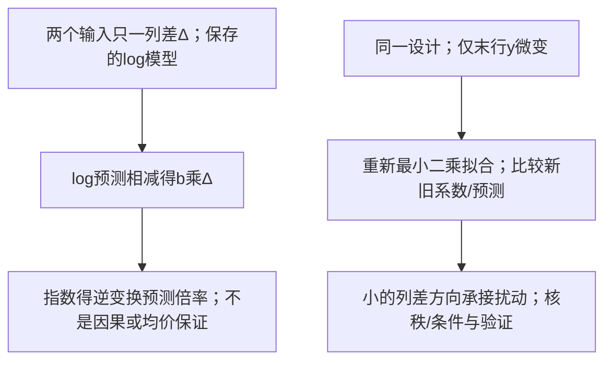

<details><summary>迁移/诊断：b=−0.1、Δ3，预测倍率？近共线例若只将最后y增加0.001，第二列系数与第一列分别应多少？</summary>

倍率exp(−0.3)≈0.740818，逆变换拟合差约−25.9182%，非因果结论。第二列b2=1才能乘x2−2x1=0.001接住新增误差，第一列b1=1−2=−1，截距0；若微小扰动引出大系数，检查设计秩/条件数及不同划分，而不是仅凭负号编业务故事。

</details>

四个"容量类"变量彼此高度相关（[[IS6400_Business_Data_Analytics/_meta/数据集卡片#5.1 ⭐ 严重多重共线性（做多元回归必踩）|数据集卡片 › 5.1 ⭐ 严重多重共线性（做多元回归必踩）]] 的实跑相关矩阵）：

| | accommodates | bathrooms | bedrooms | beds |
|---|---|---|---|---|
| **accommodates** | 1.000 | 0.523 | 0.724 | **0.829** |
| **beds** | **0.829** | 0.538 | 0.730 | 1.000 |

**`accommodates` 与 `beds` 的相关系数高达 0.829。**

**怎么理解这个负号**：多元回归的系数是"**在其他变量不变的前提下**"的拟合预测差（非因果效应）。所以 `beds = −0.056` 的准确读法是：

> **在能住的人数、卫生间数、卧室数都相同的情况下，床更多的房源反而更便宜。**

这其实说得通 —— 同样住 4 个人、2 间卧室，一间摆 2 张床（可能是双人床，情侣/夫妻房），另一间摆 4 张床（上下铺/沙发床，更像青旅）。是否存在这些房型差异需补实际事实，不能凭该负系数认定。

⚠️ **以上只是未核实的事后假说。** 高相关提示需要诊断，但不足以证明符号不稳定。2026-10-01 旧批种子0–4的beds系数均负（约−0.05628到−0.06467），未观察到变号；下方近共线迷你例解释系数可能敏感的机制，不冒充此数据已发生该现象。

> 🔗 **这和讲义里的现象是同一类问题**：[[M02-预测分析-线性回归#2.7.4 Egg Price 的条件系数与 5% 检验怎样改变|M02 §2.7.4]] 里，加入复活节虚拟变量后 Egg Price 的系数从 −553.9 缩到 −170.15 且变得不显著。**两个例子并排看，多元回归的陷阱就很清楚了。**
>
> ✅ **写报告时怎么处理**：① 明确指出这个反常识的符号；② 给出共线性的诊断（相关矩阵或 VIF）；③ 提出对策（删掉 `beds`、或改用 Ridge、或等 M04/T04的PCA（仍须按任务验证））。这些是可报告的诊断与方案；分数需以实际评分标准为准。

### 5.6 MAE = 0.4389 —— 这算好还是不好？

**notebook 只给了一个数字，没有任何参照。可以补一个同批评价基准帮助理解，不能把一个 MAE 数字直接判成好坏。**

**先统一评价对象与数据边界**：2026-10-01 旧记录报告按原 cell 29–33、70/30、random_state0 复算：训练47693行、测试20440行；4个数值原字段加3个房型dummy共7列。原代码全数据fit类别字典后切分是协议局限；2026-10-01 旧批另核仅训练fit类别字典，因训练已含相同四类，预测最大差约1.78×10⁻¹⁵，未观察到此处成绩被抬高，但不能因此推广全量预处理都安全。

| 方法（所有参数仅训练侧估计） | 同一测试集log-MAE | 同一测试集R² |
|---|---|---|
| 训练log中位数4.700480366作常量 | 0.55698603965 | −0.00888619919 |
| 原7列OLS | 0.4389203843146883 | 0.3595036288665 |

MAE改善为 $1-0.4389203843/0.55698603965\approx21.1972\%$。不是把全量基线或全量训练R²与测试MAE并列。R²表明相对此测试标签均值的平方误差改善，不能仅凭0.36断定唯一原因是字段不够；模型形式、测量、缺失机制、遗漏因素与样本差异均待诊断。来源为旧批 `verify_t02_current.py/t02-current-results.json` 的历史记录。本次未取得 2026-10-01 直接 CSV 输入的 SHA-256 绑定，不能证明旧结果对应当前 CSV 字节；不将其称为本次同输入复现。

**log-MAE 怎样读成倍率，哪里不能换算？** 先固定同一测试行与价格单位。

1. 每行残差 $e_i=\log P_i-\log\hat P_i$。
2. 指数后的绝对残差为 $\exp(|e_i|)=\max(P_i/\hat P_i,\hat P_i/P_i)$，是两方向比值中较大者。
3. $\exp(\mathrm{MAE}_{\log})$ 是这些比值的几何平均，本值约 1.551。它不是典型预测区间，也不是平均百分比或美元 MAE。
4. 美元 MAE 另对每行实际 price 与逆变换预测取绝对差，再除同批有效行数。

若要条件平均 price，还须考虑 log 残差分布和重变换偏差。$\exp(E[\log P\mid X])$ 一般不等于 $E[P\mid X]$；不能把 100→155/64 当已观察典型房源。


---

## 6. 自己动手 —— 改哪个参数会发生什么

| # | 改什么 | 会发生什么 | 学到什么 |
|---|---|---|---|
| 1 | cell 5 前加 `np.random.seed(42)` | 同生成器算法/版本、初态与调用顺序下可重现 | **可复现性**。notebook 缺这一行 |
| 2 | cell 5 改成 `rnd.rand(100)`（去掉 `,1`） | `ValueError: Expected 2D array, got 1D array` | sklearn 要求 X 是二维（§1.3 铁律三） |
| 3 | cell 5 把样本数从 100 改成 20 | 期望估计波动通常增大，但单次偏差可更小，须实跑核 | **样本越少，估计越不稳** |
| 4 | cell 5 把噪声改成 `5*rnd.randn(100,1)` | 总体参照 R² 下降，单次分数仍会波动 | 噪声方差增加、信号设定不变；有限样本不保证固定降幅 |
| 5 | cell 11 改成 `lin_reg.coef_[0]` | 单独显示可为数组；若仍用原%f格式化，还需按版本行为核数值转换 | y 是二维 → `coef_` 是 (1,1) |
| 6 | cell 13 改成 `X_new = 2*rnd.rand(100,1)` | 总体参照R²因信号范围缩小而降，实际样本分数仍波动 | 新输入支持与训练一致（§3.3）。R² 降是因为 X 范围窄了、y 方差小了 |
| 7 | cell 13 去掉 `plt.axis([0,2,0,15])` | 图上多出 x ∈ [2,3) 的点 | 按生成分布预计约三分之一落在显示范围外；原数组未保存，实际数量未知 |
| 8 | cell 20 把 `power` 从 15 改成 3 | 参数空间变小，曲线/系数与验证成绩需实跑 | 降次数可减复杂度但也可能欠拟合 |
| 9 | cell 22 把 `alpha` 从 0.1 改成 100 | 原未缩放15次幂的alpha100不保证近水平；2026-10-01 旧批记录预测范围约−0.98573到0.98667、训练R²约0.97419 | **λ 太大 → 欠拟合** |
| 10 | cell 22 把 `alpha` 改成 0 | 目标函数退化为OLS，但病态设计下求解器的有限精度结果可不同 | **λ=0 时 Ridge 退化为普通线性回归**（讲义 p.49 明写） |
| 11 | cell 22 换成 `Lasso(alpha=0.001)` | 可能得到部分零系数，须以数据/尺度/alpha/收敛结果实跑为准 | 背景对照：Lasso的L1惩罚可产生稀疏解（详见表后） |
| 12 | cell 22 前加 `StandardScaler` | 通常改善尺度差，但不保证警告消失；高次列依然可高度相关 | 按训练尺度定义惩罚，不能许诺消除共线性（§3.4） |
| 13 | cell 23 改用验证集评估 | 最优 alpha 可能改变，必须看保存的验证结果 | 验证结果可用于选择面向未见数据的配置；训练内最佳仍是另一项有范围的结论（§3.5） |
| 14 | cell 23 改成 `np.sqrt(mean_squared_error(...))` | 数值无固定大小顺序 | **RMSE ≠ √MAE**（§3.5） |
| 15 | cell 29 去掉 `drop='first'` | 先因原硬编码3列名与4列输出不符而报错；同步修列名后，无惩罚且有截距的全部dummy导致参数不唯一 | ⭐ **虚拟变量陷阱**（[[M02-预测分析-线性回归#2.7.2 虚拟变量与 n−1 规则（讲义 p.25）\|M02 §2.7.2]]） |
| 16 | cell 29 把 `drop='first'` 改成 `drop=['House']` | 基准变成 House，各 dummy 改为相对 House 的比较；特定零差值可能不变 | 无惩罚、有截距、同一列空间时更换基准可不改预测；惩罚回归不保证编码不变性 |
| 17 | cell 31 把 `random_state=0` 改成 `1` | 系数略变，MAE 略变 | 切分的随机性也会带来波动 |
| 18 | cell 31 把 `test_size` 从 0.30 改成 0.5 | 训练份额由0.7到0.5，减少约28.6%；估计波动需实测，不是少一半 | "Drawback: Less data available for training" |
| 19 | cell 27 的 `feature` 里加上 `'cancellation_policy'` | **需要再做一次 OneHotEncoder** | ⭐ **这就是作业第 4 题**。⚠️ 注意 `super_strict_60` 只有 8 行（[[IS6400_Business_Data_Analytics/_meta/数据集卡片#5.3 极端稀有类别（one-hot 之后会变成灾难）\|数据集卡片 › 5.3 极端稀有类别（one-hot 之后会变成灾难）]]） |
| 20 | cell 27 的 `feature` 里加上 `'review_scores_rating'` | **`ValueError: Input contains NaN`** | 该列缺失 22.4%（[[IS6400_Business_Data_Analytics/_meta/数据集卡片#3. 缺失率\|数据集卡片 › 3. 缺失率]]）（详见表后） |
| 21 | cell 27 的 `feature` 里删掉 `'beds'` | 重新拟合后的各系数与指标需实测，不能预先保证某列上升 | 相关列删除是模型变式，可诊断条件信息与系数敏感性；结果还取决于其他列，不能单次删列就证明负号因果 |
| 22 | cell 33 后加 `print(r2_score(y_test, y_pred))` | 得到 R² ≈ 0.36 | 原 notebook 没算此值；如补报，须标明同一测试集 |

**11 · 学到什么**

背景对照：Lasso的L1惩罚可产生稀疏解。

Ridge并非保证每系数非零，不能以一次输出区分理论保证。

详 [[M02-预测分析-线性回归#2.10.4 🔴 Ridge 平滑收缩与零系数的条件|M02 §2.10.4]]：以本讲目标和具体数据为准。

原图稀疏表达需与 L1/L2 机制区分。

**20 · 学到什么**

该列缺失 22.4%（[[IS6400_Business_Data_Analytics/_meta/数据集卡片#3. 缺失率|数据集卡片 › 3. 缺失率]]）。

这5个原字段在该文件为零缺失。

材料未给选择动机，不能据此替教授推断意图

> 💡 **优先做13、15、21；11为Lasso背景扩展，19 涉及评分题，应保持学习解析、历史提交和新执行授权分开。** 本讲核心是训练内调参、编码秩与条件系数诊断。原cell36对Lasso仅import未调用，因此只作背景对照，完整L1机制见M02；本篇不凭未实跑的可选实验宣称其验收。

---

## 7. 一整段 AI Prompt：把整个 notebook 要回来

### 7.1 原文（cell 35，完整 16 项内容）

以下是原材料的 AI Prompt，保留其实际措辞与步骤；第 10 项的 “to show overfitting” 是材料目标，不是原训练图已经提供独立证据。

🤖 AI Prompt (Copy this to AI):
Please generate a complete Jupyter Notebook for a regression analysis tutorial that covers:

1. Generating synthetic data: y = 3*x + 4 + ε with 100 samples
2. Visualizing the data with matplotlib
3. Fitting a LinearRegression model using sklearn
4. Extracting and displaying coefficients and intercept
5. Making predictions on new data (100 samples with x in [0, 3])
6. Visualizing training data, test data, and predictions
7. Evaluating model performance using R² and MAE
8. Generating a sin(x) dataset with noise (60° to 300°, step 4°)
9. Creating polynomial features (x² to x¹⁵)
10. Fitting polynomial regression (degree 15) to show overfitting
11. Implementing Ridge regression with alpha=0.1
12. Comparing Ridge regression with different alpha values [0.001, 0.01, 0.1]
13. Loading and preprocessing Airbnb dataset
14. Encoding categorical variables with OneHotEncoder
15. Splitting data for training (70%) and testing (30%)
16. Training and evaluating the Airbnb price prediction model

Include all necessary imports, clear comments, and proper formatting for Jupyter Notebook.

### 7.2 ⭐ 它和 T01 的七个 prompt 是两种不同的东西

| | [[T01-Jupyter入门与Pandas基础#6. 教授在教你怎么向 AI 提问\|T01 的 7 个 prompt]] | **T02 的这 1 个 prompt** |
|---|---|---|
| 粒度 | **一段代码一个 prompt** | **整个 notebook 一个 prompt** |
| 长度 | 1–3 句 | **16 个编号步骤** |
| 指定变量名 | ✅ 每个都指定（`'x'`、`'df'`、`'matrix'`） | 未指定各中间结果与模型对象的接口变量名（原文已有 x/y） |
| 指定库 | ✅ | ✅（matplotlib、sklearn、OneHotEncoder） |
| 数据内联 | ✅ 全部写进 prompt | ✅ 关键参数写了（100 samples、alpha=0.1、[0.001,0.01,0.1]、70/30） |
| 教什么 | **怎么描述一个动作** | **怎么描述一个项目** |

> 💡 **从文本粒度可以看到一种组织变化（笔记分析）**：W01 教你"用一句话说清一个操作"，W02 教你**"用一份清单说清整个分析流程"**。
>
> **注意 16 个步骤的顺序** —— 它就是一次完整数据分析的骨架：
> **造数据 → 可视化 → 建模 → 取参数 → 预测 → 再可视化 → 评估 → （换个更难的问题）→ 造特征 → 制造过拟合 → 正则化 → 调超参数 → 读真实数据 → 处理类别变量 → 切分 → 训练评估**
>
> ⭐ 原16步是课程演示顺序；用于新方案前须改为先固定数据身份、仅训练fit编码/尺度，再验证选择和冻结测试，见§5.1。不能直接照搬全表fit后切分。

### 7.3 这个 prompt 的两个弱点（值得学的反面教材）

**弱点 1 · 没有指定变量名**

**💡 把Prompt当规格，再由运行证据验收（笔记补充）**

输入是原cell35的16项规格，生成代码只是中间产物；由kernel实际执行、数据/评估检查决定接受还是修订。以原错误rmse变量为例：需求“回归误差”若生成`np.sqrt(mean_absolute_error(...))`，代码虽能运行却不是RMSE；用固定真实[1,3,5]/预测[2,2,5]核得√MAE≈0.816497，恰与此例RMSE相同会漏检，应再用误差[0.01,0.01]，√MAE=0.1而RMSE=0.01，定位定义错误再改sqrt(MSE)。至少采用能区分错误的检查例，不能只看无报错。

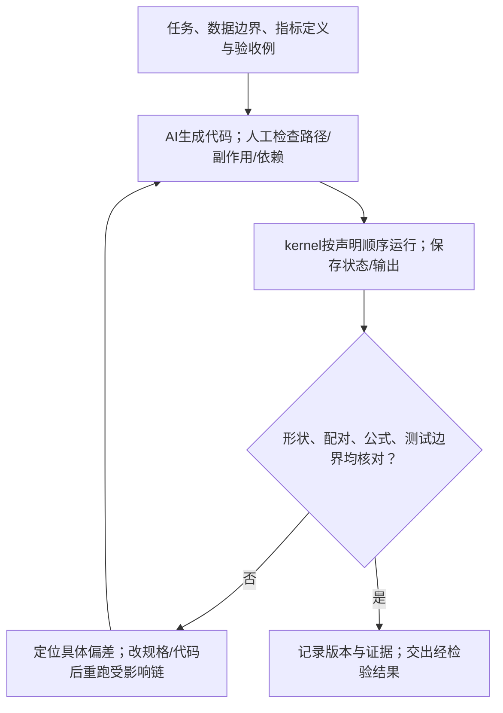

接受条件事先声明，达到后停止；若无数据/权限/预算或连续无法满足要求，应报告缺口而非无限重试。AI可能漏检指标与数据泄漏，人也可能只写一个碰巧通过的测试；保护测试数据与验收定义，不让生成器改成较容易的目标。原Prompt逐字保留，新机制为笔记补充，不替用户制作评分作业。

<details><summary>诊断变式：AI用全68133行均值基线和20440行测试MAE比，输出“改善21%”，该验收哪里失败？</summary>

比较协议不一致：基线参数应只训练估计，并与模型在同一测试行/目标尺度评价。纠正后重新算两方法同集指标，不能因百分比看起来接近就默认正确。若用测试标签挑α，它也已参与选择；不能只改字段名成test便恢复独立性。

</details>

对比 T01 的 "store it in a variable named 'x'"，原 Prompt 给了 x/y 数学符号，但未给各中间结果和模型对象的接口变量名。**后果**：AI 生成的代码变量名会与讲义、与你同学的都不一样，交叉对照时很痛苦。

**弱点 2 · 第 5 步复制了原 notebook 的缺陷**

> "5. Making predictions on new data (100 samples with **x in [0, 3]**)"

而第 1 步的训练数据是 $y = 3 \times x + 4 + \varepsilon$（原 notebook 里 x ∈ [0,2]）。原 Prompt 未明确给训练 x 的范围；如果生成代码沿用 cell 5 的 [0,2)，再按此项生成 [0,3] 的新输入，就会涉及 §3.3 的外推。Prompt 本身也应明确训练支持与评价目标。

> ⚠️ **这正是"用 AI 写代码"的核心风险**：错误规格可能传递为错误实现，AI可能提醒也可能漏检；必须用能区分错误的运行例核验。
>
> ✅ **正确的用法**：拿到 AI 的代码后**逐块核对**（用本笔记 §2–§4 的讲解），而不是直接跑。官方允许用 GenAI（`Allow Use of GenAI: Yes`），但**交上去的是你的作品，错了算你的**。

### 7.4 Summary cell（cell 36）里藏的三条信息

> ## Learn how to get linear regression models:
> `from sklearn.linear_model import LinearRegression`
> `from sklearn.linear_model import Ridge`
> **`from sklearn.linear_model import Lasso`** ← ⚠️ **notebook 里从未使用**
>
> ## Learn how to use different evaluation metrics for prediction
> `from sklearn.metrics import r2_score`
> `from sklearn.metrics import mean_absolute_error`
>
> ## Learn how to change the regularization penalties (the alpha)
> **`ridge_reg = Ridge(alpha=1, solver="cholesky")`** ← 用了 `solver` 参数，正文里没出现过
>
> ## After-class reading material:
> Interested students may read this toolbox for alternative linear regression models:
> **`https://www.statsmodels.org/stable/index.html`**

**三条信息**：

1. **Lasso在原cell36仅列入工具箱，正文未调用**；此处是课外对照，不凭列表推定教师考核范围。⭐ **建议自己跑一次 `Lasso(alpha=0.001)`**（§6 第 11 条），作为课外L1/L2目标对照；一次数值输出不能证明稀疏性的一般性质或断言Ridge绝不为零
2. **`solver="cholesky"`** —— 求解器（solver）是实现同一优化目标的数值计算方法。sklearn 的 Ridge 有多种求解器（`auto`/`svd`/`cholesky`/`lsqr`/`sag`…）。`cholesky` 用的正是 [[M02-预测分析-线性回归#2.8.3 正规方程：闭式解（讲义 p.32–34）⭐|M02 §2.8.3]] 的**闭式解**路线；较大样本时可比较`sag`等迭代求解器，须核尺度/容差与收敛；不意味着数据一大默认就自动切换（随机平均梯度，属于 §2.8.4 梯度下降家族）
3. ⭐ **statsmodels 的链接很重要**：**sklearn 不提供 p 值和标准误**（它是机器学习库，只关心预测），而讲义 p.53 的 Take Away 明确要考 "Interpretation of the output: coefficient, **p-value**"。本篇用statsmodels取得讲义所示coef/SE/t/p/CI型统计表，数学推断量并非只能由这一库计算：
   ```python
   import statsmodels.api as sm
   X2 = sm.add_constant(x_train)        # 手动加截距列
   print(sm.OLS(y_train, X2).fit().summary())
   ```

**🎙️ 课堂补充**（转录 `02:32:43–02:34:37`）

> ✅ **第 3 条已被课堂证实，而且规格比 notebook 高**：Summary cell 只把 statsmodels 写成 "**After-class reading material**（有兴趣的同学可以读）"，但助教在课上是把它当作做项目时的建议给的（`02:33:01–02:34:18`）。详见 §4.6 课堂补充及 §10.2 第 1 项的 statsmodels 建议。

**⏭️ 另外两条课上都没讲：**

| Summary 里的内容 | 课上有没有 |
|---|---|
| `from sklearn.linear_model import **Lasso**` | ❌ **助教全程只讲了 Ridge，Lasso 一次没提**（教授在讲义部分讲了 Lasso 的公式与权衡，但没写代码） |
| `Ridge(alpha=1, **solver="cholesky"**)` | ❌ **没提 solver**。助教只强调了"**记得设 alpha，默认是 1**"（见 §3.4 🎙️） |

🎙️ **✅ 关于用 AI 写代码：助教在最后一句给了明确态度**（末条起始戳 `02:34:37`；之前 `02:34:18` 仅引入 coding）：

> *"it will help you to generate the code."*（`02:34:37`，原 ASR 明确片段）

中文解释：助教说不理解时可用 AI 帮助生成代码；具体工具名在 ASR 中误写，按原 cell 35 的 Prompt 确认这一段在讲学习辅助，不把未听原音的词补成直接引语。

> ⭐ **这就是 §7 那个"把整个 notebook 要回来"的 prompt 的官方定位**：**不是"看看就好"，是"你可以真的这么用"。**
> ⚠️ **但要注意她说的是"如果你看不懂的时候用它帮你生成代码"** —— 定位是**学习辅助**，不是"代替你做作业"。⚪ 课程 syllabus 的 GenAI 政策仍然适用，见 [[IS6400_Business_Data_Analytics/_prep/课程前置资料|课程前置资料]]。
>
> ⚠️ **录音在这句话之后就断了**（`02:34:37`），所以**助教是否还说了更多（尤其是作业）无从得知**。见 [[#10.5 待核对|§10.5]]。

---

## 8. 本次作业（notebook cell 38 原文）

这里说明四题在要求什么，并对照已取得的参考答案和历史个人答卷。它是学习复盘，不是新制作的提交件；既有提交、日期与成绩保持原记录。本轮未打开 Canvas 四入口核现行要求，也未重新执行评分代码。

<details><summary>完整英文原题：Week 2 Assignment（原 notebook cell 38，原 4 题及 Submission）</summary>

## Week 2 Assignment

### 1. Dataset Generation (10 points)

Generate a training dataset based on the equation $y = 10x + 15$, and generate a separate dataset for evaluation.

### 2. Model Evaluation Using MAE (10 points)

Use **Mean Absolute Error (MAE)** to evaluate the performance of the model developed in Question 1.

### 3. Ridge Regression (40 points)

In Section 3.4, **Ridge Regression**, try the following values of `alpha`: **0.001, 0.01, and 0.1**.

Evaluate the performance of the three Ridge Regression models and compare their results. Identify which `alpha` value provides the best model performance.

### 4. Airbnb Price Prediction (40 points)

In Section 3.6, **Airbnb Price Prediction**, add **`cancellation_policy`** as an additional predictor to the linear regression model.

Evaluate the performance of the new model and compare it with the original model.

### Submission

Upload your **code and results as an HTML file** to **Canvas**.


</details>

原题内部小题合计 100 points；这与 Canvas 页面记录的 10 points 是不同层级的数字，不能把 100 当作课程总评占比。`Section 3.4` 在所供 notebook 没有同号标题；按 “Ridge Regression” 可定位 cell 16–24，这是上下文定位，不是恢复出另一份未取得材料。`Section 3.6` 对应 cell 25–33。

### 8.1 逐题读题、答案来源与复盘

#### Q1 · 先让训练式、评价式与题面一致（10 points）

中文题意：按 $y=10x+15$ 生成训练资料，另生成一批评价资料。“Separate dataset” 要求评价行与训练行分开；不能把同一行改名后重复使用。斜率（slope）是 10，表示 x 增加 1 时直线增加 10；截距（intercept）是 15，表示 x 为 0 时直线值为 15。

题面本身没有写噪声（noise）。官方参考 HTML 的 Q1 选择在直线上加入标准正态噪声，并在训练、评价中都使用同一个关系。这是参考答案的实现选择，不能改写成题面强制加噪声。无噪声且 x 有足够变化时，拟合可以接近精确；有限精度下也不应机械要求误差恰为 0。

以下摘录只说明官方 Q1 的生成关系：输入是 100 行一列的 X，输出 y 形状相同；`randn` 提供可正可负的随机偏离。

```python
# 官方参考答案 Q1 的关键两行，保留实际生成式
X = 2 * rnd.rand(100, 1)
y = 15 + 10 * X + rnd.randn(100, 1)
```

官方 Q1 拟合保存斜率 `9.725096`、截距 `15.315972`，评价输入为 `3 * rnd.rand(100, 1)`，目标仍按 `15 + 10 * X_new + noise` 生成。它也包含超出训练生成支持 `[0, 2)` 的输入，须沿 §3.3 的外推边界解释。没有固定初始随机状态时，这些保存值不是重跑必得的答案。

历史个人答卷训练用了 $y=10+15x+\varepsilon$，评价却用了 $y=15+10x+\varepsilon$。保存斜率 `14.866852`、截距 `10.113745` 与训练代码相符，但不能说明正确实现了题面。检查 $x=0$，题面给 15、错置式给 10；检查 $x=2$，题面给 35、错置式给 40。只检查 $x=1$ 会漏错，因为两式都给 25。

英文参考复盘（笔记补充）：Use the slope 10 and intercept 15 consistently in both datasets. The reference solution adds noise, while the question itself does not specify a noise term. The saved private training equation swaps the two constants and therefore does not implement the stated task.

#### Q2 · 用同一批评价行算 MAE（10 points）

中文题意：用平均绝对误差（Mean Absolute Error，MAE）评价 Q1 训练的模型。先用训练资料 `fit` 学系数，评价时只 `predict`；评价的真实 y 不提供给训练过程。每行真实值和预测值必须对应同一 x。

MAE 先取每行预测差的绝对值，再除以评价行数。笔记补充小例：真实值 10、20，预测 12、17，绝对误差 2、3，故 $\mathrm{MAE}=(2+3)/2=2.5$。单位与目标 y 相同，越低表示这批评价行的平均偏离越小。它不是先平方再开根的 RMSE，更不是 $\sqrt{\mathrm{MAE}}$。

官方 Q2 保存 `Mean absolute error=0.799716`、`R2=0.986954`。历史个人答卷保存 `MAE=2.680385`、`R2=0.729485`；该误差包含训练、评价生成关系错位的影响。本轮没有将随机噪声与关系错位的贡献分解，不能把整个差异归给一种原因。两份未固定 Q1 初始随机状态，也不能跨两批不同随机行直接按误差差值评价算法优劣。

英文参考复盘（笔记补充）：Report MAE on the separate evaluation data using the model fitted to the training data. The reference saves MAE 0.799716. The private value 2.680385 comes from inconsistent generation equations, so it is not a matched replication of the reference experiment.

#### Q3 · 三个 alpha 的“最佳”要连着评价协议说（40 points）

中文题意：比较岭回归（Ridge regression）的 `alpha=0.001, 0.01, 0.1`，并说明哪一个按所声明指标最好。`alpha` 是在训练前设定的惩罚强度，称超参数（hyperparameter）；系数仍由训练数据拟合。原题没有指定唯一的数据划分或强制标准化协议。

本题至少要读清三个不同实验。原 tutorial cell 23 对全部 61 行拟合并在同表评价，原特征未标准化，而且把 $\sqrt{\mathrm{MAE}}$ 误命名为 `rmse`。它的保存输出是 §3.5 的那组三行，不能拿下表替换原输出。

官方参考 Q3 先用标准化（standardization）把各列减均值、除标准差，再拟合 Ridge。标准化和模型封装在流水线（Pipeline）中，但整个流程仍对全部 61 行 `fit`，然后在同 61 行 `predict`。下表每行是一种 alpha，三项指标均为官方保存的训练内结果，保留六位小数。

| alpha | 官方训练内 $R^2$ | 官方训练内 MAE | 官方训练内 RMSE |
|---:|---:|---:|---:|
| 0.001 | 0.974382 | 0.096326 | 0.126021 |
| 0.010 | 0.974255 | 0.096868 | 0.126331 |
| 0.100 | 0.971888 | 0.102846 | 0.132011 |

读第一行：0.001 在这三项训练指标上都优于另两行，因此官方按本协议选 0.001。训练误差能描述对已见样本的贴合，不能单独证明未见数据上也最好。不能因为它选了最小 alpha 就说答案错误或断言模型已经过拟合。

历史个人 Q3 则先固定 70%/30% 划分，只在训练部分拟合标准化与模型；用留出部分比较三个 alpha。下表保留个人 HTML 实际显示的四位小数，不能补出未保存的更多位。

| alpha | 个人留出 $R^2$ | 个人留出 MAE |
|---:|---:|---:|
| 0.001 | 0.9699 | 0.0991 |
| 0.010 | 0.9747 | 0.0920 |
| 0.100 | 0.9649 | 0.1112 |

读第二行：0.01 的留出 $R^2$ 最高、MAE 最低，所以个人按这个协议选 0.01。这批留出行已经用于选择配置，因此是验证集（validation set）。它没有同时提供一个从未参与选择的最终测试集（test set），不能把选择后的最低验证误差当作完全独立的最终性能。

若以后要估计选模后性能，应事先保留最终测试行，在训练内验证选 alpha，然后按已声明的重拟合政策冻结模型，最后只评价测试。流程图见 §3.5。这里没有新增 `x_test` 调参，也未重跑任何评分拟合。标准化能改变惩罚的单位和数值状态，不保证解除所有病态或改善所有验证成绩。

英文参考复盘（笔记补充）：Alpha 0.001 performs best in the saved reference training comparison. Alpha 0.01 performs best on the private held-out validation set. These are different protocols; neither result alone proves the best final test performance.

#### Q4 · 加退订政策后，在相同行上比较改进大小（40 points）

中文题意：把 `cancellation_policy`（退订政策）加入 Airbnb 模型，然后与原模型比较。`additional predictor` 是增加一个原始字段；五类政策作参照编码后形成四列，所以模型由 7 个数值输入列变成 11 列，不能仍写“只多一列”。

本源五类按字典为 `flexible, moderate, strict, super_strict_30, super_strict_60`。`drop='first'` 以 flexible 为基准，四个指示位分别说明是否属于其他四类；房型仍沿 §4.3 的三列。原数据的 `super_strict_60` 仅 8 行，稀有类别系数需要谨慎解读。合并类别会改变原题实现，不能在复盘里悄悄将两类合并后称为官方原结果。

公平比较要保持数据行、划分方式和误差单位一致。官方与个人 Q4 均保存 `test_size=0.30, random_state=0` 的相同行划分：47,693 行训练、20,440 行留出。各模型系数只在对应训练行拟合，但编码器在划分前对全表 `fit`；因此留出类别集合已参与预处理规则形成，不能说整个流程无数据泄漏。数据泄漏（data leakage）指训练或选模使用了评价时不该提前取得的信息。

以下每行是一个模型，MAE 在对数价格尺度上，$R^2$ 无单位；六位小数均直接来自保存 HTML。

| 模型 | 输入列数 | 留出 MAE | 留出 $R^2$ |
|---|---:|---:|---:|
| 原模型 | 7 | 0.438920 | 0.359504 |
| 加 cancellation_policy | 11 | 0.437968 | 0.361610 |

新模型 MAE 更低，表示在这些相同行上的平均绝对偏差稍小。按展示值，绝对下降 $0.438920-0.437968=0.000952$；以原误差作分母，相对下降约 $0.000952/0.438920\times100\%=0.216896\%$，约为 0.217%。这不是下降 21.7%，也不是少错 0.000952 美元。

$R^2$ 按六位显示值相减为 0.002106；官方另用未舍入内部值打印改善量 `0.002107`。两者对应不同舍入阶段，应同时解释，不能篡改保存输出以强行统一。两项结果支持“本划分上边际改善”，不证明退订政策引起价格变化，也不保证换批数据仍改善。

后续更严谨的评估应先分行，只在训练侧 `fit` 编码器，再对留出行 `transform`。本数据某次字典相同导致数值可能相同，也不能推广“全表先 fit 总是安全”。如果反复根据同一留出表挑字段，它还会成为验证资料，不能继续称完全独立的最终测试。

英文参考复盘（笔记补充）：Adding cancellation_policy reduces saved held-out MAE from 0.438920 to 0.437968, about 0.217% using the displayed values. The improvement is small and measured in log-price units. Both saved implementations fit the encoder before splitting, which limits claims of a fully isolated test protocol.

### 8.2 做下一道类似题时怎样开始

先把题面关系、训练式和评价式并排核对，再确认每个指标评价的是哪批行。比较 alpha 时，先写好选择规则，再看验证结果；比较新增字段时，保持同样的行与目标单位。只有对应对象和协议一致，数字大小才有可比意义。

<details><summary>改条件自测：只测 x=1 能发现 Q1 调换错误吗？看到验证 MAE 最低后，这张表还能叫最终测试吗？Q4 的改善若写成“下降 0.217 美元”错在哪里？</summary>

不能，两条直线在 x=1 都为 25，至少另查 x=0 或 x=2。第二问不能：它已经参与选配置，应称验证；需要预留另一组最终测试数据。第三问把相对百分比和目标单位都弄错了：0.217% 是原 MAE 的相对下降，原目标又是 log_price，并非美元。

英文参考答案（笔记补充）：Check more than the intersection point. A held-out set used to select a model is validation data. The reported 0.217% is a relative change in log-price MAE, not a dollar error reduction.

</details>

### 8.3 提交要求与当前状态边界

所供 cell 38 写明代码和结果导出为 HTML 上传 Canvas。正式导出应从已保存 Notebook 使用 Jupyter 菜单或标准 nbconvert；本轮没有制作或替换提交文件。当前 DDL、分值和历史 Submitted! 记录见 [[IS6400_Business_Data_Analytics/assignment/graded/A02-week2/notes/任务说明|A02 任务说明]]；这些是已有记录，本轮未在线复查。

录音末条起始时间为 `02:34:37`，内容仍在讲 AI 生成代码。所供转录未覆盖 cell 38 的作业说明；不能从未录到推断课上没布置，也不能从排课结束时间倒算缺失了 13–15 分钟。原始音频尾部时长及实际下课时刻未核。

---

## 9. cell ↔ 讲义页码映射 · 课堂覆盖

| cell | 类型 | 内容 | 笔记小节 | 对应讲义页 | 🎙️ 课堂覆盖（转录时间） |
|---|---|---|---|---|---|
| 1 | md | 标题 "Tutorial 2– Simple Regressions" | §0 | — | ✅ `01:48:45`（"open up the notebook"） |
| 2 | md | 四条学习目标 + 工具箱清单 | §0, §1.1 | — | ⏭️ **明说"课后自己看"**：*"it is the [outline] … **you can check later after class**"*（`01:49:11`） |
| 3 | md | "# Linear regression using the **Normal Equation**" | §1.2 | **p.34** | ⏭️ **完全没提**（标题里的 "Normal Equation" 一次没被念到） |
| 4 | md | 说明要造 y=3x+4+ε | §2.1 | p.14 | ✅ `01:49:32` |
| **5** | **code** | 生成合成数据 | **§2.1** | p.14 | ✅ **详讲**（`01:49:32–01:52:22`）+ 🎙️ **`help()` 查文档** + 🎙️ `(100,1)` = 行×列 = 样本×特征 |
| 6 | md | 看数据分布 | §2.2 | p.12 | ⚡ 一句带过 |
| **7** | **code** | matplotlib 散点图 | **§2.2** | p.12 | ✅ **详讲 3.5 分钟**（`01:52:22–01:55:56`）+ 🎙️ **`rcParams` vs `figsize` 的作用范围差别** |
| 8 | md | 说明要用 LinearRegression | §2.3 | — | ⚡ 一句带过 |
| **9** | **code** | `LinearRegression().fit()` | **§2.3** | p.19, 28 | ✅ 详讲（`01:55:56–01:56:29`） |
| **10** | **code** | `print(lin_reg.__dict__)` | **§2.3** | — | ✅ **逐项解释输出** + 🎙️ **"有些同学电脑上显示不出来，这正常"**（`01:56:29–01:57:25`） |
| **11** | **code** | 打印 slope / intercept | **§2.3** | p.14, 20 | ✅ + 🎙️ **"每次跑结果都不一样，因为是随机生成的。So it's okay"**（`01:57:25–01:58:20`） |
| 12 | md | 说明要预测新数据 | §2.4 | — | ⚡ 一句带过 |
| **13** | **code** | 预测 + 三色可视化 | **§2.4, §3.3** | **p.45**（就是这张图）· p.21（外推警告） | ✅ 🔧 **助教当场发现并修掉了颜色冲突的 bug**（`01:58:55`："change the `b` to the `k`"）；⏭️ **坑 2、坑 3（外推）都没提** |
| 14 | md | 说明要评估 | §2.5 | — | ⚡ 一句带过 |
| **15** | **code** | `r2_score` / `mean_absolute_error` | **§2.5** | p.39 | ✅ **详讲**（`02:00:21–02:01:56`）+ 🎙️ **两个指标的口头定义与方向（R² 高好、MAE 低好）**；⏭️ **RMSE 全程没讲** |
| 16 | md | "# Deal with model complexity - Ridge Regression" | §3 | p.46 | ✅ `02:01:56`（"just like the professor [explained] in the lecture"） |
| 17 | md | 说明要造 sin 数据 | §3.1 | p.51 | ⚡ 一句带过 |
| **18** | **code** | sin 数据 + 造 x²…x¹⁵ | **§3.1** | p.51 | ✅ **详讲，全场最长的一块（12 分钟）**（`02:02:47–02:14:35`）+ 🎙️🎙️ **插了 4 分钟 Python 补课（for / range / 列表推导式）** + 🎙️ **随机种子** + 🎙️ `range(60,304,4)` 里 `+4` 的原因 + 🔴 **"项目里别做 x³、x⁴"** |
| 19 | md | 多项式回归公式 | §3.2 | **p.51** | ⚡ 一句带过 |
| **20** | **code** | 15 阶多项式（过拟合） | **§3.2** | **p.40, 52 左** | ✅ 详讲（`02:14:35–02:16:53`）："it's just like **exactly fitted** to our … data" |
| 21 | md | Ridge 惩罚说明 | §3.4 | p.50 | ✅ 🔴 **"加惩罚项是为了 avoid / alleviate the overfitting issue. So just keep that in mind."**（`02:02:34`） |
| **22** | **code** | `Ridge(alpha=0.1)` | **§3.4** | **p.50, 52 右** | ✅ **详讲**（`02:16:53–02:18:47`）+ 🎙️ **"必须自己设 alpha，默认是 1"**；⏭️ `LinAlgWarning` 与标准化都没提 |
| **23** | **code** | 比较三个 alpha ⚠️ 有 bug | **§3.5** | p.41–43（应该用验证集） | ⚡ **只停了 37 秒**（`02:18:47–02:19:24`）；⏭️ **未展开 `sqrt(MAE)` 的定义错误、训练内评价限制和导入依赖** |
| 24 | md | "Ridge can regularize model complexity" | §3.4 | p.46 | ⚡ 隐含 |
| 25 | md | "## 3.6 Real Data: Airbnb Price Prediction" + Kaggle 链接 | §4 | — | ✅ `02:19:04`（"let's see how to do it using the real-world data"） |
| **26** | **code** | `pd.read_csv('Airbnb.csv')` | **§4.1** | — | ✅ **详讲 2 分钟**（`02:19:24–02:21:15`）+ 🎙️ **"很多人读不进数据就是路径不对"** + 🎙️ **把文件拖进 CMD 拿完整路径** |
| **27** | **code** | 选 feature / target | **§4.2** | p.5（DV/IV） | ✅ **详讲**（`02:21:15–02:24:39`）+ 🔴 **"项目里要自己想选哪些特征"** + 🎙️ 助教称describe偏数值；⚠️技术纠正：类别列也可有count/unique/top/freq |
| 28 | md | 说明类别变量要造 dummy | §4.3 | **p.24** | ✅ `02:22:25`（"we need to translate … categorical variables into numbers"） |
| **29** | **code** | `OneHotEncoder(drop='first')` | **§4.3, §5.2** | **p.25** | ✅ **详讲**（`02:24:39–02:28:10`）+ 🔴 **"丢哪个 dummy 都行，不必丢第一个"** + 🎙️ **n−1 的理由与教授一致（信息冗余）** |
| **30** | **code** | `join` + `drop` | **§4.4** | p.25 | ✅ + 🎙️ **补了 `pd.concat(..., axis=1)` 这第二种写法**（`02:28:10–02:30:45`）；⏭️ 索引对齐的坑没提 |
| **31** | **code** | `train_test_split` + `fit` | **§4.5** | **p.43–44** | ✅ + 🔀 **"test set，也叫 validation data"（与讲义 p.41 冲突）** + 🔴 **"70/30 是你自己定的"**（`02:30:45–02:31:43`） |
| **32** | **code** | 预测 + 对比表 | **§4.6** | p.45 | ⚡ 快速带过（`02:31:43–02:32:43`）；⏭️ `.tolist()` 的索引技巧没提 |
| **33** | **code** | MAE | **§4.6, §5.6** | p.39 | ⚡ 带过，且**助教说要算 R²，但 notebook 里没有** |
| 34 | md | 分隔线 | — | — | — |
| 35 | md | 🤖 **AI Prompt（16 步）** | **§7** | M01 p.45 | ✅ 🔴 **"看不懂的时候可以把这个 prompt 丢给 AI 帮你生成代码"**（末条起始戳 `02:34:37`） |
| 36 | md | Summary（含 Lasso、solver、statsmodels） | §7.4 | p.49, 50 | 🟡 **只讲了 statsmodels 一条，而且升格成了项目建议**（`02:32:43–02:34:18`）；⏭️ **Lasso 与 `solver="cholesky"` 都没提** |
| 37 | md | 分隔线 | — | — | — |
| 38 | md | **Week 2 Assignment**（4 题 100 分） | **§8** | — | ❓ **无录音**（录音在 cell 35 处截断）——**不是"略过"**，见 §8.3 与 §10.5 |
| 39 | code | **空**（留给你写作业） | §8 | — | ❓ **无录音** |

**✅ 全部 39 个 cell 已覆盖。** 统计：markdown 20 个（1 大标题 + 1 学习目标 + 12 小节说明 + 1 AI Prompt + 1 Summary + 2 分隔线 + 1 作业 + 1 数据集来源）· code 19 个（18 个有内容 + 1 个空）。

**🎙️ 课堂覆盖统计（39 cells）**

| | cells | 说明 |
|---|---|---|
| ✅ 详讲 | 16 | 主要集中在 cell 5/7/13/15/18/22/26/27/29 |
| ⚡ 简略 / 隐含 | 14 | 多数是 markdown 说明格 |
| ⏭️ **有证据的略过** | **3**（cell 2 的工具箱清单、cell 3 的 Normal Equation 标题、cell 23 的三个问题） | |
| ❓ **无录音** | **2**（cell 38, 39） | 录音在 cell 35 处截断 |
| 🔴 项目规则 | **5 条** | 分别在 cell 18 / 27 / 29 / 31 / 36 处给出，见 §10.2 |

> 💡 **一个有用的观察**：**助教把时间花在"会报错的地方"，不是"数学难的地方"。**
> cell 18（12 分钟）、cell 7（3.5 分钟）、cell 26（2 分钟）三块加起来占了全场三分之一，而它们分别是**Python 语法**、**画图参数**、**文件路径** —— 全是**新手一定会卡住的地方**。
> ⚠️ 相对地，**分值最高的作业第 3 题所依赖的 cell 23，只讲了 37 秒。**

---

**🎙️ 课堂时间分配（粗粒度内容区间，按原时间戳）**

| 内容块 | 区间 | 秒数/用时 | 占该tutorial子区间 |
|---|---|---|---|
| 交接与引入 | `01:48:45`–`01:49:32` | 47秒/00:47 | 1.71% |
| 合成直线/画图/拟合/预测/指标 | `01:49:32`–`02:01:56` | 744秒/12:24 | 27.03% |
| 转到复杂度与正则化 | `02:01:56`–`02:02:47` | 51秒/00:51 | 1.85% |
| sin数据/Python补课/15次幂/Ridge | `02:02:47`–`02:19:24` | 997秒/16:37 | 36.23% |
| Airbnb读取/选字段/编码/切分/预测 | `02:19:24`–`02:32:43` | 799秒/13:19 | 29.03% |
| 统计输出建议与AI Prompt | `02:32:43`–`02:34:37` | 114秒/01:54 | 4.14% |

此表按内容转换时点归类，不等于每个cell均已完整记录。真正cell映射区间并集为2514秒（41:54）；相对于机器只按首/末起始时间戳声明的2752秒子区间为约91.35%，其余238秒没有细粒度映射，不能凭粗表抹成100%。2026-10-01 旧批check已只用映射表算覆盖，时间分配表不补覆盖洞。原源首起始戳00:02、末起始戳02:34:37，两者相差2:34:35；不能误把时长当末时间戳。tutorial声明子区间取01:48:45–02:34:37，但首末起始点仍不证明音频尾时长。计算入口t02-transcript-records.py与transcript_check.py。

## 10. 延伸与勘误

### 10.1 notebook 有但课上略过（⏭️ 可降优先级）

> **判定标准**：转录里完全没有对应内容，且前后 cell 在时间轴上连续衔接。**cell 38–39 落在录音缺口里，不在此列**（见 §10.5）。

| notebook 内容 | 课上情况 | 建议 |
|---|---|---|
| **cell 2 的工具箱清单**（四个库 + 官方文档链接） | ⏭️ 助教明说 *"it is the [outline] … **you can check later after class**"*（`01:49:11`） | ⚪ 那四个链接确实值得课后看一次，尤其 [matplotlib plot types](https://matplotlib.org/stable/plot_types/index.html) |
| **cell 3 的标题 "Linear regression using the Normal Equation"** | ⏭️ **"Normal Equation" 这个词在整个 tutorial 里一次没出现** | 原标题沿正规方程介绍最小二乘；此调用由 sklearn 的数值最小二乘实现求解，源码没有显式构造逆矩阵。优化条件与数值求解路线不是互斥选项。⚠️ 教授在讲义部分还**明说了正规方程的矩阵推导不考**（[[M02-预测分析-线性回归#2.8.3 正规方程：闭式解（讲义 p.32–34）⭐\|M02 §2.8.3]] 🔴❌） |
| cell 23 的指标定义、训练内协议与执行依赖 | ⏭️ 助教只停了 37 秒，`sqrt(MAE)` 的 bug、训练内评价的泛化限制、沿用导入的依赖未展开 | ⚠️ **这是最危险的一处略过**：它直接关系作业第 3 题（40 分）。见 §3.5 🎙️ |
| **RMSE 这个指标** | ⏭️ cell 23 里有 `rmse` 变量名，但**tutorial 全程没解释 RMSE 是什么** | ⚪ 报告里建议只用 **MAE + R²**（这两个助教讲过、口径明确） |
| **`Lasso`**（Summary cell 里 import 了） | ⏭️ 助教全程只讲 Ridge，**Lasso 一次没提**（教授在讲义部分讲了公式与权衡，但没写代码） | ⭐ **仍建议自己跑一次 `Lasso(alpha=0.001)`**（§6 第 11 条）——可作为L1/L2背景对照，但单次输出不能证明理论保证 |
| **`Ridge(solver="cholesky")`** | ⏭️ 没提 solver | ⚪ 知道 `cholesky` = 闭式解路线即可 |
| **`StandardScaler` / 特征标准化** | ⏭️ **整个 tutorial 一次都没出现过这个词** | §3.1/§3.4的训练尺度选择是笔记补充；按任务定义惩罚并验证效果，不冒称教师承诺加分 |
| **`LinAlgWarning`（矩阵病态警告）** | ⏭️ cell 22 会跳这个警告，助教没提也没解释 | ⚪ 它是 x¹⁵ 量级达到 10¹⁰ 的后果，提示需要核尺度、相关性与solver，不足以单独证明某一种修法保证成功 |
| **cell 13 的坑 2（`plt.axis` 可能裁掉超窗口点（分布期望约1/3，实际数未知））与坑 3（外推）** | ⏭️ 助教只修了颜色冲突那个 bug | ⭐ 坑 3 是很好的报告素材，见 §3.3 |
| **cell 30 的索引对齐风险** | ⏭️ 助教展示了 `join` 和 `concat` 两种写法，**没提索引不匹配会静默出错** | ⚪ §4.4 的"安全写法"是笔记补充 |
| **cell 32 的 `.tolist()` 技巧** | ⏭️ 没提 | ⚪ 小技巧，知道就行 |

---

### 10.2 课上讲了但 notebook 没有（🎙️ 最高价值）

> **tutorial 是课上带着跑的，助教补基础、改 bug、给项目建议的过程全部不在 notebook 里。** 这一节是本次转录合并的主要产出，共 **13 条**，其中 **5 条是课堂项目建议**。

**A. 五条课堂项目建议：按当时语境理解，不自动当作评分规则**

| # | 规则 | 原话（时间戳） | 影响 |
|---|---|---|---|
| **1** | ⭐⭐ **项目可用 statsmodels 等工具查看推断表** | `02:33:25` *"the first step when you're doing your project [is to] create a linear regression … [but sklearn's] `LinearRegression` **is not quite useful, because [it] didn't give you anything about the p-values** … you can import [`statsmodels`] … and you can see the p [values] … **so you can [use it] to select the feature[s] that [have an] effect for your model**"* | **填上了本课最大的断层**：讲义 Take Away 要考 p 值的解读，而 sklearn 根本不给 p 值。见 §4.6 🎙️ |
| **2** | **特征不够时可以造 `x²`，但不要造 `x³`、`x⁴`** | `02:12:08` *"the x squared is okay. **Don't do like the x cube[d] or [x] to the power of four — it's too much for your … project.**"* | ⚠️ 与 notebook 自己造到 x¹⁵ 矛盾——那是**故意的反面教材**，不是给你抄的 |
| **3** | **丢哪一个 dummy 都行，不必丢第一个** | `02:26:36` *"you can just select any one … you want to drop. **Yeah, it doesn't matter. [You don't] have to drop the first one.**"* | 回答了"我能不能让 House 当基准"这个常见纠结 |
| **4** | **训练/测试的切分比例你自己定** | `02:31:25` *"[Maybe] 30% for the test, like [70] for the training. **It's your design — you can design [it].**"* | notebook 用 70/30、讲义画 80/20，**两个都行**；但报告里要写明用了多少 |
| **5** | **特征要自己挑，notebook 的 5 个只是示例** | `02:21:53` *"Just to give you a simple example … **But when you do your [group project] you need to think about which feature I should select.**"* | 与规则 1 配套：统计输出是候选诊断证据；筛列须声明条件与重复选择限制，预测表现另验 |

**B. 🎙️ 八条课堂技能与解释（notebook 里没有）**

| # | 内容 | 时间戳 | 为什么值钱 |
|---|---|---|---|
| **6** | ⭐ **4 分钟 Python 补课**：for 循环 / 在循环里调函数 / `range()` 的三种用法（`range(10)`、`range(2,10)`、带步长）/ **列表推导式** | `02:02:47–02:06:34` | 助教解释原因是"**some students didn't have [any Python background]**"。**这四条是读懂 cell 18 造列代码的前提** |
| **7** | ⭐ **`rcParams` vs `plt.figure(figsize=…)` 的作用范围差别**：前者设随后新建 Figure 的默认尺寸，后者显式指定当前新图尺寸；既有 Figure 不自动改变 | `01:52:40–01:53:49` | **写报告统一图表尺寸时最实用的一条**，notebook 里只用了 `rcParams` 却没说为什么 |
| **8** | ⭐ **`Ridge()` 的默认 `alpha=1`，不设会静默使用它** | `02:17:09–02:18:05` | **不报错、不提示**，实际使用了不同惩罚目标。助教连说两遍 "remember to set your alpha" |
| **9** | ⭐ **路径不正确是助教提到的常见困难**，以及"把文件拖进 CMD 拿完整路径"的技巧 | `02:19:34–02:21:15` | *"**a lot of people fail to read the data because your address is not correct**"* —— 助教亲口说的 |
| **10** | ⭐ 助教describe口径｜技术纠正：类别列也可统计count/unique/top/freq | `02:23:18–02:23:47` | 探索一份新数据的两把钥匙，且接上了 T01 学过的 `describe()` |
| **11** | ⭐ **助教当场修掉了 cell 13 的颜色冲突 bug**（`"b."` 与 `color='black'` 打架 → 改成 `"k."`） | `01:58:55–01:59:42` | ✅ **与本笔记 §2.4 坑 1 给的修法完全一致**。⚪ 一般规则：避免在格式串和关键字参数同时重复指定颜色；不冲突的参数可以合用 |
| **12** | **随机种子的理由**："when doing your … research or your project we want the result [to be] **more stable**"；种子值可自行选择；笔记补充：它设置指定生成器的初始状态，同一生成器算法/版本、相同初态与调用顺序下才可复现同一串随机数 | `02:08:04–02:09:50` | ⚠️ 助教在 cell 18 讲了，**但没指出 cell 5 恰恰没设种子** |
| **13** | **`help()` 查函数文档**（她当场查了 `rand` 和 `Ridge`） | `01:50:28`, `02:17:41` | 助教自己排查参数默认值的方法。⚪ **比翻网页快** |

**C. 🔀 一条课件与课堂说法不一致**

| 讲义说 | 助教说 | 该信谁 |
|---|---|---|
| **p.41 红字 Note**："**validation set is not the same as test set**" | `02:30:45`："the **test [set] — which is also called the validation data**" | ⚠️ **考试按讲义**（验证集选模型、测试集只用一次）；不调参时可用训练/最终测试两份；调参仍需训练内验证或CV。⚪ **但不要在书面报告里写 "validation = test"**。详见 [[M02-预测分析-线性回归#2.9.3 验证集 ≠ 测试集（讲义 p.41）⭐ 容易混\|M02 §2.9.3]] |

**D. ✅ 转录印证的三条原有判断**

| 本笔记原先的判断 | 转录里的印证 |
|---|---|
| §2.4 坑 1：`"b."` 与 `color='black'` 冲突 | ✅ 助教当场指出并给了同样的修法（`01:58:55`） |
| §5.2：`drop='first'` 丢的是按字母序第一个（Apartment） | ✅ *"the [OneHotEncoder] … will automatically [drop] the first one … So we only keep the last three house[,] [loft] and [townhouse]."*（`02:27:45`–`02:27:59`） |
| §3.3：cell13有外推与裁图风险，但设计意图未知 | 代码与保存图能确认输入/显示范围；录音未出现相应设计说明，不能从沉默认定疏漏 |

### 10.3 notebook 自身的问题

以下集中区分定义错误、运行依赖、数据协议限制与来源缺口，不推定教师评分。

---

**🔴 ① cell 23：`rmse = np.sqrt(mean_absolute_error(...))` 计算错误**

**RMSE = √MSE，不是 √MAE。** 代码算出的 0.3059 是平均绝对误差的平方根，并非 RMSE。

正确：`np.sqrt(mean_squared_error(y_true, y_pred))`。

⚠️ **W02 作业第 2 题要求用 MAE 评估。别抄这一行。**

---

**② cell 23：原协议是训练内比较**

`ridge.fit(data[predictors], data['y'])` 后立刻 `ridge.predict(data[predictors])` —— **训练与评估同一批数据**。

这能回答训练拟合问题；若用于宣称泛化最佳，则缺独立验证证据。

同一精确求解目标下，较弱惩罚通常更贴训练表。保存的 0.001 最优要连着协议说；官方参考也按训练内比较选 0.001，不能据此称为反教学答案。个人验证选择 0.01，详 §8.1 Q3。

---

**🔴 ③ cell 13：违反讲义自己的外推警告**

训练 `X = 2*rnd.rand(100,1)` → x ∈ [0,2)；评估 `X_new = 3*rnd.rand(100,1)` → x ∈ [0,3)。按生成分布，落在 [2,3) 的期望比例为 1/3；原随机数组未保存，实际点数未知。

讲义 p.21 的红色警告：`don't use any values of X that aren't contained in the sample data`。

cell 35 的 AI Prompt 第 5 步写 "100 samples with x in [0, 3]"，却未指定训练 x 的支持。若生成代码沿用 cell 5 的 [0,2)，新输入才涉及外推；若训练与评价均按 [0,3] 生成，这条 Prompt 本身不必然产生外推。

---

**⚠️ ④ cell 5 没设随机种子，cell 18 设了**

`np.random.seed(10)` 只出现在 cell 18。cell5未固定生成器状态，通常重复运行会变；保存3.088464/3.876417来自某次未保存输入，现无原数组/初始状态不能精确恢复该次数据。可从新固定状态复现新的实验，不把每次必异或作者意图当结论。

---

**⚠️ ⑤ 多项式特征没有做标准化，导致 `LinAlgWarning`**

x 最大 5.236 → $x^{15} \approx 6.1\times 10^{10}$，与 `x` 本身相差一百亿倍。cell 22 与 cell 23 都跳出：

```text
LinAlgWarning: Ill-conditioned matrix (rcond=4.47936e-24): result may not be accurate.
```

**两个后果**：① 数值不稳（cell 23 的三个 R² 非单调）② **Ridge 的惩罚对不同尺度的特征不公平**。

可比较方案：只在训练侧fit `make_pipeline(StandardScaler(), Ridge(alpha=...))`，按验证成绩与警告核查；同alpha的目标单位已改变，不保证彻底消警告。

---

**⚠️ ⑥ cell 13 的 `color` 冲突警告**

```python
plt.plot(X_new, Y_new_predict, "b.", color='black', markersize=16)
```
格式串 `"b."` 说蓝色，`color='black'` 说黑色，matplotlib 报 `UserWarning` 并选了黑色。正确写法：`"."` 或 `"k."`。

同一行的 legend 把它叫 "prediction **line**"，但画出来是**点**不是线。

---

**⚠️ ⑦ cell 30 的 `.join()` 依赖索引恰好对齐**

`x.join(enc_df)` 按 index 拼接。这里能用，纯粹因为两者都是默认 RangeIndex。若筛选后原index与编码默认index不同，join可能缺失或错配；筛选本身不保证必发生错误，须核两表行身份。 见 §4.4。

---

**⚠️ ⑧ 作业里引用的 "Section 3.4" 在 notebook 里不存在**

cell 38 写 "In **Section 3.4**, Ridge Regression" 和 "In **Section 3.6**, Airbnb Price Prediction"。

notebook 里**只有一个带编号的标题**：cell 25 的 "## **3.6** Real Data: Airbnb Price Prediction"。Ridge 那一段的标题是 cell 16 的 "# Deal with model complexity - Ridge Regression"，**没有编号**。

按 Ridge Regression 名称和上下文可定位 cell 16–24；题目是否从其他材料复制而来未核实。

---

**⚠️ ⑨ 作业第 1 题没写噪声项**

原题未写ε不自动构成错误：无噪声、输入有足够独立变化时也能用近零残差检验线性拟合实现；不能仅凭觉得“不够难”擅自增噪声或改题。官方参考加了噪声，题面本身未写；§8.1 已分开说明这两种来源，当前行政条件2026-10-01 旧批未在线核实。

---

**⚠️ ⑩ 零散问题**

| 问题 | 位置 |
|---|---|
| cell 2 写 `train_test_split`"to be continued in **week 10**"，但 Syllabus 的 Model Selection 在 **W11** | cell 2 |
| cell 29 列名硬编码 `['House','Loft','Town House']`，且 `'Town House'` 带空格而原类别是 `'Townhouse'` | cell 29 |
| cell 36 的 Summary 列了 `from sklearn.linear_model import Lasso`，但 **notebook 全篇没用过 Lasso** | cell 36 |
| cell 36 的 `Ridge(alpha=1, solver="cholesky")` 用了正文没出现过的 `solver` 参数 | cell 36 |
| 报错信息里的路径 `C:\Users\**sophi**\anaconda3` 只显示该次保存输出的本地路径，不证明作者/使用者身份 | cell 13, 22, 23 |
| **notebook 全程没算过 Airbnb 模型的 R²**，只有 MAE，且 MAE 没有任何基线对照 | cell 33 |

### 10.4 课外补充

**① 为什么 sklearn 不给 p 值 🔗**

sklearn 定位是**机器学习库**：目标是**预测准**，不是**统计推断**。所以它只给 `coef_`，不给标准误、t 值、p 值、置信区间。

本篇采用statsmodels生成该统计表；不是唯一可计算这些量的工具（notebook 的 Summary cell 自己推荐了）：

```python
import statsmodels.api as sm
X2 = sm.add_constant(x_train)          # 加截距列（就是 M02 §2.8.1 的那列 1）
res = sm.OLS(y_train, X2).fit()
print(res.summary())                   # 输出与 R 几乎一致
```

⚠️ **这一点在考试上很关键**：讲义 p.53 的 Take Away 明确要考 "Interpretation of the output: coefficient, **p-value**"，而本课 tutorial 用的 sklearn **根本给不出 p 值**。**这中间有一个断层，statsmodels是本篇采用的统计输出工具；并非只能靠这个库得到推断量。**

**② `make_pipeline`：把预处理和模型绑在一起 🔗**

```python
from sklearn.pipeline import make_pipeline
from sklearn.preprocessing import StandardScaler
model = make_pipeline(StandardScaler(), Ridge(alpha=0.1))
model.fit(X_train, y_train)
model.predict(X_test)      # 预测时会自动用训练集的均值/标准差做标准化
```

**为什么重要**：如果手动 `scaler.fit_transform(X)` 在切分**之前**做，训练集就"偷看"了测试集的统计量 —— 这叫**数据泄漏（data leakage）**。仅当Pipeline对正确训练集或各训练fold执行fit、对验证/测试只执行predict/transform时，才隔离相应预处理拟合；在切分前fit整条Pipeline仍会泄漏。⚪ 本课不教，但小组项目值得用。

**③ VIF 是可选背景诊断 🔗**

方差膨胀因子（Variance Inflation Factor，VIF）考察某一输入列能否被其余列解释。若把第 j 列当目标、其余列加截距做辅助回归，得到 $R_j^2$，则 $\mathrm{VIF}_j=1/(1-R_j^2)$。分母越小，表示该列越接近其余列的组合；精确重复时分母为零。它不是“床数负号必由共线造成”的证明。

例如辅助 $R_j^2=0.8$ 时，VIF 为 $1/(1-0.8)=5$。5 或 10 是常见经验提示，并非定律。本篇未实际执行 Airbnb 的 VIF，不给未运行的结果；要做时还须明确截距、常数列、缺失与目标列排除。当前的核心判断仍见 §5.5 的可手算近共线例。

**④ `train_test_split` 的 `stratify` 参数 🔗**

处理类别极不均衡时（比如 `super_strict_60` 只有 8 行），可以用 `stratify=` 尽量按类别保持比例；有限整数取整不保证精确一致，极小类别或集合容量不足会报错：

```python
train_test_split(x, y, test_size=0.3, random_state=0, stratify=x['某类别列'])
```

⚪ 对作业第 4 题有用 —— 否则那 8 行有可能全落进测试集，训练集里那一列就成了常数 0。

**⑤ 与 EF5560 Lec02 的交叉 ⏳**

EF5560 的 `Lec02_Regression_Vibe_Coding.pdf` 同周同主题，且同样在教用 AI 写代码。对应笔记 [[M02-回归与样本外设计]] 已存在；可对照两门课的目标时点与prompt设计，其机制也在2026-10-01 旧批待修范围。见 [[IS6400_Business_Data_Analytics/00-课程总览#⭐ 硬交叉：IS6400 W02 ↔ EF5560 Lec02（同周同主题）|00-课程总览 › ⭐ 硬交叉：IS6400 W02 ↔ EF5560 Lec02（同周同主题）]]。

**⑥ 变更记录：2026-09-11 按预习可读性规则重写 §2–§4**

对 §2–§4 全部 16 个逐块讲解小节做了零基础试读：
- **开头改写**：§3.3（原来"回到 cell 13："后直接接代码块，改成先给一句人话说明外推风险是什么，再回头看代码）
- **补"所以呢"收尾**：全部 16 个小节（§2.1–2.5、§3.1–3.5、§4.1–4.6）
- **核实但未改动**：math_audit.py 报的"伪公式行内"（`['x','x^2',…,'x^15']`，§3.2）核对后确认是 `data.columns` 里真实的列名字符串（代码对象，反引号写法正确），不是把数学公式写进了代码——**不算伪公式，保留原状**
- **未改动**：§0/§1（前置）与 §5–§10（串讲/自测/映射/勘误）不在本次范围内；事实、cell 编号、🎙️ 转录原话与时间戳、💡/⚠️/🔴 标注全部保留

### 10.5 待核对

#### ⚠️ 10.5.1 录音缺口

**tutorial 段的录音覆盖 `01:48:45 → 02:34:37`（约 46 分钟），但结尾是截断的。**

最后一句停在助教讲 **cell 35（AI Prompt）**上——句子说完了，话题没结束，之后再无内容。既有资料记排课到 **14:50**；但排课时刻不能校准录音钟，录音末条起始戳为 **02:34:37**，未取得可确定墙钟终点的证据（见 [[M02-预测分析-线性回归#9.5 待核对|M02 §9.5]] 的完整缺口分析）。

现有文字支持 statsmodels 建议与末条 AI 生成代码说明，未覆盖 cell 38。不能据此判断课上从未布置作业。

> 🔴 **必须去 Canvas 确认**：作业的截止日期、提交格式、占分。⚠️ **不要因为"录音里没有"就以为没布置。**

#### 10.5.2 转录已回答的问题（v0.9 §10.5 的 13 问）

| # | v0.9 的问题 | 转录给出的答案 |
|---|---|---|
| 1 | cell 23 的 `sqrt(MAE)` bug，课上提了吗？ | ❌ **没有**。助教在 cell 23 只停了 37 秒，**而且整个 tutorial 从没解释过 RMSE 是什么**。⭐ **报告里建议只用 MAE + R²** |
| 2 | cell 23 在训练集上选 alpha，课上怎么说的？ | ❌ **完全没提**。⚪ 由于课上没有任何相反口径，训练内指标可以描述拟合，却不能证明最优泛化alpha；选择需验证协议。⭐ **稳妥写法**：照 notebook 做一遍，再加一段"更严谨的做法是用留出的验证集选 alpha" |
| 3 | 有没有讲特征标准化？ | ❌ **`StandardScaler` 一次都没出现过**。标准化可作为另列的比较方案；没有评分加分承诺 |
| 4 | `beds` 系数为负，课上有人问吗？ | ❌ **没有**。⚠️ **整个 tutorial 里没有任何学生提问被录到**（助教问过两次 "any questions?"，`02:01:56` 之后直接接 "Okay good, then we go to…"）。**"共线性 / multicollinearity" 这个词教授和助教都没说过** |
| 5 | cell 13 的外推问题课上提了吗？ | ❌ **没有**。助教只修了颜色 bug。输入支持与显示风险可由代码验证，设计意图未录到，不认定为疏漏或教学安排，见 §3.3 |
| 6 | 作业第 3 题的 "Section 3.4" 指哪一段？ | ❓ **无录音**（作业根本没被提到） |
| 7 | 作业第 1 题要不要加噪声？ | ❓ **无录音** |
| 8 | 作业第 4 题稀有类别怎么处理？ | ❓ **无录音**。⚪ 但助教讲了 `unique()`（`02:23:47`），💡 笔记补充：**用 `.value_counts()` 更好**，能看到每类的行数 |
| 9 | W02 作业的截止时间与提交格式 | ❓ **无录音** → 🔴 **去 Canvas** |
| 10 | 有没有讲 `statsmodels`？ | ✅ **讲了，而且规格比 notebook 高**：notebook 只把它写成 "After-class reading material"，助教在课上是当作**做项目的第一条建议**给的（`02:33:25`）。见 §4.6 🎙️ |
| 11 | 有多少人跑不动 notebook？ | 🟡 **间接答案**：助教花 2 分钟讲路径问题，说 *"**a lot of people fail to read the data because your address is not correct**"*（`02:21:00`）；并提到 *"**some students didn't have [any Python background]**"*（`02:02:47`）、*"for some students['] computers you didn't generate something like that"*（`01:56:55`）。→ 原文字只提到路径、基础不足和显示差异，没有人数或困难分布调查，不能据此排除算法困难。 |
| 12 | 怎么定位 cell 35 那个 AI prompt？ | ✅ **明确鼓励使用**：*"if you don't understand and you want to … leverage the [LLM] … you can just include this kind of [prompt] to the AI and it will help you to generate the code"*（`02:34:37`；原 ASR 的工具名模糊，中文按 cell 35 的 Prompt 解释）。⚪ 定位是**学习辅助**，不是代做作业 |
| 13 | 课上有没有算 R²？ | 🟡 **助教口头说了要算 R²**（`02:32:28`："to generate the R square to [evaluate] the performance"），**但 notebook 的 cell 33 只有 MAE**。→ ⭐ **报告里两个都写** |

#### 10.5.3 仍然待核对

| # | 事项 | 说明 |
|---|---|---|
| ① | 🔴 **W02 作业的截止时间、提交格式、占分** | 录音里完全没有，且结尾缺一段。**去 Canvas** |
| ② | **作业第 3 题的 "Section 3.4" 到底指哪一段** | notebook 里没有编号 3.4 的小节。⚪ 从上下文看应指 **Ridge 那一段（cell 21–24）** |
| ③ | **`cell 23` 选 alpha 的口径** | 所供片段未说明评价数据角色；§3.5 区分训练内与验证协议，§8.1 Q3 对照官方训练内最佳与个人验证最佳，不推定评分风险最小。 |
| ④ | ⚠️ **助教的姓名** | 转录里教授只称她为 "**our co-instructor**"（`01:48:15`），**她本人没有自我介绍**（应该在缺失的开头或 T01 里）。⚪ 讲义与 notebook 上也没有署名 |
| ⑤ | **`02:12:17` 那句 "it's too much for your electrical project"** | ASR 原文如此，未重听原音，具体项目修饰词未核；上下文只支持这是一条项目建议，不能确定校成 group 或 practical。 |

#### 10.5.4 本次纠正的 ASR 错误（tutorial 段样本）

> **本笔记正文中所有库名、API 名均已还原为正确拼写。** 完整清单（含讲义段）见 [[M02-预测分析-线性回归]] §9.5.4。

| 转录原文 | 应为 | 备注 |
|---|---|---|
| `the Scaler libraries` | **scikit-learn（sklearn）** | ⭐ 库名 |
| `candles` | **pandas** | ⭐ 库名 |
| `the math plot libraries` / `QR plots` | **matplotlib / `plt.plot`** | 库名 |
| `RC params` / `RC parents` | **`rcParams`** | API |
| `the on stage models` / `Nazana` | **statsmodels** | ⭐ 库名，出现在最关键的一段 |
| `RMD dot rent` / `the rent` / `randomly earthquakes` | **`rnd.rand` / `np.random`** | API |
| `model dot phi` | **`model.fit()`** | API |
| `the dates` | **`__dict__`** | API |
| `one hot equivalent` / `one cortic coder` | **`OneHotEncoder`** | ⭐ API |
| `the radio regressions` / `rich` / `range` / `the rate regression` | **Ridge regression** | ⭐ 全段最高频 |
| `dummy` → `domain` / `varieties` / `Romanians` / `SOMI` / `stomach` / `riots` | **dummy (variable)** | ⭐ 全段最高频 |
| `the overfeeding issues` | **the overfitting issue** | ⭐ |
| `Juvenile notebook` | **Jupyter Notebook** | |
| `the beam is the blue dots` | **the `b` is the blue dots** | ⚠️ 单字母被听成词 |
| `the LGBT` | **ChatGPT / LLM** | ⭐ 出现在录音最后一句 |
| `the harrow term` / `the arrow` | **the error term / error** | ⭐ |
| `mean absolute arrows` / `me absolute error` | **mean absolute error (MAE)** | ⭐ |
| `polynarian regressions` / `poly work` | **polynomial regression** | |
| `the seat / the 6 / the seeds` | **the seed** | ⚠️ 随机种子一段里 seed 被听成 6 |
| `the territory one` | **the tutorial one（Tutorial 1）** | ⚠️ 指 [[T01-Jupyter入门与Pandas基础]] |
| `from Japanese` | **[when you do] your [group] project** | ⚠️ 完全不相干的词 |
| `the RBM B / RBMB` | **Airbnb** | ⭐ |
| `compartments` | **apartments** | ⚠️ 关键类别名 |
| `house locked and townhouse` / `downhouse` | **House, Loft and Townhouse** | ⭐ 三个 dummy 的名字 |
| `PE component catenate` | **`pd.concat`** | API |
| `the property wick / the property tab` | **the `property_type` [column]** | ⭐ |
| `the headware` | **the `head()`** | API |
| `uranium / numerous numbers` | **numeric [values]** | |
| `set off the random` | **set the seed of the random [generator]** | |

**反方视角（2026-10-01来源复核）**：① 最需保留边界的是原无seed段，保存输出没有X/y数组，不能重建同批数据；原sin训练图不能证明过拟合或Ridge改善泛化。② 仍未知的教学口径是未录到评分说明及部分课堂细粒度区间，不能擅自从技术补充推出评分要求。③ 2026-10-01 旧批主动更正ASR专名四处并加方括号；其余未重转音频，自动audit只核合乎标记格式的引文，不证明所有普通引用块都逐字精确。所有新算法例与原输出分开，评分§82026-10-01 旧批逐字保护，由另会话负责当前作业规范。

**历史 2026-10-01 转录机器检查的结构兼容**：本篇既有tutorial映射在§9、来源在§10，与《材料处理规则》代码讲解形态一致；checker现按type tutorial和实际章节标题定位，而不是把评分§8当映射。真实缺项仍严格检查，未知/改写/数字不匹配不因兼容放过。59时间戳、未匹配0；6条格式符合的引文匹配0问题、A13/A14均0。数目以实际末轮输出为准，不把这些6条等同全文全部引用。

### 10.6 变更记录

| 日期 | 变更与来源 |
|---|---|
| 2026-10-01 | 复核既有M02转录融合的tutorial段：59时间戳，原同录音class子区间/映射/细粒度缺口明确；校OneHotEncoder/drop/Loft/Townhouse两处引文并加[ ]，补课堂时间分配/实况/反方记录。保留既有merged/v1.0，不冒称2026-10-01 旧批重转或补得缺失评分说明。 |


| 日期 | 变更 |
|---|---|
| 2026-09-11 | 链接修复：本文件 3 处 Markdown 形式的同文件锚点（`[§x](#slug)` 写法）改为 Obsidian 双链 `[[#标题原文\|§x]]`——Obsidian 按标题原文匹配，GitHub 式小写连字符 slug 一律点不开（对抗自检清单 9b）。只改链接写法，标题与正文未动 |

---

> **材料状态**：保留既有 `v1.0 / transcript: merged`。2026-10-27 候选只读核 39 cells 与所供 tutorial 转录，未重听音频或重跑拟合；本次教学独审待完成，不沿用旧通过结论。
> **⚠️ 已知限制**：录音在 cell 35 处截断，**录音未覆盖cell38作业说明** —— 见 [[#10.5 待核对|§10.5]]
> **回写完成**：[[IS6400_Business_Data_Analytics/_meta/术语表|术语表]] · [[IS6400_Business_Data_Analytics/_meta/考点库|考点库]] · [[IS6400_Business_Data_Analytics/_meta/作业与DDL|作业与DDL]] · [[IS6400_Business_Data_Analytics/_meta/待并入术语总表|待并入术语总表]]

### 10.7 历史课堂机制理解记录（2026-10-01）

<details><summary>历史证据原文：仅记录当时范围与执行，不作为 2026-10-27 全篇独审结论</summary>

下文“本轮”均指 2026-10-01 旧批。旧文的评分段当时未审，本次候选已把 §8 纳入全篇待独审范围；任何旧数值重跑、截图和通过结论均不冒称本次重新执行。


**代理阅读检验，非真人初学者试读；评分§8不在本轮验收范围。** 旧结构或旧转录v1.0不推出mechanism-v1通过。隔离读者只拿冻结成稿/新变式，不拿作者脚本与结果；首轮九主题R实际各2，但因旧文矛盾判整稿FAIL。主代理按回源与读者定位精确修复，单节/差异复验后16课堂leaf各Q6/6，九主题R各2；不把答题成功抵消旧文错误，也不伪称每次全篇重算。末轮读者SHA be099b9d…；随后只改研究意图标题、已知外推范围/作业来源边界与术语引用，不改参数更新或R输入。

| 核心主题/正文D证据 | 实际新输入与中间/输出证据 | R1/R2/R3/R4 |
|---|---|---|
| OLS/fit/predict与形状，§1.3/§2.3–2.4 | x0/1/2，y2/3/6：均值1与11/3、Sxy4/Sxx2、b2/a5/3；残差1/3/−2/3/1/3、SSE2/3；新1.5→14/3；常数X/单行重fit/原列序边界 | 2/2/2/2 |
| R²/MAE/RMSE，§2.5 | 真1/2/4、预测1.5/1.5/3：绝对和2、平方和1.5、SST14/3；MAE2/3、RMSE√0.5、R²19/28；常数y0分母、误差0.04/0.04揭sqrtMAE=0.2≠RMSE.04 | 2/2/2/2 |
| 多项式表示与诊断，§3.1–3.3 | 新x−2、d3→[−2,4,−8]；参数1/0.5/0.25/−0.1→1.8；负系数/训练图不证过拟合；原sin支持之外另报告外推 | 2/2/2/2 |
| Ridge/单位/缩放，§3.4 | 同三行α2→b1/a8/3，新1.5→25/6；总体std√(2/3)下同α2得到原单位b1.2/预测64/15；若保持原单位α2，缩放后α应3；λ与alpha按目标系数换算 | 2/2/2/2 |
| 调参/预处理状态/Pipeline，§3.5/§5.1 | 训练三行、验证x3/y7.5，α0/2/6 MAE1/6、11/6、17/6，选0；训练加验证重拟合b1.95/a1.7；候选全评/最终冻结与测试一次，不全表fit尺度 | 2/2/2/2 |
| OneHotEncoder/行身份，§4.3–4.5 | 训练Apt/House/Loft→两列House/Loft；House[1,0]；Castle默认报错终止、ignore[0,0]未知≠基准；ID9/4真8/2与预测7/3 MAE1，单独排序真值错误MAE5；图现先split再训练fit/各组transform | 2/2/2/2 |
| statsmodels推断链，§4.6 | x0/1/2/3，y1/4/4/7：b1.8/a1.3、SSE1.8、df2/残差方差0.9、SE.793725/0.424264、t1.637846/4.242641、p约0.243111/0.051317；说明分布条件与p非因果概率 | 2/2/2/2 |
| log倍率/近共线，§5.4–5.5 | b.3/Δ−2→exp(−0.6)≈0.548812；x2=3x1且末行+0.002，y=2x1且末行+0.004，可由b1−4/b2=2表达；教学敏感性不冒称Airbnb已变号；两数据流已画 | 2/2/2/2 |
| Prompt到验收，§7.3 | 新误差0.04/0.04区分RMSE.04与sqrtMAE.2；无报错不证实现指标；生成代码→kernel输出→形状/配对/公式/数据边界→修或接受，不让测试参与调参 | 2/2/2/2 |

**原材料/输出**：39cells=20markdown+19code（其中空39，实际非空代码18）；独立回源检查确认18非空原码语句与正文Python块等价AST，原cell35的16步Prompt保持。主代理抽取/实际查看5张原保存PNG（7/13/18/20/22），与原notebook字节一致；原20图未穿过所有点，原22没有真实sin线或独立样本，不以稍平滑宣称泛化改善。无seed段缺原X/y，只保留保存3.088464/3.876417/0.870716/0.828464，不假称新恢复同次随机数据。Python3.13.5是原材料metadata，不冒称本次运行版本。

**当前数值复算**：verify_t02_current.py/t02-current-results.json核原Airbnb（68133×15、47693训练/20440测试、7输入列）与新增完整四行机制；同测试log-MAE 0.4389203843146883/R² 0.3595036288665012，训练log中位数4.700480366基线MAE 0.55698603965/R²−0.00888619919，改善21.1972378%。仅训练fit encoder与原全量字典协议在此次四类齐全时预测最大差1.78e−15，不能推广全表预处理安全。beds seed0–4均负，没有观察到变号。verify_t02_reader_variants.py独立核上表新输入/参数/SE/p/变式与安装API，结果t02-reader-variants-results.json；不运行评分作业。

**真实渲染与结构**：IAB Mermaid/KaTeX实际13图、2独立与76行内数学，错误0、溢出0；13图逐张查看，unknown错误单独停止、行身份先split的改动另复看。是IAB预览，非已操作Obsidian。所有Python块按Markdown引用/列表缩进还原后AST语法0错误；整理时误落进code的说明已移出并核原cell7语法。strict PASS：19源code（含1空）/16leaf，正文15983CJK，密度841；结构不代替上面的R与来源。

**转录范围与真实限制**：源M02-transcript.txt 631段、首00:02/末02:34:37，整源跨度2:34:35；本篇声明tutorial子区间01:48:45–02:34:37为2752秒。映射细区间并集2514秒≈91.35%，未细映射238秒，不用粗时间表补成100%。机器最终audit PASS：16格、72引用时间戳、7条符合格式的引文、未匹配/低匹配/A13/A14均0，27条带讲义页的映射受检；不把27等同39cell核对，也不把7等同全文23条普通引文逐字校验。已对已识别ASR四专名/动词及dummy校词加[ ]/准时间戳；其余普通引文没有本轮完整逐字校词证明。缺失评分说明、音频尾时长与课堂设计意图继续按来源限制保留。

**结构兼容的证据**：transcript_check.py现在只对type tutorial依实际映射/延伸标题找§9/§10，支持单/双反引号区间及声明单源子区间；时间覆盖只算映射表，粗时间分配不能填洞。7个回归用例含真实坏引文仍FAIL、缺映射仍FAIL、粗表不能伪造coverage；M05/T03原结构回归仍PASS。不是为了让坏引文通过改阈值。

**范围与背景**：Lasso原cell36仅import、未用于本次建模，现作L1/L2课外对照，回M02完整机制；VIF/stratify/各solver内部算法只作背景，附参数与适用条件，不伪称已执行。当前直接求解例/真实OLS/Ridge、编码、指标、推断都按核心展开。评分§8原文本逐字保留，不认可其旧推测为现行作业要求，也不由课堂通过推出作业通过；原cell35 Prompt未改，原材料哈希未变。其他IS6400/四课修复仍未完成。

</details>

## 相关

- **配套讲义**：[[M02-预测分析-线性回归]]（本 notebook 的每个 cell 都对应它的某一节）
- 数据：[[IS6400_Business_Data_Analytics/_meta/数据集卡片#Airbnb.csv|数据集卡片 › Airbnb.csv]]（68,133 × 15 的完整六项概览）
- 前置代码课：[[T01-Jupyter入门与Pandas基础]]（Jupyter、pandas、numpy 的基础）
- 前置理论：[[M01-导论-商业数据分析全景与工具链]]（CRISP-DM）
- **跨课交叉**：[[M02-回归与样本外设计]]（EF5560 同周同主题，✅ 已产出）
- 元数据：[[IS6400_Business_Data_Analytics/_meta/知识层级台账|知识层级台账]] ｜ [[IS6400_Business_Data_Analytics/_meta/术语表|术语表]] ｜ [[IS6400_Business_Data_Analytics/_meta/考点库|考点库]] ｜ [[IS6400_Business_Data_Analytics/_meta/作业与DDL|作业与DDL]]
- 课程入口：[[IS6400_Business_Data_Analytics/00-课程总览|00-课程总览]]
