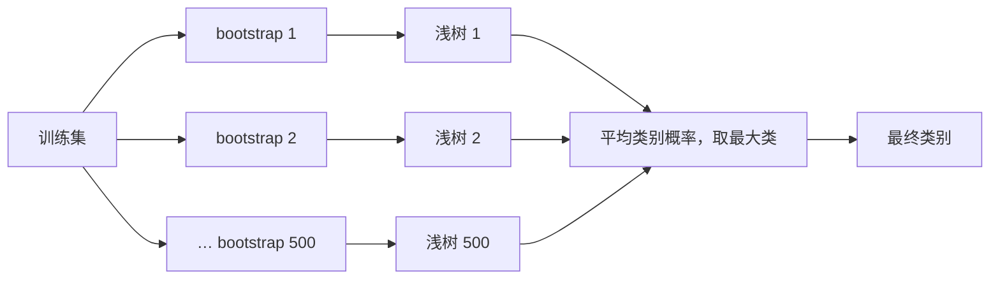
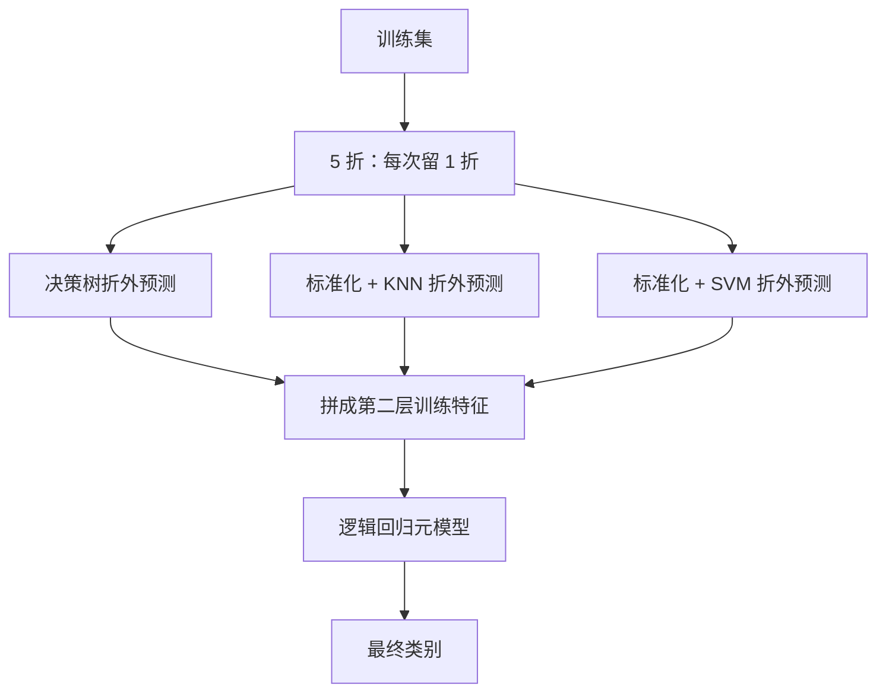
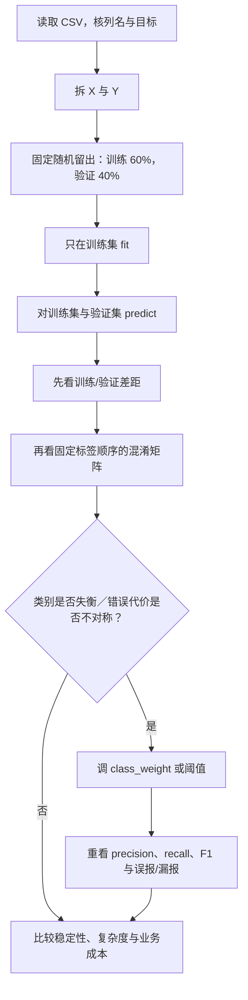

# T07 · 分类实战：信用审批与欺诈识别

> [!info] 来源与状态
> 本笔记逐 cell 讲解 `Week 7 Classification_Tutorial.ipynb` 的 23 个 cells。原 notebook 保存了 11 个已执行 code cells 的输出，但保存输出不等于本次运行结果。本文把“原 notebook 保存输出”和“2026-10-14 scratch 副本复算”分开标明。Canvas 已核到 Week 7 材料和通用提交规范；上课日期、Week 7 专属截止时间与官方答案仍未核实。

## 0. 这个 notebook 在教什么

这份 notebook 解决两个业务问题。第一部分用 678 条信用审批记录比较一棵浅决策树和四种集成分类器。第二部分用合成数据说明类别不平衡时，为什么高准确率仍可能漏掉重要少数类，以及 `class_weight` 怎样改变错误代价。

学完后，你应该能完成以下可检验动作：

- 把一张监督学习表拆成特征 `X` 和目标 `Y`，再用固定随机种子做一次 60%/40% 留出划分。
- 说明决策树、随机森林、Bagging、AdaBoost 和 Stacking 的训练对象、组合方式与输出差异。
- 根据训练准确率和验证准确率判断模型是否出现明显泛化落差，但不把一次留出结果当成稳定排名。
- 按“真实类别是行、预测类别是列”读出混淆矩阵中的每一种错误。
- 解释给少数类更高权重后，为什么少数类召回率可能上升，而总体准确率和精确率可能下降。
- 知道 Week 7 Assignment 要交什么，并把个人评分答案保留在私有作业区。

## 1. 前置、环境与数据

### 1.1 理论衔接

本 tutorial 对应 [[M06-分类-决策树集成SVM与不平衡学习]]。分类器收到一行特征，输出一个离散类别；本例的类别是信用审批 `+` / `-`，以及合成数据的 `0` / `1`。

这里会反复出现三个动作：

1. `fit(X_train, Y_train)`：让模型从训练样本学习规则。
2. `predict(X_test)`：把学到的规则应用到未参与训练的样本。
3. 指标计算：比较预测类别与真实类别，得到 accuracy 或混淆矩阵。

这三个动作必须按顺序执行。若先查看测试结果再反复调模型，测试集就参与了选择，最终分数会偏乐观。

### 1.2 运行环境

原 notebook 的 metadata 记录 Python `3.13.5`，kernel 为 `conda-base-py`。本次只在 vault 外的 scratch 中复算教学 cells，实际环境如下。

| 组件 | 原 notebook metadata | 本次 scratch 复算 |
|---|---|---|
| Python | 3.13.5 | 3.12.3 |
| pandas | 未记录 | 2.3.3 |
| NumPy | 未记录 | 1.26.4 |
| scikit-learn | 未记录 | 1.5.1 |
| Matplotlib | 未记录 | 3.9.2 |

读第一行：原 notebook 声明的 Python 版本与本次复算版本不同。因此，原保存输出优先作为课堂材料记录；本次结果只用于检查当前环境下能否复现。

### 1.3 两份数据分别做什么

本 notebook 的教学代码使用 `Credit_approval.csv`。`creditcard-reduced.csv` 只出现在评分 assignment 题面中，本文仅做描述性概览，不训练题目要求的五个模型。

#### Credit_approval.csv

这张表一行代表一名申请人的一条审批记录。前 5 列是模型输入，`Approved` 是要预测的目标。

| 字段 | dtype | 含义 | 范围／类别 | 缺失 |
|---|---|---|---|---:|
| `Age` | float64 | 年龄数值；单位未在文件中说明 | 13.75–80.25 | 0 |
| `Debt` | float64 | 债务数值；单位未说明 | 0–28 | 0 |
| `YearsEmployed` | float64 | 就业年数 | 0–28.5 | 0 |
| ` CreditScore` | int64 | 信用分数或计数；表头前有空格 | 0–67 | 0 |
| `Income ` | int64 | 收入数值；表头后有空格，单位未说明 | 0–100000 | 0 |
| `Approved` | object | 目标类别 | `+` 305；`-` 373 | 0 |

读第一行：`Age=13.75` 是文件中的最小值；材料没有说明它的单位或是否合法，所以这里只报告，不替材料解释。精确列名中 ` CreditScore` 和 `Income ` 含空格，手写列名时很容易触发 `KeyError`。

数据共 678 行 × 6 列，文件大小 15513 字节，存在 1 条完全重复记录。`-` 占 55.01%，`+` 占 44.99%，两类并不极端失衡。它对应本 notebook 的 Cells 3–16。

#### creditcard-reduced.csv

这张表一行代表一笔交易。目标 `Class` 中，`1` 有 492 行，`0` 有 32272 行。

| 字段组 | 列数 | dtype | 已知含义 | 范围／类别 | 缺失 |
|---|---:|---|---|---|---:|
| `Time` | 1 | int64 | 时间数值；单位与起点未提供 | 406–172792 | 0 |
| `V1`–`V28` | 28 | float64 | 匿名数值特征；本地材料未给语义 | 各列不同 | 0 |
| `Amount` | 1 | float64 | 交易金额；币种未提供 | 0–25691.16 | 0 |
| `Class` | 1 | int64 | 目标类别 | `0` / `1` | 0 |

读第一行：`Time=406` 只表示文件中的最小时间数值。没有数据字典时，不能把它直接解释成秒、分钟或具体日期。

数据共 32764 行 × 31 列，文件大小 11877400 字节，存在 177 条完全重复记录。`Class=1` 只占 1.5016%，约每 66.6 条交易才有 1 条。若模型把所有交易都判成 `0`，accuracy 仍有 98.50%，因此本题必须同时看 precision、recall、F1 和混淆矩阵。它对应 Cell 22 的评分任务，教学 cells 没有读取它。

## 2. 逐块讲解

### 2.1 Cells 0–2：目标、工具箱与留出法入口

Cell 0 把分类定义为：根据其他属性预测一个名义类别属性。它给出两个目标：使用不同集成方法，以及比较模型表现。Cell 1 列出本讲 API；Cell 2 开始数据准备。

Cell 1 的“weighted classification”示例是：

```python
weights = {0: 10.0, 1: 1.0}
clf = DecisionTreeClassifier(max_depth=2, class_weight=weights)
```

下表一行对应一行关键代码，说明类别权重在训练中怎样传入。

| 行 | 代码片段 | 作用 |
|---:|---|---|
| 1 | `{0: 10.0, 1: 1.0}` | 把类 0 的单条训练错误计为类 1 的 10 倍 |
| 2 | `class_weight=weights` | 把这组代价交给树的分裂准则 |

逐列读法：行是本节代码块的行号；代码片段是实际调用或参数；作用说明该步接收什么、改变什么。行号没有业务单位。


**为什么这么写**：类别权重改变训练时的损失，不会复制原始行，也不会保证每个类 0 都判对。模型更愿意牺牲一部分类 1，以减少类 0 的漏判。

**⚠️ 易错点**：Cell 1 的文档链接只是 API 入口。API 能运行不代表你已经说明了业务目标、类别定义和错误代价。

**所以呢**：工具箱只是路线图；后续每个 API 都要落到数据、参数和输出上。

### 2.2 Cell 3：导入工具并读取信用审批数据

这段代码把 CSV 读成 DataFrame，并显示前 5 行，先确认列名与样本长相。

```python
from sklearn.model_selection import train_test_split
from sklearn.metrics import accuracy_score
import matplotlib.pyplot as plt
import pandas as pd
import numpy as np

data = pd.read_csv('Credit_approval.csv', header='infer')
data.head(5)
```

下表一行对应读取阶段的一个关键片段，并说明它负责什么。

| 行 | 代码片段 | 作用 |
|---:|---|---|
| 1 | `train_test_split` | 一次随机切分训练集与验证集 |
| 2 | `accuracy_score` | 计算预测正确的样本比例 |
| 3–5 | `plt`、`pd`、`np` | 绘图、表格和数组工具 |
| 7 | `pd.read_csv(...)` | 读取 CSV；首行自动作为表头 |
| 8 | `head(5)` | 显示前 5 行，不代表全表分布 |

逐列读法：行是本节代码块的行号；代码片段是实际调用或参数；作用说明该步接收什么、改变什么。行号没有业务单位。


原 notebook 保存输出的第一行是 `Age=30.83`、`Debt=0`、`YearsEmployed=1.25`、`CreditScore=1`、`Income=0`、`Approved='+'`。

**怎么读输出**：一行是一次审批记录。前五个值描述申请人，最后一个 `+` 是该记录的已知审批类别。

**⚠️ 易错点**：相对路径按当前工作目录解析。若 notebook 不在 CSV 同一目录运行，就会得到 `FileNotFoundError`。不要为了修路径而改原 notebook；在副本中改工作目录或使用副本路径。

**所以呢**：先确认真实列名和样本含义，才能判断后面的训练是否用了正确输入。

### 2.3 Cell 4：拆出 X、Y 并做 60%/40% 划分

这段代码先分离目标，再固定一次随机留出划分。

```python
Y = data['Approved']
X = data.drop(['Approved'], axis=1)
X_train, X_test, Y_train, Y_test = train_test_split(
    X, Y, test_size=0.4, random_state=1
)
```

下表一行对应划分阶段的一个关键片段，并说明它产生的数据对象。

| 行 | 代码片段 | 作用 |
|---:|---|---|
| 1 | `data['Approved']` | 取出 678 个真实类别，形状为 `(678,)` |
| 2 | `drop(..., axis=1)` | 删除目标列，留下 5 个输入特征 |
| 3–4 | `test_size=0.4` | 272 行进入验证集，406 行进入训练集 |
| 4 | `random_state=1` | 固定切分，便于复现同一结果 |

逐列读法：行是本节代码块的行号；代码片段是实际调用或参数；作用说明该步接收什么、改变什么。行号没有业务单位。


参数的含义如下。

| 参数 | 本例值 | 作用 | 改变后会怎样 |
|---|---:|---|---|
| `test_size` | 0.4 | 40% 样本用于验证 | 更大：验证更稳，但训练样本更少 |
| `random_state` | 1 | 固定伪随机切分 | 改值会换一批训练／验证样本 |
| `stratify` | 未设置 | 是否保留类别比例 | 不设置时，小数据的比例可能漂移 |

本次划分中，训练集为 406 × 5，验证集为 272 × 5。训练目标有 `-` 218 条、`+` 188 条；验证目标有 `-` 155 条、`+` 117 条。

**为什么这一步不能晚做**：预处理、选参数和拟合都只能使用训练侧信息。若先对全表学习均值、尺度或特征选择，再切分，就发生数据泄漏。

**所以呢**：划分决定模型能看见什么；它也是防止数据泄漏的第一道边界。

### 2.4 Cells 5–6：单棵浅决策树基线

Cell 5 宣布进入 base classifier。Cell 6 用深度不超过 2 的树建立基线。

```python
from sklearn.tree import DecisionTreeClassifier

clf = DecisionTreeClassifier(max_depth=2)
clf = clf.fit(X_train, Y_train)
Y_predTrain = clf.predict(X_train)
Y_predTest = clf.predict(X_test)
```

下表一行对应决策树 cell 的一个关键片段，并说明训练或预测作用。

| 行 | 代码片段 | 作用 |
|---:|---|---|
| 1 | `DecisionTreeClassifier` | 导入分类树 |
| 3 | `max_depth=2` | 每条根到叶路径至多 2 次分裂 |
| 4 | `fit(...)` | 只用训练集学习分裂规则 |
| 5 | `predict(X_train)` | 检查模型对见过数据的拟合 |
| 6 | `predict(X_test)` | 检查模型对未见数据的泛化 |

逐列读法：行是本节代码块的行号；代码片段是实际调用或参数；作用说明该步接收什么、改变什么。行号没有业务单位。


**树怎样做一次预测**：每个内部节点问一个“某特征是否小于阈值”的问题。样本沿真／假分支向下走，最后到叶节点，以该叶训练样本的多数类作为预测。

**完整微例（笔记补充）**：假设只有 6 条训练记录，树先问信用分数是否不超过 2。满足条件的 3 条中有 2 条是 `-`，因此该叶预测 `-`；不满足的 3 条中有 3 条是 `+`，因此该叶预测 `+`。新申请人的分数为 1，就走左边并得到 `-`。真实训练会遍历候选阈值，选择能最大降低节点杂质的分裂。

**停止边界**：到达 `max_depth=2`、节点无法继续有效分裂，或其他停止条件生效时，树停止生长。本例用浅树限制容量，但不保证找到最佳深度。

原 notebook 保存输出：

```text
Training accuracy is 0.751232
Validation accuracy is 0.727941
```

**怎么读输出**：训练正确率为 75.12%，验证正确率为 72.79%。两者相差 2.33 个百分点；这提示存在小幅泛化落差，但一次切分不足以证明稳定过拟合。

**⚠️ 易错点**：原 cell 注释把 `max_depth` 写成 “number estimators”。这不对。`max_depth` 是单棵树的最大深度；`n_estimators` 才是集成中的基学习器数量。

**所以呢**：单棵浅树提供可解释基线，后续集成模型必须证明自己比这条基线更有用。

### 2.5 Cells 7–8：随机森林

Cell 7 切换到 ensemble classifier。Cell 8 训练 500 棵深度不超过 2 的随机树。

```python
from sklearn.ensemble import RandomForestClassifier

np.random.seed(1)
clf = RandomForestClassifier(max_depth=2, n_estimators=500)
clf = clf.fit(X_train, Y_train)
Y_predTest = clf.predict(X_test)
```

下表一行对应随机森林 cell 的一个关键片段，并说明随机性或集成规模来自哪里。

| 行 | 代码片段 | 作用 |
|---:|---|---|
| 1 | `RandomForestClassifier` | 导入随机森林 |
| 3 | `np.random.seed(1)` | 固定当前 NumPy 随机序列 |
| 4 | `n_estimators=500` | 建立 500 棵树并平均类别概率 |
| 4 | `max_depth=2` | 每棵树保持较浅 |

逐列读法：行是本节代码块的行号；代码片段是实际调用或参数；作用说明该步接收什么、改变什么。行号没有业务单位。


随机森林的状态变化如下：

1. 从训练集有放回抽一份 bootstrap 样本。
2. 每个分裂节点只看随机抽到的一部分特征。
3. 每棵树让新样本落入叶，返回各类的叶内比例。
4. 按 classes_ 对齐概率列，跨树平均，再选平均概率最大的类别。



**为什么同时随机样本和特征**：若所有树看到相同数据和相同候选特征，它们会犯相似错误。增加差异后，投票更有机会抵消单棵树的偶然误差。

原 notebook 保存输出：训练 0.780788，验证 0.761029。本次复算相同。验证正确率比单树高约 3.31 个百分点，但这只是同一次留出划分上的差异。

**所以呢**：随机森林组合许多有差异的树的类别概率，目标是降低单棵树对样本扰动的敏感度。


**完整聚合微例（笔记补充）**：三棵树对类 1 给概率 0.51、0.51、0。若先让每树选类，类 1 得两票，硬投票判 1；按本软件实现平均，类 1 概率为 0.34，类 0 为 0.66，最终判 0。区别在于叶内的不确定性是否保留。

训练时每个节点的候选特征重新抽取，树达到深度／纯度／最小叶数边界后停止；森林建立预设数量的树后停止。特征高度相关时，许多树可能仍犯同样错误；浅树过多也不保证修复欠拟合。

**读图自测**：三树例应从图中“平均类别概率”到“最终类别”，输出 0。把节点改成“多数票”会输出 1，这不是单纯换措辞。

🔗 [RandomForestClassifier 1.5 官方文档](https://scikit-learn.org/1.5/modules/generated/sklearn.ensemble.RandomForestClassifier.html)；[BaggingClassifier 1.5 官方文档](https://scikit-learn.org/1.5/modules/generated/sklearn.ensemble.BaggingClassifier.html)，核对日期 2026-10-14。

### 2.6 Cells 9–10：Bagging

Cell 9 标出 Bagging；Cell 10 用同一种浅决策树训练 50 个 bootstrap 模型。

```python
from sklearn.ensemble import BaggingClassifier

np.random.seed(1)
clf2 = BaggingClassifier(
    DecisionTreeClassifier(max_depth=2),
    n_estimators=50
)
clf2 = clf2.fit(X_train, Y_train)
```

下表一行对应 Bagging cell 的一个关键片段，并说明基学习器与集成数量。

| 行 | 代码片段 | 作用 |
|---:|---|---|
| 1 | `BaggingClassifier` | 导入通用 bootstrap 聚合器 |
| 4 | `DecisionTreeClassifier(...)` | 指定每个基学习器都是浅树 |
| 5 | `n_estimators=50` | 训练 50 个基学习器 |
| 7 | `fit(...)` | 各模型在不同 bootstrap 样本上拟合 |

逐列读法：行是本节代码块的行号；代码片段是实际调用或参数；作用说明该步接收什么、改变什么。行号没有业务单位。


本例的 Bagging 和随机森林都先平均类别概率，再选最大类。若 Bagging 基学习器没有 predict_proba，软件才退回类别投票。关键差别是：标准 Bagging 可以包装多种基学习器，且本 cell 没有要求每个节点再随机抽特征；随机森林专门为树加入了特征随机性。

原 notebook 保存输出：训练 0.778325，验证 0.735294。本次在 scikit-learn 1.5.1 中使用新参数名 `estimator=` 复算，数值相同。

**版本边界**：原代码把基树作为第一个位置参数。新版本推荐显式写 `estimator=DecisionTreeClassifier(...)`，更容易读，也减少 API 变化导致的歧义。

**所以呢**：Bagging 提供通用并行聚合基线，也让我们看清随机森林多出的特征随机性。

### 2.7 Cells 11–12：AdaBoost

Cell 11 标出 AdaBoost；Cell 12 顺序训练 5 个深度为 2 的树。

```python
from sklearn.ensemble import AdaBoostClassifier

np.random.seed(1)
clf3 = AdaBoostClassifier(
    DecisionTreeClassifier(max_depth=2),
    n_estimators=5
)
clf3 = clf3.fit(X_train, Y_train)
```

下表一行对应 AdaBoost cell 的一个关键片段，并说明顺序提升设置。

| 行 | 代码片段 | 作用 |
|---:|---|---|
| 1 | `AdaBoostClassifier` | 导入自适应提升分类器 |
| 4 | `DecisionTreeClassifier(...)` | 指定基学习器 |
| 5 | `n_estimators=5` | 最多建立 5 个顺序学习器 |
| 7 | `fit(...)` | 后一轮更重视前一轮错分样本 |

逐列读法：行是本节代码块的行号；代码片段是实际调用或参数；作用说明该步接收什么、改变什么。行号没有业务单位。


AdaBoost 的核心不是重新独立抽许多模型，而是逐轮调整关注重点：

1. 初始化时，每条训练记录权重相同。
2. 训练第 1 个弱学习器并找出错分记录。
3. 提高错分记录的权重，降低已正确记录的相对权重。
4. 用新权重训练下一轮。
5. 按各轮学习器的可靠程度加权投票。

**完整微例（笔记补充）**：4 条记录初始各重 0.25。第一棵树只错第 4 条。下一轮会让第 4 条的相对权重上升，使第二棵树更愿意寻找能修正它的分裂。若噪声点永远无法解释，算法也可能反复追逐噪声。

**停止边界**：达到 `n_estimators`，或实现判断继续提升没有意义时停止。基学习器太强、标签噪声多或异常点很多时，提升可能把注意力耗在不可学习的错误上。

原 notebook 保存输出为训练 0.770936、验证 0.764706。本次 scikit-learn 1.5.1 复算得到训练 0.805419、验证 0.779412，并出现默认算法未来弃用警告。本轮改变了软件环境，并显式固定模型随机种子；原环境未记录完整，不能确认差异的单一原因，也不能覆盖原保存结果。

**所以呢**：AdaBoost 用后续模型修正前轮难点，适合解释“顺序学习”与噪声风险。

### 2.8 Cells 13–14：Stacking 的两层学习

Cell 13 标出 Stacking。Cell 14 让三种 base estimators 先预测，再由逻辑回归学习怎样组合它们。

第一层模型如下。K 近邻（KNN）按附近训练样本投票；支持向量机（SVM）寻找能分开类别的边界。两者都放在 `StandardScaler` pipeline 中。标准化用训练集均值和标准差把各列换到可比较尺度，避免数值大的列支配距离。树按阈值切分，不需要同样的尺度处理。

```python
base_estimators = [
    ("dt", DecisionTreeClassifier(max_depth=3, random_state=1)),
    ("knn", make_pipeline(
        StandardScaler(),
        KNeighborsClassifier(n_neighbors=7)
    )),
    ("svm", make_pipeline(
        StandardScaler(),
        SVC(probability=True, C=1.0, kernel="rbf", random_state=1)
    )),
]
```

下表一行是一种第一层模型，列分别说明输入处理、第二层输入和本例边界。

| 名称 | 输入处理 | 模型输出供第二层使用 | 关键边界 |
|---|---|---|---|
| `dt` | 原始数值 | 本例为 `-` 的概率 | 深度 3，可能欠拟合 |
| `knn` | 先标准化 | 本例为 `-` 的邻居比例 | `n_neighbors=7` 依赖尺度 |
| `svm` | 先标准化 | 本例为 `-` 的校准概率 | RBF、`C=1.0` |

读第一行：`dt` 不做标准化，输出会作为第二层的新输入；它不是最终单独决策。

第二层和训练设置如下。

```python
meta_estimator = LogisticRegression(max_iter=2000, random_state=1)

clf_stack = StackingClassifier(
    estimators=base_estimators,
    final_estimator=meta_estimator,
    cv=5,
    stack_method="auto",
    passthrough=False
)
clf_stack.fit(X_train, Y_train)
```

下表一行是一个 Stacking 参数，说明本例取值、作用和改动后的含义。

| 参数 | 本例值 | 作用 | 改变后的含义 |
|---|---|---|---|
| `final_estimator` | 逻辑回归 | 学习怎样组合第一层输出 | 可换其他分类器 |
| `cv` | 5 | 用 5 折的折外预测训练第二层 | 更大通常更慢 |
| `stack_method` | `auto` | 自动找 `predict_proba` 等输出 | 手动指定可固定接口 |
| `passthrough` | `False` | 第二层只看模型输出 | `True` 时也看原特征 |

逐列读法：参数为 API 配置名；本例值是原 cell 实际设置；作用解释改变的计算环节；末列说明改配置后应检查什么。该表不混用样本数与概率单位。




**为什么必须用折外预测训练第二层**：若第二层看到的是第一层对其训练样本的过度乐观预测，它会学到虚假的组合权重。`cv=5` 让每一行的第二层特征来自没有训练过该行的第一层模型。


**本例真正交给第二层的矩阵**：三个基模型都支持 predict_proba，因此 auto 实际选择的三项都是 predict_proba。二分类的两列概率相加为 1，软件会删除每个模型的第一列，避免重复信息。

本次核到 classes_ 为 ['+', '-']，保留下来的是 - 的概率。本例验证侧变换为 272 行 × 3 列，列顺序依次 dt、knn、svm；passthrough=False 时没有再接入五个原特征。

1. 第一条验证记录的三项元特征约为 0.0769、0.4286、0.1870。
2. 三项各自与对应基模型 predict_proba 的第二列一致。
3. 元模型结合这三项得到最终类别；不能把任何一项误称为批准 + 的概率。

transform(X_test) 使用已在完整训练集重拟合的基模型，是推断检查。它不能拿来冒充训练元模型所用的 OOF 特征；那是在各留出折上单独生成的矩阵。此行为已对官方 1.5 文档及实际矩阵核对，精确结果保留在 stacking-shape.json。

原 notebook 保存输出为训练 0.805419、验证 0.764706。本次复算相同。训练与验证相差 4.07 个百分点；仍需多次切分或交叉验证才能判断是否稳定。

**所以呢**：Stacking 学的是“何时信哪一个基模型”，但必须用折外预测避免第二层偷看训练答案。


#### 2.8.1 一条记录怎样经过距离模型和元模型（笔记补充）

Cell 14 真正调用 KNN、SVM 和逻辑回归，必须看清这些模型如何交出第二层输入。下面的小例专用于机制，参数和数字与原信用审批实验分开。

先解释 KNN。模型训练时主要保存训练坐标和标签；预测时计算新点到各训练点的距离，再统计最近 k 个邻居的标签。

设训练输入为 0、2、4、6，标签依次为 0、0、1、1。训练均值为 3，按总体标准差计算的尺度约为 2.2361。

1. 训练坐标减去 3 再除以 2.2361；保存均值、尺度和新坐标。
2. 查询点 x=3.8 也使用同一均值与尺度，得到约 0.3578。
3. 四个训练点与查询点的标准化距离依次约为 1.6994、0.8050、0.0894、0.9839。
4. 本补充例取 k=3，最近邻是 x=4、2、6，标签为 1、0、1。
5. 等权投票给类 1 概率 2／3、类 0 概率 1／3，最终预测 1。

原 cell 使用 k=7，操作相同，但每个训练折至少要有 7 行。k 太小容易被单个噪声点左右；k 太大可能跨过局部边界。尺度未处理时，一个数值范围大的输入会主导距离，缩放也必须在各训练折内部学习。

**SVM 支路的输入与输出**

SVM 支路先学习边界，然后才产生新点分数；RBF 核先算两点相似性，并由训练学出的系数组合成分数。`probability=True` 还会拟合概率校准过程；概率列必须按 `classes_` 定位。一个正的原始分数并不等于同数值的概率。

#### 2.8.2 逻辑回归元模型的一步训练（笔记补充）

最后看逻辑回归。它把各基模型对同一类的概率当输入，先加权求和形成 logit（概率的对数比值），再用 sigmoid 把分数映成 0–1。

假设仅有一个元特征 u：两条训练记录为 (u=0,y=0)、(u=1,y=1)。这是补充训练例，不复现真实元模型参数。

1. 从 w=0、b=0 开始，两条记录预测概率均为 0.5。
2. 平均损失对 w 的导数为 -0.25，对 b 的导数为 0。
3. 本例学习率取 1，一步更新到 w=0.25、b=0。
4. 两条概率变成 0.5 和约 0.5622，平均对数损失由约 0.6931 降到 0.6345。
5. 明确限定演示只更新一步，然后停止；这不是收敛后的最优模型。
6. 对新元特征 u=0.8，分数为 0.2，概率约 0.5498，按 0.5 阈值判 1。

导数来自“每条预测概率减真实标签，再乘该条输入，最后平均”。若 y=1，概率越小，负导数越明显，更新会提高该输入的得分。真实 `LogisticRegression` 包含正则项并使用数值求解器，不能把本例的一步无正则梯度当成其实际迭代轨迹。

两个常见失败是：基模型的训练拟合概率泄漏进元特征；各概率列对应的正类不一致。前者要求折外预测，后者要求统一 `classes_` 顺序。

**走图与迁移**：三条支路的输出必须属于同一行记录、同一类别。若把某支路类 0 的概率当成类 1，第二层收到的证据方向会反转；如果先用全数据拟合标准化，折外支路仍可能泄漏。


### 2.9 Cells 15–16：混淆矩阵究竟在数什么

Cell 15 宣布模型比较。Cell 16 调用的是变量 `clf`。按 notebook 当前执行顺序，`clf` 最近一次在 Cell 8 被赋值为随机森林；Bagging、AdaBoost 和 Stacking 分别保存在 `clf2`、`clf3`、`clf_stack`。因此，这张矩阵比较的是随机森林，不是 Stacking。

```python
disp = ConfusionMatrixDisplay.from_estimator(
    clf, X_test, Y_test,
    display_labels=['+', '-'],
    values_format='.0f',
    cmap=plt.cm.Blues
)
print(disp.confusion_matrix)
```

原 notebook 保存输出：

```text
[[ 70  47]
 [ 18 137]]
```

一行是真实类别，一列是预测类别；顺序都是 `+`、`-`。

| 真实类别 | 预测 `+` | 预测 `-` | 行合计 |
|---|---:|---:|---:|
| `+` | 70 | 47 | 117 |
| `-` | 18 | 137 | 155 |

读第一行：真实为 `+` 的 117 条申请中，70 条判成 `+`，47 条误判成 `-`。若 `+` 表示批准，47 就是把本应批准者拒绝。

由此可算：

1. Accuracy：$(70+137)/272=76.10\%$。
2. 类 `+` precision：$70/(70+18)=79.55\%$。
3. 类 `+` recall：$70/(70+47)=59.83\%$。
4. 类 `+` F1：约 $68.27\%$。

**⚠️ 易错点**：`display_labels` 只改图上的标签文字，不会重新排列模型内部的类别。稳妥做法是同时检查 `clf.classes_`，或在 `confusion_matrix(..., labels=[...])` 中显式固定顺序。

本次复算确认该随机森林的 `clf.classes_ == ['+', '-']`。scikit-learn 1.5 文档也说明：未显式传 `labels` 时，矩阵使用真实／预测中出现的标签并按排序顺序排列；`display_labels` 只提供绘图名称。🔗 [ConfusionMatrixDisplay 1.5 文档](https://scikit-learn.org/1.5/modules/generated/sklearn.metrics.ConfusionMatrixDisplay.html)，核对日期 2026-10-14。

**所以呢**：混淆矩阵把 accuracy 隐藏的错误方向展开，业务方才能讨论哪种错更贵。

### 2.10 Cells 17–18：制造一个 10%/90% 的不平衡问题

Cell 17 引入类别权重。Cell 18 生成 10000 行、2 个数值特征的二分类数据。

```python
X, y = make_classification(
    n_samples=10000,
    n_features=2,
    n_redundant=0,
    n_clusters_per_class=1,
    weights=[0.1],
    flip_y=0,
    random_state=2
)
```

下表一行解释一个数据生成参数，说明本例取值和改动后会发生什么。

| 参数 | 本例值 | 作用 | 改变后的含义 |
|---|---:|---|---|
| `n_samples` | 10000 | 样本总数 | 更大时运行更慢 |
| `n_features` | 2 | 两个可画在平面的特征 | 更多维无法直接散点显示 |
| `n_redundant` | 0 | 不加线性冗余特征 | 增大会加入可由其他特征组合出的列 |
| `weights` | `[0.1]` | 类 0 约占 10% | 改为 `[0.01]` 会更极端 |
| `flip_y` | 0 | 不随机翻转标签 | 增大可模拟标签噪声 |
| `random_state` | 2 | 固定数据生成 | 改值会换一份数据 |

逐列读法：参数为 API 配置名；本例值是原 cell 实际设置；作用解释改变的计算环节；末列说明改配置后应检查什么。该表不混用样本数与概率单位。


原 notebook 保存输出为 `Counter({1: 9000, 0: 1000})`。散点图中一个点是一条合成样本，横纵轴是两个无业务单位的合成特征。

**完整微例（笔记补充）**：若验证集有 90 条类 1、10 条类 0，一个永远预测 1 的模型会答对 90 条，accuracy 为 90%。但类 0 的 recall 是 $0/10=0$，说明重要少数类全部漏掉。

**所以呢**：先制造可控的不平衡数据，才能把权重变化与错误变化直接对应起来。

### 2.11 Cell 19：不加权时，accuracy 掩盖了 124 个少数类漏判

这一 cell 先建立不加权基线，用来观察高 accuracy 会漏掉多少少数类。

```python
clf = DecisionTreeClassifier(max_depth=2)
clf.fit(X_train, Y_train)
Y_predTest = clf.predict(X_test)
```

原 notebook 保存的混淆矩阵为：

```text
[[ 262  124]
 [   8 3606]]
```

下表一行是真实类别，两个预测列给出各去向的样本数。

| 真实类别 | 预测 0 | 预测 1 | 行合计 |
|---|---:|---:|---:|
| 0 | 262 | 124 | 386 |
| 1 | 8 | 3606 | 3614 |

逐列读法：真实类别是验证标签；预测 0／1 是模型输出去向；行合计为同一真实类的总数。后三列均以条计数，来自本节混淆矩阵。


读第一行：386 条真实类 0 中有 124 条被错判成 1。总体 accuracy 为 96.70%，但少数类 0 的 recall 只有 $262/386=67.88\%$。

**为什么 accuracy 很高**：验证集中 3614 条属于多数类 1。只要多数类大多判对，总正确数就会很大。

**所以呢**：不加权模型的 96.70% accuracy 不能代表少数类识别已合格。

### 2.12 Cell 20：给类 0 十倍权重后，决策边界怎样移动

这一 cell 只改变类别权重，再比较混淆矩阵怎样移动。

```python
weights = {0: 10.0, 1: 1.0}
clf = DecisionTreeClassifier(max_depth=2, class_weight=weights)
clf.fit(X_train, Y_train)
Y_predTest = clf.predict(X_test)
```

原 notebook 保存的混淆矩阵为：

```text
[[ 376  10]
 [ 532 3082]]
```

下表一行是真实类别，两个预测列给出加权后的样本去向。

| 真实类别 | 预测 0 | 预测 1 | 行合计 |
|---|---:|---:|---:|
| 0 | 376 | 10 | 386 |
| 1 | 532 | 3082 | 3614 |

逐列读法：真实类别是验证标签；预测 0／1 是模型输出去向；行合计为同一真实类的总数。后三列均以条计数，来自本节混淆矩阵。


读第一行：类 0 的漏判从 124 降到 10，类 0 recall 从 67.88% 升到 97.41%。代价是 532 条类 1 被误报成 0，总体 accuracy 降到 86.45%。

本次复算得到以下少数类 0 指标。

表中四个指标都是比例。Accuracy 是全部样本的正确比例；Precision(0) 表示预测为 0 的样本中真实为 0 的比例；Recall(0) 表示真实为 0 的样本中成功抓到的比例；F1(0) 是 Precision(0) 与 Recall(0) 的调和平均。

| 设置 | Accuracy | Precision(0) | Recall(0) | F1(0) |
|---|---:|---:|---:|---:|
| 不加权 | 96.70% | 97.04% | 67.88% | 79.88% |
| 类 0 权重 10 | 86.45% | 41.41% | 97.41% | 58.11% |

读第一行：不加权树预测为 0 时通常很准，但漏掉约三分之一真实类 0。加权后几乎抓到全部类 0，却产生大量误报。

**业务边界**：权重不是越大越好。应根据漏判和误报的真实成本选阈值或权重，并在独立验证集上比较。若欺诈漏判损失远高于人工复核成本，提高 recall 可能合理；若误报会冻结大量正常交易，就必须约束 precision。

scikit-learn 1.5 文档把 `class_weight` 定义为 `{class_label: weight}` 形式的类别权重；未设置时各类权重都为 1。🔗 [DecisionTreeClassifier 1.5 文档](https://scikit-learn.org/1.5/modules/generated/sklearn.tree.DecisionTreeClassifier.html)，核对日期 2026-10-14。

**所以呢**：类别权重把模型的关注点移向少数类，但最终选择必须回到误报和漏报成本。


**看图比较权重的作用**：上排散点每个点是一条合成样本（包括划分前的全部 10,000 行），横纵轴是两个人造数值特征。下排矩阵的行是真实 0／1，列是预测 0／1，数字单位为条。


数值由 `calc_t07.py` 复算，最终图由 `render_figure.py` 同源排版生成，数据生成参数与 cell 18 一致。读取下排左图的首行：262 条类 0 被抓到、124 条漏掉；右图变成 376 条抓到、10 条漏掉，但类 1 误报增至 532。图支持错误取舍，不能证明权重 10 在实际欺诈数据上最优。

**读图自测**：哪一格体现加权后的代价？下排右图“真实 1／预测 0”是 532，显示误报正常多数类的增加。若只看少数类召回，会漏掉这一项。

### 2.13 Cell 21：四项学习总结

Cell 21 总结四个目标：构建集成方法、导入分类器、计算混淆矩阵、执行类别敏感分类。它还给出 scikit-learn 分类示例入口。

这里应补上一条判断顺序：先定义哪个类重要，再固定混淆矩阵的行列顺序，最后选择对应的 precision、recall 与 F1。只报告 accuracy 无法回答不平衡业务问题。

**所以呢**：本 tutorial 的最终能力是用多项指标解释错误，而不是只会调用五个分类器。

### 2.14 Cell 22：Week 7 Assignment 的公开边界

原 Notebook 三题内部分合计 100；Canvas points 仍待核。公开 T 笔记只记录任务要求和通用方法，不给五个模型的完整代码、最终指标、排名或个人结论。

题目要求如下。

1. 使用 `creditcard-reduced.csv` 建立 5 个分类模型，并为每个模型画混淆矩阵，计算 accuracy、precision、recall、F-score（50 分）。
2. 解释分类器差异，并比较模型表现（30 分）。
3. 对同一数据建立不加 `class_weight` 与加入 `class_weight` 的分类器，再比较五项评估结果（20 分）。

通用工作顺序：

1. 明确 `Class=1` 是否为要优先识别的正类。
2. 切分训练与验证数据；不在验证集上拟合预处理。
3. 对需要尺度处理的模型使用 pipeline。
4. 只在训练侧选择参数。
5. 固定标签顺序，报告混淆矩阵和正类指标。
6. 用错误代价解释指标取舍，不凭 accuracy 排名。

2026-10-14 已只读核对 Canvas 四个入口。Modules 的 `Week 7 - Classification` 含本轮 5 份附件：L6 分类 PDF、两份 CSV、Week 7 ipynb 和 HTML；HTML 预览的 23 个 cells 与本地 notebook 一致。Assignments 当前列表没有 Week 7 独立入口。Announcements 的 10 月 1 日通用规范要求：执行全部代码并显示输出、用 Markdown 解释、保存 HTML、逐题标出答案位置。Files 列表会重定向课程首页／Modules。

以下信息仍未核实：Week 7 专属截止时间、Canvas points、专属允许文件类型、五种模型是否另有限定、是否要求同一随机切分、正类口径，以及是否另有 rubric。Assignments 列表暂时没有独立入口，不能据此断言任务“未发布”或永远不计分。

本 notebook 没有 `🤖 AI Prompt (Copy this to AI)` 单元格，因此没有可保留的教师 prompt 原句。若要向 AI 求助，一个合格请求应明确数据文件、目标列、正类、切分规则、五个候选模型、要输出的指标，以及“不得用验证集拟合预处理”这一限制。本课 ILO 3 关注能否用 GenAI 支持提案和编程；以上请求模板是笔记补充，不是本周教师提供的原提示词。

**所以呢**：公开笔记讲清评分任务的方法与约束，同时把个人模型、输出和结论留在私有作业区。

## 3. 完整流程串讲

下面把分散 cells 串成一条从数据到业务判断的流程。



每一步的输入输出如下。

| 步骤 | 输入 | 动作 | 输出 | 下一步检查 |
|---|---|---|---|---|
| 1 | 原始 CSV | 读取并核字段 | DataFrame | 行列、缺失、目标 |
| 2 | DataFrame | 分离目标 | `X`、`Y` | 目标是否误入特征 |
| 3 | `X`、`Y` | 留出划分 | train/test 四对象 | 比例与随机种子 |
| 4 | 训练数据 | `fit` | 已训练模型 | 训练只见训练侧 |
| 5 | 已训练模型 | `predict` | 预测类别 | 形状与类别顺序 |
| 6 | 真实／预测 | 指标计算 | 分数与矩阵 | 对应哪类错误 |

读第一行：读取数据后先核字段，而不是立刻建模。若目标列或带空格的列名处理错，后续所有分数都没有意义。

一次留出法的停止边界是：完成预先定义的模型比较后，不再用这份验证结果反复挑参数。若需要继续选模，应在训练集内部做交叉验证，并保留一个最终测试集。

## 4. 自己动手

### 4.1 改参数前先写预测

1. 把决策树 `max_depth` 从 2 改成 1、4、None。先预测训练准确率和验证准确率怎样变，再运行核对。
2. 把随机森林 `n_estimators` 从 10 改成 100、500。记录运行时间与验证分数，不要假定树越多 accuracy 必然单调上升。
3. 把 Stacking 的 `passthrough` 改为 `True`。说明第二层输入多了什么，并检查是否更容易过拟合。
4. 把合成数据的类 0 权重从 1 改为 2、5、10、20。画出 Recall(0) 与 Precision(0) 的变化。

### 4.2 迁移题

> [!question] 改条件
> 某欺诈验证集有 10000 笔交易，其中只有 100 笔欺诈。模型把所有交易都判成正常。它的 accuracy、欺诈 recall 分别是多少？

<details>
<summary>答案</summary>

模型答对 9900 笔正常交易，所以 accuracy 为 $9900/10000=99\%$。100 笔欺诈一笔也没抓到，所以欺诈 recall 为 $0/100=0$。这说明 99% accuracy 仍可能是不可用模型。

</details>

> [!question] 判断泄漏
> 先对全部 678 行计算标准化均值，再切训练集和验证集，是否合格？

<details>
<summary>答案</summary>

不合格。验证行参与了均值和尺度的计算，训练流程提前知道了验证分布。应先切分，再用训练集 `fit` 标准化器，并把同一变换应用到验证集。最稳妥的写法是 pipeline。

</details>

## 5. Cell ↔ 理论对应表

一行表示一个 notebook cell。理论页码需由 M06 的最终讲义映射补齐；当前只给目标章节，不编造页码。

| Cell | 类型 | 内容 | 本笔记 | 理论对应／状态 |
|---:|---|---|---|---|
| 0 | Markdown | 分类与 tutorial 目标 | §0、§2.1 | M06 分类总览 |
| 1 | Markdown | API 工具箱与权重片段 | §2.1 | M06 集成、评估、不平衡 |
| 2 | Markdown | Hold-out 标题 | §2.1 | M06 留出法 |
| 3 | Code | 导入、读 CSV、`head` | §2.2 | 数据准备；有保存输出 |
| 4 | Code | `X/Y` 与 60/40 切分 | §2.3 | M06 评估协议；无保存输出 |
| 5 | Markdown | Base classifier 标题 | §2.4 | M06 决策树 |
| 6 | Code | 深度 2 决策树 | §2.4 | M06 决策树；有保存输出 |
| 7 | Markdown | Random Forest 标题 | §2.5 | M06 随机森林 |
| 8 | Code | 500 棵随机森林 | §2.5 | M06 随机森林；有保存输出 |
| 9 | Markdown | Bagging 标题 | §2.6 | M06 Bagging |
| 10 | Code | 50 个浅树 Bagging | §2.6 | M06 Bagging；有保存输出 |
| 11 | Markdown | AdaBoost 标题 | §2.7 | M06 Boosting |
| 12 | Code | 5 轮 AdaBoost | §2.7 | M06 AdaBoost；有保存输出 |
| 13 | Markdown | Stacking 标题 | §2.8 | M06 Stacking |
| 14 | Code | 三基模型 + 元模型 | §2.8 | M06 Stacking；有保存输出 |
| 15 | Markdown | 模型比较标题 | §2.9 | M06 模型评估 |
| 16 | Code | 随机森林混淆矩阵 | §2.9 | M06 混淆矩阵；有保存图／矩阵 |
| 17 | Markdown | 类别权重标题 | §2.10 | M06 不平衡学习 |
| 18 | Code | 合成 10/90 数据与散点图 | §2.10 | M06 类别不平衡；有保存图／计数 |
| 19 | Code | 不加权树的矩阵 | §2.11 | M06 accuracy 陷阱；有保存图／矩阵 |
| 20 | Code | 类 0 十倍权重 | §2.12 | M06 成本敏感学习；有保存图／矩阵 |
| 21 | Markdown | 四项总结 | §2.13 | 本 tutorial 总结 |
| 22 | Markdown | 100 分个人 assignment | §2.14 | 私有：公开笔记不放完整答案 |

## 9. 制作与待核记录

### 9.1 已复算范围

- 已读取原 notebook 全部 23 个 cells：12 个 Markdown、11 个 Code。
- 已核每个 code cell 的 `execution_count` 与保存输出数量；Cell 4 无保存输出，其余 10 个 code cells 有保存输出。
- 已在 scratch 中用当前 API 复算信用审批的五种模型、随机森林混淆矩阵、合成数据和两种类别权重矩阵。
- 已对两份 CSV 核行列、dtype、缺失、重复、目标分布与关键范围。
- 没有运行 Cell 22 的评分任务，也没有生成其五模型答案。

### 9.2 版本与来源限制

- 原 notebook 保存输出仍是课程材料事实。本次复算只证明当前环境的结果。
- AdaBoost 的当前复算与保存输出不同，并出现默认算法弃用警告；发布前应保留两套结果及版本说明。
- Notebook 没有记录 scikit-learn 版本，因此不能断言差异只由哪一个版本变化造成。
- `Credit_approval.csv` 的业务单位、字段定义与符号口径没有随文件提供。
- `creditcard-reduced.csv` 的 `V1`–`V28`、`Time` 单位、币种与抽样方式没有随文件提供。
- 上课日期、Canvas 截止、提交格式与 rubric 待核。

### 9.2.1 官方 API 核对

- `train_test_split` 的 `random_state` 用于复现随机切分；`stratify` 非空时按给定类别分层。🔗 [train_test_split 1.5 文档](https://scikit-learn.org/1.5/modules/generated/sklearn.model_selection.train_test_split.html)，核对日期 2026-10-14。
- `StackingClassifier` 的最终估计器使用基模型的交叉验证预测训练；官方文档提醒，在同一训练数据上使用预训练模型输出会有很高的过拟合风险。🔗 [StackingClassifier 1.5 文档](https://scikit-learn.org/1.5/modules/generated/sklearn.ensemble.StackingClassifier.html)，核对日期 2026-10-14。
- scikit-learn 1.5 的 `AdaBoostClassifier` 默认 `SAMME.R`，该值自 1.4 起弃用，并计划在 1.6 移除；这支持本文对版本漂移的提醒，但不能单独证明保存输出差异的全部原因。🔗 [AdaBoostClassifier 1.5 文档](https://scikit-learn.org/1.5/modules/generated/sklearn.ensemble.AdaBoostClassifier.html)，核对日期 2026-10-14。

### 9.3 图与最终验收状态

本轮数值图由同一脚本生成 SVG 与 PNG，源码及结果随本轮图示保留。正文使用 SVG；集中验收以实际浏览器预览为依据，Obsidian 阅读视图未直接查看。

### 9.4 后续同步提示

候选发布后，需增量更新本课数据集卡、知识台账、术语表、考点库、作业与 DDL、课程总览和根 README，并按流程回读。Notion 只写已核事实；不得替用户勾选已学会、已提交或自测通过。


### 9.7 本轮制作记录

讲义与代码覆盖、复算、图文显示、L/G/E/R 原始诊断及来源限制见 [[IS6400_Business_Data_Analytics/_meta/M06-T07-制作验收记录-2026-10-14|本轮制作验收记录]]。原始材料只读；本轮未提交或推送 Git，个人学习与提交状态不由笔记生成代填。
