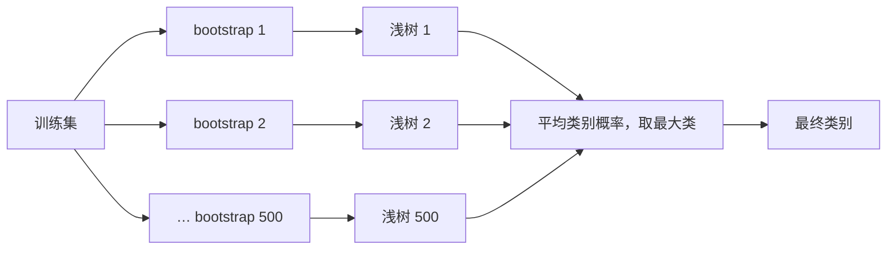
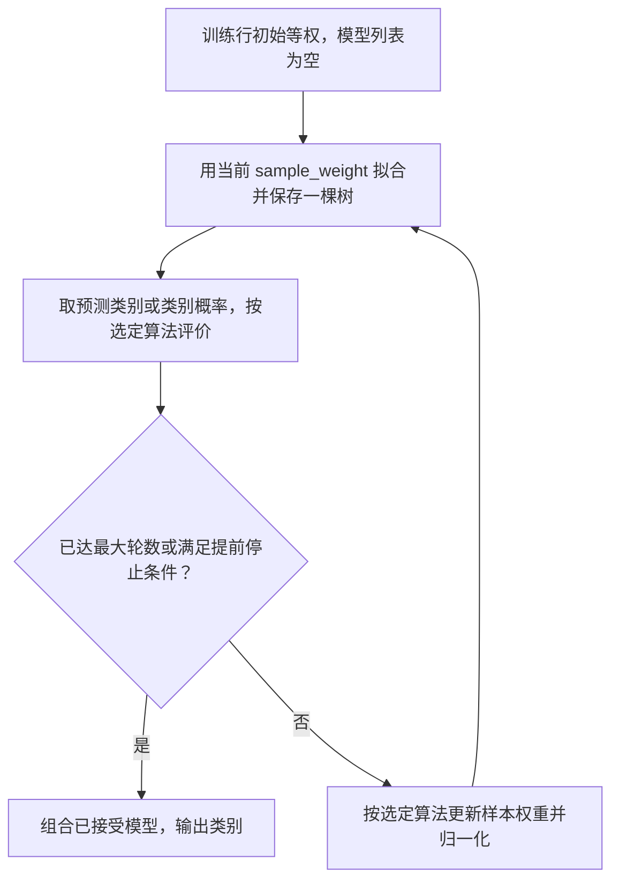
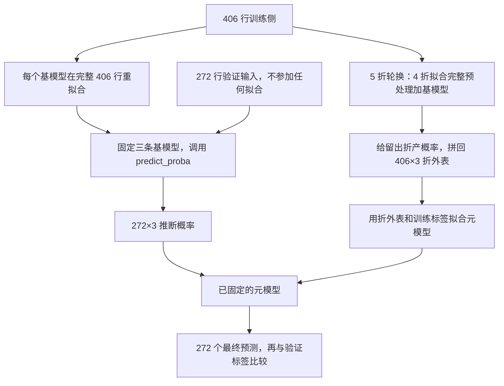
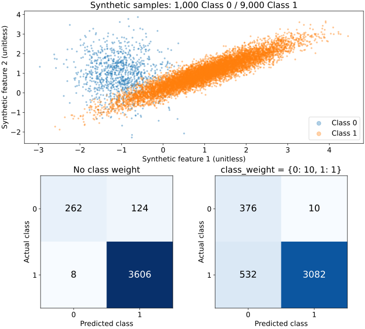
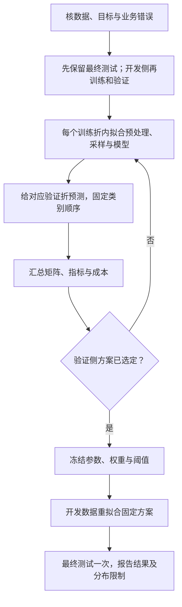

# T07 · 分类实战：信用审批与欺诈识别

> ✅ **材料融合 v1.0（2026-10-15）**：2026-10-14 Windows 录音机两源已按内容归属融合。固定别名 A=`M06-transcript-part1-partial.txt`（源5；265段；段首 `00:00`→`39:35`；媒体40:08），B=`M06-transcript-part2-partial.txt`（源6；619段；段首 `00:00`→`01:36:09`；媒体1:36:12.368）。两源各用原始时钟；时长不相加为课堂总长。
>
> A 首句已在 p.7 决策树，p.1–6 未录到，不可降权。A 末宣布休息，B 首复述 p.28 后继续，支持顺序接续；课间暂停及接缝是否漏一句未知。B `01:00:04` 起换助教（TA）带 T07，末尾停在作业答问，无正式下课语。新增教学／最终视觉验收单独记录，材料 v1.0 不等于本人已学会。
>
> 助教负责本次代码教程。自动语音识别（ASR）把录音转成文字，可能误认专名或数字；正文保留相应疑点。

> [!info] 来源与状态
> 本笔记逐 cell 讲解 `Week 7 Classification_Tutorial.ipynb` 的 23 个 cells。原 notebook 的 11 个 code cells 都有执行计数，其中 Cell 4 没有保存输出，其余 10 格有保存输出。保存输出不等于本轮运行结果。本文把“原 notebook 保存输出”和“2026-10-14 scratch 副本复算”分开标明。Canvas 已核到 Week 7 材料和通用提交规范；本次两源按内容核为2026-10-14课程；Week 7专属截止与官方答案仍未核实。

## 0. 这个 notebook 在教什么

这份 notebook 解决两个业务问题。第一部分用 678 条信用审批记录比较一棵浅决策树和四种集成分类器。第二部分用合成数据说明类别不平衡时，为什么高准确率仍可能漏掉重要少数类，以及 `class_weight` 怎样改变训练贡献与错误取舍。

学完后，你应该能完成以下可检验动作：

- 把一张监督学习表拆成特征 `X` 和目标 `Y`，再用固定随机种子做一次 60%/40% 留出划分。
- 说明决策树、随机森林、Bagging、AdaBoost 和 Stacking 的训练对象、组合方式与输出差异。
- 根据训练准确率和验证准确率判断模型是否出现明显泛化落差，但不把一次留出结果当成稳定排名。
- 按“真实类别是行、预测类别是列”读出混淆矩阵中的每一种错误。
- 解释给少数类更高权重后，为什么少数类召回率可能上升，而总体准确率和精确率可能下降。
- 识别 Week 7 Assignment 三问的材料、指标和讨论要求；分清教学方法、个人答卷、官方答案及本人提交状态。

## 1. 前置、环境与数据

### 1.1 理论衔接

本 tutorial 对应 [[M06-分类-决策树集成SVM与不平衡学习]]。分类器收到一行特征，输出一个离散类别；本例的类别是信用审批 `+` / `-`，以及合成数据的 `0` / `1`。

这里会反复出现三个动作：

1. `fit(X_train, Y_train)`：让模型从训练样本学习规则。
2. `predict(X_test)`：把学到的规则应用到未参与训练的样本。
3. 指标计算：比较预测类别与真实类别，得到 accuracy 或混淆矩阵。

这三个动作必须按顺序执行。原代码把留出对象命名为 `X_test`，输出却称 Validation accuracy；本文按它实际用于比较五个模型的用途称为验证集（validation set）。若据此选模型或参数，它就不再是最后只用一次的测试集（test set）。

正文先讲输入与切分，再逐个讲模型，最后解释错误、权重和评分要求。这样保留原 cell 顺序供课堂定位，也把共同的训练／预测／评估操作集中讲清。M06 是理论依赖，但本篇执行所需的尺度、距离、折外预测与指标仍在本地解释；M06 本轮自身验收状态不能替本篇放行。

### 1.2 先读懂本篇用到的 Python，再看环境

代码里的一个变量名像贴在对象上的标签。`X = data.drop(...)` 把结果交给 `X`，不会自动训练；`clf = clf.fit(...)` 才让这个模型接收训练记录。括号中的 `max_depth=2` 是把名为 `max_depth` 的配置设为 2，不是在比较两者相等。

本篇实际需要以下语法。一行表示一种写法；例子是笔记补充，最后一列说明它如何影响本次操作。

| 写法 | 最小例子 | 本篇用途 |
|---|---|---|
| 导入与别名 | `import pandas as pd` | 用 `pd` 这个短名调用表格库 |
| 按名字取列 | `data['Approved']` | 返回每行的目标类别 |
| 列表 | `['Approved']` | 方括号装一组项目；这里仅一项 |
| 字典 | `{0: 10.0, 1: 1.0}` | 冒号前是类别，后是训练权重 |
| 对象的方法 | `clf.predict(X_test)` | 让已训练模型处理验证输入 |
| 多变量接收 | `a, b = (2, 3)` | 左右按顺序配对；切分函数返回四项 |

读字典一行：类 0 对应 10，类 1 对应 1；这不是把类 0 的标签改成数字 10。`X_train` 是多行多列的表，`Y_train` 是同样行数的一列标签；切分时必须保持每行输入与自己的标签配对。

### 1.3 运行环境

原 notebook 的 metadata 记录 Python `3.13.5`，kernel 为 `conda-base-py`。2026-10-14 曾在 vault 外的 scratch 副本复算教学 cells，环境如下；2026-10-27 未训练模型，按原件与历史记录的真实哈希承接。

| 组件 | 原 notebook metadata | 2026-10-14 scratch 复算 |
|---|---|---|
| Python | 3.13.5 | 3.12.3 |
| pandas | 未记录 | 2.3.3 |
| NumPy | 未记录 | 1.26.4 |
| scikit-learn | 未记录 | 1.5.1 |
| Matplotlib | 未记录 | 3.9.2 |

读第一行：原 notebook 声明的 Python 版本与2026-10-14 历史复算版本不同。因此，原保存输出优先作为课堂材料记录；该历史结果只证明 2026-10-14 的环境与脚本能完成等价计算。

### 1.4 两份数据分别做什么

本 notebook 的教学代码使用 `Credit_approval.csv`。`creditcard-reduced.csv` 只出现在评分 assignment 题面中，本文仅做描述性概览，不训练题目要求的五个模型。

#### Credit_approval.csv

这张表一行代表一名申请人的一条审批记录。前 5 列是模型输入，`Approved` 是要预测的目标。

| 字段 | dtype | 含义 | 范围／类别 | 缺失 |
|---|---|---|---|---:|
| `Age` | float64 | 年龄数值；单位未在文件中说明 | 13.75–80.25 | 0 |
| `Debt` | float64 | 债务数值；单位未说明 | 0–28 | 0 |
| `YearsEmployed` | float64 | 就业年数 | 0–28.5 | 0 |
| ` CreditScore` | int64 | 信用分数或计数；表头前有空格 | 0–67 | 0 |
| `Income ` | int64 | 收入数值；表头后有空格，单位未说明 | 0–100000 | 0 |
| `Approved` | object | 目标类别 | `+` 305；`-` 373 | 0 |

读第一行：`Age=13.75` 是文件中的最小值；材料没有说明它的单位或是否合法，所以这里只报告，不替材料解释。精确列名中 ` CreditScore` 和 `Income ` 含空格，手写列名时很容易触发 `KeyError`。

表中 `float64` 是可含小数的数值，`int64` 是整数，`object` 在这里保存类别文字；它们是存储类型，不证明业务含义。

数据共 678 行 × 6 列，文件大小 15513 字节，存在 1 条完全重复记录。`-` 占 55.01%，`+` 占 44.99%，两类并不极端失衡。它对应本 notebook 的 Cells 3–16。

#### creditcard-reduced.csv

这张表一行代表一笔交易。目标 `Class` 中，`1` 有 492 行，`0` 有 32272 行。

| 字段组 | 列数 | dtype | 已知含义 | 范围／类别 | 缺失 |
|---|---:|---|---|---|---:|
| `Time` | 1 | int64 | 时间数值；单位与起点未提供 | 406–172792 | 0 |
| `V1`–`V28` | 28 | float64 | 匿名数值特征；本地材料未给语义 | 各列不同 | 0 |
| `Amount` | 1 | float64 | 交易金额；币种未提供 | 0–25691.16 | 0 |
| `Class` | 1 | int64 | 目标类别 | `0` / `1` | 0 |

读第一行：`Time=406` 只表示文件中的最小时间数值。没有数据字典时，不能把它直接解释成秒、分钟或具体日期。

数据共 32764 行 × 31 列，文件大小 11877400 字节，存在 177 条完全重复记录。`Class=1` 只占 1.5016%，约每 66.6 条交易才有 1 条。若模型把所有交易都判成 `0`，accuracy 仍有 98.50%，因此本题必须同时看 precision、recall、F1 和混淆矩阵。它对应 Cell 22 的评分任务，教学 cells 没有读取它。

## 2. 逐块讲解

### 2.1 Cells 0–2：目标、工具箱与留出法入口

Cell 0 把分类定义为：根据其他属性预测一个名义类别属性。这里“名义”表示类别没有可直接相减的数值距离，例如批准／不批准；数字 0／1 也可以只是类别编码。它给出两个目标：使用不同集成方法，以及比较模型表现。Cell 1 列出本讲 API；Cell 2 开始数据准备。

<details>
<summary>Cell 0 英文说明原文（只统一标题显示）</summary>

> Classification - Ensemble Learning
> 
> The following tutorial contains Python examples for solving classification problems. You should refer to the Slides Week 7 to understand some of the concepts introduced in this tutorial. 
> 
> Classification is the task of predicting a nominal-valued attribute (known as class label) based on the values of other attributes (known as predictor variables). The goals for this tutorial are as follows:
> 1. To provide examples of using different ensemble learning techniques from the scikit-learn library package.
> 2. To make a model performance comparison.
> 
> Read the step-by-step instructions below carefully. To execute the code, click on the corresponding cell and press the SHIFT-ENTER keys simultaneously.

</details>

中文读法：先参照 Slides Week 7 理解概念，依次执行单元；`SHIFT-ENTER` 是运行当前格并移到下一格的键。原教材的运行指示是教学操作，不表示本文已再次执行。Cell 1 的八项工具分别在本节至 §2.12 解释，完整原单元见只读 Notebook；链接到 stable 文档会随网站更新，历史 API 口径见 §9。

Cell 1 的“weighted classification”示例是：

```python
weights = {0: 10.0, 1: 1.0}
clf = DecisionTreeClassifier(max_depth=2, class_weight=weights)
```

下表一行对应一行关键代码，说明类别权重在训练中怎样传入。

| 行 | 代码片段 | 作用 |
|---:|---|---|
| 1 | `{0: 10.0, 1: 1.0}` | 让每条类 0 训练记录贡献类 1 的 10 倍权重 |
| 2 | `class_weight=weights` | 用这组权重计算节点类别比例与分裂改善 |

逐列读法：行是本节代码块的行号；代码片段是实际调用或参数；作用说明该步接收什么、改变什么。行号没有业务单位。


**为什么这么写**：这组类别权重先变成每条训练记录的贡献权重。树据此计算节点的加权类别比例、比较分裂改善，并形成叶子的加权类别概率；它不是直接最小化“错分一条类 0 罚十倍”的错误账单。权重不会复制原始行，也不保证每个类 0 都判对；误报、漏报及另设的真实业务成本仍须按 §2.12 检查。

**⚠️ 易错点**：Cell 1 的文档链接只是 API 入口。API 能运行不代表你已经说明了业务目标、类别定义和错误代价。

**所以呢**：工具箱只是路线图；后续每个 API 都要落到数据、参数和输出上。


**🎙️ 课堂补充**（B · 讲了同讲义；TA，B `01:00:04`–`01:03:36`）

*"the first step is for data preparation"*（B `01:02:18`）。

TA先提出读数据／划分、选择模型、训练与评价三阶段。此处接棒者与前段教授分开标注；一般API学习提示不自动代表每项算法必考。

### 2.2 Cell 3：导入工具并读取信用审批数据

这段代码把 CSV 读成 DataFrame，并显示前 5 行，先确认列名与样本长相。

```python
from sklearn.model_selection import train_test_split
from sklearn.metrics import accuracy_score
import matplotlib.pyplot as plt
import pandas as pd
import numpy as np

data = pd.read_csv('Credit_approval.csv', header='infer')
data.head(5)
```

下表一行对应读取阶段的一个关键片段，并说明它负责什么。

| 行 | 代码片段 | 作用 |
|---:|---|---|
| 1 | `train_test_split` | 一次随机切分训练集与验证集 |
| 2 | `accuracy_score` | 计算预测正确的样本比例 |
| 3–5 | `plt`、`pd`、`np` | 绘图、表格和数组工具 |
| 7 | `pd.read_csv(...)` | 读取 CSV；首行自动作为表头 |
| 8 | `head(5)` | 显示前 5 行，不代表全表分布 |

逐列读法：行是本节代码块的行号；代码片段是实际调用或参数；作用说明该步接收什么、改变什么。行号没有业务单位。


原 notebook 保存输出的第一行是 `Age=30.83`、`Debt=0`、`YearsEmployed=1.25`、`CreditScore=1`、`Income=0`、`Approved='+'`。

原 Cell 3 注释把 `accuracy_score` 与 MAE 并提，只能理解为“都是评价工具”：准确率数类别是否相同，平均绝对误差（mean absolute error，MAE）数数值误差大小；不能对 `+`／`-` 类别直接做减法当本题指标。

**怎么读输出**：一行是一次审批记录。前五个值描述申请人，最后一个 `+` 是该记录的已知审批类别。

**⚠️ 易错点**：相对路径按当前工作目录解析。若 notebook 不在 CSV 同一目录运行，就会得到 `FileNotFoundError`。不要为了修路径而改原 notebook；在副本中改工作目录或使用副本路径。

**所以呢**：先确认真实列名和样本含义，才能判断后面的训练是否用了正确输入。


**🎙️ 课堂补充**（B · 讲了同讲义；TA，B `01:03:39`–`01:05:05`）

*"And this part, these five attributes are independent variables."*（B `01:04:46`）。

TA核信用审批中五个输入与一个二分类目标。原列名含空格及单位缺失仍按CSV记录；课堂未补全字段字典。

### 2.3 Cell 4：拆出 X、Y 并做 60%/40% 划分

这段代码先分离目标，再固定一次随机留出划分。

```python
Y = data['Approved']
X = data.drop(['Approved'], axis=1)
X_train, X_test, Y_train, Y_test = train_test_split(
    X, Y, test_size=0.4, random_state=1
)
```

下表一行对应划分阶段的一个关键片段，并说明它产生的数据对象。

| 行 | 代码片段 | 作用 |
|---:|---|---|
| 1 | `data['Approved']` | 取出 678 个真实类别，形状为 `(678,)` |
| 2 | `drop(..., axis=1)` | 删除目标列，留下 5 个输入特征 |
| 3–4 | `test_size=0.4` | 272 行进入验证集，406 行进入训练集 |
| 4 | `random_state=1` | 固定切分，便于复现同一结果 |

逐列读法：行是本节代码块的行号；代码片段是实际调用或参数；作用说明该步接收什么、改变什么。行号没有业务单位。


参数的含义如下。

| 参数 | 本例值 | 作用 | 改变后会怎样 |
|---|---:|---|---|
| `test_size` | 0.4 | 40% 样本用于验证 | 更大：验证更稳，但训练样本更少 |
| `random_state` | 1 | 固定伪随机切分 | 改值会换一批训练／验证样本 |
| `stratify` | 未设置 | 是否保留类别比例 | 不设置时，小数据的比例可能漂移 |

本次划分中，训练集为 406 × 5，验证集为 272 × 5。训练目标有 `-` 218 条、`+` 188 条；验证目标有 `-` 155 条、`+` 117 条。

**为什么这一步不能晚做**：训练侧学习模型和预处理参数，验证侧用于选择方案，最终测试侧只在方案冻结后评估。若先对全表学习均值、尺度或特征选择，评估行的信息会提前进入训练流程，这叫数据泄漏（data leakage）。

**把三种角色分开（笔记补充）**：假设有 100 行，先预留 20 行最终测试且封存；其余 80 行中用 60 行训练、20 行验证来选择深度和阈值。选好后，可以用这 80 行重新训练固定方案，最后才看封存的 20 行。这个 60/20/20 例子不是原 Cell 4 的 406/272 划分，也不保证每个任务都该用这个比例。

若用交叉验证（cross-validation）选方案，把开发数据轮流分成几份，每次留一份评估、其余训练，再汇总结果。

标准化、补缺失和特征选择先在**当次训练折**调用 `fit`，学习均值、填充值或保留哪些列；再用已学规则调用 `transform`，处理该训练折和对应验证折。验证折可以使用这些固定规则，不能反过来更新规则。

重采样另算一步：SMOTE／ADASYN 等只在当次训练折生成或筛选训练记录，**验证折不重采样**。然后用训练好的流程预测验证折原有记录，保留其类别分布。普通 scikit-learn `Pipeline`（流水线）可把预处理变换与模型串联，但不能直接把 SMOTE 当作普通 `transform` 步骤；本篇未执行采样，不在这里增加新的 API 或安装依赖。

本数据还发现 1 条完全重复记录。复现原材料时保留它并注明；研究真实泛化时，应先查是否同一主体重复出现，必要时按主体分组切分，防止同一主体跨训练和评估。不能仅凭整行相同就静默删原件。对按时间上线的欺诈任务，应先问能否只用过去预测未来；随机切分不自动等于现实部署检验。

**所以呢**：划分决定模型能看见什么；它也是防止数据泄漏的第一道边界。


**🎙️ 课堂补充**（A · 课上展开；TA，B `01:05:05`–`01:06:27`）

*"You should remember what's the key parameters here. I think the most important is this one, test size."*（B `01:05:29`）。

TA明确要求记住test_size，并解释0.4为40%测试、60%训练。函数名与参数可为考试辨认范围，但不据此推断一定要求手写整本代码。

### 2.4 Cells 5–6：单棵浅决策树基线

Cell 5 宣布进入 base classifier。Cell 6 用深度不超过 2 的树建立基线。

```python
from sklearn.tree import DecisionTreeClassifier

clf = DecisionTreeClassifier(max_depth=2)
clf = clf.fit(X_train, Y_train)
Y_predTrain = clf.predict(X_train)
Y_predTest = clf.predict(X_test)
```

下表一行对应决策树 cell 的一个关键片段，并说明训练或预测作用。

| 行 | 代码片段 | 作用 |
|---:|---|---|
| 1 | `DecisionTreeClassifier` | 导入分类树 |
| 3 | `max_depth=2` | 每条根到叶路径至多 2 次分裂 |
| 4 | `fit(...)` | 只用训练集学习分裂规则 |
| 5 | `predict(X_train)` | 检查模型对见过数据的拟合 |
| 6 | `predict(X_test)` | 检查模型对未见数据的泛化 |

逐列读法：行是本节代码块的行号；代码片段是实际调用或参数；作用说明该步接收什么、改变什么。行号没有业务单位。


**树怎样做一次预测**：本例数据无缺失值；scikit-learn 的树把“不超过阈值”（$\le$，代码写作 `<=`）的记录送到左分支，把“大于阈值”的记录送到右分支。记录逐节点走到叶子，未加权的本例按叶内训练记录的多数类预测；加权版本按加权类别比例形成叶概率，见 §2.12.1。

**完整训练到预测的微例（笔记补充）**：只用一个分数特征，六条记录按分数从小到大为 1、2、3、4、5、6，标签依次 `-`、`-`、`+`、`+`、`+`、`+`。树要找一个切点，让两边的标签尽量一致。节点杂质（Gini impurity）用 $1-p_-^2-p_+^2$ 衡量混杂，$p_-$、$p_+$ 是该节点两类所占比例；节点只含一个类时，杂质为 0。

根节点两类占 $2/6$ 与 $4/6$，杂质为 $1-(2/6)^2-(4/6)^2=4/9$。候选阈值放在相邻不同分数的中点；每个候选的子节点杂质按落入人数加权，不能让只含 1 人的小节点与含 5 人的节点各占一半。

下表一行是一个候选切点，左右比例表示该切分的人数，最后一列是两边杂质的加权平均。

| 切点 | 左／右人数 | 分裂后杂质 |
|---:|---|---:|
| 1.5 | 1／5 | $4/15$ |
| 2.5 | 2／4 | $0$ |
| 3.5 | 3／3 | $2/9$ |
| 4.5 | 4／2 | $1/3$ |
| 5.5 | 5／1 | $2/5$ |

读第二行：分数不超过 2.5 的两人全是 `-`，另一边四人全是 `+`，所以两个子节点都纯，分裂后杂质为 0。这比其余候选都小，因此先选 2.5；纯节点停止，得到两个叶子。查询分数 2 走左叶预测 `-`，分数 3 走右叶预测 `+`。若新查询恰好是 2.5，等号也归左叶，所以预测 `-`；训练数据及五候选 Gini 值都不因此改变。到此从训练、选切点到新样本预测都完成了。

真实 Cell 6 有五个特征，软件对各特征候选阈值重复上述比较，按默认 Gini 准则找改善最大的分裂，再对子节点递归。`max_depth=2` 最多允许每条根到叶路径经历两次分裂，允许提前停止，不是强制正好两层。

**停止边界**：到达 `max_depth=2`、节点无法继续有效分裂，或其他停止条件生效时，树停止生长。本例用浅树限制容量，但不保证找到最佳深度。

原 notebook 保存输出：

```text
Training accuracy is 0.751232
Validation accuracy is 0.727941
```

**怎么读输出**：训练正确率为 75.12%，验证正确率为 72.79%。两者相差 2.33 个百分点；这提示存在小幅泛化落差，但一次切分不足以证明稳定过拟合。

**⚠️ 易错点**：原 cell 注释把 `max_depth` 写成 “number estimators”。这不对。`max_depth` 是单棵树的最大深度；`n_estimators` 才是集成中的基学习器数量。

**所以呢**：单棵浅树提供可解释基线，后续集成模型必须证明自己比这条基线更有用。


**🎙️ 课堂补充**（A · 课上展开；TA，B `01:06:45`–`01:10:45`）

*"This one, the library name, because again, the final exam may include this one."*（B `01:07:57`）。

TA强调DecisionTreeClassifier的库名、max_depth、fit/predict。01:08:48提醒过深会过拟合；本节原保存输出与2026-10-14 scratch 复算仍分开，录音不证明本次重跑。

### 2.5 Cells 7–8：随机森林

Cell 7 切换到 ensemble classifier。Cell 8 训练 500 棵深度不超过 2 的随机树。

```python
from sklearn.ensemble import RandomForestClassifier

np.random.seed(1)
clf = RandomForestClassifier(max_depth=2, n_estimators=500)
clf = clf.fit(X_train, Y_train)
Y_predTest = clf.predict(X_test)
```

下表一行对应随机森林 cell 的一个关键片段，并说明随机性或集成规模来自哪里。

| 行 | 代码片段 | 作用 |
|---:|---|---|
| 1 | `RandomForestClassifier` | 导入随机森林 |
| 3 | `np.random.seed(1)` | 固定当前 NumPy 随机序列 |
| 4 | `n_estimators=500` | 建立 500 棵树并平均类别概率 |
| 4 | `max_depth=2` | 每棵树保持较浅 |

逐列读法：行是本节代码块的行号；代码片段是实际调用或参数；作用说明该步接收什么、改变什么。行号没有业务单位。


随机森林的状态变化如下：

1. 从训练集有放回抽一份自助样本（bootstrap sample）：每抽一次都把记录放回，下一次还能抽到同一记录。
2. 每个分裂节点只看随机抽到的一部分特征。
3. 每棵树让新样本落入叶，返回各类的叶内比例。
4. 按 classes_ 对齐概率列，跨树平均，再选平均概率最大的类别。



**怎样“有放回”（笔记补充）**：训练行编号为 A、B、C、D；一袋可以依次抽到 A、A、C、D，另一袋可以是 B、C、C、D。每袋仍抽 4 次，允许重复，也会漏掉某些训练行；这两袋是明确给定的示例抽取，不冒充原随机序列。

**为什么同时随机样本和特征**：若所有树看到相同数据和相同候选特征，它们会犯相似错误。增加差异后，平均更有机会抵消单棵树的偶然误差。原 Cell 8 未改 `max_features`；历史 1.5 API 中分类森林默认每个节点从约平方根特征数中选候选，本例五列通常为两列。普通 Bagging 本例默认每棵基树可用全部五列。

原 notebook 保存输出：训练 0.780788，验证 0.761029。2026-10-14 历史复算相同。验证正确率比单树高约 3.31 个百分点，但这只是同一次留出划分上的差异。

**所以呢**：随机森林组合许多有差异的树的类别概率，目标是降低单棵树对样本扰动的敏感度。


**完整聚合微例（笔记补充）**：三棵树对类 1 给概率 0.51、0.51、0。若先让每树选类，类 1 得两票，硬投票判 1；按本软件实现平均，类 1 概率为 0.34，类 0 为 0.66，最终判 0。区别在于叶内的不确定性是否保留。

训练时每个节点的候选特征重新抽取，树达到深度／纯度／最小叶数边界后停止；森林建立预设数量的树后停止。特征高度相关时，许多树可能仍犯同样错误；浅树过多也不保证修复欠拟合。

**读图自测**：三树例应从图中“平均类别概率”到“最终类别”，输出 0。把节点改成“多数票”会输出 1，这不是单纯换措辞。

🔗 [RandomForestClassifier 1.5 官方文档](https://scikit-learn.org/1.5/modules/generated/sklearn.ensemble.RandomForestClassifier.html)；[BaggingClassifier 1.5 官方文档](https://scikit-learn.org/1.5/modules/generated/sklearn.ensemble.BaggingClassifier.html)，核对日期 2026-10-14。


**🎙️ 课堂补充**（A · 课上展开；TA，B `01:10:45`–`01:14:33`）

*"So please remember the key parameters and what is meaning here."*（B `01:13:18`）。

TA给出“500个base model、每棵深度2”的可能题面（01:12:48），对应n_estimators=500、max_depth=2。课堂把集成泛称combine wisdom；软件的概率平均与硬票区别仍按本节机制。

### 2.6 Cells 9–10：Bagging

Cell 9 标出 Bagging；Cell 10 用同一种浅决策树训练 50 个 bootstrap 模型。

```python
from sklearn.ensemble import BaggingClassifier

np.random.seed(1)
clf2 = BaggingClassifier(
    DecisionTreeClassifier(max_depth=2),
    n_estimators=50
)
clf2 = clf2.fit(X_train, Y_train)
```

下表一行对应 Bagging cell 的一个关键片段，并说明基学习器与集成数量。

| 行 | 代码片段 | 作用 |
|---:|---|---|
| 1 | `BaggingClassifier` | 导入通用 bootstrap 聚合器 |
| 4 | `DecisionTreeClassifier(...)` | 指定每个基学习器都是浅树 |
| 5 | `n_estimators=50` | 训练 50 个基学习器 |
| 7 | `fit(...)` | 各模型在不同 bootstrap 样本上拟合 |

逐列读法：行是本节代码块的行号；代码片段是实际调用或参数；作用说明该步接收什么、改变什么。行号没有业务单位。


本例的 Bagging 和随机森林都先平均类别概率，再选最大类。若 Bagging 基学习器没有 predict_proba，软件才退回类别投票。关键差别是：标准 Bagging 可以包装多种基学习器，且本 cell 没有要求每个节点再随机抽特征；随机森林专门为树加入了特征随机性。

原 notebook 保存输出：训练 0.778325，验证 0.735294。2026-10-14 在 scikit-learn 1.5.1 中使用新参数名 `estimator=` 复算，数值相同。

**版本边界**：原代码把基树作为第一个位置参数。1.5 API 中对应参数名为 `estimator`；2026-10-14 历史复算显式写 `estimator=DecisionTreeClassifier(...)`。这只是给位置参数写上名字，不把原件改成新代码，也不证明所有未来版本均兼容。旧版本文档中还可见 `base_estimator`，照抄该名字到不支持它的版本会报错；先核正在使用的 API 签名。

Bagging 不是随意把任何对象塞入都能运行：基模型必须支持所需的 `fit`／预测接口；AdaBoost 还需要训练时接收 `sample_weight`，所以课堂说可自定义基模型不等于 KNN 能直接作为本例 AdaBoost 的基模型。

**所以呢**：Bagging 提供通用并行聚合基线，也让我们看清随机森林多出的特征随机性。


**🎙️ 课堂补充**（A · 课上展开；TA，B `01:14:33`–`01:17:52`）

*"Here I'm showing you how to customize the model."*（B `01:16:08`）。

TA现场示范把Bagging基模型换成K近邻（KNN）。K近邻按附近训练记录投票；此处邻居数为7。口述有15个base models。原保存cell10仍是50棵深度2的树，现场变式不能覆盖原代码或保存输出。先选择合适基模型，再传给Bagging；所选模型还须满足接口要求。

### 2.7 Cells 11–12：AdaBoost

Cell 11 标出 AdaBoost；Cell 12 顺序训练 5 个深度为 2 的树。

```python
from sklearn.ensemble import AdaBoostClassifier

np.random.seed(1)
clf3 = AdaBoostClassifier(
    DecisionTreeClassifier(max_depth=2),
    n_estimators=5
)
clf3 = clf3.fit(X_train, Y_train)
```

下表一行对应 AdaBoost cell 的一个关键片段，并说明顺序提升设置。

| 行 | 代码片段 | 作用 |
|---:|---|---|
| 1 | `AdaBoostClassifier` | 导入自适应提升分类器 |
| 4 | `DecisionTreeClassifier(...)` | 指定基学习器 |
| 5 | `n_estimators=5` | 最多建立 5 个顺序学习器 |
| 7 | `fit(...)` | 后一轮更重视前一轮错分样本 |

逐列读法：行是本节代码块的行号；代码片段是实际调用或参数；作用说明该步接收什么、改变什么。行号没有业务单位。


AdaBoost 的每一轮会留下训练样本的权重和已训练基模型，再据此决定下一轮关注哪里。原 Cell 12 未写 `algorithm`，也未记录 scikit-learn 版本；因此**不能确定原保存输出来自 SAMME 还是 SAMME.R**。2026-10-14 历史复算环境为 1.5.1，当时默认是概率型 SAMME.R；下面把教学算法与软件证据分开。

**先走完离散二分类的一轮（笔记补充，非 Cell 12 轨迹）**：四条训练记录初始权重都是 0.25。一个基模型只错第 4 条，所以加权错误率 $e=0.25$。按 M06 的二分类指数损失写法，本轮模型权重为：

$$
\alpha=\frac12\ln\frac{1-e}{e}=\frac12\ln3\approx0.5493.
$$

$\ln$ 是自然对数；这里只用它把“正确总权重／错误总权重”的比值变为一个可相加的模型分数。将正确记录的旧权重乘 $\exp(-\alpha)$，错误记录乘 $\exp(\alpha)$；$\exp$ 是自然指数函数，与自然对数互为逆运算。

前三条各变成约 0.1443，第 4 条变成约 0.4330。四数合计约 0.8660；再逐条除以总和，使权重和重新为 1，得到前三条各 $1/6$、第 4 条 $1/2$。下一轮用这个新权重训练，会更在意第 4 条。之后把各模型的 $\alpha$ 乘类别符号后相加，正分判 $+1$、负分判 $-1$；这里用 ±1 是补充例编码，不是把审批字符串直接相乘。

**概率型怎样不同（1.5.1 历史行为，笔记补充）**：SAMME.R 会使用基模型对两类给出的概率，不仅看对错。二分类一轮的分数可写为 $\frac12\ln(p_+/p_-)$。某条真实为正的记录若得到 $p_+=0.8,p_-=0.2$，分数约 0.6931，样本权重乘 $\exp(-0.6931)=0.5$；若另一条真实为正却只获 $p_+=0.2$，则乘约 2。再统一归一化，下一轮训练新的加权树。概率越自信地错，增权越明显；软件还对极端概率作数值保护。

下图把两种更新的共同控制流程画出，框中“按选定算法”提醒不能把二分类离散 $\alpha$ 公式当作所有 API 的逐行实现。



读图时从等权开始，走到第一棵树、评价、停止判断；若继续才把更新权重送回下一棵树。原 `n_estimators=5` 是最多五轮，训练可能提前停止。零错误时直接处理完美基模型，不能代入 $\ln((1-e)/e)$ 除以零；弱模型差到不满足算法条件时也不能盲目继续。噪声标签可能不断被增权，更多轮不保证更好。

原 notebook 保存训练 0.770936、验证 0.764706；2026-10-14 的 1.5.1 历史等价复算为训练 0.805419、验证 0.779412，并出现默认算法弃用警告。历史脚本改用了显式模型随机种子和 `estimator=`，不能称原码逐字重跑。原环境和 `algorithm` 未记录，不能确定原保存软件用了 SAMME.R，也不能把差异只归因于某一个参数或版本。

**🎙️ 课堂补充**（B · 讲了同讲义；TA，B `01:17:52`–`01:20:17`）

> *"So with the later classifier pays more attention on the wrong samples by former classifiers, so that's the underlying of the kinds of differences."*（B `01:18:08`）

TA把顺序关注错例与Bagging并行训练区分，并提醒fit用训练而非测试。原AdaBoost复算版本差异继续保留；课堂没有识别SAMME.R或重新确认数值差异原因。

### 2.8 Cells 13–14：Stacking 的两层学习

Cell 13 标出 Stacking。Cell 14 让三种 base estimators 先预测，再由逻辑回归学习怎样组合它们。

第一层模型如下。K 近邻（KNN）按附近训练样本投票；支持向量机（SVM）寻找能分开类别的边界。两者都放在 `StandardScaler` 流水线（pipeline）中。标准化（standardization）用训练集均值和标准差把各列换到可比较尺度，避免数值大的列支配距离。树按阈值切分，不需要同样的尺度处理。

**先看这段代码怎样装模型**：外层 `[...]` 是放三条支路的列表，每项 `(名称, 模型对象)` 是保留两个位置的元组（tuple）。例如 `("knn", make_pipeline(...))` 的字符串 `"knn"` 只是支路名，不是输入特征；第二项才是要训练的模型对象。三个配对放入 `base_estimators`，再由下段的 `estimators=base_estimators` 交给 Stacking。

`make_pipeline(A, B)` 把同一条支路按 A→B 串起来，并非把三条基模型收在一起。本例 KNN 支路训练时，`StandardScaler` 先在当前训练折 `fit` 学均值和尺度，再 `transform` 换算这些训练记录，最后交给 KNN 的 `fit` 保存坐标与标签。预测时复用同一均值和尺度处理新记录，KNN 再给类别概率；SVM 支路也按同样顺序先变换再建模。后面的 OOF 划分会为每折重新拟合这条完整支路，而不是先用所有记录学尺度。

```python
base_estimators = [
    ("dt", DecisionTreeClassifier(max_depth=3, random_state=1)),
    ("knn", make_pipeline(
        StandardScaler(),
        KNeighborsClassifier(n_neighbors=7)
    )),
    ("svm", make_pipeline(
        StandardScaler(),
        SVC(probability=True, C=1.0, kernel="rbf", random_state=1)
    )),
]
```

下表一行是一种第一层模型，列分别说明输入处理、第二层输入和本例边界。

| 名称 | 输入处理 | 模型输出供第二层使用 | 关键边界 |
|---|---|---|---|
| `dt` | 原始数值 | 本例为 `-` 的概率 | 深度 3，可能欠拟合 |
| `knn` | 先标准化 | 本例为 `-` 的邻居比例 | `n_neighbors=7` 依赖尺度 |
| `svm` | 先标准化 | 本例为 `-` 的校准概率 | RBF、`C=1.0` |

读第一行：`dt` 不做标准化，输出会作为第二层的新输入；它不是最终单独决策。

第二层和训练设置如下。

```python
meta_estimator = LogisticRegression(max_iter=2000, random_state=1)

clf_stack = StackingClassifier(
    estimators=base_estimators,
    final_estimator=meta_estimator,
    cv=5,
    stack_method="auto",
    passthrough=False
)
clf_stack.fit(X_train, Y_train)
```

下表一行是一个 Stacking 参数，说明本例取值、作用和改动后的含义。

| 参数 | 本例值 | 作用 | 改变后的含义 |
|---|---|---|---|
| `final_estimator` | 逻辑回归 | 学习怎样组合第一层输出 | 可换其他分类器 |
| `cv` | 5 | 用 5 折的折外预测训练第二层 | 更大通常更慢 |
| `stack_method` | `auto` | 自动找 `predict_proba` 等输出 | 手动指定可固定接口 |
| `passthrough` | `False` | 第二层只看模型输出 | `True` 时也看原特征 |

逐列读法：参数为 API 配置名；本例值是原 cell 实际设置；作用解释改变的计算环节；末列说明改配置后应检查什么。该表不混用样本数与概率单位。




**为什么必须用折外预测训练第二层**：若第二层看到的是第一层对其训练样本的过度乐观预测，它会学到虚假的组合权重。折外预测（out-of-fold prediction，OOF）指预测某行时，负责预测的那份基模型未用这行训练。

`cv=5` 把 406 行训练侧记录分为五折。拿第一折作例子，分别在其余四折内拟合三条完整 pipeline，给第一折每行产出三个概率；再轮换五次，把每行没被自己那份基模型见过的概率放回原行位置。元模型用这张 406×3 的折外表和 406 个标签学习组合。

元模型训练完成后，三条基模型还会各自在**完整 406 行训练侧**重拟合，供新样本使用。272 行验证记录先经这三份完整训练模型变成 272×3，再进固定元模型。外部验证标签未进入此过程。若以后继续根据这 272 行选 Stacking 参数，最终测试仍须另留；五折 OOF 只解决元训练特征来源，不自动充当外部测试。


**本例真正交给第二层的矩阵**：三个基模型都支持 predict_proba，因此 auto 实际选择的三项都是 predict_proba。二分类的两列概率相加为 1，软件会删除每个模型的第一列，避免重复信息。

2026-10-14 历史检查核到 `classes_` 为 ['+', '-']，保留下来的是 - 的概率。本例验证侧变换为 272 行 × 3 列，列顺序依次 dt、knn、svm；passthrough=False 时没有再接入五个原特征。

1. 第一条验证记录的三项元特征约为 0.0769、0.4286、0.1870。
2. 三项各自与对应基模型 predict_proba 的第二列一致。
3. 元模型结合这三项得到最终类别；不能把任何一项误称为批准 + 的概率。

transform(X_test) 使用已在完整训练集重拟合的基模型，是推断检查。它不能拿来冒充训练元模型所用的 OOF 特征；那是在各留出折上单独生成的矩阵。此行为已对官方 1.5 文档及实际矩阵核对，精确结果保留在 stacking-shape.json。

原 notebook 保存输出为训练 0.805419、验证 0.764706。2026-10-14 历史复算相同。训练与验证相差 4.07 个百分点；仍需多次切分或交叉验证才能判断是否稳定。

**所以呢**：Stacking 学的是“何时信哪一个基模型”，但必须用折外预测避免第二层偷看训练答案。


#### 2.8.1 一条记录怎样经过距离模型和元模型（笔记补充）

Cell 14 真正调用 KNN、SVM 和逻辑回归，必须看清这些模型如何交出第二层输入。下面的小例专用于机制，参数和数字与原信用审批实验分开。

先解释 K 近邻（K-nearest neighbors，KNN）。模型训练时主要保存训练坐标和标签；预测时计算新点到各训练点的距离，再统计最近 k 个邻居的标签。

设训练输入为 0、2、4、6，标签依次为 0、0、1、1。训练均值是四数之和除以 4，得到 3。每数与均值的差为 -3、-1、1、3，平方后平均为 5；它叫总体方差，再开平方得到总体标准差约 2.2361。

本例用这个标准差作尺度；均值负责搬移中心，除以尺度负责换单位。训练记录全相同导致标准差为 0 时，`StandardScaler` 会作保护而非直接除零；这一列没有区分样本的变化。

1. 训练坐标减去 3 再除以 2.2361；保存均值、尺度和新坐标。
2. 查询点 x=3.8 也使用同一均值与尺度，得到约 0.3578。
3. 四个训练点与查询点的标准化距离依次约为 1.6994、0.8050、0.0894、0.9839。
4. 本补充例取 k=3，最近邻是 x=4、2、6，标签为 1、0、1。
5. 等权投票给类 1 概率 2／3、类 0 概率 1／3，最终预测 1。

原 cell 使用 k=7，操作相同，但每个训练折至少要有 7 行。k 太小容易被单个噪声点左右；k 太大可能跨过局部边界。尺度未处理时，一个数值范围大的输入会主导距离，缩放也必须在各训练折内部学习。

**SVM 支路：边界分数与概率是两步**

支持向量机（Support Vector Machine，SVM）先学习分隔两类的边界，并希望边界与最近训练点之间保留较宽空隙。边界附近、真正决定位置的训练点叫支持向量（support vectors）。允许少数点越过间隔时，会用参数 `C` 平衡“边界宽”与“违反间隔的惩罚”；`C` 大更重视减少训练违反，不能据此保证验证更好。

**一维完整边界例（笔记补充）**：负类在 -2、-1，正类在 1、2。最近异类点是 -1 和 1，中点 0 可作最大间隔边界。写成分数 $f(x)=x$，正分判正、负分判负；新点 0.4 判正，-0.4 判负。若边界挪到 0.5，距最近正类 1 仅 0.5，反而窄于原来的 1。这个对称例说明为何取居中边界；它是线性小例，不是 Cell 14 的真实 SVC 训练结果。

原代码 `kernel="rbf"` 用径向基核（Radial Basis Function，RBF），相似性为 $K(a,b)=\exp(-\gamma\lVert a-b\rVert^2)$。$a,b$ 是两条标准化记录，$\lVert a-b\rVert^2$ 是各列差的平方和，$\gamma$ 控制相似性下降多快。差为 1、$\gamma=0.5$ 时相似性约 0.6065；差为 2 时约 0.1353，更远的记录贡献更弱。

训练会学习支持向量及其系数，把新记录与它们的相似性加权求和，再加截距形成决策分数（decision score）。例如明确给定两个支持点 -1、1、相反的等大系数和零截距，查询 0.4 与正支持点更近，核相似性更高，分数为正；这展示输出怎样形成，系数不是本文复原出的真实模型参数。

原 Cell 14 没写 `gamma`。历史 1.5 API 默认 `gamma="scale"`，按训练输入的特征数与总体方差设尺度；`StandardScaler` 先按当次训练折学习均值和尺度，不能在全部 678 行提前拟合。`C=1.0`、RBF 都是原配置，不是经验证后宣布的最优值。

`probability=True` 要额外把 SVM 分数映成概率；历史 libsvm 实现使用内部交叉验证拟合概率映射。校准（calibration）问的是“预测约 80% 的记录，实际是否约 80% 属该类”，而非单纯能否分开类别。输出 0.8 的原始分数不等于 80% 概率，`predict` 与最大概率类别也可能不一致。Stacking 此处取得的是 `predict_proba`，仍须按 `classes_` 定位概率列；这一步没有自动证明外部新分布上的概率已校准。

#### 2.8.2 逻辑回归元模型的一步训练（笔记补充）

最后看逻辑回归（logistic regression）。它把各基模型对同一类的概率当输入，先加权求和形成分数，再用 sigmoid 函数把分数映成 0–1；这个分数称为 logit，即概率与剩余概率之比的自然对数，具体换算在下面展开。

假设仅有一个元特征 u：两条训练记录为 (u=0,y=0)、(u=1,y=1)，其中 u 是模型输入，y 是真实的 0／1 标签，w 是输入权重，b 是与输入无关的截距。这是补充训练例，不复现真实元模型参数。

1. 从 w=0、b=0 开始，两条记录预测概率均为 0.5。
2. 平均损失对 w 的导数为 -0.25，对 b 的导数为 0。
3. 本例学习率取 1，一步更新到 w=0.25、b=0。
4. 两条概率变成 0.5 和约 0.5622，平均对数损失由约 0.6931 降到 0.6345。
5. 明确限定演示只更新一步，然后停止；这不是收敛后的最优模型。
6. 对新元特征 u=0.8，分数为 0.2，概率约 0.5498，按 0.5 阈值判 1。

上例的对数损失（log loss）惩罚“自信却预测错”；真实为 1 时损失是 $-\ln p$，真实为 0 时是 $-\ln(1-p)$。初始都为 0.5，所以平均损失为 $-\ln0.5\approx0.6931$。

梯度是“把参数略微提高，损失会往哪边变、变多快”的斜率。权重的梯度按每条的“预测概率减真实标签，再乘该条输入”求平均，本例为 $[(0.5-0)\times0+(0.5-1)\times1]/2=-0.25$。更新用旧权重减学习率乘梯度；因此 $0-1\times(-0.25)=0.25$。截距梯度为两条误差的平均，正负抵消为 0。

sigmoid 的换算是 $p=1/(1+\exp(-s))$，$s=wu+b$ 是加权分数。代入 $s=0.25$ 得约 0.5622；新点 $u=0.8$ 的分数为 0.2，换算概率约 0.5498。正则化（regularization）会惩罚过大的模型权重，以免只追逐训练样本；真实 `LogisticRegression` 默认有正则项并由数值求解器迭代，`max_iter=2000` 是迭代上限，不能把上面的一步无正则演示当实际求解轨迹。

两个常见失败是：基模型的训练拟合概率泄漏进元特征；各概率列对应的正类不一致。前者要求折外预测，后者要求统一 `classes_` 顺序。

**走图与迁移**：三条支路的输出必须属于同一行记录、同一类别。若把某支路类 0 的概率当成类 1，第二层收到的证据方向会反转；如果先用全数据拟合标准化，折外支路仍可能泄漏。


**🎙️ 课堂补充**（A · 课上展开；TA，B `01:20:17`–`01:25:05`）

*"So stacking will be a bit more complex than the previous one because they have two layers."*（B `01:20:59`）。

TA依次识别base estimators、final classifier、cv=5。其01:24:35泛称可按final要求自定义，与教授34:31/39:12明确免考口径有冲突，不能据泛称取消免考。01:22:57口述max_iter=200，原cell14为2000；未回听，保留原件。

### 2.9 Cells 15–16：混淆矩阵究竟在数什么

Cell 15 宣布模型比较。Cell 16 调用的是变量 `clf`。按 notebook 当前执行顺序，`clf` 最近一次在 Cell 8 被赋值为随机森林；Bagging、AdaBoost 和 Stacking 分别保存在 `clf2`、`clf3`、`clf_stack`。因此，这张矩阵比较的是随机森林，不是 Stacking。

```python
disp = ConfusionMatrixDisplay.from_estimator(
    clf, X_test, Y_test,
    display_labels=['+', '-'],
    values_format='.0f',
    cmap=plt.cm.Blues
)
print(disp.confusion_matrix)
```

原 notebook 保存输出：

```text
[[ 70  47]
 [ 18 137]]
```

一行是真实类别，一列是预测类别；顺序都是 `+`、`-`。

| 真实类别 | 预测 `+` | 预测 `-` | 行合计 |
|---|---:|---:|---:|
| `+` | 70 | 47 | 117 |
| `-` | 18 | 137 | 155 |

读第一行：真实为 `+` 的 117 条申请中，70 条判成 `+`，47 条误判成 `-`。若 `+` 表示批准，47 就是把本应批准者拒绝。

由此可算：

先约定把 `+` 当作本节关注的正类（positive class）。真阳性（true positive，TP）是 70，假阴性（false negative，FN）是 47，假阳性（false positive，FP）是 18，真阴性（true negative，TN）是 137；这些名称相对于选定的正类，正类不是永远等于数字 1。

1. 准确率（accuracy）问全部申请答对多少：$(70+137)/272=76.10\%$。
2. 精确率（precision）问判成 `+` 的 88 人中多少真的 `+`：$70/(70+18)=79.55\%$。
3. 召回率（recall）问真实 `+` 的 117 人中抓到多少：$70/(70+47)=59.83\%$。
4. F1 分数（F1-score）把精确率和召回率作调和平均；等价计数式为 $2TP/(2TP+FP+FN)$，本例 $140/(140+18+47)=68.29\%$。它同时惩罚两种错误，但没有自动纳入业务金额。

若一个模型从未预测正类，precision 的分母是 0，不能自行写成 100%；代码可用 `zero_division=0` 并明确约定。若评估集连真实正类也没有，recall 就无法反映正类识别，须检查切分与样本量。

**⚠️ 易错点**：`display_labels` 只改图上的标签文字，不会重新排列模型内部的类别。稳妥做法是同时检查 `clf.classes_`，或在 `confusion_matrix(..., labels=[...])` 中显式固定顺序。

2026-10-14 历史复算确认该随机森林的 `clf.classes_ == ['+', '-']`。scikit-learn 1.5 文档也说明：未显式传 `labels` 时，矩阵使用真实／预测中出现的标签并按排序顺序排列；`display_labels` 只提供绘图名称。🔗 [ConfusionMatrixDisplay 1.5 文档](https://scikit-learn.org/1.5/modules/generated/sklearn.metrics.ConfusionMatrixDisplay.html)，核对日期 2026-10-14。

**所以呢**：混淆矩阵把 accuracy 隐藏的错误方向展开，业务方才能讨论哪种错更贵。


**🎙️ 课堂补充**（A · 课上展开；TA，B `01:25:55`–`01:28:17`）

*"confusion matrix"*（B `01:26:53`）。

TA要求记住显示工具名，并强调用未参与训练的数据评价泛化。01:27:21“不能用training评价”按泛化评价理解；训练指标仍可作拟合诊断。clf指哪个模型继续按原执行顺序判定，课堂没有提供改变量的可靠证据。

### 2.10 Cells 17–18：制造一个 10%/90% 的不平衡问题

Cell 17 引入类别权重。Cell 18 生成 10000 行、2 个数值特征的二分类数据。

```python
X, y = make_classification(
    n_samples=10000,
    n_features=2,
    n_redundant=0,
    n_clusters_per_class=1,
    weights=[0.1],
    flip_y=0,
    random_state=2
)
```

下表一行解释一个数据生成参数，说明本例取值和改动后会发生什么。

| 参数 | 本例值 | 作用 | 改变后的含义 |
|---|---:|---|---|
| `n_samples` | 10000 | 样本总数 | 更大时运行更慢 |
| `n_features` | 2 | 两个可画在平面的特征 | 更多维无法直接散点显示 |
| `n_redundant` | 0 | 不加线性冗余特征 | 增大会加入可由其他特征组合出的列 |
| `weights` | `[0.1]` | 类 0 约占 10% | 改为 `[0.01]` 会更极端 |
| `flip_y` | 0 | 不随机翻转标签 | 增大可模拟标签噪声 |
| `random_state` | 2 | 固定数据生成 | 改值会换一份数据 |

逐列读法：参数为 API 配置名；本例值是原 cell 实际设置；作用解释改变的计算环节；末列说明改配置后应检查什么。该表不混用样本数与概率单位。


原 notebook 保存输出为 `Counter({np.int64(1): 9000, np.int64(0): 1000})`；`np.int64` 是 NumPy 整数类型包装，类别仍是 1 和 0。散点图中一个点是一条合成样本，横纵轴是两个无业务单位的合成特征。

**把合成数据接到接下来的训练**：原 Cell 18 在画图之后还执行以下切分。这里的 `X, y` 已经是新生成的 10000 条合成记录，不再是信用审批表。

```python
X_train, X_test, Y_train, Y_test = train_test_split(X, y, test_size=0.4, random_state=1)
```

这次赋值覆盖先前四个同名变量：训练输入为 6000×2，验证输入为 4000×2，两个标签数组各有对应的 6000／4000 项。原保存矩阵的行合计及未变历史记录表明，验证侧真实类 0 为 386 条、类 1 为 3614 条。§2.11 的不加权树和 §2.12 的加权树都在同一批 4000 条验证记录上比较；这里保留原切分源码并解释历史对象状态，本轮没有重新执行。

**完整微例（笔记补充）**：若验证集有 90 条类 1、10 条类 0，一个永远预测 1 的模型会答对 90 条，accuracy 为 90%。但类 0 的 recall 是 $0/10=0$，说明重要少数类全部漏掉。

**所以呢**：先制造可控的不平衡数据，才能把权重变化与错误变化直接对应起来。


**🎙️ 课堂补充**（A · 课上展开；TA，B `01:28:17`–`01:30:19`）

*"This part is not required for final exam because it's about data visualization."*（B `01:29:08`）。

这句紧邻合成数据／散点可视化段，只降低该段绘图的背记要求；不能扩大成class_weight或混淆矩阵免考。TA明确1占90%、0占10%，不是信用卡作业中1为少数类的编码。

### 2.11 Cell 19：不加权时，accuracy 掩盖了 124 个少数类漏判

这一 cell 先建立不加权基线，用来观察高 accuracy 会漏掉多少少数类。

```python
clf = DecisionTreeClassifier(max_depth=2)
clf.fit(X_train, Y_train)
Y_predTest = clf.predict(X_test)
```

原 notebook 保存的混淆矩阵为：

```text
[[ 262  124]
 [   8 3606]]
```

下表一行是真实类别，两个预测列给出各去向的样本数。

| 真实类别 | 预测 0 | 预测 1 | 行合计 |
|---|---:|---:|---:|
| 0 | 262 | 124 | 386 |
| 1 | 8 | 3606 | 3614 |

逐列读法：真实类别是验证标签；预测 0／1 是模型输出去向；行合计为同一真实类的总数。后三列均以条计数，来自本节混淆矩阵。


读第一行：386 条真实类 0 中有 124 条被错判成 1。总体 accuracy 为 96.70%，但少数类 0 的 recall 只有 $262/386=67.88\%$。

**为什么 accuracy 很高**：验证集中 3614 条属于多数类 1。只要多数类大多判对，总正确数就会很大。

**所以呢**：不加权模型的 96.70% accuracy 不能代表少数类识别已合格。


**🎙️ 课堂补充**（B · 讲了同讲义；TA，B `01:29:20`–`01:30:39`）

*"1 is 90% and 0 is 10%"*（B `01:29:55`）。

TA先看未加权基线，再提出给0更多关注。此句的类别比例由合成数据生成，不可移植成真实数据分布。具体矩阵数保留原notebook输出。

### 2.12 Cell 20：给类 0 十倍权重后，决策边界怎样移动

这一 cell 只改变类别权重，再比较混淆矩阵怎样移动。

```python
weights = {0: 10.0, 1: 1.0}
clf = DecisionTreeClassifier(max_depth=2, class_weight=weights)
clf.fit(X_train, Y_train)
Y_predTest = clf.predict(X_test)
```

原 notebook 保存的混淆矩阵为：

```text
[[ 376  10]
 [ 532 3082]]
```

下表一行是真实类别，两个预测列给出加权后的样本去向。

| 真实类别 | 预测 0 | 预测 1 | 行合计 |
|---|---:|---:|---:|
| 0 | 376 | 10 | 386 |
| 1 | 532 | 3082 | 3614 |

逐列读法：真实类别是验证标签；预测 0／1 是模型输出去向；行合计为同一真实类的总数。后三列均以条计数，来自本节混淆矩阵。


读第一行：类 0 的漏判从 124 降到 10，类 0 recall 从 67.88% 升到 97.41%。代价是 532 条类 1 被误报成 0，总体 accuracy 降到 86.45%。

2026-10-14 历史复算得到以下少数类 0 指标。

表中四个指标都是比例。Accuracy 是全部样本的正确比例；Precision(0) 是少数类精确率，分母为预测 0 的总数；Recall(0) 是少数类召回率，分母为真实 0 总数。F1(0) 是两者的调和平均，计算方式见 §2.9。

| 设置 | Accuracy | Precision(0) | Recall(0) | F1(0) |
|---|---:|---:|---:|---:|
| 不加权 | 96.70% | 97.04% | 67.88% | 79.88% |
| 类 0 权重 10 | 86.45% | 41.41% | 97.41% | 58.11% |

读第一行：不加权树预测为 0 时通常很准，但漏掉约三分之一真实类 0。加权后几乎抓到全部类 0，却产生大量误报。

**业务边界**：权重不是越大越好。应根据漏判和误报的真实成本选阈值或权重，并在独立验证集上比较。若欺诈漏判损失远高于人工复核成本，提高 recall 可能合理；若误报会冻结大量正常交易，就必须约束 precision。

scikit-learn 1.5 文档把 `class_weight` 定义为 `{class_label: weight}` 形式的类别权重；未设置时各类权重都为 1。🔗 [DecisionTreeClassifier 1.5 文档](https://scikit-learn.org/1.5/modules/generated/sklearn.tree.DecisionTreeClassifier.html)，核对日期 2026-10-14。

**所以呢**：类别权重把模型的关注点移向少数类，但最终选择必须回到误报和漏报成本。


**看图比较权重的作用**：上排散点每个点是一条合成样本（包括划分前的全部 10,000 行），横纵轴是两个人造数值特征。下排矩阵的行是真实 0／1，列是预测 0／1，数字单位为条。



数值来自 2026-10-14 历史 `calc-tutorial.py`／`tutorial-results.json`，最终 SVG 由 `render_figure.py` 以同一生成参数排版。该图是教学重画，不是从原散点图反推出每点坐标；原 Notebook Cell 18 的保存 PNG 可在源文件只读查看。读取下排左图的首行：262 条类 0 被抓到、124 条漏掉；右图变成 376 条抓到、10 条漏掉，但类 1 误报增至 532。图支持错误取舍，不能证明权重 10 在实际欺诈数据上最优。

**读图自测**：哪一格体现加权后的代价？下排右图“真实 1／预测 0”是 532，显示多数类被误报为少数类的增加；此合成数据本身没有真实交易的“正常／欺诈”语义。若只看少数类召回，会漏掉这一项。


**🎙️ 课堂补充**（A · 课上展开；TA，B `01:30:19`–`01:32:21`）

*"We set it to 10, while the other label was set to 1, right?"*（B `01:30:26`）。

TA把weights字典传入初始化，并比较类1误判为0从8增至532（01:31:32），确认提高少数类召回会增加误报。训练权重改变学得的规则，推断仍应用该规则；不能误读为测试时把模型退回未加权版。

#### 2.12.1 权重、阈值与业务成本怎样分开（笔记补充）

类别权重（class weight）改变训练中的样本重要性。树对节点计算加权类别比例、比较分裂改善，并在叶子形成加权类别概率；它没有直接向最终报告账单收费，也没有给验证行复制十份。给类 0 权重 10 是“训练时单条类 0 贡献十倍权重”，不能等同于已经量化真实欺诈损失。

决策阈值（decision threshold）改变已有分数到类别的规则。把类 0 的预测概率记为 $p_0$，选阈值 $t$，当 $p_0\ge t$ 就报类 0；降低 $t$ 通常会抓到更多类 0，也会多报类 1。这个操作可以不重训模型；调整 `class_weight` 一般需要重训。两者都会改变错误取舍，但不是同一操作。

**从本例矩阵算一笔成本**：先假设漏掉一条真实类 0 的代价为 20 单位，误报一条类 1 为 1 单位；正确预测成本设为 0。这是笔记补充的统一成本，非真实业务报价。

- 不加权：漏判 124、误报 8，总代价为 $124\times20+8\times1=2488$ 单位。
- 权重 10：漏判 10、误报 532，总代价为 $10\times20+532\times1=732$ 单位。
- 若漏判代价改为 1，两者分别为 $124+8=132$ 和 $10+532=542$ 单位；同一组矩阵的偏好随成本假设改变。

若 $p$ 是目标事件在部署人群中**可用的校准概率**，漏判成本记为 $C_{FN}$、误报成本记为 $C_{FP}$，正确成本为零。

报正的期望代价是 $C_{FP}(1-p)$，报负是 $C_{FN}p$；当报正不更贵时应报正。整理得阈值 $C_{FP}/(C_{FP}+C_{FN})$，成本为 1 和 20 时约 0.0476。

加权或重采样后的分数未必是原人群概率，不能直接套这个阈值而省略校准、分布和成本条件。

#### 2.12.2 重采样为何只放训练侧（笔记补充）

本 Notebook **没有执行** SMOTE 或 ADASYN。这里衔接 M06 的不平衡方法，让读者判断替换方案时不把合成数据与真实验证数据混在一起。

欠采样（under-sampling）减少训练中的多数类，可能丢信息；随机过采样（random over-sampling）重复抽取少数类，增加训练曝光但不会创造新观测。合成少数类过采样（Synthetic Minority Over-sampling Technique，SMOTE）则在少数类近邻之间插值。

例如明确给定两个少数类点 $a=(1,2)$、$b=(3,4)$，取插值比例 $\lambda=0.25$，新点为 $a+\lambda(b-a)=(1.5,2.5)$。这是两坐标差分别乘 0.25 再加回 $a$ 的补充小例，非原散点精确坐标。真实 SMOTE 先在训练少数类中找近邻，再按设定数量抽邻居与插值；不是在多数类之间连线，也不只是原样复制。

自适应合成采样（Adaptive Synthetic Sampling，ADASYN）会给少数类中“周围多数类更多、较难分”的区域分配更多合成量。仍需少数类邻居来造点；困难点若本来是噪声，反而可能放大噪声。少数类太少、邻居数不够、类别或混合型特征不适合直接插值时，不能生搬连续坐标公式。

两种合成都不保证新点现实可行，也不自动优化成本或校准。应先划分数据，训练折内生成合成点；验证和最终测试保持预期业务分布。若先用全部数据找邻居再切分，验证点已影响合成训练点；若把验证集也做成 50/50，得到的 precision 与真实 1.5% 正类人群可能完全不同。

**指标也要对准问题**：本例有明确矩阵时可算 precision、recall、F1 与成本；有连续分数时还能画精确率－召回率曲线（precision-recall curve）和接收者操作特征曲线（receiver operating characteristic curve，ROC）。每个曲线点代表一个阈值；ROC 的横轴是假阳性率 $FP/(FP+TN)$，纵轴为 recall。少数类很稀少时，即使假阳性率小，误报条数仍可能压过真阳性，所以还要看 PR、实际错误数和复核容量。

ROC-AUC 是阈值变化下的排序能力摘要，不等于当前阈值的 recall，也不证明概率校准。多模型比较应在同一分布、同一评估记录上做；先在验证侧选权重、阈值及采样策略，方案固定后才使用最终测试。原 T07 没提供这些扩展的实验结果，本文不补造曲线或最优阈值。

### 2.13 Cell 21：四项学习总结

Cell 21 总结四个目标：构建集成方法、导入分类器、计算混淆矩阵、执行类别敏感分类。它还给出 scikit-learn 分类示例入口。

这里应补上一条判断顺序：先定义哪个类重要，再固定混淆矩阵的行列顺序，最后选择对应的 precision、recall 与 F1。只报告 accuracy 无法回答不平衡业务问题。

**所以呢**：本 tutorial 的最终能力是用多项指标解释错误，而不是只会调用五个分类器。


**🎙️ 课堂补充**（B · 讲了同讲义；TA，B `01:32:21`–`01:32:50`）

*"So here is the summary"*（B `01:32:27`）。

TA回顾数据准备、训练、accuracy、confusion matrix和不平衡处理。主线与本节四目标一致，未增加新模型或截止事实。

### 2.14 Cell 22：Week 7 Assignment 三问要交什么

原 Notebook 三题内部合计 100 分，Canvas points、当前 DDL 和专属 rubric 尚未取得本轮新证据。按 2026-10-21 现行规则，本人作答允许公开；“允许公开”不等于已完成、已获官方确认或已提交。本轮仅修教学笔记，未训练评分数据的五模型，未改任何个人答案和成绩。

先读完整英文题面，再按原编号拆任务。原题第一问把文件误拼为 `credictcard-reduced.csv`；原文保留，实际本地文件为 `creditcard-reduced.csv`。

<details>
<summary>Cell 22 完整英文原题，保留原编号与拼写</summary>

> Week 7 Assignment
> 
> 1.  Use the credictcard-reduced.csv dataset and build Five classification models. Please plot confusion matrix, and evaluate your model performance using accuracy, precision, recall, F-score (50 points). A list of classification models can be found [here](https://scikit-learn.org/stable/auto_examples/classification/plot_classifier_comparison.html)
> 
> 2.  Illustrate the differences between these classifiers and compare the model performances. (30 points)
> 
> 3.  Use the class-weight method from the tutorial for imbalanced classification on the creditcard-reduced.csv dataset. Build a classifier with and without class_weight, then evaluate model performance before and after applying class weights using accuracy, precision, recall, F-score, and confusion matrix.(20 points)

</details>

**第 1 问中文解析**：用指定交易 CSV 建五个分类模型，各画一个混淆矩阵，并分别报告 accuracy、precision、recall、F-score。`Five` 修饰五个模型，不能把同一模型的五项指标算成五个模型。F-score 未给 β 值，通常可明确采用 F1 并说明；正类需按数据字典／教师口径确认，不能把合成段的少数类 0 直接搬来。五模型先共用相同评估记录与正类定义，再按各算法需要在训练折内预处理，才可公平比较。

**英文参考回答框架（笔记自拟，待个人结果填入）**："I compare five classifiers on the specified creditcard-reduced.csv dataset using a shared evaluation protocol. For each classifier, I report the confusion matrix, accuracy, precision, recall and F1-score for the stated positive class." 这句说明交付结构，不是假造已做实验；最终答卷须附真实代码、图和数值，本文尚无这些评分结果。

**第 2 问中文解析**：`Illustrate the differences` 要解释模型的决策方式、输入尺度或训练组合如何不同；`compare` 要把这些差异与第一问的实际错误和指标联系。可以写“在相同验证集上，模型 A 比模型 B 少漏了多少目标事件，同时多误报多少”，再解释成本取舍；没有实际输出时不能宣布排名。

**英文参考回答框架（笔记自拟）**："The classifiers differ in how they learn decision boundaries and combine evidence. I compare their errors on the same evaluation set and explain the trade-off between missed positive cases and false alarms." 此句是分析路线；具体比较仍待真实结果支持，不能直接当作完成答案。

**第 3 问中文解析**：固定数据划分和同一种分类器，对比不加权与加权版本，把混淆矩阵和四种数值指标全部报出。此问问 `with and without class_weight`，应选支持该参数的模型；不是拿完全不同的两个算法来归因权重效果。权重按交易目标实际类别设置；保留原分布验证集，调权重只用开发侧，再解释哪些漏报减少、哪些误报增加。

**英文参考回答框架（笔记自拟）**："I compare the same classifier with and without class_weight on the same evaluation records. I report all required metrics and use the changes in false negatives and false positives to explain the effect of weighting." 数值、方向和结论要依据未来真实输出；本节不声称该评分实验已经完成。

通用顺序是先核目标与正类，固定评估协议，再在训练侧拟合预处理、模型及选择参数；最后按统一类别顺序计算矩阵与指标。§2.9 和 §2.12 的完整教学矩阵提供计算方法，不能替代本问指定 CSV 的实验结果。

**Canvas 历史记录**：2026-10-14 曾只读核到 Modules 的 `Week 7 - Classification` 五附件、Assignments 当时列表无独立 Week 7 入口，以及 10 月 1 日公告中的执行全部代码、显示输出、Markdown 解释、HTML 保存与答案定位要求。Files 当时重定向课程页。以上是历史快照，2026-10-27 未重新访问 Canvas，不能据此断言当前未发布或没有截止。

**GenAI 提问（笔记补充）**：原 Notebook 无 `🤖 AI Prompt (Copy this to AI)` 单元格。可向 AI 说明数据文件、目标列、确认后的正类、划分规则、候选模型和指标，并要求先切分、训练折内预处理、不造结果。课程 ILO 3 关于 GenAI 的目标来自课程前置资料，这段提示是自拟，不能标作教师原 prompt。


**🎙️ 课堂补充**（A · 课上展开；TA，B `01:32:50`–`01:36:09`）

*"Yes, the confusion matrix is not enough."*（B `01:35:55`）。

TA明确可自选五分类器／沿用示例，使用指定creditcard-reduced数据；矩阵之外还要所列指标。第二问须用完整句子展示自己的分析（01:35:06），不能只有关键词。01:33:12转写15marks与原题50分冲突，按书面题面；录音未给截止，不推算。

### 2.15 原 Code cells 全文与使用边界

上文部分代码块突出关键调用；本节按原编号保留全部 11 个 code cells 的源码，便于查漏变量、导入、预测和打印。仅统一换行；原注释中的错误仍保留，以正文勘误为准。Cell 14 按导入／基模型／元模型与预测分块，合起来是同一个原 cell；未运行这些代码。

`print` 末尾的 `%f` 把指标按六位小数输出，`accuracy_score` 需真实标签与同一批预测一一对应。Cell 18 的循环逐类选择行：`where(y == label)[0]` 找该类行号，`X[row_ix, 0]`、`X[row_ix, 1]` 取这批记录的第一、第二特征；逗号两边分别是行、列索引，列从 0 起算。图例由 `label=str(label)` 把类别转成文字。`counter.items()` 每次给出类别与计数，`_` 表示这里不使用该计数。

<details>

<summary>Cell 3 原源码</summary>


```python

from sklearn.model_selection import train_test_split # this function provides a single "Hold-Out" Validation.
import matplotlib.pyplot as plt
from sklearn.metrics import accuracy_score #similar to MAE, we use accuracy_score evaluation metric.
import pandas as pd
import numpy as np

data = pd.read_csv('Credit_approval.csv',header='infer')
data.head(5)

```

输出 `head(5)` 是前五行；完整数据范围与列名空格见 §1.4，导入别名不改变数据。


</details>


<details>

<summary>Cell 4 原源码</summary>


```python

Y = data['Approved'] #this is our prediction target
X = data.drop(['Approved'],axis=1)
X_train, X_test, Y_train, Y_test = train_test_split(X, Y, test_size=0.4, random_state=1) 
# From original dataset, 0.4 (40%) is used for testing (validation). random_state ensures random split is fixed.

```

四项输出依次是训练输入、验证输入、训练标签、验证标签；`X` 有五列而 `Y` 只有一列。


</details>


<details>

<summary>Cell 6 原源码</summary>


```python

from sklearn.tree import DecisionTreeClassifier
clf = DecisionTreeClassifier(max_depth=2) # number estimators is the key parameter
clf = clf.fit(X_train, Y_train)
Y_predTrain = clf.predict(X_train)
Y_predTest = clf.predict(X_test)

print('Training accuracy is %f' % accuracy_score(Y_train, Y_predTrain))
      
print('Validation accuracy is %f' %accuracy_score(Y_test, Y_predTest))

```

先训练浅树，再对同一模型分别预测训练／验证输入；两次打印的分母分别为 406 与 272。


</details>


<details>

<summary>Cell 8 原源码</summary>


```python

from sklearn.ensemble import RandomForestClassifier
np.random.seed(1) #because the model has random sampling, a random seed can ensure repeated results.
clf = RandomForestClassifier(max_depth=2,n_estimators=500)
clf = clf.fit(X_train, Y_train)
Y_predTrain = clf.predict(X_train)
Y_predTest = clf.predict(X_test)

print('Training accuracy is %f' % accuracy_score(Y_train, Y_predTrain))
      
print('Validation accuracy is %f' %accuracy_score(Y_test, Y_predTest))

```

`clf` 在这里被覆盖为随机森林，预测数组也被覆盖；Cell 16 用的仍是此模型。


</details>


<details>

<summary>Cell 10 原源码</summary>


```python

from sklearn.ensemble import BaggingClassifier
np.random.seed(1)
clf2 = BaggingClassifier(DecisionTreeClassifier(max_depth=2),n_estimators=50) # number estimators is the key parameter
clf2 = clf2.fit(X_train, Y_train)
Y_predTrain = clf2.predict(X_train)
Y_predTest = clf2.predict(X_test)

print('Training accuracy is %f' % accuracy_score(Y_train, Y_predTrain))
      
print('Validation accuracy is %f' %accuracy_score(Y_test, Y_predTest))

```

基模型为深度 2 的树，数量 50；`clf2` 是 Bagging 对象，不能误认为 `clf`。


</details>


<details>

<summary>Cell 12 原源码</summary>


```python

from sklearn.ensemble import AdaBoostClassifier
np.random.seed(1)
clf3 = AdaBoostClassifier(DecisionTreeClassifier(max_depth=2),n_estimators=5) # number estimators is the key parameter
clf3 = clf3.fit(X_train, Y_train)
Y_predTrain = clf3.predict(X_train)
Y_predTest = clf3.predict(X_test)

print('Training accuracy is %f' % accuracy_score(Y_train, Y_predTrain))
      
print('Validation accuracy is %f' %accuracy_score(Y_test, Y_predTest))

```

`clf3` 是 AdaBoost 对象，未写算法版本；原保存与历史等价复算差异见 §2.7。


</details>


<details>

<summary>Cell 14 原源码</summary>


```python

from sklearn.ensemble import StackingClassifier
from sklearn.linear_model import LogisticRegression
from sklearn.tree import DecisionTreeClassifier
from sklearn.neighbors import KNeighborsClassifier
from sklearn.svm import SVC
from sklearn.pipeline import make_pipeline
from sklearn.preprocessing import StandardScaler
from sklearn.metrics import accuracy_score
import numpy as np

np.random.seed(1)

```

三段合起来是原 Cell 14；预测和打印都针对 `clf_stack`，折外训练／完整训练推断的区别见 §2.8。


```python


# ---- level-1 base estimators ----
base_estimators = [
    ("dt",  DecisionTreeClassifier(max_depth=3, random_state=1)),
    ("knn", make_pipeline(StandardScaler(), KNeighborsClassifier(n_neighbors=7))),
    ("svm", make_pipeline(StandardScaler(), SVC(probability=True, C=1.0, kernel="rbf", random_state=1))),
]

# ---- level-2 meta estimator ----

```

三段合起来是原 Cell 14；预测和打印都针对 `clf_stack`，折外训练／完整训练推断的区别见 §2.8。


```python

meta_estimator = LogisticRegression(max_iter=2000, random_state=1)

clf_stack = StackingClassifier(
    estimators=base_estimators,
    final_estimator=meta_estimator,
    cv=5,                # fold number
    stack_method="auto", # automatically select predict_proba / decision_function
    passthrough=False    # pass original features to level 2, can be set as True
)

# training
clf_stack.fit(X_train, Y_train)

# prediction
Y_predTrain = clf_stack.predict(X_train)
Y_predTest  = clf_stack.predict(X_test)

print('Training accuracy is %f'   % accuracy_score(Y_train, Y_predTrain))
print('Validation accuracy is %f' % accuracy_score(Y_test,  Y_predTest))

```

三段合起来是原 Cell 14；预测和打印都针对 `clf_stack`，折外训练／完整训练推断的区别见 §2.8。


</details>


<details>

<summary>Cell 16 原源码</summary>


```python

from sklearn.metrics import ConfusionMatrixDisplay
import numpy as np
disp = ConfusionMatrixDisplay.from_estimator(clf, X_test, Y_test,display_labels=['+','-'],values_format = '.0f',cmap=plt.cm.Blues)
np.set_printoptions(precision=1)
print(disp.confusion_matrix)

```

矩阵来自 `clf` 随机森林，显示顺序需核 classes；正确数是对角线 70 加 137。


</details>


<details>

<summary>Cell 18 原源码</summary>


```python

from sklearn.datasets import make_classification
from matplotlib import pyplot
from numpy import where
# Generate and plot a synthetic imbalanced classification dataset
from collections import Counter
# define dataset
np.random.seed(1)
X, y = make_classification(n_samples=10000, n_features=2, n_redundant=0,
                           n_clusters_per_class=1, weights=[0.1], flip_y=0, random_state=2) 
#randomly generate an imbalanced 2-dimensional binary set

counter = Counter(y)
print(counter) #count how many 1 and how many 0

for label, _ in counter.items():
    row_ix = where(y == label)[0]
    pyplot.scatter(X[row_ix, 0], X[row_ix, 1], label=str(label))
pyplot.legend()
pyplot.show()

X_train, X_test, Y_train, Y_test = train_test_split(X, y, test_size=0.4, random_state=1) 

```

`X` 和 `y` 被覆盖为合成数据，随后四个训练／验证对象也重新切分；Cells 19–20 不再使用信用审批。


</details>


<details>

<summary>Cell 19 原源码</summary>


```python

clf=DecisionTreeClassifier(max_depth=2)
clf = clf.fit(X_train, Y_train)
Y_predTrain = clf.predict(X_train)
Y_predTest = clf.predict(X_test)
disp = ConfusionMatrixDisplay.from_estimator(clf, X_test, Y_test,display_labels=['0','1'],values_format = '.0f',cmap=plt.cm.Blues)
np.set_printoptions(precision=1)
print(disp.confusion_matrix) #direct implementation. the number of 0 labels that were misclassified as 1 is high

```

此处又把 `clf` 改为未加权合成数据树，矩阵的少数类为 0，分母来自 386 条真实类 0。


</details>


<details>

<summary>Cell 20 原源码</summary>


```python

weights = {0:10.0, 1:1.0} #the weight put the weight for class "0" to 10 and "1" to 1. So the "0" class is more important
clf = DecisionTreeClassifier(max_depth=2,class_weight=weights)
clf = clf.fit(X_train, Y_train)
Y_predTrain = clf.predict(X_train)
Y_predTest = clf.predict(X_test)
disp = ConfusionMatrixDisplay.from_estimator(clf, X_test, Y_test,display_labels=['0','1'],values_format = '.0f',cmap=plt.cm.Blues)
np.set_printoptions(precision=1)
print(disp.confusion_matrix)

```

权重字典只交给新树训练；矩阵仍在同一批 4000 条验证记录上比较，没有把验证样本加权复制。


</details>


## 3. 一图看懂：从原 Notebook 到可靠评估

原 Notebook 只有训练／留出两组。下图明确标为**笔记补充的扩展评估流程**，增加最终测试角色；不是原 Cell 4 已经完成三组划分的执行证明。沿图走一遍：训练折学参数，验证折帮助比较，方案冻结后才到最后测试；测试结果不能回流到本轮选参。



每一步的输入输出如下。

| 步骤 | 输入 | 动作 | 输出 | 下一步检查 |
|---|---|---|---|---|
| 1 | 原始 CSV | 读取并核字段 | DataFrame | 行列、缺失、目标 |
| 2 | DataFrame | 分离目标 | `X`、`Y` | 目标是否误入特征 |
| 3 | `X`、`Y` | 留出划分 | train/test 四对象 | 比例与随机种子 |
| 4 | 训练数据 | `fit` | 已训练模型 | 训练只见训练侧 |
| 5 | 已训练模型 | `predict` | 预测类别 | 形状与类别顺序 |
| 6 | 真实／预测 | 指标计算 | 分数与矩阵 | 对应哪类错误 |

读第一行：读取数据后先核字段，而不是立刻建模。若目标列或带空格的列名处理错，后续所有分数都没有意义。

一次留出法的停止边界是：完成预先定义的模型比较后，不再用这份验证结果反复挑参数。若需要继续选模，应在训练集内部做交叉验证，并保留一个最终测试集。

## 4. 速查：每次换数据先检查什么

下表一行是一个需要保持的边界，右列指出其失效会造成什么；它汇总已在正文解释的操作，不替代原实验。

| 对象 | 正确边界 | 失效后果 |
|---|---|---|
| 划分 | `X` 与 `Y` 同步；训练／验证／最终测试分工 | 目标错配或选模分数偏乐观 |
| 标准化 | 每个训练折学均值和尺度 | 验证分布提前被利用 |
| Stacking | 元训练用 OOF，推断用完整训练模型 | 训练拟合概率泄漏给元模型 |
| 指标 | 正类和矩阵行列固定 | precision／recall 分母错位 |
| 权重／阈值 | 开发侧选择，按真实成本解释 | 把高 recall 误当最优 |
| 重采样 | 仅训练折，评估保留业务分布 | 泄漏与部署 precision 失真 |

读 Stacking 行：每条元训练概率由未训练该条的模型产出，而验证推断来自完整训练侧重拟合模型；这两个概率表的来源不同。

## 5. 双语术语卡

下表一行对应本篇已解释的术语；英文句子是笔记自拟的应试定义，位置列用于回看机制。

| 中文 | English | 英文参考定义 | 位置 |
|---|---|---|---|
| 留出验证 | Hold-out validation | A held-out subset supports comparison without fitting the model on that subset. | §2.3 |
| 折外预测 | Out-of-fold prediction | Each training row is predicted by a model fitted without that row. | §2.8 |
| 类别权重 | Class weight | A class weight changes a training sample's contribution according to its class. | §2.12.1 |
| 精确率 | Precision | Precision is the fraction of predicted positive cases that are truly positive. | §2.9 |
| 召回率 | Recall | Recall is the fraction of actual positive cases that are detected. | §2.9 |
| 概率校准 | Probability calibration | Calibration compares predicted probabilities with observed event frequencies. | §2.8.1 |

读召回率一行：分母是真实正类数，不能用“预测正类数”替代。

## 6. 考点与英文作答框架

TA 的具体库名／参数提示来自 B 原时钟，属于课堂明示线索，不保证原题必考。其余业务与泄漏问题是笔记推断的复习目标。

- **TA 具体提示**：`train_test_split`（B `01:03:46`）、`DecisionTreeClassifier`（B `01:07:57`）、500 棵每棵深度 2 的森林（B `01:12:48`）。相应原话与解释在 §2.3–§2.5。参数题英文参考答句："I use RandomForestClassifier(n_estimators=500, max_depth=2) to limit each tree to depth two while combining 500 trees."
- **考试口径冲突**：教授在 B `34:31` 说 *"So this method will not show up in your final exam."*（这种方法不会出现在期末），B `39:12` 再说不会考；上下文指 Stacking。TA 在 B `01:24:35` 泛称可按 assignment／final 要求自定义，不能据泛称抹掉教授具体说明，也不把免考理解为作业或理解可以删掉。
- **TA 局部降权**：B `01:29:08` 的 *"This part is not required for final exam because it's about data visualization."* 指紧邻合成数据的绘图，非所有不平衡方法免考。
- **笔记推断的应用答题链**：先说正类与两种错误，给同分布矩阵和指标，再解释成本。英文参考框架："A high accuracy can conceal poor minority-class recall. I therefore inspect the confusion matrix and compare false-negative and false-positive costs under the same evaluation protocol."

## 7. 自测与自己动手

### 7.1 改参数前先写预测

1. 把决策树 `max_depth` 从 2 改成 1、4、None。先预测训练准确率和验证准确率怎样变，再运行核对。
2. 把随机森林 `n_estimators` 从 10 改成 100、500。记录运行时间与验证分数，不要假定树越多 accuracy 必然单调上升。
3. 把 Stacking 的 `passthrough` 改为 `True`。说明第二层输入多了什么，并检查是否更容易过拟合。
4. 把合成数据的类 0 权重从 1 改为 2、5、10、20。画出 Recall(0) 与 Precision(0) 的变化。

### 7.2 迁移题

> [!question] 改条件
> 某欺诈验证集有 10000 笔交易，其中只有 100 笔欺诈。模型把所有交易都判成正常。它的 accuracy、欺诈 recall 分别是多少？

<details>
<summary>答案</summary>

模型答对 9900 笔正常交易，所以 accuracy 为 $9900/10000=99\%$。100 笔欺诈一笔也没抓到，所以欺诈 recall 为 $0/100=0$。这说明 99% accuracy 仍可能是不可用模型。

</details>

> [!question] 判断泄漏
> 先对全部 678 行计算标准化均值，再切训练集和验证集，是否合格？

<details>
<summary>答案</summary>

不合格。验证行参与了均值和尺度的计算，训练流程提前知道了验证分布。应先切分，再用训练集 `fit` 标准化器，并把同一变换应用到验证集。最稳妥的写法是 pipeline。

</details>

### 7.3 四个参数变式的参考解释

<details>
<summary>先写预测，再核这份参考解释（笔记补充，非新实验结果）</summary>

1. 树深从 2 降到 1，会减少可用分支，通常更容易欠拟合；放宽到 4 或 None 提高拟合容量，但验证准确率方向不保证。没有实际运行不能报分数；`None` 仍受纯节点和其他停止条件限制。
2. 森林增加树数通常增大计算量、减小抽样波动，不保证每个随机种子下验证 accuracy 单调上升。应固定评估集与随机控制条件，再记录真实时间和分数。
3. `passthrough=True` 会把五列原特征接到三列模型输出后；本例第二层从 3 列变为 8 列。额外信息可能有用，也可能增加过拟合风险，不能只看训练分数决定。
4. 提高类 0 权重一般使模型更关注类 0，可能提高 Recall(0)、降低 Precision(0)，但树的分裂离散变化，方向和单调性都要据真实验证输出核实。不得凭趋势描述捏造 2、5、20 的矩阵。

英文参考概括："More model capacity or a larger class weight changes the learning trade-off; it does not guarantee better validation performance. I verify the effect using unchanged evaluation records and the relevant error metrics."

</details>

## 8. Cell 映射与课堂来源

### 8.1 Cell ↔ 理论对应表

一行表示原 Notebook 从 0 起算的一个 cell，共 23 行。位置列回到本篇讲解；理论对应说明学习对象，不把 M06 待验状态写成已通过，也不编造其最终页码映射。

| Cell | 类型 | 内容 | 本笔记 | 理论对应／状态 |
|---:|---|---|---|---|
| 0 | Markdown | 分类与 tutorial 目标 | §0、§2.1 | M06 分类总览 |
| 1 | Markdown | API 工具箱与权重片段 | §2.1 | M06 集成、评估、不平衡 |
| 2 | Markdown | Hold-out 标题 | §2.1 | M06 留出法 |
| 3 | Code | 导入、读 CSV、`head` | §2.2 | 数据准备；有保存输出 |
| 4 | Code | `X/Y` 与 60/40 切分 | §2.3 | M06 评估协议；无保存输出 |
| 5 | Markdown | Base classifier 标题 | §2.4 | M06 决策树 |
| 6 | Code | 深度 2 决策树 | §2.4 | M06 决策树；有保存输出 |
| 7 | Markdown | Random Forest 标题 | §2.5 | M06 随机森林 |
| 8 | Code | 500 棵随机森林 | §2.5 | M06 随机森林；有保存输出 |
| 9 | Markdown | Bagging 标题 | §2.6 | M06 Bagging |
| 10 | Code | 50 个浅树 Bagging | §2.6 | M06 Bagging；有保存输出 |
| 11 | Markdown | AdaBoost 标题 | §2.7 | M06 Boosting |
| 12 | Code | 5 轮 AdaBoost | §2.7 | M06 AdaBoost；有保存输出 |
| 13 | Markdown | Stacking 标题 | §2.8 | M06 Stacking |
| 14 | Code | 三基模型 + 元模型 | §2.8 | M06 Stacking；有保存输出 |
| 15 | Markdown | 模型比较标题 | §2.9 | M06 模型评估 |
| 16 | Code | 随机森林混淆矩阵 | §2.9 | M06 混淆矩阵；有保存图／矩阵 |
| 17 | Markdown | 类别权重标题 | §2.10 | M06 不平衡学习 |
| 18 | Code | 合成 10/90 数据与散点图 | §2.10 | M06 类别不平衡；有保存图／计数 |
| 19 | Code | 不加权树的矩阵 | §2.11 | M06 accuracy 陷阱；有保存图／矩阵 |
| 20 | Code | 类 0 十倍权重 | §2.12 | M06 成本敏感学习；有保存图／矩阵 |
| 21 | Markdown | 四项总结 | §2.13 | 本 tutorial 总结 |
| 22 | Markdown | 100 分个人 assignment | §2.14 | 完整原题与方法；个人结果未制作 |

### 8.2 课堂覆盖与来源

B `01:00:04` 起由 TA 接棒；以下是一组代码与原时钟的对应。保存输出、课堂口述和此前复算是三个不同证据来源。

| Cell组 | 原时钟B | 课堂覆盖 |
|---|---|---|
| 0–4 | `01:00:04`–`01:06:27` | 总流程、信用审批、目标与留出 |
| 5–8 | `01:06:45`–`01:14:33` | 单树／随机森林与关键参数 |
| 9–12 | `01:14:33`–`01:20:17` | Bagging现场KNN变式、AdaBoost |
| 13–16 | `01:20:17`–`01:28:17` | Stacking两层、accuracy和矩阵 |
| 17–20 | `01:28:17`–`01:32:21` | 合成不平衡与class_weight取舍 |
| 21–22 | `01:32:21`–`01:36:09` | 总结、三题要求及答问 |

逐列读法：

- Cell组列是原notebook从0起算的单元编号。
- 原时钟B列是源B音频内部的时分秒，不是课堂墙钟。
- 覆盖列说明该区间实际讲解的对象。

读第一行：源B从1小时零4秒开始讲总流程和数据准备，对应Cells 0–4。它不表示课堂在当天1点零4秒开始。

TA 明示库名与关键参数可能入考；`train_test_split`（B `01:03:46`）、`DecisionTreeClassifier`（B `01:07:57`）及森林500棵／深度2（B `01:12:48`）最具体。Stacking仍保留教授免考与TA泛称冲突，不擅自统一口径。

录音末尾无正式下课语；dropped三段与复读疑点见M06§9.5。新增14个课堂格均基于本源；未改变原保存输出、未运行个人评分作业、未代填本人学习／提交状态。

## 9. 制作与待核记录

### 9.1 历史执行承接与本轮边界

本表只核本次转录的来源边界，不改变下面既有代码复算记录。

| 范围 | 证据 | 结论与限制 |
|---|---|---|
| Tutorial开头 | B `01:00:04` Hello并宣布接棒 | 教程开头已录到；前段为教授讲义 |
| Tutorial末尾 | B `01:36:09` Is that clear后媒体结束 | 无正式下课语，后续答问是否缺失未知 |
| 现场Bagging变式 | B `01:16:08`–`01:17:25` | KNN7／15模型未保存在原cell10，原保存版不覆盖 |
| 自动过滤晚段 | 原dropped JSON的01:33:45与01:36:01附近 | 语义疑似实质，不回听不引为原话；原题指标仍有证据 |

- 已读取原 notebook 全部 23 个 cells：12 个 Markdown、11 个 Code。
- 已核每个 code cell 的 `execution_count` 与保存输出数量；Cell 4 无保存输出，其余 10 个 code cells 有保存输出。
- 2026-10-14 历史 scratch 脚本曾以 1.5.1 API 等价复算信用审批五模型、随机森林矩阵、合成数据及两种权重矩阵；本轮未训练。
- 两份 CSV 的行列、dtype、缺失、重复、目标与范围承接 `tutorial-results.json`；本轮已核原数据 SHA 与历史记录一致。
- 没有运行 Cell 22 的评分任务，也没有生成其五模型答案。

### 9.2 版本与来源限制

下面每行是一项TA新增解释或要求，后续保留原有版本限制。

| TA增量 | 原时钟B | 正文位置 | 来源边界 |
|---|---|---|---|
| 森林500棵／每棵深度2的代码题面 | `01:12:48`–`01:13:18` | §2.5 | 具体参数辨认提示，不保证必考 |
| Bagging可替换KNN基模型 | `01:16:08`–`01:17:25` | §2.6 | 现场变式，不替代原cell10 |
| 绘图段不要求final | `01:29:08` | §2.10 | 不外推为class_weight免考 |
| 权重后误报8增至532 | `01:31:32` | §2.12 | 确认错误取舍，不是所有预测0的总数 |
| 第二题须完整句分析 | `01:35:06`–`01:35:14` | §2.14 | 不只关键词，不代写本人作业 |

逐列读法：

- 增量列写助教在原材料以外强调的具体要求或解释。
- 原时钟B列按该音频的时分秒定位，不是课堂墙钟。
- 正文位置列指向相应课堂格。
- 来源边界列说明这条证据支持到哪里。

读第一行：源B从1小时12分48秒起提出森林参数题，§2.5解释两个参数；这是一条具体题型提示，没有保证必考。

- 原 notebook 保存输出仍是课程材料事实。2026-10-14 历史复算只证明当日环境与历史脚本的结果。
- AdaBoost 的2026-10-14 复算与保存输出不同，并出现默认算法弃用警告；发布前应保留两套结果及版本说明。
- Notebook 没有记录 scikit-learn 版本，因此不能断言差异只由哪一个版本变化造成。
- `Credit_approval.csv` 的业务单位、字段定义与符号口径没有随文件提供。
- `creditcard-reduced.csv` 的 `V1`–`V28`、`Time` 单位、币种与抽样方式没有随文件提供。
- 课程日期按用户说明、媒体元数据与内容核为2026-10-14；Canvas截止、提交格式与rubric仍待核。

### 9.2.1 官方 API 核对

- `train_test_split` 的 `random_state` 用于复现随机切分；`stratify` 非空时按给定类别分层。🔗 [train_test_split 1.5 文档](https://scikit-learn.org/1.5/modules/generated/sklearn.model_selection.train_test_split.html)，核对日期 2026-10-14。
- `StackingClassifier` 的最终估计器使用基模型的交叉验证预测训练；官方文档提醒，在同一训练数据上使用预训练模型输出会有很高的过拟合风险。🔗 [StackingClassifier 1.5 文档](https://scikit-learn.org/1.5/modules/generated/sklearn.ensemble.StackingClassifier.html)，核对日期 2026-10-14。
- scikit-learn 1.5 的 `AdaBoostClassifier` 默认 `SAMME.R`，该值自 1.4 起弃用，并计划在 1.6 移除；这支持本文对版本漂移的提醒，但不能单独证明保存输出差异的全部原因。🔗 [AdaBoostClassifier 1.5 文档](https://scikit-learn.org/1.5/modules/generated/sklearn.ensemble.AdaBoostClassifier.html)，核对日期 2026-10-14。

### 9.3 图与当前验收状态

既有 `class-weight-effect.svg` 与 `render_figure.py` 哈希未变；它是按参数生成的教学重画。2026-10-27 已实际查看从原 Notebook 提取的四幅保存 PNG：Cell 16 的信用审批矩阵、Cell 18 的散点、Cells 19–20 的权重前后矩阵。原点坐标不从图片反推；重画不能作为原图每点坐标已经逐一核对的证明。

本轮新增／调整 Mermaid 需要实际渲染观看；仅语法和 DOM 数量不能代替看图。完整候选的独立教学审查、必要浏览器显示与正式 gate 在交接时分别登记，未完成保持 pending；Obsidian 阅读视图未直接查看。

### 9.4 同步与个人状态

当前是全篇教学重审候选，原材料 v1.0 与 `transcript: merged` 保留；历史审查回执不追改。知识台账、术语和课程入口的适用增量由主写者按精确计划合并；根术语先合，课程队列再记状态。未发生新的任务、DDL、材料路径或本人状态变更时，不凭教学修文改 Notion 行。本文不能给本人通读、自测、复习、作业提交或成绩打勾。


### 9.5 本次来源与反方视角

B源619段，教程从B `01:00:04`接棒到B `01:36:09`答问，媒体末端为1:36:12.368。A源只作同课来源登记，不用A的同秒词集为TA引文背书。三处dropped及未过滤复读另见M06§9.5与原JSON。

**反方视角**

1. 最薄弱处是什么？现场KNN变式没有保存源码与输出，只能记录明确口述；不能恢复完整现场执行轨迹。
2. 哪些问题仍答不上？原AdaBoost软件环境、Week7专属截止和rubric仍未知；录音不补造这些事实。
3. 哪些判断是有边界的解释？TA在Stacking段泛说final与教授具体免考分列；若后续有新考试公告应按新证据更新，当前不把两句硬拼成统一承诺。

### 9.6 本次融合增量（2026-10-15）

| 日期 | 转录融合变更 |
|---|---|
| 2026-10-15 | 合并B源教程转录，14个课堂格、全部23cell覆盖索引；保留现场／保存版本差异及ASR、截止、考试口径边界 |


- 14个教学单元新增TA课堂格；全部23个cell有覆盖索引。
- 现场Bagging KNN变式与原cell10五十棵树分开；max_iter/分值ASR冲突保留原件，不静默改原题。
- 来源继承M06的双源登记：教程只用B时钟；没有把教授与TA原话混成同一说话者。
- 最终教学／视觉集中核对待管理者完成；当前材料v1.0候选，不以历史passed标签证明新稿已过门槛。


### 9.7 本轮制作记录

10月14日讲义版的覆盖、复算、图文显示及原始诊断见 [[IS6400_Business_Data_Analytics/_meta/M06-T07-制作验收记录-2026-10-14|讲义版制作验收记录]]，该阶段未提交或推送Git。本轮10月15日转录融合另见 [[转录融合与来源定位说明-2026-10-15]] 及下节；原始材料只读，个人学习与提交状态不由笔记生成代填。


### 9.8 2026-10-15 本次集中核对范围

本轮按changed范围核全部新增课堂格及受影响相邻解释、小测、来源冲突和实际图文显示；L/R硬项0，旧strict G/E诊断FAIL保留。材料audit及逐源引文核对通过不代表声轨已听校。Obsidian未直接查看，原件/软件/DDL与ASR疑点保留。没有重验全部未改历史正文，也没有真人已懂评分；正式写回、Notion、Git分别登记。


### 9.9 2026-10-27 全篇候选重审范围

本轮覆盖全部 23 cells 的教学解释、原保存输出、课堂格、源图、补充机制、原题中英、速查和自测。集中修正历史复算时态与原输出数量、原 Cell 22 拼写及公开边界，并补足训练／验证／测试、预处理折内边界、树分裂、概率聚合、AdaBoost 两种算法与版本、SVM 概率、折外训练／推断、指标分母、阈值成本及重采样分布解释。

原 Notebook、HTML、CSV、转录及个人答案只读；没有重训、没有运行评分代码、没有接入用户 kernel。本文不构成该三问评分作业的完整运行答卷；官方答案、当前 Canvas 条件仍待核。M06 依赖候选的文本状态与视觉待核也不转移为 T07 的通过证据。正式库写回、跨文件同步、Notion 与 Git 尚不由本作者执行。
