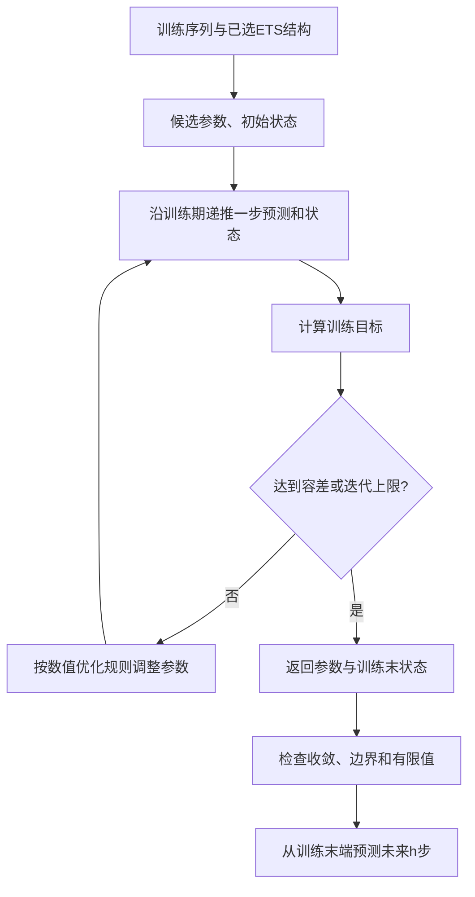
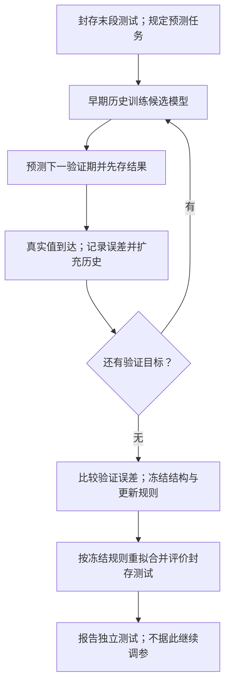
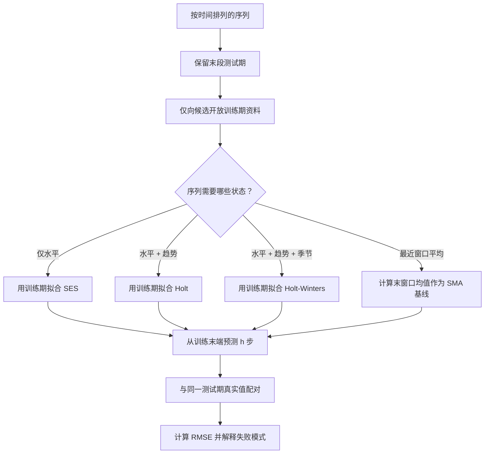

# T08 · 时间序列实战：销量与季度季节性

> [!info] 来源与边界
> 本笔记逐 cell 讲解 `Week 8 Time series I_Tutorial_2026.ipynb` 的公开教程 Cells 0–48。Cells 49–50 是 Week 8 个人评分作业与 HTML 提交要求，完整题面和参考作答另见 [[IS6400_Business_Data_Analytics/assignment/graded/A09-week8/notes/任务说明|A09 任务说明]] 与 [[IS6400_Business_Data_Analytics/assignment/graded/A09-week8/notes/开始这里|A09 中文学习导览]]。现行规则允许本人作业公开；教学分工不再表示该目录必须私有。本篇不运行评分代码，也不改变既有提交件。
>
> 原 notebook 保存输出与 2026-10-20 scratch 复算是两套证据。本文会明确标注来源。2026-10-20 使用 Python 3.12.3、pandas 2.3.3、NumPy 1.26.4、scikit-learn 1.5.1、statsmodels 0.14.2 与 Matplotlib 3.9.2，按原顺序运行 Cells 0–48，共 30 个代码 cells，错误数为 0。
>
> 2026-10-27 仅只读核源码、数据、既存输出和历史执行哈希，并重核手算；没有重跑模型或评分单元。本篇尚无可归属于 T08 的课堂转录，保持 `v0.9 / transcript: pending`。M07 的三源顺延融合只覆盖其已声明范围，不能推成 T08 录音完整。

## 0. 这个 notebook 在教什么

这份 tutorial 解决一个核心问题：怎样只用过去的数据，预测时间顺序之后的值，并用留出的未来区间比较模型。它先用 shampoo 销量说明“平坦预测为什么追不上趋势”，再用季度 CVD 数据说明“季节模式存在时，季节状态为什么有用”。

学完后，你应该能完成以下可检验动作：

- 按时间顺序切出训练期和测试期，并说明为什么不能随机打乱。
- 从最近 $w$ 个观测手算滚动平均，再把最后一个平均值扩展成平坦多步预测。
- 写出简单指数平滑、Holt 线性趋势与加法 Holt-Winters 的状态更新和预测公式。
- 用 `ETSModel(...).fit().forecast(h)` 建模，并解释 `trend`、`seasonal`、`seasonal_periods` 与预测步数 $h$。
- 根据预测序列和实际序列复算均方根误差（root mean squared error, RMSE），读出模型在指定测试期的相对表现。
- 判断季度自然周期 $m=4$、月度自然年度周期 $m=12$ 与源例“4 个观测一循环”的区别。
- 识别日期标签、频率、数据泄漏、优化收敛和模型过度复杂等失败方式。

## 1. 前置、环境与数据

### 1.1 理论衔接

本 tutorial 的理论入口是 [[IS6400_Business_Data_Analytics/notes/M07-时间序列I-平滑趋势与季节性|M07 时间序列 I]]。下一讲的自相关、差分与 ARIMA 见 [[IS6400_Business_Data_Analytics/notes/M08-时间序列II-自相关差分与ARIMA|M08 时间序列 II]]。

时间序列（time series）是一组带先后顺序的观测。预测第 $t+1$ 期时，模型只能使用 $t$ 期及以前已知的信息。若测试期的信息提前参与拟合、调参或特征计算，就发生数据泄漏（data leakage）。

本篇会反复执行五个动作：

1. 读取按时间排列的表。
2. 保留最末若干期作为测试集。
3. 只在训练集估计状态或参数。
4. 从训练末端向前预测 $h$ 步。
5. 把预测与同一测试期的真实值逐点比较。

### 1.2 两份 CSV 的角色

一行代表一个按源文件顺序排列的时点。下表数字来自 2026-10-20 的 scratch 描述性实跑。

| 数据 | 规模 | 时间字段 | 数值字段 | 缺失 | 完全重复 |
|---|---:|---|---|---:|---:|
| `shampoo_sales.csv` | 36 × 2 | `Date`，字符串 | `Sales`，float64 | 0 | 0 |
| `CVD.csv` | 56 × 3 | `year`、`quarter`，int64 | `cvd`，int64 | 0 | 0 |

逐列读法：数据列给文件名；规模是行数 × 列数；时间字段说明源中的顺序标签；数值字段是被预测量；缺失与重复均按整张表统计。第一行表示 shampoo 表有 36 个观测、2 列，没有缺失或完全重复行。

`shampoo_sales.csv` 的 `Sales` 范围为 119.3–682.0，均值为 312.6。源 tutorial 把它称为 monthly series，但 CSV 标签从 `1/1/2020` 到 `31/1/2020`，随后到 `1/2/2020`–`5/2/2020`，图标题又写成 `Daily shampoo sales`。这三处频率口径互相冲突；本文保留其教学意图，同时不把标签冒充已经核实的真实月度日期。

`CVD.csv` 覆盖 1987 Q1 至 2000 Q4。`cvd` 范围为 3508–5373，一年恰有 4 个季度，因此自然年度季节周期是 $m=4$。

### 1.3 日期索引与频率：源代码没有做完的准备

源 notebook 直接用字符串 `Date` 作横轴，并未把它设为 pandas 日期索引（date index）。这不妨碍按行号复现，但会隐藏重复日期、缺期和频率不一致。

如果已经确认 shampoo 标签按“日/月/年”解释，可以用下面的笔记补充代码建立日索引。由于源材料同时称它为 monthly，本篇不替源决定真实频率。

```python
shampoo_daily = shampoo.copy()
shampoo_daily['Date'] = pd.to_datetime(
    shampoo_daily['Date'], dayfirst=True, errors='raise'
)
shampoo_daily = shampoo_daily.set_index('Date').sort_index()
```

下表一行对应补充代码的一步，说明日期字符串怎样变成有序索引。

| 行 | 代码片段 | 作用 |
|---:|---|---|
| 1 | `copy()` | 另建对象，不改源数据框 |
| 2–4 | `pd.to_datetime(...)` | 按日/月/年解析；坏标签直接报错 |
| 5 | `set_index(...).sort_index()` | 用时间做索引并按先后排序 |

逐列读法：行是补充代码的行号；代码片段是关键 API；作用说明输入如何变成时间索引。它是笔记补充，不是 notebook Cell 0–48 的源代码。

CVD 的 `year` 与 `quarter` 已明确，可以安全构造季度 PeriodIndex：

```python
cvd_q = cvd.copy()
cvd_q.index = pd.PeriodIndex(
    year=cvd_q['year'], quarter=cvd_q['quarter'], freq='Q'
)
```

`PeriodIndex` 表示“1987 Q1 这一整期”，比随意挑一个季度末日期更贴近源字段。若索引出现重复或缺少某季度，应先核数据，不要直接让季节模型把缺期当连续期。

### 1.4 两份 XLSX：先问预测发出时，哪些销量已经知道

两份工作簿共用 11 个月的小例：销量依次为 100、104、112、113、124、125、130、134、140、144、152。它们补充机制，源 notebook Cells 0–48 没有读取工作簿；下列公式按只读工作表及缓存值核对。

先看 `model lagged term in sklearn.xlsx`。任务是站在第 3 月结束、尚不知道第 4 月销量时，准备第 4 月的预测输入。滞后特征（lagged feature）把已经发生的旧值对齐到将来要预测的那一行。`shift(1)` 先把销量列向后移一行，因此第 4 月行可用的最近销量是第 3 月的 112。

这张表一行代表一个预测目标月；“过去三月”列列出发出预测时已知的销量。均值、最大、最小都是输入特征，不是教师已拟合出的回归预测。

| 目标月 | 最近一月 `shift(1)` | 过去三月 | 均值 | 最大／最小 |
|---:|---:|---|---:|---|
| 4 | 112 | 100、104、112 | 105.3333 | 112／100 |
| 5 | 113 | 104、112、113 | 109.6667 | 113／104 |
| 11 | 144 | 134、140、144 | 139.3333 | 144／134 |

读第一行：工作表 D5 用 `AVERAGE(B2:B4)`；先相加 $100+104+112=316$，再除以 3 得 105.3333。E5/F5 从同一窗口取最大 112、最小 100。未知的第 4 月实际 113 不进入任何特征。前 3 月尚无完整的三个过去值，所以这些窗口特征留空。

笔记补充的 pandas 对应关系如下，只用于说明，不在本次执行：

```python
past_sales = sales.shift(1)
mean_3 = past_sales.rolling(3).mean()
max_3 = past_sales.rolling(3).max()
min_3 = past_sales.rolling(3).min()
```

`sales` 是按月排列的数值序列；后三行对同一个已移位序列建窗口。若先对原 `sales` 滚动再直接把结果当同一行的预测特征，第 4 月窗口会含未知的 113，产生泄漏。若任务改为第 4 月结束预测第 5 月，113 已知，才允许进入新窗口。固定起点多步预测中，未来真实销量仍未知，不能预先用它补后几步滞后特征。

再看 `Why Double Moving Average Works.xlsx`。任务改为第 5 月结束，利用到第 5 月为止的销量预测第 6 月。一次移动平均会落后于上升趋势；二重移动平均（double moving average）再平滑一次，通过两条平滑线的距离估计这种落后。

取窗口 $n=3$，$M_t$ 是截至第 $t$ 月、包含该月的三月销量均值，$D_t$ 是最近三个 $M$ 的均值。工作簿 C 列标题写 `shift(1)`，但 C4 的实际公式是 `AVERAGE(B2:B4)`，包含第 3 月，并不是前一表的纯滞后一月列；这里以公式和发出预测的时点解释。

下表一行是一个月末状态；两列均值与销量同单位。空位表示历史不足，不能当作零。

| 月末 $t$ | 最近三月销量 | 一次均值 $M_t$ | 最近三个一次均值 | 二次均值 $D_t$ |
|---:|---|---:|---|---:|
| 3 | 100、104、112 | 105.3333 | 不足三个 | — |
| 4 | 104、112、113 | 109.6667 | 不足三个 | — |
| 5 | 112、113、124 | 116.3333 | 105.3333、109.6667、116.3333 | 110.4444 |

读最后一行：$M_5=(112+113+124)/3=116.3333$，再算 $D_5=(105.3333+109.6667+116.3333)/3=110.4444$。二次均值又落后一次，两线差为约 5.8889。

为什么可以用这个差估趋势？以下是笔记补充推导，假定窗口内恰好是每月增加 $b$ 的直线，没有噪声。最近窗口的平均时间，比当前时点早 $(n-1)/2$ 月。每月增加量为 $b$，所以一次均值的落后量为 $b(n-1)/2$。

再平均一次，$D_t$ 比 $M_t$ 多落后同样距离；两者相减便得到一次平均的落后量。真实资料有噪声，这只是局部线性估计，不保证精确。

把一次落后加回 $M_t$ 得当前水平 $L_t$，把落后量除以对应月数得每月趋势 $T_t$，再向前走 $p$ 月：

$$
L_t=2M_t-D_t,\qquad
T_t=\frac{2(M_t-D_t)}{n-1},\qquad
\hat y_{t+p}=L_t+pT_t.
$$

这些符号各有明确时点和单位：

- $t$ 是已知月末，$p$ 是待预测的正整数步数。
- $L_t$ 与预测都用销量单位，$T_t$ 用销量单位／月。
- 窗口必须满足 $n>1$，避免趋势分母为零。

月 5 得到水平 122.2222、每月趋势 5.8889，所以月 6 预测为 $122.2222+5.8889=128.1111$，写在工作簿 H7。随后才看到月 6 实际 125，才能记录误差并更新月 6 状态；不能倒过来用 125 重写月 5 发出的预测。

若窗口为 1，趋势公式分母为零；若趋势突然反转，两个均值都会延迟反应。它也不是在拟合 MA(2) 随机误差模型；本节“二重”指把销量均值再平均一次。

### 1.5 重排说明

源 notebook 按“shampoo 的四类模型 → CVD 的三类模型”排列。本文保留这个主顺序，但先把时间边界、频率和 ETS 状态讲清，再进入重复 API。这样读者在看到 RMSE 之前，已经知道每个预测能使用哪些信息、为什么会平坦或随趋势移动。

> **数值证据日期**：下文“2026-10-20 复算”沿用 2026-10-20 的既有运行记录。2026-10-21 仅对本次补充的状态手算与六期误差明细重新计算，未重跑全部 30 个公共代码单元。

### 1.6 本篇所需的 Python 读法

读到代码时，把表格想成“每行一个时点、每列一个字段”。`shampoo['Sales']` 取名为 Sales 的一列，`train = ...` 将右侧对象保存到变量 train；`pd.read_csv(...)` 是调用工具函数，括号内给输入。`trend='add'` 用参数名指定模型部件，单引号里的 add 是文字标签，不是数学加号。

`.方法(...)` 表示让左侧对象执行操作，例如序列的 `.rolling(5).mean()` 先组织五点窗口，再求平均。后文的 `[:-5]` 是切出一段位置，`[-1]` 表示最后一项，具体边界在 §2.4–§2.5 用实际数据展开。代码中的 `#` 后面是注释，不参与计算。

## 2. 逐 cell 讲解

### 2.1 Cells 0–1：任务、RMSE 与 ETS 工具箱

Cell 0 给出完整预测流程、两份数据的教学角色和 RMSE。Cell 1 介绍 `statsmodels` 的 ETS：误差（error）、趋势（trend）与季节（seasonality）三个部件。

RMSE 把每个测试时点的误差平方后求平均，再开根：

$$
\mathrm{RMSE}=\sqrt{\frac{1}{n}\sum_{t=1}^{n}(y_t-\hat y_t)^2}.
$$

下表一行解释一个公式符号，并给出比较 RMSE 时必须保持的口径。

| 符号 | 含义 | 单位／范围 |
|---|---|---|
| $n$ | 测试期观测数 | 正整数 |
| $y_t$ | 时点 $t$ 的真实值 | 与目标相同 |
| $\hat y_t$ | 对同一时点的预测值 | 与目标相同 |
| $y_t-\hat y_t$ | 预测误差 | 与目标相同 |

逐列读法：符号是公式对象；含义说明它对应哪个数据；单位／范围说明可比较口径。若 sales 的 RMSE 为 90.61，意思是五个测试时点的平方误差平均后开根为约 90.61 个 sales 单位。

**为什么平方后再开根**：平方让正负误差不会抵消，并加重较大误差；开根把结果带回目标原单位。RMSE 只能在同一目标、同一测试时段和同一尺度下直接比较。

**💡 两期最小复算例（笔记补充；不是原数据或源 notebook 输出）**

假设预测已经在看见测试销量前固定。每行是一处相同时间位置的实际／预测配对；销量单位写作 sales，误差为“实际减预测”。

| 测试期 | 实际销量 | 事前预测 | 误差 | 平方误差 |
|---|---:|---:|---:|---:|
| 第 1 期 | 100 | 98 | 2 | 4 |
| 第 2 期 | 105 | 108 | -3 | 9 |

实际、预测与误差列的单位都是 sales；平方误差列的单位是 sales 的平方。第一行读作：实际 100 减预测 98，少预测 2；平方后计入 4。

1. 逐期相减再平方：$(100-98)^2=4$，$(105-108)^2=9$。正负误差各自计损失。
2. 两期平方误差合计 $4+9=13$；除以配对数 $n=2$，得到均方误差（mean squared error, MSE）$13/2=6.5$。
3. 开根得到 $\mathrm{RMSE}=\sqrt{6.5}\approx2.55$ sales；它描述这两期误差的整体量级。

若直接平均带正负号的误差，会得到 $(2-3)/2=-0.5$ sales；抵消后的数不是 RMSE。把第二期预测改为 105，则第二期误差归零，RMSE 改为 $\sqrt{(4+0)/2}\approx1.41$ sales。

原数据的六个季度实算另见 [[#2.14 Cells 47–48：CVD 的 Holt-Winters 捕捉季度循环|§2.14 六期 RMSE]]；那里的 $n=6$ 和季度计数单位，不能与本例的两期 sales 混用。

ETS 中 E 指误差形式：加法误差（additive error）约定“实际值 = 一步预测 + 误差”；T 指趋势（trend），描述每期的方向与增量；S 指季节性（seasonality），描述固定间隔重复的高低。ETSModel 默认使用加法误差。简单指数平滑（simple exponential smoothing, SES）只维护水平；Holt 再维护趋势；Holt-Winters 再维护一个长度为 $m$ 的季节状态。

**所以呢**：模型的复杂度来自它维护的状态，不是 API 名称越长就天然越好。

### 2.2 Cell 2：导入库与 notebook 显示设置

这段代码准备表格、数组、指标、ETS 模型和绘图工具。

```python
import pandas as pd
import numpy as np
from sklearn import metrics
from statsmodels.tsa.exponential_smoothing.ets import ETSModel #key library
from matplotlib import pyplot as plt
# a magic function that renders the figure in a notebook
%matplotlib inline

pd.options.mode.chained_assignment = None 
```

下表一行对应一个导入或显示设置，说明它服务于哪一步。

| 行 | 代码片段 | 作用 |
|---:|---|---|
| 1 | `import pandas as pd` | 读取和切分表格 |
| 2 | `import numpy as np` | 开根与数组运算 |
| 3 | `from sklearn import metrics` | 调用均方误差 |
| 4 | `ETSModel` | 估计 ETS 状态与参数 |
| 5 | `pyplot as plt` | 画训练、测试和预测线 |
| 7 | `%matplotlib inline` | 让图显示在 notebook cell 下方 |
| 9 | `chained_assignment=None` | 关闭 pandas 链式赋值提示 |

逐列读法：行对应源 cell 的物理行；代码片段保留 API；作用说明这行给后续哪一步服务。

**失败方式**：`%matplotlib inline` 是 IPython magic，在普通 `.py` 文件中会触发语法错误。关闭链式赋值提示不会解决副本／视图歧义，只会让警告消失；生产代码宜显式 `.copy()`。

**所以呢**：本 cell 只搭环境；模型结果要等数据、边界和参数全部给定后才能解释。

### 2.3 Cells 3–7：读取 shampoo 并先看形状

Cell 3 只是章节标题。Cell 4 读取数据并显示前 5 行：

```python
# read csv file
shampoo = pd.read_csv('shampoo_sales.csv')
shampoo.head()
```

下表一行对应读取阶段的一个动作，输出均以源 CSV 为准。

| 行 | 代码片段 | 作用 |
|---:|---|---|
| 2 | `pd.read_csv(...)` | 从当前工作目录读取 36 × 2 CSV |
| 3 | `head()` | 查看前 5 行和真实列名 |

原 notebook 保存输出的首行是 `Date='1/1/2020'`、`Sales=266.0`。`head()` 只展示样本，不证明全表无缺失、已排序或频率正确。

Cell 5 画源序列：

```python
# plot the time series data
plt.figure(figsize = (20,8))
plt.plot(shampoo['Date'], shampoo['Sales'], '.-', markersize=20)
plt.title('Daily shampoo sales')
plt.xticks(rotation=45) # 👈 Add this line to rotate dates by 45 degrees
plt.show()
```

下表一行对应一个绘图动作；画布尺寸以英寸计，数据轴单位见源字段。

| 行 | 代码片段 | 作用 |
|---:|---|---|
| 2 | `figure(figsize=(20,8))` | 新建 20 × 8 英寸画布 |
| 3 | `plot(Date, Sales, '.-')` | 以标签为横轴、销量为纵轴，点线相连 |
| 4 | `title(...)` | 标题称它为 daily，和 Cell 0 的 monthly 冲突 |
| 5 | `xticks(rotation=45)` | 旋转字符串标签，减少重叠 |
| 6 | `show()` | 输出当前图 |

Cell 6 提出公开观察题：`Do you observe any trend or seasonality?`

> **Original question (Cell 6)**
>
> Do you observe any trend or seasonality?

**中文题意与限定**：只根据 36 个观测的图，区分长期方向与稳定重复模式。视觉上没看见清晰季节性，不等于统计上证明没有任何周期。

**逐项解析**：整体水平向后升高，支持“存在上升趋势”；局部高低波动没有显示与明确自然周期对齐的稳定重复，且源频率本身冲突，所以不能把某四点起伏命名为年度季节性。

**English reference answer（⚪ 笔记推断；Cell 7 与源观察一致）**：The series shows a clear upward trend, while no stable seasonal pattern is obvious from the plotted observations. The date-frequency inconsistency should be resolved before assigning a natural seasonal period.

Cell 7 的源观察是“clear upward trend but no obvious seasonality”，并据此把 Holt 作为合理候选，同时保留移动平均、SES 和 Holt-Winters 作同一测试集基准。

**所以呢**：先看图是为了提出模型假设；真正比较仍要回到同一测试期 RMSE。

### 2.4 Cells 8–9：按时间保留最后 5 个观测

Cell 8 沿原顺序切分，不随机抽样：

```python
# first split our data into training and test
train = shampoo[:-5] #"-5 index" means the last five records in this list.
test = shampoo[-5:]
train.shape, test.shape #first 31 records are used for training and the rest for testing
```

下表一行对应切分阶段的一步，行数以观测条数计。

| 行 | 代码片段 | 作用 |
|---:|---|---|
| 2 | `shampoo[:-5]` | 取前 31 行训练 |
| 3 | `shampoo[-5:]` | 取末 5 行测试 |
| 4 | `.shape` | 核为 `(31, 2)` 与 `(5, 2)` |

`-5` 不是“编号为负五的记录”，而是从序列末端向前数第五个位置。测试集模拟训练期结束之后的五步未来。

Cell 9 把两段画在同一坐标系：

```python
# plot training and testing data
plt.figure(figsize = (20,8))
plt.plot(train['Date'], train['Sales'], '.-',markersize=20,label = 'Train')
plt.plot(test['Date'], test['Sales'], '.-',markersize=20,label = 'Test')
plt.legend(loc = 'upper left',fontsize=30)
plt.title('Daily shampoo sales',fontsize=16)
plt.xticks(rotation=45) # 👈 Add this line to rotate dates by 45 degrees
plt.show()
```

`label` 为图例提供名称；`legend` 把训练与测试颜色映射显示出来。源图没有画切分竖线，读者要从颜色交界处找边界。

**为什么时间序列不能照搬随机划分**：随机划分会让未来行进入训练，模型就可能利用评估时点之后的信息。源算法正确地保留了顺序；本文不会悄悄改成随机 `train_test_split`。

**所以呢**：模型比较是否可信，先取决于预测边界是否真实，再取决于 RMSE 大小。

### 2.5 Cells 10–14：5 点滚动平均与平坦预测

Cell 10 定义简单移动平均（simple moving average, SMA）：

$$
M_t^{(w)}=\frac{1}{w}\sum_{i=0}^{w-1}y_{t-i}.
$$

窗口 $w$ 决定一次平均多少个最新观测。源实现用训练期最后一个 $M_T^{(w)}$ 预测整个测试区间：

$$
\hat y_{T+h}=M_T^{(w)},\qquad h=1,\ldots,5.
$$

Cell 11 标出窗口 5。Cell 12 计算每行的后向滚动平均：

```python
#we can simply using the rolling window to calculate the moving average of this data
train['moving_average_5']=train['Sales'].rolling(5).mean() #window size of 5
train.head(31)
```

下表一行对应滚动平均的一步，窗口单位是观测数。

| 行 | 代码片段 | 作用 |
|---:|---|---|
| 2 | `train['Sales']` | 取训练期销量序列 |
| 2 | `.rolling(5)` | 为每行建立含当前行在内的后向 5 点窗口 |
| 2 | `.mean()` | 对窗口求算术平均；不足 5 点时为 `NaN` |
| 3 | `head(31)` | 显示全部 31 个训练观测及均值 |

前 4 行是 `NaN`，因为当时还凑不齐 5 个观测。最后 5 个训练销量为 315.9、439.3、401.3、437.4、575.5，手核如下：

$$
M_{31}^{(5)}=\frac{315.9+439.3+401.3+437.4+575.5}{5}=433.88.
$$

Cell 13 把这个最后平均值复制给测试期五行：

```python
#then we use the last window average as predicted value
test.loc[:,'moving_average_forecast_5'] = train['moving_average_5'].iloc[-1]
test.head()
```

`iloc[-1]` 按位置取训练表最后一个均值；`.loc[:, column]` 给测试表所有行写同一预测。因此五个预测都是 433.88，它不是递归更新：测试真实值没有被放回窗口。

Cell 14 把训练真实值、训练滚动均值、测试真实值和平坦预测一起画出：

```python
plt.figure(figsize = (20,8))
plt.plot(train['Date'], train['Sales'], '.-',markersize=20, label = 'Train')
plt.plot(train['Date'], train['moving_average_5'], '.-',markersize=20, label = 'Train')
plt.plot(test['Date'], test['Sales'],'.-',markersize=20, label = 'Test')
plt.plot(test['Date'], test['moving_average_forecast_5'],'.-',markersize=20, label = 'Moving Average Forecast with 5 Observations')
plt.legend(loc = 'upper left',fontsize=25)
plt.xticks(rotation=45) # 👈 Add this line to rotate dates by 45 degrees
plt.show()
```

第二条线也被标成 `Train`，会造成两个同名图例；它实际是 training moving average。预测线水平，正是“只记住最后平均水平，不外推趋势”的直接结果。

**失败与迁移**：若未来每到一期就拿到真实值并重算窗口，那是滚动一步预测；源实现是固定起点的五步预测。两种协议不能用同一名称混在一起。

**所以呢**：移动平均能消除短期噪声，但用最后均值平铺未来时，无法追随持续上升趋势。

### 2.6 Cells 15–21：窗口 10、15 与三种移动平均 RMSE

Cell 15 标出窗口 10。Cell 16 同时计算、预测和画图：

```python
#let's switching to a moving window of size 10
train['moving_average_10']=train['Sales'].rolling(10).mean()
test['moving_average_forecast_10'] = train['moving_average_10'].iloc[-1]
plt.figure(figsize = (20,8))
plt.plot(train['Date'], train['Sales'], '.-',markersize=20, label = 'Train')
plt.plot(train['Date'], train['moving_average_10'], '.-',markersize=20, label = 'Train')
plt.plot(test['Date'], test['Sales'],'.-',markersize=20, label = 'Test')
plt.plot(test['Date'], test['moving_average_forecast_10'],'.-',markersize=20, label = 'Moving Average Forecast with 10 Observations')
plt.legend(loc = 'upper left',fontsize=25)
plt.xticks(rotation=45) # 👈 Add this line to rotate dates by 45 degrees
plt.show()
```

下表一行对应 Cell 16 的关键片段，说明输入形状和窗口变化的影响。

| 代码片段 | 输入 → 输出 | 参数改变的后果 |
|---|---|---|
| `rolling(10).mean()` | 31 个销量 → 前 9 个缺失、其后为 10 点均值 | 窗口更大，线更平滑、反应更慢 |
| `iloc[-1]` | 最后一个均值 → 397.79 | 只用训练末端，不读测试真实值 |
| 写入 forecast 列 | 标量 → 五个相同预测 | 多步预测保持平坦 |

逐列读法：代码片段对应源 API；输入 → 输出说明形状变化；参数后果说明换窗口会改变什么。第一行表示 10 点窗口让最早 9 行没有足够历史。

Cell 17 标出窗口 15。Cell 18 重复同一机制：

```python
#let's switching to a moving window of size 15
train['moving_average_15']=train['Sales'].rolling(15).mean()
test['moving_average_forecast_15'] = train['moving_average_15'].iloc[-1]
plt.figure(figsize = (20,8))
plt.plot(train['Date'], train['Sales'], '.-',markersize=20, label = 'Train')
plt.plot(train['Date'], train['moving_average_15'], '.-',markersize=20, label = 'Train')
plt.plot(test['Date'], test['Sales'],'.-',markersize=20, label = 'Test')
plt.plot(test['Date'], test['moving_average_forecast_15'],'.-',markersize=20, label = 'Moving Average Forecast with 10 Observations')
plt.legend(loc = 'upper left',fontsize=25)
plt.xticks(rotation=45) # 👈 Add this line to rotate dates by 45 degrees
plt.show()
```

15 点窗口的最后均值为 351.72，前 14 行为 `NaN`。源图例写成 `10 Observations`，但实际代码和列名都是 15；这是显示标签错误，不改变计算。

Cell 19 宣布评估。Cell 20 对三个预测计算 RMSE：

```python
# get rmse of moving average with 5, 10, and 15 windows on test data
rmse_sma5 = np.sqrt(metrics.mean_squared_error(y_pred=test['moving_average_forecast_5'],
                                               y_true=test['Sales']))
rmse_sma10 = np.sqrt(metrics.mean_squared_error(y_pred=test['moving_average_forecast_10'],
                                                y_true=test['Sales']))
rmse_sma15 = np.sqrt(metrics.mean_squared_error(y_pred=test['moving_average_forecast_15'],
                                                y_true=test['Sales']))
print(rmse_sma5)
print(rmse_sma10)
print(rmse_sma15)
```

下表一行对应 RMSE 计算或输出动作；误差单位是 sales。

| 行 | API／对象 | 作用 |
|---:|---|---|
| 2–3 | `mean_squared_error(...)` | 配对五个预测与五个真实销量，求平方误差均值 |
| 2 | `np.sqrt(...)` | 把 MSE 开根，回到销量单位 |
| 4–7 | 10 点、15 点预测 | 使用完全相同的测试五行 |
| 8–10 | `print(...)` | 按 5、10、15 的顺序输出 |

源保存输出与 2026-10-20 复算一致到显示精度：

| 窗口 $w$ | 平坦预测 | 源保存 RMSE | 2026-10-20 RMSE |
|---:|---:|---:|---:|
| 5 | 433.88 | 161.9135 | 161.9135 |
| 10 | 397.79 | 191.1079 | 191.1079 |
| 15 | 351.72 | 231.2218 | 231.2218 |

逐列读法：窗口是一轮纳入的训练观测数；平坦预测是测试五步共用值；两列 RMSE 分别来自原 notebook 输出和2026-10-20 独立复算。第一行表示这三个移动平均中，5 点窗口误差最低。

Cell 21 的源解释是：5 点窗口相对最好，但三者都无法外推趋势；因此转向更重视近期值、并可显式增加趋势与季节状态的指数平滑。

**所以呢**：窗口不是越大越稳就越好；上升序列中，长窗口会让陈旧低值占比更大，预测更落后。

### 2.7 Cells 22–25：简单指数平滑只维护水平

Cell 22 定义 SES。要预测下一期，先保存一个当前基础水平；新观测到达后，用它修正旧水平。若新销量是 110、旧水平为 100，取新值一半、旧值一半得到 105；这是加权平均的模型约定。其加法状态写法是：

$$
\ell_t=\alpha y_t+(1-\alpha)\ell_{t-1},
\qquad
\hat y_{T+h}=\ell_T.
$$

下表一行解释一个 SES 符号，并标明参数或状态的范围。

| 符号 | 含义 | 边界 |
|---|---|---|
| $\ell_t$ | 时点 $t$ 更新后的水平状态 | 与目标同单位 |
| $\alpha$ | 新观测权重 | 通常在 0–1 内，由拟合估计 |
| $h$ | 从训练末端向前的预测步数 | 正整数 |

逐列读法：符号是模型状态或参数；含义说明它在更新中做什么；边界给单位或取值。$\alpha$ 越大，水平越快跟随新观测，但也更容易追逐噪声。

在无趋势、无季节且为加法误差的规格下，这个 $\alpha$ 对应 `smoothing_level`。但复原完整软件结果还需相同的初始水平、训练序列与精度。上面的 0.5 是为理解机制而固定的权重；源 `.fit()` 要估计权重和初始水平，不能把这次手算称为软件拟合结果。

Cell 23 建模、拟合并预测 5 步：

```python
ses = ETSModel(train['Sales']) #by default, it is SEM
ses_fit = ses.fit()
y_predict = ses_fit.forecast(5)
```

下表一行对应 SES 的建模、拟合或预测步骤，输出形状按观测数计。

| 行 | API | 输入 → 中间状态 → 输出 |
|---:|---|---|
| 1 | `ETSModel(endog)` | 31 个训练销量 → 无趋势、无季节的加法误差模型规格 |
| 2 | `.fit()` | 规格 → 优化参数与初始状态 → 拟合结果对象 |
| 3 | `.forecast(5)` | 训练末状态 → 未来 5 步预测，形状 `(5,)` |

`endog` 是被解释／预测的序列。源注释写 `SEM`，应读作 simple exponential smoothing 的语境；常用缩写是 SES。

**`.fit()` 内部在选择什么（笔记补充）**

输入是31个训练销量和已经选定的ETS结构。待估对象包括平滑参数及初始状态；它们不是从测试集选出来的。拟合过程反复做以下动作：

1. 给出一组候选参数和初始状态。
2. 沿训练时间逐期产生一步预测，取得新观测后更新状态，并记录预测误差。
3. 用训练误差计算似然目标，调整参数，再从训练开头递推。
4. 达到数值容差或迭代上限后结束，返回参数、初始状态和训练末状态。

这里的似然（likelihood）衡量：在选定误差模型下，这组参数对训练观测给出的解释有多合适。高斯误差是假设误差大多靠近零、极端大误差较少的钟形分布，不是数据已被证明服从该分布。对固定加法高斯误差规格，较小的误差平方和（sum of squared errors, SSE）对应较好的拟合目标；软件还会处理方差、初始化和参数约束。因此不能把一次手动挑参数写成已经重现了整套优化器。

第一次更新前也要有水平，带趋势时还要有初始趋势，带季节时还要有各位置初始偏移。源 `ETSModel` 默认 `initialization_method='estimated'`：软件用训练资料产生数值起点，并在拟合中估计所需初始状态；不是把测试开头的真实值拿来初始化。手算中“设初始水平 100”则是人为已知条件。季节分解中，水平整体加 2、所有季节偏移减 2 会保持总和不变，因此软件还要固定季节基准以识别状态；初始状态数值必须连同这个约定一起解释。

例如只比较两个 SES 权重。取训练序列100、110、120，初始水平固定为100，两组参数都先预测第二期为100。

- 当 $\alpha=0.2$，第二期吸收观测后水平为102，第三期预测误差为 $120-102=18$。两期SSE为 $10^2+18^2=424$。
- 当 $\alpha=0.8$，第二期更新水平为108，第三期预测误差为12。两期SSE为 $10^2+12^2=244$。

在这两组固定候选中，训练目标偏好0.8；这没有证明它是全局最优，也没有说明它在未来更好。`.forecast(5)` 随后只使用拟合后的训练末状态，不会自行读取5个测试真实值来更新。



读图时，回环只发生在训练资料内部。以权重0.2的例子走图，候选参数给出训练SSE424；优化器可再尝试别的权重，但不能为了降低训练目标去读取测试期。若到迭代上限仍未收敛，应保留警告并排查，不把“返回对象”当作已经可靠拟合。

原保存输出里的 L-BFGS-B 日志记录数值优化。`CONVERGENCE` 说明优化器按自己的停止条件结束，不证明模型结构适合业务，也不证明找到唯一全局最优。

Cell 24 画三条线：

```python
plt.figure(figsize = (20,8))
plt.plot(train['Date'], train['Sales'],'.-',markersize=20, label = 'Train')
plt.plot(test['Date'], test['Sales'],'.-',markersize=20, label = 'Test')
plt.plot(test['Date'], y_predict,'.-',markersize=20, label = 'Simple exponential smoothing')
plt.legend(loc = 'upper left',fontsize=20)
plt.xticks(rotation=45) # 👈 Add this line to rotate dates by 45 degrees
plt.show()
```

预测线是水平线，因为 SES 没有趋势状态。Cell 25 计算误差：

```python
rmse_ses = np.sqrt(metrics.mean_squared_error(y_pred=y_predict, y_true=test['Sales']))
print(rmse_ses)
```

源保存 RMSE 为 132.5452；2026-10-20 保存值为 132.5447，差约 0.0006。源运行环境未完整记录，本次不能唯一确定差异原因；软件版本、初始化和优化过程只是待核可能性。它优于三个移动平均，但仍没有追踪持续上升方向。

**停止边界与失败方式**：缺失值、非数值值、极少样本或优化不收敛会让拟合失败或不稳定。即使优化收敛，若序列有趋势，平坦的结构仍会系统性落后。

**所以呢**：SES 能平滑水平，却不能靠估计一个 $\alpha$ 自动长出趋势。

### 2.8 Cells 26–29：Holt 用水平加趋势外推

Cell 26 引入 Holt 线性趋势（Holt linear trend）。一个对应的加法更新机制是：

$$
\ell_t=\alpha y_t+(1-\alpha)(\ell_{t-1}+b_{t-1}),
$$

$$
b_t=\beta(\ell_t-\ell_{t-1})+(1-\beta)b_{t-1},
$$

$$
\hat y_{T+h}=\ell_T+h b_T.
$$

$b_t$ 是每期水平变化的平滑估计，单位为目标单位／观测期；$\ell_t-\ell_{t-1}$ 是这次更新支持的新变化量。教材式用趋势权重混合新变化量和旧趋势，因此权重越大，趋势越快反应。

水平与实际值同单位；$T$ 为训练末端，$h$ 为向前步数。

要与软件对上，记本节教材权重为 $\beta^*$，即上式中的 $\beta$；statsmodels 0.14.2 的 `smoothing_trend` 记作 $\beta_{\mathrm{ETS}}$。在当前加法、无阻尼规格下，两者关系是：

$$
\beta_{\mathrm{ETS}}=\alpha\beta^*.
$$

软件也可写成“旧趋势加创新权重乘新误差”。这来自将水平式代入趋势式，不是不同算法名字自然保证的对应。下例水平权重 0.5、教材趋势权重 0.25，对应软件创新权重为 0.125；将软件返回的 0.125 直接放进教材式的 0.25 位置会算错。

**💡 跟着一个状态走完：水平和趋势各更新了什么（笔记补充）**

先暂停软件拟合，只练前面的教材递推。给定一个无季节的假设销量序列；旧水平为 100，旧趋势为每期增加 4，新观测为 110。

下面各行都是这次更新的已知输入。状态与观测用演示销量单位；趋势用“演示销量单位/观测期”；两个权重无单位。

| 输入 | 符号 | 本例值 | 在更新中做什么 |
|---|---|---:|---|
| 旧水平 | $\ell_{t-1}$ | 100 | 上一期的基础位置 |
| 旧趋势 | $b_{t-1}$ | 4 | 对下一期的增量预期 |
| 新观测 | $y_t$ | 110 | 实际发生的销量 |
| 水平权重 | $\alpha$ | 0.5 | 新观测在水平更新中的权重 |
| 趋势权重 | $\beta$ | 0.25 | 新水平增量在趋势更新中的权重 |

1. **先预测，后看实际**：旧状态给出 $100+4=104$；看到 110 后，误差为 $110-104=6$。没有把 110 先塞进预测。
2. **更新水平**：$\ell_t=0.5(110)+0.5(100+4)=107$。新水平在“实际 110”和“原先预期 104”之间，而不是直接等于实际值。
3. **再更新趋势**：新旧水平增加了 $107-100=7$，所以 $b_t=0.25(7)+0.75(4)=4.75$。这里必须用刚算出的新水平；若仍用旧水平，趋势更新会错。
4. **输出固定起点的未来预测**：一步为 $107+4.75=111.75$，两步为 $107+2(4.75)=116.50$。没有新观测时，只按同一末状态外推；下一期真实值到达后才再执行一次更新。

为什么旧水平要先加旧趋势？因为上一期的位置不能原封不动代表这一期的位置；它要先按既有增量向前移一步，再与实际值比较。若趋势已改变，较小的 $\beta$ 会使修正较慢；较大的 $\beta$ 又可能跟随偶然波动。

**改条件检查**：只把新观测改为 100，保留全部旧状态和权重。新水平为 $0.5(100)+0.5(104)=102$；新趋势为 $0.25(2)+0.75(4)=3.5$，一步预测为 105.5。低于原预期的新观测会下调趋势，但不会立即把趋势变成零。

**English reference explanation（笔记补充）**: The new level is 107 and the new trend is 4.75, giving forecasts of 111.75 and 116.50. The trend update uses the newly updated level. These teaching states are not the fitted states of the shampoo model.

Cell 27 的源代码只多传一个参数：

```python
holt = ETSModel(train['Sales'], trend='add') #we use linear by adding addictive trend pattern
holt_fit = holt.fit()
y_predict = holt_fit.forecast(5)
```

下表一行对应首次出现的 Holt 参数或方法，预测步数单位是观测期。

| 参数／方法 | 本例值 | 作用 | 改变后会怎样 |
|---|---|---|---|
| `trend` | `'add'` | 每期增加一个加法趋势状态 | `None` 会退回无趋势结构 |
| `.fit()` | 默认优化 | 按软件约定估计平滑参数与初始状态 | 版本、初始化或优化细节可能改变末位数 |
| `.forecast(5)` | 5 | 从同一训练末端预测 5 步 | 改为 1 只预测下一步 |

逐列读法：参数／方法是首次 API；本例值是源代码实参；作用说明它改变哪个状态；最后一列说明调整时的结构后果。

Cell 28 画训练、测试和向上倾斜的 Holt 预测：

```python
plt.figure(figsize = (20,8))
plt.plot(train['Date'], train['Sales'],'.-',markersize=20, label = 'Train')
plt.plot(test['Date'], test['Sales'],'.-',markersize=20, label = 'Test')
plt.plot(test['Date'], y_predict,'.-',markersize=20, label = 'Holt Linear')
plt.legend(loc = 'upper left',fontsize=20)
plt.xticks(rotation=45) # 👈 Add this line to rotate dates by 45 degrees
plt.show()
```

Cell 29 沿用同一 RMSE API：

```python
rmse_holt = np.sqrt(metrics.mean_squared_error(y_pred=y_predict, y_true=test['Sales']))
print(rmse_holt)
```

源保存 RMSE 为 90.6062；2026-10-20 保存值为 90.6063。五步2026-10-20 保存预测约为 497.54、522.97、548.41、573.84、599.27，体现每多走一步就加一次末端趋势。

**失败方式**：长期线性外推可能在远期变得不合理，例如销量无限增长或降到负值。可考虑阻尼趋势、变换或只在短期使用，但这些不是源 Cell 27 的算法。

**所以呢**：Holt 的预测形状与本测试区间的上升方向较吻合，因此这次误差更小；这项观察既没有单独证明优势的因果来源，也不是“趋势模型永远最好”的通则。

### 2.9 Cells 30–33：Holt-Winters 与演示性的 4 观测季节

Cell 30 给 Holt 再加季节状态。加法 Holt-Winters 的机制可写为：

$$
\ell_t=\alpha(y_t-s_{t-m})+(1-\alpha)(\ell_{t-1}+b_{t-1}),
$$

$$
b_t=\beta(\ell_t-\ell_{t-1})+(1-\beta)b_{t-1},
$$

$$
s_t=\gamma(y_t-\ell_t)+(1-\gamma)s_{t-m},
$$

$$
\hat y_{T+h}=\ell_T+h b_T+s_{T-m+((h-1)\bmod m)+1}.
$$

$s_t$ 是当前季节位置相对水平的加法偏移，单位与销量相同；$m$ 是一个完整季节包含的观测数。先从当前销量扣去同位置旧季节偏移，再更新基础水平；随后更新趋势，最后只更新当前这一格季节记忆。预测时轮流读取相应位置，便形成重复起伏。

预测式的 $\bmod$ 表示除法余数。若 $m=4$，$h=1,2,3,4,5$ 时，$(h-1)\bmod4$ 依次为 0、1、2、3、0，因此第五步回到第一步使用的季节位置；不会把第一个偏移复制给所有未来期。

本式季节权重以“新观测减更新后水平”为依据，记作 $\gamma^*$；statsmodels 加法 ETS 的 `smoothing_seasonal` 则用更新前一步预测的创新误差，记作 $\gamma_{\mathrm{ETS}}$。当前规格下，两者满足：

$$
\gamma_{\mathrm{ETS}}=(1-\alpha)\gamma^*.
$$

趋势仍按 §2.8 换算。本节示例的水平权重 0.5、教材季节权重 0.2，对应软件创新权重 0.1。初始状态与约束也必须相同，才能尝试复原软件递推。水平权重等于 1 时不能反除 $1-\alpha$，应直接用适用的软件创新式。

**💡 多一只季节记忆盒：从第 5 期走到第 6 期（笔记补充）**

这一例仍只验证教材公式，不替软件选择参数。假设每个完整季节有 4 个观测；更新前处于第 4 期末，下一期回到季节位置 1。它不是对 shampoo 自然频率的认定。

先给水平与趋势：$\ell_4=100$、$b_4=4$。四个旧季节偏移依次为 $[-5,-2,3,4]$，第 5 期实际观测为 107。

三个权重取 $\alpha=0.5$、$\beta=0.25$、$\gamma=0.2$。其中 $\gamma$ 是季节更新权重（seasonal smoothing weight）：用多少新观测中的季节偏移，替换同一位置的旧记忆；越大，季节形状改变得越快。

下面一行是一项季节状态。偏移与销量同单位，正值表示该位置通常高于基础水平，负值表示通常低于基础水平。

| 季节位置 | 旧偏移 | 此次是否更新 | 预测时怎样取 |
|---:|---:|---|---|
| 1 | −5 | 是，第 5 期正处于位置 1 | 下一次位置 1 用新值 |
| 2 | −2 | 否 | 第 6 期用 −2 |
| 3 | 3 | 否 | 第 7 期用 3 |
| 4 | 4 | 否 | 第 8 期用 4 |

1. **按旧状态预测第 5 期**：$100+4-5=99$。实际为 107，创新误差为 $107-99=8$；这是更新前尚未知道的偏差。
2. **去掉同位置旧季节影响，再更新水平**：$\ell_5=0.5(107-(-5))+0.5(100+4)=108$。减去负偏移等于加回 5，不能误写成 $107-5$。
3. **用新水平更新趋势**：$b_5=0.25(108-100)+0.75(4)=5$。
4. **更新位置 1 的季节记忆**：$s_5=0.2(107-108)+0.8(-5)=-4.2$。本次只替换位置 1，另外三个位置继续保留。
5. **选对未来的季节位置**：第 6 期处于位置 2，因此预测为 $108+5-2=111$；从第 5 期向前 4 步的第 9 期回到位置 1，因此预测为 $108+4(5)-4.2=123.8$。不能对所有未来期都加同一个刚更新的季节值。

为什么用 $y_t-\ell_t$ 更新季节？加法分解把观测理解为“基础水平+季节偏移”，所以扣去当前基础水平后，才取得这次观测支持的季节偏移；再把它与同位置旧记忆平滑合并。该式是教材的一种递推约定，不能脱离前文的软件参数化限制拿它硬套 `hw_fit.params`。

**边界与迁移**：若把周期误设为 3，第 6 期会被配到错误季节位置，数值公式仍可能运行，季节解释却失效。若未来季节振幅随基础水平成比例扩大，应另比较乘法季节；本例不证明加法在所有数据上合适。

**English reference explanation（笔记补充）**: After observing period 5, the updated level, trend and position-1 seasonal state are 108, 5 and −4.2. Period 6 uses the unchanged position-2 effect, giving 111. Period 9 returns to position 1, giving 123.8 under the stated textbook recursion.

Cell 31 设置 `seasonal_periods=4`：

```python
holt = ETSModel(train['Sales'], trend='add',seasonal = 'add', seasonal_periods = 4) 
holt_fit = holt.fit()
y_predict = holt_fit.forecast(5)
```

下表一行对应 Holt-Winters 的结构参数，周期单位是每季节的观测数。

| 参数 | 本例值 | 精确含义 | 本例边界 |
|---|---|---|---|
| `trend` | `'add'` | 加法趋势状态 | 每期变化以目标单位相加 |
| `seasonal` | `'add'` | 加法季节状态 | 季节波动近似固定绝对幅度 |
| `seasonal_periods` | 4 | 每 4 个观测重复同一季节位置 | 对 shampoo 只是演示口径 |

逐列读法：参数是 `ETSModel` 实参；本例值来自 Cell 31；精确含义说明模型怎样分解；边界说明能否解释成自然周期。若它真是月度数据，自然年度季节应为 $m=12$；$m=4$ 只代表“4 个月一循环”，不是一年四季，也不是自动等于季度。

Cell 32 画结果：

```python
plt.figure(figsize = (20,8))
plt.plot(train['Date'], train['Sales'],'.-',markersize=20, label = 'Train')
plt.plot(test['Date'], test['Sales'],'.-',markersize=20, label = 'Test')
plt.plot(test['Date'], y_predict,'.-',markersize=20, label = 'Holt Winter')
plt.legend(loc = 'upper left',fontsize=20)
plt.xticks(rotation=45) # 👈 Add this line to rotate dates by 45 degrees
plt.show()
```

Cell 33 计算 RMSE，但把变量名继续写成 `rmse_holt`：

```python
rmse_holt = np.sqrt(metrics.mean_squared_error(y_pred=y_predict, y_true=test['Sales']))
print(rmse_holt)
```

变量名不会改变值，却会覆盖 Cell 29 的 Holt RMSE。更清晰的名字应为 `rmse_hw`，但本文保留源代码并在解释中指出。

| 证据 | Holt-Winters $m=4$ RMSE | 与 Holt 的关系 |
|---|---:|---|
| 原 notebook 保存输出 | 93.4528 | 高于 90.6062 |
| 2026-10-20 scratch 复算 | 93.0974 | 高于 90.6063 |

逐列读法：证据区分原保存与2026-10-20 环境；RMSE 是同一五步测试期；最后一列只比较同一证据内的 Holt。两套数值都支持“额外季节状态没有改善本例”。

**为什么会有数值差**：源保存环境没有记录完整版本、初始化和优化细节。差异可能与软件版本、初始化或优化过程有关，但历史复算没有唯一定位原因。模型排序一致；2026-10-20 值仍不能冒充源 cell 原输出。

**所以呢**：季节参数必须来自数据频率和稳定重复模式；为了复杂而增加季节状态，可能只增加估计负担。

### 2.10 Cells 34–36：CVD 的季度结构

Cell 34 明确 CVD 是季度序列，一个自然年度有 4 个观测。它预告将比较 SES、Holt 和带加法季节的 Holt-Winters。

Cell 35 读取并显示前 5 行：

```python
# import the data
cvd = pd.read_csv('CVD.csv')
cvd.head()
```

下表一行对应 CVD 读取动作，行数单位是季度观测。

| 行 | 代码片段 | 作用 |
|---:|---|---|
| 2 | `pd.read_csv('CVD.csv')` | 读取 56 × 3 的季度表 |
| 3 | `head()` | 核对 `year`、`quarter`、`cvd` 列 |

源保存首行为 1987 Q1、`cvd=4761`。这里一行是一季，不是一人或一日；`cvd` 的单位只能按材料称“cardiovascular deaths”，材料未进一步说明地区或统计口径。

Cell 36 按行索引画序列：

```python
# plot the data
plt.figure(figsize = (20,8))
plt.plot(cvd['cvd'],'.-',markersize=20)
plt.show()
```

未显式传横轴时，Matplotlib 使用 0–55 的行索引。相邻四点构成一个年度循环；图中高低模式多次重复，支持尝试 $m=4$ 的季节状态。

**怎么读一个点**：横轴 0 对应 1987 Q1，纵轴 4761；横轴 1 对应 1987 Q2，纵轴 4217。若只看横轴数字而不回到 `year`、`quarter`，会丢失季度含义。

**所以呢**：CVD 的 $m=4$ 来自明确季度频率，和 shampoo 的演示性 $m=4$ 不是同一个理由。

### 2.11 Cells 37–40：90%/10% 顺序切分的实际边界

Cell 37 说明用前三种 ETS 变体比较趋势和季节的增量价值。Cell 38 计算数量：

```python
# let's first split our data into 90% training and 10% testing
N_train = int(0.9*cvd.shape[0])
N_test = cvd.shape[0] - N_train
print(N_train)
print(N_test)
```

下表一行解释样本数计算的一步，结果单位是季度观测数。

| 行 | 对象 | 计算与结果 |
|---:|---|---|
| 2 | `cvd.shape[0]` | 总行数 56 |
| 2 | `int(0.9*56)` | 50.4 截断为 50 |
| 3 | `56-50` | 测试 6 行 |
| 4–5 | `print` | 输出 50 与 6 |

实际测试占比是 $6/56=10.714\%$，不是精确 10%。`int()` 向零截断使训练集为 50 行。

Cell 39 执行顺序切分：

```python
cvd_train = cvd[:N_train] # take first N_train (50) data as trainig data
cvd_test = cvd[N_train:] # the remaining N_test (6) data as test data
```

训练期结束于 1999 Q2；测试期是 1999 Q3、Q4 和 2000 全年，共 6 季。此边界跨越 1.5 个季节周期，足以观察部分季节重复，但样本仍很小，单次 RMSE 不应被当作稳定的全局排名。

Cell 40 画两段：

```python
plt.figure(figsize = (20,8))
plt.plot(cvd_train['cvd'],'.-',markersize=20, label = 'Train')
plt.plot(cvd_test['cvd'],'.-',markersize=20, label = 'Test')
plt.legend(loc = 'upper right')
plt.title('Quarterly cardiovascular deaths, 1987 - 2000')
plt.show()
```

两个 Series 保留原索引，所以训练线到 49、测试线从 50 开始。图例位于右上；标题给出季度数据与年份范围。

**无泄漏边界**：所有 ETS 参数都只用 `cvd_train['cvd']` 拟合。测试真实值只进入画图与 RMSE；若先根据测试 RMSE反复选季节形式，再把该 RMSE当最终泛化成绩，测试集就参与了模型选择。

**所以呢**：比例描述要回到具体年份与季度，才能知道预测真正跨过了什么时间边界。

### 2.12 Cells 41–44：CVD 的 SES 平坦基线

Cell 41 预测没有趋势、没有季节的平坦基线。Cell 42 与 shampoo SES 使用同一 API，但输入改为 50 个季度值，预测步数改为 6：

```python
ses = ETSModel(cvd_train['cvd']) 
ses_fit = ses.fit()
y_predict = ses_fit.forecast(N_test)
```

下表一行对应 CVD 的 SES 步骤，输入和输出都是一维季度序列。

| 行 | 输入形状 | 状态／输出 |
|---:|---:|---|
| 1 | `(50,)` | 建立仅水平 ETS 规格 |
| 2 | `(50,)` | 估计水平平滑参数和初始水平 |
| 3 | `N_test=6` | 返回 6 个未来季度预测 |

逐列读法：行对应源代码；输入形状是进入 API 的一维序列；状态／输出说明模型内部维护什么、返回多少值。

Cell 43 画出平坦预测：

```python
plt.figure(figsize = (20,8))
plt.plot(cvd_train['cvd'],'.-',markersize=20, label = 'Train')
plt.plot(cvd_test['cvd'],'.-',markersize=20, label = 'Test')
plt.plot(y_predict,'.-',markersize=20, label = 'Simple exponential smoothing')
plt.legend(loc = 'upper right')
plt.show()
```

`y_predict` 的索引由 statsmodels 延续为测试位置，因此预测线与测试线对齐。2026-10-20 保存的六个预测均约为 4068.26。

Cell 44 计算 RMSE：

```python
rmse_ses = np.sqrt(metrics.mean_squared_error(y_pred=y_predict, y_true=cvd_test['cvd']))
print(rmse_ses)
```

源保存 RMSE 为 477.6303；2026-10-20 保存值为 477.6303。平坦线无法随 Q1/Q3 等季节位置上下摆动。

**所以呢**：SES 在季节序列上不是“跑不动”，而是结构上没有表示季度位置的状态。

### 2.13 Cells 45–46：CVD 的 Holt 仍漏掉季节

Cell 45 预期 Holt 只带来小幅改善，因为长期趋势较弱，主要规律是季度起伏。

Cell 46 把建模、画图和评价放在一个 cell：

```python
ses = ETSModel(cvd_train['cvd'], trend='add') 
ses_fit = ses.fit()
y_predict = ses_fit.forecast(N_test)

plt.figure(figsize = (20,8))
plt.plot(cvd_train['cvd'],'.-',markersize=20, label = 'Train')
plt.plot(cvd_test['cvd'],'.-',markersize=20, label = 'Test')
plt.plot(y_predict,'.-',markersize=20, label = 'Holt Linear')
plt.legend(loc = 'upper right')
plt.show()

rmse_ses = np.sqrt(metrics.mean_squared_error(y_pred=y_predict, y_true=cvd_test['cvd']))
print(rmse_ses)
```

下表一行对应 Cell 46 的一个功能块，季度数是序列长度单位。

| 功能块 | 关键行 | 输入 → 输出 |
|---|---|---|
| 建模 | 1–3 | 50 个季度值 → 6 个带线性趋势的预测 |
| 绘图 | 5–10 | 训练、测试、预测 → 一张比较图 |
| 评价 | 12–13 | 6 对实际／预测 → RMSE |

逐列读法：功能块说明 cell 内的三个阶段；关键行是源代码位置；输入 → 输出说明形状与用途。

源代码复用了变量名 `ses`、`ses_fit` 和 `rmse_ses`，但模型已是 Holt。变量名会误导后续读者；判断模型必须看 `trend='add'`。

源保存 RMSE 为 473.2970；2026-10-20 保存值为 473.2966。它只比 SES 低约 4.33，六个预测约从 4126.69 缓慢升至 4211.08，仍未重现季度高低。

**所以呢**：增加一个与主要规律无关的状态，只会带来有限收益；错误机制仍在季节维度。

### 2.14 Cells 47–48：CVD 的 Holt-Winters 捕捉季度循环

Cell 47 说明加法趋势加季度加法季节应明显改善。Cell 48 完成整条链：

```python
hw = ETSModel(cvd_train['cvd'], trend='add', seasonal = 'add', seasonal_periods = 4)
hw_fit = hw.fit()
y_predict = hw_fit.forecast(N_test)

plt.figure(figsize = (20,8))
plt.plot(cvd_train['cvd'],'.-',markersize=20, label = 'Train')
plt.plot(cvd_test['cvd'],'.-',markersize=20, label = 'Test')
plt.plot(y_predict,'.-',markersize=20, label = 'Holt Winter')
plt.legend(loc = 'upper right',fontsize=20)
plt.show()

rmse_hw = np.sqrt(metrics.mean_squared_error(y_pred=y_predict, y_true=cvd_test['cvd']))
print(rmse_hw)
```

下表一行对应 Cell 48 的一个功能块，说明状态怎样变成预测与误差。

| 功能块 | 状态变化 | 输出 |
|---|---|---|
| `ETSModel(...)` | 水平 + 趋势 + 4 个季节位置 | 未拟合规格 |
| `.fit()` | 反复计算似然并更新参数，直到优化停止 | `hw_fit` |
| `.forecast(6)` | 从 1999 Q2 末状态向前循环季节位置 | 1999 Q3–2000 Q4 六个预测 |
| RMSE | 六个季度逐点比较 | 一个 CVD 单位误差 |

逐列读法：功能块对应源 cell 的阶段；状态变化说明内部对象如何变；输出给变量或评估量。

2026-10-20 保存预测约为 3584.97、4155.94、4633.91、4014.37、3618.71、4189.68。它在 Q3 较低、Q4 回升、Q1 较高、Q2 回落，并在下一年重复季度位置。

| 模型 | 源保存 RMSE | 2026-10-20 RMSE | 模型结构 |
|---|---:|---:|---|
| SES | 477.6303 | 477.6303 | 水平 |
| Holt | 473.2970 | 473.2966 | 水平 + 趋势 |
| Holt-Winters | 246.5844 | 246.5843 | 水平 + 趋势 + $m=4$ 季节 |

逐列读法：模型列给 ETS 变体；两列 RMSE 区分源保存与 2026-10-20 复算；结构列说明状态集合。最后一行在这 6 季测试期内误差最低，但不证明它在所有未来年份都最好。

**重要计算手核：六个季度都进入误差，而不是只看第一期（笔记补充）**

下表一行是一个测试季度；实际来自只读 `CVD.csv`，预测来自 2026-10-20 已保存的公共教程复算。误差按“实际减预测”，平方误差单位为 CVD 计数单位的平方。展示值四舍五入，求和使用保存的完整精度。

| 测试季度 | 实际 | 预测 | 误差 | 平方误差 |
|---|---:|---:|---:|---:|
| 1999 Q3 | 3669 | 3584.97 | 84.03 | 7061.37 |
| 1999 Q4 | 4664 | 4155.94 | 508.06 | 258126.15 |
| 2000 Q1 | 4884 | 4633.91 | 250.09 | 62542.74 |
| 2000 Q2 | 3847 | 4014.37 | -167.37 | 28011.92 |
| 2000 Q3 | 3714 | 3618.71 | 95.29 | 9080.32 |
| 2000 Q4 | 4189 | 4189.68 | -0.68 | 0.46 |

读第一行：实际 3669 减预测 3584.97，约少预测了 84.03；正负误差不能直接相加抵消，所以逐期平方。再按相同测试样本数取平均：

1. 六项平方误差之和为 $\mathrm{SSE}=364822.9656$。
2. 六期均方误差为 $\mathrm{MSE}=364822.9656/6=60803.8276$。
3. 开根回到目标原单位：$\mathrm{RMSE}=\sqrt{60803.8276}=246.5843$，即约 246.58。

第 2、3 个季度的较大误差占据较多平方损失，这解释了为什么第一期只差约 84，整体 RMSE 仍约 246.58。若只拿第一个季度评分，回答的已是另一段测试区间，不能用来比较原表六期模型。

**English reference explanation（笔记补充）**: Squaring all six matched forecast errors, averaging them over six quarters and taking the square root gives an RMSE of approximately 246.58. The first-quarter error alone is not the six-quarter RMSE.


**停止与失败机制**：需要至少多个完整季节来初始化和估计季节状态；缺期、错序或错误的 $m$ 会把不同季节位置混在一起。若季节幅度随水平成比例扩大，加法季节可能不合适，应另比较乘法结构；源 cell 没有做这项比较。

**所以呢**：CVD 的改进来自把“第几季度”变成模型状态，而不只是增加参数数量。

### 2.15 Cells 49–50：评分作业边界

源 Cell 49 起为 `Assignment Week 8`，包含 Bitcoin 四题；Cell 50 要求提交一个完整可执行文档，并导出 HTML 上传 Canvas。它们不属于公开教程 Cells 0–48。

本篇登记教学分工：完整英文题面、个人参考答案、提交源码和预测数字在 [[IS6400_Business_Data_Analytics/assignment/graded/A09-week8/notes/任务说明|A09 任务说明]] 与 [[IS6400_Business_Data_Analytics/assignment/graded/A09-week8/notes/开始这里|中文导览]]。评分题不在本次执行范围，原件保持只读。本人已在 2026-10-21 确认提交 A09；这项事实与 T08 教学审查、Canvas 回执核实、本人是否学会分别记录。

### 2.16 测试期比较之后，怎样再做可信的选择（笔记补充）

原教程在同一个末端区间比较各模型，足以演示预测形状与误差；若读完这些误差再挑模型，该区间就参与了选择，不能继续把最低 RMSE 称为一次独立最终测试。更稳妥的后续流程是：最早一段训练，中间一段滚动验证选择模型，最后留一段完全不看的测试。

例如有 24 期资料，先封存 21–24 期。用 1–12 期训练预测第 13 期；存好预测后才看到 13，下一轮用 1–13 期预测 14，依次走到 20。两候选在 13–20 这八个同样目标上比较 RMSE。选好模型结构、窗口、预处理和重新拟合规则后冻结这些决定，再按事先规定的固定起点四步或滚动一步协议评价 21–24，不能混用两种误差。滚动协议中加入已到达的测试真实值，是预先规定的状态更新，不是看到分数后改规格。



走图时，预测第 13 期之前只允许读取 1–12；看到第 13 期之后才把它加入历史。验证结束才走向封存测试。若第 13 期预测缺失，两模型必须使用同一组有效目标并报告数量，不能各挑容易的日期比较。

窗口特征、缺失填补和缩放也要在每轮可见历史内决定，§1.4 的滞后特征照此检查。原教程已经展示的末段结果不能事后重新变成“从未看过”；新独立测试需要之后真正未参与选择的资料。本节只做方法说明，没有运行滚动回测。

## 3. 完整机制串讲

下面的图回答一个问题：一份按时间排列的数据，怎样从原始观测走到可比较的预测结果？箭头表示数据和控制顺序；虚线不存在，所有分支都在同一个固定测试期汇合。



**读图路径**：从上方序列开始，先锁住测试期；之后只向候选开放训练资料。菱形不是自动选模器，而是研究者根据频率、图形和验证协议提出候选结构；确定每个结构后，才用训练期资料拟合相应模型，SMA 则计算末窗口均值。所有候选预测同一 $h$ 步，再进入同一 RMSE。

**具体例走图**：CVD 共 56 季，保留末 6 季后，前 50 季进入 `ETSModel`。Holt-Winters 用 $m=4$ 维护四个季度位置，从 1999 Q2 末端预测 1999 Q3 至 2000 Q4，再与 `[3669, 4664, 4884, 3847, 3714, 4189]` 配对，得到2026-10-20 RMSE 246.58。

**图旁边界**：图没有表示滚动重拟合、交叉验证、乘法季节和参数选择。若用测试集反复挑结构，最后的 RMSE 会带有选择偏差。

**文字替代**：先按时间切分，提出候选结构后仅用训练期资料拟合或计算均值，再统一预测和评价；模型差异来自是否维护水平、趋势与季节状态。

## 4. 输出怎样读

### 4.1 Shampoo 的同一测试期比较

一行是一个源模型，数字来自源保存输出或 2026-10-20 scratch 复算。

| 模型 | 预测形状 | 源保存 RMSE | 2026-10-20 RMSE | 主要行为 |
|---|---:|---:|---:|---|
| SMA(5) | 5 | 161.9135 | 161.9135 | 433.88 平坦线 |
| SMA(10) | 5 | 191.1079 | 191.1079 | 397.79 平坦线 |
| SMA(15) | 5 | 231.2218 | 231.2218 | 351.72 平坦线 |
| SES | 5 | 132.5452 | 132.5447 | 约 475.48 平坦线 |
| Holt | 5 | 90.6062 | 90.6063 | 线性上升 |
| Holt-Winters，$m=4$ | 5 | 93.4528 | 93.0974 | 趋势上叠加演示性 4 点季节 |

逐列读法：模型列给源代码结构；预测形状是输出元素数；两个 RMSE 列严格区分证据；主要行为说明预测线为什么是平或斜。Holt 在本测试期最低，但与 Holt-Winters 的差距不大，且源频率冲突限制了季节解释。

### 4.2 CVD 的季度比较

一行是一个 ETS 结构，测试期固定为 1999 Q3–2000 Q4。

| 模型 | 测试季度数 | 源保存 RMSE | 2026-10-20 RMSE | 遗漏／捕捉 |
|---|---:|---:|---:|---|
| SES | 6 | 477.6303 | 477.6303 | 漏趋势与季节 |
| Holt | 6 | 473.2970 | 473.2966 | 捕捉弱趋势，漏季节 |
| Holt-Winters，$m=4$ | 6 | 246.5844 | 246.5843 | 捕捉季度重复 |

逐列读法：测试季度数是 RMSE 分母 $n$；两列数值分别来自源 notebook 和 2026-10-20 复算；最后一列解释结构性误差。Holt-Winters 在本测试期 RMSE 比 Holt 低约 226.71。

### 4.3 读实际复算图

![[figures/time-series/T08-forecast-comparison.svg]]

上图横轴是观测索引或季度索引，纵轴分别是 sales 与 CVD deaths；虚线是训练／测试边界。蓝线是训练真实值，橙线是测试真实值，绿、红、紫分别是 SES、Holt、Holt-Winters。

**读一个点**：CVD 横轴 52 对应 2000 Q1，真实值 4884；Holt-Winters 预测约 4633.91，而 SES 仍约 4068.26。季节模型虽仍低估，却明显更接近该季度高点。

图由 `T08-generate-forecast-figure.py` 读取只读 `course_files_export/shampoo_sales.csv` 与 `CVD.csv` 复算生成，可编辑矢量源为 `T08-forecast-comparison.svg`。2026-10-20 已实际查看同源 1760 × 1280 PNG：标题、图例、边界线、轴标签与五条线均可辨；同源浏览器 SVG 已实际查看；原生 Obsidian 阅读视图未直接查看。

## 5. Cell ↔ 理论对应表

一行对应一个公开教程 cell；“实质覆盖”指正文中解释代码、输出、机制或题目，而非只登记编号。

| Cell | 类型 | 源内容 | 实质覆盖 |
|---:|---|---|---|
| 0 | Markdown | 工作流、两数据、RMSE | §0、§2.1 |
| 1 | Markdown | statsmodels 与 ETS 三部件 | §2.1 |
| 2 | Code | 导入与 notebook 设置 | §2.2 |
| 3 | Markdown | Shampoo 标题 | §2.3 |
| 4 | Code | 读 shampoo | §2.3 |
| 5 | Code | 画 shampoo | §2.3 |
| 6 | Markdown | 趋势／季节观察题 | §2.3 原题与双语答案 |
| 7 | Markdown | 源观察与候选模型 | §2.3 |
| 8 | Code | 31/5 顺序切分 | §2.4 |
| 9 | Code | 画训练／测试 | §2.4 |
| 10 | Markdown | 移动平均定义 | §2.5 |
| 11 | Markdown | 窗口 5 标题 | §2.5 |
| 12 | Code | 5 点 rolling mean | §2.5 |
| 13 | Code | 最后均值平铺测试期 | §2.5 |
| 14 | Code | 5 点预测图 | §2.5 |
| 15 | Markdown | 窗口 10 标题 | §2.6 |
| 16 | Code | 10 点均值、预测、图 | §2.6 |
| 17 | Markdown | 窗口 15 标题 | §2.6 |
| 18 | Code | 15 点均值、预测、图 | §2.6 |
| 19 | Markdown | 移动平均评价标题 | §2.6 |
| 20 | Code | 三种 SMA RMSE | §2.6 |
| 21 | Markdown | 源结果解释 | §2.6 |
| 22 | Markdown | SES 定义 | §2.7 |
| 23 | Code | SES 建模、拟合、预测 | §2.7 |
| 24 | Code | SES 预测图 | §2.7 |
| 25 | Code | SES RMSE | §2.7 |
| 26 | Markdown | Holt 定义 | §2.8 |
| 27 | Code | Holt 建模、拟合、预测 | §2.8 |
| 28 | Code | Holt 预测图 | §2.8 |
| 29 | Code | Holt RMSE | §2.8 |
| 30 | Markdown | Holt-Winters 定义 | §2.9 |
| 31 | Code | Shampoo HW，$m=4$ | §2.9 |
| 32 | Code | HW 预测图 | §2.9 |
| 33 | Code | HW RMSE、变量覆盖 | §2.9 |
| 34 | Markdown | CVD 与季度季节 | §2.10 |
| 35 | Code | 读 CVD | §2.10 |
| 36 | Code | 画 CVD | §2.10 |
| 37 | Markdown | 三 ETS 候选与 90/10 | §2.11 |
| 38 | Code | 计算 50/6 | §2.11 |
| 39 | Code | CVD 顺序切分 | §2.11 |
| 40 | Code | CVD 训练／测试图 | §2.11 |
| 41 | Markdown | CVD SES 说明 | §2.12 |
| 42 | Code | CVD SES 拟合预测 | §2.12 |
| 43 | Code | CVD SES 图 | §2.12 |
| 44 | Code | CVD SES RMSE | §2.12 |
| 45 | Markdown | CVD Holt 说明 | §2.13 |
| 46 | Code | CVD Holt 全流程 | §2.13 |
| 47 | Markdown | CVD Holt-Winters 说明 | §2.14 |
| 48 | Code | CVD HW 全流程 | §2.14 |

逐列读法：Cell 是 notebook 的零基编号；类型区分文字与可执行代码；源内容概括该 cell；实质覆盖给正文定位。第一行表示 Cell 0 的目标、数据角色和 RMSE 已在 §0 与 §2.1 展开。

Cells 49–50 不在上表：它们是评分任务及提交要求，边界见 §2.15。

## 6. 速查表与模型选择框架

一行是一个方法；适用结构是建模假设，不是看到 API 就自动成立。

| 方法 | 状态 | 多步预测形状 | 关键参数 | 主要失败方式 |
|---|---|---|---|---|
| SMA | 最近 $w$ 点均值 | 源实现为平坦 | $w$ | 趋势时滞后 |
| SES | 水平 $\ell_t$ | 平坦 | $\alpha$ | 漏趋势、漏季节 |
| Holt | 水平 + 趋势 | 线性外推 | $\alpha,\beta$ | 远期趋势失真 |
| Holt-Winters | 水平 + 趋势 + 季节 | 趋势叠加周期 | $\alpha,\beta,\gamma,m$ | 错频率、缺完整周期 |

逐列读法：方法给模型家族；状态说明模型记住什么；预测形状描述源中的多步行为；关键参数是待估或待定对象；失败方式指出结构不匹配时怎样错。第一行表示源 SMA 只记住最后窗口均值，所以五步都一样。

选择时按以下顺序提问：

1. 数据是否按真实时间排序，频率是否明确？
2. 测试边界是否只在训练之后？
3. 图中是否有稳定趋势？
4. 是否有与频率一致、重复多次的季节模式？
5. 各候选是否在同一测试期、同一尺度比较？
6. 更复杂模型的改善是否超过优化波动与单次切分偶然性？

### 6.1 双语术语速查

每行恢复一个本篇已展开的概念，英文定义是笔记参考表述，不冒充教授原句。

| 中文 | English | English reference definition | 位置 |
|---|---|---|---|
| 时间顺序切分 | chronological split | Earlier observations train the model; later ones evaluate forecasts. | §2.4 |
| 水平状态 | level | The smoothed baseline value at the current observation. | §2.7 |
| 趋势状态 | trend | The estimated change in level per observation step. | §2.8 |
| 季节周期 | seasonal period | The number of observations in one repeating seasonal cycle. | §2.9 |
| 滞后特征 | lagged feature | A feature constructed from values available before its prediction target. | §1.4 |
| 滚动验证 | rolling validation | Forecast each next target before observing it, then advance the origin. | §2.16 |

例如最后一行强调先预测、后取得目标真实值；把已有目标先放进窗口就不满足这个定义。考点仅作笔记推断：答模型比较题时，先交代预测时点与频率，再说状态如何改变预测形状，最后用同一目标区间的误差给出有限结论。没有 T08 转录，不能升级为教授明示。

## 7. 自测与迁移

### 7.1 读图自测

**题目**：在 §3 流程图中，若先查看 CVD 测试期并据此决定 $m=4$，哪条边界被破坏？

<details><summary>答案</summary>

测试期参与了结构选择，破坏“只用训练期拟合／选择”的边界。季度频率本身来自 `quarter` 字段，可以预先确定 $m=4$；但不能因为测试线恰好呈现季度起伏才回头选择模型，再把同一测试 RMSE 当最终评估。

</details>

### 7.2 手算题

**题目**：训练末五个 shampoo 销量为 315.9、439.3、401.3、437.4、575.5。按源实现，SMA(5) 对未来第 3 步的预测是多少？

<details><summary>答案</summary>

最后 5 点均值是 433.88。源实现把这个标量复制给五个测试时点，所以第 3 步仍是 433.88；它没有使用前两个测试真实值递归更新。

</details>

### 7.3 改条件题

**题目**：新数据是每月一条、跨 8 年，并显示每年相似的高低循环。应先比较哪个自然季节周期？为什么不是 4？

<details><summary>答案</summary>

先比较 $m=12$，因为一年有 12 个每月观测。$m=4$ 在月度数据中只表示四个月一循环；只有季度频率下，年度周期才自然对应 4 个观测。

</details>

### 7.4 API 失败题

**题目**：把包含 `%matplotlib inline` 的 Cell 2 原样复制到普通 `.py` 后报 `SyntaxError`，原因和处理方式是什么？

<details><summary>答案</summary>

`%matplotlib inline` 是 IPython/Jupyter magic，不是 Python 语法。普通脚本删除该行并使用 `plt.show()` 或 `savefig()`；其余 import 保留。

</details>

### 7.5 English exam-ready answer

**Question**: Why can Holt-Winters outperform Holt's linear method on a quarterly seasonal series?

<details><summary>Answer</summary>

Holt's linear method models the level and trend but has no state for the quarter of the year. Additive Holt-Winters adds a seasonal state with period four, so forecasts can repeat the within-year quarterly pattern. It should be preferred only when the frequency and repeated seasonal pattern support that structure and when out-of-sample evaluation improves.

</details>

### 7.6 预测时点和参数换算

第 3 月结束要预测第 4 月时，能否把第 4 月实际销量放进三月均值？若教材 Holt 取 $\alpha=0.5$、$\beta^*=0.25$，软件创新趋势权重是多少？

<details><summary>答案与理由</summary>

不能，发出预测时第 4 月实际尚未知；窗口应是第 1–3 月。若改为第 4 月结束预测第 5 月，才允许纳入第 4 月。当前加法无阻尼规格下，$\beta_{\mathrm{ETS}}=0.5\times0.25=0.125$；教材权重对水平增量加权，软件权重直接对创新误差加权，二者基准不同。

</details>

## 8. 本次课堂覆盖与来源

| 来源 | 本篇使用范围 | 状态 | 限制 |
|---|---|---|---|
| Week 8 notebook | Cells 0–48 | 全覆盖 | Cells 49–50 另见 A09 |
| `shampoo_sales.csv` | 36 行公开教程 | 已描述与复算 | monthly／daily 口径冲突 |
| `CVD.csv` | 56 季公开教程 | 已描述与复算 | 地区、统计定义未提供 |
| 两份 XLSX | 滞后与二重移动平均补充 | 只读解释 | notebook 未调用 |
| 课堂转录 | 无 | pending | 不编课堂补充或教授明示 |

逐列读法：来源是只读原件；使用范围说明进入正文哪部分；状态记录本次实际动作；限制保留材料不能证明的事实。第一行表示公开教程 0–48 已逐 cell 覆盖，评分任务在 A09 独立讲解，未在本次运行。

## 9. 制作、复算与勘误记录

### 9.1 原件与执行边界

- vault 原 notebook SHA-256：`CBAA69B57F8272EEB3846892DE4C5440663CFC2803ACB6ABABB000E6DF286BDB`。
- scratch 初始副本与源哈希一致；执行时另生成只含 Cells 0–48 的 `public-executed.ipynb`。
- 原件没有修改。评分 Cells 49–50 没有执行。
- 相对数据路径在 scratch 副本中直接解析到同目录复制数据，没有改源 cell 算法。

### 9.2 源保存输出与 2026-10-20 复算

源 notebook 已保存 30 个执行编号和图／数值输出。2026-10-20 的独立 scratch 执行记录为 30 个代码 cells、0 个 error output。2026-10-27 只读对比历史执行文件、原源码与两个 CSV；未重复执行。

主要数值排序一致。shampoo Holt-Winters 的 RMSE 从源保存 93.4528 变为该历史复算 93.0974；差异可能与软件版本、初始化或优化过程有关，尚未唯一定位。SES、Holt 与 CVD 各模型只有约 $10^{-4}$ 至 $10^{-3}$ 量级差异。本文没有用 2026-10-20 值覆盖源输出，也不把可能原因写成已证实归因。

### 9.3 源材料勘误与口径限制

- Cell 0 称 shampoo 为 monthly，Cells 5、9 标题称 daily，CSV 标签像连续日历日；频率未统一。
- Cell 18 的 15 点窗口图例误写 `10 Observations`。
- Cell 33 用 `rmse_holt` 保存 Holt-Winters RMSE，覆盖前一个 Holt 变量。
- Cell 46 用 `ses`／`rmse_ses` 命名 Holt 模型和结果，代码可运行但语义易混。
- 源注释 `addictive trend` 应理解为 additive trend；本文没有改源文件。
- CVD Cell 37 的“90%/10%”经整数截断后实际为 50/6，即 89.286%/10.714%。
- 只用一次末端切分不能证明模型长期稳定；源教程未做滚动起点评估。

### 9.4 图源与实际查看

- 可编辑发布候选脚本：`T08-generate-forecast-figure.py`，正式目标为 `notes/figures/time-series/`。默认从课程根 `course_files_export/` 只读两个 CSV，并把 SVG／PNG 写到脚本所在图目录；可用 `--course-root`、`--output-dir` 在 scratch 验证。
- 矢量图：`T08-forecast-comparison.svg`。
- 查看副本：`T08-forecast-comparison.png`，1760 × 1280。
- 已查看内容：训练／测试边界、两面板标题、轴、图例、实际与三条 ETS 预测线。
- 同源浏览器中已核 SVG 嵌入与阅读尺寸，原生 Obsidian 阅读视图未直接查看。

### 9.5 反方视角

最弱的结论是 shampoo 的自然频率：源文字、日期和图标题冲突，所以本文只能确认“36 个按行排序的观测”，不能确认真实业务日／月频率。由此，`seasonal_periods=4` 只能解释为演示性 4 观测周期。

CVD 的模型排序证据更强，因为季度字段明确且图有重复季度模式；但测试期只有 6 季，仍不足以断言所有未来时期都由 Holt-Winters 最优。

### 9.6 后续同步提示

本篇的课程总览、概念台账、术语、数据集、考点、README 与 Notion 同步结果，见 [[Canvas材料增量更新回执-2026-10-20]]。本人学习及提交状态独立记录；当次 Git 状态见历史回执，本次发布与 Git 状态由本轮正式写回回执分别记录。

### 9.7 2026-10-21 G/E定向修复

本次修正SES权重的LaTeX符号、取消未经证实的输出差异归因，补Holt/加法Holt-Winters完整状态例及CVD全部六期RMSE明细。旧350字/代码块和固定标签诊断不作为填字数目标；逐项分类及正式门槛另见本次G/E修复回执。未改原Notebook、数据、评分Cells或本人状态。


### 9.9 2026-10-21 待核线索定向修订

H01：在 RMSE 首次出现的 §2.1 补两期完整代入、单位、误差抵消反例和改预测练习，精确回指 §2.14 原六期计算。教学小例为笔记补充；未改源 notebook、数据、模型输出、作业或本人状态。核对记录见 [[待核线索核实与修复回执-2026-10-21|23 条线索回执]]。


### 9.10 2026-10-27 教学修订边界

本次补滞后特征四种列的时间边界、二重移动平均推理与实例、Python 最小读法、训练初始化与参数估计、教材／ETS 权重换算、验证后冻结及独立测试。源题 Cell 6 的完整原文与双语解析、全部 49 个公开教学 cells、既存结果和自测均保留；Cells 49–50 为只读题面，完整解析留在 A09。旧审查字段和旧数值不是本次独立审查证据。

软件公式核对依据为本机 statsmodels 0.14.2 `tsa/exponential_smoothing/ets.py` 的状态与平滑方程（2026-10-27 只读）；核心教学范围没有使用 T08 课堂原话。M07 的材料融合、p.44 顺延方法和录音边界仍以 M07 正式稿声明为准，不扩张为本篇已融合。
