# T09 · 时间序列 II 实操：从变换到公平比较预测

> 转录来源为 `M08-T09-transcript-source20-partial.txt`（S20），同源 `01:30:17` 后进入本教程，`01:58:49`末段仍在PACF选阶。实际授课日期未核；讲义窗另见M08，保留同一原时钟。材料v1.0只表示已融合现有部分来源，不表示整堂课录全。

## 0. 三分钟速览

本教程用月度取暖器需求跑 ARMA、ARIMA、季节 ARIMA 和 ETS。要学会的不只是 `.fit()`：必须知道预测的是哪个量，以及怎样把它恢复成需求单位。

- 能按日期把 198 个月拆成 186 个月训练、12 个月测试。
- 能解释 Box-Cox、减月份均值、差分分别改变了什么。
- 能追踪模型训练、12 步预测、逆变换和 RMSE 的完整数据流。
- 能指出原教程全数据预处理及不同目标尺度比较的限制。
- 能按 Extra Assignment 的要求组织训练专用的天气预测比较。

> 🎙️ **课堂实况**（实际授课日期未核）：S20 `01:30:17`进入教程，录到日期、KPSS、Box-Cox、月份均值、差分、切分与PACF。`01:58:49`末句中断，后段源码和既有实跑不冒称课堂演示。实际授课日期未知。


## 1. 开始之前 · 知识衔接

### 1.1 前置唤醒

[[IS6400_Business_Data_Analytics/notes/M08-时间序列II-自相关差分与ARIMA|M08]] 已讲时间序列理论：自相关检查“前后的值是否有关”，差分是相邻值相减，自回归（Autoregression，AR）使用过去数值；移动平均误差（Moving Average，MA）使用过去预测创新；自回归积分移动平均（Autoregressive Integrated Moving Average，ARIMA）将它们与差分结合。本篇把这些操作接到具体列和日期，不能仅凭记住名字运行。

[[IS6400_Business_Data_Analytics/notes/T08-时间序列实战-销量与季度季节性|T08]] 的指数平滑状态空间（Exponential Smoothing State Space，ETS）每次按预测误差更新水平、趋势、季节状态。本篇保留这条状态更新理解，并说明参数如何在训练段估计。

### 1.2 Python 最小入场

`heater` 是一张表，行是一月，列是一种信息。`heater['demand']` 取需求列；`x = ...` 把右侧结果保存在名字 `x`；函数名后的小括号表示执行操作，`order=(2,1,1)` 这样的名字和值指定设置。

`a[:-12]` 取末 12 项以前的部分，`a[-12:]` 取末 12 项。负号在这里是从末尾定位，不是负需求。`.head()` 看开头，`.shape` 看行列数，`.fit()` 是用训练数据估参数，`.forecast(12)` 才是用已估计模型向后算 12 步。改后者不会替你重新训练。

### 1.3 路径和运行方式

预习先看原需求图、KPSS 原问和三步变换。课中用 [[#8. Notebook 单元映射|逐格表]] 找源码；课后先独立复做 §2.11 的还原，再用 §7 检查误差比较。

把 Notebook 副本与 `heater.csv`、`weather.csv` 放在同一工作目录，再从第一格顺序运行。原件继续只读。相对路径 `'heater.csv'` 是相对 Notebook 内核工作目录，不是相对 Obsidian 笔记；找不到文件先查看当前目录，不要换一个同名但不知来源的 CSV。

本次在现有 `D:/anaconda3/python.exe` 环境执行了 35 个代码单元，未安装包。Notebook 魔法 `%matplotlib inline` 在脚本复算时去除，图形改用非交互后端；它不影响模型数值。原源码、保存输出、本次复算和笔记修正实验四种来源分别标注。

## 2. 正文

### 2.1 先固定输入、输出和时间（Cells 1–9）

输入 `heater.csv` 有 198 行 × 2 列。`year_month` 是月份，`demand` 是需求量，数据未交代更细的业务单位，因此写“原需求单位”，不擅自补“千台”。Cell 6 的开头五项为 27、18、14、13、13。

Cell 3 导入 pandas 处理表、NumPy 处理数值、SciPy 做变换、statsmodels 建时间模型、sklearn 算误差、Matplotlib 画图。`warnings.filterwarnings('ignore')` 会隐藏警告；教学复现可说明它来自原件，诊断预测时应保留收敛警告，不能因画面安静就说模型可靠。

Cell 7 用明确格式 `%Y-%m` 把月份文字转成日期；否则绘图库可能把每月当成独立文字类别。Cell 8 查 198 个非空需求，Cell 9 画“横轴月份、纵轴原需求”的曲线。一点代表一月，不是单个顾客。

**🎙️ 课堂补充**（S20 `01:30:17`–`01:41:26`）

教程先强调数据准备，再用 198 行月度需求演示日期类型。S20 `01:39:13`：*"make sure your format is consistent with with your data here"*。中文：日期解析格式要匹配实际文字；`%Y-%m`用于这份年-月数据，不能随意套日-月-年。

图中冬季重复峰值、整体上升和振幅扩大分别对应季节、趋势与波动尺度。这里确认的是课堂如何读原图，不是把可见形状当成严格平稳检验证明。

#### Cell 9 · 保存图

**查看原 Notebook 保存图**

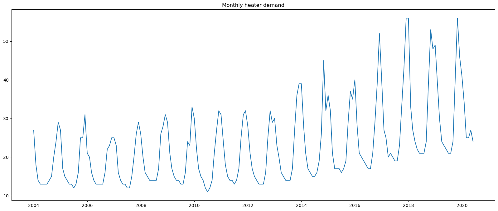

**Cell 9 读图**：原尺度需求随年份增加，重复峰谷的振幅也扩大。

#### Cell 1 · 课程路线和工具

源总览列出平稳检验、尺度处理、拟合与比较 RMSE。§2.11 把各预测还原到同一原需求尺度评价，是本笔记补充；源 Cell 81 的四行并非同一评分量。

[[#2.1 先固定输入、输出和时间（Cells 1–9）|查看同组机制与计算]]。

#### Cell 2 · 导入前的工具分工

这一格引出库的导入：表格、数值、KPSS、Box-Cox、ARIMA、相关图和绘图各有不同用途。

[[#2.1 先固定输入、输出和时间（Cells 1–9）|查看同组机制与计算]]。

#### Cell 4 · 数据准备的顺序

先知道原记录代表什么、时间单位是什么，才判断要压振幅、去季节或去趋势。

[[#2.1 先固定输入、输出和时间（Cells 1–9）|查看同组机制与计算]]。

#### Cell 5 · 月度需求表和日期轴

源说明先读并画原月度需求；年月应解析为时间值，使相邻格能按真实顺序画。

[[#2.1 先固定输入、输出和时间（Cells 1–9）|查看同组机制与计算]]。

### 2.2 KPSS 检查什么（Cells 10–12）

#### Cell 10 · 平稳性原问

> Is the time series stationary?

中文：先问原始需求是否围绕固定均值平稳。Cell 12 源判断按 0.05 阈值拒绝相应原假设；检验不独立区分趋势、季节或方差变化分别贡献了多少。

**English reference**: Reject the level-stationarity null for the original demand series at the 5% level; the reported KPSS p-value bound is 0.01, below 0.05. The KPSS result does not by itself identify which feature of the series causes the rejection.

平稳性（Stationarity）在这里指序列的均值、波动和相隔相同月份的关系不随绝对时间系统变化。不断上升的趋势会破坏这种稳定结构。KPSS 的原假设（Null hypothesis）是在指定确定性项下平稳；`regression='c'` 使用常数均值口径，`nlags='auto'` 自动选计算所需滞后。

Cell 11 保存及本次输出的 p 值均为 0.01。按 0.05 阈值拒绝该原假设，支持继续处理非平稳问题。不能把 p 值解释为“平稳的概率只有 1%”，也不能把拒绝说成已证明原因一定是趋势。

KPSS 软件的 0.01／0.1 可能位于表格可给的边界，实际警告可能提示真实 p 值在范围外；原件隐藏了警告。报告这些输出值，并说明阈值判断，不能假装获得了无限精度的概率。

**🎙️ 课堂补充**（S20 `01:41:35`–`01:43:00`）

教程读原需求 KPSS 的输出为0.01（S20 `01:42:24`），与 Cell11 保存结果相符。按 c 规格和0.05阈值拒绝平稳原假设；口头“数据非平稳”是简述，不表示已经找出唯一原因，也不把p值解释为原假设的概率。

#### Cell 12 · 原需求的源判定

源格据小于 0.05 判非平稳。按常数水平 KPSS，拒绝对应原假设；原因还要看趋势、季节及波动。

[[#Cell 10 · 平稳性原问|查看同组机制与计算]]。

### 2.3 Box-Cox 怎样压缩波动（Cells 13–18）

#### Cell 18 · 变换后的剩余结构

原 Cell 18 提醒，压缩振幅后仍有趋势和季节。若准备原 ARMA 的差分输入，还要去季节和差分；后续其他模型使用的尺度不完全相同。

以下 log 是自然对数，零参数时的反变换才是以 e 为底的指数。

需求量增大时波动也变大，直接用一个固定误差尺度可能不合适。Box-Cox 对正数作单调变换，大数值区间可以被压缩。它不自动去掉趋势和季节性。

对正需求 $y$，变换后的值记为 $z$，调节形状的参数为 $\lambda$：

$$
z=\begin{cases}(y^\lambda-1)/\lambda,&\lambda\ne0,\\\log y,&\lambda=0.\end{cases}
$$

这里的 $y$ 是一月需求，$z$ 是变换尺度，不再用原需求单位。$\lambda$ 由训练数据估计；Cell 15 未显式给参数，所以 SciPy 用输入序列估计它。原教程输入全 198 月，保存值约为 $-0.664521$；本次复算相同到展示精度。直接代入原教程λ，$[27^{-0.664521}-1]/(-0.664521)\approx1.336452$。需求27因此被变成约1.336452，这不是需求降到 1.34 台。

Cell 17 把数组放回 `demand_BC` 列并画图。若需求含零或负数，当前原代码不能直接做 Box-Cox；不能为了消错随意加常数而不交代改变的模型与逆变换。

**🎙️ 课堂补充**（S20 `01:43:19`–`01:45:42`）

教程要求留住变换参数，方便把预测恢复为需求。S20 `01:44:12`：*"So the lambda will tell you how to reverse this one"*。中文：模型若预测变换尺度，就要用对应λ做反向恢复；只画出较平稳曲线还没有得到原需求预测。

口述将Box-Cox与更接近正态形状联系。这里仍按正文界定：改变边际分布或稳定方差，不保证没有趋势、季节或自相关，也不等于KPSS检验会把数据变成正态。

#### Cell 17 · 保存图

**查看原 Notebook 保存图**

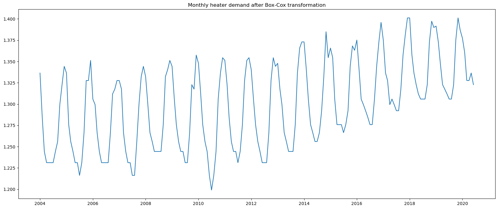

**Cell 17 读图**：Box-Cox 后的纵轴已换尺度；峰谷仍存在，不能把压振幅当成去季节。

#### Cell 13 · 稳定化三步

变尺度、减月份效应、做相邻差分分别对付不同结构；保留每一步才能在预测后逆序还原。

[[#2.3 Box-Cox 怎样压缩波动（Cells 13–18）|查看同组机制与计算]]。

#### Cell 14 · 先处理振幅

原格用 Box-Cox 稳定随水平扩大的振幅；标准式要求输入为正。

[[#2.3 Box-Cox 怎样压缩波动（Cells 13–18）|查看同组机制与计算]]。

#### Cell 16 · 画变换后的需求

横轴仍是同一批年月；此处看波动幅度，不能把换了纵轴数值当去季节。

[[#2.3 Box-Cox 怎样压缩波动（Cells 13–18）|查看同组机制与计算]]。

### 2.4 月份均值怎样去季节（Cells 19–27）

#### Cell 27 · 去季节后的趋势

原 Cell 27 提醒：减同月均值后重复峰谷减弱，剩余趋势仍须处理。

S20 01:51:36–01:52:05 是课堂读图自问自答：移除月份效应后，图的周期高低已不明显，但仍可看见上升趋势。这是目视说明，不用它替代平稳性检验。

先把每行的月份编号取出来，例如 2004-01 和 2005-01 都得到 1。`groupby('month')` 把同月份放一组，`.mean()` 算各组均值，`.reset_index()` 将月份索引恢复成普通列，便于合并。

`rename` 把均值列命名为 `demand_month_avg`，避免和每月真实值混淆；`merge(..., on='month')` 按月份把 12 个均值贴回 198 行。右表应每月一行，否则一月可能匹配多行、错误膨胀表；合并后核行数、月份覆盖和日期排序。

原教程设 $s_m$ 为第 $m$ 月的 Box-Cox 平均值，再算去季节量 $u_t=z_t-s_{m(t)}$。$m(t)$ 表示日期 $t$ 属于几月。

💡 读一行：2004-01 的 $z_t$ 约 1.336452，原教程的一月均值约 1.354655，相减得到约 −0.018203。负数只说明低于一月平均，不是负需求。去季节量仍可能随年份上升，所以 Cell 27 之后还要查趋势。

与 M08 §2.7 的示例对照：那里减的是“同季节均值减总体均值”，所以保留总体水平；本教程直接减同月均值，额外移去一个总体常量。两种结果的相邻差分相同，但恢复水平须加回各自保存的量。本篇后续始终加回同月 Box-Cox 均值，不混用中心化季节差额。

这些均值由输入数据估计，不能用包含测试期的一月均值回头评价预测。它和“月份编号 1–12 是已知日历”不同：日历已知，未来需求均值未知。

**🎙️ 课堂补充**（S20 `01:45:42`–`01:52:05`）

教程按月份分组、求 Box-Cox 需求均值，再按 month 合回原表。S20 `01:49:57`：*"demand of each month and then we merge this data set to our original data set here by the month, right?"* 它把12个“月份位置的平均”贴回逐月行，再相减；负值是低于该月份平均。

这确认实际处理的列是 demand_BC，不能对原需求均值和变换后需求混减。原教程此处仍用全198月，课堂后面对选阶的更正没有自动修好预处理泄漏，训练侧修正方案仍见正文。

#### Cell 26 · 保存图

**查看原 Notebook 保存图**

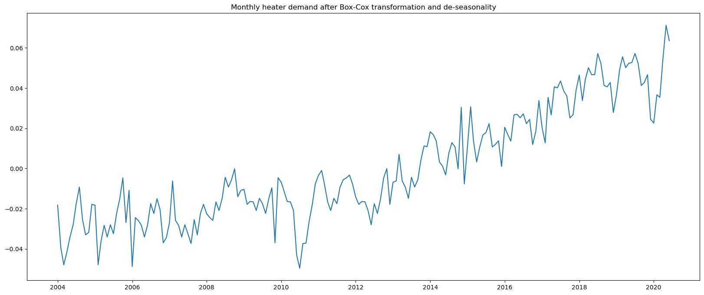

**Cell 26 读图**：减月均后重复峰谷变弱，但中心仍向上移动。

#### Cell 19 · 用同月均值去季节

按月份位置估平均水平，再逐行减相应月份的平均值。

[[#2.4 月份均值怎样去季节（Cells 19–27）|查看同组机制与计算]]。

#### Cell 21 · 按月份聚合

把所有一月、二月等各自汇总；原描述性过程用了整表，预测验证应在训练内估计。

[[#2.4 月份均值怎样去季节（Cells 19–27）|查看同组机制与计算]]。

#### Cell 24 · 把季节均值接回原表

用月份键给每行带上该位置的均值，再按年月排序。不是按新表行号猜对应月。

[[#2.4 月份均值怎样去季节（Cells 19–27）|查看同组机制与计算]]。

### 2.5 差分、缺失首项与测试边界（Cells 28–37）

#### Cell 33 · 差分后如何判定

原 Cell 33 将 p=0.1 表述为 95% 置信下平稳。按 5% 门槛，只能说本检验未拒绝平稳原假设；0.1 是查表上界输出，不是平稳概率。

Cell 29 的 `.diff()` 得到 $v_t=u_t-u_{t-1}$，即本月相对上月改变多少。首月没有前月，因此为 NaN（缺失值）；不能把它填成 0 后当实际观测。

原教程前两项 $u$ 约 −0.018203、−0.039314，相减得到 −0.021111。Cell 32 去掉首项后再做 KPSS，保存输出为 0.1；按 0.05 不拒绝平稳原假设。**不拒绝不是证明平稳，更不是“95% 概率平稳”**，这是对 Cell 33 的口径修正。

Cell 35 用前 186 行训练、末 12 行测试。分割点前已进行全表 Box-Cox 和月份均值估计，故原教程的边界并不干净。修正时必须先固定原始时间切分，再在训练段估计变换参数和月份均值。

差分的跨界要仔细区分：测试首月真实差分可用最后训练月真实值相减来评价；但是在**一次性预测 12 步**时，第二步以后不能把真实测试月喂回当过去观测，否则已变成另一种滚动协议。

下面图按一次性 12 步评价读；箭头表示数据进入计算，测试目标只进入最后评分。

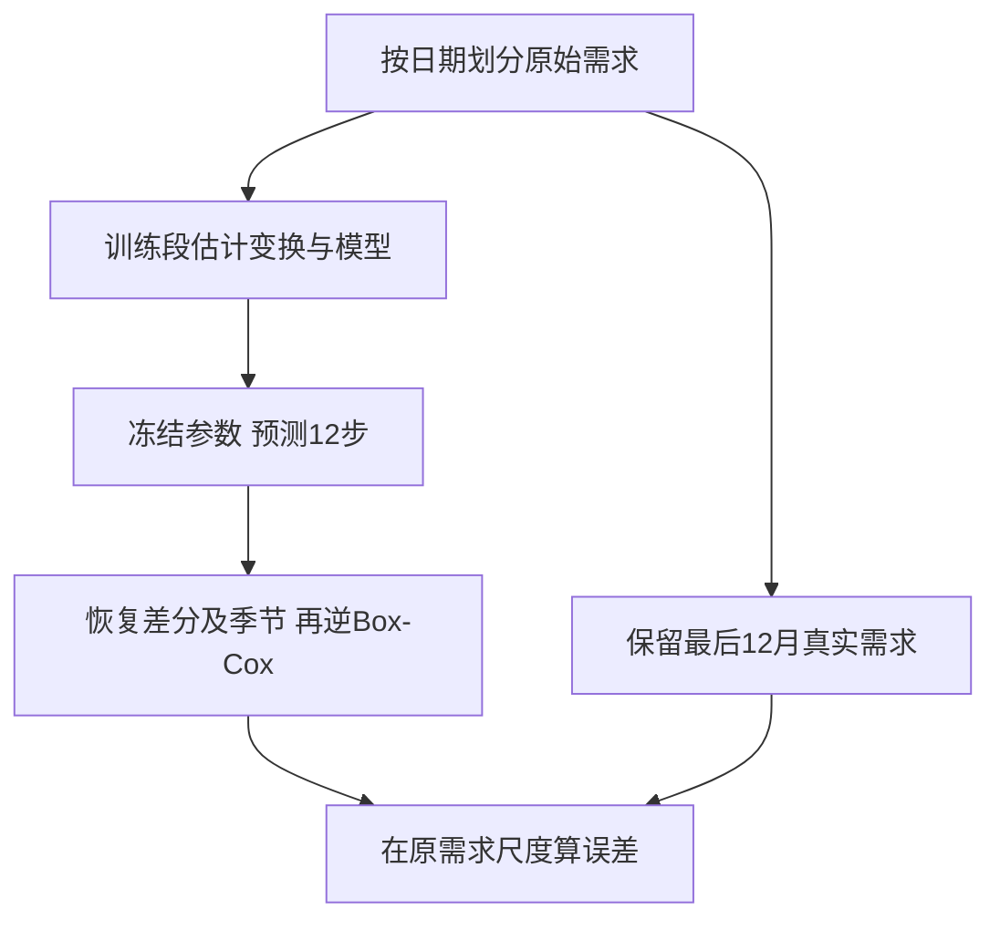

**🎙️ 课堂补充**（S20 `01:52:14`–`01:55:39`）

教程明确调用一阶差分，并读处理后KPSS输出0.1。S20 `01:52:14`：*"So the third step is we can apply first-order differencing to detrend the data."* 后续又强调，并非所有模型都使用三步处理后的最终列（`01:52:55`–`01:53:32`）；模型自己能处理哪种结构，决定要交给它哪个输入。

`01:55:07`要求测试数据在训练之后；`01:55:23`说明末12月作测试。课堂p值口径仍须按正文写“未拒绝”，不能写已证明平稳。

#### Cell 30 · 保存图

**查看原 Notebook 保存图**

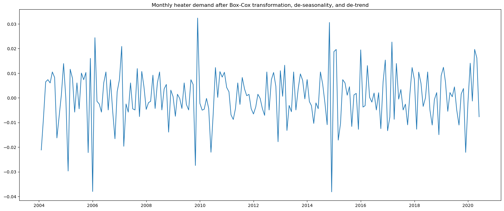

**Cell 30 读图**：相邻差分后大致围绕 0 变化；仍需结合检验。

#### Cell 37 · 保存图

**查看原 Notebook 保存图**

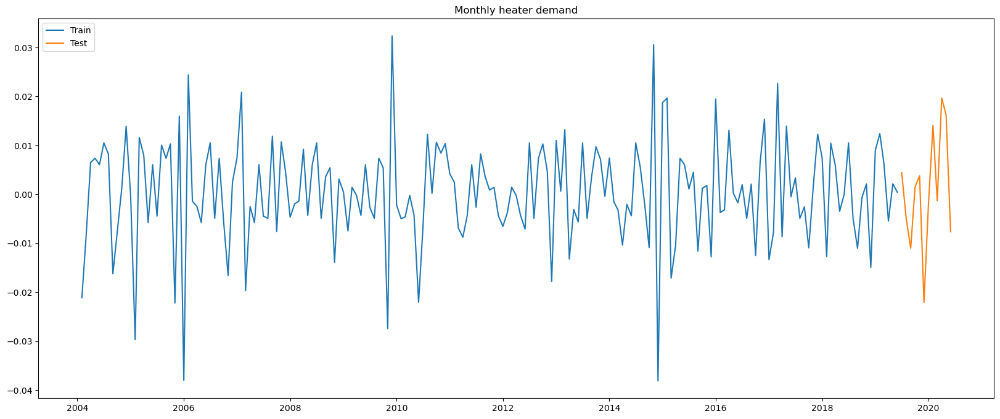

**Cell 37 读图**：蓝训练后接橙测试，纵轴为差分后的处理值。

#### Cell 28 · 用一阶差分处理趋势

每期减上期，目标变成去季节后的变化量；首期没有上期，留下缺项。

[[#2.5 差分、缺失首项与测试边界（Cells 28–37）|查看同组机制与计算]]。

#### Cell 31 · 决定再做检验

图看起来较稳定，接下来对去首缺值的差分做同规格 KPSS。图不能代替统计判断。

[[#2.5 差分、缺失首项与测试边界（Cells 28–37）|查看同组机制与计算]]。

#### Cell 34 · 固定末十二月

前 186 行训练，末 12 月测试；之后更严谨的例子在训练内估各变换。

[[#2.5 差分、缺失首项与测试边界（Cells 28–37）|查看同组机制与计算]]。

#### Cell 36 · 读分色边界

蓝橙线标训练与测试的交界；这幅原图画的实际是差分量，不因标题把它当原需求水平。

[[#2.5 差分、缺失首项与测试边界（Cells 28–37）|查看同组机制与计算]]。

### 2.6 ARMA：预测的是“变化量”（Cells 38–51）

#### Cell 42 · 从 PACF 提候选

原 Cell 42 提议 p=2，并写 “Simpler model is preferred”。远处偶有柱越带并不自动需要更高阶；候选还需训练侧比较与残差检查。

以 1–4 月为例，lag 1 配对 2 月与 1 月、3 月与 2 月、4 月与 3 月；lag 2 只配 3 月与 1 月、4 月与 2 月，跨过中间月份。ACF 汇总这种同序列的滞后联系。若做 lag 2 的 PACF，先分别从两端去掉中间月能线性解释的部分，再相关剩余量。短示例只说明配对，不据它估可靠阶数。

ACF（自相关函数）看一串数与其滞后值的相关；PACF（偏自相关函数）进一步控制中间滞后影响。Cell 41／44 在训练差分量上画图，Cell 42／45 选 $p=2,q=1$。这是一种候选阶数判断，不是“图上某根线越界便唯一证明正确阶数”。多次看测试误差来挑阶会让测试变成验证集。

ARMA(2,1) 的当前输出由前两个滞后月份的变化量和一个过去创新参与解释。创新 $\varepsilon_t$ 是给定当时历史后仍没预测到的新误差，不是原需求减平均值。

💡 示意约定：若 $v_t=0.5v_{t-1}+0.2v_{t-2}+\varepsilon_t+0.3\varepsilon_{t-1}$，已知最近两个变化量为 0.02、0.01，最近创新 0.005，下一步预测是 $0.5\times0.02+0.2\times0.01+0.3\times0.005=0.0135$。这是笔记补充参数，不是教师模型估计值。多步预测时未知未来创新的条件期望取 0，并递推使用已经预测出的变化量。

Cell 47 调 `ARIMA(..., order=(2,0,1))`，中间的 0 表示这里不再额外差分，因为传入的 `demand_diff1` 已差分。`.fit()` 通过训练段的概率模型及创新计算估计系数和误差尺度，使训练数据在模型下更可能出现；不是把测试答案存进去。优化迭代满足数值停止条件，不保证全局最优。

Cell 49 把预测放到测试月份画图；Cell 51 的保存 RMSE 为 0.0114638359，量纲是**去季节后差分的 Box-Cox 单位**。它还没有回答原需求误差有多少。

**🎙️ 课堂补充**（S20 `01:55:49`–`01:58:49`）

教程讲者明确纠正选阶数据范围。S20 `01:56:58`：*"we can only use the training data to determine how many parts of value we use."* `01:57:12`–`01:57:21`说明旧版用全数据不对，已更新Notebook；本地当前Cell41／44确实传 train。

录音末尾在PACF取p=2的解释中断，尚未直接录到本节其后的ACF选q、拟合、预测及RMSE，不能把讲义源码和既有本机实跑冒称课堂演示。这个更正只确认选阶，不会自动消除Cell15／22全表预处理的问题。

#### 2.6.1 怎样读当前训练侧的 ACF／PACF 图

下图由本次训练段重新计算，未使用测试段选阶；上排是去季节后的一阶差分，下排是 Box-Cox 水平的 12 期差分。它与原教程的全表预处理输入不同，不能冒称原件保存图。

![[IS6400_Business_Data_Analytics/notes/figures/t09-time-series/t09-diagnostics.svg]]

横轴 lag 是相隔几个月，纵轴是相关系数。lag 0 等于与自己比较，通常为 1，不能拿它选 AR 阶数。浅蓝带是所用方法给出的近似显著性参考区，越界只提示该滞后下相关值得检查，多重滞后与估计误差仍可能造成偶然越界。

实际读上排：lag 1 明显为负，PACF 的 lag 2 也为负；后面仍有多根靠近／越过参考带，因此不能硬说“恰好在2阶严格截尾”。读下排：虚线标 12、24、36 个月，lag 12 的相关为负，36 附近又有结构，季节项应按这些间隔检查，不是把横轴3直接当季节lag36。

“截尾”指理论上某阶后相关归零，“拖尾”指逐渐衰减而不是突然消失；有限样本的图只提供近似线索。纯AR常以PACF截尾、纯MA常以ACF截尾作候选启发式，混合模型不保证出现干净形状。本篇固定沿用原教程规格用于比较，未声称这张图证明它们唯一正确。

若要真正选择规格，可在186月训练段内部再留最近12月作验证：每个候选只在更早训练部分估变换和模型，在这12月按相同原尺度评价；先检查收敛与残差，再结合误差和复杂度选定。规格冻结后才用完整186月重估，并只对最后12月正式测试一次。这样测试期没有被反复用作选阶工具。


#### Cell 41 · 保存图

**查看原 Notebook 保存图**

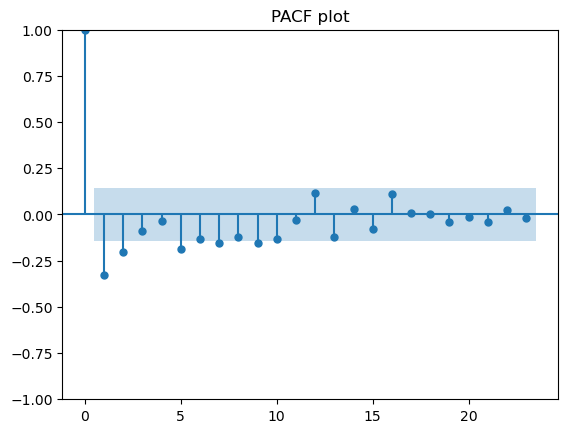

**Cell 41 读图**：第 1、2 阶柱明显，其他阶也有接近或越带的柱，图只提候选。

#### Cell 44 · 保存图

**查看原 Notebook 保存图**

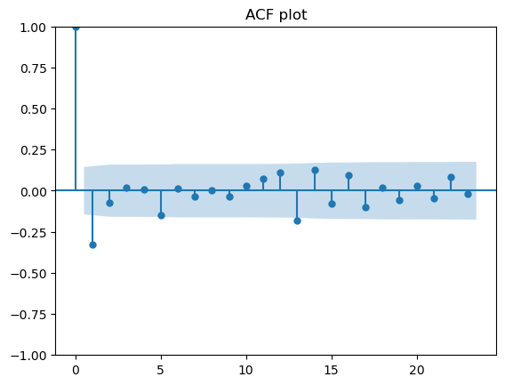

**Cell 44 读图**：忽略 0 阶，负的一阶柱突出；样本图不能单独证明 q。

#### Cell 49 · 保存图

**查看原 Notebook 保存图**

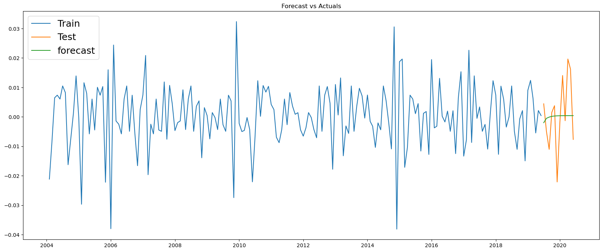

**Cell 49 读图**：绿线是差分尺度的 ARMA 预测，不能与原需求 RMSE 直接比。

#### Cell 38 · 进入训练与评价

从此比较的是指定变换尺度上的预测。每个模型都要写清输入和评分对象。

[[#2.6 ARMA：预测的是“变化量”（Cells 38–51）|查看同组机制与计算]]。

#### Cell 39 · ARMA 工作对象

第一个模型在去季节的一阶差分上建模，预测回来的仍是变化量。

[[#2.6 ARMA：预测的是“变化量”（Cells 38–51）|查看同组机制与计算]]。

#### Cell 40 · 相关图各回答什么

PACF 给 AR 候选，ACF 给 MA 候选；样本图只缩小搜索范围。

[[#2.6 ARMA：预测的是“变化量”（Cells 38–51）|查看同组机制与计算]]。

#### Cell 43 · 用 ACF 提 q

对当前工作序列的过去冲击长度提出候选，先忽略必为 1 的零阶。

[[#2.6 ARMA：预测的是“变化量”（Cells 38–51）|查看同组机制与计算]]。

#### Cell 45 · 原格采用 q=1

此处只记录原示例选择；不能由几根柱证明所有样本都适用。

[[#2.6 ARMA：预测的是“变化量”（Cells 38–51）|查看同组机制与计算]]。

#### Cell 46 · 拟合第一组规格

原代码用 ARIMA(2,0,1) 表示在已差分输入上做 ARMA，不再增加内部普通差分。

[[#2.6 ARMA：预测的是“变化量”（Cells 38–51）|查看同组机制与计算]]。

#### Cell 48 · 画 ARMA 预测

橙色实际与绿色预测同在差分尺度，不能拿这条线直接读需求件数。

[[#2.6 ARMA：预测的是“变化量”（Cells 38–51）|查看同组机制与计算]]。

#### Cell 50 · ARMA 在变化量评分

把预测变化和实际变化逐期配对，评分对象与后面的水平模型不同。

[[#2.6 ARMA：预测的是“变化量”（Cells 38–51）|查看同组机制与计算]]。

### 2.7 ARIMA：模型内部做差分并恢复（Cells 52–58）

Cell 54 传 `demand_de_season`，`order=(2,1,1)` 表示内部做一次差分，再用 ARMA 结构拟合。与上一节的输入不同，因此 `.forecast()` 返回的是去季节后的水平 $u$，不是其差分 $v$。

差分恢复的理由是等式 $u_t=u_{t-1}+v_t$。从最后已知水平出发，把未来变化逐个累加即可。若末水平为 0.10、两步预测变化为 0.02 和 −0.01，两步水平分别是 0.12 和 0.11；不能每步都只加最初的 0.10。

Cell 56 画去季节水平，Cell 58 保存 RMSE 约 0.0155562296。它与 ARMA 节的误差对象不同，数值较大不能据此判模型较差。

#### Cell 56 · 保存图

**查看原 Notebook 保存图**

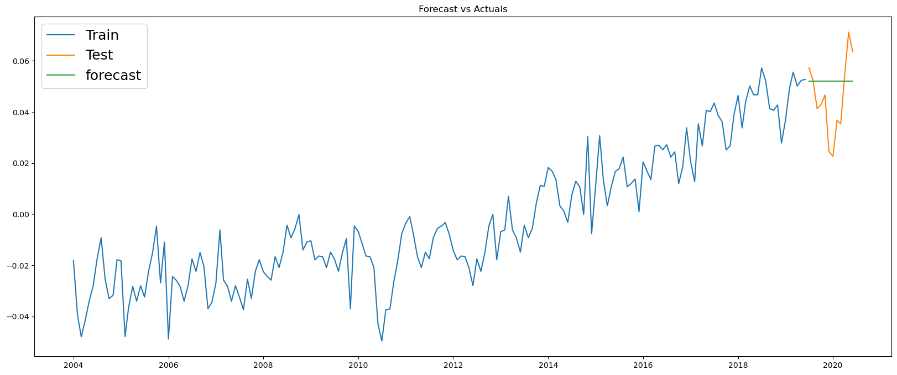

**Cell 56 读图**：绿线已在去季节的水平尺度；季节和 Box-Cox 仍未还原。

#### Cell 52 · ARIMA 的输入层次

第二个模型从去季节后的水平开始，把普通差分交给模型内部。

[[#2.7 ARIMA：模型内部做差分并恢复（Cells 52–58）|查看同组机制与计算]]。

#### Cell 53 · 预测十二步

只在训练去季节水平上估计参数，固定起点预测末十二月。

[[#2.7 ARIMA：模型内部做差分并恢复（Cells 52–58）|查看同组机制与计算]]。

#### Cell 55 · 看还原到哪一层

图已经回到去季节水平，但月份效应与 Box-Cox 原尺度仍未恢复。

[[#2.7 ARIMA：模型内部做差分并恢复（Cells 52–58）|查看同组机制与计算]]。

#### Cell 57 · 去季节水平评分

RMSE 用同尺度实际值与预测值，不能直接跟 ARMA 变化量分数排榜。

[[#2.7 ARIMA：模型内部做差分并恢复（Cells 52–58）|查看同组机制与计算]]。

### 2.8 季节 ARIMA：普通差分和季节差分分开（Cells 59–73）

#### Cell 66 · 原季节 Q 与图的范围

原 Cell 66 提出季节 Q=3，下一格原图并未显示 lag 24 和 36；不能从这幅图证明三阶季节项。

#### Cell 63 · D=0 的源解释

原 Cell 63 用 lag 12 差分图说趋势不明显，从而演示 D=0 的选择。此处是源经验判断；没有趋势并不自动排除所有季节结构。

Cell 67 原保存图大约只到 lag 23，能看 lag 12，不能看季节第 2、3 阶所需的 lag 24、36。因而原图不足以验证季节 Q=3；后文训练修正版使用另一数据处理过程及更长图，不作为原选阶证据。

月度数据一年 12 期。季节 ARIMA 记为 $(p,d,q)(P,D,Q)_{12}$：小写部分处理普通滞后，大写部分处理间隔 12 的季节结构。大写 $D$ 才是模型实际做几次季节差分。

Cell 62 画 `demand_BC.diff(12)`，目的是诊断；Cell 65／67 用训练段的季节差分画 PACF／ACF。原件称 $P=1,Q=3$，Cell 69 实际拟合 `order=(2,1,1), seasonal_order=(1,0,3,12)`，输入仍是 **未作季节差分的 Box-Cox 水平**。

Cell 63 写“季节差分图无趋势，所以不再差分，即 D=0”。这段解释不足以推出拟合应选 $D=0$：已经看了差分后的图，不能把它当作未差分序列平稳的证据；而普通 $d$ 和季节 $D$ 也不是同一个参数。本笔记保留原代码规格用于复现，不把阶数理由当已严格证实。

季节 MA 项里的 $Q=3$ 涉及季节间隔 12、24、36 的创新结构；不是只看普通 lag 3 就够。ACF/PACF 的阶数识别是候选启发式，还须核残差和训练侧验证。

Cell 69 的 `.fit()` 同时估这些系数，`.forecast(12)` 返回 Box-Cox 水平预测；不再手动给它累加普通差分。Cell 73 保存 RMSE 约 0.0094490941；历史一次软件环境复算约 0.0099579327；2026-11-04 原公开课堂代码本机复跑约 0.0094096678。三项数值按各自证据记录，未改原件。数值优化和软件版本可产生差异，当前证据没有把差异单独归因到某一个原因。

#### Cell 62 · 保存图

**查看原 Notebook 保存图**

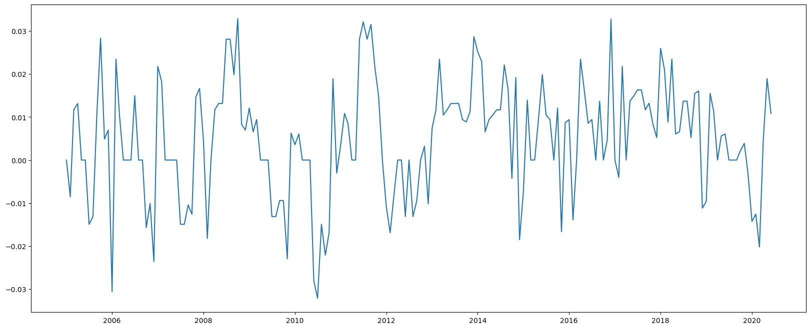

**Cell 62 读图**：相隔 12 期作差，前 12 期没有同月对照；这是诊断尺度。

#### Cell 65 · 保存图

**查看原 Notebook 保存图**

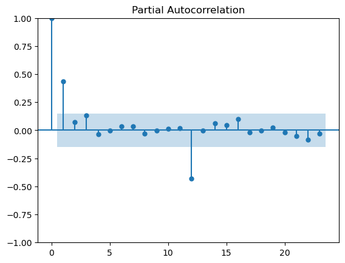

**Cell 65 读图**：在季节差后的工作序列读 PACF，一阶和约第 12 阶值得留意。

#### Cell 67 · 保存图

**查看原 Notebook 保存图**

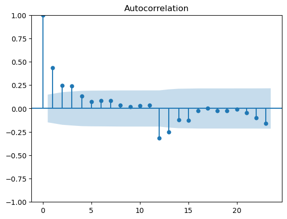

**Cell 67 读图**：前数阶及第 12 阶附近均有突出柱；源图挑规格只是示例。

#### Cell 71 · 保存图

**查看原 Notebook 保存图**

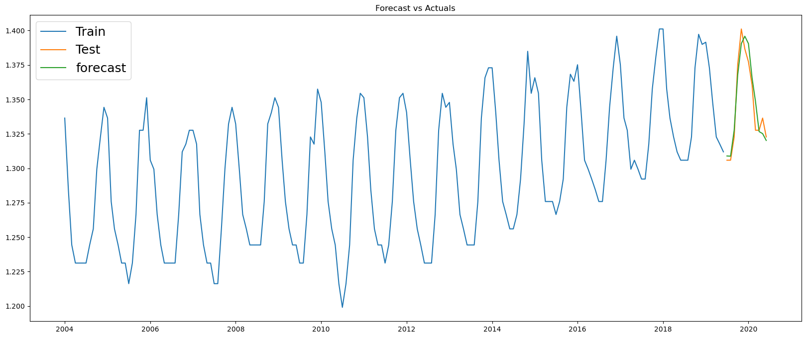

**Cell 71 读图**：纵轴为 Box-Cox 水平，绿线季节预测和橙线真实值对比。

#### Cell 59 · 季节 ARIMA 的输入层次

第三个模型从 Box-Cox 水平开始，用周期 12 表达年度相同月份。

[[#2.8 季节 ARIMA：普通差分和季节差分分开（Cells 59–73）|查看同组机制与计算]]。

#### Cell 60 · 先提出季节阶数候选

相关图协助提 P/Q，是否保留季节差分由训练诊断与验证一起判断。

[[#2.8 季节 ARIMA：普通差分和季节差分分开（Cells 59–73）|查看同组机制与计算]]。

#### Cell 61 · 相减去年同月

季节差分拿当前月减去年同月；没有满一年历史时缺相应差值。

[[#2.8 季节 ARIMA：普通差分和季节差分分开（Cells 59–73）|查看同组机制与计算]]。

#### Cell 64 · 源选择季节 P

原格把 P=1 作为候选；看季节间隔的相关证据，不机械数所有越带的柱。

[[#2.8 季节 ARIMA：普通差分和季节差分分开（Cells 59–73）|查看同组机制与计算]]。

#### Cell 68 · 写出两组规格

把普通阶数与季节阶数同时传入；原示例季节周期为 12。

[[#2.8 季节 ARIMA：普通差分和季节差分分开（Cells 59–73）|查看同组机制与计算]]。

#### Cell 70 · 在同一 Box-Cox 轴对照

图上绿色预测和橙色实际已是同一处理尺度，但还不是原需求单位。

[[#2.8 季节 ARIMA：普通差分和季节差分分开（Cells 59–73）|查看同组机制与计算]]。

#### Cell 72 · 计算季节模型的评分

同一测试月、同一 Box-Cox 水平配对，得到源保存的第三组误差。

[[#2.8 季节 ARIMA：普通差分和季节差分分开（Cells 59–73）|查看同组机制与计算]]。

### 2.9 ETS：用误差调整状态（Cells 74–80）

Cell 76 的 `ETSModel(..., trend='add', seasonal='add', seasonal_periods=12)` 在 Box-Cox 水平上估计加法趋势和季节。`add` 表示组成部分相加，12 是一年月份数。未写 `error` 时该 API 使用加法误差设置；实际环境版本见复算记录。

用加法 Holt-Winters 的直觉恢复当前操作：先用上月水平、趋势和相应季节状态给本月预测，再根据实际与预测之差修正状态。一个便于理解的常见写法是：

$$
\ell_t=\alpha(z_t-s_{t-12})+(1-\alpha)(\ell_{t-1}+b_{t-1}),
$$

$$
b_t=\beta(\ell_t-\ell_{t-1})+(1-\beta)b_{t-1},\qquad
s_t=\gamma(z_t-\ell_t)+(1-\gamma)s_{t-12}.
$$

$\ell$ 是水平，$b$ 是每月趋势，$s$ 是季节项；$\alpha,\beta,\gamma$ 是状态调整权重。这是常见递推帮助理解，statsmodels ETS 的创新参数化与传统平滑写法不应只因符号相同就逐项等同。

💡 数字例：旧水平 10、趋势 1、同月季节 2，实际值 15，取三权重均 0.5。新水平为 $0.5(15-2)+0.5(10+1)=12$；新趋势为 $0.5(12-10)+0.5\times1=1.5$；新季节为 $0.5(15-12)+0.5\times2=2.5$。之后按日期选下一月的季节状态，不能把本月 2.5 随意用于每一个未来月份。

`.fit()` 同时估平滑参数和初始状态。优化日志里的 `N` 是待优化变量数，迭代序号是优化步，不是模型看过了几个月。正常停止并不证明预测最好。Cell 78 画图，Cell 80 保存 RMSE 约 0.0187049494，本次约 0.0187049394。

#### Cell 78 · 保存图

**查看原 Notebook 保存图**

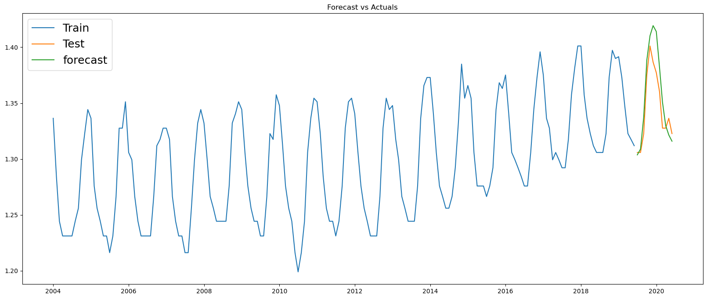

**Cell 78 读图**：仍在 Box-Cox 水平；峰值附近绿线与实际有偏离。

#### Cell 74 · ETS 的工作尺度

第四个模型也用 Box-Cox 水平，因此与前一个可在该共同尺度上比较。

[[#2.9 ETS：用误差调整状态（Cells 74–80）|查看同组机制与计算]]。

#### Cell 75 · 训练加法趋势与季节

估计训练状态后固定起点向前 12 月；不能用实际测试值逐月更新。

[[#2.9 ETS：用误差调整状态（Cells 74–80）|查看同组机制与计算]]。

#### Cell 77 · 画 ETS 预测图

绿线与橙线在同一 Box-Cox 轴，关注各月峰谷偏差。

[[#2.9 ETS：用误差调整状态（Cells 74–80）|查看同组机制与计算]]。

#### Cell 79 · ETS 的 RMSE

以同一测试 12 月计算变换尺度误差，再区分与原需求误差的用途。

[[#2.9 ETS：用误差调整状态（Cells 74–80）|查看同组机制与计算]]。

### 2.10 为什么原比较表不能直接选赢家（Cell 81）

RMSE（Root Mean Squared Error，均方根误差）把每个预测差先平方、平均再开根号，以原被评分量的单位读结果。

$$
\mathrm{RMSE}=\sqrt{\frac1H\sum_{h=1}^{H}(y_{n+h}-\widehat y_{n+h})^2}.
$$

$H$ 是测试月份数，本例为 12；$y$ 是真实目标，$\widehat y$ 是在预测时能知道的信息形成的预测。若两个月真实为 10、14，预测为 12、12，平方误差为 4、4，平均 4、开根得到 2。不是把正负误差先平均成 0。

原表保留以下保存值及目标，不能跨行忽略目标差别。

| 原模型 | 被评分量 | 原保存 RMSE |
|---|---|---:|
| ARMA | 去季节后的差分 | 0.0115 |
| ARIMA | 去季节后的水平 | 0.0156 |
| 季节 ARIMA | Box-Cox 水平 | 0.0094 |
| ETS | Box-Cox 水平 | 0.0187 |

例如第一行误差是在“月变化”上，第三行是在“变换后水平”上。它们都写小数，不代表同单位。ARMA 和 ARIMA 相比，前者误差数字小不能直接证明更优。

### 2.11 从预测量恢复到原需求，再公平比较

这是笔记补充实验，不替换教师原件。

1. 先在原需求上固定 186／12 的时间切分，只用训练需求估 Box-Cox 的 $\lambda$。
2. 训练侧计算每月均值，并把同一变换规则用于未来月份。
3. ARMA 预测差分后，从最后训练去季节水平逐步累计；ARIMA 的返回已是去季节水平，不重复累加。
4. 两者按未来月份加回对应训练月份均值。季节 ARIMA／ETS 直接返回 Box-Cox 水平，不加这一步。
5. 统一用同一个训练 $\lambda$ 做逆 Box-Cox，得到原需求尺度，评价同 12 个真实月份。

逆变换为 $y=(1+\lambda z)^{1/\lambda}$，$\lambda=0$ 时为 $e^z$。必须满足 $1+\lambda z>0$；否则超出当前逆变换定义域，不能静默截成 0。逆变换后的点预测通常不等于经过偏差校正的原尺度条件均值，比较时说明采用同一插件式点预测规则。

本次实际运行的训练侧结果如下，单位均为原需求单位。只比较这个表内部。

| 模型规格沿原教程 | 同尺度 RMSE | 优化器收敛标记 |
|---|---:|---|
| ARMA(2,1) | 14.7413 | true |
| ARIMA(2,1,1) | 12.7463 | true |
| SARIMA(2,1,1)(1,0,3,12) | 4.2851 | false，50次迭代后未收敛 |
| ETS 加法趋势／季节 | 15.7103 | true |

读第三行：该固定规格在这 12 月的预测偏差，用 RMSE 汇总为约 4.29 个需求单位。它的数值最低，但本次优化器报告未收敛（converged=false，warnflag=1），并有 Maximum Likelihood optimization failed to converge 警告。因此4.2851只是当前未收敛优化结果的描述性误差，不能据此宣布可靠拟合完成后的赢家。其他行的true也只是优化器停止标记，不是模型有效性证明。这里仍只是一段测试、固定规格的结果，不是普遍排名。若根据此结果再调参，本测试已经参与选择，下次应留新的最终测试。

![[IS6400_Business_Data_Analytics/notes/figures/t09-time-series/t09-forecast.svg]]

图为本次补充实验真实预测；其中SARIMA线来自上述未收敛优化结果，不能仅凭贴近黑点就认定其可靠。横轴是共同的 12 个测试月份，纵轴是原需求；黑点为真实值，四条线是一次性 12 步预测。读某月时先比较同一纵轴上的线与黑点距离，不把跨月份斜率当误差。图源与输入版本随资产保存。

#### 2.11.1 用实际2019年7月走完恢复链

本次训练期为2004-01至2019-06，测试期为2019-07至2020-06。训练估计的 $\lambda$ 为约 −0.747199247；真实运算使用未舍入值，下面保留足够位数方便逐步核读。

| 恢复步骤 | 本次实际数值 | 意思 |
|---|---:|---|
| 末训练去季节水平 | 0.044871892 | 累计变化量的已知起点 |
| ARMA首步变化预测 | −0.000384823 | 相对上月的预测变化 |
| 两者相加 | 0.044487070 | 7月去季节水平预测 |
| 加训练期7月均值1.152286636 | 1.196773705 | 7月Box-Cox水平预测 |
| 用训练λ逆变换 | 20.217026828 | 原需求单位的7月预测 |
| 测试7月真实值 | 21 | 只用于最终评价 |

本表用预测减实际，即 20.2170−21，未舍入差约 −0.782973。若用实际减预测，符号相反而 RMSE 不变。这里为负，表示少预测约0.783个原需求单位。下一步ARMA继续累计预测变化，而不是把测试7月的真实需求21喂回。这一例将§2.11的恢复顺序接到实际数组；不是用已舍入表格重新估参数。

持久入口：[完整复算脚本](figures/t09-time-series/t09-reproduce.py)、[实际执行与预测记录](figures/t09-time-series/t09-execution.json)、[本月中间量](figures/t09-time-series/t09-first-month.json)。脚本从自身正式位置找到本课`course_files_export/`，输出写到库外`E:/app-data/codex/scratchpad/cityu-t09-reproduction/`，不会覆盖学校原件。

运行入口是 `D:\anaconda3\python.exe -X utf8 <本课notes/figures/t09-time-series/t09-reproduce.py的完整路径>`。需已有pandas、SciPy、statsmodels、sklearn和Matplotlib；本机本次已具备。脚本包含原35格复现与训练侧修正两条独立链，不能把修正值冒称原件输出；诊断标记、日期、预测和图都写入执行记录。


### 2.12 Extra Assignment：完整原题与参考实现（Cell 82）

以下是评分作业，原题在 Notebook 内。作业要求、参考演示、本人作答和 Canvas 提交分别记录；本篇的例子不是本人已提交答卷。

**Cell 82 英文原题全文**

# Week 9 Assignment(Extra): Weather Time Series Forecasting

**Data:** `weather.csv`
**Task:** Choose a weather variable, forecast it using the ARIMA pipeline, and compare it with another forecasting model.

### Requirements:
1. **Data Prep:** Select a variable, resample it to monthly averages, and split the last 12 months as the test set.
2. **ARIMA:** Apply the Tutorial 9 pipeline (transformations, ACF/PACF, etc.) using train data only to fit and forecast.
3. **Alternative Model:** Choose a second model and forecast the same period.
4. **Evaluation:** Plot actual vs. predicted values for both models, calculate their RMSE, and write a brief conclusion on which model performed better and why.

**Submission:** One Jupyter Notebook with your code, plots, RMSE results, and conclusion.

中文读题：自选一个天气变量，按月平均，末 12 月测试；只用训练数据处理／选模，再用第二模型预测同一段，画图、算同尺度 RMSE，解释谁好以及为什么。原 Notebook 写交一份 Notebook，Canvas 正式作业页只写 file upload，没有追加格式说明；当前需核平台实际可接收类型，不把旧周通用 HTML 公告静默当成此题明确要求。

⚪ 参考演示选择温度 `T (degC)`。它允许负数，因此本例不直接用 Box-Cox；按原单位建模，并以训练侧诊断与一个固定 ARIMA(1,0,0) 做演示。另一个模型取季节朴素法（Seasonal naive），即明年某月预测为去年同月，不用测试答案调参数。

```python
weather = pd.read_csv('weather.csv')
weather['date'] = pd.to_datetime(
    weather['Date Time'], format='%d.%m.%Y %H:%M:%S')
monthly = weather.set_index('date')['T (degC)'].resample('MS').mean()
train = monthly.iloc[:-12]
test = monthly.iloc[-12:]
fit = ARIMA(train, order=(1, 0, 0)).fit()
pred_arima = fit.forecast(12)
pred_baseline = monthly.iloc[-24:-12].to_numpy()
```

逐块读：先转换日／月／年的日期格式；`set_index` 让日期作为时间标签；`resample('MS')` 按月初标记分组并求平均；`iloc` 按位置分训练和测试。最后基线取的 12 项都在训练期，不是取测试实际值。 基线首项对 2016 年 1 月；先核真实序列及两套预测都是同样的 12 个月，再逐月配对、取误差平方的平均并开根。

该示范按原 CSV 全部行求月均，保留 24 条完全重复记录（集中在 2010 年 7 月）；不在沿用既有 RMSE 的同时偷偷去重。若另做去重版，须另列输入和输出。

数据横跨 2009–2016 共 96 月，训练 84 月、测试 12 月，无缺整月；仅对文件里已有采样求平均，未假装每月采样都完整。月度聚合及缺测密度仍会影响代表性。

本次参考运行温度 ARIMA(1,0,0) 的 RMSE 为 **7.0205 °C**，季节朴素为 **2.4923 °C**。此处基线更好；固定 AR(1) 逐步回归其长期均值，难以保持全年温度季节起伏，是与模型结构相符的解释，不代表已证明差异只有这一个原因。可在训练段内部滚动验证季节模型，再冻结规格评价；不能看测试结果反复挑参数后仍称未见测试。

#### 2.12.1 英文参考步骤与结果

**英文参考步骤（笔记示范）**：(1) Aggregate the chosen temperature series by calendar month and hold out the final twelve observations. (2) Fit all preprocessing and the fixed ARIMA specification using training data only, then forecast twelve months. (3) Forecast the same months with the training-period seasonal-naive benchmark. (4) Plot both forecasts against the same actual values, compute RMSE on the same temperature scale, and compare the errors and annual patterns.

**英文参考结论**：“For the monthly temperature series, the fixed ARIMA(1,0,0) achieved an RMSE of 7.0205 °C, while the seasonal-naive benchmark achieved 2.4923 °C over the same final twelve months. The benchmark performed better in this illustrative test. A non-seasonal AR(1) forecast tends towards its long-run level and does not preserve the annual pattern well. Further model selection should use training-side validation.”

本次训练侧KPSS统计量约0.08547、p值输出0.1、自动滞后4：在本设置下不拒绝常数平稳原假设，但不等于证明没有季节性。训练ACF在12个月处约0.78733，PACF在1个月处约0.80019，说明年度结构和短期相关都值得关注；固定AR(1)是说明协议的参考候选，不是由诊断证明最优。

![[IS6400_Business_Data_Analytics/notes/figures/t09-time-series/t09-weather.svg]]

图的横轴为2016年12个测试月，纵轴为月均摄氏温度。黑点是真实月均温度，ARIMA(1,0,0)线逐渐趋平，季节朴素线保留上一年的月度起伏；该图支持前述有限的结构解释，不能用此测试再反复调参。

[天气参考代码与诊断／绘图](figures/t09-time-series/weather-reference.py) 提供完整数据处理、训练侧诊断、两个预测、两RMSE与共同图。正式位置可用 D:\anaconda3\python.exe -X utf8 加脚本完整路径运行；在本机Notebook按块运行时，脚本已给出没有 __file__ 时的明确课程路径分支，若搬到另一处先改 course 为包含 course_files_export/ 的实际课程目录。它是已运行逻辑的持久参考入口，不是本人已审核或提交的正式答卷。Canvas接受扩展名、个人文件和最终提交仍按任务说明另核。

### 2.13 原教程代码逐单元对照（Cells 3–80）

本节按原顺序保留所有 35 个代码单元，可折叠查阅。§2.1–2.9 已逐组解释输入、关键设置和输出；绘图单元共享“先定画布→按同日期画真实与预测→标标题／图例→显示”的读法。代码仅为原件保真引用，不能抹去上文的泄漏和尺度限制。

#### 原 Code Cell 3

先准备读取表格、检验平稳性、变换需求和拟合模型所用的库。

**原 Code Cell 3**

```python
import pandas as pd
import numpy as np
from sklearn.metrics import root_mean_squared_error
from scipy.stats import boxcox
from statsmodels.tsa.stattools import kpss
from statsmodels.tsa.arima.model import ARIMA
from statsmodels.graphics.tsaplots import plot_acf, plot_pacf
from matplotlib import pyplot as plt
%matplotlib inline

import warnings
warnings.filterwarnings("ignore")
```

这些导入语句让后续名字对应具体库函数；%matplotlib是Notebook显示设置，warnings行会屏蔽警告，诊断时须注意其限制。

#### 原 Code Cell 6

先从本地 CSV 读出日期和加热器需求，再检查前几行。

**原 Code Cell 6**

```python
heater = pd.read_csv('heater.csv')
heater.head()
```

read_csv按当前工作目录读取两列表，head返回前五行，用来核月份及需求输入。

#### 原 Code Cell 7

把读进来的年月文本按年－月格式转换成日期，供排序和绘图。

**原 Code Cell 7**

```python
heater['year_month'] = pd.to_datetime(heater['year_month'], format = '%Y-%m')
```

to_datetime按年-月格式转换这一列，赋值只更新副本中的日期表示，输出供后面的时间轴使用。

#### 原 Code Cell 8

检查数据表的行数、字段类型和非缺失计数，确认日期和需求列可用。

**原 Code Cell 8**

```python
heater.info()
```

info返回每列类型和非空数，核198行是否仍在，以及需求列有没有缺失。

#### 原 Code Cell 9

将年月放横轴、需求值放纵轴，画原始需求以观察趋势和季节。

**原 Code Cell 9**

```python
plt.figure(figsize = (20,8))
plt.plot(heater['year_month'], heater['demand'])
plt.title('Monthly heater demand')
plt.show()
```

[[#Cell 9 · 保存图|在机制段查看此格原图]]。

figure定画布，plot把每月需求放到日期轴，show显示图；横轴是月份，纵轴是需求。

#### 原 Code Cell 11

把未变换的需求序列交给 KPSS，检查水平平稳的原假设。

**原 Code Cell 11**

```python
kpss_stat, pval, lags, crit = kpss(heater['demand'], regression = 'c', nlags = 'auto')
print('p Value to the KPSS test is: ',pval)
```

kpss输入原需求列，四个返回量分别为统计量、p值、使用滞后和临界值；本格只打印p值。

#### 原 Code Cell 15

用原需求拟合 Box-Cox，得到变换后序列及参数。

**原 Code Cell 15**

```python
#if parameter lmbda is none, the model will find the optimal parameter
BCheater, lmbda = boxcox(heater['demand']) 
print(BCheater[:10])
print(lmbda)
```

boxcox返回变换数组和估计λ；[:10]只显示前十项，不是仅用十项估计。

#### 原 Code Cell 17

把变换后的需求按时间画出来，看峰谷振幅是否收敛。

**原 Code Cell 17**

```python
heater['demand_BC'] = BCheater
plt.figure(figsize = (20,8))
plt.plot(heater['year_month'], heater['demand_BC'])
plt.title('Monthly heater demand after Box-Cox transformation')
plt.show()
```

[[#Cell 17 · 保存图|在机制段查看此格原图]]。

先把变换数组加入同一表，再按日期画变换尺度的曲线，不能把纵轴当原需求。

#### 原 Code Cell 20

从年月日期提取月份编号，作为后续汇总键。

**原 Code Cell 20**

```python
heater['month'] = heater['year_month'].dt.month
print(heater.head())
```

dt.month从日期取得1至12的月份编号，赋值后每行仍代表原来的月份。

#### 原 Code Cell 22

按月份计算 Box-Cox 需求的平均值，检查 12 个季节位置。

**原 Code Cell 22**

```python
heater_by_month = heater.groupby('month')['demand_BC'].mean().reset_index()
print(heater_by_month.head(12))
```

groupby按月份分组，对demand_BC求均值，reset_index让月份成为普通列；输出应是12行。

#### 原 Code Cell 23

重命名月均值列，以免合回原表后和原始 Box-Cox 值同名。

**原 Code Cell 23**

```python
heater_by_month = heater_by_month.rename(columns = {'demand_BC':'demand_month_avg'})
print(heater_by_month.head(12))
```

rename仅改右侧均值列名，保留数值，便于下一格区分观测与均值。

#### 原 Code Cell 25

按月份将汇总表合回主表，为每行加一个对应的季节均值。

**原 Code Cell 25**

```python
heater = heater.merge(heater_by_month, on = 'month')
print(heater.head())
```

merge用月份把右侧每月均值接回各观测行，若右表月份重复会膨胀，须核行数。

#### 原 Code Cell 26

减去该行月均值、按年月重新排序，再画去季节后的序列。

**原 Code Cell 26**

```python
heater['demand_de_season'] = heater['demand_BC'] - heater['demand_month_avg']
heater = heater.sort_values(by='year_month')
plt.figure(figsize = (20,8))
plt.plot(heater['year_month'], heater['demand_de_season'])
plt.title('Monthly heater demand after Box-Cox transformation and de-seasonality')
plt.show()
```

[[#Cell 26 · 保存图|在机制段查看此格原图]]。

相减得到去季节水平，sort_values恢复日期顺序，再画该列；负值表示低于月份平均。

#### 原 Code Cell 29

用相邻月份之差把去季节后的水平换成变化量。

**原 Code Cell 29**

```python
heater['demand_diff1'] = heater['demand_de_season'].diff()
heater.head()
```

diff按当前日期顺序做相邻相减，首行缺前值为NaN，head用来核中间量。

#### 原 Code Cell 30

画一阶差分序列，看连续上升趋势是否减弱。

**原 Code Cell 30**

```python
plt.figure(figsize = (20,8))
plt.plot(heater['year_month'], heater['demand_diff1'])
plt.title('Monthly heater demand after Box-Cox transformation, de-seasonality, and de-trend')
plt.show()
```

[[#Cell 30 · 保存图|在机制段查看此格原图]]。

本格仅画差分结果，用同日期坐标查趋势与波动形态，不自动证明平稳。

#### 原 Code Cell 32

把差分去掉首个空值后交给 KPSS，检查当前尺度。

**原 Code Cell 32**

```python
_, pval, __, ___ = kpss(heater['demand_diff1'][1:], regression = 'c', nlags = 'auto') # do not include the first NaN value
print('p Value to the KPSS test is: ',pval)
```

[1:]去掉首个缺失差分值，KPSS再次检查；下划线变量是未打算展示的返回项。

#### 原 Code Cell 35

沿时间尾端保留 12 个月，得到训练和测试行。

**原 Code Cell 35**

```python
train = heater[:-12]
test = heater[-12:]
train.shape, test.shape
```

负索引切分末12行，其余训练；shape返回两表行列数，核186/12和列数。

#### 原 Code Cell 37

用现有切分画图并确认训练末点与测试起点。

**原 Code Cell 37**

```python
plt.figure(figsize = (20,8))
plt.plot(train['year_month'], train['demand_diff1'], label = 'Train')
plt.plot(test['year_month'], test['demand_diff1'], label = 'Test')
plt.legend(loc = 'upper left')
plt.title('Monthly heater demand')
plt.show()
```

[[#Cell 37 · 保存图|在机制段查看此格原图]]。

分别按两段日期绘训练和测试，legend说明两线；此图不能代替检查预处理先后。

#### 原 Code Cell 41

对训练差分作 PACF 图，提出自回归候选阶数。

**原 Code Cell 41**

```python
plot_pacf(train['demand_diff1'][1:], title = 'PACF plot');
plt.show()
```

[[#Cell 41 · 保存图|在机制段查看此格原图]]。

plot_pacf对训练差分序列画偏自相关，去掉首NaN；横轴lag是月数。

#### 原 Code Cell 44

对训练差分作 ACF 图，提出移动平均候选阶数。

**原 Code Cell 44**

```python
plot_acf(train['demand_diff1'][1:], title = 'ACF plot');
plt.show()
```

[[#Cell 44 · 保存图|在机制段查看此格原图]]。

plot_acf对同一训练差分序列画自相关；与PACF的控制中间滞后口径不同。

#### 原 Code Cell 47

原码把含首个 NaN 的训练列传给 ARIMA。前两张相关图显式跳过该缺项；这里默认状态空间拟合，滤波在缺失观测处不进行该次观测更新，时间位置仍保留。不要填 0 冒充实际变化。

在训练变化量上拟合 ARMA，保留供测试期预测的模型。

**原 Code Cell 47**

```python
# 2,0,1 ARIMA Model
model = ARIMA(train['demand_diff1'], order=(2,0,1))
model_fit = model.fit()
y_predict = model_fit.forecast(12)
```

ARIMA创建(2,0,1)概率模型，fit估计参数，forecast返回未来12步差分预测；必须恢复后才得需求。

#### 原 Code Cell 49

比较差分尺度的预测与测试实际值。

**原 Code Cell 49**

```python
# Plot
plt.figure(figsize = (20,8))
plt.plot(train['year_month'], train['demand_diff1'], label = 'Train')
plt.plot(test['year_month'], test['demand_diff1'], label = 'Test')
plt.plot(test['year_month'], y_predict, label='forecast')
plt.title('Forecast vs Actuals')
plt.legend(loc='upper left', fontsize=18)
plt.show()
```

[[#Cell 49 · 保存图|在机制段查看此格原图]]。

三条plot共用日期，y_predict对应测试日期，但实际预测对象仍是差分列。

#### 原 Code Cell 51

用相同日期的真实和预测变化量计算 RMSE。

**原 Code Cell 51**

```python
rmse_arma = root_mean_squared_error(y_true=test['demand_diff1'], y_pred=y_predict)
print(rmse_arma)
```

root_mean_squared_error在差分尺度对真实与预测逐项评分，print返回该尺度的RMSE。

#### 原 Code Cell 54

在去季节水平上让 ARIMA 内部做差分，并预测测试 12 期。

**原 Code Cell 54**

```python
model = ARIMA(train['demand_de_season'], order=(2,1,1)) 
model_fit = model.fit()
y_predict = model_fit.forecast(12)
```

输入去季节水平并设d=1，模型内部差分，返回预测已恢复到此输入水平，不能再累计一次。

#### 原 Code Cell 56

对照去季节尺度的测试实际值与 ARIMA 预测。

**原 Code Cell 56**

```python
plt.figure(figsize = (20,8))
plt.plot(train['year_month'], train['demand_de_season'], label = 'Train')
plt.plot(test['year_month'], test['demand_de_season'], label = 'Test')
plt.plot(test['year_month'], y_predict, label='forecast')
plt.title('Forecast vs Actuals')
plt.legend(loc='upper left', fontsize=18)
plt.show()
```

[[#Cell 56 · 保存图|在机制段查看此格原图]]。

本格把去季节水平的真实与预测共轴画出，不是原需求图。

#### 原 Code Cell 58

把去季节水平的配对误差汇总成 RMSE。

**原 Code Cell 58**

```python
rmse_arima = root_mean_squared_error(y_true=test['demand_de_season'], y_pred=y_predict)
print(rmse_arima)
```

本格评分的是真实去季节水平，因此不能与上一差分RMSE直接排胜负。

#### 原 Code Cell 62

查看同一季节之间的差，判断季节结构能否减弱。

**原 Code Cell 62**

```python
# plot the demand after differencing with lag = 12
plt.figure(figsize = (20,8))
plt.plot(heater['year_month'], heater['demand_BC'].diff(12))
plt.show()
```

[[#Cell 62 · 保存图|在机制段查看此格原图]]。

diff(12)做相隔12月相减；原代码这里用全表作诊断，训练专用版须另外限定范围。

#### 原 Code Cell 65

对季节差后的训练序列读 PACF，提议季节 AR 阶数。

**原 Code Cell 65**

```python
print(train['demand_BC'].diff(12).head(n=20))
plot_pacf(train['demand_BC'].diff(12)[12:]);
plt.show()
```

[[#Cell 65 · 保存图|在机制段查看此格原图]]。

打印训练季节差分的前20项，前12项NaN属定义；[12:]只去掉这些缺项，再画PACF。

#### 原 Code Cell 67

对季节差后的训练序列读 ACF，提议季节 MA 阶数。

**原 Code Cell 67**

```python
plot_acf(train['demand_BC'].diff(12)[12:]);
plt.show()
```

[[#Cell 67 · 保存图|在机制段查看此格原图]]。

对训练12期差分画ACF，季节滞后要看12的倍数，不是普通第3个月就等于季节3阶。

#### 原 Code Cell 69

把普通与季节阶数写进同一个 ARIMA 规格并拟合。

**原 Code Cell 69**

```python
model = ARIMA(train['demand_BC'], order=(2,1,1), seasonal_order = (1,0,3,12))
model_fit = model.fit()
y_predict = model_fit.forecast(12)
```

输入Box-Cox水平，普通与季节规格分别传入两个元组，fit和forecast生成12个月水平预测。

#### 原 Code Cell 71

比较 Box-Cox 水平上的测试实际与季节模型预测。

**原 Code Cell 71**

```python
plt.figure(figsize = (20,8))
plt.plot(train['year_month'], train['demand_BC'], label = 'Train')
plt.plot(test['year_month'], test['demand_BC'], label = 'Test')
plt.plot(test['year_month'], y_predict, label='forecast')
plt.title('Forecast vs Actuals')
plt.legend(loc='upper left', fontsize=18)
plt.show()
```

[[#Cell 71 · 保存图|在机制段查看此格原图]]。

共轴画Box-Cox真实与预测，读图不能把变换纵轴还当作原需求数量。

#### 原 Code Cell 73

在 Box-Cox 水平上计算季节 ARIMA 的 RMSE。

**原 Code Cell 73**

```python
rmse_sarima = root_mean_squared_error(y_true=test['demand_BC'], y_pred=y_predict)
print(rmse_sarima)
```

本格在Box-Cox尺度评分，保存值与当前软件复算的差别在§2.8分列。

#### 原 Code Cell 76

以 Box-Cox 水平拟合带加法趋势和季节的 ETS。

**原 Code Cell 76**

```python
from statsmodels.tsa.exponential_smoothing.ets import ETSModel
hw = ETSModel(train['demand_BC'], trend='add', seasonal = 'add', seasonal_periods = 12)
hw_fit = hw.fit()
y_predict = hw_fit.forecast(12)
```

ETSModel设置加法趋势和12期加法季节，fit估计状态和参数，forecast出12步；优化日志是训练过程。

#### 原 Code Cell 78

对齐测试月份，画出 Box-Cox 水平的真实值与 ETS 预测。

**原 Code Cell 78**

```python
plt.figure(figsize = (20,8))
plt.plot(train['year_month'], train['demand_BC'], label = 'Train')
plt.plot(test['year_month'], test['demand_BC'], label = 'Test')
plt.plot(test['year_month'], y_predict, label='forecast')
plt.title('Forecast vs Actuals')
plt.legend(loc='upper left', fontsize=18)
plt.show()
```

[[#Cell 78 · 保存图|在机制段查看此格原图]]。

画ETS的Box-Cox水平预测，线与实际同尺度，但和差分图不能直接比较距离。

#### 原 Code Cell 80

在相同月份的 Box-Cox 水平上计算 ETS 的 RMSE。

**原 Code Cell 80**

```python
rmse_hw = root_mean_squared_error(y_pred=y_predict, y_true=test['demand_BC'])
print(rmse_hw)
```

评分仍为Box-Cox水平，y_true和y_pred参数写反顺序不改变RMSE的对称平方差。

## 3. 一图看懂

§2.5 的数据流是完整评价顺序。记住四个对象：原需求 $y$ → Box-Cox 水平 $z$ → 去季节水平 $u$ → 差分 $v$。预测后沿实际经过的路径倒着恢复；没有经过的变换不要额外再做。

## 4. 速查表

表中每行是一种输入与输出口径，预测返回量决定恢复动作。

| 模型输入 | 原规格 | 返回预测 | 后续恢复 |
|---|---|---|---|
| $v$ | (2,0,1) | 变化量 | 累计、加季节、逆变换 |
| $u$ | (2,1,1) | 去季节水平 | 加季节、逆变换 |
| $z$ | (2,1,1)(1,0,3,12) | Box-Cox 水平 | 逆变换 |
| $z$ | ETS 加法 | Box-Cox 水平 | 逆变换 |

## 5. 双语术语卡

这些英文参考定义是笔记自拟，不能冒称原教程句子。

| 中文 | English | 英文参考定义 | 位置 |
|---|---|---|---|
| 平稳 | Stationarity | Stable distributional features over time under the specified definition. | §2.2 |
| 创新 | Innovation | The new forecast error given the information available at that time. | §2.6 |
| 差分恢复 | Integration of differences | Recovering levels by accumulating predicted changes from a known level. | §2.7 |
| 训练侧预处理 | Training-only preprocessing | Estimating transformation parameters using training observations only. | §2.4–2.5 |
| 季节朴素法 | Seasonal naive | Forecasting each future seasonal period using its last observed counterpart. | §2.12 |
| 同尺度比较 | Common-scale comparison | Evaluating forecasts for the same target, units and test period. | §2.10–2.11 |

## 6. 考点预判与答题框架

本源确认课堂强调数据准备与仅用训练数据选阶；没有本教程独立的期末必考承诺。以下仍按 🟡 教程结构／⚪ 笔记推断准备：从输入列判断 $d$；区分KPSS未拒绝与证明；识别预处理泄漏；恢复原尺度；同测试段比较模型。

英文答题：“The reported RMSE values are not directly comparable because they evaluate different transformed targets. I would estimate preprocessing on the training period, forecast without using future observations, restore each prediction to the original demand scale, and evaluate the same twelve-month test period.”

## 7. 自测

### 7.1 已差分的序列再设 d=1 会怎样

> [!example]- 答案
>
> 又做一次差分，改变了拟合对象与恢复步骤，可能过度差分。先查传入的列是水平还是差分量，不能只看模型名称。

### 7.2 一月平均只用日历编号，为什么会泄漏

> [!example]- 答案
>
> 月份编号本身不会泄漏，但各月份的需求平均是从观测值估计的。若含未来测试需求，就提前使用了当时未知的信息。

### 7.3 原尺度预测小于零，要自动截零吗

> [!example]- 答案
>
> 不能静默处理。先核变换定义域、模型适用范围和业务约束。截零是改变预测规则，须训练侧确定并公开，再用同规则评估。

## 8. Notebook 单元映射

预习从第 11、15、29、81 格看平稳性、尺度变换、差分和误差口径。课中按 1 起始编号逐格定位。代码格可先跳到本格源码，再从机制链接回长例；录音缺失的格仍按源码学习。复习用 §7 并复做 §2.11 的恢复与比较。

| 物理格 | 类型 | 正文 | 原有课堂时间段（不细分到单格） |
|---:|---|---|---|
| 1 | Markdown | [[#Cell 1 · 课程路线和工具\|本格讲解]] | S20 01:30:17–01:41:26 |
| 2 | Markdown | [[#Cell 2 · 导入前的工具分工\|本格讲解]] | S20 01:30:17–01:41:26 |
| 3 | Code | [[#2.1 先固定输入、输出和时间（Cells 1–9）\|机制与用途]]；[[#原 Code Cell 3\|源码与逐格说明]] | S20 01:30:17–01:41:26 |
| 4 | Markdown | [[#Cell 4 · 数据准备的顺序\|本格讲解]] | S20 01:30:17–01:41:26 |
| 5 | Markdown | [[#Cell 5 · 月度需求表和日期轴\|本格讲解]] | S20 01:30:17–01:41:26 |
| 6 | Code | [[#2.1 先固定输入、输出和时间（Cells 1–9）\|机制与用途]]；[[#原 Code Cell 6\|源码与逐格说明]] | S20 01:30:17–01:41:26 |
| 7 | Code | [[#2.1 先固定输入、输出和时间（Cells 1–9）\|机制与用途]]；[[#原 Code Cell 7\|源码与逐格说明]] | S20 01:30:17–01:41:26 |
| 8 | Code | [[#2.1 先固定输入、输出和时间（Cells 1–9）\|机制与用途]]；[[#原 Code Cell 8\|源码与逐格说明]] | S20 01:30:17–01:41:26 |
| 9 | Code | [[#2.1 先固定输入、输出和时间（Cells 1–9）\|机制与用途]]；[[#原 Code Cell 9\|源码与逐格说明]] | S20 01:30:17–01:41:26 |
| 10 | Markdown | [[#Cell 10 · 平稳性原问\|本格讲解]] | S20 01:41:35–01:43:00 |
| 11 | Code | [[#2.2 KPSS 检查什么（Cells 10–12）\|机制与用途]]；[[#原 Code Cell 11\|源码与逐格说明]] | S20 01:41:35–01:43:00 |
| 12 | Markdown | [[#Cell 12 · 原需求的源判定\|本格讲解]] | S20 01:41:35–01:43:00 |
| 13 | Markdown | [[#Cell 13 · 稳定化三步\|本格讲解]] | S20 01:43:19–01:45:42 |
| 14 | Markdown | [[#Cell 14 · 先处理振幅\|本格讲解]] | S20 01:43:19–01:45:42 |
| 15 | Code | [[#2.3 Box-Cox 怎样压缩波动（Cells 13–18）\|机制与用途]]；[[#原 Code Cell 15\|源码与逐格说明]] | S20 01:43:19–01:45:42 |
| 16 | Markdown | [[#Cell 16 · 画变换后的需求\|本格讲解]] | S20 01:43:19–01:45:42 |
| 17 | Code | [[#2.3 Box-Cox 怎样压缩波动（Cells 13–18）\|机制与用途]]；[[#原 Code Cell 17\|源码与逐格说明]] | S20 01:43:19–01:45:42 |
| 18 | Markdown | [[#Cell 18 · 变换后的剩余结构\|本格讲解]] | S20 01:43:19–01:45:42 |
| 19 | Markdown | [[#Cell 19 · 用同月均值去季节\|本格讲解]] | S20 01:45:42–01:52:05 |
| 20 | Code | [[#2.4 月份均值怎样去季节（Cells 19–27）\|机制与用途]]；[[#原 Code Cell 20\|源码与逐格说明]] | S20 01:45:42–01:52:05 |
| 21 | Markdown | [[#Cell 21 · 按月份聚合\|本格讲解]] | S20 01:45:42–01:52:05 |
| 22 | Code | [[#2.4 月份均值怎样去季节（Cells 19–27）\|机制与用途]]；[[#原 Code Cell 22\|源码与逐格说明]] | S20 01:45:42–01:52:05 |
| 23 | Code | [[#2.4 月份均值怎样去季节（Cells 19–27）\|机制与用途]]；[[#原 Code Cell 23\|源码与逐格说明]] | S20 01:45:42–01:52:05 |
| 24 | Markdown | [[#Cell 24 · 把季节均值接回原表\|本格讲解]] | S20 01:45:42–01:52:05 |
| 25 | Code | [[#2.4 月份均值怎样去季节（Cells 19–27）\|机制与用途]]；[[#原 Code Cell 25\|源码与逐格说明]] | S20 01:45:42–01:52:05 |
| 26 | Code | [[#2.4 月份均值怎样去季节（Cells 19–27）\|机制与用途]]；[[#原 Code Cell 26\|源码与逐格说明]] | S20 01:45:42–01:52:05 |
| 27 | Markdown | [[#Cell 27 · 去季节后的趋势\|本格讲解]] | S20 01:45:42–01:52:05 |
| 28 | Markdown | [[#Cell 28 · 用一阶差分处理趋势\|本格讲解]] | S20 01:52:14–01:55:39 |
| 29 | Code | [[#2.5 差分、缺失首项与测试边界（Cells 28–37）\|机制与用途]]；[[#原 Code Cell 29\|源码与逐格说明]] | S20 01:52:14–01:55:39 |
| 30 | Code | [[#2.5 差分、缺失首项与测试边界（Cells 28–37）\|机制与用途]]；[[#原 Code Cell 30\|源码与逐格说明]] | S20 01:52:14–01:55:39 |
| 31 | Markdown | [[#Cell 31 · 决定再做检验\|本格讲解]] | S20 01:52:14–01:55:39 |
| 32 | Code | [[#2.5 差分、缺失首项与测试边界（Cells 28–37）\|机制与用途]]；[[#原 Code Cell 32\|源码与逐格说明]] | S20 01:52:14–01:55:39 |
| 33 | Markdown | [[#Cell 33 · 差分后如何判定\|本格讲解]] | S20 01:52:14–01:55:39 |
| 34 | Markdown | [[#Cell 34 · 固定末十二月\|本格讲解]] | S20 01:52:14–01:55:39 |
| 35 | Code | [[#2.5 差分、缺失首项与测试边界（Cells 28–37）\|机制与用途]]；[[#原 Code Cell 35\|源码与逐格说明]] | S20 01:52:14–01:55:39 |
| 36 | Markdown | [[#Cell 36 · 读分色边界\|本格讲解]] | S20 01:52:14–01:55:39 |
| 37 | Code | [[#2.5 差分、缺失首项与测试边界（Cells 28–37）\|机制与用途]]；[[#原 Code Cell 37\|源码与逐格说明]] | S20 01:52:14–01:55:39 |
| 38 | Markdown | [[#Cell 38 · 进入训练与评价\|本格讲解]] | S20 01:55:49–01:58:49，末句中断 |
| 39 | Markdown | [[#Cell 39 · ARMA 工作对象\|本格讲解]] | S20 01:55:49–01:58:49，末句中断 |
| 40 | Markdown | [[#Cell 40 · 相关图各回答什么\|本格讲解]] | S20 01:55:49–01:58:49，末句中断 |
| 41 | Code | [[#2.6 ARMA：预测的是“变化量”（Cells 38–51）\|机制与用途]]；[[#原 Code Cell 41\|源码与逐格说明]] | S20 01:55:49–01:58:49，末句中断 |
| 42 | Markdown | [[#Cell 42 · 从 PACF 提候选\|本格讲解]] | S20 01:55:49–01:58:49，末句中断 |
| 43 | Markdown | [[#Cell 43 · 用 ACF 提 q\|本格讲解]] | 录音已结束 |
| 44 | Code | [[#2.6 ARMA：预测的是“变化量”（Cells 38–51）\|机制与用途]]；[[#原 Code Cell 44\|源码与逐格说明]] | 录音已结束 |
| 45 | Markdown | [[#Cell 45 · 原格采用 q=1\|本格讲解]] | 录音已结束 |
| 46 | Markdown | [[#Cell 46 · 拟合第一组规格\|本格讲解]] | 录音已结束 |
| 47 | Code | [[#2.6 ARMA：预测的是“变化量”（Cells 38–51）\|机制与用途]]；[[#原 Code Cell 47\|源码与逐格说明]] | 录音已结束 |
| 48 | Markdown | [[#Cell 48 · 画 ARMA 预测\|本格讲解]] | 录音已结束 |
| 49 | Code | [[#2.6 ARMA：预测的是“变化量”（Cells 38–51）\|机制与用途]]；[[#原 Code Cell 49\|源码与逐格说明]] | 录音已结束 |
| 50 | Markdown | [[#Cell 50 · ARMA 在变化量评分\|本格讲解]] | 录音已结束 |
| 51 | Code | [[#2.6 ARMA：预测的是“变化量”（Cells 38–51）\|机制与用途]]；[[#原 Code Cell 51\|源码与逐格说明]] | 录音已结束 |
| 52 | Markdown | [[#Cell 52 · ARIMA 的输入层次\|本格讲解]] | 未录到 |
| 53 | Markdown | [[#Cell 53 · 预测十二步\|本格讲解]] | 未录到 |
| 54 | Code | [[#2.7 ARIMA：模型内部做差分并恢复（Cells 52–58）\|机制与用途]]；[[#原 Code Cell 54\|源码与逐格说明]] | 未录到 |
| 55 | Markdown | [[#Cell 55 · 看还原到哪一层\|本格讲解]] | 未录到 |
| 56 | Code | [[#2.7 ARIMA：模型内部做差分并恢复（Cells 52–58）\|机制与用途]]；[[#原 Code Cell 56\|源码与逐格说明]] | 未录到 |
| 57 | Markdown | [[#Cell 57 · 去季节水平评分\|本格讲解]] | 未录到 |
| 58 | Code | [[#2.7 ARIMA：模型内部做差分并恢复（Cells 52–58）\|机制与用途]]；[[#原 Code Cell 58\|源码与逐格说明]] | 未录到 |
| 59 | Markdown | [[#Cell 59 · 季节 ARIMA 的输入层次\|本格讲解]] | 未录到 |
| 60 | Markdown | [[#Cell 60 · 先提出季节阶数候选\|本格讲解]] | 未录到 |
| 61 | Markdown | [[#Cell 61 · 相减去年同月\|本格讲解]] | 未录到 |
| 62 | Code | [[#2.8 季节 ARIMA：普通差分和季节差分分开（Cells 59–73）\|机制与用途]]；[[#原 Code Cell 62\|源码与逐格说明]] | 未录到 |
| 63 | Markdown | [[#Cell 63 · D=0 的源解释\|本格讲解]] | 未录到 |
| 64 | Markdown | [[#Cell 64 · 源选择季节 P\|本格讲解]] | 未录到 |
| 65 | Code | [[#2.8 季节 ARIMA：普通差分和季节差分分开（Cells 59–73）\|机制与用途]]；[[#原 Code Cell 65\|源码与逐格说明]] | 未录到 |
| 66 | Markdown | [[#Cell 66 · 原季节 Q 与图的范围\|本格讲解]] | 未录到 |
| 67 | Code | [[#2.8 季节 ARIMA：普通差分和季节差分分开（Cells 59–73）\|机制与用途]]；[[#原 Code Cell 67\|源码与逐格说明]] | 未录到 |
| 68 | Markdown | [[#Cell 68 · 写出两组规格\|本格讲解]] | 未录到 |
| 69 | Code | [[#2.8 季节 ARIMA：普通差分和季节差分分开（Cells 59–73）\|机制与用途]]；[[#原 Code Cell 69\|源码与逐格说明]] | 未录到 |
| 70 | Markdown | [[#Cell 70 · 在同一 Box-Cox 轴对照\|本格讲解]] | 未录到 |
| 71 | Code | [[#2.8 季节 ARIMA：普通差分和季节差分分开（Cells 59–73）\|机制与用途]]；[[#原 Code Cell 71\|源码与逐格说明]] | 未录到 |
| 72 | Markdown | [[#Cell 72 · 计算季节模型的评分\|本格讲解]] | 未录到 |
| 73 | Code | [[#2.8 季节 ARIMA：普通差分和季节差分分开（Cells 59–73）\|机制与用途]]；[[#原 Code Cell 73\|源码与逐格说明]] | 未录到 |
| 74 | Markdown | [[#Cell 74 · ETS 的工作尺度\|本格讲解]] | 未录到 |
| 75 | Markdown | [[#Cell 75 · 训练加法趋势与季节\|本格讲解]] | 未录到 |
| 76 | Code | [[#2.9 ETS：用误差调整状态（Cells 74–80）\|机制与用途]]；[[#原 Code Cell 76\|源码与逐格说明]] | 未录到 |
| 77 | Markdown | [[#Cell 77 · 画 ETS 预测图\|本格讲解]] | 未录到 |
| 78 | Code | [[#2.9 ETS：用误差调整状态（Cells 74–80）\|机制与用途]]；[[#原 Code Cell 78\|源码与逐格说明]] | 未录到 |
| 79 | Markdown | [[#Cell 79 · ETS 的 RMSE\|本格讲解]] | 未录到 |
| 80 | Code | [[#2.9 ETS：用误差调整状态（Cells 74–80）\|机制与用途]]；[[#原 Code Cell 80\|源码与逐格说明]] | 未录到 |
| 81 | Markdown | [[#2.10 为什么原比较表不能直接选赢家（Cell 81）\|机制与用途]] | 未录到 |
| 82 | Markdown | [[#2.12 Extra Assignment：完整原题与参考实现（Cell 82）\|机制与用途]] | 天气评分题，只读 |

**课堂时间分配**（本源所列窗口的段首跨度，非净授课时长）：

| 内容块 | 时间戳 | 跨度 | 所列跨度占比 |
|---|---|---:|---:|
| 教程已录到的数据准备与PACF | S20 `01:30:17`–`01:58:49` | 28.5 min | 100.0% |

分母仅为本表各窗口跨度之和；空档是否含未识别语句未逐声核实，不能称课堂净时长。
## 9. 延伸与勘误

### 9.1 课件有但课上略过

没有支持明确略过的证据；缺录与源码／本机实跑分开。

| 范围 | 缺口原因 | 处理 |
|---|---|---|
| Cells43–51 | 录音在PACF末句结束，后续ACF／拟合未录 | ❓ 不可降权 |
| Cells52–82 | 无后段教学和本教程下课语 | ❓ 原题／代码／参考实验仍保留 |


### 9.2 课上讲了但课件没有

三项课堂增量的来源如下，具体操作仍见正文。

| 内容 | 来源窗口 | 去向 |
|---|---|---|
| 日期格式须匹配原文字 | S20 `01:38:17`–`01:39:13` | §2.1 |
| 不同模型不统一用最终变换列 | S20 `01:52:55`–`01:53:32` | §2.5 |
| 旧版全数据选阶的更正 | S20 `01:57:12`–`01:57:21` | §2.6；当前Cell41／44用train |

讲者身份按lecture／tutorial语境区分，未另核姓名。

### 9.3 原件需带着读的限制

全表预处理后才切分；KPSS 的“95% 平稳”表述；季节差分诊断和 $D=0$ 理由；不同目标的 RMSE 排名；忽略所有警告；本次 SARIMA 输出与保存值的差异。均已在当前学习操作旁解释，原件未修改。

### 9.4 软件和补充实验

本次真实环境、35 格状态、两类预测、参数／日期及图源保存于本篇复算资产。工具定义以原 Notebook 所列 SciPy、statsmodels 与 sklearn API 为依据，代码实际可用性另由本地执行确认。补充实验不证明任何模型普遍最优。

### 9.5 尚未等同完成的事项

Extra Assignment 的完整本人答卷与行政可提交验收未随教程笔记自动完成。当前S20仅录到PACF，未知实际授课日期和具体需求单位；不替本人勾通读、自测、提交或评分。

S20完整机器源1064段，带4条过滤文本的复核记录；本教程只用其 `01:30:17` 以后窗口。原音未逐字听校、录音没有本教程收束。ASR把first误写fourth及把p阶数说成p-value等位置，按公式／当前Notebook解释，不当真实检验p值。

本篇§8只引用S20的教程窗口，自动audit若以整份源作分母，会出现低覆盖提示；完整S20在本批对齐表及M08另有归属，不能为了凑覆盖把讲义时间当作教程教学。

**反方视角**：最弱证据是PACF之后未录到；课堂选阶更正不证明全表预处理已经修好，也不证明未收敛SARIMA已成为可靠赢家。源码与此前实跑支持自学，均不当作本次课堂输出。

### 9.6 变更记录

| 日期 | 变化 |
|---|---|
| 2026-10-31 | 从同一S20转录原时钟纳入教程数据准备与PACF课堂说明，保留后半缺录、全表预处理及未收敛实验限制；审查／写回／各端同步另列。 |
