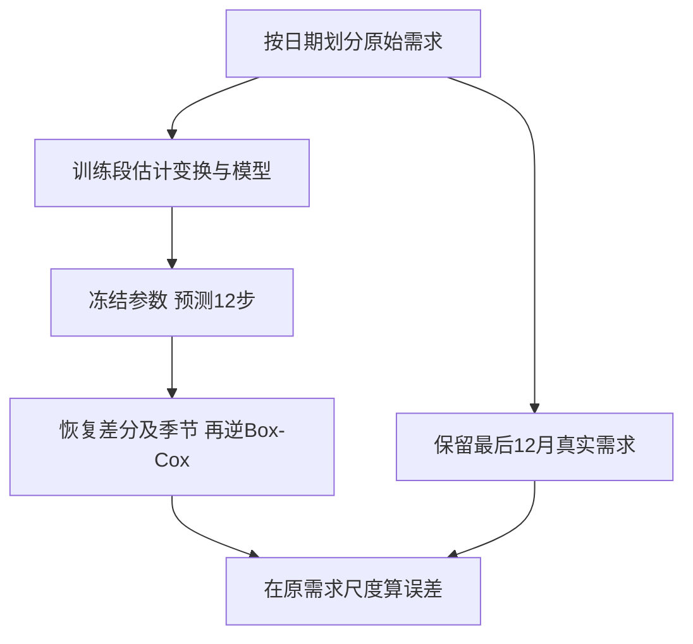

# T09 · 时间序列 II 实操：从变换到公平比较预测

> 转录来源为 `M08-T09-transcript-source20-partial.txt`（S20），同源 `01:30:17` 后进入本教程，`01:58:49`末段仍在PACF选阶。实际授课日期未核；讲义窗另见M08，保留同一原时钟。材料v1.0只表示已融合现有部分来源，不表示整堂课录全。

## 0. 三分钟速览

本教程用月度取暖器需求跑 ARMA、ARIMA、季节 ARIMA 和 ETS。要学会的不只是 `.fit()`：必须知道预测的是哪个量，以及怎样把它恢复成需求单位。

- 能按日期把 198 个月拆成 186 个月训练、12 个月测试。
- 能解释 Box-Cox、减月份均值、差分分别改变了什么。
- 能追踪模型训练、12 步预测、逆变换和 RMSE 的完整数据流。
- 能指出原教程全数据预处理及不同目标尺度比较的限制。
- 能按 Extra Assignment 的要求组织训练专用的天气预测比较。

> 🎙️ **课堂实况**（实际授课日期未核）：S20 `01:30:17`进入教程，录到日期、KPSS、Box-Cox、月份均值、差分、切分与PACF。`01:58:49`末句中断，后段源码和既有实跑不冒称课堂演示。实际授课日期未知。


## 1. 开始之前 · 知识衔接

### 1.1 前置唤醒

[[IS6400_Business_Data_Analytics/notes/M08-时间序列II-自相关差分与ARIMA|M08]] 已讲时间序列理论：自相关检查“前后的值是否有关”，差分是相邻值相减，自回归（Autoregression，AR）使用过去数值；移动平均误差（Moving Average，MA）使用过去预测创新；自回归积分移动平均（Autoregressive Integrated Moving Average，ARIMA）将它们与差分结合。本篇把这些操作接到具体列和日期，不能仅凭记住名字运行。

[[IS6400_Business_Data_Analytics/notes/T08-时间序列实战-销量与季度季节性|T08]] 的指数平滑状态空间（Exponential Smoothing State Space，ETS）每次按预测误差更新水平、趋势、季节状态。本篇保留这条状态更新理解，并说明参数如何在训练段估计。

### 1.2 Python 最小入场

`heater` 是一张表，行是一月，列是一种信息。`heater['demand']` 取需求列；`x = ...` 把右侧结果保存在名字 `x`；函数名后的小括号表示执行操作，`order=(2,1,1)` 这样的名字和值指定设置。

`a[:-12]` 取末 12 项以前的部分，`a[-12:]` 取末 12 项。负号在这里是从末尾定位，不是负需求。`.head()` 看开头，`.shape` 看行列数，`.fit()` 是用训练数据估参数，`.forecast(12)` 才是用已估计模型向后算 12 步。改后者不会替你重新训练。

### 1.3 路径和运行方式

把 Notebook 副本与 `heater.csv`、`weather.csv` 放在同一工作目录，再从第一格顺序运行。原件继续只读。相对路径 `'heater.csv'` 是相对 Notebook 内核工作目录，不是相对 Obsidian 笔记；找不到文件先查看当前目录，不要换一个同名但不知来源的 CSV。

本次在现有 `D:/anaconda3/python.exe` 环境执行了 35 个代码单元，未安装包。Notebook 魔法 `%matplotlib inline` 在脚本复算时去除，图形改用非交互后端；它不影响模型数值。原源码、保存输出、本次复算和笔记修正实验四种来源分别标注。

## 2. 正文

### 2.1 先固定输入、输出和时间（Cells 1–9）

输入 `heater.csv` 有 198 行 × 2 列。`year_month` 是月份，`demand` 是需求量，数据未交代更细的业务单位，因此写“原需求单位”，不擅自补“千台”。Cell 6 的开头五项为 27、18、14、13、13。

Cell 3 导入 pandas 处理表、NumPy 处理数值、SciPy 做变换、statsmodels 建时间模型、sklearn 算误差、Matplotlib 画图。`warnings.filterwarnings('ignore')` 会隐藏警告；教学复现可说明它来自原件，诊断预测时应保留收敛警告，不能因画面安静就说模型可靠。

Cell 7 用明确格式 `%Y-%m` 把月份文字转成日期；否则绘图库可能把每月当成独立文字类别。Cell 8 查 198 个非空需求，Cell 9 画“横轴月份、纵轴原需求”的曲线。一点代表一月，不是单个顾客。

**🎙️ 课堂补充**（S20 `01:30:17`–`01:41:26`）

教程先强调数据准备，再用 198 行月度需求演示日期类型。S20 `01:39:13`：*"make sure your format is consistent with with your data here"*。中文：日期解析格式要匹配实际文字；`%Y-%m`用于这份年-月数据，不能随意套日-月-年。

图中冬季重复峰值、整体上升和振幅扩大分别对应季节、趋势与波动尺度。这里确认的是课堂如何读原图，不是把可见形状当成严格平稳检验证明。

### 2.2 KPSS 检查什么（Cells 10–12）

平稳性（Stationarity）在这里指序列的均值、波动和相隔相同月份的关系不随绝对时间系统变化。不断上升的趋势会破坏这种稳定结构。KPSS 的原假设（Null hypothesis）是在指定确定性项下平稳；`regression='c'` 使用常数均值口径，`nlags='auto'` 自动选计算所需滞后。

Cell 11 保存及本次输出的 p 值均为 0.01。按 0.05 阈值拒绝该原假设，支持继续处理非平稳问题。不能把 p 值解释为“平稳的概率只有 1%”，也不能把拒绝说成已证明原因一定是趋势。

KPSS 软件的 0.01／0.1 可能位于表格可给的边界，实际警告可能提示真实 p 值在范围外；原件隐藏了警告。报告这些输出值，并说明阈值判断，不能假装获得了无限精度的概率。

**🎙️ 课堂补充**（S20 `01:41:35`–`01:43:00`）

教程读原需求 KPSS 的输出为0.01（S20 `01:42:24`），与 Cell11 保存结果相符。按 c 规格和0.05阈值拒绝平稳原假设；口头“数据非平稳”是简述，不表示已经找出唯一原因，也不把p值解释为原假设的概率。

### 2.3 Box-Cox 怎样压缩波动（Cells 13–18）

需求量增大时波动也变大，直接用一个固定误差尺度可能不合适。Box-Cox 对正数作单调变换，大数值区间可以被压缩。它不自动去掉趋势和季节性。

对正需求 $y$，变换后的值记为 $z$，调节形状的参数为 $\lambda$：

$$
z=\begin{cases}(y^\lambda-1)/\lambda,&\lambda\ne0,\\\log y,&\lambda=0.\end{cases}
$$

这里的 $y$ 是一月需求，$z$ 是变换尺度，不再用原需求单位。$\lambda$ 由训练数据估计；Cell 15 未显式给参数，所以 SciPy 用输入序列估计它。原教程输入全 198 月，保存值约为 $-0.664521$；本次复算相同到展示精度。直接代入原教程λ，$[27^{-0.664521}-1]/(-0.664521)\approx1.336452$。需求27因此被变成约1.336452，这不是需求降到 1.34 台。

Cell 17 把数组放回 `demand_BC` 列并画图。若需求含零或负数，当前原代码不能直接做 Box-Cox；不能为了消错随意加常数而不交代改变的模型与逆变换。

**🎙️ 课堂补充**（S20 `01:43:19`–`01:45:42`）

教程要求留住变换参数，方便把预测恢复为需求。S20 `01:44:12`：*"So the lambda will tell you how to reverse this one"*。中文：模型若预测变换尺度，就要用对应λ做反向恢复；只画出较平稳曲线还没有得到原需求预测。

口述将Box-Cox与更接近正态形状联系。这里仍按正文界定：改变边际分布或稳定方差，不保证没有趋势、季节或自相关，也不等于KPSS检验会把数据变成正态。

### 2.4 月份均值怎样去季节（Cells 19–27）

先把每行的月份编号取出来，例如 2004-01 和 2005-01 都得到 1。`groupby('month')` 把同月份放一组，`.mean()` 算各组均值，`.reset_index()` 将月份索引恢复成普通列，便于合并。

`rename` 把均值列命名为 `demand_month_avg`，避免和每月真实值混淆；`merge(..., on='month')` 按月份把 12 个均值贴回 198 行。右表应每月一行，否则一月可能匹配多行、错误膨胀表；合并后核行数、月份覆盖和日期排序。

原教程设 $s_m$ 为第 $m$ 月的 Box-Cox 平均值，再算去季节量 $u_t=z_t-s_{m(t)}$。$m(t)$ 表示日期 $t$ 属于几月。

💡 读一行：2004-01 的 $z_t$ 约 1.336452，原教程的一月均值约 1.354655，相减得到约 −0.018203。负数只说明低于一月平均，不是负需求。去季节量仍可能随年份上升，所以 Cell 27 之后还要查趋势。

与 M08 §2.7 的示例对照：那里减的是“同季节均值减总体均值”，所以保留总体水平；本教程直接减同月均值，额外移去一个总体常量。两种结果的相邻差分相同，但恢复水平须加回各自保存的量。本篇后续始终加回同月 Box-Cox 均值，不混用中心化季节差额。

这些均值由输入数据估计，不能用包含测试期的一月均值回头评价预测。它和“月份编号 1–12 是已知日历”不同：日历已知，未来需求均值未知。

**🎙️ 课堂补充**（S20 `01:45:42`–`01:52:05`）

教程按月份分组、求 Box-Cox 需求均值，再按 month 合回原表。S20 `01:49:57`：*"demand of each month and then we merge this data set to our original data set here by the month, right?"* 它把12个“月份位置的平均”贴回逐月行，再相减；负值是低于该月份平均。

这确认实际处理的列是 demand_BC，不能对原需求均值和变换后需求混减。原教程此处仍用全198月，课堂后面对选阶的更正没有自动修好预处理泄漏，训练侧修正方案仍见正文。

### 2.5 差分、缺失首项与测试边界（Cells 28–37）

Cell 29 的 `.diff()` 得到 $v_t=u_t-u_{t-1}$，即本月相对上月改变多少。首月没有前月，因此为 NaN（缺失值）；不能把它填成 0 后当实际观测。

原教程前两项 $u$ 约 −0.018203、−0.039314，相减得到 −0.021111。Cell 32 去掉首项后再做 KPSS，保存输出为 0.1；按 0.05 不拒绝平稳原假设。**不拒绝不是证明平稳，更不是“95% 概率平稳”**，这是对 Cell 33 的口径修正。

Cell 35 用前 186 行训练、末 12 行测试。分割点前已进行全表 Box-Cox 和月份均值估计，故原教程的边界并不干净。修正时必须先固定原始时间切分，再在训练段估计变换参数和月份均值。

差分的跨界要仔细区分：测试首月真实差分可用最后训练月真实值相减来评价；但是在**一次性预测 12 步**时，第二步以后不能把真实测试月喂回当过去观测，否则已变成另一种滚动协议。

下面图按一次性 12 步评价读；箭头表示数据进入计算，测试目标只进入最后评分。



**🎙️ 课堂补充**（S20 `01:52:14`–`01:55:39`）

教程明确调用一阶差分，并读处理后KPSS输出0.1。S20 `01:52:14`：*"So the third step is we can apply first-order differencing to detrend the data."* 后续又强调，并非所有模型都使用三步处理后的最终列（`01:52:55`–`01:53:32`）；模型自己能处理哪种结构，决定要交给它哪个输入。

`01:55:07`要求测试数据在训练之后；`01:55:23`说明末12月作测试。课堂p值口径仍须按正文写“未拒绝”，不能写已证明平稳。

### 2.6 ARMA：预测的是“变化量”（Cells 38–51）

ACF（自相关函数）看一串数与其滞后值的相关；PACF（偏自相关函数）进一步控制中间滞后影响。Cell 41／44 在训练差分量上画图，Cell 42／45 选 $p=2,q=1$。这是一种候选阶数判断，不是“图上某根线越界便唯一证明正确阶数”。多次看测试误差来挑阶会让测试变成验证集。

ARMA(2,1) 的当前输出由前两个滞后月份的变化量和一个过去创新参与解释。创新 $\varepsilon_t$ 是给定当时历史后仍没预测到的新误差，不是原需求减平均值。

💡 示意约定：若 $v_t=0.5v_{t-1}+0.2v_{t-2}+\varepsilon_t+0.3\varepsilon_{t-1}$，已知最近两个变化量为 0.02、0.01，最近创新 0.005，下一步预测是 $0.5\times0.02+0.2\times0.01+0.3\times0.005=0.0135$。这是笔记补充参数，不是教师模型估计值。多步预测时未知未来创新的条件期望取 0，并递推使用已经预测出的变化量。

Cell 47 调 `ARIMA(..., order=(2,0,1))`，中间的 0 表示这里不再额外差分，因为传入的 `demand_diff1` 已差分。`.fit()` 通过训练段的概率模型及创新计算估计系数和误差尺度，使训练数据在模型下更可能出现；不是把测试答案存进去。优化迭代满足数值停止条件，不保证全局最优。

Cell 49 把预测放到测试月份画图；Cell 51 的保存 RMSE 为 0.0114638359，量纲是**去季节后差分的 Box-Cox 单位**。它还没有回答原需求误差有多少。

**🎙️ 课堂补充**（S20 `01:55:49`–`01:58:49`）

教程讲者明确纠正选阶数据范围。S20 `01:56:58`：*"we can only use the training data to determine how many parts of value we use."* `01:57:12`–`01:57:21`说明旧版用全数据不对，已更新Notebook；本地当前Cell41／44确实传 train。

录音末尾在PACF取p=2的解释中断，尚未直接录到本节其后的ACF选q、拟合、预测及RMSE，不能把讲义源码和既有本机实跑冒称课堂演示。这个更正只确认选阶，不会自动消除Cell15／22全表预处理的问题。

#### 2.6.1 怎样读当前训练侧的 ACF／PACF 图

下图由本次训练段重新计算，未使用测试段选阶；上排是去季节后的一阶差分，下排是 Box-Cox 水平的 12 期差分。它与原教程的全表预处理输入不同，不能冒称原件保存图。

![[IS6400_Business_Data_Analytics/notes/figures/t09-time-series/t09-diagnostics.svg]]

横轴 lag 是相隔几个月，纵轴是相关系数。lag 0 等于与自己比较，通常为 1，不能拿它选 AR 阶数。浅蓝带是所用方法给出的近似显著性参考区，越界只提示该滞后下相关值得检查，多重滞后与估计误差仍可能造成偶然越界。

实际读上排：lag 1 明显为负，PACF 的 lag 2 也为负；后面仍有多根靠近／越过参考带，因此不能硬说“恰好在2阶严格截尾”。读下排：虚线标 12、24、36 个月，lag 12 的相关为负，36 附近又有结构，季节项应按这些间隔检查，不是把横轴3直接当季节lag36。

“截尾”指理论上某阶后相关归零，“拖尾”指逐渐衰减而不是突然消失；有限样本的图只提供近似线索。纯AR常以PACF截尾、纯MA常以ACF截尾作候选启发式，混合模型不保证出现干净形状。本篇固定沿用原教程规格用于比较，未声称这张图证明它们唯一正确。

若要真正选择规格，可在186月训练段内部再留最近12月作验证：每个候选只在更早训练部分估变换和模型，在这12月按相同原尺度评价；先检查收敛与残差，再结合误差和复杂度选定。规格冻结后才用完整186月重估，并只对最后12月正式测试一次。这样测试期没有被反复用作选阶工具。


### 2.7 ARIMA：模型内部做差分并恢复（Cells 52–58）

Cell 54 传 `demand_de_season`，`order=(2,1,1)` 表示内部做一次差分，再用 ARMA 结构拟合。与上一节的输入不同，因此 `.forecast()` 返回的是去季节后的水平 $u$，不是其差分 $v$。

差分恢复的理由是等式 $u_t=u_{t-1}+v_t$。从最后已知水平出发，把未来变化逐个累加即可。若末水平为 0.10、两步预测变化为 0.02 和 −0.01，两步水平分别是 0.12 和 0.11；不能每步都只加最初的 0.10。

Cell 56 画去季节水平，Cell 58 保存 RMSE 约 0.0155562296。它与 ARMA 节的误差对象不同，数值较大不能据此判模型较差。

### 2.8 季节 ARIMA：普通差分和季节差分分开（Cells 59–73）

月度数据一年 12 期。季节 ARIMA 记为 $(p,d,q)(P,D,Q)_{12}$：小写部分处理普通滞后，大写部分处理间隔 12 的季节结构。大写 $D$ 才是模型实际做几次季节差分。

Cell 62 画 `demand_BC.diff(12)`，目的是诊断；Cell 65／67 用训练段的季节差分画 PACF／ACF。原件称 $P=1,Q=3$，Cell 69 实际拟合 `order=(2,1,1), seasonal_order=(1,0,3,12)`，输入仍是 **未作季节差分的 Box-Cox 水平**。

Cell 63 写“季节差分图无趋势，所以不再差分，即 D=0”。这段解释不足以推出拟合应选 $D=0$：已经看了差分后的图，不能把它当作未差分序列平稳的证据；而普通 $d$ 和季节 $D$ 也不是同一个参数。本笔记保留原代码规格用于复现，不把阶数理由当已严格证实。

季节 MA 项里的 $Q=3$ 涉及季节间隔 12、24、36 的创新结构；不是只看普通 lag 3 就够。ACF/PACF 的阶数识别是候选启发式，还须核残差和训练侧验证。

Cell 69 的 `.fit()` 同时估这些系数，`.forecast(12)` 返回 Box-Cox 水平预测；不再手动给它累加普通差分。Cell 73 保存 RMSE 约 0.0094490941；本次在记录的软件环境复算约 0.0099579327，未改原件。数值优化和软件版本可产生差异，当前证据没有把差异单独归因到某一个原因。

### 2.9 ETS：用误差调整状态（Cells 74–80）

Cell 76 的 `ETSModel(..., trend='add', seasonal='add', seasonal_periods=12)` 在 Box-Cox 水平上估计加法趋势和季节。`add` 表示组成部分相加，12 是一年月份数。未写 `error` 时该 API 使用加法误差设置；实际环境版本见复算记录。

用加法 Holt-Winters 的直觉恢复当前操作：先用上月水平、趋势和相应季节状态给本月预测，再根据实际与预测之差修正状态。一个便于理解的常见写法是：

$$
\ell_t=\alpha(z_t-s_{t-12})+(1-\alpha)(\ell_{t-1}+b_{t-1}),
$$

$$
b_t=\beta(\ell_t-\ell_{t-1})+(1-\beta)b_{t-1},\qquad
s_t=\gamma(z_t-\ell_t)+(1-\gamma)s_{t-12}.
$$

$\ell$ 是水平，$b$ 是每月趋势，$s$ 是季节项；$\alpha,\beta,\gamma$ 是状态调整权重。这是常见递推帮助理解，statsmodels ETS 的创新参数化与传统平滑写法不应只因符号相同就逐项等同。

💡 数字例：旧水平 10、趋势 1、同月季节 2，实际值 15，取三权重均 0.5。新水平为 $0.5(15-2)+0.5(10+1)=12$；新趋势为 $0.5(12-10)+0.5\times1=1.5$；新季节为 $0.5(15-12)+0.5\times2=2.5$。之后按日期选下一月的季节状态，不能把本月 2.5 随意用于每一个未来月份。

`.fit()` 同时估平滑参数和初始状态。优化日志里的 `N` 是待优化变量数，迭代序号是优化步，不是模型看过了几个月。正常停止并不证明预测最好。Cell 78 画图，Cell 80 保存 RMSE 约 0.0187049494，本次约 0.0187049394。

### 2.10 为什么原比较表不能直接选赢家（Cell 81）

RMSE（Root Mean Squared Error，均方根误差）把每个预测差先平方、平均再开根号，以原被评分量的单位读结果。

$$
\mathrm{RMSE}=\sqrt{\frac1H\sum_{h=1}^{H}(y_{n+h}-\widehat y_{n+h})^2}.
$$

$H$ 是测试月份数，本例为 12；$y$ 是真实目标，$\widehat y$ 是在预测时能知道的信息形成的预测。若两个月真实为 10、14，预测为 12、12，平方误差为 4、4，平均 4、开根得到 2。不是把正负误差先平均成 0。

原表保留以下保存值及目标，不能跨行忽略目标差别。

| 原模型 | 被评分量 | 原保存 RMSE |
|---|---|---:|
| ARMA | 去季节后的差分 | 0.0115 |
| ARIMA | 去季节后的水平 | 0.0156 |
| 季节 ARIMA | Box-Cox 水平 | 0.0094 |
| ETS | Box-Cox 水平 | 0.0187 |

例如第一行误差是在“月变化”上，第三行是在“变换后水平”上。它们都写小数，不代表同单位。ARMA 和 ARIMA 相比，前者误差数字小不能直接证明更优。

### 2.11 从预测量恢复到原需求，再公平比较

这是笔记补充实验，不替换教师原件。

1. 先在原需求上固定 186／12 的时间切分，只用训练需求估 Box-Cox 的 $\lambda$。
2. 训练侧计算每月均值，并把同一变换规则用于未来月份。
3. ARMA 预测差分后，从最后训练去季节水平逐步累计；ARIMA 的返回已是去季节水平，不重复累加。
4. 两者按未来月份加回对应训练月份均值。季节 ARIMA／ETS 直接返回 Box-Cox 水平，不加这一步。
5. 统一用同一个训练 $\lambda$ 做逆 Box-Cox，得到原需求尺度，评价同 12 个真实月份。

逆变换为 $y=(1+\lambda z)^{1/\lambda}$，$\lambda=0$ 时为 $e^z$。必须满足 $1+\lambda z>0$；否则超出当前逆变换定义域，不能静默截成 0。逆变换后的点预测通常不等于经过偏差校正的原尺度条件均值，比较时说明采用同一插件式点预测规则。

本次实际运行的训练侧结果如下，单位均为原需求单位。只比较这个表内部。

| 模型规格沿原教程 | 同尺度 RMSE | 优化器收敛标记 |
|---|---:|---|
| ARMA(2,1) | 14.7413 | true |
| ARIMA(2,1,1) | 12.7463 | true |
| SARIMA(2,1,1)(1,0,3,12) | 4.2851 | false，50次迭代后未收敛 |
| ETS 加法趋势／季节 | 15.7103 | true |

读第三行：该固定规格在这 12 月的预测偏差，用 RMSE 汇总为约 4.29 个需求单位。它的数值最低，但本次优化器报告未收敛（converged=false，warnflag=1），并有 Maximum Likelihood optimization failed to converge 警告。因此4.2851只是当前未收敛优化结果的描述性误差，不能据此宣布可靠拟合完成后的赢家。其他行的true也只是优化器停止标记，不是模型有效性证明。这里仍只是一段测试、固定规格的结果，不是普遍排名。若根据此结果再调参，本测试已经参与选择，下次应留新的最终测试。

![[IS6400_Business_Data_Analytics/notes/figures/t09-time-series/t09-forecast.svg]]

图为本次补充实验真实预测；其中SARIMA线来自上述未收敛优化结果，不能仅凭贴近黑点就认定其可靠。横轴是共同的 12 个测试月份，纵轴是原需求；黑点为真实值，四条线是一次性 12 步预测。读某月时先比较同一纵轴上的线与黑点距离，不把跨月份斜率当误差。图源与输入版本随资产保存。

#### 2.11.1 用实际2019年7月走完恢复链

本次训练期为2004-01至2019-06，测试期为2019-07至2020-06。训练估计的 $\lambda$ 为约 −0.747199247；真实运算使用未舍入值，下面保留足够位数方便逐步核读。

| 恢复步骤 | 本次实际数值 | 意思 |
|---|---:|---|
| 末训练去季节水平 | 0.044871892 | 累计变化量的已知起点 |
| ARMA首步变化预测 | −0.000384823 | 相对上月的预测变化 |
| 两者相加 | 0.044487070 | 7月去季节水平预测 |
| 加训练期7月均值1.152286636 | 1.196773705 | 7月Box-Cox水平预测 |
| 用训练λ逆变换 | 20.217026828 | 原需求单位的7月预测 |
| 测试7月真实值 | 21 | 只用于最终评价 |

最后两行差约 −0.782973，表示少预测约0.783个原需求单位。下一步ARMA继续累计预测变化，而不是把测试7月的真实需求21喂回。这一例将§2.11的恢复顺序接到实际数组；不是用已舍入表格重新估参数。

持久入口：[完整复算脚本](figures/t09-time-series/t09-reproduce.py)、[实际执行与预测记录](figures/t09-time-series/t09-execution.json)、[本月中间量](figures/t09-time-series/t09-first-month.json)。脚本从自身正式位置找到本课`course_files_export/`，输出写到库外`E:/app-data/codex/scratchpad/cityu-t09-reproduction/`，不会覆盖学校原件。

运行入口是 `D:\anaconda3\python.exe -X utf8 <本课notes/figures/t09-time-series/t09-reproduce.py的完整路径>`。需已有pandas、SciPy、statsmodels、sklearn和Matplotlib；本机本次已具备。脚本包含原35格复现与训练侧修正两条独立链，不能把修正值冒称原件输出；诊断标记、日期、预测和图都写入执行记录。


### 2.12 Extra Assignment：完整原题与参考实现（Cell 82）

以下是评分作业，原题在 Notebook 内。作业要求、参考演示、本人作答和 Canvas 提交分别记录；本篇的例子不是本人已提交答卷。

<details><summary>Cell 82 英文原题全文</summary>

# Week 9 Assignment(Extra): Weather Time Series Forecasting

**Data:** `weather.csv`
**Task:** Choose a weather variable, forecast it using the ARIMA pipeline, and compare it with another forecasting model.

### Requirements:
1. **Data Prep:** Select a variable, resample it to monthly averages, and split the last 12 months as the test set.
2. **ARIMA:** Apply the Tutorial 9 pipeline (transformations, ACF/PACF, etc.) using train data only to fit and forecast.
3. **Alternative Model:** Choose a second model and forecast the same period.
4. **Evaluation:** Plot actual vs. predicted values for both models, calculate their RMSE, and write a brief conclusion on which model performed better and why.

**Submission:** One Jupyter Notebook with your code, plots, RMSE results, and conclusion.

</details>

中文读题：自选一个天气变量，按月平均，末 12 月测试；只用训练数据处理／选模，再用第二模型预测同一段，画图、算同尺度 RMSE，解释谁好以及为什么。原 Notebook 写交一份 Notebook，Canvas 正式作业页只写 file upload，没有追加格式说明；当前需核平台实际可接收类型，不把旧周通用 HTML 公告静默当成此题明确要求。

⚪ 参考演示选择温度 `T (degC)`。它允许负数，因此本例不直接用 Box-Cox；按原单位建模，并以训练侧诊断与一个固定 ARIMA(1,0,0) 做演示。另一个模型取季节朴素法（Seasonal naive），即明年某月预测为去年同月，不用测试答案调参数。

```python
weather = pd.read_csv('weather.csv')
weather['date'] = pd.to_datetime(
    weather['Date Time'], format='%d.%m.%Y %H:%M:%S')
monthly = weather.set_index('date')['T (degC)'].resample('MS').mean()
train = monthly.iloc[:-12]
test = monthly.iloc[-12:]
fit = ARIMA(train, order=(1, 0, 0)).fit()
pred_arima = fit.forecast(12)
pred_baseline = monthly.iloc[-24:-12].to_numpy()
```

逐块读：先转换日／月／年的日期格式；`set_index` 让日期作为时间标签；`resample('MS')` 按月初标记分组并求平均；`iloc` 按位置分训练和测试。最后基线取的 12 项都在训练期，不是取测试实际值。

数据横跨 2009–2016 共 96 月，训练 84 月、测试 12 月，无缺整月；仅对文件里已有采样求平均，未假装每月采样都完整。月度聚合及缺测密度仍会影响代表性。

本次参考运行温度 ARIMA(1,0,0) 的 RMSE 为 **7.0205 °C**，季节朴素为 **2.4923 °C**。此处基线更好；固定 AR(1) 逐步回归其长期均值，难以保持全年温度季节起伏，是与模型结构相符的解释，不代表已证明差异只有这一个原因。可在训练段内部滚动验证季节模型，再冻结规格评价；不能看测试结果反复挑参数后仍称未见测试。

英文参考结论：“For the monthly temperature series, the fixed ARIMA(1,0,0) achieved an RMSE of 7.0205 °C, while the seasonal-naive benchmark achieved 2.4923 °C over the same final twelve months. The benchmark performed better in this illustrative test. A non-seasonal AR(1) forecast tends towards its long-run level and does not preserve the annual pattern well. Further model selection should use training-side validation.”

本次训练侧KPSS统计量约0.08547、p值输出0.1、自动滞后4：在本设置下不拒绝常数平稳原假设，但不等于证明没有季节性。训练ACF在12个月处约0.78733，PACF在1个月处约0.80019，说明年度结构和短期相关都值得关注；固定AR(1)是说明协议的参考候选，不是由诊断证明最优。

![[IS6400_Business_Data_Analytics/notes/figures/t09-time-series/t09-weather.svg]]

图的横轴为2016年12个测试月，纵轴为月均摄氏温度。黑点是真实月均温度，ARIMA(1,0,0)线逐渐趋平，季节朴素线保留上一年的月度起伏；该图支持前述有限的结构解释，不能用此测试再反复调参。

[天气参考代码与诊断／绘图](figures/t09-time-series/weather-reference.py) 提供完整数据处理、训练侧诊断、两个预测、两RMSE与共同图。正式位置可用 D:\anaconda3\python.exe -X utf8 加脚本完整路径运行；在本机Notebook按块运行时，脚本已给出没有 __file__ 时的明确课程路径分支，若搬到另一处先改 course 为包含 course_files_export/ 的实际课程目录。它是已运行逻辑的持久参考入口，不是本人已审核或提交的正式答卷。Canvas接受扩展名、个人文件和最终提交仍按任务说明另核。

### 2.13 原教程代码逐单元对照（Cells 3–80）

本节按原顺序保留所有 35 个代码单元，可折叠查阅。§2.1–2.9 已逐组解释输入、关键设置和输出；绘图单元共享“先定画布→按同日期画真实与预测→标标题／图例→显示”的读法。代码仅为原件保真引用，不能抹去上文的泄漏和尺度限制。

<details><summary>原 Code Cell 3</summary>

```python
import pandas as pd
import numpy as np
from sklearn.metrics import root_mean_squared_error
from scipy.stats import boxcox
from statsmodels.tsa.stattools import kpss
from statsmodels.tsa.arima.model import ARIMA
from statsmodels.graphics.tsaplots import plot_acf, plot_pacf
from matplotlib import pyplot as plt
%matplotlib inline

import warnings
warnings.filterwarnings("ignore")
```

</details>

这些导入语句让后续名字对应具体库函数；%matplotlib是Notebook显示设置，warnings行会屏蔽警告，诊断时须注意其限制。

<details><summary>原 Code Cell 6</summary>

```python
heater = pd.read_csv('heater.csv')
heater.head()
```

</details>

read_csv按当前工作目录读取两列表，head返回前五行，用来核月份及需求输入。

<details><summary>原 Code Cell 7</summary>

```python
heater['year_month'] = pd.to_datetime(heater['year_month'], format = '%Y-%m')
```

</details>

to_datetime按年-月格式转换这一列，赋值只更新副本中的日期表示，输出供后面的时间轴使用。

<details><summary>原 Code Cell 8</summary>

```python
heater.info()
```

</details>

info返回每列类型和非空数，核198行是否仍在，以及需求列有没有缺失。

<details><summary>原 Code Cell 9</summary>

```python
plt.figure(figsize = (20,8))
plt.plot(heater['year_month'], heater['demand'])
plt.title('Monthly heater demand')
plt.show()
```

</details>

figure定画布，plot把每月需求放到日期轴，show显示图；横轴是月份，纵轴是需求。

<details><summary>原 Code Cell 11</summary>

```python
kpss_stat, pval, lags, crit = kpss(heater['demand'], regression = 'c', nlags = 'auto')
print('p Value to the KPSS test is: ',pval)
```

</details>

kpss输入原需求列，四个返回量分别为统计量、p值、使用滞后和临界值；本格只打印p值。

<details><summary>原 Code Cell 15</summary>

```python
#if parameter lmbda is none, the model will find the optimal parameter
BCheater, lmbda = boxcox(heater['demand']) 
print(BCheater[:10])
print(lmbda)
```

</details>

boxcox返回变换数组和估计λ；[:10]只显示前十项，不是仅用十项估计。

<details><summary>原 Code Cell 17</summary>

```python
heater['demand_BC'] = BCheater
plt.figure(figsize = (20,8))
plt.plot(heater['year_month'], heater['demand_BC'])
plt.title('Monthly heater demand after Box-Cox transformation')
plt.show()
```

</details>

先把变换数组加入同一表，再按日期画变换尺度的曲线，不能把纵轴当原需求。

<details><summary>原 Code Cell 20</summary>

```python
heater['month'] = heater['year_month'].dt.month
print(heater.head())
```

</details>

dt.month从日期取得1至12的月份编号，赋值后每行仍代表原来的月份。

<details><summary>原 Code Cell 22</summary>

```python
heater_by_month = heater.groupby('month')['demand_BC'].mean().reset_index()
print(heater_by_month.head(12))
```

</details>

groupby按月份分组，对demand_BC求均值，reset_index让月份成为普通列；输出应是12行。

<details><summary>原 Code Cell 23</summary>

```python
heater_by_month = heater_by_month.rename(columns = {'demand_BC':'demand_month_avg'})
print(heater_by_month.head(12))
```

</details>

rename仅改右侧均值列名，保留数值，便于下一格区分观测与均值。

<details><summary>原 Code Cell 25</summary>

```python
heater = heater.merge(heater_by_month, on = 'month')
print(heater.head())
```

</details>

merge用月份把右侧每月均值接回各观测行，若右表月份重复会膨胀，须核行数。

<details><summary>原 Code Cell 26</summary>

```python
heater['demand_de_season'] = heater['demand_BC'] - heater['demand_month_avg']
heater = heater.sort_values(by='year_month')
plt.figure(figsize = (20,8))
plt.plot(heater['year_month'], heater['demand_de_season'])
plt.title('Monthly heater demand after Box-Cox transformation and de-seasonality')
plt.show()
```

</details>

相减得到去季节水平，sort_values恢复日期顺序，再画该列；负值表示低于月份平均。

<details><summary>原 Code Cell 29</summary>

```python
heater['demand_diff1'] = heater['demand_de_season'].diff()
heater.head()
```

</details>

diff按当前日期顺序做相邻相减，首行缺前值为NaN，head用来核中间量。

<details><summary>原 Code Cell 30</summary>

```python
plt.figure(figsize = (20,8))
plt.plot(heater['year_month'], heater['demand_diff1'])
plt.title('Monthly heater demand after Box-Cox transformation, de-seasonality, and de-trend')
plt.show()
```

</details>

本格仅画差分结果，用同日期坐标查趋势与波动形态，不自动证明平稳。

<details><summary>原 Code Cell 32</summary>

```python
_, pval, __, ___ = kpss(heater['demand_diff1'][1:], regression = 'c', nlags = 'auto') # do not include the first NaN value
print('p Value to the KPSS test is: ',pval)
```

</details>

[1:]去掉首个缺失差分值，KPSS再次检查；下划线变量是未打算展示的返回项。

<details><summary>原 Code Cell 35</summary>

```python
train = heater[:-12]
test = heater[-12:]
train.shape, test.shape
```

</details>

负索引切分末12行，其余训练；shape返回两表行列数，核186/12和列数。

<details><summary>原 Code Cell 37</summary>

```python
plt.figure(figsize = (20,8))
plt.plot(train['year_month'], train['demand_diff1'], label = 'Train')
plt.plot(test['year_month'], test['demand_diff1'], label = 'Test')
plt.legend(loc = 'upper left')
plt.title('Monthly heater demand')
plt.show()
```

</details>

分别按两段日期绘训练和测试，legend说明两线；此图不能代替检查预处理先后。

<details><summary>原 Code Cell 41</summary>

```python
plot_pacf(train['demand_diff1'][1:], title = 'PACF plot');
plt.show()
```

</details>

plot_pacf对训练差分序列画偏自相关，去掉首NaN；横轴lag是月数。

<details><summary>原 Code Cell 44</summary>

```python
plot_acf(train['demand_diff1'][1:], title = 'ACF plot');
plt.show()
```

</details>

plot_acf对同一训练差分序列画自相关；与PACF的控制中间滞后口径不同。

<details><summary>原 Code Cell 47</summary>

```python
# 2,0,1 ARIMA Model
model = ARIMA(train['demand_diff1'], order=(2,0,1))
model_fit = model.fit()
y_predict = model_fit.forecast(12)
```

</details>

ARIMA创建(2,0,1)概率模型，fit估计参数，forecast返回未来12步差分预测；必须恢复后才得需求。

<details><summary>原 Code Cell 49</summary>

```python
# Plot
plt.figure(figsize = (20,8))
plt.plot(train['year_month'], train['demand_diff1'], label = 'Train')
plt.plot(test['year_month'], test['demand_diff1'], label = 'Test')
plt.plot(test['year_month'], y_predict, label='forecast')
plt.title('Forecast vs Actuals')
plt.legend(loc='upper left', fontsize=18)
plt.show()
```

</details>

三条plot共用日期，y_predict对应测试日期，但实际预测对象仍是差分列。

<details><summary>原 Code Cell 51</summary>

```python
rmse_arma = root_mean_squared_error(y_true=test['demand_diff1'], y_pred=y_predict)
print(rmse_arma)
```

</details>

root_mean_squared_error在差分尺度对真实与预测逐项评分，print返回该尺度的RMSE。

<details><summary>原 Code Cell 54</summary>

```python
model = ARIMA(train['demand_de_season'], order=(2,1,1)) 
model_fit = model.fit()
y_predict = model_fit.forecast(12)
```

</details>

输入去季节水平并设d=1，模型内部差分，返回预测已恢复到此输入水平，不能再累计一次。

<details><summary>原 Code Cell 56</summary>

```python
plt.figure(figsize = (20,8))
plt.plot(train['year_month'], train['demand_de_season'], label = 'Train')
plt.plot(test['year_month'], test['demand_de_season'], label = 'Test')
plt.plot(test['year_month'], y_predict, label='forecast')
plt.title('Forecast vs Actuals')
plt.legend(loc='upper left', fontsize=18)
plt.show()
```

</details>

本格把去季节水平的真实与预测共轴画出，不是原需求图。

<details><summary>原 Code Cell 58</summary>

```python
rmse_arima = root_mean_squared_error(y_true=test['demand_de_season'], y_pred=y_predict)
print(rmse_arima)
```

</details>

本格评分的是真实去季节水平，因此不能与上一差分RMSE直接排胜负。

<details><summary>原 Code Cell 62</summary>

```python
# plot the demand after differencing with lag = 12
plt.figure(figsize = (20,8))
plt.plot(heater['year_month'], heater['demand_BC'].diff(12))
plt.show()
```

</details>

diff(12)做相隔12月相减；原代码这里用全表作诊断，训练专用版须另外限定范围。

<details><summary>原 Code Cell 65</summary>

```python
print(train['demand_BC'].diff(12).head(n=20))
plot_pacf(train['demand_BC'].diff(12)[12:]);
plt.show()
```

</details>

打印训练季节差分的前20项，前12项NaN属定义；[12:]只去掉这些缺项，再画PACF。

<details><summary>原 Code Cell 67</summary>

```python
plot_acf(train['demand_BC'].diff(12)[12:]);
plt.show()
```

</details>

对训练12期差分画ACF，季节滞后要看12的倍数，不是普通第3个月就等于季节3阶。

<details><summary>原 Code Cell 69</summary>

```python
model = ARIMA(train['demand_BC'], order=(2,1,1), seasonal_order = (1,0,3,12))
model_fit = model.fit()
y_predict = model_fit.forecast(12)
```

</details>

输入Box-Cox水平，普通与季节规格分别传入两个元组，fit和forecast生成12个月水平预测。

<details><summary>原 Code Cell 71</summary>

```python
plt.figure(figsize = (20,8))
plt.plot(train['year_month'], train['demand_BC'], label = 'Train')
plt.plot(test['year_month'], test['demand_BC'], label = 'Test')
plt.plot(test['year_month'], y_predict, label='forecast')
plt.title('Forecast vs Actuals')
plt.legend(loc='upper left', fontsize=18)
plt.show()
```

</details>

共轴画Box-Cox真实与预测，读图不能把变换纵轴还当作原需求数量。

<details><summary>原 Code Cell 73</summary>

```python
rmse_sarima = root_mean_squared_error(y_true=test['demand_BC'], y_pred=y_predict)
print(rmse_sarima)
```

</details>

本格在Box-Cox尺度评分，保存值与当前软件复算的差别在§2.8分列。

<details><summary>原 Code Cell 76</summary>

```python
from statsmodels.tsa.exponential_smoothing.ets import ETSModel
hw = ETSModel(train['demand_BC'], trend='add', seasonal = 'add', seasonal_periods = 12)
hw_fit = hw.fit()
y_predict = hw_fit.forecast(12)
```

</details>

ETSModel设置加法趋势和12期加法季节，fit估计状态和参数，forecast出12步；优化日志是训练过程。

<details><summary>原 Code Cell 78</summary>

```python
plt.figure(figsize = (20,8))
plt.plot(train['year_month'], train['demand_BC'], label = 'Train')
plt.plot(test['year_month'], test['demand_BC'], label = 'Test')
plt.plot(test['year_month'], y_predict, label='forecast')
plt.title('Forecast vs Actuals')
plt.legend(loc='upper left', fontsize=18)
plt.show()
```

</details>

画ETS的Box-Cox水平预测，线与实际同尺度，但和差分图不能直接比较距离。

<details><summary>原 Code Cell 80</summary>

```python
rmse_hw = root_mean_squared_error(y_pred=y_predict, y_true=test['demand_BC'])
print(rmse_hw)
```

</details>

评分仍为Box-Cox水平，y_true和y_pred参数写反顺序不改变RMSE的对称平方差。

## 3. 一图看懂

§2.5 的数据流是完整评价顺序。记住四个对象：原需求 $y$ → Box-Cox 水平 $z$ → 去季节水平 $u$ → 差分 $v$。预测后沿实际经过的路径倒着恢复；没有经过的变换不要额外再做。

## 4. 速查表

表中每行是一种输入与输出口径，预测返回量决定恢复动作。

| 模型输入 | 原规格 | 返回预测 | 后续恢复 |
|---|---|---|---|
| $v$ | (2,0,1) | 变化量 | 累计、加季节、逆变换 |
| $u$ | (2,1,1) | 去季节水平 | 加季节、逆变换 |
| $z$ | (2,1,1)(1,0,3,12) | Box-Cox 水平 | 逆变换 |
| $z$ | ETS 加法 | Box-Cox 水平 | 逆变换 |

## 5. 双语术语卡

这些英文参考定义是笔记自拟，不能冒称原教程句子。

| 中文 | English | 英文参考定义 | 位置 |
|---|---|---|---|
| 平稳 | Stationarity | Stable distributional features over time under the specified definition. | §2.2 |
| 创新 | Innovation | The new forecast error given the information available at that time. | §2.6 |
| 差分恢复 | Integration of differences | Recovering levels by accumulating predicted changes from a known level. | §2.7 |
| 训练侧预处理 | Training-only preprocessing | Estimating transformation parameters using training observations only. | §2.4–2.5 |
| 季节朴素法 | Seasonal naive | Forecasting each future seasonal period using its last observed counterpart. | §2.12 |
| 同尺度比较 | Common-scale comparison | Evaluating forecasts for the same target, units and test period. | §2.10–2.11 |

## 6. 考点预判与答题框架

本源确认课堂强调数据准备与仅用训练数据选阶；没有本教程独立的期末必考承诺。以下仍按 🟡 教程结构／⚪ 笔记推断准备：从输入列判断 $d$；区分KPSS未拒绝与证明；识别预处理泄漏；恢复原尺度；同测试段比较模型。

英文答题：“The reported RMSE values are not directly comparable because they evaluate different transformed targets. I would estimate preprocessing on the training period, forecast without using future observations, restore each prediction to the original demand scale, and evaluate the same twelve-month test period.”

## 7. 自测

### 7.1 已差分的序列再设 d=1 会怎样

<details><summary>答案</summary>

又做一次差分，改变了拟合对象与恢复步骤，可能过度差分。先查传入的列是水平还是差分量，不能只看模型名称。

</details>

### 7.2 一月平均只用日历编号，为什么会泄漏

<details><summary>答案</summary>

月份编号本身不会泄漏，但各月份的需求平均是从观测值估计的。若含未来测试需求，就提前使用了当时未知的信息。

</details>

### 7.3 原尺度预测小于零，要自动截零吗

<details><summary>答案</summary>

不能静默处理。先核变换定义域、模型适用范围和业务约束。截零是改变预测规则，须训练侧确定并公开，再用同规则评估。

</details>

## 8. Notebook 单元映射

原82cells仍完整保真；课堂来源只覆盖下表列明的部分。S20 的讲义窗与教程窗互不相加冒充完整课长，教程末端缺失不等于略过。

| Cells（从1计） | 正文 | 课堂覆盖 |
|---|---|---|
| 1–9 | §1、§2.1 | S20 `01:30:17`–`01:41:26` |
| 10–12 | §2.2 KPSS | S20 `01:41:35`–`01:43:00` |
| 13–18 | §2.3 Box-Cox | S20 `01:43:19`–`01:45:42` |
| 19–27 | §2.4 月均、合并、去季节 | S20 `01:45:42`–`01:52:05` |
| 28–37 | §2.5 差分、检验、切分 | S20 `01:52:14`–`01:55:39` |
| 38–42 | §2.6 ARMA入口与PACF | S20 `01:55:49`–`01:58:49`，末句中断 |
| 43–51 | §2.6 ACF／拟合／预测／误差 | ❓ 录音已结束；不可降权，源码与既有实跑另列 |
| 52–58 | §2.7 ARIMA | ❓ 未录；不可降权 |
| 59–73 | §2.8 季节模型 | ❓ 未录；不可降权 |
| 74–80 | §2.9 ETS | ❓ 未录；不可降权 |
| 81 | §2.10–2.11 比较与补充实验 | ❓ 未录；补充实验不是课堂输出 |
| 82 | §2.12 天气评分题 | ❓ 本源未录题面讲评；原题及参考实现仍保留 |


**课堂时间分配**（本源所列窗口的段首跨度，非净授课时长）：

| 内容块 | 时间戳 | 跨度 | 所列跨度占比 |
|---|---|---:|---:|
| 教程已录到的数据准备与PACF | S20 `01:30:17`–`01:58:49` | 28.5 min | 100.0% |

分母仅为本表各窗口跨度之和；空档是否含未识别语句未逐声核实，不能称课堂净时长。
## 9. 延伸与勘误

### 9.1 课件有但课上略过

没有支持明确略过的证据；缺录与源码／本机实跑分开。

| 范围 | 缺口原因 | 处理 |
|---|---|---|
| Cells43–51 | 录音在PACF末句结束，后续ACF／拟合未录 | ❓ 不可降权 |
| Cells52–82 | 无后段教学和本教程下课语 | ❓ 原题／代码／参考实验仍保留 |


### 9.2 课上讲了但课件没有

三项课堂增量的来源如下，具体操作仍见正文。

| 内容 | 来源窗口 | 去向 |
|---|---|---|
| 日期格式须匹配原文字 | S20 `01:38:17`–`01:39:13` | §2.1 |
| 不同模型不统一用最终变换列 | S20 `01:52:55`–`01:53:32` | §2.5 |
| 旧版全数据选阶的更正 | S20 `01:57:12`–`01:57:21` | §2.6；当前Cell41／44用train |

讲者身份按lecture／tutorial语境区分，未另核姓名。

### 9.3 原件需带着读的限制

全表预处理后才切分；KPSS 的“95% 平稳”表述；季节差分诊断和 $D=0$ 理由；不同目标的 RMSE 排名；忽略所有警告；本次 SARIMA 输出与保存值的差异。均已在当前学习操作旁解释，原件未修改。

### 9.4 软件和补充实验

本次真实环境、35 格状态、两类预测、参数／日期及图源保存于本篇复算资产。工具定义以原 Notebook 所列 SciPy、statsmodels 与 sklearn API 为依据，代码实际可用性另由本地执行确认。补充实验不证明任何模型普遍最优。

### 9.5 尚未等同完成的事项

Extra Assignment 的完整本人答卷与行政可提交验收未随教程笔记自动完成。当前S20仅录到PACF，未知实际授课日期和具体需求单位；不替本人勾通读、自测、提交或评分。

S20完整机器源1064段，带4条过滤文本的复核记录；本教程只用其 `01:30:17` 以后窗口。原音未逐字听校、录音没有本教程收束。ASR把first误写fourth及把p阶数说成p-value等位置，按公式／当前Notebook解释，不当真实检验p值。

本篇§8只引用S20的教程窗口，自动audit若以整份源作分母，会出现低覆盖提示；完整S20在本批对齐表及M08另有归属，不能为了凑覆盖把讲义时间当作教程教学。

**反方视角**：最弱证据是PACF之后未录到；课堂选阶更正不证明全表预处理已经修好，也不证明未收敛SARIMA已成为可靠赢家。源码与此前实跑支持自学，均不当作本次课堂输出。

### 9.6 变更记录

| 日期 | 变化 |
|---|---|
| 2026-10-31 | 从同一S20转录原时钟纳入教程数据准备与PACF课堂说明，保留后半缺录、全表预处理及未收敛实验限制；审查／写回／各端同步另列。 |
