# T10 · 深度序列预测实战：从窗口到 LSTM

## 0. 这个 Notebook 在教什么

先把有顺序的温度记录切成“已知历史→未来答案”的样本，再训练 LSTM 预测。本篇最重要的动作是追踪每个标签来自哪一行：形状正确、训练日志下降，都不能替代时间边界检查。

- 能手工给一段数列列出第一窗历史与对应标签。
- 能解释 (样本数,时间步数,特征数) 和单点／多点输出。
- 能只用训练均值与标准差换算，再将预测还原为摄氏度。
- 能发现原函数的训练标签越界及源文 12／72／一天的矛盾。
- 能区分保存演示、此次局部执行、未重训网络与本人学习／提交。

## 1. 开始之前 · 输入、环境与路线

### 1.1 先把数组当一张按时间排的表

数组（Array）保存按顺序排列的数，索引（Index）从 0 起。`a[0]` 取第一项，`a[1:4]` 取第 1、2、3 项，右端 4 不取。若 a=(10,20,30,40)，该切片为 (20,30,40)。二维 `a[:,1]` 的冒号保留全部行，1 取第二列。

形状（Shape）描述每条轴有多少项。例如 (2,3,1) 是两窗、每窗三时点、每时点一个数；不是六个独立标签。一个训练样本把整窗历史与自己的目标配对。赋值 `x=...` 给变量保存结果；函数 `def` 把可复用的步骤命名；`for` 逐项重复，缩进表示哪些语句属于同一次循环。

[[IS6400_Business_Data_Analytics/notes/M08-时间序列II-自相关差分与ARIMA|M08]] 与 [[IS6400_Business_Data_Analytics/notes/T09-时间序列II实战-变换恢复与模型评价|T09]] 的时间划分仍适用：预测时不能看未来；本例不先按月聚合。[[IS6400_Business_Data_Analytics/notes/M09-深度学习-神经网络与文本分析|M09]] 讲 RNN 的状态与 LSTM 门；本篇在调用前也会唤醒它们的职责。数据来源与单位见 [[IS6400_Business_Data_Analytics/_meta/数据集卡片|本课数据集卡片]]。

### 1.2 本次实际做到了什么

来源 Notebook 86 cells（45 code、41 markdown），含 12 张保存 PNG；同名 Colab PDF 9 页是 2023 年导出的历史显示，不是授课日期证据。已读全部源码、保存文本与图。源代码不修改，讲义原件保留；没有执行其中链接、云盘操作或下载。

本次在 Python 3.12.3、NumPy 1.26.4、pandas 2.3.3 只读 `weather.csv`，抽取原 cell 13／57 的窗口函数做小例与全数组形状／索引核验，并核首窗标准化数值。当前该 Python 无 TensorFlow，未安装、未重新训练三个网络；保存的模型日志／预测仍明确属于源文件历史。核验脚本与数值保存在本批持久证据，不能把下面源码展示写成此次全本运行。

### 1.3 三条使用路线与编号

- 预习沿 §2 的 cell 顺序，先算 cell 13 的小窗口，再理解标准化和训练，最后比较 cell 59／70 标签差异。
- 课中从 §8 按原 Notebook 的 1 起 cell 序号定位；配套 PDF 只作显示对照，不把它的分页当 Notebook 题号。
- 复习用 §3 流程、§4 形状与边界速查，再做 §7 的变式。所有当前学习、通读、自测和提交状态由本人另记，本篇不代填。

T10 是本库空缺的下一 Tutorial 编号，不代表已经确认第十个教学周；来源未给本次授课日期、正式作业分数或截止。此文为参考学习解析，材料状态 v0.9，转录待补。

## 2. 按原 Cell 顺序讲解

### 2.1 来源、环境与天气表（cell 1–17）

#### cell 1 · 来源与版权

这是原教程的版权声明：Copyright 2019 The TensorFlow Authors。它说明模板的历史来源，不表示本学期授课发生于 2019 年。

<details><summary>原英文说明（保留来源措辞，标题统一为段落）</summary>
<div class="source-original">
<p>Copyright 2019 The TensorFlow Authors.</p>
</div>
</details>

#### cell 2 · 许可注释

这格用于许可注释；先看原代码，再逐步读下面的输入、动作与结果。

```python
#@title Licensed under the Apache License, Version 2.0 (the "License");
# you may not use this file except in compliance with the License.
# You may obtain a copy of the License at
#
# https://www.apache.org/licenses/LICENSE-2.0
#
# Unless required by applicable law or agreed to in writing, software
# distributed under the License is distributed on an "AS IS" BASIS,
# WITHOUT WARRANTIES OR CONDITIONS OF ANY KIND, either express or implied.
# See the License for the specific language governing permissions and
# limitations under the License.
```

本 code cell 全部是以 # 开头的注释，没有计算或联网动作。保留 Apache License 2.0 的许可、使用限制及免责声明；execution_count=1 只说明来源文件保存过执行计数，不能证明本次重跑。

#### cell 3 · Colab 副本说明

原说明要求下载模板、在自己的 Google Drive 建副本后编辑，可能需要 Google 账号。本次原件只读，没有访问其中分享入口、复制云端文件或挂载 Drive。

代码 cell 8 实际读取本地 weather.csv，Colab 不是理解窗口函数的前提。

<details><summary>原英文说明（保留来源措辞，标题统一为段落）</summary>
<div class="source-original">
<p>Download This Template from Google Colab, and then make a copy in your own Google Drive and Edit. You may need a Google Account for your Google Drive and Colab. 
（公开模板入口保留在只读原件 cell 3；此处不重复云盘文件标识。）</p>
</div>
</details>

#### cell 4 · 本教程的两条预测任务

原文先承诺单变量、再多变量时间序列预测。单变量只看温度历史；多变量再加入气压与密度，但目标仍是温度。

RNN（循环神经网络）依次读取时间步、用隐藏状态保留摘要；本例使用其中带门控记忆的 LSTM，机制见 M09 的状态更新。

<details><summary>原英文说明（保留来源措辞，标题统一为段落）</summary>
<div class="source-original">
<p><strong>Time series forecasting</strong></p>
<p>This tutorial is an introduction to time series forecasting using Recurrent Neural Networks (RNNs). This is covered in two parts: first, you will forecast a univariate time series, then you will forecast a multivariate time series.</p>
</div>
</details>

#### cell 5 · 准备运行环境

这一行是 Setup Environment 标题，实际导入位于下一个 cell。先确认 Python、TensorFlow、NumPy、pandas、Matplotlib 可用，再谈重跑；本次不安装 TensorFlow。

<details><summary>原英文说明（保留来源措辞，标题统一为段落）</summary>
<div class="source-original">
<p>Setup Environment</p>
</div>
</details>

#### cell 6 · 导入工具

这格用于导入工具；先看原代码，再逐步读下面的输入、动作与结果。

```python
from __future__ import absolute_import, division, print_function, unicode_literals
import tensorflow as tf
import matplotlib as mpl
import matplotlib.pyplot as plt
import numpy as np
import os
import pandas as pd
```

import 把库加载进程序，as 给短名：tf 用来构造与训练网络，np 做数组计算，pd 读表，plt 画图。mpl 是 Matplotlib 配置入口，os 处理系统路径，本教程没有进一步用这两项完成核心预测。

from __future__ 是兼容较早 Python 的写法，现代 Python 中大部分相应语义已默认。仅导入不代表已经训练网络。

本次局部核验在 Python 3.12.3 / NumPy 1.26.4 / pandas 2.3.3 进行，未安装 TensorFlow，未执行这个完整环境 cell。

#### cell 7 · 天气数据来源与频率的两种说法

原文把历史气象数据归于德国 Jena 的 Max Planck Institute，并说原始数据每 10 分钟记录、教程只用 2009–2016。后面 cell 12 又说当前每小时一条。

本地 weather.csv 是本次读入的实际版本，不能直接把原始采集频率套给它；下文按实测行序和时间戳分别解释。

<details><summary>原英文说明（保留来源措辞，标题统一为段落）</summary>
<div class="source-original">
<p>The weather dataset
This tutorial uses a <a href="https://www.bgc-jena.mpg.de/wetter/">weather time series dataset</a> recorded by the <a href="https://www.bgc-jena.mpg.de/index.php/Main/HomePage">Max-Planck-Institute for Biogeochemistry</a>.</p>
<p>This dataset contains 14 different features such as air temperature, atmospheric pressure, and humidity. These were collected every 10 minutes, beginning in 2003. For efficiency, you will use only the data collected between 2009 and 2016. This section of the dataset was prepared by François Chollet for his book <a href="https://www.manning.com/books/deep-learning-with-python">Deep Learning with Python</a>.</p>
</div>
</details>

#### cell 8 · 读取本地 weather.csv

这格用于读取本地 weather.csv；先看原代码，再逐步读下面的输入、动作与结果。

```python
# store csv as dataframe
df = pd.read_csv('weather.csv') # load the Google Storage data as a pandas dataframe
```

pd.read_csv 将 CSV 读为 DataFrame（一张有行列名的数据表），赋给变量 df。相对路径 weather.csv 从当前工作目录找；本库文件在 course_files_export，应从该目录运行副本或给出正确路径。

注释称 Google Storage，实际语句没有 URL，不下载数据。原件只读，本次仅用绝对路径加载核验。

#### cell 9 · 先看开头几行

这句让读者查看数据，下一 cell 的 head 是了解表头和一行记录含义的入口。前五行能看类型和样例，不能证明全段时间严格连续。

<details><summary>原英文说明（保留来源措辞，标题统一为段落）</summary>
<div class="source-original">
<p>Let's take a glance at the data.</p>
</div>
</details>

#### cell 10 · 一行是一个时点，15 列是什么

这格用于一行是一个时点，15 列是什么；先看原代码，再逐步读下面的输入、动作与结果。

```python
df.head()
```

df.head() 默认展示前五行。Date Time 是字符串时间，后面有 14 个天气数值；例如首行 T (degC)=-8.05，是摄氏温度，p (mbar)=996.50 是气压。

输出里的反斜杠只是宽表换行，不是缺失列。原索引 0 表第一行，不是日期，也不是一月。

首五行一小时一条，本次实际值与保存输出一致；全表另外有异常间隔，不能只据这五行判断频率。

来源保存输出（非本次重训）：

```text
             Date Time  p (mbar)  T (degC)  Tpot (K)  Tdew (degC)  rh (%)  \
0  01.01.2009 01:00:00    996.50     -8.05    265.38        -8.78    94.4   
1  01.01.2009 02:00:00    996.62     -8.88    264.54        -9.77    93.2   
2  01.01.2009 03:00:00    996.84     -8.81    264.59        -9.66    93.5   
3  01.01.2009 04:00:00    996.99     -9.05    264.34       -10.02    92.6   
4  01.01.2009 05:00:00    997.46     -9.63    263.72       -10.65    92.2   

   VPmax (mbar)  VPact (mbar)  VPdef (mbar)  sh (g/kg)  H2OC (mmol/mol)  \
0          3.33          3.14          0.19       1.96             3.15   
1          3.12          2.90          0.21       1.81             2.91   
2          3.13          2.93          0.20       1.83             2.94   
3          3.07          2.85          0.23       1.78             2.85   
4          2.94          2.71          0.23       1.69             2.71   

   rho (g/m**3)  wv (m/s)  max. wv (m/s)  wd (deg)  
0       1307.86      0.21           0.63     192.7  
1       1312.25      0.25           0.63     190.3  
2       1312.18      0.18           0.63     167.2  
3       1313.61      0.10           0.38     240.0  
4       1317.19      0.40           0.88     157.0
```

#### cell 11 · 确认行列形状

这格用于确认行列形状；先看原代码，再逐步读下面的输入、动作与结果。

```python
df.shape
```

df.shape 返回 (行数,列数)，保存值 (70091,15) 与本地只读数据相同。70091 是观测行数，15 含日期加 14 天气列，不是 15 个预测目标。

来源保存输出（非本次重训）：

```text
(70091, 15)
```

#### cell 12 · 窗口长度与预测距离的引子

原文设想用五天 120 条历史预测六小时后，是举例，不是后面所有实验的最终参数。真正单变量配置在 cell 26 为 24 条历史、target_size=0；多变量在 cell 59 才用 120 条和 12。

history_size 数历史有多少行，target_size 决定相对锚点 i 的目标偏移；它不是“标签的数值”。本地实测 70090 个相邻间隔中 70083 个为 1 小时，其余 7 个不等，时间戳还重复 24 次。

故只有连续的小时段，行数才可直接解释成小时；原件不排序或去重。

<details><summary>原英文说明（保留来源措辞，标题统一为段落）</summary>
<div class="source-original">
<p>As you can see above, an observation is recorded every 1 hour. This means that, for a single hour, you will have 1 observations. Similarly, a single day will contain 24 (1x24) observations. </p>
<p>Given a specific time, let's say you want to<strong> predict the temperature 6 hours </strong>in the future. In order to make this prediction, you choose to <strong>use 5 days of observations</strong>. Thus, you would create a window containing the last 120(5x24) observations to train the model. Many such configurations are possible, making this dataset a good one to experiment with.</p>
<p>The function below returns the above described windows of time for the model to train on. The parameter <code>history_size</code> is the size of the past window of information. The <code>target_size</code> is how far in the future does the model need to learn to predict. The <code>target_size</code> is the label that needs to be predicted.</p>
</div>
</details>

#### cell 13 · 单变量窗口函数：先索引，再谈时间

这格用于单变量窗口函数：先索引，再谈时间；先看原代码，再逐步读下面的输入、动作与结果。

```python
def univariate_data(dataset, start_index, end_index, history_size, target_size):
  data = []
  labels = []

  start_index = start_index + history_size
  if end_index is None:
    end_index = len(dataset) - target_size

  for i in range(start_index, end_index):
    indices = range(i-history_size, i)
    # Reshape data from (history_size,) to (history_size, 1)
    data.append(np.reshape(dataset[indices], (history_size, 1)))
    labels.append(dataset[i+target_size])
  return np.array(data), np.array(labels)
```

def 定义函数；括号里的五项是调用时提供的输入。dataset 是按时间顺序的一维数列，start_index/end_index 限制锚点范围，history_size 是历史长度，target_size 是目标偏移。

data 与 labels 两个空列表分别收历史和答案，append 每次加一项，最后 np.array 转为整批数组。

Python 从 0 起编号；range(a,b) 包含 a、不包含 b。函数先把起点加 history_size，避免历史向左越界。

每个锚点 i 用 i-history_size 到 i-1 的数做输入，答案取 i+target_size。np.reshape(...,(history_size,1)) 将一串历史变成“时间步×1 特征”，数值和顺序不变。

💡 实跑小例 dataset=0…17、history_size=3、target_size=0：第一个 i=3，历史 [0,1,2]，标签 3，输出形状 (15,3,1)。最新已知位置是 2，标签 3 是其下一步；target_size=0 不表示拿最后已知值当答案。

若 target_size=2，标签取 5，相对最新输入相隔 3 步。end_index=None 时用 len(dataset)-target_size 保证最后目标不越整条数据；给定 end_index 时函数不自动保护训练／验证界限，后面会查这个边界。

下面是同一补充小例的标签数据流，不把未来放入历史。实际原函数对每个允许的 i 重复这套动作，再把所有窗一起返回。

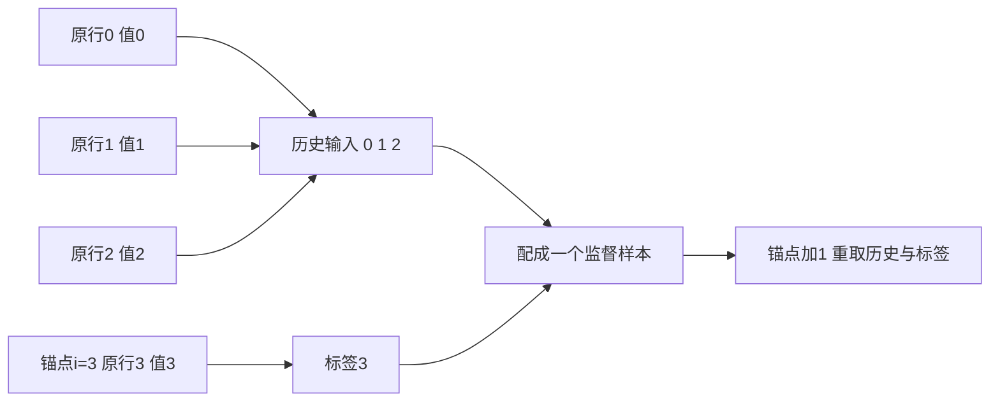

#### cell 14 · 按行切分训练与验证

原文明确前 50000 行训练，其余验证，约 2100 天是把 50000÷24≈2083 天取整的描述。输入顺序要保留，不能先随机把未来行分到训练。

验证（Validation）用于比较和选择配置，不能再冒充最终独立测试集；本教程没有另外保留第三份测试。

<details><summary>原英文说明（保留来源措辞，标题统一为段落）</summary>
<div class="source-original">
<p>In both the following tutorials, the first 50,000 rows of the data will be the training dataset, and there remaining will be the validation dataset. This amounts to ~2100 days worth of training data.</p>
</div>
</details>

#### cell 15 · 设置训练分界

这格用于设置训练分界；先看原代码，再逐步读下面的输入、动作与结果。

```python
TRAIN_SPLIT = 50000
```

TRAIN_SPLIT=50000 只把整数存入变量。切片 [:50000] 包含 0…49999，后段从 50000 开始。

这个变量不会自动阻止目标窗口越界，必须检查函数里的标签索引。

#### cell 16 · 可复现性说明

原文说设置种子是为了复现。随机种子固定部分随机起点，仍要同时约束库版本、数据顺序、硬件和非确定算子才能比较运行；不能只凭下一行保证保存结果逐位一致。

<details><summary>原英文说明（保留来源措辞，标题统一为段落）</summary>
<div class="source-original">
<p>Setting seed to ensure reproducibility.</p>
</div>
</details>

#### cell 17 · 设置 TensorFlow 随机种子

这格用于设置 TensorFlow 随机种子；先看原代码，再逐步读下面的输入、动作与结果。

```python
tf.random.set_seed(13)
```

tf.random.set_seed(13) 设置 TensorFlow 随机操作的种子，不是把数据里的每个值改成 13，也不等于训练轮数。它不证明 NumPy 或其他库的所有随机操作同样固定。

本次没有执行 TensorFlow，局部窗口核验本身不抽随机数。

### 2.2 单变量准备与窗口（cell 18–31）

#### cell 18 · 第一部分：只用温度

目标为未来温度，输入也只用过去温度，称单变量（Univariate）。多变量不是预测多个目标的同义词：后面三个输入仍只预测温度。

<details><summary>原英文说明（保留来源措辞，标题统一为段落）</summary>
<div class="source-original">
<p><strong>Part 1: Forecast a univariate time series</strong>
First, you will train a model using only a single feature (temperature), and use it to make predictions for that value in the future.</p>
<p>Let's first extract only the temperature from the dataset.</p>
</div>
</details>

#### cell 19 · 取出温度并画保存曲线

这格用于取出温度并画保存曲线；先看原代码，再逐步读下面的输入、动作与结果。

```python
uni_data = df['T (degC)']
uni_data.index = df['Date Time']
print(uni_data.head())
uni_data.plot()
uni_data = uni_data.values
```

df['T (degC)'] 取温度列，uni_data.index 指定日期字符串作显示索引。head 打印首五个值，plot 画随行序的温度变化，最后 .values 取出纯数值数组，丢去标签以供窗口索引。

保存图横向是原日期字符串顺序、纵向是摄氏温度，全年高低变化形成多个波峰；日期文字挤在一起，不能从它精确量每段间隔。本次保留图的原貌，时间连续性另用数值核验。

原源码并未 pd.to_datetime，也未重采样，不能说已经修复了异常日期。

来源保存输出（非本次重训）：

```text
Date Time
01.01.2009 01:00:00   -8.05
01.01.2009 02:00:00   -8.88
01.01.2009 03:00:00   -8.81
01.01.2009 04:00:00   -9.05
01.01.2009 05:00:00   -9.63
Name: T (degC), dtype: float64
```

来源保存输出（非本次重训）：

```text
<Figure size 432x288 with 1 Axes>
```

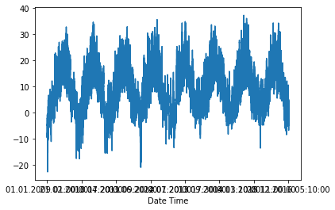

#### cell 20 · 为什么改变量的尺度

标准化（Standardization）把不同大小的数变成与训练中心的距离，方便优化器处理。它不创造预测信息，也不把序列变为平稳；本例是减均值再除标准差，具体参数必须只从训练段估计。

<details><summary>原英文说明（保留来源措辞，标题统一为段落）</summary>
<div class="source-original">
<p>It is important to normalize features before training a neural network. A common way to do so is by subtracting the mean and dividing by the standard deviation of each feature.</p>
</div>
</details>

#### cell 21 · 统计量只看训练段

这是关键限制：若用包括验证未来在内的全部数据求均值和标准差，训练就提前知道未来分布，称数据泄漏（Data leakage）。下两格先 fit 训练统计量，再用同一参数转换全部段，不在验证段重新 fit。

<details><summary>原英文说明（保留来源措辞，标题统一为段落）</summary>
<div class="source-original">
<p>Note: The mean and standard deviation should only be computed using the training data.</p>
</div>
</details>

#### cell 22 · 训练温度的均值与标准差

这格用于训练温度的均值与标准差；先看原代码，再逐步读下面的输入、动作与结果。

```python
uni_train_mean = uni_data[:TRAIN_SPLIT].mean()
uni_train_std = uni_data[:TRAIN_SPLIT].std()
```

uni_data[:TRAIN_SPLIT] 选前 50000 个温度，mean 算平均，std 算围绕平均的尺度。这里 uni_data 已是 NumPy 数组，std 默认 ddof=0，即用 N 作方差分母，不是 pandas Series.std 默认的样本分母。

实测均值 9.2336506 ℃、标准差 8.636926440992747 ℃。若标准差为零不能相除，须先识别常数列；本例非零。

#### cell 23 · 开始换算全部温度

这句衔接到标准化公式。用于换算的是刚刚估计的训练参数，验证资料可用这些既定参数变换，不能反过来更新它们。

<details><summary>原英文说明（保留来源措辞，标题统一为段落）</summary>
<div class="source-original">
<p>Let's normalize the data.</p>
</div>
</details>

#### cell 24 · 标准化公式与逆变换

这格用于标准化公式与逆变换；先看原代码，再逐步读下面的输入、动作与结果。

```python
uni_data = (uni_data-uni_train_mean)/uni_train_std
```

对每个温度 x，计算 z=(x-训练均值)/训练标准差。第一行 −8.05 ℃ 减 9.2336506 再除 8.63692644，得到约 −2.001134，意思是低于训练均值约两个标准差；它不是 −2 ℃。

要把预测 z_hat 还原为摄氏温度，算 x_hat=z_hat×8.63692644+9.2336506。后面 MAE 和图仍在标准化尺度，不能直接标 ℃。

此赋值覆盖变量的内存值，不修改 weather.csv。

#### cell 25 · 确定单变量任务

原文要求前 24 个温度预测 next time step，后面配置 target_size=0 正好取紧接历史的下一行。这里不是 cell 12 的五天／六小时方案。

<details><summary>原英文说明（保留来源措辞，标题统一为段落）</summary>
<div class="source-original">
<p>Let's now create the data for the univariate model. For part 1, the model will be given the last 24 recorded temperature observations, and needs to learn to predict the temperature at the next time step.</p>
</div>
</details>

#### cell 26 · 构造单变量训练／验证窗

这格用于构造单变量训练／验证窗；先看原代码，再逐步读下面的输入、动作与结果。

```python
univariate_past_history = 24
univariate_future_target = 0

x_train_uni, y_train_uni = univariate_data(uni_data, 0, TRAIN_SPLIT,
                                           univariate_past_history,
                                           univariate_future_target)
x_val_uni, y_val_uni = univariate_data(uni_data, TRAIN_SPLIT, None,
                                       univariate_past_history,
                                       univariate_future_target)
```

两个配置先定历史 24 和偏移 0，再各调用一次 cell 13 函数。训练锚点 i=24…49999，共 49976 窗，X 形状 (49976,24,1)，y 形状 (49976,)；验证先从 50000 加上历史，锚点从 50024 开始，得到 (20067,24,1)。

首个训练历史为原行 0…23，标签原行 24；首个验证历史为行 50000…50023，标签行 50024。原写法放弃用训练末尾的历史为第一条验证记录预测，这是一种边界选择，不代表必须如此。

当前偏移为 0，训练最后标签是 49999，未越分界。三个轴分别是样本、时间、特征，不能把 24 当成 24 个独立特征后删掉时间轴。

#### cell 27 · 查看函数返回了什么

下一格只打印一个窗口及其一个标签，不是全部训练数据。学习时用它验证时间步与特征轴有没有放反。

<details><summary>原英文说明（保留来源措辞，标题统一为段落）</summary>
<div class="source-original">
<p>This is what the <code>univariate_data</code> function returns.</p>
</div>
</details>

#### cell 28 · 读首个窗口的保存数值

这格用于读首个窗口的保存数值；先看原代码，再逐步读下面的输入、动作与结果。

```python
print ('Single window of past history')
print (x_train_uni[0])
print ('\n Target temperature to predict')
print (y_train_uni[0])
```

x_train_uni[0] 选第一窗，里面 24 行各一项温度；第一项 −2.0011344 对应原行 0，最后一项 −1.59473983 对应原行 23。标签 −1.5831616366560513 对应原行 24。

数字为标准化值，第一次输入和目标不同位置。

本次只读数据和原函数局部执行逐值复算，首窗 24 项及标签与保存输出吻合；这项核验不依赖训练网络。若误把历史切成含 i 的 [:i+1]，答案会混进输入，样本看似更准却失去预测意义。

来源保存输出（非本次重训）：

```text
Single window of past history
[[-2.0011344 ]
 [-2.0972334 ]
 [-2.08912866]
 [-2.11691633]
 [-2.18406985]
 [-2.18870112]
 [-2.13081016]
 [-2.0069235 ]
 [-1.95597945]
 [-1.88419465]
 [-1.92703396]
 [-1.86451172]
 [-1.75104543]
 [-1.75683453]
 [-1.72788905]
 [-1.69431229]
 [-1.69083883]
 [-1.676945  ]
 [-1.66073553]
 [-1.63642132]
 [-1.62484313]
 [-1.59010855]
 [-1.58663509]
 [-1.59473983]]

 Target temperature to predict
-1.5831616366560513
```

#### cell 29 · 图上蓝线与红叉

蓝线是模型可见的历史，红叉是真未来目标。图能检查未来有没有错误地进入历史；真实目标用于训练／验证评分，不能在实际预测时预先输入。

<details><summary>原英文说明（保留来源措辞，标题统一为段落）</summary>
<div class="source-original">
<p>Now that the data has been created, let's take a look at a single example. The information given to the network is given in blue, and it must predict the value at the red cross.</p>
</div>
</details>

#### cell 30 · 绘图辅助函数的索引规则

这格用于绘图辅助函数的索引规则；先看原代码，再逐步读下面的输入、动作与结果。

```python
def create_time_steps(length):
  time_steps = []
  for i in range(-length, 0, 1):
    time_steps.append(i)
  return time_steps

def show_plot(plot_data, delta, title):
  labels = ['History', 'True Future', 'Model Prediction']
  marker = ['.-', 'rx', 'go']
  time_steps = create_time_steps(plot_data[0].shape[0])
  if delta:
    future = delta
  else:
    future = 0

  plt.title(title)
  for i, x in enumerate(plot_data):
    if i:
      plt.plot(future, plot_data[i], marker[i], markersize=10,
               label=labels[i])
    else:
      plt.plot(time_steps, plot_data[i].flatten(), marker[i], label=labels[i])
  plt.legend()
  plt.xlim([time_steps[0]-1, (future+2)*2])
  plt.xlabel('Time-Step')
  return plt
```

create_time_steps(length) 把历史位置编号成 −length…−1，例如长度 3 得 [−3,−2,−1]。show_plot 的 plot_data 列表依次放历史、真值、可选预测；labels 和 marker 以同一位置对应蓝线、红叉、绿点。

.shape[0] 取历史时间步数，flatten 将 (时间,1) 变一串数供画图；enumerate 同时取得序号和值。i=0 走 else 画历史，i>0 在同一 future 坐标画未来点。

delta=0 用坐标 0，delta=12 用 12，均相对“紧接历史的锚点 0”；最新已知坐标为 −1。plt.xlim 只改变显示范围，不改变目标索引；return plt 让调用者再 show。

函数不训练，也不计算误差。

#### cell 31 · 画第一窗与下一步真值

这格用于画第一窗与下一步真值；先看原代码，再逐步读下面的输入、动作与结果。

```python
show_plot([x_train_uni[0], y_train_uni[0]], 0, 'Sample Example')
```

把 x_train_uni[0] 和 y_train_uni[0] 交给绘图函数，delta=0，历史横轴 −24…−1，红叉在 0。纵轴是标准化温度，红叉约 −1.5832。

source execute_result 打印 matplotlib 模块路径只是返回对象的显示，不是额外预测。图显示历史末端与目标分开，不能据一窗判模型能力。

来源保存输出（非本次重训）：

```text
<module 'matplotlib.pyplot' from '/usr/local/lib/python3.9/dist-packages/matplotlib/pyplot.py'>
```

来源保存输出（非本次重训）：

```text
<Figure size 432x288 with 1 Axes>
```

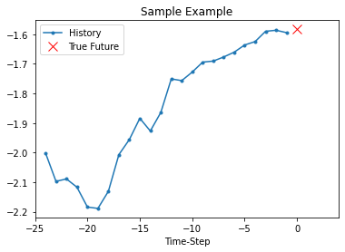

### 2.3 均值基线与单变量 LSTM（cell 32–46）

#### cell 32 · 先设一个容易计算的比较基准

基线（Baseline）给出在复杂网络之前的简单预测。本教程把过去 24 项的平均作为下一项；它不训练参数。

要判断 LSTM 是否胜出，应在同一验证区间对两者计算同一误差指标，而不是只比较不同样本的两幅图。

<details><summary>原英文说明（保留来源措辞，标题统一为段落）</summary>
<div class="source-original">
<p>1.1 Baseline Model
Before proceeding to train a model, let's first set a simple baseline. Given an input point, the baseline method looks at all the history and predicts the next point to be the average of the last 24 observations.</p>
</div>
</details>

#### cell 33 · 历史均值基线函数

这格用于历史均值基线函数；先看原代码，再逐步读下面的输入、动作与结果。

```python
def baseline(history):
  return np.mean(history)
```

np.mean(history) 把历史里的数相加再除元素个数，return 把均值作为预测。这里只有一特征，全部取均值正是 24 个温度的平均；若以后给它多列原始量纲，直接对整个矩阵求一个均值会混合气压和温度，不再是合理温度基线。

首窗实算均值为 −1.851582741，真值 −1.583161637，绝对误差 0.268421104 个训练标准差；可用训练温度标准差换回约 2.3183 ℃。这是单个训练窗的演示误差，不能当验证 MAE。

#### cell 34 · 原 Notebook 的完整基线图

这格把历史均值与真实下一步画在同一张图，便于看清单窗预测误差。

```python
show_plot([x_train_uni[0], y_train_uni[0], baseline(x_train_uni[0])], 0,
           'Baseline Prediction Example')
```

把三个对象交给 show_plot：历史、真实下一步、历史均值。原 Notebook 的保存 PNG 为完整的 380×278 像素图：两条坐标轴、图例、历史蓝线、真实红叉与预测绿点都能辨认。

从蓝线最右的历史位置 −1 往右看，红叉和绿点都在横坐标 0；红叉约 −1.5832，均值预测绿点约 −1.8516，因此绿点低于红叉。这说明首窗的过去均值低估了实际下一步，不能由一个训练窗推断全验证集表现。

按原数据复算，绿点为 −1.851582741、红叉为 −1.583161637，差约 0.268421104 个训练标准差。配套 Colab PDF 的 p.4 显示受分页／叠压影响，不能把该 PDF 的显示问题误记为 Notebook PNG 残缺。下方额外重绘保留为标明行号与尺度的笔记补充，原保存图保持不变。

来源保存输出（非本次重训）：

```text
<module 'matplotlib.pyplot' from '/usr/local/lib/python3.9/dist-packages/matplotlib/pyplot.py'>
```

来源保存输出（非本次重训）：

```text
<Figure size 432x288 with 1 Axes>
```

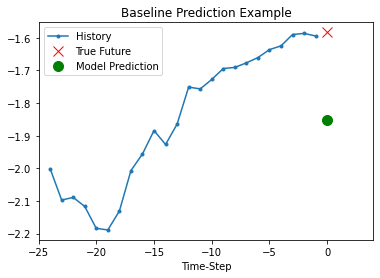

笔记补充：按只读原数据及原公式重算首窗，另外标清原行号与标准化尺度。原保存 PNG 本身已完整；此图是补充重绘，不是原图恢复。横轴 −24…−1 为历史、0 为目标与基线，纵轴为标准化温度。

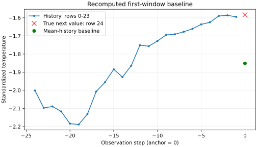

#### cell 35 · 怎样回应超过基线的挑战

原文 “Let's see if you can beat this baseline using a recurrent neural network.” 是教学挑战，未给正式作业题号、分数或期限。⚪ 参考回应是先按相同验证边界、相同目标及 MAE 评估均值基线和网络，再比较；当前保存材料只给网络的部分验证损失与样例，缺全验证基线结果，所以不能据它确认整体胜出。

英文参考：“Compare the LSTM and the mean-history baseline on identical validation targets with the same error metric before claiming an improvement.”

<details><summary>原英文说明（保留来源措辞，标题统一为段落）</summary>
<div class="source-original">
<p>Let's see if you can beat this baseline using a recurrent neural network.</p>
</div>
</details>

#### cell 36 · 把窗口交给 LSTM

RNN 顺序读取，旧隐藏状态与当前温度一起算新状态；LSTM 另外用细胞状态、遗忘门、输入门和输出门控制信息。它不是把 24 项无序平均。

理论回链 M09 解释门怎么算，本教程着重代码形状和预测边界。下一 cell 的 shuffle 是打乱已经完整构造的窗口顺序，没有打乱每窗内部的时间步；这些窗口并不设置 stateful=True，批之间不承接同一个持久状态。

<details><summary>原英文说明（保留来源措辞，标题统一为段落）</summary>
<div class="source-original">
<p>1.2 Recurrent neural network</p>
<p>A Recurrent Neural Network (RNN) is a type of neural network well-suited to time series data. RNNs process a time series step-by-step, maintaining an internal state summarizing the information they've seen so far. For more details, read the <a href="https://www.tensorflow.org/tutorials/sequences/recurrent">RNN tutorial</a>. In this tutorial, you will use a specialized RNN layer called Long Short Term Memory (<a href="https://www.tensorflow.org/versions/r2.0/api_docs/python/tf/keras/layers/LSTM">LSTM</a>)</p>
<p>Let's now use <code>tf.data</code> to shuffle, batch, and cache the dataset.</p>
</div>
</details>

#### cell 37 · 构造可重复的批数据流

这格用于构造可重复的批数据流；先看原代码，再逐步读下面的输入、动作与结果。

```python
BATCH_SIZE = 256
BUFFER_SIZE = 10000

train_univariate = tf.data.Dataset.from_tensor_slices((x_train_uni, y_train_uni))
train_univariate = train_univariate.cache().shuffle(BUFFER_SIZE).batch(BATCH_SIZE).repeat()

val_univariate = tf.data.Dataset.from_tensor_slices((x_val_uni, y_val_uni))
val_univariate = val_univariate.batch(BATCH_SIZE).repeat()
```

from_tensor_slices((X,y)) 把每个完整窗口与自己的标签配对成一条样本。cache 把窗口缓存，shuffle(10000) 用缓冲区打乱训练样本，batch(256) 每批最多 256 窗，repeat() 在末尾再开始，形成没有自然终点的数据流。

验证流不 shuffle，按相同的配对和批量组织。必须为无限 repeat 指定训练 steps，否则不能靠读完数据结束。

cache 可能占较大内存；它只缓存，既不标准化也不修复时间戳。不同调用里的 batch 和 shuffle 顺序影响样本分组，不代表可以把未来行随机划进训练。

#### cell 38 · LSTM 需要哪两个输入维度

模型定义要知道每窗时间长度和每时间步特征数。批数不写入 input_shape，运行时由 batch 提供；本例每窗是 (24,1)。

<details><summary>原英文说明（保留来源措辞，标题统一为段落）</summary>
<div class="source-original">
<p>You will see the LSTM requires the input shape of the data it is being given.</p>
</div>
</details>

#### cell 39 · 8 单元 LSTM 接一个温度输出

这格用于8 单元 LSTM 接一个温度输出；先看原代码，再逐步读下面的输入、动作与结果。

```python
simple_lstm_model = tf.keras.models.Sequential([
    tf.keras.layers.LSTM(8, input_shape=x_train_uni.shape[-2:]),
    tf.keras.layers.Dense(1)
])

simple_lstm_model.compile(optimizer='adam', loss='mae')
```

Sequential 按列表顺序连接两层。LSTM(8, input_shape=(24,1)) 依次处理 24 个一维温度，输出 8 项最后隐藏表示；默认 return_sequences=False，因此不返回 24 个时点的全部状态。

Dense(1) 将这 8 项乘权重加偏置，产生一个连续预测。

compile 指定 optimizer='adam' 与 loss='mae'。平均绝对误差（Mean absolute error，MAE）先取每条预测与目标的差的绝对值，再平均；例如真值 [1,3]、预测 [2,1]，误差 [1,2]，MAE=1.5。

此处 y 是标准化温度，因此 MAE 的单位是训练标准差，不是百分数／摄氏度。Adam 利用梯度及其历史决定更新，是本例调用的优化器；具体状态内部计算不作为本教程目标。

#### cell 40 · 训练前先查输出形状

下一格在未训练参数下作预测，只检查接口是否匹配。能输出正确形状不代表温度估得准确。

<details><summary>原英文说明（保留来源措辞，标题统一为段落）</summary>
<div class="source-original">
<p>Let's make a sample prediction, to check the output of the model.</p>
</div>
</details>

#### cell 41 · 第一批预测形状

这格用于第一批预测形状；先看原代码，再逐步读下面的输入、动作与结果。

```python
for x, y in val_univariate.take(1):
    print(simple_lstm_model.predict(x).shape)
```

val_univariate.take(1) 取一个 batch，不是一条样本。for 得到 x、y；predict(x) 输出每窗一个值，保存形状 (256,1)。

256 是窗口数，1 是每窗预测数，时间 24 已由 LSTM 在内部处理。未训练时不评价预测质量。

日志 8/8 是 predict 的内部小批进度，不等于教程训练了八轮。

来源保存输出（非本次重训）：

```text
8/8 [==============================] - 1s 3ms/step
(256, 1)
```

#### cell 42 · 一轮不遍历全部训练窗

原文明确每 epoch 只走 100 steps。配合每批 256，就是约 25600 个窗口位置，少于全部 49976 个训练窗；由于 shuffle/repeat，不能说五轮正好把每条记录各学五遍。

<details><summary>原英文说明（保留来源措辞，标题统一为段落）</summary>
<div class="source-original">
<p>Let's train the model now. Due to the large size of the dataset, in the interest of saving time, each epoch will only run for 100 steps, instead of the complete training data as normally done.</p>
</div>
</details>

#### cell 43 · 训练五轮的来源日志

这格用于训练五轮的来源日志；先看原代码，再逐步读下面的输入、动作与结果。

```python
EVALUATION_INTERVAL = 100
EPOCHS = 5

simple_lstm_model.fit(train_univariate, epochs=EPOCHS,
                      steps_per_epoch=EVALUATION_INTERVAL,
                      validation_data=val_univariate, validation_steps=50)
```

EVALUATION_INTERVAL=100 控制每轮训练 100 批，EPOCHS=5 控制五轮。validation_steps=50 每轮仅评价验证流的 50 批；256×50=12800，少于验证全部 20067 窗。

它不是整个验证集合的最终 MAE。

保存末轮 loss=0.1446、val_loss=0.1150；训练损失由本轮各批汇总，验证损失由所选验证批计算，两者包含的样本不同。损失下降说明来源这次运行在这些批上改善，不证明当前环境复现或优于全段基线。

本次没有重新拟合，完整五轮保存日志原样保留。

来源保存输出（非本次重训）：

```text
Epoch 1/5
100/100 [==============================] - 5s 18ms/step - loss: 0.8357 - val_loss: 0.4723
Epoch 2/5
100/100 [==============================] - 1s 13ms/step - loss: 0.3837 - val_loss: 0.2687
Epoch 3/5
100/100 [==============================] - 1s 13ms/step - loss: 0.2675 - val_loss: 0.2023
Epoch 4/5
100/100 [==============================] - 1s 10ms/step - loss: 0.1876 - val_loss: 0.1509
Epoch 5/5
100/100 [==============================] - 1s 11ms/step - loss: 0.1446 - val_loss: 0.1150
```

来源保存输出（非本次重训）：

```text
<keras.callbacks.History at 0x7fb3ab38ae20>
```

#### cell 44 · 训练后的样例预测

这里只进入 Predict using the simple LSTM model 小节，网络是否已经训练取决于前面 fit 真实执行；文件里的执行序号是来源历史。

<details><summary>原英文说明（保留来源措辞，标题统一为段落）</summary>
<div class="source-original">
<p>Predict using the simple LSTM model
Now that you have trained your simple LSTM, let's try and make a few predictions.</p>
</div>
</details>

#### cell 45 · 三个批各画第一窗

这格用于三个批各画第一窗；先看原代码，再逐步读下面的输入、动作与结果。

```python
for x, y in val_univariate.take(3):
  plot = show_plot([x[0].numpy(), y[0].numpy(),
                    simple_lstm_model.predict(x)[0]], 0, 'Simple LSTM model')
  plot.show()
```

take(3) 取三批，x[0] 和 y[0] 只选每批第一个样本；predict(x)[0] 同样选第一项预测。numpy() 把 TensorFlow 张量转成 NumPy 以便画图。

每图蓝线为过去 24 步，红叉是真值，绿点是预测，真值与预测都在 0。

三图分别能看到预测接近真值、偏低和接近真值的不同情况；它们不是前三个连续窗口，而是验证第 0、256、512 号窗口的示例。纵轴仍是标准化温度，不能把绿点 0.65 当 0.65 ℃。

来源保存输出（非本次重训）：

```text
8/8 [==============================] - 0s 6ms/step
```

来源保存输出（非本次重训）：

```text
<Figure size 432x288 with 1 Axes>
```

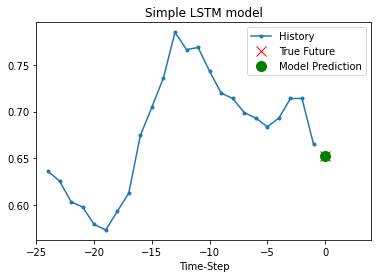

来源保存输出（非本次重训）：

```text
8/8 [==============================] - 0s 4ms/step
```

来源保存输出（非本次重训）：

```text
<Figure size 432x288 with 1 Axes>
```

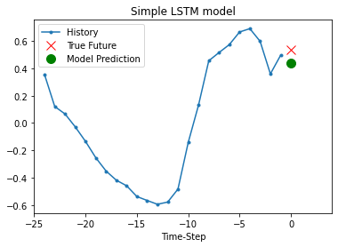

来源保存输出（非本次重训）：

```text
8/8 [==============================] - 0s 6ms/step
```

来源保存输出（非本次重训）：

```text
<Figure size 432x288 with 1 Axes>
```

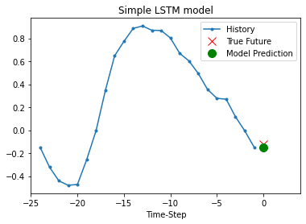

#### cell 46 · 对更好这一句话保留证据边界

源文 “This looks better than the baseline” 是对演示外观的判断。基线图来自首个训练窗，LSTM 图来自验证窗，比较对象不相同，不能当公平的全段性能结论；下半篇只是开始更丰富输入任务。

<details><summary>原英文说明（保留来源措辞，标题统一为段落）</summary>
<div class="source-original">
<p>This looks better than the baseline. Now that you have seen the basics, let's move on to part two, where you will work with a multivariate time series.</p>
</div>
</details>

### 2.4 多变量单点预测（cell 47–68）

#### cell 47 · 第二部分：多变量输入

多变量（Multivariate）在这里指每个时间步同时有三项天气信息，不意味着网络预测三种天气。后面单点与多点都只取温度为目标。

<details><summary>原英文说明（保留来源措辞，标题统一为段落）</summary>
<div class="source-original">
<p><strong>Part 2: Forecast a multivariate time series</strong></p>
</div>
</details>

#### cell 48 · 选三列的理由与边界

源文从十四天气列中取气温、气压、空气密度以简化演示。更多列可加入候选，但加入前要解释在预测时是否可知、量纲与缺失如何处理，并由验证表现判断；不能把目标未来值当新特征。

<details><summary>原英文说明（保留来源措辞，标题统一为段落）</summary>
<div class="source-original">
<p>The original dataset contains fourteen features. For simplicity, this section considers only three of the original fourteen. The features used are air temperature, atmospheric pressure, and air density. </p>
<p>To use more features, add their names to this list.</p>
</div>
</details>

#### cell 49 · 固定特征顺序

这格用于固定特征顺序；先看原代码，再逐步读下面的输入、动作与结果。

```python
features_considered = ['p (mbar)', 'T (degC)', 'rho (g/m**3)']
```

features_considered 是三个字符串组成的列表，顺序为气压、温度、密度。后面 dataset[:,1] 的 1 表第二列，所以指温度；若重排这个列表却不改目标索引，程序可能悄悄预测气压或密度。

#### cell 50 · 取三列并保留显示日期

这格用于取三列并保留显示日期；先看原代码，再逐步读下面的输入、动作与结果。

```python
features = df[features_considered]
features.index = df['Date Time']
features.head()
```

df[features_considered] 取指定列，features.index 用日期字符串作显示索引，head 展示前三变量的前五行。首行 (996.50,−8.05,1307.86) 分别使用 mbar、℃、g/m³，不可直接把三者相加求平均。

原始数值保存不变，标准化在后面单独做。

来源保存输出（非本次重训）：

```text
                     p (mbar)  T (degC)  rho (g/m**3)
Date Time                                            
01.01.2009 01:00:00    996.50     -8.05       1307.86
01.01.2009 02:00:00    996.62     -8.88       1312.25
01.01.2009 03:00:00    996.84     -8.81       1312.18
01.01.2009 04:00:00    996.99     -9.05       1313.61
01.01.2009 05:00:00    997.46     -9.63       1317.19
```

#### cell 51 · 分别查看三条曲线

这句要求观察各特征随时间怎样变。三个物理量不同，下一格采用分开的子图，避免在同一纵轴直接比较绝对大小。

<details><summary>原英文说明（保留来源措辞，标题统一为段落）</summary>
<div class="source-original">
<p>Let's have a look at how each of these features vary across time.</p>
</div>
</details>

#### cell 52 · 三子图的轴不能混

这格用于三子图的轴不能混；先看原代码，再逐步读下面的输入、动作与结果。

```python
features.plot(subplots=True)
```

features.plot(subplots=True) 给气压、温度、密度各一条子图，保存返回数组包含三个 Axes。横轴仍是原日期字符串，文字重叠，三图纵轴单位分别不同。

温度较高时密度常较低是图中的关系线索，不能仅据重叠走势宣称因果、也不能用曲线证明时间无重复。所有列的标准化会保留其按行变化，但换掉尺度。

来源保存输出（非本次重训）：

```text
array([<Axes: xlabel='Date Time'>, <Axes: xlabel='Date Time'>,
       <Axes: xlabel='Date Time'>], dtype=object)
```

来源保存输出（非本次重训）：

```text
<Figure size 432x288 with 3 Axes>
```

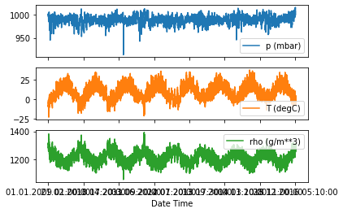

#### cell 53 · 再次只用训练段估尺度

多变量沿用单变量的同一规则，每列分别估计均值／标准差。不能因为这里三列而把所有数凑成一个共同均值。

<details><summary>原英文说明（保留来源措辞，标题统一为段落）</summary>
<div class="source-original">
<p>As mentioned, the first step will be to normalize the dataset using the mean and standard deviation of the training data.</p>
</div>
</details>

#### cell 54 · axis=0 为什么按列算

这格用于axis=0 为什么按列算；先看原代码，再逐步读下面的输入、动作与结果。

```python
dataset = features.values
data_mean = dataset[:TRAIN_SPLIT].mean(axis=0)
data_std = dataset[:TRAIN_SPLIT].std(axis=0)
```

features.values 得 (70091,3) 数组。[:50000] 只用训练行，mean(axis=0) 和 std(axis=0) 沿行方向聚合，给每一列留一个统计量，输出都是三项。

实测训练均值约 (988.6513092,9.2336506,1216.4039966)，标准差约 (8.23600908,8.63692644,40.86727693)。

axis=0 是把不同时间点的同一物理量放一起；若 axis=1，会把同一时点的气压、温度、密度混算，量纲不兼容，也不能用三个训练尺度广播到整表。

#### cell 55 · 按列广播标准化

这格用于按列广播标准化；先看原代码，再逐步读下面的输入、动作与结果。

```python
dataset = (dataset-data_mean)/data_std
```

dataset-data_mean 用长度 3 的向量分别减每行三列，除 data_std 也按对应列发生，叫广播（Broadcasting）。例如首行温度仍得到 −2.0011344，因为温度统计量与单变量相同。

只改变数值尺度，不改变 (70091,3) 的形状或原始行序。

#### cell 56 · 单点预测不是一步以后

Single step 在本小节指输出一个指定未来时点，而不是必须下一小时。哪个时点由 target_size 与索引规则决定，下一函数既能输出单点，也能输出一段。

<details><summary>原英文说明（保留来源措辞，标题统一为段落）</summary>
<div class="source-original">
<p>Single step model
In a single step setup, the model learns to predict a single point in the future based on some history provided.</p>
<p>The below function performs the same windowing task as below, however, here it samples the past observation based on the step size given.</p>
</div>
</details>

#### cell 57 · 多变量窗口与两种标签

这格用于多变量窗口与两种标签；先看原代码，再逐步读下面的输入、动作与结果。

```python
def multivariate_data(dataset, target, start_index, end_index, history_size,
                      target_size, step, single_step=False):
  data = []
  labels = []

  start_index = start_index + history_size
  if end_index is None:
    end_index = len(dataset) - target_size

  for i in range(start_index, end_index):
    indices = range(i-history_size, i, step)
    data.append(dataset[indices])

    if single_step:
      labels.append(target[i+target_size])
    else:
      labels.append(target[i:i+target_size])

  return np.array(data), np.array(labels)
```

本函数历史索引是 range(i-history_size,i,step)，step 控制历史每隔几行抽一次。历史每行保留全部三列，故单窗形状是“抽到的时间点数×3”。

target 是单独传入的一维目标，避免把三列都当答案。

single_step=True 选 target[i+target_size] 一个点；默认 False 选切片 target[i:i+target_size] 一段，右端不含。💡 小例历史取原行 [0,1,2]、target_size=2 时，单点答案为原行 5，多点答案为原行 [3,4]，二者不是同一预测任务。

训练 end_index=50000 只限制 i<50000，却没有限制 i+target_size 或标签切片末尾。这会让最后几窗使用原行 50000 以后的未来标签，违背 cell 14 的训练边界；须按下面 cell 59/70 的标签索引修正。

函数只是数据准备，没有训练或自动检查泄漏。

沿这个小表读标签差别，每行对应同一历史，不能把两个模型的答案混在一列。

| 模式 | 历史行 | 锚点 i | target_size | 标签行 |
|---|---|---:|---:|---|
| 单点 True | 0、1、2 | 3 | 2 | 5 |
| 多点 False | 0、1、2 | 3 | 2 | 3、4 |

读第一行：最新输入是原行 2，但单点标签取原行 5，因此相隔三步。第二行则从紧接历史的原行 3 开始取两项。

#### cell 58 · 120 行历史与 12 偏移

源文说过去五天、120 个小时点，标签为 12 小时后。应先按索引精确读：历史最后位置 i−1，单点标签 i+12，二者差 13 个行间隔；“12”是相对尚未作为输入的锚点 i。

并且本地不严格等时，只有正常连续小时段能把间隔数换成小时。

<details><summary>原英文说明（保留来源措辞，标题统一为段落）</summary>
<div class="source-original">
<p>In this tutorial, the network is shown data from the last five (5) days, i.e. 120 observations that are sampled every hour. For the single step prediction model, the label for a datapoint is the temperature 12 hours into the future. In order to create a label for this, the temperature after 12 observations is used.</p>
</div>
</details>

#### cell 59 · 构造三输入的指定未来点

这格用于构造三输入的指定未来点；先看原代码，再逐步读下面的输入、动作与结果。

```python
past_history = 120
future_target = 12
STEP = 1

x_train_single, y_train_single = multivariate_data(dataset, dataset[:, 1], 0,
                                                   TRAIN_SPLIT, past_history,
                                                   future_target, STEP,
                                                   single_step=True)
x_val_single, y_val_single = multivariate_data(dataset, dataset[:, 1],
                                               TRAIN_SPLIT, None, past_history,
                                               future_target, STEP,
                                               single_step=True)
```

past_history=120、future_target=12、STEP=1，所以保留历史全部 120 行三列。dataset[:,1] 取所有行第二列即标准化温度。

训练第一窗历史 0…119，目标 132，X 形状 (49880,120,3)，y 为 (49880,)；验证第一窗历史 50000…50119，目标 50132，形状 (19959,120,3)。

原训练最后锚点 i=49999，标签为 50011；最后 12 个锚点的标签落到分界后的 12 个不同未来行。纠正用法（笔记补充）是训练调用 end_index=TRAIN_SPLIT-future_target，即 49988；range 不含右端，最后 i=49987、标签49999，训练窗变 49868。

不要通过把验证也随机混入训练消掉这个问题。若真正要求从最后已知点往后 12 步，应把偏移改成 11，并同步图上坐标和边界。

原件不改，保存日志仍按原代码解释。

#### cell 60 · 查看一个多变量样本

下一格只检查第一窗 shape，尚不展示目标的时间位置。光看到 (120,3) 不能发现标签越训练边界，因此本篇同时给行索引核验。

<details><summary>原英文说明（保留来源措辞，标题统一为段落）</summary>
<div class="source-original">
<p>Let's look at a single data-point.</p>
</div>
</details>

#### cell 61 · (120,3) 的两轴

这格用于(120,3) 的两轴；先看原代码，再逐步读下面的输入、动作与结果。

```python
print ('Single window of past history : {}'.format(x_train_single[0].shape))
```

保存输出 Single window of past history : (120,3) 与本次局部复算一致。120 表历史时点数，3 表每个时点三特征；第一轴不是 120 个训练样本。

整批才再加样本轴。

来源保存输出（非本次重训）：

```text
Single window of past history : (120, 3)
```

#### cell 62 · 多变量单点批数据流

这格用于多变量单点批数据流；先看原代码，再逐步读下面的输入、动作与结果。

```python
train_data_single = tf.data.Dataset.from_tensor_slices((x_train_single, y_train_single))
train_data_single = train_data_single.cache().shuffle(BUFFER_SIZE).batch(BATCH_SIZE).repeat()

val_data_single = tf.data.Dataset.from_tensor_slices((x_val_single, y_val_single))
val_data_single = val_data_single.batch(BATCH_SIZE).repeat()
```

与 cell 37 相同，from_tensor_slices 使每窗三变量历史与一个温度标签配对。训练 cache→shuffle→batch→repeat，验证 batch→repeat；打乱的是完整样本，不改变一窗内部的时间。

此处不会修正 cell 59 已生成的越界标签，须先修正窗口再建数据流。

#### cell 63 · 32 单元 LSTM 的单点模型

这格用于32 单元 LSTM 的单点模型；先看原代码，再逐步读下面的输入、动作与结果。

```python
single_step_model = tf.keras.models.Sequential()
single_step_model.add(tf.keras.layers.LSTM(32,
                                           input_shape=x_train_single.shape[-2:]))
single_step_model.add(tf.keras.layers.Dense(1))

single_step_model.compile(optimizer=tf.keras.optimizers.RMSprop(), loss='mae')
```

LSTM(32,input_shape=(120,3)) 每步读三个数，经 120 步输出 32 项最后状态；Dense(1) 压到一个未来温度。RMSprop 是利用平方梯度历史调整步幅的优化器，网络仍用 MAE 作为误差目标。

这里比单变量同时改变了输入、历史、目标距离、隐藏宽度和优化器，不能把后面误差变化单独归因于“用了更多特征”。本教程目标是追踪调用接口；RMSprop 内部状态算法未在源文展开，不把它伪装为已手算完的课程内容。

#### cell 64 · 再次检查训练前接口

下一格同样只是未训练预测的形状检查。当前输出一个远期点，不是 120 个预测，也不是三个变量的预测。

<details><summary>原英文说明（保留来源措辞，标题统一为段落）</summary>
<div class="source-original">
<p>Let's check out a sample prediction.</p>
</div>
</details>

#### cell 65 · 每批仍是一窗一个预测

这格用于每批仍是一窗一个预测；先看原代码，再逐步读下面的输入、动作与结果。

```python
for x, y in val_data_single.take(1):
  print(single_step_model.predict(x).shape)
```

val_data_single.take(1) 取第一批，predict 返回 (256,1)。与单变量相同的输出形状，并不说明输入相同；输入现为 (256,120,3)。

来源保存输出（非本次重训）：

```text
8/8 [==============================] - 1s 5ms/step
(256, 1)
```

#### cell 66 · 多变量单点训练日志

这格用于多变量单点训练日志；先看原代码，再逐步读下面的输入、动作与结果。

```python
single_step_history = single_step_model.fit(train_data_single, epochs=EPOCHS,
                                            steps_per_epoch=EVALUATION_INTERVAL,
                                            validation_data=val_data_single,
                                            validation_steps=50)
```

fit 仍为五轮、每轮100训练批、50验证批。保存末轮 loss=0.2637、val_loss=0.2741；第三到第五轮的训练值不是严格单调，因每轮抽样批和更新过程都变。

验证只有 12800/19959 个窗口位置，仍不是全验证评估。

这些日志承接原训练窗口的越界标签问题。本次保留历史值以读代码，不拿它们当修正切分后重新验证的结果；若要正式比较，需要修正窗口、重新训练并另留测试集。

来源保存输出（非本次重训）：

```text
Epoch 1/5
100/100 [==============================] - 5s 15ms/step - loss: 0.4005 - val_loss: 0.3043
Epoch 2/5
100/100 [==============================] - 1s 10ms/step - loss: 0.2786 - val_loss: 0.2896
Epoch 3/5
100/100 [==============================] - 1s 9ms/step - loss: 0.2774 - val_loss: 0.2798
Epoch 4/5
100/100 [==============================] - 1s 10ms/step - loss: 0.2589 - val_loss: 0.2776
Epoch 5/5
100/100 [==============================] - 1s 9ms/step - loss: 0.2637 - val_loss: 0.2741
```

#### cell 67 · 源文的一天与代码不一致

这一格说 prediction is made one day into the future，但 cell 59 的配置为偏移12、cell 68 画在12；并非一天24小时。按当前索引，从最后输入到标签差13行。

保留原句作为版本问题，不静默改成“一天”。图只画温度历史不表示网络没读气压与密度。

<details><summary>原英文说明（保留来源措辞，标题统一为段落）</summary>
<div class="source-original">
<p>Predict a single step future
Now that the model is trained, let's make a few sample predictions. The model is given the history of three features over the past five days sampled every hour (120 data-points), since the goal is to predict the temperature, the plot only displays the past temperature. The prediction is made one day into the future (hence the gap between the history and prediction).</p>
</div>
</details>

#### cell 68 · 两幅指定未来点的图

这格用于两幅指定未来点的图；先看原代码，再逐步读下面的输入、动作与结果。

```python
for x, y in val_data_single.take(2):
  plot = show_plot([x[0][:, 1].numpy(), y[0].numpy(),
                    single_step_model.predict(x)[0]], 12,
                   'Single Step Prediction')
  plot.show()
```

x[0][:,1] 只抽第一窗的温度列来画，网络 predict(x) 实际仍收到整批三列。图蓝线从−120到−1，红叉／绿点在+12；间隙表示本模型直接预测这个指定点，不是缺漏了12个预测。

第一图绿点略高于红叉，第二图略低。横坐标0是历史之后的锚点，不是最后已知样本；若用最后输入当“现在”，这就是向后13步。

原时间戳异常仍在，图横轴宜读作 Time-Step 而非确定小时。

来源保存输出（非本次重训）：

```text
8/8 [==============================] - 0s 4ms/step
```

来源保存输出（非本次重训）：

```text
<Figure size 432x288 with 1 Axes>
```

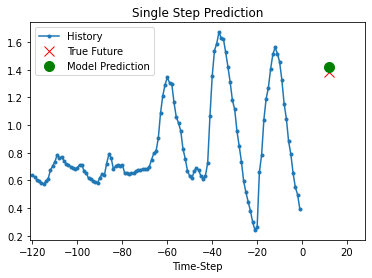

来源保存输出（非本次重训）：

```text
8/8 [==============================] - 0s 4ms/step
```

来源保存输出（非本次重训）：

```text
<Figure size 432x288 with 1 Axes>
```

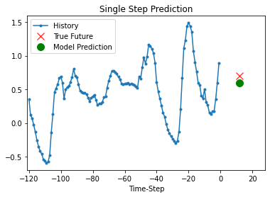

### 2.5 多变量连续未来预测（cell 69–86）

#### cell 69 · 多点未来的任务

源文要求 next 12 hours、12 predictions。按原函数，将历史末行 i−1 之后的 i…i+11 共12行作为标签；这里正好是接下来12个观测步，不再是单点 i+12。

三列输入、12个温度输出，不能说12种天气变量。

<details><summary>原英文说明（保留来源措辞，标题统一为段落）</summary>
<div class="source-original">
<p>Multi-Step model
In a multi-step prediction model, given a past history, the model needs to learn to predict a range of future values. Thus, unlike a single step model, where only a single future point is predicted, a multi-step model predict a sequence of the future.</p>
<p>For the multi-step model, the training data again consists of recordings over the past five days sampled every hour. However, here, the model needs to learn to predict the temperature for the next 12 hours. The output is 12 predictions. For this task, the dataset needs to be prepared accordingly, thus the first step is just to create it again, but with a different target window.</p>
</div>
</details>

#### cell 70 · 构造十二个连续未来目标

这格用于构造十二个连续未来目标；先看原代码，再逐步读下面的输入、动作与结果。

```python
future_target = 12
x_train_multi, y_train_multi = multivariate_data(dataset, dataset[:, 1], 0,
                                                 TRAIN_SPLIT, past_history,
                                                 future_target, STEP)
x_val_multi, y_val_multi = multivariate_data(dataset, dataset[:, 1],
                                             TRAIN_SPLIT, None, past_history,
                                             future_target, STEP)
```

调用不传 single_step，使用默认 False；第一窗输入仍原行0…119，标签改为120…131。保存数组 X 为 (49880,120,3)，y 为 (49880,12)，验证分别 (19959,120,3) 与 (19959,12)。

原最后 i=49999，标签49999…50010，越界的不同目标行为50000…50010，共11行。笔记补充的严格边界是训练 end_index=TRAIN_SPLIT-future_target+1，即49989；最后 i=49988，最后标签49999，得到49869窗。

原函数在 end_index=None 时用 len−12，也额外放弃了一个仍可容纳完整标签的末窗；本篇保留来源19959验证窗，不偷偷把它写成修正数。

#### cell 71 · 检查多点样本

接下来同时查看输入与目标形状，这是辨别单点／多点任务的直接证据。

<details><summary>原英文说明（保留来源措辞，标题统一为段落）</summary>
<div class="source-original">
<p>Let's check out a sample data-point.</p>
</div>
</details>

#### cell 72 · 输入三列，目标十二项

这格用于输入三列，目标十二项；先看原代码，再逐步读下面的输入、动作与结果。

```python
print ('Single window of past history : {}'.format(x_train_multi[0].shape))
print ('\n Target temperature to predict : {}'.format(y_train_multi[0].shape))
```

保存 (120,3) 是一窗历史，(12,) 是这一窗连续未来温度；括号中逗号表示一维数组，不能误读为12×12。修正训练边界不会改变每窗的这两个形状，只会减少可用窗数。

来源保存输出（非本次重训）：

```text
Single window of past history : (120, 3)

 Target temperature to predict : (12,)
```

#### cell 73 · 多点批数据流

这格用于多点批数据流；先看原代码，再逐步读下面的输入、动作与结果。

```python
train_data_multi = tf.data.Dataset.from_tensor_slices((x_train_multi, y_train_multi))
train_data_multi = train_data_multi.cache().shuffle(BUFFER_SIZE).batch(BATCH_SIZE).repeat()

val_data_multi = tf.data.Dataset.from_tensor_slices((x_val_multi, y_val_multi))
val_data_multi = val_data_multi.batch(BATCH_SIZE).repeat()
```

与之前接口相同，但 y 每条有12项，batch后为 (B,12)。shuffle依旧只打乱已完成的窗口配对。

repeat 的无限长度仍须由 fit 的 steps_per_epoch 明确结束。

#### cell 74 · 画一条多点样例

这句引到下一函数。此时可以只画历史和真未来，不需要任何模型预测；画图不能当成网络已经学会。

<details><summary>原英文说明（保留来源措辞，标题统一为段落）</summary>
<div class="source-original">
<p>Plotting a sample data-point.</p>
</div>
</details>

#### cell 75 · 多点绘图函数与 STEP 隐患

这格用于多点绘图函数与 STEP 隐患；先看原代码，再逐步读下面的输入、动作与结果。

```python
def multi_step_plot(history, true_future, prediction):
  plt.figure(figsize=(12, 6))
  num_in = create_time_steps(len(history))
  num_out = len(true_future)

  plt.plot(num_in, np.array(history[:, 1]), label='History')
  plt.plot(np.arange(num_out)/STEP, np.array(true_future), 'bo',
           label='True Future')
  if prediction.any():
    plt.plot(np.arange(num_out)/STEP, np.array(prediction), 'ro',
             label='Predicted Future')
  plt.legend(loc='upper left')
  plt.show()
```

history[:,1] 取温度列，num_in 长度等于历史抽样步数；true_future 有12项，用np.arange从0到11画蓝点。prediction.any() 判断是否存在非零预测，源文用全零数组表示不画预测，这种哨兵会把真实全零预测也误认为没有；补充实现宜用 prediction is not None。

横轴把未来坐标除STEP，目前STEP=1没有差别。若改STEP=2，历史按抽样点编号而未来每原行一个点，需统一两边的时间单位与锚点；不能只改参数便把图叫每小时。

plt.show只显示，不返回误差。

#### cell 76 · 每小时的显示限制

原句说图上历史和未来每小时采样；这依赖STEP=1以及原时间等间隔。当前CSV的7处异常间隔与重复戳未修复，因此本笔记只把轴保证为按原行序的步数。

<details><summary>原英文说明（保留来源措辞，标题统一为段落）</summary>
<div class="source-original">
<p>In this plot and subsequent similar plots, the history and the future data are sampled every hour.</p>
</div>
</details>

#### cell 77 · 未训练时先画数据

这格用于未训练时先画数据；先看原代码，再逐步读下面的输入、动作与结果。

```python
for x, y in train_data_multi.take(1):
  multi_step_plot(x[0], y[0], np.array([0]))
```

train_data_multi.take(1) 从已shuffle训练流取一批，x[0] 是其中第一窗；传np.array([0])让prediction.any()为False，故只画历史蓝线与真实未来蓝点。保存图未来12点整体向下，尚无红色预测点，不能说这是模型预测。

由于shuffle，这窗未必是原数据的第一窗。

来源保存输出（非本次重训）：

```text
<Figure size 864x432 with 1 Axes>
```

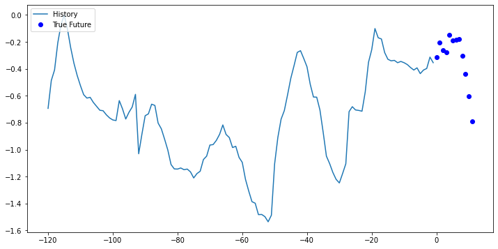

#### cell 78 · 72 是遗留文字

源文写 dense layer outputs 72 predictions，但当前任务、Dense(12)、目标(12,)和保存输出(256,12)都指12。两层LSTM是实际结构，72为模板遗留，不按72制作模型或答案。

<details><summary>原英文说明（保留来源措辞，标题统一为段落）</summary>
<div class="source-original">
<p>Since the task here is a bit more complicated than the previous task, the model now consists of two LSTM layers. Finally, since 72 predictions are made, the dense layer outputs 72 predictions.</p>
</div>
</details>

#### cell 79 · 两层 LSTM 为什么第一层保留序列

这格用于两层 LSTM 为什么第一层保留序列；先看原代码，再逐步读下面的输入、动作与结果。

```python
multi_step_model = tf.keras.models.Sequential()
multi_step_model.add(tf.keras.layers.LSTM(32,
                                          return_sequences=True,
                                          input_shape=x_train_multi.shape[-2:]))
multi_step_model.add(tf.keras.layers.LSTM(16, activation='relu'))
multi_step_model.add(tf.keras.layers.Dense(12))

multi_step_model.compile(optimizer=tf.keras.optimizers.RMSprop(clipvalue=1.0), loss='mae')
```

第一层LSTM(32,return_sequences=True)每个历史时点输出32项，批形状从(B,120,3)变(B,120,32)。第二层LSTM(16,activation='relu')读这段序列，仅返回最后16项，即(B,16)；Dense(12)再给12个未来温度(B,12)。

若第一层不return_sequences，第二层就收不到时间轴。

activation='relu'改变第二层候选／输出激活的默认tanh，门的recurrent_activation仍按其设置，不等于把所有门改ReLU。clipvalue=1.0把每个梯度分量裁到−1…1以限制过大值；不是把输入温度或预测裁到这个范围。

RMSprop内部继续按梯度历史更新。

来源警告说该LSTM不满足cuDNN快速内核条件，会在GPU上用通用实现；这是速度／实现路径提示，不是训练失败或自动把模型换掉。本次没有重跑GPU，也不把此警告称当前环境结果。

来源保存输出（非本次重训）：

```text
WARNING:tensorflow:Layer lstm_3 will not use cuDNN kernels since it doesn't meet the criteria. It will use a generic GPU kernel as fallback when running on GPU.
```

#### cell 80 · 训练前的多点输出

这里仍是检查未训练输出。模型现在能给12项数，不代表它们构成合理温度轨迹。

<details><summary>原英文说明（保留来源措辞，标题统一为段落）</summary>
<div class="source-original">
<p>Let's see how the model predicts before it trains.</p>
</div>
</details>

#### cell 81 · (256,12) 关闭72歧义

这格用于(256,12) 关闭72歧义；先看原代码，再逐步读下面的输入、动作与结果。

```python
for x, y in val_data_multi.take(1):
  print (multi_step_model.predict(x).shape)
```

保存输出一批256窗、每窗12项，确认当前Dense(12)。最后一项对应原标签片段的第12个时间步，不能读成第12列天气变量。

来源保存输出（非本次重训）：

```text
8/8 [==============================] - 1s 20ms/step
(256, 12)
```

#### cell 82 · 多点训练的保存日志

这格用于多点训练的保存日志；先看原代码，再逐步读下面的输入、动作与结果。

```python
multi_step_history = multi_step_model.fit(train_data_multi, epochs=EPOCHS,
                                          steps_per_epoch=EVALUATION_INTERVAL,
                                          validation_data=val_data_multi,
                                          validation_steps=50)
```

五轮末轮loss=0.2751、val_loss=0.2690，较首轮0.4693／0.3455下降；每条12个未来位置都参与MAE平均。此结果属于来源历史训练与原越界窗口、部分验证批，未重新拟合。

多点0.2690与单点0.2741虽然尺度同为标准化温度，预测距离集合不同、模型配置也不同，不能简单据0.2690更小证明多点模型更优。需先固定同样目标位置和评估样本。

来源保存输出（非本次重训）：

```text
Epoch 1/5
100/100 [==============================] - 28s 250ms/step - loss: 0.4693 - val_loss: 0.3455
Epoch 2/5
100/100 [==============================] - 25s 246ms/step - loss: 0.3479 - val_loss: 0.3314
Epoch 3/5
100/100 [==============================] - 24s 245ms/step - loss: 0.3506 - val_loss: 0.3244
Epoch 4/5
100/100 [==============================] - 28s 280ms/step - loss: 0.3134 - val_loss: 0.2929
Epoch 5/5
100/100 [==============================] - 26s 260ms/step - loss: 0.2751 - val_loss: 0.2690
```

#### cell 83 · 检查多点未来预测

最后用样例观察曲线形状。它有助发现提前／滞后和高低偏差，但不能替代每个预测步的误差及整段测试评估。

<details><summary>原英文说明（保留来源措辞，标题统一为段落）</summary>
<div class="source-original">
<p>Predict a multi-step future
Let's now have a look at how well your network has learnt to predict the future.</p>
</div>
</details>

#### cell 84 · 十二个预测与十二个真值对齐

这格用于十二个预测与十二个真值对齐；先看原代码，再逐步读下面的输入、动作与结果。

```python
for x, y in val_data_multi.take(2):
  multi_step_plot(x[0], y[0], multi_step_model.predict(x)[0])
```

take(2)每批选第一窗，multi_step_model.predict(x)[0]给该窗12项。图蓝线是120步历史，蓝点是0…11真实未来，红点是相同位置的12预测。

第一图红点整体明显高于蓝点，尤其起始和末端；第二图较接近形状，但峰顶偏低。

这是直接输出一整段，未把第一个预测再作为下一次输入递归滚动。图上红蓝距离是标准化误差，每个位置应一一比较，不能拿红色末点去配蓝色首点。

来源保存输出（非本次重训）：

```text
8/8 [==============================] - 0s 20ms/step
```

来源保存输出（非本次重训）：

```text
<Figure size 864x432 with 1 Axes>
```

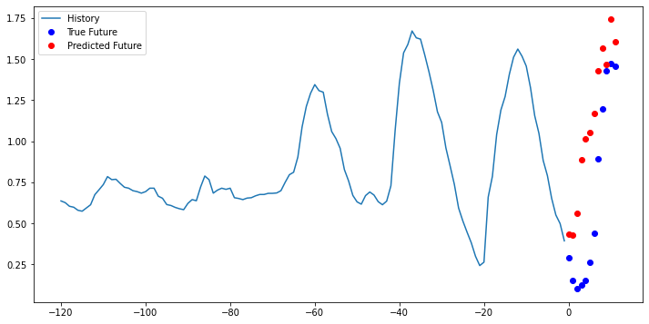

来源保存输出（非本次重训）：

```text
8/8 [==============================] - 0s 23ms/step
```

来源保存输出（非本次重训）：

```text
<Figure size 864x432 with 1 Axes>
```

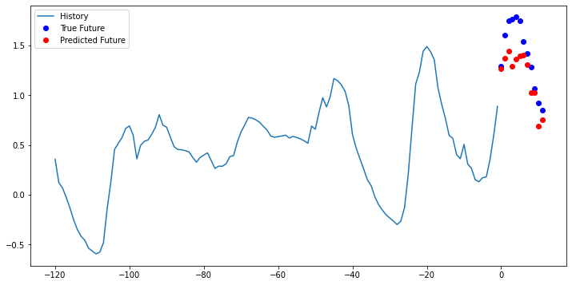

#### cell 85 · 延伸阅读不等于投资保证

Next steps 说可尝试股票预测并成为 billionaire，是教学玩笑／激励，不能据此推导投资获利或授权交易。来源推荐 Hands-on Machine Learning 第2版第15章和 Deep Learning with Python 第6章；这些书本次未全文读取。

教程没有正式作业题、截止、评分表或本人提交记录；如后续Canvas另给任务，须另查现行题面。

<details><summary>原英文说明（保留来源措辞，标题统一为段落）</summary>
<div class="source-original">
<p>Next steps
This tutorial was a quick introduction to time series forecasting using an RNN. You may now try to predict the stock market and become a billionaire.</p>
<p>For further understanding, you may read Chapter 15 of <a href="https://www.oreilly.com/library/view/hands-on-machine-learning/9781492032632/">Hands-on Machine Learning with Scikit-Learn, Keras, and TensorFlow</a>, 2nd Edition and Chapter 6 of <a href="https://www.manning.com/books/deep-learning-with-python">Deep Learning with Python</a>.</p>
</div>
</details>

#### cell 86 · 最后一个空代码格

原 cell 为空，无新增运算。

## 3. 一图看懂 · 先定时间，再训练

从数据读入一直走到评估；红旗在切窗处，不能等模型训练后才发现目标进入了未来段。

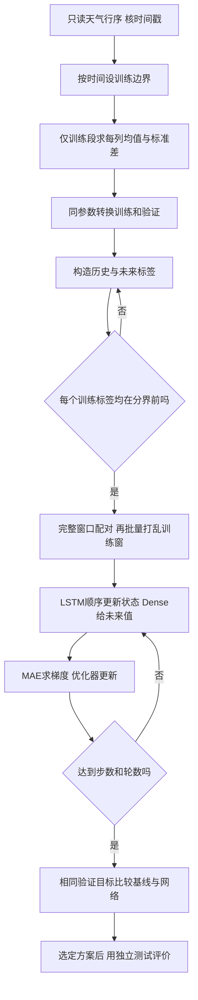

最后独立测试是完整分析所需的补充步骤，原 Notebook 没有实现；本次也未执行训练或补造测试成绩。图中“否”返回切窗，是让作者修正数据准备，不是在运行时偷偷把未来改成已知。

## 4. 速查表 · 三种任务的精确位置

表中行号从 0 起，都是原代码的第一个训练窗，形状来自本次局部复算。

| 任务 | 历史行／特征 | 目标行 | 原训练 X | 原训练 y |
|---|---|---|---|---|
| 单变量下一步 | 0…23／温度 | 24 | (49976,24,1) | (49976,) |
| 三变量单点 | 0…119／三列 | 132 | (49880,120,3) | (49880,) |
| 三变量多点 | 0…119／三列 | 120…131 | (49880,120,3) | (49880,12) |

读第二行：一窗120个时点，每时点三项输入，但目标只有原行132的温度。对应 [[#cell 59 · 构造三输入的指定未来点|cell 59]]；默认代码最后12个训练标签越界。多点最后11个不同标签行越界，详见 [[#cell 70 · 构造十二个连续未来目标|cell 70]]。

三个模型分别为 LSTM(8)→Dense(1)、LSTM(32)→Dense(1)、LSTM(32,保留序列)→LSTM(16,ReLU)→Dense(12)。输入窗口、预测距离和模型配置一起变化，保存 MAE 不能当单因素实验。

## 5. 双语术语卡与理论对应

术语的英文答法为笔记自拟，操作已在对应 cell 教过。

| 中文 | English | 英文参考定义 | 首现／理论回指 |
|---|---|---|---|
| 历史窗口 | History window | An ordered block of observations available before the prediction target. | cell 13；M09 RNN |
| 预测偏移 | Target offset | An index offset measured from the window anchor, whose relation to the last input must be stated. | cell 13、59 |
| 标准化 | Standardization | A transformation using a specified training mean and standard deviation. | cell 22–24 |
| 批 | Batch | A group of paired input windows and labels processed together. | cell 37 |
| 多步预测 | Multi-step forecasting | Predicting several future observations for each historical window. | cell 69–70 |
| 目标越界 | Target-boundary leakage | Using training labels from beyond the declared training cutoff. | cell 57–70 |
| 保留序列 | Return sequences | Returning a hidden representation for every input time step. | cell 79 |
| 梯度裁剪 | Gradient clipping | Limiting gradient values before the optimizer applies an update. | cell 79 |

M09 的单神经元乘加／激活对应 Dense，隐藏状态递推对应 LSTM，前向→损失→梯度→更新对应 compile/fit 内部训练；T09 的统计预测同样要求时间划分和评估，只是此处把历史显式变成三维窗口。

## 6. 考点预判与答题框架

🟡 笔记推断：可能要求解释 LSTM 输入形状、单点与多点标签、训练统计量为何不能看未来，以及程序为何在形状正确时仍可泄漏。没有转录或正式考试题，不标教授明示。

英文参考框架：“First define which observations are known at prediction time. Build each history window without its targets, fit scaling parameters on the training period only, and ensure every training label stays before the cutoff. An LSTM processes the ordered history, while a dense layer maps its representation to one or several future values. Compare models on identical targets with the same metric.”

### 教师怎样要求使用 AI

本 Notebook 86 cells 没有 `🤖 AI Prompt (Copy this to AI)` 单元格，不能编造教师提示词。课程大纲的 GenAI 能力目标仍适用，但不等于此模板每段都由 AI 写。本篇的补充检查可用一个具体提问练习：给 AI 原窗口函数、历史长度、切分行号，要求列首尾输入与标签索引，并用小数组断言验证；得到代码后仍需自己核时间边界。此练习是笔记补充，不冒充原题。

## 7. 自测 · 改条件后还会做吗

### 7.1 history_size=3、target_size=0 的第一窗

数列是 0、1、2、3、4、5。标签是哪项？把 history_size 改成4又怎样？

<details><summary>答案</summary><p>原第一窗输入0、1、2，标签3。改为4后输入0、1、2、3，标签4；target_size=0始终指锚点，不是最近已知输入本身。</p></details>

### 7.2 单点偏移2与多点长度2一样吗

<details><summary>答案</summary><p>不一样。历史0、1、2之后，单点取5；多点取3、4。要把“从最新已知值向后两步”的单点写进原函数，应设target_size=1，取4。</p></details>

### 7.3 训练分界为100，目标偏移12怎样保证单点不越界

<details><summary>答案</summary><p>训练标签须小于100，因此i+12小于100，即i小于88，原函数的end_index应给88。多点12项的最后索引为i+11，因此i小于89，end_index应给89。仅限制i小于100仍会看见分界后的标签。</p></details>

### 7.4 第一层 LSTM 不返回序列会怎样

<details><summary>答案</summary><p>第一层仅给每窗一个32维末状态，第二层就缺时间轴，不能按原来的堆叠接口读取120步。return_sequences=True保留每个时点32维，才给第二层一段序列；它不把真实未来标签喂给模型。</p></details>

### 7.5 所有预测恰为0，来源绘图会显示红点吗

<details><summary>答案</summary><p>不会，prediction.any()为False，把真实全零预测与“没有预测”的哨兵混淆。应另用None表示没有预测，再判断is not None；这是显示逻辑修正，不改变模型输出。</p></details>

## 8. 原 Cell 精确映射

每行对应原 Notebook 一个 cell；源码及保存输出保留在 §2，空格也不吞掉。PDF 9页仅为原显示对照，其中来源图有分页裁切，Notebook 的内嵌图才是更直接的图资产来源。

| 原 cell | 类型／任务 | 正文 |
|---:|---|---|
| 1 | markdown；来源与版权 | [[#cell 1 · 来源与版权\|本格]] |
| 2 | code；许可注释 | [[#cell 2 · 许可注释\|本格]] |
| 3 | markdown；Colab 副本说明 | [[#cell 3 · Colab 副本说明\|本格]] |
| 4 | markdown；本教程的两条预测任务 | [[#cell 4 · 本教程的两条预测任务\|本格]] |
| 5 | markdown；准备运行环境 | [[#cell 5 · 准备运行环境\|本格]] |
| 6 | code；导入工具 | [[#cell 6 · 导入工具\|本格]] |
| 7 | markdown；天气数据来源与频率的两种说法 | [[#cell 7 · 天气数据来源与频率的两种说法\|本格]] |
| 8 | code；读取本地 weather.csv | [[#cell 8 · 读取本地 weather.csv\|本格]] |
| 9 | markdown；先看开头几行 | [[#cell 9 · 先看开头几行\|本格]] |
| 10 | code；一行是一个时点，15 列是什么 | [[#cell 10 · 一行是一个时点，15 列是什么\|本格]] |
| 11 | code；确认行列形状 | [[#cell 11 · 确认行列形状\|本格]] |
| 12 | markdown；窗口长度与预测距离的引子 | [[#cell 12 · 窗口长度与预测距离的引子\|本格]] |
| 13 | code；单变量窗口函数：先索引，再谈时间 | [[#cell 13 · 单变量窗口函数：先索引，再谈时间\|本格]] |
| 14 | markdown；按行切分训练与验证 | [[#cell 14 · 按行切分训练与验证\|本格]] |
| 15 | code；设置训练分界 | [[#cell 15 · 设置训练分界\|本格]] |
| 16 | markdown；可复现性说明 | [[#cell 16 · 可复现性说明\|本格]] |
| 17 | code；设置 TensorFlow 随机种子 | [[#cell 17 · 设置 TensorFlow 随机种子\|本格]] |
| 18 | markdown；第一部分：只用温度 | [[#cell 18 · 第一部分：只用温度\|本格]] |
| 19 | code；取出温度并画保存曲线 | [[#cell 19 · 取出温度并画保存曲线\|本格]] |
| 20 | markdown；为什么改变量的尺度 | [[#cell 20 · 为什么改变量的尺度\|本格]] |
| 21 | markdown；统计量只看训练段 | [[#cell 21 · 统计量只看训练段\|本格]] |
| 22 | code；训练温度的均值与标准差 | [[#cell 22 · 训练温度的均值与标准差\|本格]] |
| 23 | markdown；开始换算全部温度 | [[#cell 23 · 开始换算全部温度\|本格]] |
| 24 | code；标准化公式与逆变换 | [[#cell 24 · 标准化公式与逆变换\|本格]] |
| 25 | markdown；确定单变量任务 | [[#cell 25 · 确定单变量任务\|本格]] |
| 26 | code；构造单变量训练／验证窗 | [[#cell 26 · 构造单变量训练／验证窗\|本格]] |
| 27 | markdown；查看函数返回了什么 | [[#cell 27 · 查看函数返回了什么\|本格]] |
| 28 | code；读首个窗口的保存数值 | [[#cell 28 · 读首个窗口的保存数值\|本格]] |
| 29 | markdown；图上蓝线与红叉 | [[#cell 29 · 图上蓝线与红叉\|本格]] |
| 30 | code；绘图辅助函数的索引规则 | [[#cell 30 · 绘图辅助函数的索引规则\|本格]] |
| 31 | code；画第一窗与下一步真值 | [[#cell 31 · 画第一窗与下一步真值\|本格]] |
| 32 | markdown；先设一个容易计算的比较基准 | [[#cell 32 · 先设一个容易计算的比较基准\|本格]] |
| 33 | code；历史均值基线函数 | [[#cell 33 · 历史均值基线函数\|本格]] |
| 34 | code；原 Notebook 的完整基线图 | [[#cell 34 · 原 Notebook 的完整基线图\|本格]] |
| 35 | markdown；怎样回应超过基线的挑战 | [[#cell 35 · 怎样回应超过基线的挑战\|本格]] |
| 36 | markdown；把窗口交给 LSTM | [[#cell 36 · 把窗口交给 LSTM\|本格]] |
| 37 | code；构造可重复的批数据流 | [[#cell 37 · 构造可重复的批数据流\|本格]] |
| 38 | markdown；LSTM 需要哪两个输入维度 | [[#cell 38 · LSTM 需要哪两个输入维度\|本格]] |
| 39 | code；8 单元 LSTM 接一个温度输出 | [[#cell 39 · 8 单元 LSTM 接一个温度输出\|本格]] |
| 40 | markdown；训练前先查输出形状 | [[#cell 40 · 训练前先查输出形状\|本格]] |
| 41 | code；第一批预测形状 | [[#cell 41 · 第一批预测形状\|本格]] |
| 42 | markdown；一轮不遍历全部训练窗 | [[#cell 42 · 一轮不遍历全部训练窗\|本格]] |
| 43 | code；训练五轮的来源日志 | [[#cell 43 · 训练五轮的来源日志\|本格]] |
| 44 | markdown；训练后的样例预测 | [[#cell 44 · 训练后的样例预测\|本格]] |
| 45 | code；三个批各画第一窗 | [[#cell 45 · 三个批各画第一窗\|本格]] |
| 46 | markdown；对更好这一句话保留证据边界 | [[#cell 46 · 对更好这一句话保留证据边界\|本格]] |
| 47 | markdown；第二部分：多变量输入 | [[#cell 47 · 第二部分：多变量输入\|本格]] |
| 48 | markdown；选三列的理由与边界 | [[#cell 48 · 选三列的理由与边界\|本格]] |
| 49 | code；固定特征顺序 | [[#cell 49 · 固定特征顺序\|本格]] |
| 50 | code；取三列并保留显示日期 | [[#cell 50 · 取三列并保留显示日期\|本格]] |
| 51 | markdown；分别查看三条曲线 | [[#cell 51 · 分别查看三条曲线\|本格]] |
| 52 | code；三子图的轴不能混 | [[#cell 52 · 三子图的轴不能混\|本格]] |
| 53 | markdown；再次只用训练段估尺度 | [[#cell 53 · 再次只用训练段估尺度\|本格]] |
| 54 | code；axis=0 为什么按列算 | [[#cell 54 · axis=0 为什么按列算\|本格]] |
| 55 | code；按列广播标准化 | [[#cell 55 · 按列广播标准化\|本格]] |
| 56 | markdown；单点预测不是一步以后 | [[#cell 56 · 单点预测不是一步以后\|本格]] |
| 57 | code；多变量窗口与两种标签 | [[#cell 57 · 多变量窗口与两种标签\|本格]] |
| 58 | markdown；120 行历史与 12 偏移 | [[#cell 58 · 120 行历史与 12 偏移\|本格]] |
| 59 | code；构造三输入的指定未来点 | [[#cell 59 · 构造三输入的指定未来点\|本格]] |
| 60 | markdown；查看一个多变量样本 | [[#cell 60 · 查看一个多变量样本\|本格]] |
| 61 | code；(120,3) 的两轴 | [[#cell 61 · (120,3) 的两轴\|本格]] |
| 62 | code；多变量单点批数据流 | [[#cell 62 · 多变量单点批数据流\|本格]] |
| 63 | code；32 单元 LSTM 的单点模型 | [[#cell 63 · 32 单元 LSTM 的单点模型\|本格]] |
| 64 | markdown；再次检查训练前接口 | [[#cell 64 · 再次检查训练前接口\|本格]] |
| 65 | code；每批仍是一窗一个预测 | [[#cell 65 · 每批仍是一窗一个预测\|本格]] |
| 66 | code；多变量单点训练日志 | [[#cell 66 · 多变量单点训练日志\|本格]] |
| 67 | markdown；源文的一天与代码不一致 | [[#cell 67 · 源文的一天与代码不一致\|本格]] |
| 68 | code；两幅指定未来点的图 | [[#cell 68 · 两幅指定未来点的图\|本格]] |
| 69 | markdown；多点未来的任务 | [[#cell 69 · 多点未来的任务\|本格]] |
| 70 | code；构造十二个连续未来目标 | [[#cell 70 · 构造十二个连续未来目标\|本格]] |
| 71 | markdown；检查多点样本 | [[#cell 71 · 检查多点样本\|本格]] |
| 72 | code；输入三列，目标十二项 | [[#cell 72 · 输入三列，目标十二项\|本格]] |
| 73 | code；多点批数据流 | [[#cell 73 · 多点批数据流\|本格]] |
| 74 | markdown；画一条多点样例 | [[#cell 74 · 画一条多点样例\|本格]] |
| 75 | code；多点绘图函数与 STEP 隐患 | [[#cell 75 · 多点绘图函数与 STEP 隐患\|本格]] |
| 76 | markdown；每小时的显示限制 | [[#cell 76 · 每小时的显示限制\|本格]] |
| 77 | code；未训练时先画数据 | [[#cell 77 · 未训练时先画数据\|本格]] |
| 78 | markdown；72 是遗留文字 | [[#cell 78 · 72 是遗留文字\|本格]] |
| 79 | code；两层 LSTM 为什么第一层保留序列 | [[#cell 79 · 两层 LSTM 为什么第一层保留序列\|本格]] |
| 80 | markdown；训练前的多点输出 | [[#cell 80 · 训练前的多点输出\|本格]] |
| 81 | code；(256,12) 关闭72歧义 | [[#cell 81 · (256,12) 关闭72歧义\|本格]] |
| 82 | code；多点训练的保存日志 | [[#cell 82 · 多点训练的保存日志\|本格]] |
| 83 | markdown；检查多点未来预测 | [[#cell 83 · 检查多点未来预测\|本格]] |
| 84 | code；十二个预测与十二个真值对齐 | [[#cell 84 · 十二个预测与十二个真值对齐\|本格]] |
| 85 | markdown；延伸阅读不等于投资保证 | [[#cell 85 · 延伸阅读不等于投资保证\|本格]] |
| 86 | code；最后一个空代码格 | [[#cell 86 · 最后一个空代码格\|本格]] |

## 9. 延伸、勘误与边界

### 9.1 课堂覆盖

没有本课转录，未知哪些内容实际讲过，不能用保存执行计数推断课堂顺序或本人操作。

### 9.2 源文与代码的差异

- cell 7 的原始10分钟数据与 cell 12 当前每小时说法须按实际CSV区分；实测有7个非1小时相邻间隔与24个重复时间，不改原件。
- cell 12 的120历史／6小时是引子，单变量实际24／0、多变量120／12。
- cell 59 单点偏移12相对最新输入为13步，cell 67 的one day也与代码不符；多点则是接下来12步。
- 训练端给定end_index不约束标签：单点有12个不同未来行越界，多点11个；严格修正调用写在各处，保存日志未被改成修正结果。
- cell 78 的72输出与Dense(12)、目标和保存形状不符；按代码和实际输出读12。
- cell 34 的原 Notebook 保存 PNG 完整，Colab PDF p.4 的分页／叠压只属于 PDF 显示问题；额外重绘为标清行号与尺度的笔记补充。cell 19／52 日期标签拥挤，不当作时间连续性证明。
- cell 75 用any判断预测是否存在，零预测会消失；STEP改动还须统一显示坐标单位。

### 9.3 模型评价限制

来源每轮只训练100批、验证50批；没有第三份独立测试，没有同窗全验证基线MAE，也没有本次重训。示例好看／日志下降不证明稳定泛化，泄漏修正后须重新训练再评价，不沿用旧成绩。

### 9.4 来源与许可

版权与 Apache 2.0 许可在原 cell 1–2 保留。气象、TensorFlow、Colab、推荐图书链接是课程源文，相关外部网页本次未逐站打开；来源书籍未全文阅读。使用原模板与保存图不意味着重新确认服务当前功能。

### 9.5 待核与本人状态

本教程的实际授课日期、课堂问答、最新正式作业题面／期限、计分与提交入口未知。此文不生成正式答卷、不上传Canvas、不改变本人通读／掌握／提交状态。窗口索引、标准化及形状已做局部核验；网络训练、全验证基线和独立测试仍未执行，不能记为全本实跑。
