# T11 · 模型选择实战：Ridge、剪枝与交叉验证

> 依据63格教师Notebook制作，保留原代码、保存输出及11月18–19日已有真实运行证据。本次融合 S32 为 `merged`（`M10-T11-transcript-source32-partial.txt`，全源恢复后1380段，教程从`01:36:26`到`02:18:44`）。材料v1.0不代表63格都逐行讲过；具体课堂覆盖见§8。实际课日未独立核实，教程讲解者按角色识别，源没有说话人分离。
>
> **考前编号**：T11／M10是Canvas **Week11**，仍在本次复习范围；教师排除的Week10深度学习对应本库 **M09／T10**。第63格仍是独立评分任务，参考实验不等于本人确认作答、已提交或取得成绩。

## 0. 这个 Notebook 在教什么

<!-- cityu-nav:opening -->
> [!abstract] 阅读导航
> **预习**：[[#1. 开始之前 · 数据、语法与运行边界|前置]] → [[#2. 按原 Cell 顺序讲解|逐页／逐格正文]]。
> **课中**：[[#8. Cell 映射与材料状态|按页码／Cell 定位]]。
> **复习**：[[#4. 操作速查|速查]] → [[#5. 双语术语与理论对应|英文术语]] → [[#7. 自测与改条件|自测]]，点表中位置回正文。
> **返回**：正文关键位置可点“回速查／回术语”，不必滚回页首。
> [[#9. 延伸与勘误|来源／勘误]] · [[IS6400_Business_Data_Analytics/00-课程总览|课程入口]]
<!-- cityu-nav:opening:end -->

先用相同数据比较候选，再用验证选超参数，最后分清这个分数是否还独立于选择。读者不仅要会运行 `fit`，还要能指出输入来自哪里、哪份数据给了选择反馈。

- 能在15个幂特征上追踪训练／缩放／预测，并从20个α中选出实际最小验证MAE。
- 能读剪枝路径、节点数和深度，分清“生成候选”和“验证选优”。
- 能算25组×5折的搜索预算，解释 best_params_ 与 refit=True。
- 能读各类precision／recall／support，以及micro／macro的不同分母。
- 能发现 `test` 变量实际用于验证、索引5实为第6项等源内口径问题。

> 🎙️ **课堂实况**：同一S32的`01:36:26`起由讲义转到教程，按Ridge→树剪枝→SVC网格→Iris比较→项目说明／评分三问推进，`02:18:44`明确收束。前段模型评价、期末总范围与AI指导见M10；本篇只引用对应教程原时钟。没有重新训练或替换既有输出，也不将口头没有逐式讲的micro／macro说成完整录到。

## 1. 开始之前 · 数据、语法与运行边界

### 1.1 三种数据不要混在一起

| 段落 | 一行是什么 | 输入／目标 | 当前数据角色 |
|---|---|---|---|
| cell 5–20 | 一条合成正弦观测 | 60×15幂特征／连续y | 45训练、15反复选α，后者实际为验证 |
| cell 24–47 | 一条乳腺影像特征记录 | 569×30／0恶性、1良性 | 426训练、143留出，网格搜索只在426内 |
| cell 50–60 | 一朵Iris的测量记录 | 150×4／三个品种 | 五折比较，另一次100／50留出演示 |

读第二行：30列是同一记录的不同测量，不是30名受试者；类别0／1不是数量大小。对应理论在 [[IS6400_Business_Data_Analytics/notes/M10-模型评估-交叉验证正则化与AB测试|M10]]，基础分类在 [[IS6400_Business_Data_Analytics/notes/M06-分类-决策树集成SVM与不平衡学习|M06]]，数据入口见 [[IS6400_Business_Data_Analytics/_meta/数据集卡片|本课数据集卡片]]。

### 1.2 最小语法与状态

`x=...`把结果绑定给名字，后面再次赋值会覆盖当前引用；本源多次把X_train切换成另一数据，必须按顺序读。列表索引从0起，a[0]为第一项、a[-1]最后一项；切片a[:-1]保留最后一项之前的内容。字典用键取值，例如参数字典的`'C'`对应一列候选值。

`for item in items`对列表逐项执行缩进语句；`[表达式 for i in 范围]`是把每次结果收成列表的紧凑写法。`对象.方法(...)`要求对象已有必要状态，例如模型fit后才有coef_；点号不是乘法。DataFrame是一张有列名的表，NumPy数组主要按位置存数，转换后要检查形状与行对应。

### 1.3 三条使用路线与真实执行

预习按§2原cell序读，每个代码格旁有输入、关键行与输出读法；课中从§8按cell定位；复习看§3数据流、§4操作速查和§7变式。纯标题或分隔格也保留定位，不把其当遗漏的代码。

源metadata记录Python3.12.7／kernel base；本批实际用Python3.12.3、NumPy1.26.4、pandas2.3.3、SciPy1.13.1、sklearn1.5.1、Matplotlib3.9.2，33个课堂代码格按序运行，0error。运行仅去掉Jupyter显示魔法并用Agg把图保存到scratch；未改源数据／模型代码，原件只读。源中没有新依赖安装。

Iris原文件在课程course_files_export根，而新Notebook在子目录。独立复做要让工作目录可找到iris.txt，本批复制只读数据到scratch后运行；合成数据由cell5生成，乳腺数据为sklearn内置，不需联网下载。源保存9张PNG，本批额外实际生成cell29缺少保存PNG的剪枝曲线，来源明确分开。

## 2. 按原 Cell 顺序讲解

### 2.01 cell 1 · 课程入口

源标题为 Tutorial 11 – Model Selection（模型选择）。本篇编号 T11，按原 Notebook 的 1 起 cell 序号定位；Lecture 11 的理论笔记在本库编号 M10。两种编号职责不同，不把第 11 个教程自动当作第 11 次已核授课日期。

### 2.02 cell 2 · 目标与工具清单

本教程把选择分两层：同一模型内挑超参数，以及不同模型间挑家族。预期学会验证集、正则化回归、带复杂度惩罚的树、GridSearchCV 和模型比较。工具清单列 `cost_complexity_pruning_path`、`SVC`、`GridSearchCV`、`classification_report`，它们分别服务于剪枝路径、支持向量分类、配置搜索和分类指标汇报。

这里的“solutions”是教师给定课堂示例，不证明最后三道个人评分题已有官方答案。源中没有 `🤖 AI Prompt` 格，本篇不虚构教师要求复制的 prompt。

**🎙️ 课堂补充**（`01:36:26`–`01:38:59`，B · 教程路线）

讲解者把本教程分为手工试超参数和工具自动搜索两层；*"how to choose different suitable parameters for different models"*（`01:37:02`），随后列候选生成、模型、搜索和报告工具。源无说话人分离，以下“教程讲解者”仅按转场角色定位，不冒称声纹确认。

### 2.03 cell 3 · Ridge与过拟合路线

第一部分的任务是看同一数据下“训练贴得很紧”和“验证预测较好”是否一致，再用 Ridge 惩罚过大的系数。原流程是生成数据→十五阶拟合→Ridge→验证选择 α。

α（Alpha）在这里是正则化强度，训练前给定；系数是训练后拟合的数。理论配方小例和 L1／L2 区别可回看 [[IS6400_Business_Data_Analytics/notes/M10-模型评估-交叉验证正则化与AB测试#2.56 Ridge与原图勘误（讲义 p.56）|M10 p.56]]，本页代码随后会把这一选择真正跑完。

### 2.04 cell 4 · 合成数据的任务

先造一个已知真实规律的演示：目标是正弦波加噪声。正弦（Sine）是随角度平滑上下起伏的函数；噪声让同一规律的观测偏离曲线。这里角度用弧度（Radian），而不是把度数 60 直接送进 `np.sin`。

再把同一个 x 变成 x、x²直到 x¹⁵ 共 15 列特征。增加的是表示列，不是增加了 15 倍独立观测；随后切分仍按记录行进行。

### 2.05 cell 5 · 生成60条正弦数据与幂特征

这一格收到角度序列，输出 60 行合成观测及十五列幂特征。`range(60,300,4)` 从 60 起每次加 4，到 296 停，300 不取；乘 π/180 把度变弧度。`np.random.seed(10)` 固定这次伪随机序列，`normal(0,0.15,len(x))` 生成与 x 一样长、均值 0／标准差 0.15 的高斯噪声。

<details><summary>教师原代码与保存输出（cell 5）</summary>

```python
#Importing libraries. The same will be used throughout the article.
import numpy as np
import pandas as pd
import random
import matplotlib.pyplot as plt
%matplotlib inline
from matplotlib.pylab import rcParams
plt.figure(figsize=(8,5))
#Define input array with angles from 60deg to 300deg converted to radians
x = np.array([i*np.pi/180 for i in range(60,300,4)])
np.random.seed(10)  #Setting seed for reproducibility
y = np.sin(x) + np.random.normal(0,0.15,len(x))
data = pd.DataFrame(np.column_stack([x,y]),columns=['x','y'])
plt.plot(data['x'],data['y'],".",color='black',markersize=16)
plt.xlabel('X')
plt.ylabel('Y')
plt.show()

#create new variables for x^k
for i in range(2,16):  #power of 1 is already there
    colname = 'x^%d'%i      #new var will be x_power
    data[colname] = data['x']**i
data.head()
```

原保存文本输出（不冒称本批重跑）：

```text
<Figure size 800x500 with 1 Axes>
          x         y       x^2       x^3       x^4       x^5       x^6  \
0  1.047198  1.065763  1.096623  1.148381  1.202581  1.259340  1.318778   
1  1.117011  1.006086  1.247713  1.393709  1.556788  1.738948  1.942424   
2  1.186824  0.695374  1.408551  1.671702  1.984016  2.354677  2.794587   
3  1.256637  0.949799  1.579137  1.984402  2.493673  3.133642  3.937850   
4  1.326450  1.063496  1.759470  2.333850  3.095735  4.106339  5.446854   

        x^7       x^8        x^9       x^10       x^11       x^12       x^13  \
0  1.381021  1.446202   1.514459   1.585938   1.660790   1.739176   1.821260   
1  2.169709  2.423588   2.707173   3.023942   3.377775   3.773011   4.214494   
2  3.316683  3.936319   4.671717   5.544505   6.580351   7.809718   9.268760   
3  4.948448  6.218404   7.814277   9.819710  12.339811  15.506664  19.486248   
4  7.224981  9.583578  12.712139  16.862020  22.366630  29.668222  39.353420   

        x^14       x^15  
0   1.907219   1.997235  
1   4.707635   5.258479  
2  11.000386  13.055521  
3  24.487142  30.771450  
4  52.200353  69.241170  
```

</details>

`np.column_stack([x,y])` 把两个长度 60 的数组并成 60×2 表，`columns` 给列名。`for i in range(2,16)` 逐次创建幂列；例如 i=2 时 `colname` 为 `x^2`，`**2` 把每条 x 平方。循环后表有 16 列：15 个输入加目标 y。

先看原图：横轴 X、纵轴 Y，黑点从左侧正值逐渐降到负值；每个点是一条合成记录，不是模型预测。原 `data.head()` 的首行 x≈1.047198、y≈1.065763，x²≈1.096623；幂越高数量级可变很大。图中弧度和幂特征均无业务计量单位，不能解释成真实销量。

`%matplotlib inline` 是 Jupyter 的显示魔法命令，不是普通 Python 语法；本批脚本复跑仅为离线运行去除此显示指令，未改数据生成与模型计算。

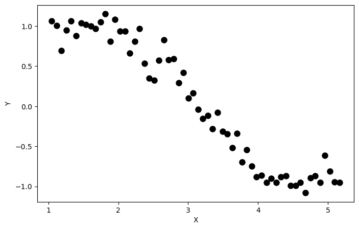

### 2.06 cell 6 · 先划分再拟合MinMax

<!-- cityu-nav:landing-6 -->
[[#4. 操作速查|↩ 回速查]] · [[#5. 双语术语与理论对应|回术语]] · [[#0. 这个 Notebook 在教什么|阅读导航]]
<!-- cityu-nav:landing:end -->

本格先把输入表与目标一起切分，再拟合缩放器。`predictors=['x']` 是只含一个列名的列表，`extend` 追加后续幂列；`data[predictors]` 取 15 列输入，`data['y']` 取一列答案。`train_test_split` 的四个返回值必须对应 X_train、X_test、y_train、y_test。

<details><summary>教师原代码与保存输出（cell 6）</summary>

```python
from sklearn.model_selection import train_test_split
from sklearn.metrics import mean_absolute_error
from sklearn.preprocessing import MinMaxScaler,Normalizer
power=15
predictors=['x']
predictors.extend(['x^%d'%i for i in range(2,power+1)])#we extend the orignial feature x to the power of 2, 3, ..., 15
X_train, X_test, y_train, y_test = train_test_split(data[predictors], data['y'], random_state=0)

feature_scaler = MinMaxScaler()
X_train_N=feature_scaler.fit_transform(X_train) #normalize X_train
X_test_N=feature_scaler.transform(X_test) #normalize X_test using min and max of X_train

X_train=pd.DataFrame(X_train_N,columns=list(X_train))
X_test=pd.DataFrame(X_test_N,columns=list(X_test))
```

</details>

未传 `test_size`，当前默认 0.25，所以 60 条分 45 条训练、15 条留出；`random_state=0` 固定划分。此处变量名叫 test，但后面拿它反复选 α，因此实际扮演验证集（Validation set），不是未参与选择的最终测试集。

最小最大缩放（Min-max scaling）在每列按训练最小／最大值计算 $z=(x-min)/(max-min)$。例如训练某列范围 2–6，原值 4 映为 0.5；验证值 8 映为 1.5，不能为了落在 0–1 而拿验证最大值重拟合。常数列分母为 0 时由软件约定处理，不能直接手除零。

`fit_transform(X_train)` 学训练边界并转换；`transform(X_test)` 只应用既有边界。缩放结果为 NumPy 数组，重新包成 `DataFrame` 保留原列名。这里产生新行索引，但模型按传入行顺序与 y 配对，没有按索引 join；若后续连接表格则需重新核行对齐。`Normalizer` 虽被导入，当前代码没有使用，不能说做了按行 L2 归一化。

**🎙️ 课堂补充**（`01:39:10`–`01:42:51`，B · 数据与预处理）

先讲正弦加噪声、十五阶特征，再强调训练端`fit_transform`、留出端只`transform`：*"we just use the feet and transform on the training data set"*（`01:42:28`–`01:42:33`，feet为fit的ASR）。`01:42:19`口头同时提X和Y归一化，但原cell6实际只缩放X；按已保留代码读，不补造y缩放。

### 2.07 cell 7 · 十五阶模型的含义

十五阶多项式预测是 $\hat y=a_0+a_1x+\cdots+a_{15}x^{15}$。a0 为截距，后面 15 个系数分别乘相应输入列；模型对系数线性，不代表关于 x 必须是一条直线。

这一格预告检查训练误差、系数量级与验证误差。更高阶有更多调节自由，但只有独立验证才能显示这种灵活度是否有用。下面每一项数字都须标明来自哪一份数据。

### 2.08 cell 8 · 拟合普通回归与训练预测

`LinearRegression()` 建立待拟合模型，`fit(X_train,y_train)` 用 45×15 输入与 45 个目标确定系数；`predict(X_train)` 再把训练记录送回，得到同长度训练预测。`fit` 会保存模型状态，`predict` 读取已保存系数，不再次学习答案。

<details><summary>教师原代码与保存输出（cell 8）</summary>

```python
from sklearn.linear_model import LinearRegression

plt.figure(figsize=(8,5))

power=15

linreg = LinearRegression() #set up the model. 
#the regressor X will be normalized before regression. 
#The normalization will be done by subtracting the mean and dividing it by L2 norm.
linreg.fit(X_train,y_train)
y_pred_train = linreg.predict(X_train)

plt.plot(X_train['x'],y_pred_train,'.',markersize=16)
plt.plot(X_train['x'],y_train,'.',markersize=16)
plt.title('Polynomial regression of power: %d'%power,fontsize=30)
plt.legend(['predicted','real data'],fontsize=16)
plt.show()
```

原保存文本输出（不冒称本批重跑）：

```text
<Figure size 800x500 with 1 Axes>
```

</details>

原注释说减均值再除 L2 norm，但实际源代码使用上一格 `MinMaxScaler`；`LinearRegression()` 本格未设置额外那种归一化，注释与代码不同，按执行代码解释。原训练图横轴是缩放后的第一列 x，蓝点预测、橙点真实。两色很接近，只能说明参与训练的记录被拟合得紧，不是验证好坏。

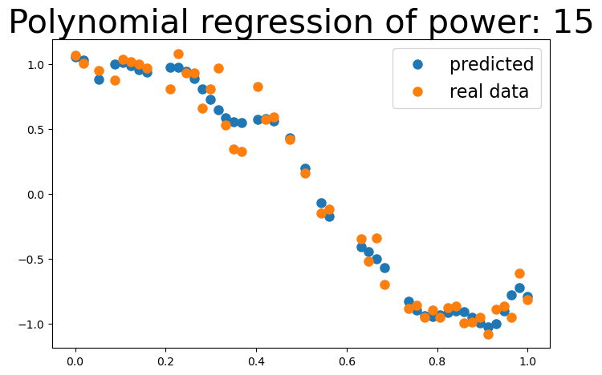

### 2.09 cell 9 · 训练误差与系数的提示

原文要继续看训练误差和系数，并预告“误差小、系数很大”。判断要接实际输出：系数作用于幂列，多个大项可能正负抵消，所以不能单凭某个系数大就算模型必坏；它提示数值稳定性和过拟合风险，仍需验证。

### 2.10 cell 10 · 读取MAE与全部系数

平均绝对误差（Mean absolute error，MAE）先逐条取真实与预测差的绝对值，再取平均。`%f` 是打印小数的格式，默认六位小数；`intercept_` 是拟合截距，`coef_` 为按 15 个输入列顺序保存的系数。变量后缀下划线表示已拟合属性。

<details><summary>教师原代码与保存输出（cell 10）</summary>

```python
print('Training Error= %f' %mean_absolute_error(y_train, y_pred_train))
print('intercept=%f' %linreg.intercept_)
for i in range(len(linreg.coef_)):
    print('a%d=%f' %(i+1,linreg.coef_[i]))
```

原保存文本输出（不冒称本批重跑）：

```text
Training Error= 0.078421
intercept=1.057933
a1=2031913.488968
a2=-36773928.509989
a3=344864790.122914
a4=-2126062340.662427
a5=9336994579.702747
a6=-30327783622.518524
a7=74302988106.380981
a8=-138560140803.835876
a9=196821717578.505493
a10=-211394249905.825348
a11=168725679119.933807
a12=-96954767996.357971
a13=37897523973.656570
a14=-9017406266.972521
a15=985384801.042269

```

</details>

`range(len(linreg.coef_))` 遍历索引 0–14，但打印用 i+1，所以 a1 对应第 0 个数组元素、a15 对应第 14 个。原保存训练 MAE=0.078421，本批复跑为 0.078420；十五阶系数病态条件下末位及较大量级数值略变，不把历史输出改成新跑输出。完整两份结果分别保留。

### 2.11 cell 11 · 转向验证问题

英文原问为 “What about validation error?”。训练误差已知很小，下一步要让模型预测未参与拟合的 15 条，而不是再换一种训练误差指标。此格“validation performance is bad”是原文相对本例的判断，须到下格核具体数值和参照。

英文参考答案（笔记自拟）：Evaluate predictions on the held-out validation observations, using the same error measure as for training. A small training MAE does not determine the validation MAE.

### 2.12 cell 12 · 普通回归验证结果

`linreg.predict(X_test)` 对 15 条留出输入产生预测，`mean_absolute_error(y_test,y_pred)` 只用于评价。原保存验证 MAE=0.230047，本批为 0.229992，约为训练误差的三倍，说明本次划分中训练拟合没有同等延伸到验证。

<details><summary>教师原代码与保存输出（cell 12）</summary>

```python
y_pred = linreg.predict(X_test)
print('Validation Error= %f' %mean_absolute_error(y_test, y_pred))
plt.plot(X_test['x'],y_pred,'.',markersize=16)
plt.plot(X_test['x'],y_test,'.',markersize=16)
plt.title('Polynomial regression of power: %d'%power,fontsize=30)
plt.legend(['predicted','real data'],fontsize=16)
plt.show()
```

原保存文本输出（不冒称本批重跑）：

```text
Validation Error= 0.230047

<Figure size 640x480 with 1 Axes>
```

</details>

原图横轴仍是缩放后的 x，部分蓝预测在右端与橙真实明显分开；这是真实记录上的误差比较，不是从点的左右顺序推时间。由于原表随机留出，不能把它叫未来预测检验。

英文参考答案（笔记自拟）：The saved validation MAE is 0.230047, compared with a training MAE of 0.078421. This split shows a substantial generalization gap. The local rerun is close but not byte-for-byte identical numerically.

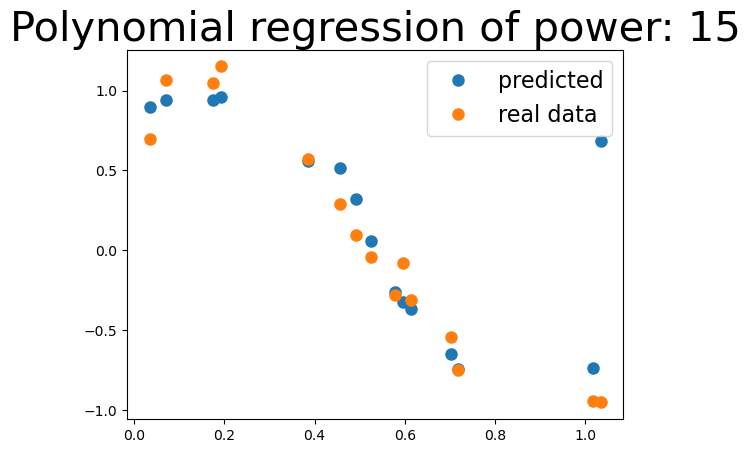

**🎙️ 课堂补充**（`01:42:55`–`01:45:58`，B · 从训练转向验证）

训练图追得很紧、系数很大，随后对留出预测再看MAE；*"It's much larger than the training"*（`01:45:38`）。这里是同一留出对照，准确保存值仍按原Notebook；口头形容“很大／很小”不替代数值，也不把系数大本身当成过拟合的充分证明。

### 2.13 cell 13 · Ridge目标与强度

Ridge 在训练目标加系数平方惩罚：scikit-learn 的约定为训练平方和加 $\alpha\sum_j a_j^2$，截距一般不惩罚。与 M10 原页使用 λ/2 的缩放不同，不能直接把同数值 α 和 λ 当同强度。

这里先固定 α=0.1 比较一次，再去验证选择。Ridge 通常让系数连续收缩；不把系数精确归零作为它的通用特征。

### 2.14 cell 14 · 固定alpha的Ridge训练

`Ridge(alpha=0.1)` 的 α 在 fit 前指定，输入仍是同一份已缩放训练表。`fit` 拟合系数，`predict(X_train)` 给训练预测；此时 `y_pred_train` 被覆盖为 Ridge 的结果，不再是 cell 8 的原线性模型预测。

<details><summary>教师原代码与保存输出（cell 14）</summary>

```python
from sklearn.linear_model import Ridge
plt.figure(figsize=(8,5))

alpha=0.1 #the penlty term is set to be 0.1
#Fit the model
ridgereg = Ridge(alpha=alpha)
ridgereg.fit(X_train,y_train)
y_pred_train = ridgereg.predict(X_train)

    
#Check if a plot is to be made for the entered alpha
plt.plot(X_train['x'],y_pred_train,'.',markersize=16)
plt.plot(X_train['x'],y_train,'.',markersize=16)
plt.title('Plot for penalty lambda: %.3g'%alpha,fontsize=30)
plt.show()
```

原保存文本输出（不冒称本批重跑）：

```text
<Figure size 800x500 with 1 Axes>
```

</details>

原图预测点比原十五阶更平缓，与真实点不再处处贴近。图没写 legend，但按两次 plot 的顺序，先画预测，再画真实；读法与前图一致。标题用 lambda 命名惩罚，源 API 实际参数名是 `alpha`。

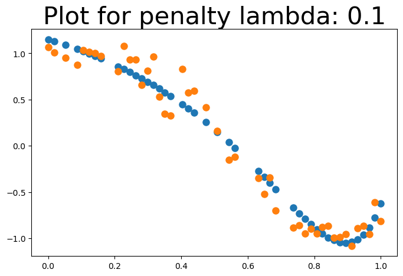

**🎙️ 课堂补充**（`01:46:12`–`01:50:58`，A · Ridge与代码准备）

讲解者说*"The key idea of range regression is to add a penalty on the size of the coefficients."*（`01:46:12`；range按源代码为Ridge）。随后用α=0.1比较训练代价和验证收益，确认本页目标，不把惩罚写成强制删列。

`01:47:41`使用明确的条件表达：*"so remember that if in your final exam they'll ask you some code questions"*；`01:47:48`接*"please remember to input from the library and then you can use that"*。input在此按代码为import；意思是**如果**遇到代码问题，先导入再使用，不承诺每道题或今年必有某个具体小题。现有书面Sample Final决策树(4)也要求导入和设置，可据此练习；M10 `32:31`的final example实际含义仍未回听确定，不能由此条件提醒反证其一定说exam。

### 2.15 cell 15 · 收缩的训练代价

原文预告 Ridge 的训练误差较大、系数显著减小。它表达正则化对“拟合得多紧”的主动取舍，不是要求把所有系数压到零。下一格在同样 45 条训练记录上比较，数据角色没变。

### 2.16 cell 16 · 读取Ridge训练结果

源保存与本批运行均得 Ridge 训练 MAE=0.126277，高于未惩罚的约 0.07842。原截距约 1.150080，系数大多在 −1 到 1 附近；例如 a1≈−0.641983、a7≈0.025460，后部也未全部归零。

<details><summary>教师原代码与保存输出（cell 16）</summary>

```python
print('Training Error= %f' %mean_absolute_error(y_train, y_pred_train))
print('intercept=%f' %ridgereg.intercept_)
for i in range(len(ridgereg.coef_)):
    print('a%d=%f' %(i+1,ridgereg.coef_[i]))
```

原保存文本输出（不冒称本批重跑）：

```text
Training Error= 0.126277
intercept=1.150080
a1=-0.641983
a2=-0.977411
a3=-0.936037
a4=-0.702257
a5=-0.422426
a6=-0.171054
a7=0.025460
a8=0.164427
a9=0.252661
a10=0.299650
a11=0.314658
a12=0.305680
a13=0.279223
a14=0.240404
a15=0.193162

```

</details>

这份表支持“系数量级明显缩小”与“训练拟合有所牺牲”。是否值得要看同一验证集；不能只比较系数总数，Ridge 仍有原来的 15 列输入。

### 2.17 cell 17 · Ridge验证比较

注释问 “What about validation performance?”。源保存及本批结果均为验证 MAE=0.196034，低于未惩罚的约 0.2300，但仍高于训练 MAE。本格数据与 cell 12 相同，所以差异主要对应拟合方法改变。

<details><summary>教师原代码与保存输出（cell 17）</summary>

```python
#The model complexity was controled. What about validation performance?
y_pred = ridgereg.predict(X_test)
print('Validation Error= %f' %mean_absolute_error(y_test, y_pred))
plt.plot(X_test['x'],y_pred,'.',markersize=16)
plt.plot(X_test['x'],y_test,'.',markersize=16)
plt.title('Polynomial regression of power: %d'%power,fontsize=30)
plt.legend(['predicted','real data'],fontsize=16)
plt.show()
```

原保存文本输出（不冒称本批重跑）：

```text
Validation Error= 0.196034

<Figure size 640x480 with 1 Axes>
```

</details>

英文参考答案（笔记自拟）：With alpha fixed at 0.1, the saved Ridge validation MAE is 0.196034, lower than the unpenalized polynomial model's saved 0.230047 on the same split. The training MAE increases, illustrating the fit-complexity trade-off.

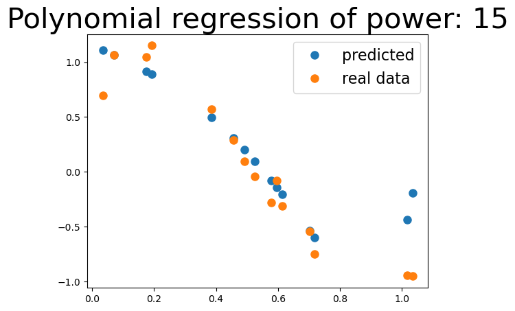

### 2.18 cell 18 · 用验证选择强度

现在不再只展示 α=0.1，而要用验证集在一份预列候选中选强度。α=0 没有平方惩罚，α增大通常收缩更多；α过大也可能把有用信号压弱，不能据“更简单”保证更好。

每个 α 都要重新 fit，不能只改一个已拟合对象的字段后直接 predict。验证集参与这一选择后，不再是独立最终测试。

### 2.19 cell 19 · 20项alpha循环

<!-- cityu-nav:landing-19 -->
[[#4. 操作速查|↩ 回速查]] · [[#5. 双语术语与理论对应|回术语]] · [[#0. 这个 Notebook 在教什么|阅读导航]]
<!-- cityu-nav:landing:end -->

`[i/100 for i in range(0,20)]` 逐个把整数 0–19 除以 100，得到 0、0.01 直到 0.19，共 20 项，不含 0.20。循环每次新建并拟合 Ridge，再对相同 15 条验证记录计算 MAE。

<details><summary>教师原代码与保存输出（cell 19）</summary>

```python
alpha_test=[i/100 for i in range(0,20)] #search this hyperparameter from 0 to 0.19, with a step of 0.01

for alpha in alpha_test:
    ridgereg = Ridge(alpha=alpha).fit(X_train,y_train)
    y_pred = ridgereg.predict(X_test)
    print(alpha,'Validation Error= %f' %mean_absolute_error(y_test, y_pred))
```

原保存文本输出（不冒称本批重跑）：

```text
0.0 Validation Error= 0.230049
0.01 Validation Error= 0.161678
0.02 Validation Error= 0.176549
0.03 Validation Error= 0.183870
0.04 Validation Error= 0.188023
0.05 Validation Error= 0.190702
0.06 Validation Error= 0.192492
0.07 Validation Error= 0.193629
0.08 Validation Error= 0.194661
0.09 Validation Error= 0.195472
0.1 Validation Error= 0.196034
0.11 Validation Error= 0.196411
0.12 Validation Error= 0.196648
0.13 Validation Error= 0.196780
0.14 Validation Error= 0.196828
0.15 Validation Error= 0.196811
0.16 Validation Error= 0.196747
0.17 Validation Error= 0.196745
0.18 Validation Error= 0.196716
0.19 Validation Error= 0.196664

```

</details>

源保存中最小误差出现在 α=0.01，MAE=0.161678；α=0.1 为 0.196034，而 α=0 为约 0.230049。本批 α=0 的末位略变，赢家仍相同。只能说它在这 20 项、这一分折与当前 MAE 下最佳；循环结束时 `ridgereg` 留的是最后 α=0.19 的模型，并未自动恢复赢家。要用于后续预测，应保存最佳模型或用选中 α 重新拟合。

### 2.20 cell 20 · 最小验证误差答案

英文原题为 “which alpha provides the best performance?”。⚪ 参考答案（按源保存和本批复跑）：候选列表中 α=0.01 的验证 MAE 最小，为 0.161678。不是直接回答 0.1，也不是回答循环结束留下的 0.19。

英文参考答案（笔记自拟）：Among the tested alpha values, 0.01 has the lowest validation MAE, approximately 0.161678. This is a result for the specified grid, split and metric, and the loop does not retain that model automatically.

**🎙️ 课堂补充**（`01:51:09`–`01:54:33`，A · 最佳候选与继续搜索）

`01:53:11`点出*"Because this one has 0.01."*；最低验证误差与原输出一致。然后建议最优值贴搜索边界时扩大范围：*"please expand the wrench"*（`01:53:47`；wrench按range理解）。

**不要误抄口头序号**：`01:53:08`称first，`01:53:37`说位于边缘；原列表含0、0.01…0.19，0.01实际为第二项且不是整个列表端点。可以在0到0.02附近增加较细候选继续检验，但这是下一轮开发，不把口头“first”改写成原输出事实，也不据此宣布0.01为全局最优。

### 2.21 cell 21 · 乳腺基准与剪枝任务

第二部分改用 Wisconsin Diagnostic 乳腺肿块测量的公开教学数据，任务是分类与剪枝比较。每条记录有来自细针抽吸图像的细胞核特征，标签区分恶性／良性；本篇是离线基准学习，不据模型输出诊断任何真实个人。

成本复杂度剪枝（Cost-complexity pruning）把树的拟合不纯度与叶子复杂度相加，来源是 sklearn 的该算法，不等同于 M10 用错分率加 Ωk/N 的数值尺度；后面 α 不能直接与讲义 Ω 比大小。

### 2.22 cell 22 · 导入与内核依赖

这里只导入绘图、切分、内置数据集和决策树分类器（DecisionTreeClassifier）。`from 模块 import 名称` 把具体工具放入当前内核；导入成功本身不代表已经读取数据或训练了树。

<details><summary>教师原代码与保存输出（cell 22）</summary>

```python
import matplotlib.pyplot as plt
from sklearn.model_selection import train_test_split
from sklearn.datasets import load_breast_cancer
from sklearn.tree import DecisionTreeClassifier
```

</details>

本格还依赖前面已经导入的 pandas 别名 `pd`，所以从空内核只运行这里会缺 pd；应按原顺序运行，或在独立复用时明确补齐依赖。

### 2.23 cell 23 · 影像特征的记录单位

原文说明载入的是细针抽吸影像的属性与类别，并给数据说明链接。当前关键是先理解“一行记录、30 个数值输入、一项类别”，再看表；不能把第一列名称 mean radius 当作样本编号。

### 2.24 cell 24 · 569行30列与标签方向

`load_breast_cancer()` 返回带数据、目标与名称的容器。`cancer['data']` 是 569×30 数表，`feature_names` 给 30 列名；`target` 是长度 569 的类别数组。包装成 df_feat 与 df_target 后，两张表的同一行来自同一原样本。

<details><summary>教师原代码与保存输出（cell 24）</summary>

```python
cancer = load_breast_cancer()

df_feat = pd.DataFrame(cancer['data'], 
                       columns = cancer['feature_names']) 
  
# cancer column is our target 
df_target = pd.DataFrame(cancer['target'],  
                     columns =['Cancer'])
```

</details>

标签顺序为 0=malignant（恶性）、1=benign（良性），目标列虽命名 Cancer，也不能误读为 1 才是恶性。全数据计数为 212 个恶性、357 个良性；后面应明确需要重点看哪个类别的召回率。

### 2.25 cell 25 · 读取特征表

`df_feat.head()` 展示前 5 条、30 列测量。mean radius、mean texture、mean perimeter 等是输入特征，`worst` 表示数据定义的较大测量摘要，不是预测错误；中间省略号是 pandas 展示折叠，不表示丢掉列。

<details><summary>教师原代码与保存输出（cell 25）</summary>

```python
df_feat.head()
```

原保存文本输出（不冒称本批重跑）：

```text
   mean radius  mean texture  mean perimeter  mean area  mean smoothness  \
0        17.99         10.38          122.80     1001.0          0.11840   
1        20.57         17.77          132.90     1326.0          0.08474   
2        19.69         21.25          130.00     1203.0          0.10960   
3        11.42         20.38           77.58      386.1          0.14250   
4        20.29         14.34          135.10     1297.0          0.10030   

   mean compactness  mean concavity  mean concave points  mean symmetry  \
0           0.27760          0.3001              0.14710         0.2419   
1           0.07864          0.0869              0.07017         0.1812   
2           0.15990          0.1974              0.12790         0.2069   
3           0.28390          0.2414              0.10520         0.2597   
4           0.13280          0.1980              0.10430         0.1809   

   mean fractal dimension  ...  worst radius  worst texture  worst perimeter  \
0                 0.07871  ...         25.38          17.33           184.60   
1                 0.05667  ...         24.99          23.41           158.80   
2                 0.05999  ...         23.57          25.53           152.50   
3                 0.09744  ...         14.91          26.50            98.87   
4                 0.05883  ...         22.54          16.67           152.20   

   worst area  worst smoothness  worst compactness  worst concavity  \
0      2019.0            0.1622             0.6656           0.7119   
1      1956.0            0.1238             0.1866           0.2416   
2      1709.0            0.1444             0.4245           0.4504   
3       567.7            0.2098             0.8663           0.6869   
4      1575.0            0.1374             0.2050           0.4000   

   worst concave points  worst symmetry  worst fractal dimension  
0                0.2654          0.4601                  0.11890  
1                0.1860          0.2750                  0.08902  
2                0.2430          0.3613                  0.08758  
3                0.2575          0.6638                  0.17300  
4                0.1625          0.2364                  0.07678  

[5 rows x 30 columns]
```

</details>

读首行：mean radius=17.99、mean texture=10.38、mean area=1001.0 都描述同一记录的不同性质。不同列尺度差别很大，会影响使用距离的 SVC；树按阈值切分的机制与此不同。原表没有在本格逐一给测量单位，笔记不补造单位。

### 2.26 cell 26 · 读取目标表

`df_target.head()` 前 5 条都为 0，只能说这五条标签是恶性，不能据头部五行推全数据只有一个类。完整类计数在 cell 24 已列，分层抽样（Stratification）会考虑整个目标数组的分布，而不是只看 head。

<details><summary>教师原代码与保存输出（cell 26）</summary>

```python
df_target.head()
```

原保存文本输出（不冒称本批重跑）：

```text
   Cancer
0       0
1       0
2       0
3       0
4       0
```

</details>

### 2.27 cell 27 · 426训练与143留出

原切分未传 test_size，按默认 0.25 生成 426 条训练、143 条留出；`random_state=0` 固定同一分法。`np.ravel(df_target)` 把 569×1 目标压成长度 569 的一维数组，满足分类器要求；不是改标签或去掉样本。

<details><summary>教师原代码与保存输出（cell 27）</summary>

```python
#randomly split the dataset. By default, the test_size=0.25
X_train, X_test, y_train, y_test = train_test_split(df_feat, np.ravel(df_target), random_state=0)
```

</details>

这一格重新给 X_train／X_test／y_train／y_test 赋值，已经从正弦回归切换到乳腺数据，不能再拿它们与前面的15维系数相乘。实际训练类计数为 159／267，留出为 53／90；原切分没设 `stratify`，只能说此次分配结果如此，不能声称强制按类等比例。

### 2.28 cell 28 · 弱连接剪枝的临界代价

<!-- cityu-nav:landing-28 -->
[[#4. 操作速查|↩ 回速查]] · [[#5. 双语术语与理论对应|回术语]] · [[#0. 这个 Notebook 在教什么|阅读导航]]
<!-- cityu-nav:landing:end -->

先生成候选剪枝强度，再为每个强度训练一棵树。弱连接剪枝（Weakest-link pruning）寻找“删掉某段子树，每减少一个叶子会增加多少训练不纯度”，这一临界代价就是有效 α。每次先删单位复杂度代价最小的子树，重复到只剩根，产生一串候选强度。

用一个笔记补充小例看比值：某子树有 3 叶，总加权不纯度 0.06；换成单叶后为 0.10，少 2 叶、增加 0.04，不纯度增加／叶减少为 0.02。α越过相关临界值时，更简单的替代方案在“训练不纯度＋α×叶数”的目标下更有利。完整路径由当前训练样本决定，不先用验证标签造路径。

### 2.29 cell 29 · 生成alpha路径

`cost_complexity_pruning_path(X_train,y_train)` 在当前 426 条上生成路径；返回 `ccp_alphas` 与 `impurities` 两个等长数组。前者是候选有效 α，后者是相应子树叶子的加权不纯度和。它还没有在验证集上选“最佳 α”。

<details><summary>教师原代码与保存输出（cell 29）</summary>

```python
clf = DecisionTreeClassifier(random_state=0)
path = clf.cost_complexity_pruning_path(X_train, y_train) #seeking alpha
ccp_alphas, impurities = path.ccp_alphas, path.impurities #output apha and tree impurities

fig, ax = plt.subplots()
ax.plot(ccp_alphas[:-1], impurities[:-1], marker="o", drawstyle="steps-post")
ax.set_xlabel("effective alpha")
ax.set_ylabel("total impurity of leaves")
ax.set_title("Total Impurity vs effective alpha for training set")
```

原保存文本输出（不冒称本批重跑）：

```text
Text(0.5, 1.0, 'Total Impurity vs effective alpha for training set')
```

</details>

`[:-1]` 表示从头取到最后一个之前，把仅根节点的极端方案暂不画入曲线；原代码只是用于这张图，完整数组尚保留。`drawstyle='steps-post'` 在阶梯上表示子树在阈值间不变，不是 α 每变一点树就连续缩短。本格源保存仅有 `Text(...)` 表示对象，没有内嵌该图 PNG；本批按原代码实际生成了新图，历史缺图与新运行图分别标注。

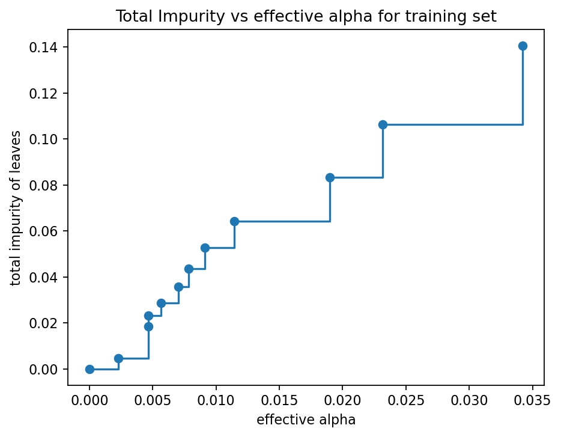

### 2.30 cell 30 · 保存不同树的计划

要看每个有效 α 对应什么树，下一格会遍历所有候选，分别创建分类器并 fit，再把模型放入列表。列表（List）按顺序保存对象，例如第 0 项对应第 0 个 α，不能把它当一组共享同一权重的模型。

### 2.31 cell 31 · 逐alpha拟合并保存

`clfs=[]` 先建空列表；`for alpha in ccp_alphas` 逐个取候选值；每轮 `DecisionTreeClassifier(random_state=0,ccp_alpha=alpha)` 新建受惩罚的树，`fit` 后 `append` 保存这棵已拟合树。

<details><summary>教师原代码与保存输出（cell 31）</summary>

```python
clfs = [] #this list will be used to store a list of Decision Tree Models with different penalty alpha values.
for alpha in ccp_alphas:
    print('the penalty term alpha is %f' %alpha)
    clf = DecisionTreeClassifier(random_state=0, ccp_alpha=alpha) # induce a tree using the ccp_alpha value
    clf.fit(X_train, y_train)
    clfs.append(clf)
```

原保存文本输出（不冒称本批重跑）：

```text
the penalty term alpha is 0.000000
the penalty term alpha is 0.002266
the penalty term alpha is 0.004647
the penalty term alpha is 0.004660
the penalty term alpha is 0.005634
the penalty term alpha is 0.007042
the penalty term alpha is 0.007842
the penalty term alpha is 0.009114
the penalty term alpha is 0.011444
the penalty term alpha is 0.018988
the penalty term alpha is 0.023142
the penalty term alpha is 0.034225
the penalty term alpha is 0.327298

```

</details>

源输出共 13 个 α，从 0 到约 0.327298。α=0 不加这一剪枝惩罚，最大值对应仅根节点；中间的 α≈0.007042 与后面 `ccp_alphas[5]` 对应。树拟合每个候选时仍只用训练集，验证集用来选强度的动作在这一节尚未发生。

### 2.32 cell 32 · 示例树与索引

原文要展示第一棵、所谓第 5 个 α 和最后一个 α 对应的树。Python 索引从 0 起，因此下一格 `ccp_alphas[5]` 实际是第 6 个候选，而非第 5 个；原标题中的 “5-th” 是计数口径错误，正文明确保留并纠正。

这里展示的是已经训练过的对象，不是在画图时重新选最优树。剪得更少或更多都只是候选，需要另做性能比较。

### 2.33 cell 33 · 第一棵树的读法

`ccp_alphas[0]` 是 0，`clfs[0]` 为无该惩罚的完整树。`plot_tree(...,filled=True)` 用颜色显示节点的类别构成。每框的 `x[j] <= threshold` 是分裂判断，`samples` 是到该节点的训练记录数，`value` 按类别顺序列计数，Gini 为不纯度：两类比例为 p0、p1 时 $1-p_0^2-p_1^2$。

<details><summary>教师原代码与保存输出（cell 33）</summary>

```python
from sklearn.tree import plot_tree
print('the first alphas is: ', ccp_alphas[0]) #the first alpha value in the list of ccp_alphas generated.
plot_tree(clfs[0], filled=True)
plt.title("Decision tree trained on the first ccp_alpha")
plt.show()
```

原保存文本输出（不冒称本批重跑）：

```text
the first alphas is:  0.0

<Figure size 640x480 with 1 Axes>
```

</details>

原图根有 samples=426、value=[159,267]，多数为类别 1（良性）。第一判断是 x[7]≤约0.049；用 `feature_names[7]` 可找 mean concave points。满足条件走 True，另一边走 False，再继续判断直到叶子；叶子没有下一特征，按多数类输出。颜色深浅不是概率校准的保证。

完整树原图字体很小，本篇保留来源图辨认结构，并以这条根路径解释读法。[打开本批同源复跑的较清晰大图](figures/t11-source/cell-33-recomputed.png)，它来自同一原cell33、同一训练数据与已记录运行环境，复用先前实际生成的较大PNG，没有新增训练或改图中数字。它不是教师原保存图；完整数据和代码仍可由内置数据、切分与原cell追踪。


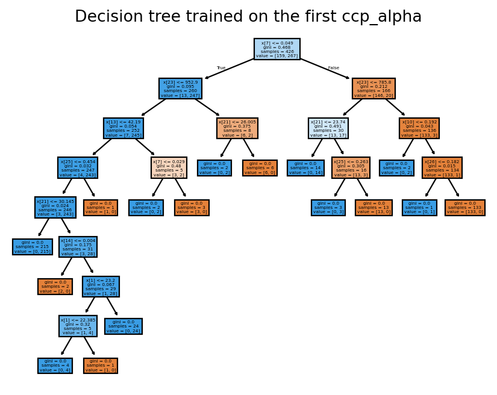

### 2.34 cell 34 · 索引5实际是第6项

代码取索引 5，实际候选值约 0.0070422535，是第 6 个 α；原打印与标题说 “5th”，按代码实际含义解读。对应树已有较少叶子和较短路径，与上格完整树形成结构对照。

<details><summary>教师原代码与保存输出（cell 34）</summary>

```python
print('the 5th alphas is: ', ccp_alphas[5])
plot_tree(clfs[5], filled=True)
plt.title("Decision tree trained on the 5-th ccp_alpha")
plt.show()
```

原保存文本输出（不冒称本批重跑）：

```text
the 5th alphas is:  0.007042253521126761

<Figure size 640x480 with 1 Axes>
```

</details>

原根仍为 426 条、159／267，说明剪枝没有删掉训练客户，而是把多条分支合并。图中较大的纯叶包含相同或接近的类别；保留哪个结构应比较验证成绩，不能仅因图更短就宣布最好。

[打开本批同源复跑的较清晰大图](figures/t11-source/cell-34-recomputed.png)。该图复用原cell34先前实际运行的较大PNG，源代码／数据／环境与本批运行回执一致；教师原保存图继续保留，不能把复跑图说成原文件内已有图像。

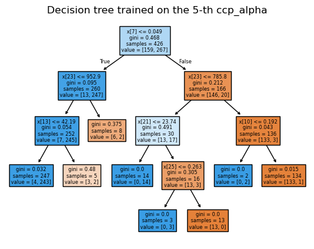

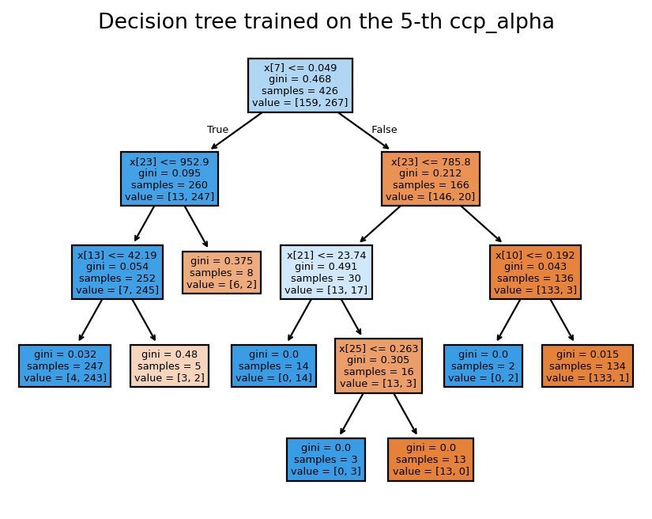

### 2.35 cell 35 · 仅根树的代价

`[-1]` 是列表最后一项，源值约 0.3272984419。原图只有根框，Gini≈0.468、426 条、159／267；它对任何输入都预测训练多数类 1，完全不使用特征作分裂。

<details><summary>教师原代码与保存输出（cell 35）</summary>

```python
print('the last alphas is: ', ccp_alphas[-1])
plot_tree(clfs[-1], filled=True)
plt.title("Decision tree trained on the last ccp_alpha")
plt.show()
```

原保存文本输出（不冒称本批重跑）：

```text
the last alphas is:  0.3272984419327777

<Figure size 640x480 with 1 Axes>
```

</details>

由根计数可复算训练准确率 267/426≈0.626761，恶性召回率为 0。这说明极大惩罚会丢掉有用区分，不能把“最简单”当作最佳。该训练推算不是独立测试成绩。

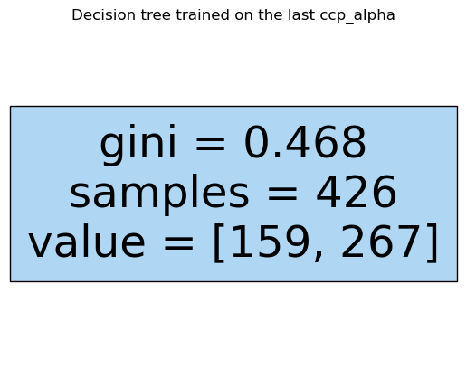

### 2.36 cell 36 · 节点数与深度

下一格把 α 与节点数、深度放在两张图上。节点数（Node count）包括分裂与叶；深度（Depth）数根到最深叶的边数。仅根树有节点 1、深度 0，两者不能混报。

源文说排除最后一棵只剩根的树；它是展示范围选择，不是隐藏某棵验证差的结果。原完整候选仍在源输出可追溯。

### 2.37 cell 37 · 截尾列表及阶梯图

`clfs=clfs[:-1]` 与 `ccp_alphas=ccp_alphas[:-1]` 同时去掉最后项，让模型与 α 仍一一对齐。若只删其中一边，后面的横坐标与模型就错位。重复运行这格会再次删最后项，故应从空内核按顺序跑，不能连按运行后还当同一完整路径。

<details><summary>教师原代码与保存输出（cell 37）</summary>

```python
clfs = clfs[:-1]
ccp_alphas = ccp_alphas[:-1]

node_counts = [clf.tree_.node_count for clf in clfs]
depth = [clf.tree_.max_depth for clf in clfs]
fig, ax = plt.subplots(2, 1)
ax[0].plot(ccp_alphas, node_counts, marker="o", drawstyle="steps-post")
ax[0].set_xlabel("alpha")
ax[0].set_ylabel("number of nodes")
ax[0].set_title("Number of nodes vs alpha")
ax[1].plot(ccp_alphas, depth, marker="o", drawstyle="steps-post")
ax[1].set_xlabel("alpha")
ax[1].set_ylabel("depth of tree")
ax[1].set_title("Depth vs alpha")
fig.tight_layout()
fig
```

原保存文本输出（不冒称本批重跑）：

```text
<Figure size 640x480 with 2 Axes>
```

</details>

列表推导 `[clf.tree_.node_count for clf in clfs]` 对每棵树读取节点数；`max_depth` 读取实际深度。原两图横轴 α，上图纵轴节点数从约 31 降到 3，下图深度从 8 降到 1；在若干 α 区间深度保持不变。它说明惩罚简化结构，没有验证分数曲线，不能从中选出预测最佳 α。

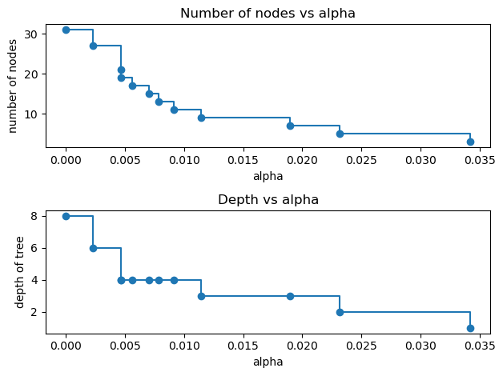

**🎙️ 课堂补充**（`01:54:33`–`02:01:28`，B · 剪枝示例）

从乳腺数据准备、训练侧造候选α，到三棵树与节点／深度趋势；*"after that, we can change our model using different alpha here"*（`01:58:11`）。大α只剩根可能欠拟合（`02:00:25`–`02:00:47`）。本源没在此给出独立验证选出的最佳树α；原第6项索引、路径与实际运行结果保持，不新增“课堂选优成功”结论。

### 2.38 cell 38 · 路径还没有选优

本节结论是 α 控制剪枝复杂度，但尚未选好 α。应对候选树在验证数据上比较；若把生成路径、训练分数或“图最小”当成最佳结果，就漏掉本节最后的验证动作。

Ridge 与剪枝都为复杂度收费，但前者惩罚系数大小，后者惩罚叶结构，两种 α 的单位与损失尺度不同。下一节用 SVC 演示自动选择，而不是已经替这棵树找出了最优 α。

### 2.39 cell 39 · 自动搜索与SVC

网格交叉验证（GridSearchCV）把“每种配置重新 fit、每折验证、汇总、选配置、重新拟合”封装为一个工具。输入仍是上一节乳腺训练部分，留出 143 条不进搜索。

支持向量分类（Support vector classification，SVC）试图用间隔区分类别，并对训练违反间隔的点付代价；RBF 核用输入点间平方距离决定相似度，能形成非直线边界。此处以它作为搜索候选，当前任务是追踪配置与验证角色；完整间隔／核机制可回看 [[IS6400_Business_Data_Analytics/notes/M06-分类-决策树集成SVM与不平衡学习|M06]]，下面就地解释 C 和 gamma 如何改变本例。

### 2.40 cell 40 · 默认SVC基线

先在同一乳腺训练集拟合默认 SVC，作为未调参基线，再与内层 CV 选出的 SVC 比较。虽然源文称保留集 test，本例实际又展示多种方案的成绩，若据此继续选择家族，这批留出就参与了选择，不能一概称反复使用后仍未受影响。

“Baseline”不是性能一定很差，而是比较起点。默认值依安装版本，本篇分别记录源 metadata 与本次 sklearn 版本。

### 2.41 cell 41 · 导入报告工具

本格准备后面要使用的 SVC、搜索器与分类报告函数，尚未训练或生成报告。

<details><summary>教师原代码与保存输出（cell 41）</summary>

```python
from sklearn.svm import SVC 
from sklearn.model_selection import GridSearchCV
from sklearn.metrics import classification_report
```

</details>

`classification_report` 收到真实标签和预测标签后，才生成各类 precision、recall、F1 与 support。导入语句只使工具名称可用；下一格必须实际调用模型与报告函数，不能把导入当评价完成。

### 2.42 cell 42 · 默认SVC分类报告

`SVC()` 采用默认配置，在源版本／本批版本常用 C=1、gamma='scale'、RBF 核。`fit` 只用 426 条训练，`predict` 给 143 条预测，报告中 support 是真实该类记录数：类别0共53、类别1共90。

<details><summary>教师原代码与保存输出（cell 42）</summary>

```python
# train the model on train set 
model = SVC() 
model.fit(X_train, y_train) 
  
# print prediction results 
predictions = model.predict(X_test) 
print(classification_report(y_test, predictions))
```

原保存文本输出（不冒称本批重跑）：

```text
              precision    recall  f1-score   support

           0       0.98      0.85      0.91        53
           1       0.92      0.99      0.95        90

    accuracy                           0.94       143
   macro avg       0.95      0.92      0.93       143
weighted avg       0.94      0.94      0.94       143


```

</details>

源保存类别0 precision≈0.98、recall≈0.85，类别1 precision≈0.92、recall≈0.99。可以理解成恶性里约 85% 被识别、漏掉约 15%；不是 0.85 概率的病理结论。准确率表中四舍五入为0.94，未舍入为134/143≈0.937063。

一行报告的分母不同：类别0 recall按全部真实0类数53，precision按所有预测0类数；F1兼顾二者。`macro avg`把各类等权，`weighted avg`按真实支持数加权，不能只看表头都叫average就互换。

### 2.43 cell 43 · C与gamma的作用

C 是违反间隔代价的控制项：较大 C 更不愿容忍训练违反约束，但也可能追逐噪声。gamma 决定 RBF 相似度随距离衰减多快：核为 $\exp(-\gamma\lVert x-x'\rVert^2)$，距离平方越大，相似度越小；gamma 大时单点影响范围更局部。

💡 笔记补充：两点距离平方为 4，gamma=0.1 时相似度约 exp(−0.4)=0.6703；gamma=1 时约 exp(−4)=0.0183。同样坐标单位若改大，距离也变大，所以未缩放输入的 gamma 不能与缩放后的同值直接混比。

候选 C 有5项、gamma有5项、kernel仅rbf一项，共25组；每组5折，候选拟合共125次。`refit=True` 再用全部426条训练重拟合所选配置，加1次，因此不能把终端“125 fits”当所有训练动作总数。

### 2.44 cell 44 · 25组五折搜索

<!-- cityu-nav:landing-44 -->
[[#4. 操作速查|↩ 回速查]] · [[#5. 双语术语与理论对应|回术语]] · [[#0. 这个 Notebook 在教什么|阅读导航]]
<!-- cityu-nav:landing:end -->

`param_grid` 是字典：键对应模型参数名，值是要遍历的列表。`GridSearchCV(SVC(),...,refit=True,verbose=3)` 收到未训练的估计器，再按组合和分折重新拟合；verbose只控制日志详细程度，不改变学习规则。

<details><summary>教师原代码与保存输出（cell 44）</summary>

```python
from sklearn.model_selection import GridSearchCV 
  
# defining hyperparameter options 
param_grid = {'C': [0.1, 1, 10, 100, 1000],  
              'gamma': [1, 0.1, 0.01, 0.001, 0.0001], 
              'kernel': ['rbf']}  
  
grid = GridSearchCV(SVC(), param_grid, refit = True, verbose = 3) 
  
# fitting the model for grid search 
grid.fit(X_train, y_train)
```

原保存输出包含25组×5折日志；完整日志保留在教师Notebook与本批source-saved-outputs.txt。开头与最终对象为：

```text
Fitting 5 folds for each of 25 candidates, totalling 125 fits
[CV 1/5] END ........C=0.1, gamma=1, kernel=rbf;, score=0.628 total time=   0.0s
[CV 2/5] END ........C=0.1, gamma=1, kernel=rbf;, score=0.635 total time=   0.0s
[CV 3/5] END ........C=0.1, gamma=1, kernel=rbf;, score=0.624 total time=   0.0s
[CV 4/5] END ........C=0.1, gamma=1, kernel=rbf;, score=0.624 total time=   0.0s
[CV 5/5] END ........C=0.1, gamma=1, kernel=rbf;, score=0.624 total time=   0.0s
[CV 1/5] END ......C=0.1, gamma=0.1, kernel=rbf;, score=0.628 total time=   0.0s
[CV 2/5] END ......C=0.1, gamma=0.1, kernel=rbf;, score=0.635 total time=   0.0s
[CV 3/5] END ......C=0.1, gamma=0.1, kernel=rbf;, score=0.624 total time=   0.0s
[CV 4/5] END ......C=0.1, gamma=0.1, kernel=rbf;, score=0.624 total time=   0.0s
[CV 5/5] END ......C=0.1, gamma=0.1, kernel=rbf;, score=0.624 total time=   0.0s
[CV 1/5] END .....C=0.1, gamma=0.01, kernel=rbf;, score=0.628 total time=   0.0s
[CV 2/5] END .....C=0.1, gamma=0.01, kernel=rbf;, score=0.635 total time=   0.0s
[CV 3/5] END .....C=0.1, gamma=0.01, kernel=rbf;, score=0.624 total time=   0.0s
[CV 4/5] END .....C=0.1, gamma=0.01, kernel=rbf;, score=0.624 total time=   0.0s
[CV 5/5] END .....C=0.1, gamma=0.01, kernel=rbf;, score=0.624 total time=   0.0s
[CV 1/5] END ....C=0.1, gamma=0.001, kernel=rbf;, score=0.628 total time=   0.0s
[CV 2/5] END ....C=0.1, gamma=0.001, kernel=rbf;, score=0.635 total time=   0.0s
[CV 3/5] END ....C=0.1, gamma=0.001, kernel=rbf;, score=0.624
[中间重复日志见完整来源]
  0.0s
[CV 2/5] END ..C=1000, gamma=0.0001, kernel=rbf;, score=0.906 total time=   0.0s
[CV 3/5] END ..C=1000, gamma=0.0001, kernel=rbf;, score=0.953 total time=   0.0s
[CV 4/5] END ..C=1000, gamma=0.0001, kernel=rbf;, score=0.941 total time=   0.0s
[CV 5/5] END ..C=1000, gamma=0.0001, kernel=rbf;, score=0.906 total time=   0.0s

GridSearchCV(estimator=SVC(),
             param_grid={'C': [0.1, 1, 10, 100, 1000],
                         'gamma': [1, 0.1, 0.01, 0.001, 0.0001],
                         'kernel': ['rbf']},
             verbose=3)
```

</details>

原未显式传 `cv`／`scoring`：本批 sklearn 1.5.1 的分类情形采用5折分层、不打乱，分数默认来自 SVC.score，即准确率。分层使各折类比例尽量接近，并不自动保证相同主体不跨折或时间无泄漏。真实运行和源日志都显示25×5=125次候选拟合，完整重复日志保留原Notebook与本批证据，不把125行逐行变成125个教学步骤。

源代码这里没有先缩放乳腺输入；这是本源的实际基线，不能偷偷把缩放后的分数写成原结果。要改善时可另建训练折内 Pipeline，让缩放在每个训练折学习，而不是先对全数据标准化再CV。

### 2.45 cell 45 · 参数与重拟合赢家

`best_params_` 返回搜索选中的参数字典，`best_estimator_` 是已经在全部训练数据重拟合的赢家对象。源与本批结果一致：C=1、gamma=0.0001、kernel='rbf'。

<details><summary>教师原代码与保存输出（cell 45）</summary>

```python
# print best parameter after tuning 
print(grid.best_params_) 
  
# print how our model looks after hyper-parameter tuning 
print(grid.best_estimator_)
```

原保存文本输出（不冒称本批重跑）：

```text
{'C': 1, 'gamma': 0.0001, 'kernel': 'rbf'}
SVC(C=1, gamma=0.0001)

```

</details>

这个“best”只针对给定25组、5折划分和准确率，不证明所有可能超参数中的全局最优。与前面手写α循环不同，GridSearchCV 在 refit=True 下自动保留并重拟合赢家。

**🎙️ 课堂补充**（`02:01:43`–`02:06:53`，B · 自动搜索）

默认SVC作起点，5个C、5个gamma、一种RBF共25组：*"and here we have 25 combinations"*（`02:03:49`），并解释每组五折。讲解者把本轮验证折口头叫testing fold（`02:04:36`），这里仍是用于选参的内层验证，不等于最终外测。随后按best参数取预测；125候选fit加refit的解释与源代码保持。

### 2.46 cell 46 · 调优SVC留出报告

`grid.predict(X_test)` 使用重拟合赢家，对同样143条留出记录作预测，再用真实 y_test 生成报告。原调优后类别0 precision／recall约0.92／0.92，类别1约0.96／0.96；未舍入准确率135/143≈0.944056。

<details><summary>教师原代码与保存输出（cell 46）</summary>

```python
grid_predictions = grid.predict(X_test) 
  
# print classification report 
print(classification_report(y_test, grid_predictions))
```

原保存文本输出（不冒称本批重跑）：

```text
              precision    recall  f1-score   support

           0       0.92      0.92      0.92        53
           1       0.96      0.96      0.96        90

    accuracy                           0.94       143
   macro avg       0.94      0.94      0.94       143
weighted avg       0.94      0.94      0.94       143


```

</details>

与默认134条正确相比多对1条，整体准确率只小幅升高；恶性召回从45/53≈0.8491升到49/53≈0.9245，同时原先更高的恶性精确率有所降低。评价应说明漏报与误报交换，不能仅说“所有指标都提高”。

### 2.47 cell 47 · 默认与调优的取舍

源表把默认与调优结果并排，是同一143条上的描述：默认C=1、gamma='scale'，调优C=1、gamma=0.0001；准确率约0.937与0.944，宏平均F1约0.93与0.94。表中类别0的precision由0.98降至0.92，recall由0.85升至0.92；类别1则precision升、recall从0.99降至0.96。

原文把测试描述为仅最终使用，这是单次比较的理想角色；如果读者因为看了此表继续选模型／特征，这批记录已对后续选择提供反馈。应如实说明验证／测试的使用史。也不能从一条正确数的差距推统计显著或一般优越。

<details><summary>教师原对照表（cell 47）</summary>

| | Baseline (default SVC) | Tuned SVC (GridSearchCV) |
|---|---|---|
| Parameters | C=1, gamma='scale' | C=1, gamma=0.0001 |
| Accuracy | 0.937 | 0.944 |
| Class 0 precision / recall | 0.98 / 0.85 | 0.92 / 0.92 |
| Class 1 precision / recall | 0.92 / 0.99 | 0.96 / 0.96 |
| Macro avg F1 | 0.93 | 0.94 |

- The accuracy improves only slightly, but the tuned model is more balanced: the recall of class 0 increases from 0.85 to 0.92.
- The numbers may differ slightly with a different scikit-learn version.

</details>

**🎙️ 课堂补充**（`02:06:53`–`02:08:12`，A · 指标连到问题）

*"do not stop at the number itself, but you should connect the number to the real program"*（`02:07:20`）。在癌症例，重点谈漏掉恶性病例的代价和召回率改善；对应原类别0而非看到标签1就当患癌。整体准确率接近不代表没有取舍：原表恶性recall升、precision降，现有两项仍同时保留，不能写成全部指标改善。

### 2.48 cell 48 · Iris与分层CV原图

现在要比较不同模型家族。Iris（鸢尾花）数据有三种品种，分类器预测的是类别，不是数值花长。源文提到分层CV，配图是 scikit-learn 的分折示意远程资源；它不含本源Iris的实际预测成绩，也不是新数据。

该原图标题为 StratifiedKFold，横轴是示例样本索引，纵轴0–4是五轮；每轮红色 Testing set 实为本轮验证折，蓝色是训练折。底下class颜色对应真实类别构成，group颜色是分组属性；红块按class分布散布，但没有按group整组隔离。因此分层不等于分组交叉验证，本例图的100个索引也不是Iris实际150条。

CV用多个验证折估计表现，可以看到不同切分的变化；平均较高只是当前协议的比较证据，不保证未来必好。若从十个模型中挑最高CV均值，这个均值仍有选择效应，需区分开发比较与独立最终评价。

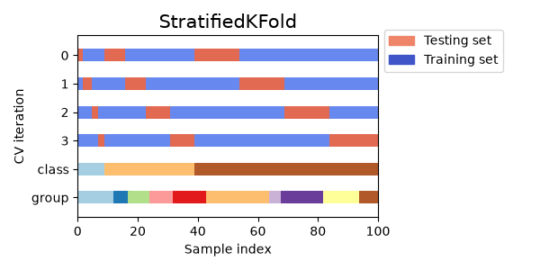

### 2.49 cell 49 · 十个候选的职责

本格导入十类候选所需工具，一些生成数据／配色／缩放工具并未在后面实际使用。导入 `StandardScaler` 不等于做了标准化；`make_moons`／`make_circles` 也没有在本例生成Iris数据。

<details><summary>教师原代码与保存输出（cell 49）</summary>

```python
import numpy as np
import pandas as pd
import matplotlib.pyplot as plt
from matplotlib.colors import ListedColormap
from sklearn.model_selection import train_test_split
from sklearn.preprocessing import StandardScaler
from sklearn.datasets import make_moons, make_circles, make_classification
from sklearn.neural_network import MLPClassifier
from sklearn.neighbors import KNeighborsClassifier
from sklearn.svm import SVC
from sklearn.gaussian_process import GaussianProcessClassifier
from sklearn.gaussian_process.kernels import RBF
from sklearn.tree import DecisionTreeClassifier
from sklearn.ensemble import RandomForestClassifier, AdaBoostClassifier
from sklearn.naive_bayes import GaussianNB
from sklearn.discriminant_analysis import QuadraticDiscriminantAnalysis
```

</details>

各模型在当前章节是可比较候选。KNN用附近已标注样本投票；线性／RBF SVM分别给平直／核相似边界；高斯过程用核关联得到类别概率。

树按阈值分支，随机森林汇总多棵随机化树。神经网络学习非线性层，AdaBoost依次提高错例影响。GaussianNB比较类条件高斯似然，QDA用各类均值和协方差形成二次边界。这里不要求从零手写十个训练器，但须知道输入都是同一四列、输出同一三类，分数才能公平对照。

### 2.50 cell 50 · 读取Iris原文件

`pd.read_csv('iris.txt',header=None)` 用相对路径读取既有150×5数据，没有表头；如果不传 header=None，第一条可能被误读为列名。随后五个名字依次为萼片长、萼片宽、花瓣长、花瓣宽、类别。

<details><summary>教师原代码与保存输出（cell 50）</summary>

```python
data = pd.read_csv('iris.txt',header=None)  #use tool "read_csv" to read the data in "iris.txt" file. the data is stored in "data"
data.columns = ['sepal length', 'sepal width', 'petal length', 'petal width', 'class'] #set the column names of the data table 
data.head(10) #
```

原保存文本输出（不冒称本批重跑）：

```text
   sepal length  sepal width  petal length  petal width        class
0           5.1          3.5           1.4          0.2  Iris-setosa
1           4.9          3.0           1.4          0.2  Iris-setosa
2           4.7          3.2           1.3          0.2  Iris-setosa
3           4.6          3.1           1.5          0.2  Iris-setosa
4           5.0          3.6           1.4          0.2  Iris-setosa
5           5.4          3.9           1.7          0.4  Iris-setosa
6           4.6          3.4           1.4          0.3  Iris-setosa
7           5.0          3.4           1.5          0.2  Iris-setosa
8           4.4          2.9           1.4          0.2  Iris-setosa
9           4.9          3.1           1.5          0.1  Iris-setosa
```

</details>

源head(10)前十行都是 Iris-setosa，只是数据原排序，不代表只有一类。四个测量通常为厘米；具体源卡记录和原文件为准。文件在旧course_files_export父目录，本次新Notebook在canvas-20261118中，直接从该目录运行会找不到iris.txt；本批在scratch工作目录复制只读数据后按原相对路径运行，不改原件。

### 2.51 cell 51 · 输入与目标分离

Y 取 class 这一列，X 用 `drop(['class'],axis=1)` 沿列轴删除答案列，得到150×4输入与150个类别。`axis=1` 表示列，axis=0通常表示行；不是把类别名为1的样本删掉。

<details><summary>教师原代码与保存输出（cell 51）</summary>

```python
Y = data['class'] #this is our prediction target
X = data.drop(['class'],axis=1)
```

</details>

不能把class同时留在输入：那会让模型直接看到答案，CV分数失去预测含义。X／Y大写是变量名约定，不是两份新采集的数据。

### 2.52 cell 52 · CV分数的角色

`cross_val_score` 返回每个验证折的分数数组，而非一份已在全数据拟合的最终模型。下面两类模型各自走同一5折；当前 `.score` 对分类器是准确率，越高表示该折正确比例更高。

原文“平均高就泛化更好”应限定为当前评价协议下的估计；K折可能共享训练样本，折分数并非五份完全独立数据集。

### 2.53 cell 53 · KNN十近邻五折

`KNeighborsClassifier(10)` 设最近邻数为10。预测一个新输入时，按特征距离找当前训练里的10个近邻，按类别投票；只有当前训练样本可以成为邻居，验证真实标签不能用于投票。平局由软件规则处理，不自行随机补一个类别。

<details><summary>教师原代码与保存输出（cell 53）</summary>

```python
from sklearn.model_selection import cross_val_score
clf=KNeighborsClassifier(10)
scores = cross_val_score(clf, X, Y, cv=5)
print('KNN CV Score:', scores)
```

原保存文本输出（不冒称本批重跑）：

```text
KNN CV Score: [0.96666667 1.         1.         0.93333333 1.        ]

```

</details>

`cross_val_score(...,cv=5)` 在本例分类目标上用默认分层5折，每折30条验证；源五分数为0.966667、1、1、0.933333、1，相当于29／30、30／30、30／30、28／30、30／30。平均约0.98，是当前5折KNN的准确率。原输入没有缩放，换测量单位会改变距离，不能不经核对直接沿用结果。

### 2.54 cell 54 · 深度10树五折

树设 `max_depth=10`，最多允许10层分裂，实际树可早停。与上一格同样四列、同样5折；源分数约0.966667、0.966667、0.9、0.933333、1，平均约0.953333，低于该KNN的0.98。

<details><summary>教师原代码与保存输出（cell 54）</summary>

```python
clf=DecisionTreeClassifier(max_depth=10)
scores = cross_val_score(clf, X, Y, cv=5)
print('DT CV Score:', scores)
```

原保存文本输出（不冒称本批重跑）：

```text
DT CV Score: [0.96666667 0.96666667 0.9        0.93333333 1.        ]

```

</details>

本格没有设置树的 random_state，平局分裂等路径可能随运行或版本变化；这份数组是保存的这次输出，本批刚好一致不证明所有重跑永远相同。要做可重复研究应另明确随机性控制，并把变化写成新协议。

### 2.55 cell 55 · 十家族比较任务

原执行要求 “Run the same cross-validation for 10 different classifiers and compare their scores.” 指同一数据／分折／指标下比较10家族，不是给每个模型换一份容易的数据再比较。下面先建立名字和对象的一一对应列表，再逐个训练评价。

英文参考答案（笔记自拟）：Evaluate all ten candidate classifiers on the same Iris features and five-fold protocol. Compare their mean accuracies and fold variation while keeping the selected score separate from an untouched final estimate.

### 2.56 cell 56 · 名字列表与模型配置

`names` 和 `classifiers` 必须等长同序，第 i 个名字描述第 i 个对象。参数是这次固定候选：KNN邻居10；线性SVM C=0.025；RBF SVM gamma=2、C=1；高斯过程使用RBF长度尺度；树深5；森林树10、深5、每次候选特征1；MLP的alpha=1、最多迭代1000；AdaBoost、GaussianNB、QDA则使用当前默认其余设置。

<details><summary>教师原代码与保存输出（cell 56）</summary>

```python
h = 0.02  # step size in the mesh

names = [
    "Nearest Neighbors",
    "Linear SVM",
    "RBF SVM",
    "Gaussian Process",
    "Decision Tree",
    "Random Forest",
    "Neural Net",
    "AdaBoost",
    "Naive Bayes",
    "QDA",
]

classifiers = [
    KNeighborsClassifier(10),
    SVC(kernel="linear", C=0.025),
    SVC(gamma=2, C=1),
    GaussianProcessClassifier(1.0 * RBF(1.0)),
    DecisionTreeClassifier(max_depth=5),
    RandomForestClassifier(max_depth=5, n_estimators=10, max_features=1),
    MLPClassifier(alpha=1, max_iter=1000),
    AdaBoostClassifier(),
    GaussianNB(),
    QuadraticDiscriminantAnalysis(),
]
```

</details>

这些alpha不是Ridge同一个控制参数：MLP的alpha惩罚网络权重，树ccp_alpha惩罚结构。RBF长度尺度也不是前面的gamma同名参数，二者都控制距离影响范围但公式约定不同。`h=0.02` 是遗留网格步长变量，当前后续并没有画决策区域，不能说它改变CV分折。

### 2.57 cell 57 · 比较十组五折成绩

`range(len(classifiers))` 给0–9索引，逐次取一个模型运行5折，并把名字与五分数打印。源保存神经网络均值约0.986667、KNN0.98、QDA0.98，其余低些；这是固定配置比较，不能称每家族都充分调参。

<details><summary>教师原代码与保存输出（cell 57）</summary>

```python
for i in range(len(classifiers)):
    clf=classifiers[i] #use the i-th model in the "classifiers" list
    scores = cross_val_score(clf, X, Y, cv=5)
    print('CV Score of '+ names[i], scores)
```

原保存文本输出（不冒称本批重跑）：

```text
CV Score of Nearest Neighbors [0.96666667 1.         1.         0.93333333 1.        ]
CV Score of Linear SVM [0.93333333 0.96666667 0.9        0.93333333 1.        ]
CV Score of RBF SVM [0.96666667 1.         0.9        0.96666667 1.        ]
CV Score of Gaussian Process [0.96666667 1.         0.93333333 0.93333333 1.        ]
CV Score of Decision Tree [0.96666667 0.96666667 0.9        0.93333333 1.        ]
CV Score of Random Forest [0.96666667 0.96666667 0.93333333 0.9        1.        ]
CV Score of Neural Net [1.         1.         0.96666667 0.96666667 1.        ]
CV Score of AdaBoost [0.96666667 0.93333333 0.9        0.93333333 1.        ]
CV Score of Naive Bayes [0.93333333 0.96666667 0.93333333 0.93333333 1.        ]
CV Score of QDA [1.         1.         0.96666667 0.93333333 1.        ]

/opt/anaconda3/lib/python3.12/site-packages/sklearn/ensemble/_weight_boosting.py:527: FutureWarning: The SAMME.R algorithm (the default) is deprecated and will be removed in 1.6. Use the SAMME algorithm to circumvent this warning.
  warnings.warn(
/opt/anaconda3/lib/python3.12/site-packages/sklearn/ensemble/_weight_boosting.py:527: FutureWarning: The SAMME.R algorithm (the default) is deprecated and will be removed in 1.6. Use the SAMME algorithm to circumvent this warning.
  warnings.warn(
/opt/anaconda3/lib/python3.12/site-packages/sklearn/ensemble/_weight_boosting.py:527: FutureWarning: The SAMME.R algorithm (the default) is deprecated and will be removed in 1.6. Use the SAMME algorithm to circumvent this warning.
  warnings.warn(
/opt/anaconda3/lib/python3.12/site-packages/sklearn/ensemble/_weight_boosting.py:527: FutureWarning: The SAMME.R algorithm (the default) is deprecated and will be removed in 1.6. Use the SAMME algorithm to circumvent this warning.
  warnings.warn(
/opt/anaconda3/lib/python3.12/site-packages/sklearn/ensemble/_weight_boosting.py:527: FutureWarning: The SAMME.R algorithm (the default) is deprecated and will be removed in 1.6. Use the SAMME algorithm to circumvent this warning.
  warnings.warn(

```

</details>

源AdaBoost警告说旧默认SAMME.R将被弃用，本批sklearn1.5.1仍能执行，但警告保留；不能把当前官网新默认默默套到旧输出。随机森林、神经网络等没显式设random_state，必须把保存输出、这次运行和可能的随机差异分开。

最后获得的是10组分折成绩，没有在这一循环中自动选赢家并全数据重拟合。若要输出可用模型，还需事先定义指标／平局规则，选定后重新训练，同时留独立评价。完整原始五折数组在保存输出与运行记录保留，平均表由脚本按这些数组计算。

**🎙️ 课堂补充**（`02:08:12`–`02:12:08`，B · 同协议家族比较）

讲解者在相同Iris五折下比较KNN与树，再遍历十个候选；*"when the metrics are similar between different models, you may compare whether one is more stable than the other one"*（`02:11:03`–`02:11:10`），也可看训练时间。这里说明比较准则，不把未固定随机状态的保存数组说成永不变化的模型真分数。

### 2.58 cell 58 · 另一留出演示

留出法只切一次，再看各类别的precision、recall和F1；与5折平均回答不同问题。原示例下一格用树深10及约33%留出，不能拿它的0.96直接当上一格所有模型的统一测试排名。

### 2.59 cell 59 · 100训练50评价

`test_size=0.33` 对150条得到50条留出、100条训练，`random_state=1` 固定划分。树在100条上fit，给50条预测。原保存每类support为17、19、14，合计50；准确48／50=0.96。

<details><summary>教师原代码与保存输出（cell 59）</summary>

```python
from sklearn.metrics import classification_report # this library directly generates precision, recall, f-measure
from sklearn.model_selection import train_test_split

clf=DecisionTreeClassifier(max_depth=10)
X_train, X_test, y_train, y_test = train_test_split(X, Y, test_size=0.33, random_state=1)
clf.fit(X_train,y_train)
y_pred=clf.predict(X_test)

print(classification_report(y_test, y_pred))
```

原保存文本输出（不冒称本批重跑）：

```text
                 precision    recall  f1-score   support

    Iris-setosa       1.00      1.00      1.00        17
Iris-versicolor       0.95      0.95      0.95        19
 Iris-virginica       0.93      0.93      0.93        14

       accuracy                           0.96        50
      macro avg       0.96      0.96      0.96        50
   weighted avg       0.96      0.96      0.96        50


```

</details>

源setosa全对；versicolor与virginica各有1条未被正确识别。从显示值可读各类召回约1、18／19、13／14。类间错向如需精确判定应看混淆矩阵，不能仅凭四舍五入report重建所有情况；本批运行另留真实预测。三分类概率归一化与单标签准确率分母仍按记录数，不把50条变成150条独立评价对象。

### 2.60 cell 60 · micro与macro分母

<!-- cityu-nav:landing-60 -->
[[#4. 操作速查|↩ 回速查]] · [[#5. 双语术语与理论对应|回术语]] · [[#0. 这个 Notebook 在教什么|阅读导航]]
<!-- cityu-nav:landing:end -->

微平均（Micro average）先合计各类TP与FP，再算精确率；宏平均（Macro average）先算每类精确率再等权平均。加权平均（Weighted average）按真实类支持数加权，是第三种不同规则。

源给三分类公式。用c=1、2、3编号三类，$TP_c$为第c类真实且预测为该类的条数，$FP_c$为其他类却误预测为第c类的条数。先把三类计数汇总，微平均为

$$P_{micro}=\frac{\sum_{c=1}^3TP_c}{\sum_{c=1}^3(TP_c+FP_c)}.$$

若每类精确率分别为$P_1$、$P_2$、$P_3$，宏平均按三个类别等权：

$$P_{macro}=\frac{P_1+P_2+P_3}{3}.$$

本篇原公式的三类下标1／2／3指三种花，不是类别概率。若每条恰有一个真实标签和一个预测标签，并包含全部类别，micro precision＝micro recall＝accuracy：每条预测总会贡献一次预测类别，错的同时贡献一个FP和真实类的一个FN。本例48条正确／50条，因此micro precision=0.96；macro precision按三类各自比值再取平均，未必刚好等于0.96。

💡 可复做反例：若类别A有90条、B有10条，全部预测A，则accuracy和micro precision为0.90；A的precision=0.90，B无预测项，若约定未定义精确率填0，macro precision=(0.90+0)/2=0.45。必须同时声明缺预测类别的处理约定，不能把macro和micro混成同一个“平均分”。

### 2.61 cell 61 · 四部分总结

原Summary回顾四部分：Ridge强度用验证选；树路径只生成候选α；GridSearchCV遍历给定配置并交叉验证；不同家族用CV／留出比较。本篇还要记住三个实际执行细节：变量名test可能实际用于验证、手写循环结束未保留赢家、剪枝路径没有替代验证选参。

**🎙️ 课堂补充**（`02:12:08`–`02:16:22`，A · 公平比较与项目叙述）

留出演示后，讲解者总结公平比较：*"we use the same dataset, the same testing procedures"*（`02:13:50`），再要求从业务问题、数据准备说到比较和选择理由，并把指标接到真实错误代价。`02:12:20`说报告可一次看多项指标，但没有逐式讲解cell60的micro／macro；该段公式仍由原Notebook和笔记解释支持，不标为课堂逐式确认。

### 2.62 cell 62 · 纯分隔格

这是横线分隔，没有新增知识或任务；§8仍保留其cell定位，下一格才是独立计分作业。

### 2.63 cell 63 · Week11评分原题与学习入口

最后一格是 Assignment Week 11，不是另一个已给答案的课堂演示。以下保留完整三问、原序号与40／40／20内部评分；Canvas当前10points和正式截止另在任务说明登记。

> 1. Use the Breast Cancer Wisconsin (Diagnostic) dataset to select the best model among Decision Trees, RandomForest, and SVC that has the minimum testing error (use the default model settings) (40 points).
> 2. Use the same dataset and try to use nested Cross-validation to get the optimal hyperparameters for each model, and then compare the model performance (40 points).
> 3. What other BDA process can you use to further improve the performance of the best models in Question 2? For example, feature selection or dimension reduction, imbalanced data sampling, etc., Please evaluate. (20 points).

中文任务拆解：Q1三种默认模型共用同一留出与错误率；Q2每家族在内层调参、外层只评价，不能把best_score_当外层分数；Q3选择具体BDA改动并比较实际结果，不能空列“可做PCA／SMOTE”就算评价。没有真实改善时如实报告，不为迎合题意伪造变好。

本批另建了与个人答卷隔离的⚪参考学习实验。Q1在原426／143划分中，默认RF错4／143，低于DT19／143、SVC9／143。

Q2固定3×3嵌套与小网格，原尺度RF外层均值约0.957839，在三家族中最高。Q3把折内特征筛选与标准化加入各家族，RF降到约0.947257，SVC升到约0.975411，说明不应承诺所有预处理都改善所有模型。

完整数据角色、候选范围、各折参数、代码和结果解释在 [[IS6400_Business_Data_Analytics/assignment/graded/A12-week11-model-selection/notes/学习参考|A12 学习参考]]；它与本篇同包审查，尚不是个人已确认的答卷或提交。Q1的testing参与选赢家，Q2／Q3的外层成绩也被用于跨方案开发比较，因此不能把所选最高均值再冒称另一份未受选择影响的最终测试。

英文参考答案（笔记自拟，限定本批学习协议）：Under the documented default-model hold-out experiment, Random Forest has the lowest observed error, 4/143. Under the fixed educational nested-CV grids, the raw-input Random Forest has the highest mean outer accuracy among the three families. Adding fold-fitted feature selection and scaling improves the SVC comparison but reduces the Random Forest comparison, so improvement is empirical rather than guaranteed. These selected comparisons are not an untouched final performance claim; the complete protocol and limitations are given in the separate learning reference.

<!-- cityu-nav:return-3 -->
[[#0. 这个 Notebook 在教什么|↑ 阅读导航]] · [[#8. Cell 映射与材料状态|页／Cell 索引]] · [[#4. 操作速查|复习速查]]
<!-- cityu-nav:return:end -->

**🎙️ 课堂补充**（`02:16:22`–`02:18:44`，A · 本周三问要求）

讲解者依次要求默认三模型公平留出比较（`02:16:40`–`02:17:03`）、各模型嵌套CV调参再比较（`02:17:09`–`02:17:55`）。Q3明确说*"you need to write down and run the code to show us how this process can improve the performance"*（`02:18:14`），接着*"Do not just write down that dimension reduction can improve the performance."*（`02:18:29`）。

因此Q3要有具体改动、执行和同协议结果，不能只列PCA等名词。课堂未保证每种改动都成功；既有参考实验的RF下降、SVC提高仍如实保留，不为迎合题意伪造改善。没有新DDL／扩展名／上传指令，当前Canvas行政来源和本人状态均保持。

## 3. 完整流程串讲

先读下面的“输入在哪里改变”，不要把同名变量误当一直是同一份数据。

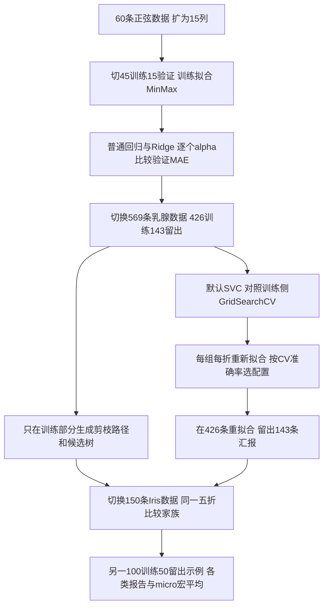

图中每个“切换”都重新定义X／Y，不能把前一段的缩放器直接用于后一段。图是教师示例的运行流，不把三个数据拼成一项完整业务实验。完整内外嵌套、评分题本批参考协议另见A12学习参考。

## 4. 操作速查

每行是一项常见操作，先看输入状态，再看返回值与易错处。

| 操作 | 返回／用途 | 关键边界 | 回指 |
|---|---|---|---|
| fit_transform／transform | 前者学习训练统计量并变换，后者仅应用 | 不在验证／测试重新fit | [[#2.06 cell 6 · 先划分再拟合MinMax\|cell6]] |
| Ridge(alpha=...) | 按固定惩罚拟合系数 | alpha是配置，coef_是拟合结果 | [[#2.13 cell 13 · Ridge目标与强度\|cell13]]–[[#2.20 cell 20 · 最小验证误差答案\|20]] |
| cost_complexity_pruning_path | 当前训练树的有效α与不纯度路径 | 不自动选验证赢家 | [[#2.28 cell 28 · 弱连接剪枝的临界代价\|cell28]]–[[#2.31 cell 31 · 逐alpha拟合并保存\|31]] |
| ccp_alphas[5] | 第6个元素 | 0起算，源标题5th不准确 | [[#2.34 cell 34 · 索引5实际是第6项\|cell34]] |
| GridSearchCV | 同分折比较配置，保留最佳与重拟合模型 | refit另加一次fit，best_score_是内层CV | [[#2.44 cell 44 · 25组五折搜索\|cell44]]–[[#2.45 cell 45 · 参数与重拟合赢家\|45]] |
| cross_val_score | 每折分数数组 | 不直接返回全数据最终模型 | [[#2.53 cell 53 · KNN十近邻五折\|cell53]]–[[#2.57 cell 57 · 比较十组五折成绩\|57]] |
| classification_report | 各类指标、真实支持数及平均 | 正类／macro／micro分母要明说 | [[#2.42 cell 42 · 默认SVC分类报告\|cell42]]、[[#2.59 cell 59 · 100训练50评价\|59]]–[[#2.60 cell 60 · micro与macro分母\|60]] |

## 5. 双语术语与理论对应

这里的英文定义为笔记自拟，便于读题；不能替代正文首次操作解释。

| 中文 | English／API | 英文参考定义 | 位置 |
|---|---|---|---|
| 最小最大缩放 | Min-max scaling | A feature-wise transform using minima and maxima learned from training observations. | [[#2.06 cell 6 · 先划分再拟合MinMax\|cell6]] |
| 成本复杂度剪枝 | Cost-complexity pruning | Simplifying a tree by trading leaf impurity against a penalty for its number of leaves. | [[#2.28 cell 28 · 弱连接剪枝的临界代价\|cell28]]–[[#2.31 cell 31 · 逐alpha拟合并保存\|31]] |
| 有效α | Effective alpha | A threshold at which a subtree's impurity increase per removed leaf makes pruning competitive. | [[#2.28 cell 28 · 弱连接剪枝的临界代价\|cell28]]–[[#2.29 cell 29 · 生成alpha路径\|29]] |
| 网格搜索 | Grid search | Evaluation of all combinations in a specified parameter grid. | [[#2.43 cell 43 · C与gamma的作用\|cell43]]–[[#2.45 cell 45 · 参数与重拟合赢家\|45]] |
| 重拟合 | Refit | Fitting the selected configuration again on the full development training set. | [[#2.45 cell 45 · 参数与重拟合赢家\|cell45]] |
| 分层交叉验证 | Stratified cross-validation | Cross-validation with fold class proportions kept approximately representative of the input labels. | [[#2.44 cell 44 · 25组五折搜索\|cell44]]、[[#2.48 cell 48 · Iris与分层CV原图\|48]] |
| 支持数 | Support | The number of true observations belonging to a class in the evaluation set. | [[#2.42 cell 42 · 默认SVC分类报告\|cell42]] |
| 微平均 | Micro average | Aggregating class-level counts before computing a metric. | [[#2.60 cell 60 · micro与macro分母\|cell60]] |
| 宏平均 | Macro average | Taking an unweighted average of class-specific metric values. | [[#2.60 cell 60 · micro与macro分母\|cell60]] |

Ridge与讲义M10 [[IS6400_Business_Data_Analytics/notes/M10-模型评估-交叉验证正则化与AB测试#2.55 Lasso与超参数（讲义 p.55）|p.55]]–[[IS6400_Business_Data_Analytics/notes/M10-模型评估-交叉验证正则化与AB测试#2.58 正则化的曲线和系数（讲义 p.58）|58]]对应；剪枝与[[IS6400_Business_Data_Analytics/notes/M10-模型评估-交叉验证正则化与AB测试#2.60 悲观误差定义（讲义 p.60）|p.60]]–[[IS6400_Business_Data_Analytics/notes/M10-模型评估-交叉验证正则化与AB测试#2.64 后剪枝30条算例（讲义 p.64）|64]]对应，但sklearn的叶不纯度尺度不同于讲义错分率示例；搜索／CV与[[IS6400_Business_Data_Analytics/notes/M10-模型评估-交叉验证正则化与AB测试#2.25 K折交叉验证机制（讲义 p.25）|p.25]]及[[IS6400_Business_Data_Analytics/notes/M10-模型评估-交叉验证正则化与AB测试#2.43 超参数与参数（讲义 p.43）|p.43]]–[[IS6400_Business_Data_Analytics/notes/M10-模型评估-交叉验证正则化与AB测试#2.52 内层步骤7至10（讲义 p.52）|52]]对应；micro／macro是本教程对分类报告的进一步解释。

## 6. 考点与向 AI 提问

本次已有S32教程来源；**T11是Canvas Week11，不属于被排除的Week10深度学习（本库M09／T10）**。期末总范围见M10§6.3。M10 `32:31`原ASR为final example，可能是例子或考试相关表述，未回听确定；不能确证是exam误识别。教程`01:47:41`–`01:47:48`只条件式提醒：如果final问代码，先import。现有书面Sample Final决策树(4)明确要求导入／设置，可据此练习；它不是今年最终卷，也不保证每道题都写完整程序。

其余仍按🟡课件／代码任务反推准备：最佳α与搜索边界、test变量角色、25×5预算、标签0／1、剪枝路径与验证选择、micro／macro。Q3运行展示是明确作业要求，不把它单独升级成新增期末题型。

源没有AI Prompt格，下列为💡笔记补充提问示例：

> Explain which observations are used to fit preprocessing, tune hyperparameters and evaluate the final model. Keep the current data split and metric fixed. Show the array shapes and distinguish saved notebook outputs from a new execution. Do not select parameters using the final test set.

提问时把数据、目标、分折／指标、输出格式和限制说清，才能核AI生成代码是否符合任务。特别检查Pipeline在分折内fit，而非先全表标准化后再调用CV。

## 7. 自测与改条件

### 7.1 为什么变量名X_test不保证它是最终测试？

<details><summary>答案</summary>

本源cell19反复用它选α，因此它实际是验证集。角色由使用方式决定，不由名字决定。应另留未用于选择的数据评价最终流程；见cell6、19。英文参考：The held-out observations are used for alpha selection, so they function as validation data even though the variable is called X_test.

</details>

### 7.2 循环最佳α=0.01，最后的ridgereg为什么不是赢家？

<details><summary>答案</summary>

循环按列表到0.19结束，每轮覆盖变量；没有保存最佳对象，所以最后留下0.19。应记录最小验证MAE对应配置并重拟合，或显式保存对象。GridSearchCV的refit=True会替用户完成最后重拟合。英文参考：The variable stores the last fitted model, not the model with the smallest validation error.

</details>

### 7.3 ccp_alphas的索引5和第5个候选一样吗？

<details><summary>答案</summary>

不一样。索引0是第1个，所以索引5是第6个；源输出约0.007042。若要第5个应取索引4。见cell32–34。英文参考：Index 5 refers to the sixth candidate in a zero-based list.

</details>

### 7.4 25组5折，refit=True，只有125次训练吗？

<details><summary>答案</summary>

125次是配置×分折，选中后在完整开发训练集再fit一次，合计126次（不计此前基线等训练）。日志的125 fits并未包含所有上下文训练动作。英文参考：There are 125 candidate-fold fits and one final refit of the selected configuration.

</details>

### 7.5 根节点159／267，只有根时恶性召回为什么是0？

<details><summary>答案</summary>

它总预测多数类1=良性，真实恶性0没有一个被预测成0，TP0=0、FN0=159，训练恶性召回0。训练准确率267／426约0.626761，这与未见测试不同。英文参考：The root-only classifier predicts benign for every observation and therefore recalls none of the malignant training observations.

</details>

### 7.6 把厘米换毫米，会影响哪些模型比较？

<details><summary>答案</summary>

原始距离扩大十倍、平方距离扩大百倍，KNN、RBF SVC、核与网络的行为可能变化；若每列统一缩放但保持相对距离，KNN排名可不变，而固定gamma的RBF相似度会变。树基于阈值次序，正倍数单位变化通常能由阈值同步换算；若加了正则化／数值容差等仍需核实现。比较时应固定单位，并在需要的训练折内拟合缩放。英文参考：Feature units affect distance- and kernel-based procedures, so the preprocessing protocol must be specified and fitted within training folds.

</details>

## 8. Cell 映射与材料状态

每行对应原Notebook一个cell；代码编号为1起算。原cell内代码／输出与本篇解释可对照，标题分隔也明确处置。课堂覆盖按S32教程组内内容定位；“对应”不表示逐行读完，未定位不等于略过。

| 原cell | 类型 | 独有任务／内容 | 正文精确入口 | 处置 | 课堂覆盖 |
|---|---|---|---|---|---|
| 1 | markdown | 课程入口 | [[#2.01 cell 1 · 课程入口\|cell 1]] | 正文已解释／分隔已说明 | ✅ 对应组内讲解 `01:36:26`–`01:38:59`；不代表逐行读完代码／输出 |
| 2 | markdown | 目标与工具清单 | [[#2.02 cell 2 · 目标与工具清单\|cell 2]] | 正文已解释／分隔已说明 | ✅ 对应组内讲解 `01:36:26`–`01:38:59`；不代表逐行读完代码／输出 |
| 3 | markdown | Ridge与过拟合路线 | [[#2.03 cell 3 · Ridge与过拟合路线\|cell 3]] | 正文已解释／分隔已说明 | ✅ 对应组内讲解 `01:39:10`–`01:42:51`；不代表逐行读完代码／输出 |
| 4 | markdown | 合成数据的任务 | [[#2.04 cell 4 · 合成数据的任务\|cell 4]] | 正文已解释／分隔已说明 | ✅ 对应组内讲解 `01:39:10`–`01:42:51`；不代表逐行读完代码／输出 |
| 5 | code | 生成60条正弦数据与幂特征 | [[#2.05 cell 5 · 生成60条正弦数据与幂特征\|cell 5]] | 33个课堂code之一，实际执行 | ✅ 对应组内讲解 `01:39:10`–`01:42:51`；不代表逐行读完代码／输出 |
| 6 | code | 先划分再拟合MinMax | [[#2.06 cell 6 · 先划分再拟合MinMax\|cell 6]] | 33个课堂code之一，实际执行 | ✅ 对应组内讲解 `01:39:10`–`01:42:51`；不代表逐行读完代码／输出 |
| 7 | markdown | 十五阶模型的含义 | [[#2.07 cell 7 · 十五阶模型的含义\|cell 7]] | 正文已解释／分隔已说明 | ✅ 对应组内讲解 `01:42:55`–`01:45:58`；不代表逐行读完代码／输出 |
| 8 | code | 拟合普通回归与训练预测 | [[#2.08 cell 8 · 拟合普通回归与训练预测\|cell 8]] | 33个课堂code之一，实际执行 | ✅ 对应组内讲解 `01:42:55`–`01:45:58`；不代表逐行读完代码／输出 |
| 9 | markdown | 训练误差与系数的提示 | [[#2.09 cell 9 · 训练误差与系数的提示\|cell 9]] | 正文已解释／分隔已说明 | ✅ 对应组内讲解 `01:42:55`–`01:45:58`；不代表逐行读完代码／输出 |
| 10 | code | 读取MAE与全部系数 | [[#2.10 cell 10 · 读取MAE与全部系数\|cell 10]] | 33个课堂code之一，实际执行 | ✅ 对应组内讲解 `01:42:55`–`01:45:58`；不代表逐行读完代码／输出 |
| 11 | markdown | 转向验证问题 | [[#2.11 cell 11 · 转向验证问题\|cell 11]] | 正文已解释／分隔已说明 | ✅ 对应组内讲解 `01:42:55`–`01:45:58`；不代表逐行读完代码／输出 |
| 12 | code | 普通回归验证结果 | [[#2.12 cell 12 · 普通回归验证结果\|cell 12]] | 33个课堂code之一，实际执行 | ✅ 对应组内讲解 `01:42:55`–`01:45:58`；不代表逐行读完代码／输出 |
| 13 | markdown | Ridge目标与强度 | [[#2.13 cell 13 · Ridge目标与强度\|cell 13]] | 正文已解释／分隔已说明 | ✅ 对应组内讲解 `01:46:12`–`01:50:58`；不代表逐行读完代码／输出 |
| 14 | code | 固定alpha的Ridge训练 | [[#2.14 cell 14 · 固定alpha的Ridge训练\|cell 14]] | 33个课堂code之一，实际执行 | ✅ 对应组内讲解 `01:46:12`–`01:50:58`；不代表逐行读完代码／输出 |
| 15 | markdown | 收缩的训练代价 | [[#2.15 cell 15 · 收缩的训练代价\|cell 15]] | 正文已解释／分隔已说明 | ✅ 对应组内讲解 `01:46:12`–`01:50:58`；不代表逐行读完代码／输出 |
| 16 | code | 读取Ridge训练结果 | [[#2.16 cell 16 · 读取Ridge训练结果\|cell 16]] | 33个课堂code之一，实际执行 | ✅ 对应组内讲解 `01:46:12`–`01:50:58`；不代表逐行读完代码／输出 |
| 17 | code | Ridge验证比较 | [[#2.17 cell 17 · Ridge验证比较\|cell 17]] | 33个课堂code之一，实际执行 | ✅ 对应组内讲解 `01:46:12`–`01:50:58`；不代表逐行读完代码／输出 |
| 18 | markdown | 用验证选择强度 | [[#2.18 cell 18 · 用验证选择强度\|cell 18]] | 正文已解释／分隔已说明 | ✅ 对应组内讲解 `01:51:09`–`01:54:33`；不代表逐行读完代码／输出 |
| 19 | code | 20项alpha循环 | [[#2.19 cell 19 · 20项alpha循环\|cell 19]] | 33个课堂code之一，实际执行 | ✅ 对应组内讲解 `01:51:09`–`01:54:33`；不代表逐行读完代码／输出 |
| 20 | markdown | 最小验证误差答案 | [[#2.20 cell 20 · 最小验证误差答案\|cell 20]] | 正文已解释／分隔已说明 | ✅ 对应组内讲解 `01:51:09`–`01:54:33`；不代表逐行读完代码／输出 |
| 21 | markdown | 乳腺基准与剪枝任务 | [[#2.21 cell 21 · 乳腺基准与剪枝任务\|cell 21]] | 正文已解释／分隔已说明 | ✅ 对应组内讲解 `01:54:33`–`01:56:49`；不代表逐行读完代码／输出 |
| 22 | code | 导入与内核依赖 | [[#2.22 cell 22 · 导入与内核依赖\|cell 22]] | 33个课堂code之一，实际执行 | ✅ 对应组内讲解 `01:54:33`–`01:56:49`；不代表逐行读完代码／输出 |
| 23 | markdown | 影像特征的记录单位 | [[#2.23 cell 23 · 影像特征的记录单位\|cell 23]] | 正文已解释／分隔已说明 | ✅ 对应组内讲解 `01:54:33`–`01:56:49`；不代表逐行读完代码／输出 |
| 24 | code | 569行30列与标签方向 | [[#2.24 cell 24 · 569行30列与标签方向\|cell 24]] | 33个课堂code之一，实际执行 | ✅ 对应组内讲解 `01:54:33`–`01:56:49`；不代表逐行读完代码／输出 |
| 25 | code | 读取特征表 | [[#2.25 cell 25 · 读取特征表\|cell 25]] | 33个课堂code之一，实际执行 | ✅ 对应组内讲解 `01:54:33`–`01:56:49`；不代表逐行读完代码／输出 |
| 26 | code | 读取目标表 | [[#2.26 cell 26 · 读取目标表\|cell 26]] | 33个课堂code之一，实际执行 | ✅ 对应组内讲解 `01:54:33`–`01:56:49`；不代表逐行读完代码／输出 |
| 27 | code | 426训练与143留出 | [[#2.27 cell 27 · 426训练与143留出\|cell 27]] | 33个课堂code之一，实际执行 | ✅ 对应组内讲解 `01:54:33`–`01:56:49`；不代表逐行读完代码／输出 |
| 28 | markdown | 弱连接剪枝的临界代价 | [[#2.28 cell 28 · 弱连接剪枝的临界代价\|cell 28]] | 正文已解释／分隔已说明 | ✅ 对应组内讲解 `01:56:49`–`01:58:53`；不代表逐行读完代码／输出 |
| 29 | code | 生成alpha路径 | [[#2.29 cell 29 · 生成alpha路径\|cell 29]] | 33个课堂code之一，实际执行 | ✅ 对应组内讲解 `01:56:49`–`01:58:53`；不代表逐行读完代码／输出 |
| 30 | markdown | 保存不同树的计划 | [[#2.30 cell 30 · 保存不同树的计划\|cell 30]] | 正文已解释／分隔已说明 | ✅ 对应组内讲解 `01:56:49`–`01:58:53`；不代表逐行读完代码／输出 |
| 31 | code | 逐alpha拟合并保存 | [[#2.31 cell 31 · 逐alpha拟合并保存\|cell 31]] | 33个课堂code之一，实际执行 | ✅ 对应组内讲解 `01:56:49`–`01:58:53`；不代表逐行读完代码／输出 |
| 32 | markdown | 示例树与索引 | [[#2.32 cell 32 · 示例树与索引\|cell 32]] | 正文已解释／分隔已说明 | ✅ 对应组内讲解 `01:58:53`–`02:00:47`；不代表逐行读完代码／输出 |
| 33 | code | 第一棵树的读法 | [[#2.33 cell 33 · 第一棵树的读法\|cell 33]] | 33个课堂code之一，实际执行 | ✅ 对应组内讲解 `01:58:53`–`02:00:47`；不代表逐行读完代码／输出 |
| 34 | code | 索引5实际是第6项 | [[#2.34 cell 34 · 索引5实际是第6项\|cell 34]] | 33个课堂code之一，实际执行 | ✅ 对应组内讲解 `01:58:53`–`02:00:47`；不代表逐行读完代码／输出 |
| 35 | code | 仅根树的代价 | [[#2.35 cell 35 · 仅根树的代价\|cell 35]] | 33个课堂code之一，实际执行 | ✅ 对应组内讲解 `01:58:53`–`02:00:47`；不代表逐行读完代码／输出 |
| 36 | markdown | 节点数与深度 | [[#2.36 cell 36 · 节点数与深度\|cell 36]] | 正文已解释／分隔已说明 | ✅ 对应组内讲解 `02:00:52`–`02:01:28`；不代表逐行读完代码／输出 |
| 37 | code | 截尾列表及阶梯图 | [[#2.37 cell 37 · 截尾列表及阶梯图\|cell 37]] | 33个课堂code之一，实际执行 | ✅ 对应组内讲解 `02:00:52`–`02:01:28`；不代表逐行读完代码／输出 |
| 38 | markdown | 路径还没有选优 | [[#2.38 cell 38 · 路径还没有选优\|cell 38]] | 正文已解释／分隔已说明 | ✅ 对应组内讲解 `02:00:52`–`02:01:28`；不代表逐行读完代码／输出 |
| 39 | markdown | 自动搜索与SVC | [[#2.39 cell 39 · 自动搜索与SVC\|cell 39]] | 正文已解释／分隔已说明 | ✅ 对应组内讲解 `02:01:43`–`02:02:44`；不代表逐行读完代码／输出 |
| 40 | markdown | 默认SVC基线 | [[#2.40 cell 40 · 默认SVC基线\|cell 40]] | 正文已解释／分隔已说明 | ✅ 对应组内讲解 `02:01:43`–`02:02:44`；不代表逐行读完代码／输出 |
| 41 | code | 导入报告工具 | [[#2.41 cell 41 · 导入报告工具\|cell 41]] | 33个课堂code之一，实际执行 | ✅ 对应组内讲解 `02:01:43`–`02:02:44`；不代表逐行读完代码／输出 |
| 42 | code | 默认SVC分类报告 | [[#2.42 cell 42 · 默认SVC分类报告\|cell 42]] | 33个课堂code之一，实际执行 | ✅ 对应组内讲解 `02:01:43`–`02:02:44`；不代表逐行读完代码／输出 |
| 43 | markdown | C与gamma的作用 | [[#2.43 cell 43 · C与gamma的作用\|cell 43]] | 正文已解释／分隔已说明 | ✅ 对应组内讲解 `02:02:44`–`02:06:53`；不代表逐行读完代码／输出 |
| 44 | code | 25组五折搜索 | [[#2.44 cell 44 · 25组五折搜索\|cell 44]] | 33个课堂code之一，实际执行 | ✅ 对应组内讲解 `02:02:44`–`02:06:53`；不代表逐行读完代码／输出 |
| 45 | code | 参数与重拟合赢家 | [[#2.45 cell 45 · 参数与重拟合赢家\|cell 45]] | 33个课堂code之一，实际执行 | ✅ 对应组内讲解 `02:02:44`–`02:06:53`；不代表逐行读完代码／输出 |
| 46 | code | 调优SVC留出报告 | [[#2.46 cell 46 · 调优SVC留出报告\|cell 46]] | 33个课堂code之一，实际执行 | ✅ 对应组内讲解 `02:06:53`–`02:08:12`；不代表逐行读完代码／输出 |
| 47 | markdown | 默认与调优的取舍 | [[#2.47 cell 47 · 默认与调优的取舍\|cell 47]] | 正文已解释／分隔已说明 | ✅ 对应组内讲解 `02:06:53`–`02:08:12`；不代表逐行读完代码／输出 |
| 48 | markdown | Iris与分层CV原图 | [[#2.48 cell 48 · Iris与分层CV原图\|cell 48]] | 正文已解释／分隔已说明 | ✅ 对应组内讲解 `02:08:12`–`02:11:25`；不代表逐行读完代码／输出 |
| 49 | code | 十个候选的职责 | [[#2.49 cell 49 · 十个候选的职责\|cell 49]] | 33个课堂code之一，实际执行 | ✅ 对应组内讲解 `02:08:12`–`02:11:25`；不代表逐行读完代码／输出 |
| 50 | code | 读取Iris原文件 | [[#2.50 cell 50 · 读取Iris原文件\|cell 50]] | 33个课堂code之一，实际执行 | ✅ 对应组内讲解 `02:08:12`–`02:11:25`；不代表逐行读完代码／输出 |
| 51 | code | 输入与目标分离 | [[#2.51 cell 51 · 输入与目标分离\|cell 51]] | 33个课堂code之一，实际执行 | ✅ 对应组内讲解 `02:08:12`–`02:11:25`；不代表逐行读完代码／输出 |
| 52 | markdown | CV分数的角色 | [[#2.52 cell 52 · CV分数的角色\|cell 52]] | 正文已解释／分隔已说明 | ✅ 对应组内讲解 `02:08:12`–`02:11:25`；不代表逐行读完代码／输出 |
| 53 | code | KNN十近邻五折 | [[#2.53 cell 53 · KNN十近邻五折\|cell 53]] | 33个课堂code之一，实际执行 | ✅ 对应组内讲解 `02:08:12`–`02:11:25`；不代表逐行读完代码／输出 |
| 54 | code | 深度10树五折 | [[#2.54 cell 54 · 深度10树五折\|cell 54]] | 33个课堂code之一，实际执行 | ✅ 对应组内讲解 `02:08:12`–`02:11:25`；不代表逐行读完代码／输出 |
| 55 | markdown | 十家族比较任务 | [[#2.55 cell 55 · 十家族比较任务\|cell 55]] | 正文已解释／分隔已说明 | ✅ 对应组内讲解 `02:11:33`–`02:12:08`；不代表逐行读完代码／输出 |
| 56 | code | 名字列表与模型配置 | [[#2.56 cell 56 · 名字列表与模型配置\|cell 56]] | 33个课堂code之一，实际执行 | ✅ 对应组内讲解 `02:11:33`–`02:12:08`；不代表逐行读完代码／输出 |
| 57 | code | 比较十组五折成绩 | [[#2.57 cell 57 · 比较十组五折成绩\|cell 57]] | 33个课堂code之一，实际执行 | ✅ 对应组内讲解 `02:11:33`–`02:12:08`；不代表逐行读完代码／输出 |
| 58 | markdown | 另一留出演示 | [[#2.58 cell 58 · 另一留出演示\|cell 58]] | 正文已解释／分隔已说明 | ✅ 对应组内讲解 `02:12:08`–`02:13:07`；不代表逐行读完代码／输出 |
| 59 | code | 100训练50评价 | [[#2.59 cell 59 · 100训练50评价\|cell 59]] | 33个课堂code之一，实际执行 | ✅ 对应组内讲解 `02:12:08`–`02:13:07`；不代表逐行读完代码／输出 |
| 60 | markdown | micro与macro分母 | [[#2.60 cell 60 · micro与macro分母\|cell 60]] | 正文已解释／分隔已说明 | ❓ micro／macro逐式未定位；原题及解释保留，不可降权 |
| 61 | markdown | 四部分总结 | [[#2.61 cell 61 · 四部分总结\|cell 61]] | 正文已解释／分隔已说明 | ✅ 对应组内讲解 `02:13:07`–`02:16:22`；不代表逐行读完代码／输出 |
| 62 | markdown | 纯分隔格 | [[#2.62 cell 62 · 纯分隔格\|cell 62]] | 正文已解释／分隔已说明 | ⚪ 纯分隔，无独立教学内容 |
| 63 | markdown | Week11评分原题与学习入口 | [[#2.63 cell 63 · Week11评分原题与学习入口\|cell 63]] | 评分题另有学习参考，非已提交 | ✅ 对应组内讲解 `02:16:22`–`02:18:44`；不代表逐行读完代码／输出 |

<!-- cityu-nav:return-9 -->
[[#0. 这个 Notebook 在教什么|↑ 阅读导航]] · [[#8. Cell 映射与材料状态|页／Cell 索引]] · [[#4. 操作速查|复习速查]]
<!-- cityu-nav:return:end -->

**覆盖统计**：63格中61格能与对应组内讲解定位，cell60未定位逐式讲解，cell62纯分隔；并非61格均逐行详细讲。33个代码格的运行证据沿11月18–19日已保存执行，不冒称本次重跑。

**课堂时间分配**（教程42分18秒，原时钟；与M10共用同源，不重复累加）：

| 内容 | 区间 | 跨度 |
|---|---|---|
| 路线与Ridge | `01:36:26`–`01:54:33` | 18分07秒 |
| 树剪枝 | `01:54:33`–`02:01:43` | 7分10秒 |
| SVC搜索与报告 | `02:01:43`–`02:08:12` | 6分29秒 |
| Iris、总结与项目 | `02:08:12`–`02:16:22` | 8分10秒 |
| 作业三问与结束 | `02:16:22`–`02:18:44` | 2分22秒 |

## 9. 延伸与勘误

### 9.1 原件、保存输出与本批运行

本源63cells、33code，本批逐格阅读并执行全部课堂代码。源保存9张PNG与远程CV示意已实际看图；本批另生成缺保存PNG的cell29路径图。源metadata与本地版本不同，十五阶无惩罚系数和末位误差出现小差异；原保存输出不被本批覆盖。

评分题cell63的本批参考实验与课堂源代码分开，见A12学习参考。运行成功没有替本人确认学习、作答、审阅或提交；没有向Canvas写入。

| 课堂边界 | 判定与依据 | 学习处置 |
|---|---|---|
| cell60 micro／macro逐式推导 | ❓ `02:12:08`–`02:13:07`只讲留出与报告优势，未定位逐式说明 | 不可降权，保留原Notebook公式与本篇完整解释 |
| 其他cell的逐行输出 | ✅ 可定位主题组，但不假称逐行读过所有代码／保存数值 | 课堂主题证据与已有逐格来源／执行证据分开 |
| 旧T08／T10教程 | ❓ 本源没有其实际实操 | 原缺口不关闭 |

### 9.2 课上新增与保留边界

| # | 内容 | 原时钟 | 教学位置 |
|---|---|---|---|
| 1 | final代码问题语境下先导入库 | `01:47:41`–`01:47:48` | cell14／§6；不是全部期末题型承诺 |
| 2 | 最优值贴边时继续扩大／细化候选 | `01:53:11`–`01:53:57` | cell20；0.01不是原20项的第一项 |
| 3 | 数字必须联系真实错误代价 | `02:07:20`–`02:08:07` | cell47；recall改善同时有precision取舍 |
| 4 | Q3必须具体写并运行、展示比较 | `02:18:14`–`02:18:36` | cell63／A12；未保证每种改动都提高 |
| 5 | 同数据、同程序，指标近时看稳定和时间 | `02:11:03`–`02:14:16` | cell57／61；最高CV不是独立最终成绩 |

cell60的micro／macro逐式说明在本源未定位，不据此降权。旧T08／T10缺录仍保留；S32没有其实际教程实操。

### 9.3 需要记住的源内差异

| 位置 | 差异 | 处理 |
|---|---|---|
| cell6–20 | test变量被反复用来选α | 实际为验证，不能冒称最终独立测试 |
| cell8 | 注释写减均值除L2，而代码用MinMax | 原注释保留，按实际代码解释 |
| cell19 | 循环结束对象为最后α | 另记录赢家，不能直接拿最后对象当最优 |
| cell29 | 原保存无曲线PNG | 本批按代码生成，明确不是原图 |
| cell34 | [5]被标成5th | 实际第6项，α数值保持源值 |
| cell37 | 截去末项操作会再次改变列表 | 空内核按序运行，避免重复删项 |
| cell42–47 | 多次展示同一留出，原称仅最终使用 | 若据反馈继续选择，则要如实记录选择史 |
| cell49 | 导入StandardScaler等未实际使用 | 不把import冒称预处理已做 |
| cell54、57 | 部分候选未固定随机状态 | 报本次／保存结果，研究需另控制随机性 |
| cell57 | 旧SAMME.R弃用警告 | 保留版本与警告，不改写历史结果 |
| cell63 | 内部100分与Canvas10points | 分别记录，不猜课程折算 |

S32口头另外两处需防误读：`01:42:19`提X/Y缩放而cell6只缩X；`01:53:08`/`01:53:37`的first/edge与含0的候选列表不同。前者按原代码，后者按完整列表与输出读；引文不暗改，具体解释在cell6和cell20。

### 9.4 课外来源与可复做文件

🔗 核对于2026-11-18：[sklearn成本复杂度剪枝](https://scikit-learn.org/stable/auto_examples/tree/plot_cost_complexity_pruning.html)、[GridSearchCV](https://scikit-learn.org/stable/modules/generated/sklearn.model_selection.GridSearchCV.html)、[SVC](https://scikit-learn.org/stable/modules/generated/sklearn.svm.SVC.html)。网页stable版本可能高于本次执行的1.5.1；代码事实以记录的实际本地版本和源输出为准。

长期复做入口与实际输入／输出记录保存在本批t11证据目录；A12参考脚本与结果另在任务work保存。原Notebook和同名HTML不修改，课堂原始保存结果与运行新图的来源分别绑定。

### 9.5 转录登记与反方视角

| 事项 | 本次判断 |
|---|---|
| 同源登记 | `M10-T11-transcript-source32-partial.txt`，S32恢复后1380段，全源`00:00`→`02:18:44`；本教程使用`01:36:26`以后。原媒体8328.938667秒，末段结束8327.19秒，无≥120秒段首空档；首段M10缺头不掩盖。 |
| 首尾／角色 | `01:36:15`讲义收束后转教程，是否暂停及墙钟间隔未知；`02:18:44`明确结束教程。按内容角色识别教程讲解者，无说话人分离／声纹身份认证；不称本次恢复了旧T10。 |
| 过滤与隐私 | 全源4条过滤均恢复，均在教程前；详细见M10登记。仅全文转录与过滤段核查，未全音逐字听；未识别需遮蔽的具体学生身份／学号／联系方式／私谈。 |
| 行政 | 没有录到新绝对DDL、格式／扩展名或上传渠道；A12既有Canvas事实与本人状态不变。 |
| 承接执行 | 原保存输出与11月18–19日已审运行分开；本次不重训、不改原Notebook，不把课堂文字确认当新执行成绩。 |

**反方视角**：最容易错的是三个数据集复用变量、test实际选α、口头first/edge与源列表不一致，以及只报召回改善却省略精确率代价。现有代码／数组／高分辨率图和局部解释均保留。若要求cell60完整课堂推导、全部现场改码或最终卷细项，本源不足；材料v1.0只表示声明范围的融合完成，不替本人确认学会／提交，也不代替独立抽检或最终显示。

### 9.6 变更记录

| 日期 | 变更 |
|---|---|
| 2026-11-18 | 依据新63-cell教程建立T11候选，逐cell解释、原代码／保存输出、9原图及CV来源示意、课堂33格实际执行与来源勘误；cell63完整原题与独立学习参考，材料v0.9／transcript pending。 |

| 2026-11-21 | 合并S32转录（`M10-T11-transcript-source32-partial.txt`，全源1380段，本教程`01:36:26`–`02:18:44`）；补实际组内覆盖、Ridge边界搜索／import／公平比较及Q3运行要求，保留63格、原题、输出、导航与既有参考实验；cell60未定位逐式讲解，本人状态不变，教学／写回／同步另核。 |

