> [!info] M09 验收时的阅读副本
> 正式稿已写回，请直接打开 [[IS6400_Business_Data_Analytics/notes/M09-深度学习-神经网络与文本分析|正式 M09]]。本页保留验收入口和当时的图片副本。
> 常用定位：[[#p.10 · Artificial Neuron|p.10 神经元]] · [[#p.28 · Model Representation · 补偏置再算输出|p.28 网络图]] · [[#p.69 · LSTM Model|p.69 LSTM]] · [[#p.72 · LSTM Walk-through · 遗忘门|p.72 遗忘门]] · [[#8. 物理页码映射|逐页目录]]。


# M09 · 深度学习：从一个神经元到序列与文本分析

## 0. 三分钟速览

神经网络把“给输入算输出”的小步骤连接起来，再用预测误差调整连接参数。本讲先完整算一个小网络，再把同一思路扩展到时间序列和文本。

- 能计算加权和、激活和输出，并看懂矩阵只是批量记账。
- 能区分 AND、OR、XOR、XNOR，并发现原课件对后两者的错标。
- 能从一次预测误差反推参数调整方向，完成一步训练。
- 能按时间追踪 RNN 隐藏状态与 LSTM 的旧记忆、新信息和输出。
- 能把词频变成 TF-IDF，并区分分词、词性、句法、语义和上下文。

## 1. 开始之前 · 知识衔接

### 1.1 用到哪些已有想法

[[IS6400_Business_Data_Analytics/notes/M02-预测分析-线性回归|M02]] 的预测是“输入乘系数再相加”；神经元先做相同动作，再接一个函数。[[IS6400_Business_Data_Analytics/notes/M04-特征工程-特征重要性与降维|M04]] 的特征是描述记录的数值；网络隐藏层会从数据学习新的中间特征。[[IS6400_Business_Data_Analytics/notes/M06-分类-决策树集成SVM与不平衡学习|M06]] 的分类把记录分组，仍要分训练与测试、检查过拟合；深度网络不例外。

### 1.2 数学起点

向量（Vector）在本讲是一列按固定顺序排的数，例如两个输入组成 $x=(x_1,x_2)^\top$。上标 $\top$ 只表示转置，把横排改成竖排；不改变里面的值。矩阵（Matrix）是一张数表，一行可以存一个神经元的权重。

求和号 $\sum$ 表示把若干项相加。导数／梯度的必要读法在 p.38 现教，不默认读者会微积分；本讲用到的概率、对数、指数和逐元素乘法也在首次计算旁解释。

### 1.3 编号、顺序和材料状态

来源为《L11-IS6400-DeepLearning.pdf》，Canvas Week 10，课件标 Lecture 11。本文用 PDF 物理页码，材料状态 v0.9，转录待补。

- 预习先做 [[#p.10 · Artificial Neuron|p.10 单神经元]]、[[#p.40 · Gradient Descent · 反复更新|p.40 一轮训练]]、[[#p.74 · LSTM Walk-through · 更新细胞状态|p.74 LSTM 更新]] 和 [[#p.89 · The Mighty TF-IDF|p.89 TF-IDF]] 的小例，再沿各组补全。
- 课中按 §2 页序读，或从 §8 查正在投影的物理页。点击或单独打开原图可查看小字。
- 复习用 §3–§6 对照三条主线，再做 §7 的自测并返回对应课件页。

## 2. 正文

### 2.1 深度学习怎样表示信息（讲义 p.1–9）

#### p.1 · IS6400 Business Data Analytics

封面突出人工神经网络（ANN）。学习入口是 [[#p.10 · Artificial Neuron|神经元]]、[[#p.53 · Recurrent Neural Networks|序列状态]] 和 [[#p.78 · What is Text Mining|文本挖掘]]。右列列出 Tutorial 11: Deep Learning，具体教程步骤需看教程原件。

#### p.2 · What is Deep Learning?

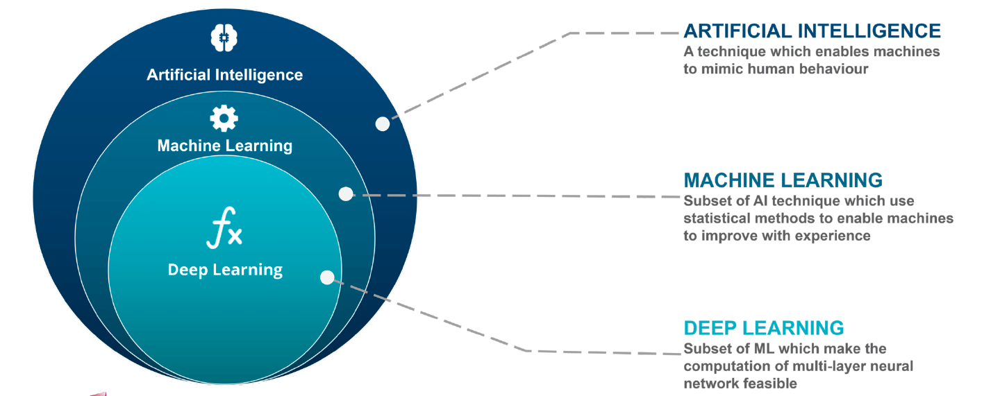

先看三个嵌套的圆。人工智能（Artificial Intelligence，AI）在外，机器学习（Machine Learning，ML）在中，深度学习（Deep Learning）在内，表示方法的包含关系。神经网络可用多层运算把原始输入逐步变成有用的表示。

#### p.3 · Artificial Neural Networks

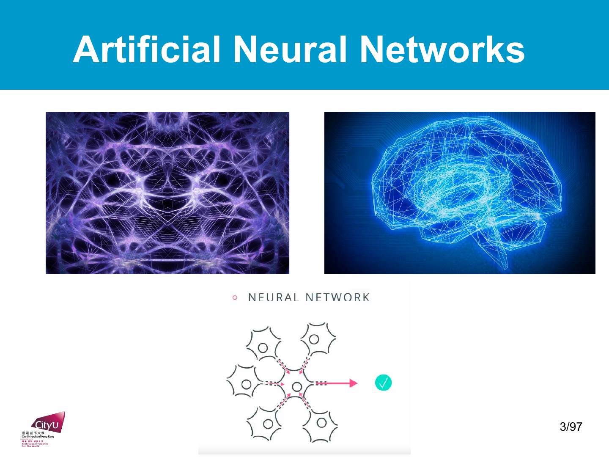

上方两张图联想生物神经与大脑，下方示意多个信号汇到同一节点，再沿粉红箭头输出。人工神经网络（Artificial Neural Network，ANN）借用了信号汇合的思路，p.10 会把中间动作写成可计算的公式。

#### p.4 · What is Deep Learning?

泳池读书照片把 deep 当成水深，只是双关。技术上的「深」可从下一页的多层表示入手。

#### p.5 · What is Deep Learning?

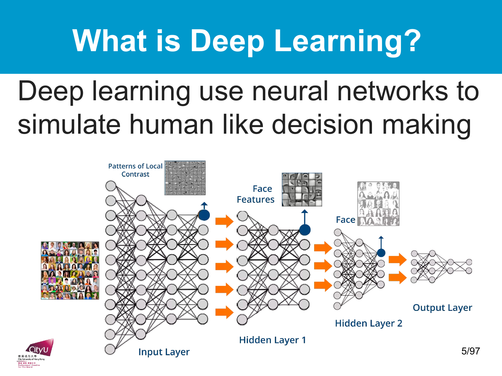

从左边输入的照片沿橙箭头往右。Patterns of Local Contrast 指局部明暗变化，Face Features 指组合出的面部特征，Face 指更整体的人脸表示。蓝点向上的箭头对应各阶段可视化示意。节点的具体含义取决于训练任务。

#### p.6 · Why Deep Learning?

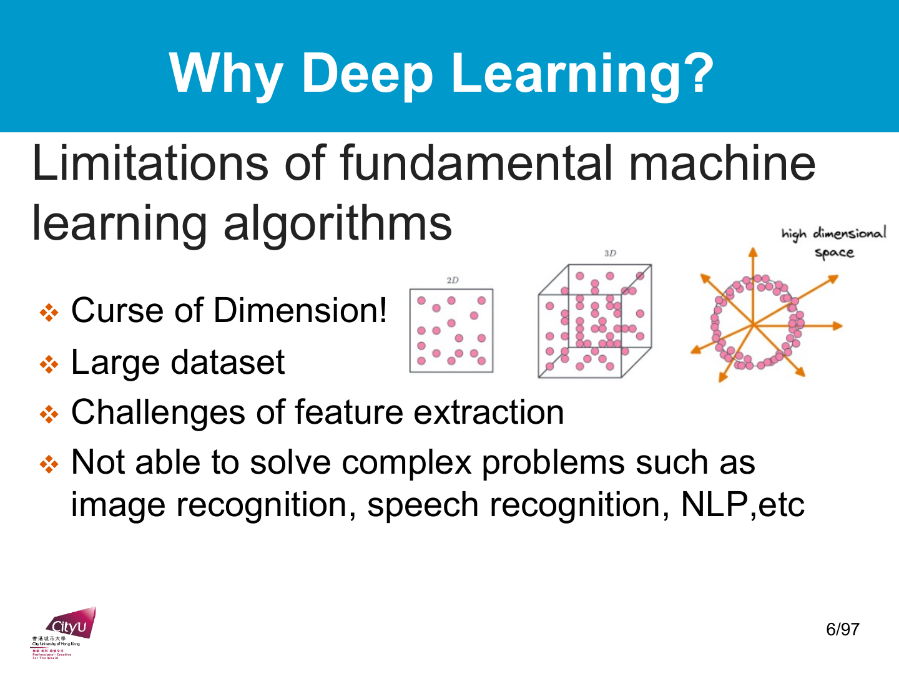

看右侧的 2D、3D 和 high dimensional space。随着维度增加，同一批样本可覆盖的组合比例往往下降，这叫维度灾难（Curse of dimensionality）。例如每维只分 10 档，两维是 100 格，十维已经是 $10^{10}$ 格。课件同时提出大数据与手工提取特征的难处，传统方法仍可能适用于特定任务。

#### p.7 · Why Deep Learning?

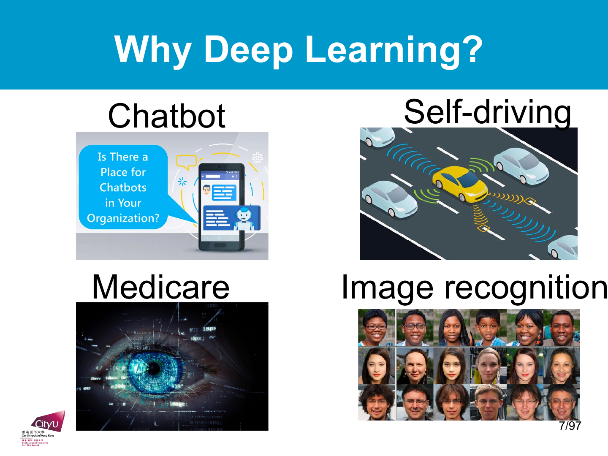

按四个标签区分输出。Chatbot 要接收消息并给回复，Self-driving 图画的是用周围物体和距离帮助驾驶判断，Medicare 是医疗用途示意，Image recognition 是图像识别。四张图没有给模型表现。

#### p.8 · Why Deep Learning and NN?

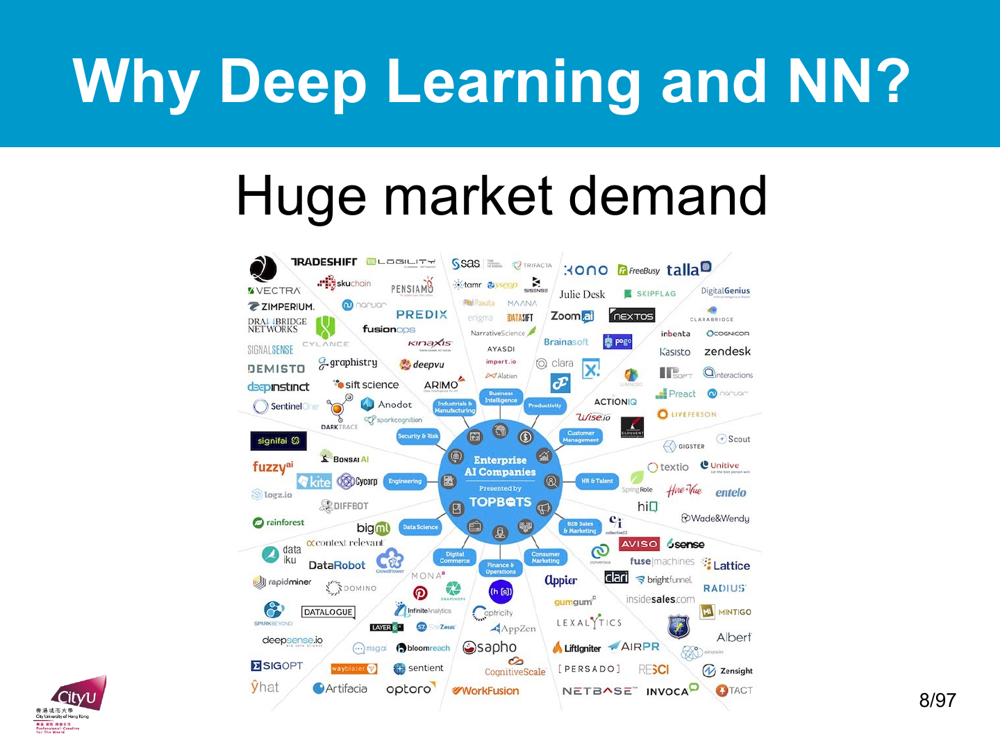

从中心 Enterprise AI Companies 顺着左侧的 Data Science（数据科学）分支，可看到该类示例公司的标志。别的分支包括 Customer Management（客户管理）和 Finance & Operations（财务与运营）。原图展示一份企业 AI 应用分类，课件未给市场规模的统计口径。

#### p.9 · Biological Background

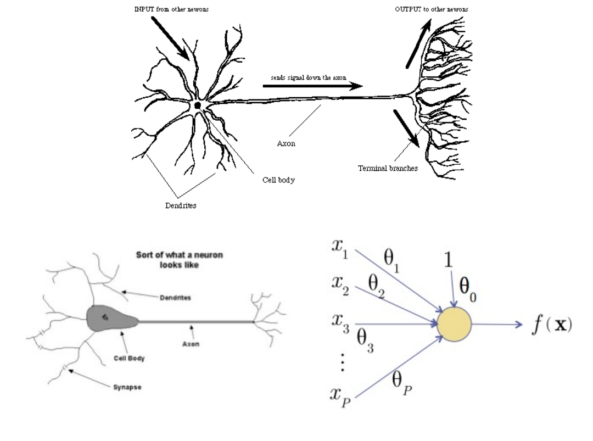

上图从左侧树突（Dendrites）收信号，经细胞体（Cell body），再沿轴突（Axon）送出。右下抽象图把每条支路写成输入 $x_j$ 与权重 $\theta_j$，恒为 1 的线携带偏置 $\theta_0$，最后输出 $f(x)$。

### 2.2 一个神经元怎样算（讲义 p.10–13）

#### p.10 · Artificial Neuron

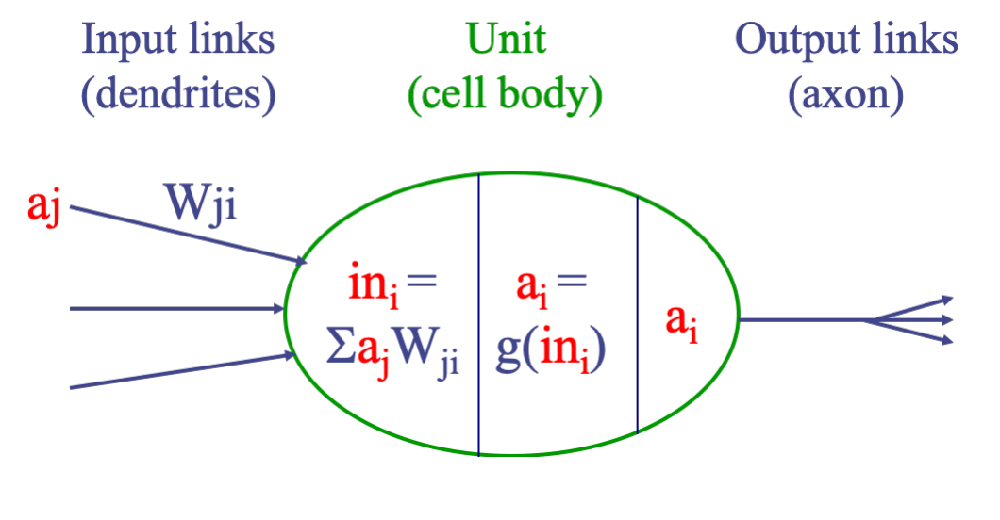

从椭圆左边看入线。上一单元传来的 $a_j$ 在边上乘 $W_{ji}$，在单元 $i$ 把各条乘积相加。

相加结果 $in_i$ 是下例的激活前分数 $z$。沿着绿色椭圆从左格走到中格，激活函数 $g$ 把它变成 $a_i$。最右格只把这个 $a_i$ 送出去；右边分成三根箭头，是把同一个数送给三个后续单元，每个接收端可以用自己的权重。原图的求和格没有单列偏置，下面的补充例把偏置 $b$ 单独写出来。

先做一个明确输入的例子。两个输入为 1 和 2，两个权重（Weight）为 0.5 和 −1，偏置（Bias）为 1。权重决定输入怎样影响分数，偏置让整体阈值能移动。

先乘再加，预激活分数 $z=1+0.5\times1-1\times2=-0.5$。接下来激活函数（Activation function）把这个分数转换成输出 $a=g(z)$。同一个分数若接不同激活，输出含义不同。

$$
z=b+\sum_{j=1}^{d}w_jx_j,\qquad a=g(z).
$$

下面逐行解释当前神经元公式中的对象和例值。

| 符号 | 当前意思 | 本例 |
|---|---|---|
| $x_j$ | 第 $j$ 项输入 | 1、2 |
| $w_j$ | 对应输入的权重 | 0.5、−1 |
| $b$ | 与输入无关的偏移 | 1 |
| $z$ | 激活前分数 | −0.5 |
| $a$ | 激活后输出 | 由函数决定 |

#### p.11 · Class I: Perceptron

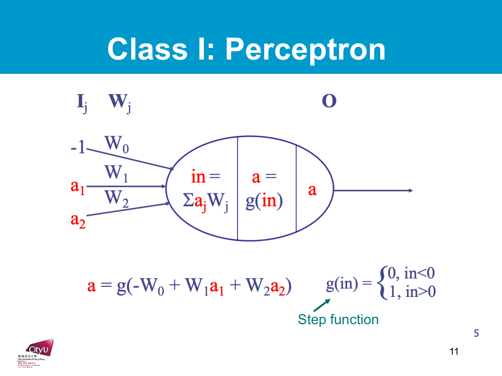

感知机（Perceptron）图的第一根线输入固定为 −1，所以偏移项是 $-W_0$。先算 $-W_0+W_1a_1+W_2a_2$，再按阶跃函数（Step function）把负数判 0、正数判 1。图漏写等于 0，本篇需要边界时约定非负判 1。

#### p.12 · Use a trained model

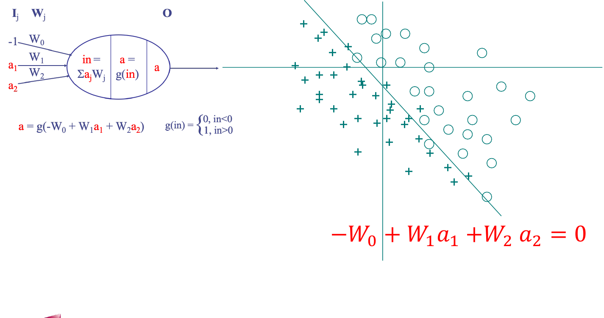

从左图的固定 −1、$a_1$、$a_2$ 三根入线算分数 $s=-W_0+W_1a_1+W_2a_2$。右图把 $a_1,a_2$ 当平面上的两个坐标，红式写出斜边界 $s=0$；十字坐标轴只是位置参照。边界两侧的分数符号相反，图用十字点和空心圆区分两组，未说明哪个符号对应 1。

用已训练的模型预测时，各 $W$ 固定。沿用 p.11 的 0/1 约定，先代新点坐标算 $s$，例如 $s=-0.5$ 就输出 0；若正好 $s=0$，按本篇约定输出 1。这里 −0.5 是说明操作的补充值，原图没给具体权重。

#### p.13 · Perceptron’s Step Function

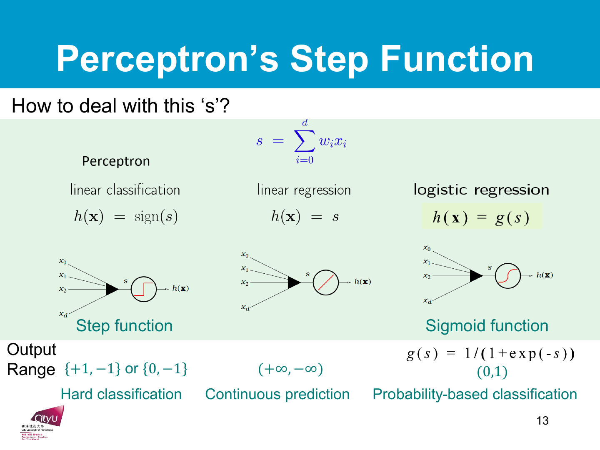

原问 “How to deal with this ‘s’?” 指先算出的加权分数 $s$。从左到右分别把它变为硬类别、连续预测值、0 到 1 之间的输出。中栏恒等函数的范围是全体实数，原图把正负无穷顺序印反。第一栏的类别标签应按模型约定，p.11 用 0/1。⚪ 英文参考作答 “Apply a step function for hard classification, keep the score for linear regression, or apply a sigmoid for a probability-based binary model.”

阶跃函数（Step function）按阈值输出类别。此处约定 $z\ge0$ 为 1、否则 0，原 p.11 未明确等于 0 的边界，应自行说明。恒等函数 $g(z)=z$ 保留连续分数，适合相应回归输出。Sigmoid 为 $\sigma(z)=1/(1+e^{-z})$，把实数压到 0 与 1 之间；$e$ 是约 2.718 的常数，指数表示连续的乘方关系。例中 $\sigma(-0.5)\approx0.3775$。

如果把 Sigmoid 输出解释为正类概率，常用 0.5 阈值分类；但输出位于 0–1 不自动保证概率已校准。p.13 的输出范围写法有倒序和类别标签混乱，复习以函数和明确阈值为准。

### 2.3 从单个感知机到多层网络（讲义 p.14–20）

#### p.14 · Perceptron’s Capability · AND

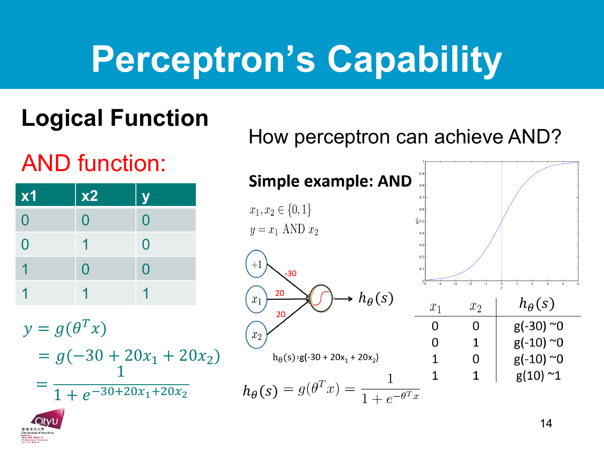

从原图的 $+1$ 边读出偏置 −30，两条输入边都乘 20。两项都为 1 才得到正分数。左下最后一行把分数直接放进指数而漏掉负号，正确代入为 $1/(1+e^{-(-30+20x_1+20x_2)})$，与右下的定义及给定输出一致。

这组练习输入都是 0／1。AND 要两项都为 1 才输出 1；OR 只要任一项为 1 即输出 1。讲义给 AND 分数 $-30+20x_1+20x_2$，OR 分数 $-10+20x_1+20x_2$，都接 Sigmoid；以下按 0.5 阈值显示类别。

原问题（p.14）：“How perceptron can achieve AND?” 中文：怎样让一个感知机实现“两个都满足”？直接答案是使用所给权重，使只有双 1 时分数为正。

| $x_1,x_2$ | AND 分数 | AND 类别 | OR 分数 | OR 类别 |
|---|---:|---:|---:|---:|
| 0,0 | −30 | 0 | −10 | 0 |
| 0,1 | −10 | 0 | 10 | 1 |
| 1,0 | −10 | 0 | 10 | 1 |
| 1,1 | 10 | 1 | 30 | 1 |

读最后一行：$-30+20+20=10$，Sigmoid 约 0.99995，阈值后为 1；它不是数学上精确等于 1。英文参考答案：“Use a bias of −30 and weights of 20 for both inputs. Only the input (1,1) produces a positive score, so thresholding the sigmoid output at 0.5 implements AND.”

#### p.15 · Perceptron’s Capability · OR

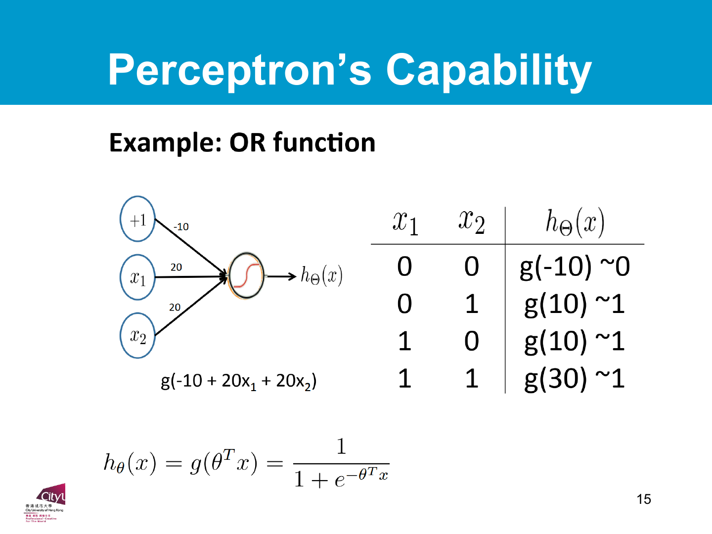

同 p.14 比较左图的 $+1$ 边，偏置从 −30 改为 −10。只有一项为 1 时，加 20 已能跨过 0，右表的 01 和 10 因此都接近 1。

[[#p.14 · Perceptron’s Capability · AND|p.14 手算表]]的 OR 列列全了四个输入。试代 00 得 −10，只有这一行在 0.5 以下。

#### p.16 · Class II: Multi-layer Feed-forward Networks

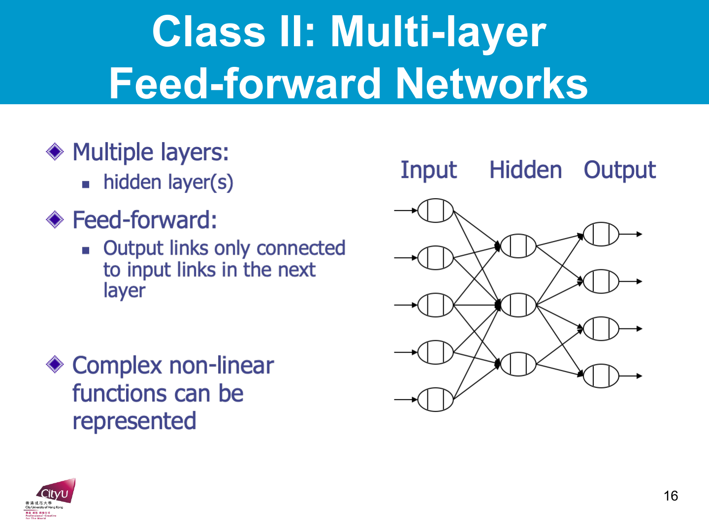

先按原图上方标签把椭圆分成三列：左边 Input 有 5 个节点，中间 Hidden 有 3 个，右边 Output 有 4 个。沿一条真实连线走：最上面的输入 → 最上面的隐藏节点 → 最上面的输出。这个输出还有一条入线来自中间那个隐藏节点；最下面的隐藏节点没有线接到这个输出。只沿图上接通的边传数。

每个隐藏节点按 p.10 的读法，给自己的每条入线乘一个权重，加总后做激活，再把得到的数送往下一列。隐藏层（Hidden layer）存放的就是这些中间结果。前馈（Feed-forward）表示箭头从左往右进入下一层，不从输出折返回来。原图未写权重值，也没有单独画偏置，p.23 再示范怎样计入。

左下说网络可以表示复杂的非线性关系，关键是节点可使用非线性激活。若各层只做乘加，就像把 $2x+1$ 再变成 $3(2x+1)+4=6x+7$，仍可写成一次乘加。p.17 会用折线激活说明怎样改变这个结果。

#### p.17 · Universal Approximation Theorem

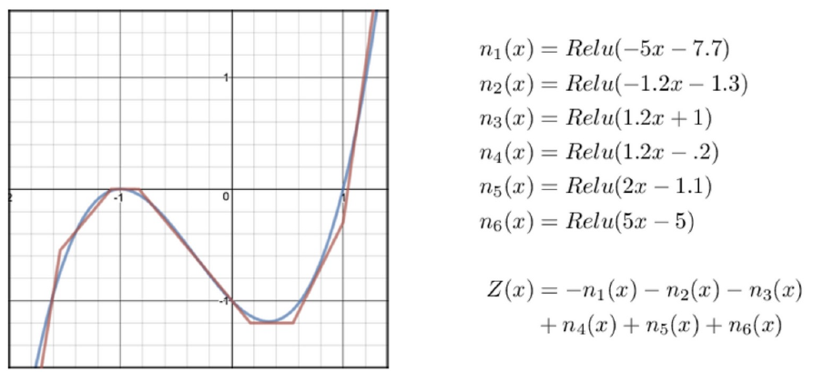

左图横轴是输入 $x$，蓝色光滑曲线是目标形状，红色折线是右侧六个 ReLU 单元（负分数置零，正分数保留）的有符号和。以 $x=0$ 为例，只有 $n_3$ 为 1，其他单元为 0，组合得 $Z(0)=-1$。不同单元在不同位置折转，叠起来便可逼近曲线。

p.17 的通用逼近定理（Universal Approximation Theorem）说，在相应激活与条件下，有足够节点的一个隐藏层可把紧集上的连续函数逼近到任意精度。紧集可先理解为有界且含边界的输入范围。它是表达能力结论，不证明有限数据训练一定找到好权重，也不保证样本外预测；“一个隐藏层够表达”与“深层网络训练和表示更合适”并不矛盾。

#### p.18 · A complex case · XOR 与 XNOR

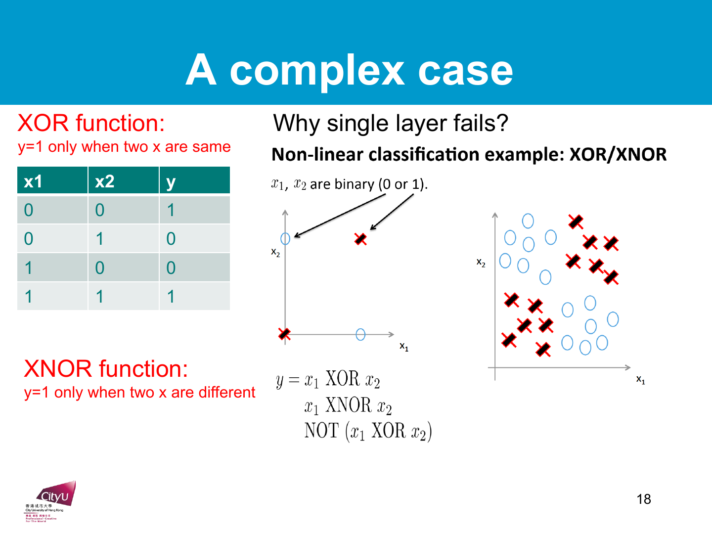

左图四角是四种 0/1 输入，红叉在同值的两个对角点，空心圆在异值的两个对角点。右图把相同困难画成两组交错点。课件红字标签对调，按真值表把左图的红叉理解为 XNOR 的正类。

原 p.18 的问题是：“Why single layer fails?” 它标 “XOR function: y=1 only when two x are same”，表却是 00→1、01→0、10→0、11→1；又标“XNOR function: y=1 only when two x are different”。**名称与标准定义对调**，不能把错标背进考试。

标准 XOR 是不同为 1，标准 XNOR 是相同为 1。对 XOR 的四个角，两个正类位于对角，无法用一条直线同时把它们与另外两角分开。按本篇非负判为1的约定，若正类 10、01 的分数都大于或等于 0，两分数相加为 $2b+w_1+w_2\ge0$；负类 00、11 的分数若都小于 0，同样相加却要求 $2b+w_1+w_2<0$，冲突。同一表达式不能同时非负且严格小于零，因此也覆盖边界情况。

英文参考答案：“A single linear threshold cannot separate the opposite positive corners from the opposite negative corners. A hidden layer can combine intermediate regions to represent XOR or XNOR.”

#### p.19 · A complex case · 分开算三种逻辑

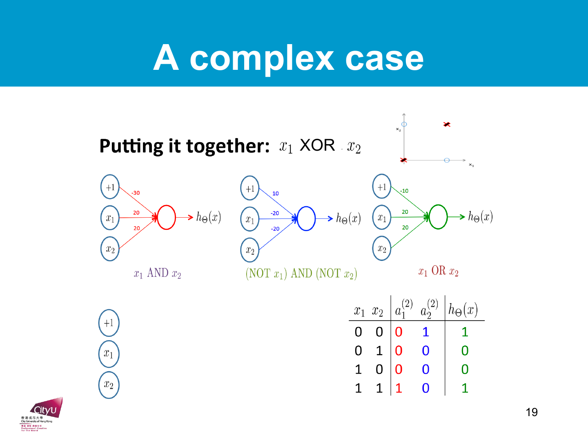

先沿红、蓝、绿三支读图。红支 AND 查双 1，蓝支查双 0（两个 NOT 再 AND，即 NOR），绿支查两个隐藏输出中是否至少一项为 1。把红、蓝两个结果交给绿支，右下表只在 00 与 11 给 1。

#### p.20 · A complex case · 接成一个网络

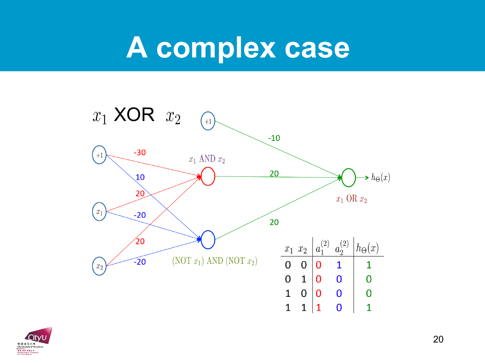

这一页把三套运算接起来。红线与蓝线各汇到一个隐藏单元，绿线把这两个输出各乘 20，再加来自上方独立 $+1$ 的 −10。沿 00 输入追踪，蓝单元被激活，绿单元因此输出接近 1。

p.19–20 实际把 AND、NOR 再 OR，算的是 **XNOR**。NOR 是“两个都不是 1”：分数 $10-20x_1-20x_2$。保留这套原网络，不能为修标题偷偷改权重。

$$
h_1=\sigma(-30+20x_1+20x_2),\quad
h_2=\sigma(10-20x_1-20x_2),\quad
\widehat y=\sigma(-10+20h_1+20h_2).
$$

下面每行是一种完整输入，隐藏列按逻辑近似显示两个中间结果。

| 输入 | 隐藏层的逻辑近似 $h_1,h_2$ | 最终阈值类别 |
|---|---|---:|
| 0,0 | 0,1 | 1 |
| 0,1 | 0,0 | 0 |
| 1,0 | 0,0 | 0 |
| 1,1 | 1,0 | 1 |

例如 00 先由 NOR 检出，再使输出 OR 为真。变成标准 XOR 可取最终类别的逻辑补，但不把这个补充当成 p.20 原网络。原图的连续值只是接近逻辑 0／1，表为阈值近似。

### 2.4 多层网络及矩阵读法（讲义 p.21–30）

#### p.21 · A more complex case – multi output

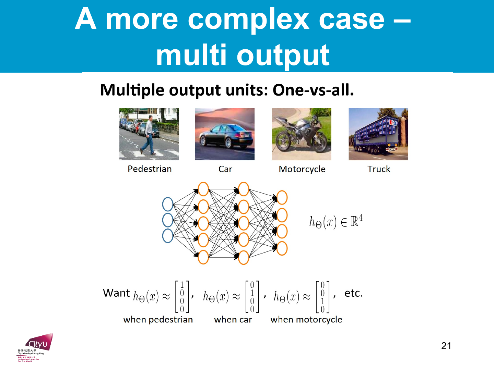

上方照片顺序就是右端四个输出的约定顺序。行人的目标写成 $(1,0,0,0)^\top$，汽车把 1 放到第二格。独热向量（One-hot vector）中只有真类的格子是 1。原图标 one-vs-all，含义是逐类对其余类看待，输出之间是否归一化取决于输出层设计。

#### p.22 · Build an Artificial Neural Network

先定输入和目标，再定隐藏层数、宽度及激活。训练时再从数据估计层间连接参数。若所选激活自身含可训练参数，仍需在训练中估计。神经元数量和训练样本数量分别描述网络和数据。

#### p.23 · ANN Model Representation

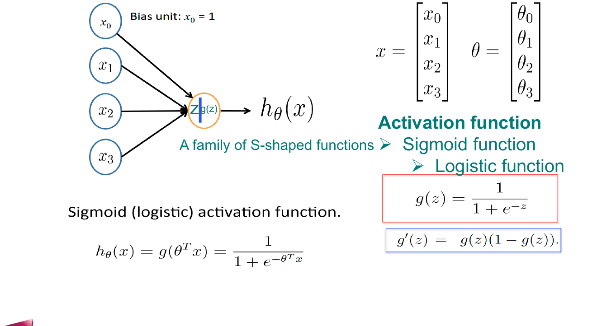

图左 $x_0=1$，其余 $x_1,x_2,x_3$ 是真实特征。右侧两列按同一顺序逐项乘加即 $\theta^\top x$，第零项就贡献 $\theta_0$。与 p.11 的 $-W_0$ 比较，这里用固定 1，偏置正负已包含在 $\theta_0$。

#### p.24 · Model Representation · 红线是哪条边

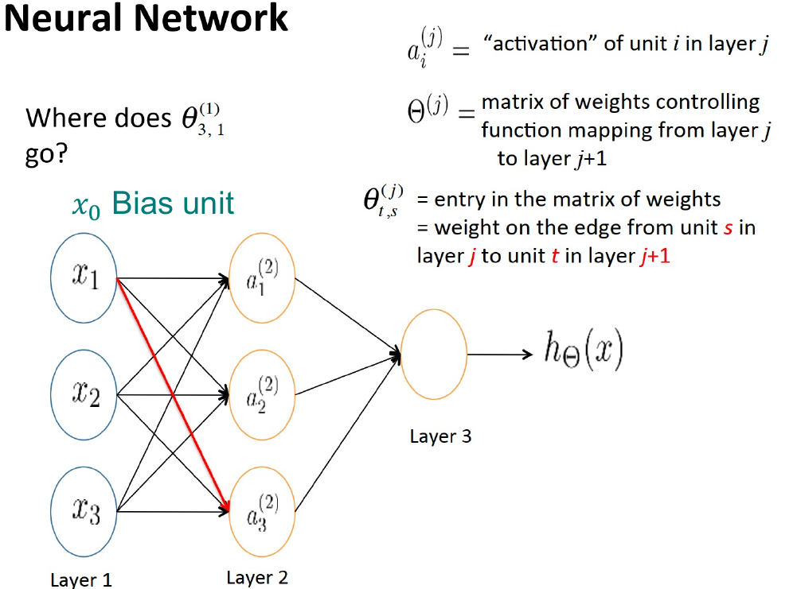

⚪ 原问 “Where does $\theta^{(1)}_{3,1}$ go?” 中文是找出这一项对应的边。沿左侧第一层 $x_1$ 到第二层第 3 个橙圈 $a^{(2)}_3$。上标 1 指出发层，下标按「终点，起点」读，图中红线正好标出此边。英文参考 “It is the weight from unit 1 in layer 1 to unit 3 in layer 2.” 图标出偏置 $x_0$，但三个可见的蓝圈是实际特征。

红线对应第 1 层到第 2 层的权重矩阵 $\Theta^{(1)}$ 中，第 2 层第 3 个接收节点（第三个橙圈）所用的那一行、第 1 个特征所用的那一列（偏置另记为第 0 项）。p.10 的 $W_{ji}$ 下标先写起点、后写终点；本页的 $\theta^{(j)}_{t,s}$ 则先写终点、后写起点。

沿这条边进入橙圈的是 $\theta^{(1)}_{3,1}x_1$；另外两根黑线各带来 $x_2,x_3$ 的一项。把三项和偏置相加，再做激活，才得到整个橙圈的结果 $a_3^{(2)}$。

#### p.25 · Model Representation · 读输出节点

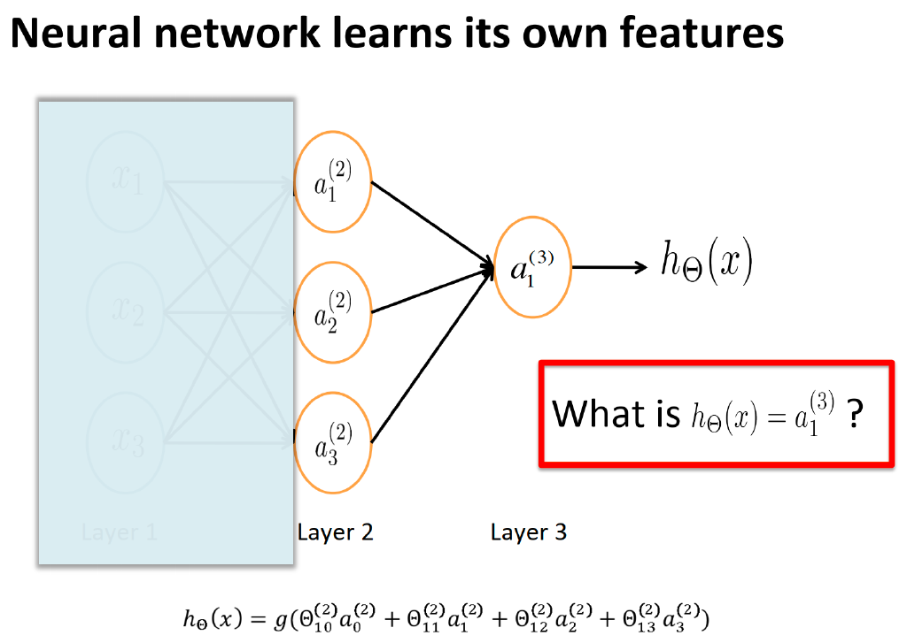

浅蓝覆盖第一层，强调计算最后一个节点时可把第二层的三个激活当成新特征。从这三个橙圈的入边数起，再加上公式里的偏置边 $a_0^{(2)}=1$。

⚪ 原 p.25 问：“What is $h_\theta(x)=a_1^{(3)}$?” 中文是输出等于第三层第一个单元时怎样展开。直接答案是把第三层的输入写清：$a_1^{(3)}=g(\Theta_{10}^{(2)}+\Theta_{11}^{(2)}a_1^{(2)}+\Theta_{12}^{(2)}a_2^{(2)}+\Theta_{13}^{(2)}a_3^{(2)})$，各个二层激活又由第一层输入计算。英文参考：“The final output is the activation of unit 1 in layer 3, computed from a bias and a weighted sum of the preceding layer's activations.”

#### p.26 · Model Representation · 权重矩阵的尺寸

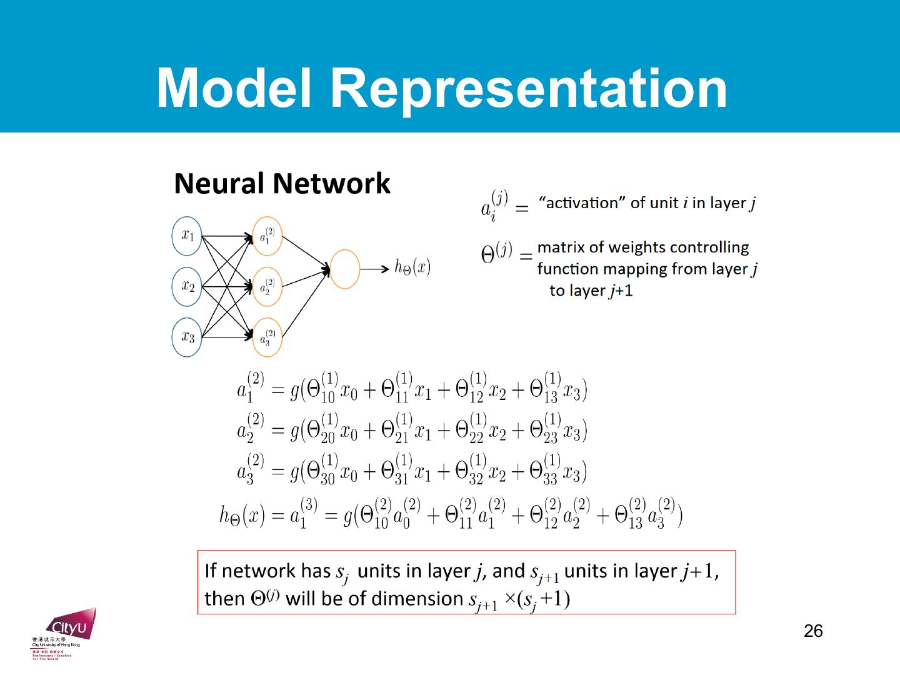

比 p.25 多写出了第二层三个神经元各自的公式。先看每行开头带下标 0 的项，再看三个特征项。把同一个接收节点的系数放在一行，这张图的第一层到第二层矩阵就是 3 行 4 列，最后一层的矩阵是 1 行 4 列。

p.24–28 的 $a_i^{(j)}$ 是第 $j$ 层第 $i$ 个单元输出；$\Theta_{ki}^{(j)}$ 是从第 $j$ 层单元 $i$ 连到下层单元 $k$ 的权重。

若本层有 $s_j$ 个真实单元，额外加一个恒为 1 的偏置输入，下层有 $s_{j+1}$ 个单元，则权重矩阵尺寸为 $s_{j+1}\times(s_j+1)$。

多出的 1 是偏置列，不是多出一个真实输入特征。

#### p.27 · Model Representation · 批量算隐藏层

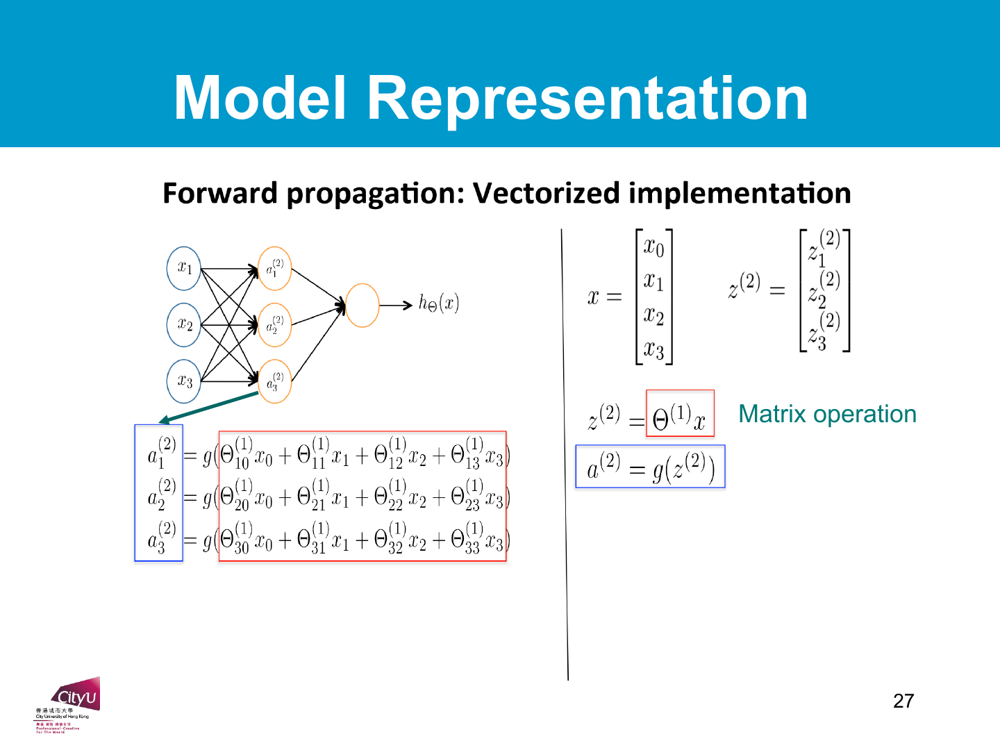

红框的三个乘加合为 $\Theta^{(1)}x$，依次产出 $z_1^{(2)},z_2^{(2)},z_3^{(2)}$。蓝框才对三个分数分别做 $g$。向量化（Vectorization）只是把等价计算集中写出来，输入列中保留了偏置位置。

#### p.28 · Model Representation · 补偏置再算输出

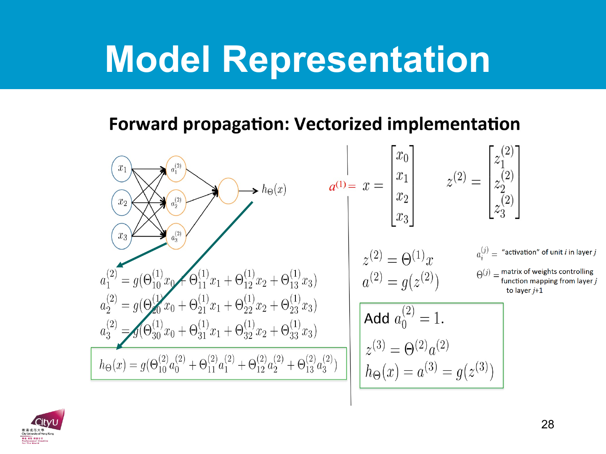

新出现的绿框做第二次矩阵乘。取 p.27 的三项激活，加一个恒为 1 的 $a_0^{(2)}$，再用 $\Theta^{(2)}$ 得 $z^{(3)}$，最后激活成 $h_\Theta(x)$。

**笔记补充 · 逐步手算一个小网络**

图从左到右读，每条边表示乘一个可训练权重，圆框内先加总再激活。这里是补充小网络，由两个输入、两个隐藏单元和一个输出组成。

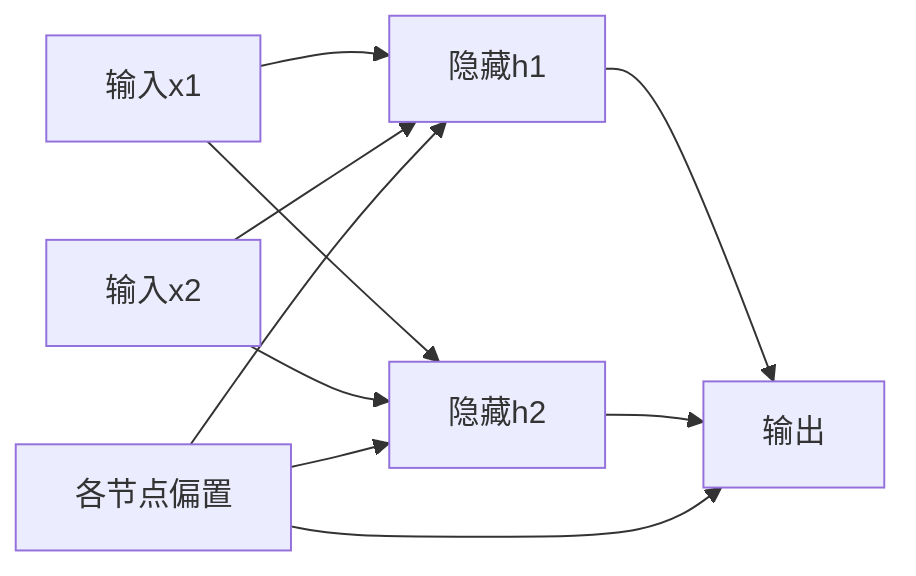

💡 完整前向例：输入 $x=(1,2)^\top$，第一隐藏单元权重为 $(1,-1)$、偏置 0，第二个为 $(0.5,1)$、偏置 −1。分别得到分数 −1、1.5；这里的 ReLU 保留正数、把负数改成 0，即 $g(z)=\max(0,z)$；p.31–35 再比较其他激活。因此激活后为 0、1.5。输出按 $2h_1+h_2+0.5$ 得到 2。这是回归分数，不擅自当概率。

把两行权重记在同一矩阵，只是同时执行刚才两次乘加：

$$
W=\begin{bmatrix}1&-1\\0.5&1\end{bmatrix},\quad
b=\begin{bmatrix}0\\-1\end{bmatrix},\quad
z=Wx+b=\begin{bmatrix}-1\\1.5\end{bmatrix}.
$$

矩阵乘法的每行与输入逐项相乘后求和，不是把同位置的两个二维表逐格相乘。本例 $W$ 为 2×2，输入为 2×1，结果为 2×1，维度中的内侧两个 2 必须一致。

#### p.29 · NN with 2 hidden layers

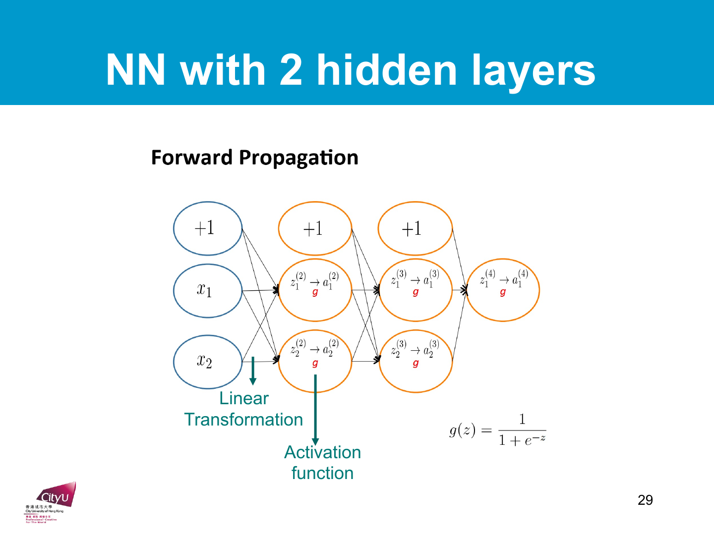

数左到右的实质计算列。第一列是两个输入加偏置，第二、第三列各有两个隐藏单元加各自的偏置输入，第四列给一个输出。箭头标出先线性乘加、再激活。第二隐藏层重复同一类操作，用它自己的权重接收第一隐藏层输出。

#### p.30 · NN learn complex features

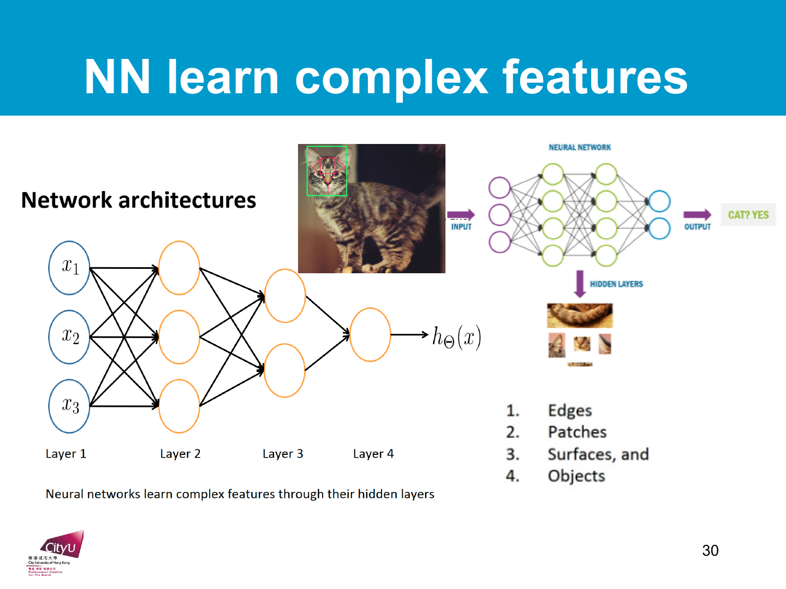

先看左下网络：第 1 层是三个蓝圈 $x_1,x_2,x_3$，第 2 层有三个橙圈，第 3 层有两个，第 4 层有一个。从 $x_1$ 沿黑箭头走过第 2 层最上面的橙圈、第 3 层最上面的橙圈，最后到第 4 层，右侧的 $h_\Theta(x)$ 就是这个网络的输出。每到一个橙圈，都把它收到的各条入线加权组合再做激活；它收到的是上一层算出的数，因此较后面的层可以继续组合前面学到的表示。

右上是另一幅例图。沿紫色 INPUT 箭头从猫的照片进入网络；中间绿圈属于隐藏层，向下的 HIDDEN LAYERS 箭头用局部图块帮助理解中间表示；最右 OUTPUT 箭头给出 “CAT? YES”。课件列的边缘（Edges）、小块（Patches）、表面（Surfaces）到物体（Objects），可想成先找明暗边界，再把相邻边界组合成耳朵轮廓之类的形状，最后用这些线索判断整张照片。左右两图的节点数不对应；右图没有指定某个圈一定负责认耳朵，实际学到的表示由数据和任务决定。

### 2.5 激活函数（讲义 p.31–35）

#### p.31 · Activation Function

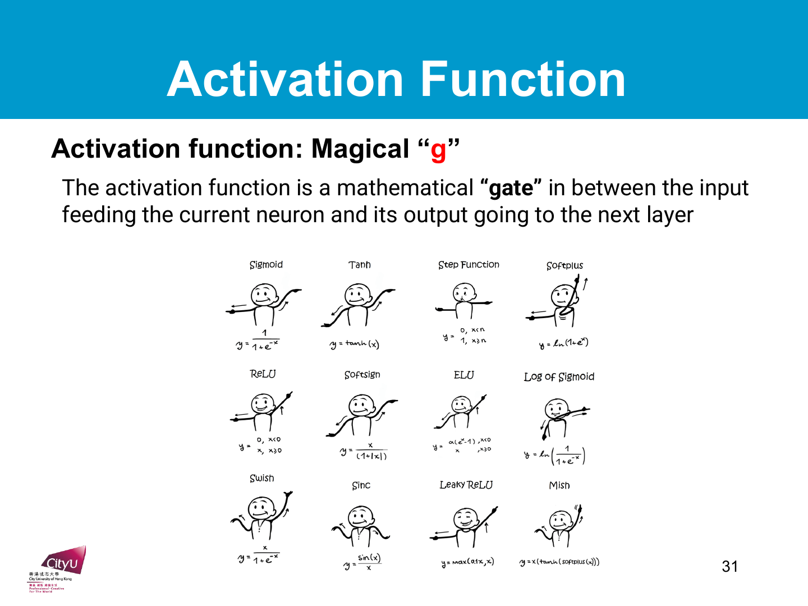

先在图里找 Step Function、Sigmoid 和 ReLU 三个小格，横向是进入单元的分数，纵向是送往下一层的输出。Step Function 跨过阈值会跳到另一个值；Sigmoid 是平滑的 S 形；ReLU 的负半边水平、正半边上升。用后面 p.32 和 p.34 将详细计算的两个函数先比一次：分数为 0 时，Sigmoid 输出 0.5，ReLU 输出 0。同一个加权分数可以因此送出不同数值。其他小格展示可选的函数形状；p.16 的复合算例说明只有乘加时，多层仍可合成一次乘加。

#### p.32 · Sigmoid Activation Function

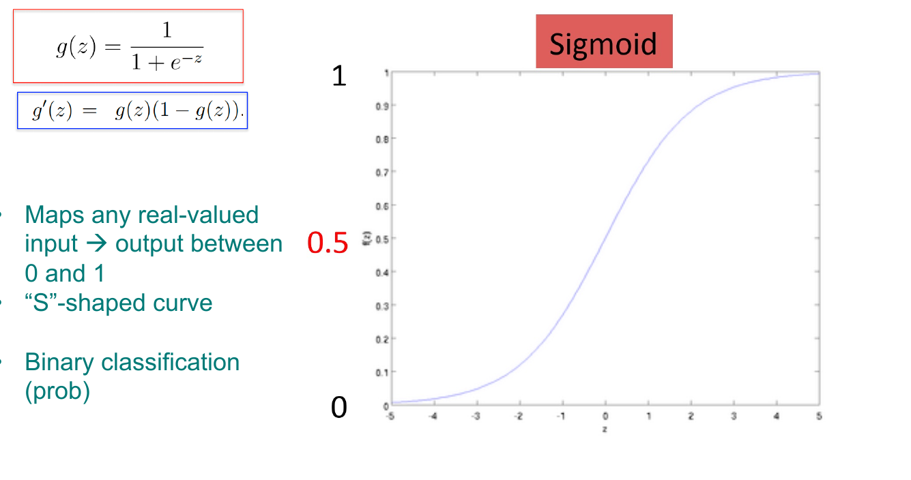

原图横轴是输入分数，纵轴是 $g(z)$。沿中间红标 0.5 找到 $z=0$，再向两端看曲线如何变平。实际有限输入只会得到严格介于 0 与 1 的值。

局部斜率表示输入微小改变时输出怎样改变，下一节训练会用它把误差往回传。课件给出 Sigmoid 的导数：

$$
\sigma'(z)=\sigma(z)(1-\sigma(z)).
$$

Sigmoid 输出为 0.5 时斜率为 0.25；输出靠近 0.99 时为 $0.99\times0.01=0.0099$。输入改变同样一点，饱和端输出改变得更少。

#### p.33 · Tangent activation function

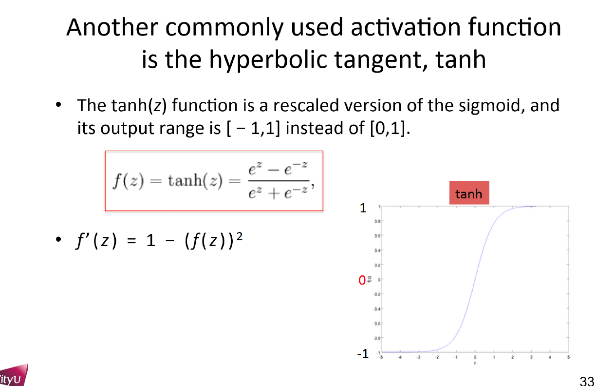

tanh 的中点从 Sigmoid 的 0.5 改成 0，纵轴两端趋向 −1、1，有限输入达不到端点。它可把负分数保留为负输出，后面会用于 RNN 状态和 LSTM 候选记忆。

$$
\tanh'(z)=1-\tanh^2(z).
$$

tanh 输出为 0 时斜率为 1，输出为 0.9 时为 $1-0.9^2=0.19$。这把“曲线变平”接到反向信号乘以较小因子的机制，不能只看函数名字说会遗忘。

#### p.34 · ReLU activation function

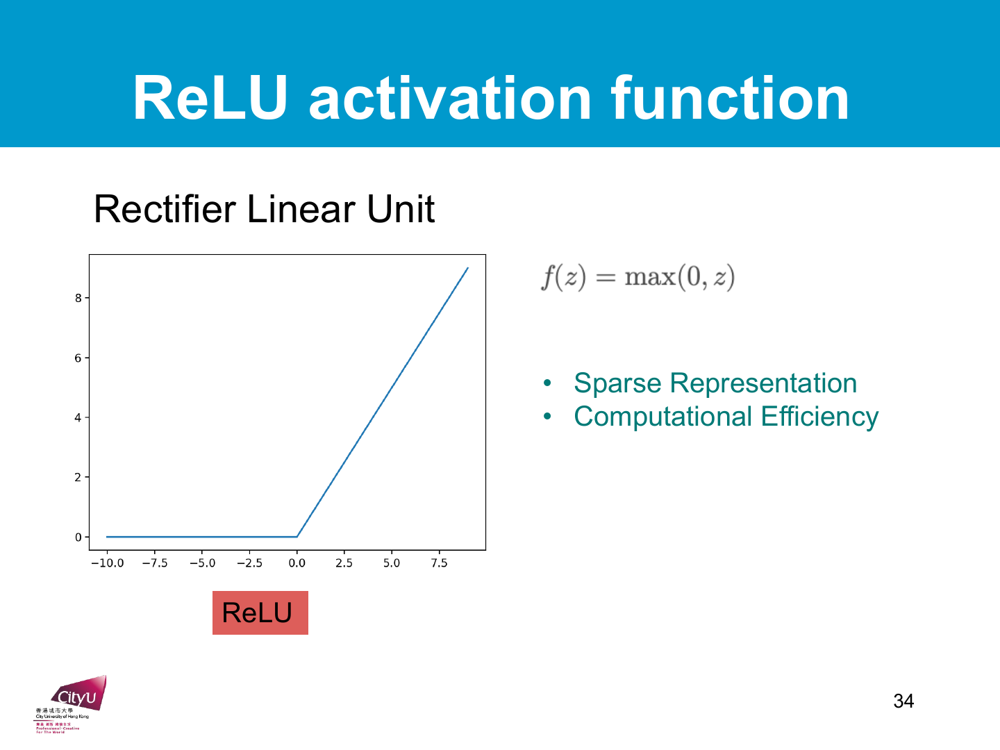

从原图的折角 $z=0$ 看两侧。左侧水平，所有负输入均变成 0，所以一部分激活会刚好为零，称稀疏表示（Sparse representation）。右侧斜率 1，正数原样通过。折角没有普通导数，实现会约定该点的梯度值。

训练时 ReLU 正侧可传递局部梯度，负侧的局部梯度为 0。如果某个单元在所有训练输入上长期落在负侧，它可能失活。

#### p.35 · Softmax Activation

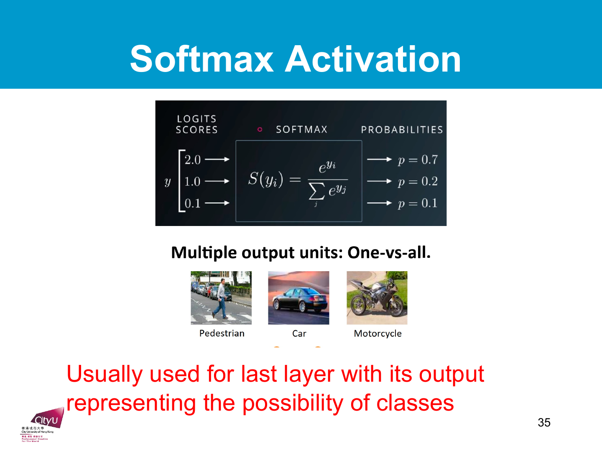

左边三项是分数（Logits），中间指数归一化，右边才是总和为 1 的比例。用原图分数 2.0、1.0、0.1 实算约得 0.659、0.242、0.099，图中 0.7、0.2、0.1 是粗略示意。同页下方的 One-vs-all 表示把每类分别与其余类比较。上方 Softmax 将全部类别分数一起归一化，产生总和为 1 的一组输出。p.37 的独立 Sigmoid 输出各自计算概率，通常没有这条总和约束。

Softmax 对第 $k$ 类的分数 $z_k$ 先取指数，再除以各类指数总和：

$$
p_k=\frac{e^{z_k}}{\sum_{j=1}^{K}e^{z_j}}.
$$

这里 $K$ 是类别数，$p_k$ 是该类输出比例。若三个分数为 $\log2,0,0$，指数为 2、1、1，总和 4，输出为 0.5、0.25、0.25。只看第一分数而不看其余分数，无法确定第一类概率。互斥多类可用 Softmax；多个标签可同时为真时，通常需要分别建概率，不能机械要求它们和为 1。

**用相同的分数比较四种激活**

下表以同一分数 $z=-1$ 或 0、1 说明四种常见函数。对数／指数都采用自然底数，数值为笔记补充。

| 函数 | 定义／范围 | 具体读法 |
|---|---|---|
| Sigmoid | $1/(1+e^{-z})$，(0,1) | −1、0、1 对应约 0.269、0.5、0.731 |
| 双曲正切 tanh | $(e^z-e^{-z})/(e^z+e^{-z})$，(−1,1) | 0 输出 0；−1 约 −0.762 |
| ReLU | $\max(0,z)$ | −1 变 0，1 保持 1 |
| Softmax | 见上式，整组和为 1 | 把多个类别分数变为互相竞争的比例 |

### 2.6 损失与训练目标（讲义 p.36–37）

#### p.36 · Model Training

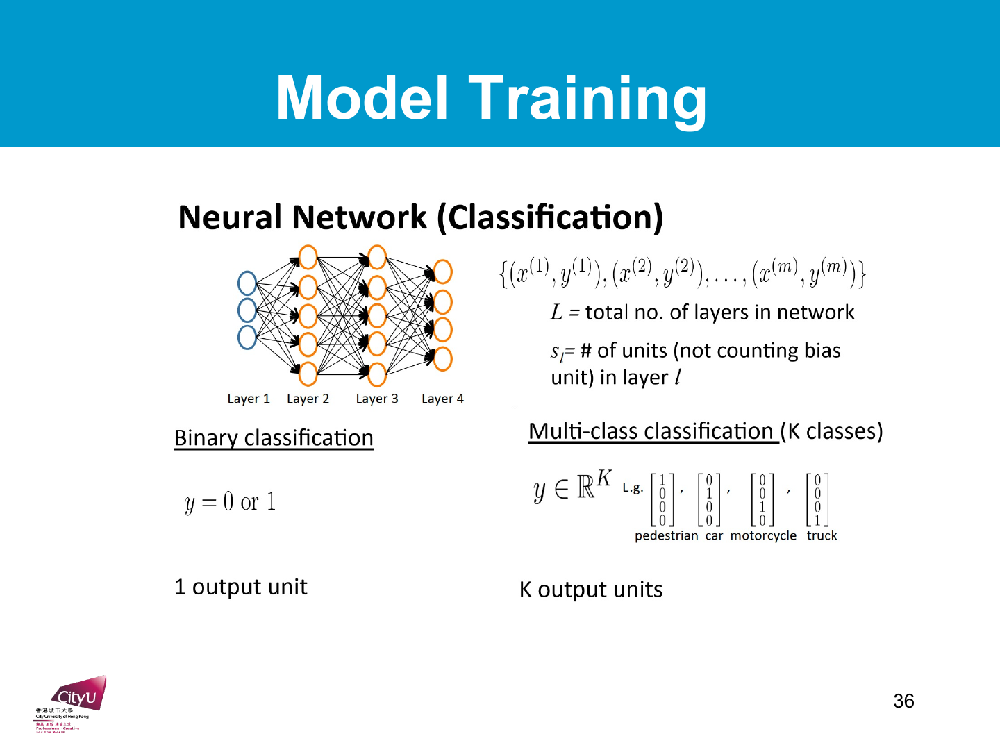

对照下方两栏。二分类可只输出正类的一个分数或概率，标签用 0 或 1。互斥的 $K$ 类可用 $K$ 个输出，四类示意就有四个标签位置。页中的 $L$ 是总层数，$s_l$ 是第 $l$ 层真实单元数，偏置位不计。

训练样本有输入 $x$ 和真实标签 $y$。损失函数（Loss function）把预测与真实之间的不符合变成一个数，训练要减小它。p.36 区分二分类的一输出和多类的 $K$ 输出，标签形式要与输出含义匹配。

#### p.37 · Cost Function (Objective)

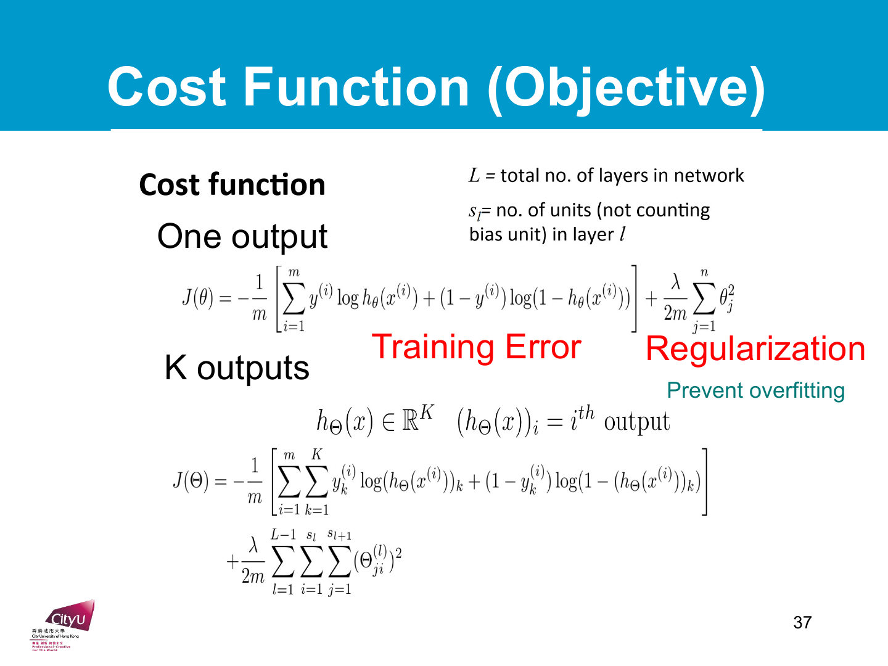

先看红标 Training Error 与 Regularization。前者惩罚预测偏离标签，后者按权重平方增加成本。下半部把单输出的损失扩到 $K$ 个独立 Sigmoid 输出，需与 p.35 的互斥 Softmax 区分。

p.37 单输出使用二元交叉熵（Binary cross-entropy）。$m$ 为训练记录数，$p_i$ 是第 $i$ 条正类预测概率，$y_i$ 为 0 或 1：

$$
J=-\frac1m\sum_{i=1}^{m}[y_i\log p_i+(1-y_i)\log(1-p_i)]
+\frac{\lambda}{2m}\sum_j w_j^2.
$$

对数 $\log$ 是指数的反运算，$\log(e^u)=u$。真实为 1 时，单条误差只剩 $-\log p$；$p=0.8$ 得约 0.2231，$p=0.2$ 得约 1.6094。更自信地报错会受到更大损失。训练不是只看最后阈值类别对不对，也看预测概率。

后半项为 L2 正则化（Regularization）：权重平方和越大，惩罚越大；$\lambda$ 控制对拟合和权重大小的取舍，通常不把偏置计入同一项。若 $m=2,\lambda=1$，两个被惩罚权重为 1、2，正则项为 $(1^2+2^2)/4=1.25$。这会改变训练目标，并不保证完全消除过拟合。

p.37 的 $K$ 输出公式，是把每个输出的二元交叉熵对 $k$ 再求和，并对所有层的非偏置连接权重求平方和。它与多独立 Sigmoid 输出相容。**不能把这条 BCE 求和式不加说明地叫作 Softmax 多类损失**；Softmax 配 one-hot 标签的常用式为 $-\sum_k y_k\log p_k$。本篇同时保留来源两种输出语境，避免混用。

### 2.7 反向传播与梯度下降（讲义 p.38–44）

#### p.38 · Back propagation

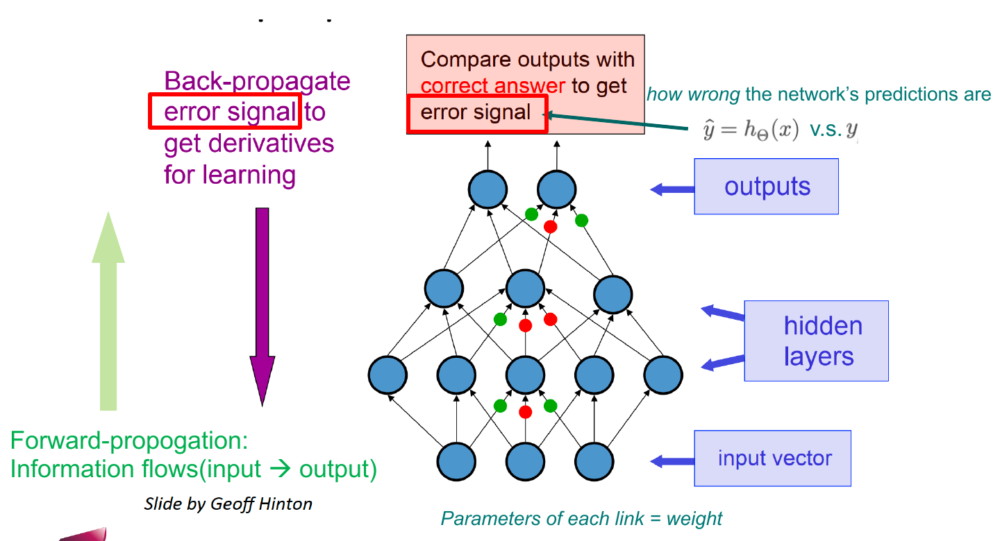

按图从底部输入沿绿箭头到顶部输出，再把预测与真实标签比较，沿紫箭头往回算各边权重的导数。倒着传的是损失对中间量的变化率，更新参数是接下来的独立动作。

先理解斜率：若把某个权重加一个很小的量，损失会改变多少？损失改变量除以权重改变量，就是局部变化率的近似；步长足够小时，对应导数。偏导数（Partial derivative）指只改一个参数，先固定其他参数；梯度（Gradient）把所有参数的这些变化率排成向量。

反向传播（Backpropagation）利用链式法则高效计算这些导数：若参数先改变中间量，中间量再改变损失，总变化率把沿路各段的局部变化率相乘。多条路径通向同一个参数时，把各条路径贡献相加；它是算梯度的方法，梯度下降才是用梯度更新参数的方法。

#### p.39 · Gradient Descent · 多参数时怎么办

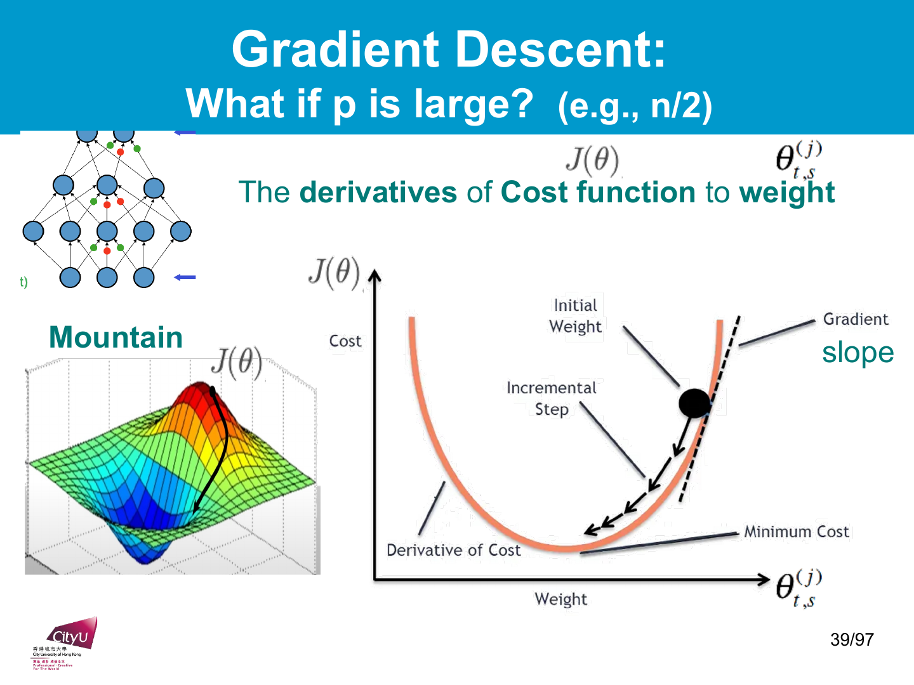

左下山地把高度画成成本，右侧一维切片的横轴是一项权重，纵轴是 $J$。黑点切线斜率为正，沿负梯度向左迈小步可下降。多参数时把每一项的偏导合成梯度。

p.39 原问：“What if p is large? (e.g., n/2)”。中文：参数很多时怎么办？原页没有充分解释 p、n 的具体统计对象，保留其问法，不假装这两个字母已经定义。就当前训练任务，实际回应是高效计算所有参数梯度，再迭代更新。

英文参考答案（p.39 原问与 p.42 演示任务）：“With many parameters, compute the gradient efficiently by backpropagation and update all parameters using gradient descent. Backpropagation applies the chain rule through the network; the learning rate controls each update. A stationary point is not necessarily a global minimum.”

#### p.40 · Gradient Descent · 反复更新

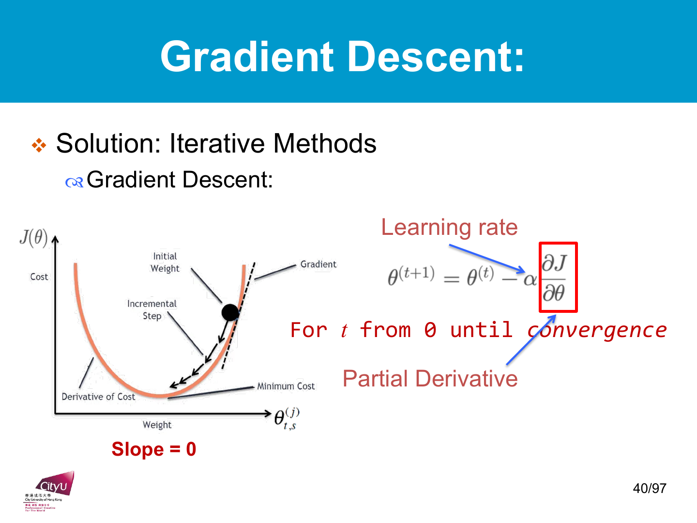

对照红框偏导和蓝箭头标的学习率 $\alpha$。用当前位置算梯度，各参数同步减去自己的学习率倍梯度，再用新位置重算。图里的碗形谷底斜率为零，实际优化还需要停止条件。

梯度下降（Gradient descent）沿使损失局部下降的反方向更新：

$$
w^{\mathrm{new}}=w^{\mathrm{old}}-\eta\frac{\partial J}{\partial w}.
$$

$\eta>0$ 是学习率（Learning rate），决定一次走多远。导数为正，就减小权重；导数为负，减负数即增大。p.39 的山地／切线图只帮理解局部方向，网络损失未必是简单凸碗。

从图中的初始化进入，每轮先预测、再算损失、再反推梯度，最后更新。判断出口包括验证表现、梯度变化和迭代上限；不是永远循环。

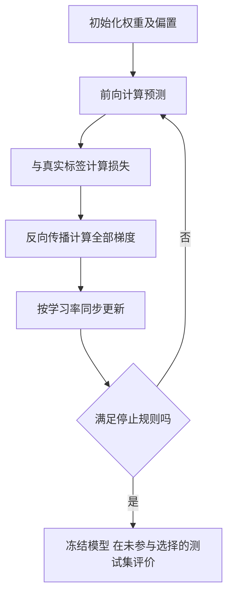

**笔记补充 · 完整手算一次反向传播和同步更新**

💡 同一输入的完整补充例：一个隐藏单元，输入 $x=2$，隐藏分数 $z=wx+b$，激活 $h=\max(0,z)$，输出 $\widehat y=vh+c$。

给定 $w=1,b=0,v=3,c=0$，真实目标为 4，先得到 $z=2,h=2,\widehat y=6$。

本例用平方损失 $L=(\widehat y-4)^2/2=2$，是回归演示，不冒称 p.37 的交叉熵。


先补最关键的一步：令当前输出为 $q$，目标为 $y$，平方损失为 $(q-y)^2/2$。

若输出多一个很小的量 $\delta$，损失改变量为 $(q-y)\delta+\delta^2/2$；除以 $\delta$ 得到 $(q-y)+\delta/2$。

当 $\delta$ 越来越小，局部变化率趋向 $q-y$，所以本例损失对输出的导数才是 2。

换损失函数必须重算这一步。


从损失往回跟四步。输出多一点时，损失按当前误差 2 的比例变化。隐藏输出多一点时，模型输出按 $v=3$ 的比例变化，因为 $q=vh+c$。此时 ReLU 位于正侧，分数变化原样传到隐藏输出，比例是 1。最后，输入为 2，所以权重多一点使分数多两倍。四段相乘是 $2\times3\times1\times2=12$，即 $w$ 的梯度。

要算输出权重 $v$，只走两步：损失对输出的变化率为 2，输出对 $v$ 的变化率为 $h=2$，所以梯度是 4。若隐藏分数改为负，ReLU 把该处变化挡住，$w$ 和 $b$ 的数据梯度都为 0。输出偏置仍直接改变预测，因此仍可能有梯度。

| 参数 | 本步梯度 | 学习率 0.01 的同步更新 |
|---|---:|---:|
| $w$ | 12 | 0.88 |
| $b$ | 6 | −0.06 |
| $v$ | 4 | 2.96 |
| $c$ | 2 | −0.02 |

偏置直接以加法进入对应分数，局部变化率为 1。因此 $b$ 的梯度为隐藏侧误差信号 6 乘 1，$c$ 的梯度为输出误差 2 乘 1。

全部梯度都用**更新前**参数算，再一起更新；不能先改 $v$，又用新 $v$ 算同一步的 $w$ 梯度。更新后 $z=0.88\times2-0.06=1.70$，新输出为 $2.96\times1.70-0.02=5.012$，新损失约 0.5121，确实低于原来 2。

#### p.41 · Gradient Descent: Learning Rate

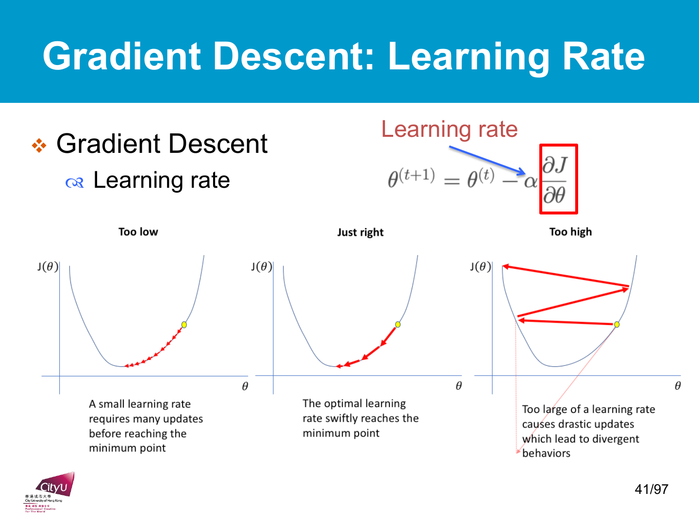

三幅图从同样的起点出发。小学习率的红步密而短，适中的步子较快接近谷底，过大的步子来回跨谷且可能越跨越远。这里的横轴是参数，纵轴是损失。

#### p.42 · Gradient computation given cost function

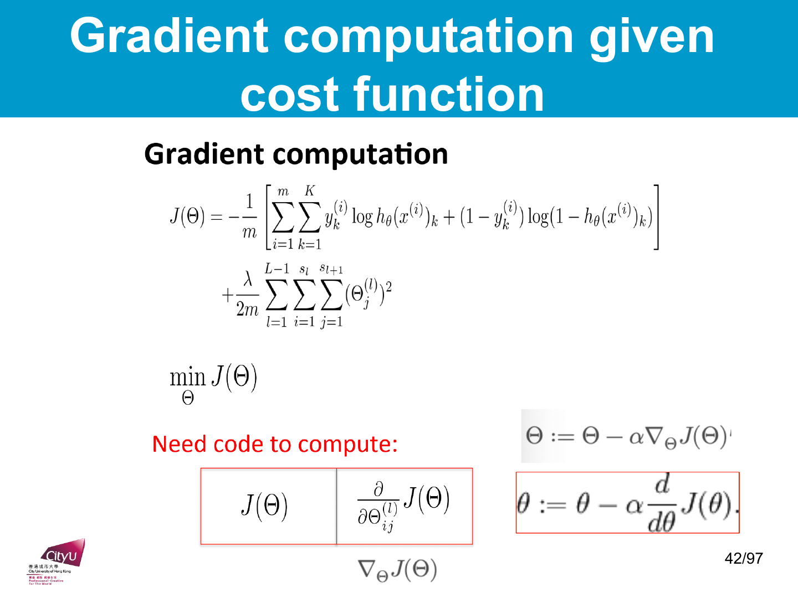

左侧红框列实现需要得到的两个量，目标 $J$ 和各参数的梯度，右侧红框把梯度用于更新。先算同一组旧参数下的所有导数，再统一更新，避免前一项新权重混入后一项的计算。

**笔记补充 · 用 Sigmoid 和带正则的二元交叉熵跑一次更新**

前面的平方损失是为看清链条而补的回归例；现在用本讲给定的分类目标做同一件事。单条记录的目标 $y$ 为 0／1，分数 $z=wx+b$，预测概率 $p=\sigma(z)$。

对数的局部变化规则是 $d\log p/dp=1/p$。据此，二元损失对概率的变化率为：

$$
\frac{\partial L}{\partial p}=-\frac y p+\frac{1-y}{1-p}.
$$

再乘上一节 Sigmoid 的局部斜率，化简得到分数侧的误差信号：

$$
\frac{\partial L}{\partial z}=\left(-\frac y p+\frac{1-y}{1-p}\right)p(1-p)=p-y.
$$

若 $y=1,p=0.8$，损失对概率的变化率是 −1.25，激活局部斜率为 0.16，乘积为 −0.2。负号说明提高分数能在局部降低该条损失；不能把回归例的“输出减目标”无条件套到任意输出函数。

单条输入取 $x=2,w=0.5,b=\log4-1$，使分数为 $\log4$、概率为 0.8。取正则权重 $\lambda=0.1$、样本数 $m=1$，权重梯度为 $(-0.2)\times2+0.1\times0.5=-0.35$；偏置不加这项平方惩罚，所以梯度为 −0.2。

下面代码对应 p.42 所需的“目标→梯度→更新”计算，是笔记补充，可直接运行，没有重训大图片网络。

```python
import math
x, y, w = 2.0, 1.0, 0.5
b = math.log(4) - w * x
lam, eta = 0.1, 0.01
p = 1 / (1 + math.exp(-(w * x + b)))
data_loss = -y * math.log(p) - (1 - y) * math.log1p(-p)
loss = data_loss + lam * w * w / 2
dw = (p - y) * x + lam * w
db = p - y
w_new, b_new = w - eta * dw, b - eta * db
print(loss, dw, db, w_new, b_new)
```

输出依次为当前总损失、权重梯度、偏置梯度和同步更新后的两个参数。此例约为 0.235644、−0.35、−0.20、0.5035、0.388294。

试把标签改成 0，预测仍是 0.8。数据损失改为 $-\log(1-0.8)\approx1.609438$，带正则的总损失约 1.621938，两个梯度变为 1.65 和 0.8。代码中的 log1p(-p) 计算 $\log(1-p)$。课件的目标对 $K$ 个独立输出求和，本例演示其中一个输出的计算。`lam` 控制正则惩罚，`eta` 控制更新步长，是不同设置。对多记录先汇总／平均各记录梯度，多层权重再沿计算图传回；正则梯度只加到相应受惩罚权重。

英文参考说明：“For sigmoid and binary cross-entropy, the score-level gradient is p−y. Multiply it by each input to obtain the data contribution to a weight gradient, then add the applicable regularization gradient. Biases are updated from their own paths without the same weight penalty.”

#### p.43 · Overfitting of NN

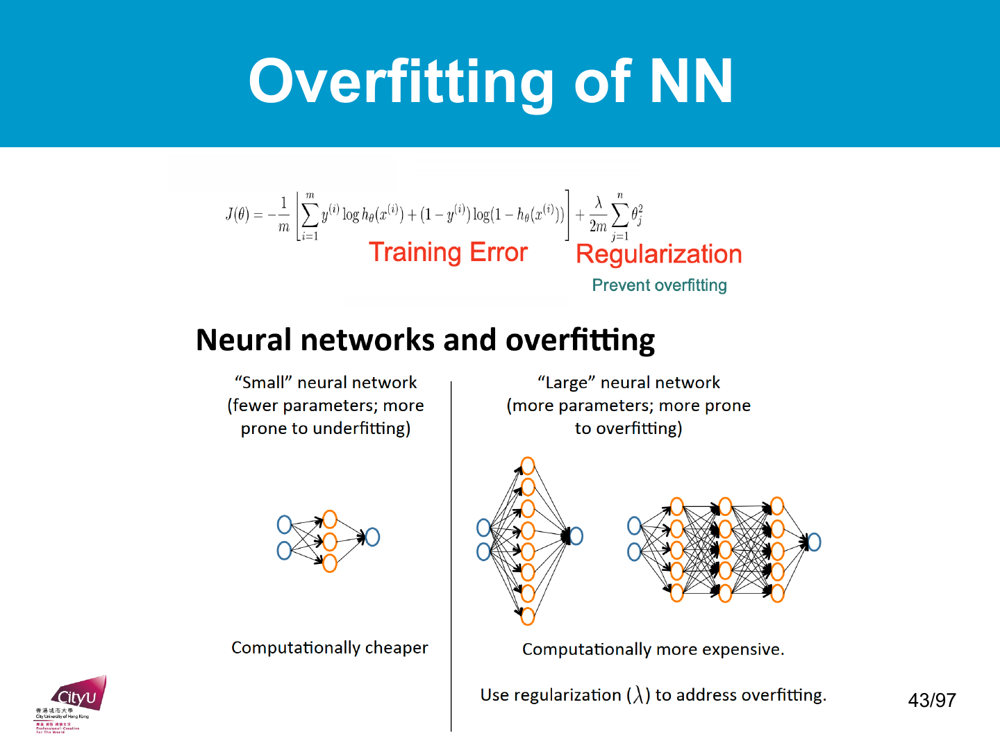

从左图数较少的隐藏单元和连线，再看右侧两种扩充：第一种把一层加宽，第二种叠更多层。连线和参数通常随之增加，也增加计算量。小模型可能连训练规律都拟合不足，称欠拟合（Underfitting）；大模型能表示更复杂的关系，也可能把训练噪声学进去，称过拟合（Overfitting）。图中说的是风险，没有说模型大小能单独决定结果。

对照上方两个红色标签：左侧 Training Error 衡量预测与标签的差异；右侧 Regularization 还要付权重平方的代价。若两组参数的训练误差一样而后一组权重平方和更大，$\lambda>0$ 时后一组的总成本更高。是否需要更宽／更深、选多大的 $\lambda$，都用验证数据比较，最终测试不参与选择。

#### p.44 · Local Optimal Parameters

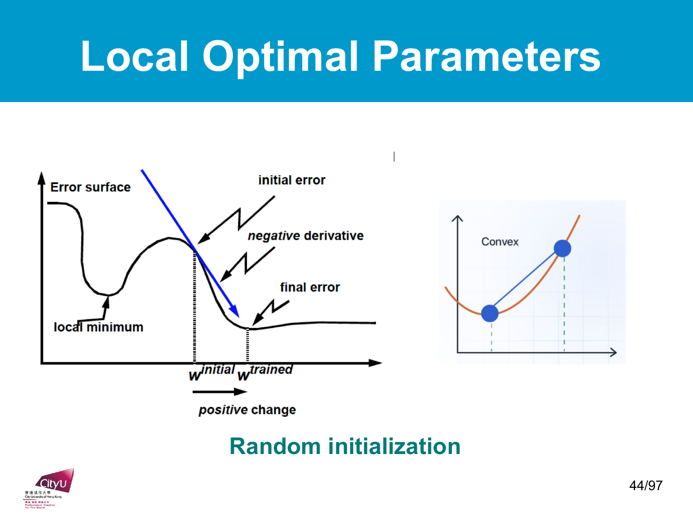

左图横轴是权重 $w$、纵轴是误差。先找 $w^{\mathrm{initial}}$ 的虚线：该点的切线往右下，斜率为负。按 p.40 的更新式，从 $w$ 减去正学习率乘负斜率，$w$ 就向右增大，蓝箭头趋向 $w^{\mathrm{trained}}$。左侧还有一个谷底；若从另一个斜坡出发，下降可能走进另一个谷底，所以图底写 Random initialization。

右图蓝色线段连接橙色凸曲线上的两个蓝点；中间橙线落在线段下方，示意凸形与左边多谷地形不同。训练停在低点附近并不证明找到了全局最低值，零斜率也可能出现在鞍点或平坦处。

### 2.8 图像分类（讲义 p.45–49）

#### p.45 · Example · 服饰类别

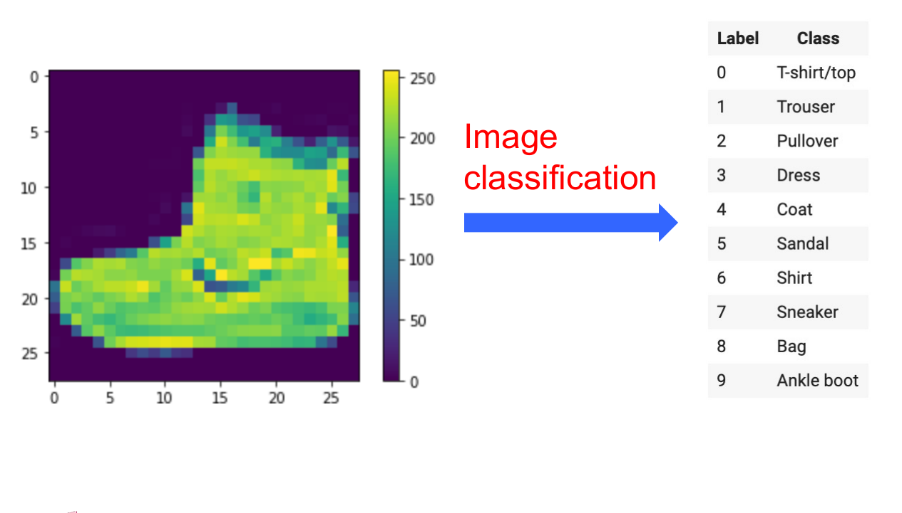

左边色条是像素强度，颜色用来显示灰度数值。右表定义 0–9：T-shirt/top、Trouser、Pullover、Dress、Coat、Sandal、Shirt、Sneaker、Bag、Ankle boot。图像分类输出一个类别编号，再查表读类别。

#### p.46 · Example · 像素怎样进入模型

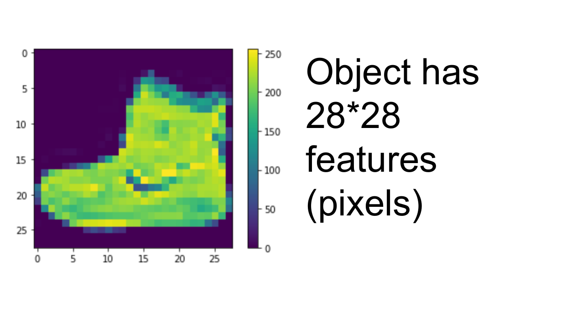

图沿行、列各取 28 个位置，每个灰度像素取一个数。按固定次序逐行连接可得到 $28\times28=784$ 维输入，训练与测试必须使用同一顺序。

#### p.47 · Example · 训练集合

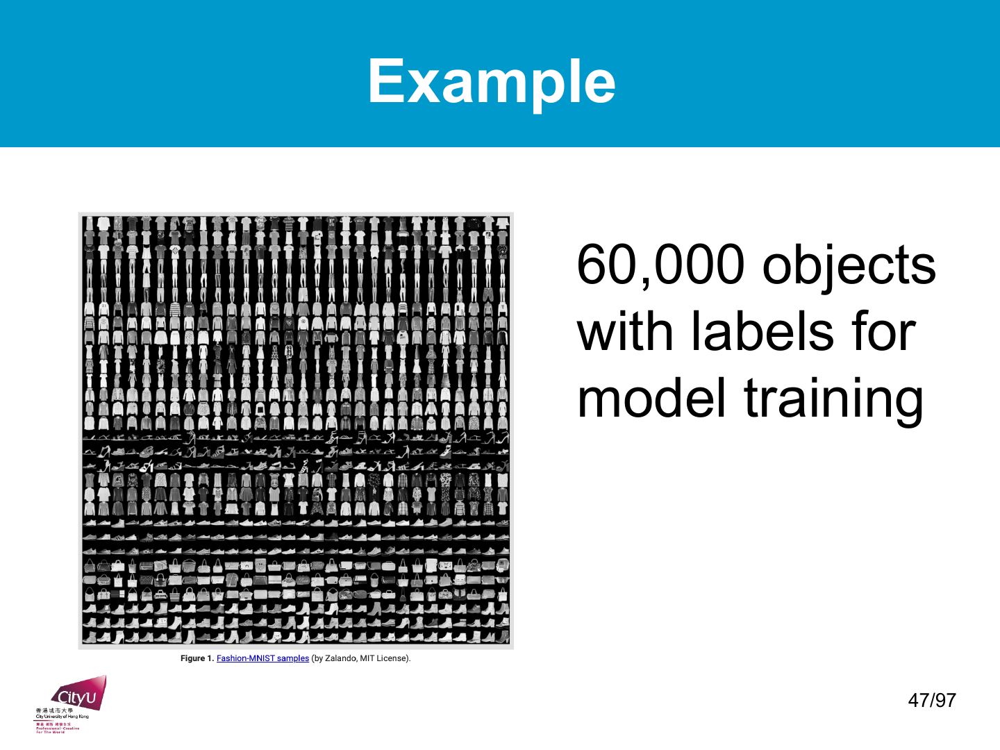

左侧拼图展示服饰样本的差异，右侧给出训练用的 60,000 张带标签图片。单张输入仍是 784 维，60,000 是记录数。

#### p.48 · Example · 识别五项设定

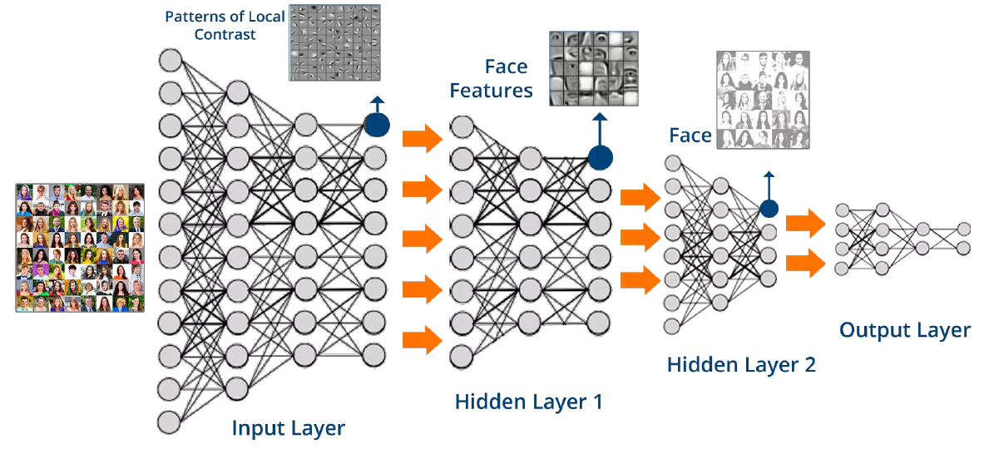

原图橙箭头从人脸输入经过两段有标签的隐藏表示到输出。这与 p.45 的服饰输入是不同示意。能从图认出的阶段和能供代码复现的架构信息要分开。

原题：“Identify the following parameters: Input layer dimension (for features input); Number of hidden layers; Number of nodes in hidden layers; Activation function; Loss function (objective function).”

中文是逐一识别输入维度、隐藏层数、每层单元数、激活和损失。⚪ 参考作答分清可知与不可知：

1. 若承接 p.46 的灰度服饰输入，维度为 $28\times28=784$；若专指 p.48 人脸图，图未给图像尺寸，不能借服饰尺寸代填。
2. p.48 标出了 Hidden Layer 1 和 Hidden Layer 2 两个表示阶段；它不是带明确逐层尺寸的实现规格。
3. 每层实际节点数没有明确数值，不能将示意图的圈数当真实超参数。
4. 该图未给激活；可以提出 ReLU 隐藏层／Softmax 输出的**补充方案**，不能说是图中指定答案。
5. 该图未给损失；互斥服饰类别配 Softmax 可用多类交叉熵，这是条件式方案；p.37 的独立二元损失又是另一种输出口径。

英文参考答案：“For the 28×28 grayscale example, the flattened input dimension is 784. The face diagram labels two hidden representation stages, but it does not specify an implementable unit count, activation or loss. ReLU hidden units and a softmax/categorical-cross-entropy output are a possible design for mutually exclusive classes, not an answer explicitly supplied by that diagram.”

#### p.49 · Example · 用模型给新图片分类

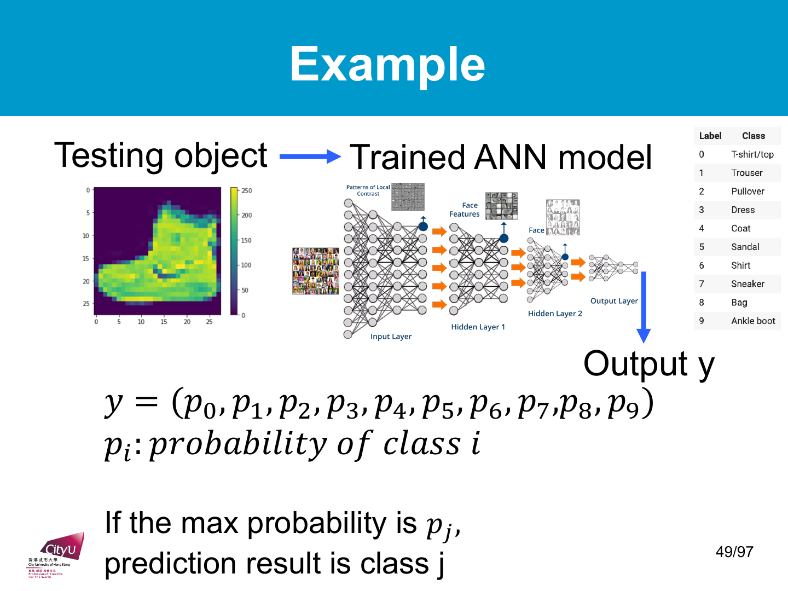

沿蓝箭头从测试图送入已训练 ANN，再到 $p_0,\ldots,p_9$。选择最大概率所在的编号 $j$，用右表译回标签。比如 $p_9$ 最大就输出 Ankle boot，单张选择结果无法说明整体正确率。中间仍沿用 p.48 的人脸示意。

把新图和 [[#p.47 · Example · 训练集合|p.47 的训练集合]]区分。此处只前向计算，训练参数已经冻结。

### 2.9 序列状态与参数共享（讲义 p.50–58）

#### p.50 · IS6400 Business Data Analytics · RNN 与 LSTM

目录此处点亮 RNN、LSTM。先在 p.53–58 跟一条隐藏状态的箭头，再在 p.70–76 跟两条不同的状态通道。

#### p.51 · FFNN

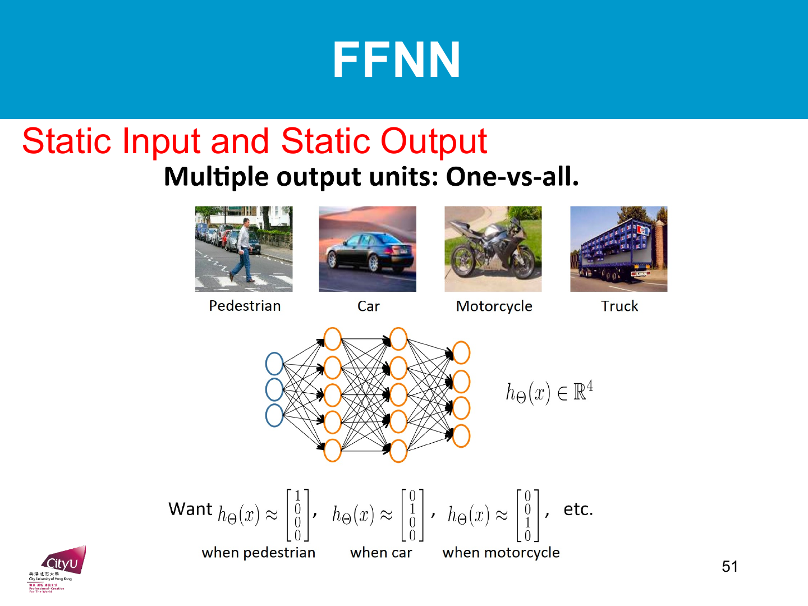

复用 p.21 的四类网络。新增红字 Static Input and Static Output，强调一张图对应一组分类分数，没有前一时点的状态输入。下一页把输入改成有顺序的资料。

#### p.52 · NN for Sequence Analysis

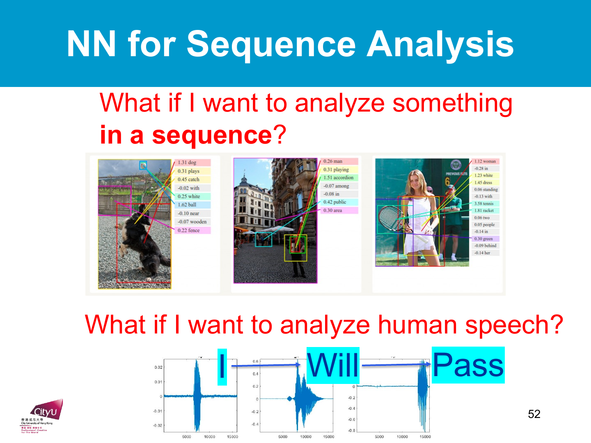

上方图示从图片中的物件生成描述词。下方按时间排出 “I Will Pass” 三段语音波形。

1. ⚪ 原问 “What if I want to analyze something in a sequence?” 中文题意：输入前后顺序有意义时，怎样让当前一步利用之前的信息？依序读入每项，把到目前为止的摘要作为隐藏状态传给下一步。英文参考：“Keep the inputs in order and pass a state from each step to the next.”
2. ⚪ 原问 “What if I want to analyze human speech?” 中文题意：怎样保留语音的时间信息？将音频切成依时间排列的小帧，让当前帧的判断参考前面帧留下的状态。英文参考：“For speech, process successive audio frames so the model can use earlier context when interpreting the current frame.”

#### p.53 · Recurrent Neural Networks


红方块表示循环神经网络（Recurrent Neural Network, RNN）的一次计算。左侧 $x_t$ 是当前输入，右侧 $y_t$ 是本步输出，下面的虚线标 One-step delay，表示本步的隐藏状态（Hidden state）$h_t$ 要到下一步才作为旧状态进入。

#### p.54 · Unrolling RNNs · 展开三个时点


右边按从上到下展开。第一框收到 $x_0$，把 $h_0$ 沿绿色线传给处理 $x_1$ 的框，再传 $h_1$ 给 $x_2$。时间展开形成有向无环图（Directed Acyclic Graph，DAG），计算边没有返回早先时点，损失梯度可在训练时沿图回传。

#### p.55 · Unrolling RNNs · 参数共享


右图横着展开时间，每个红框都执行同一个带共享参数的函数 $f_W$。首框写成 $f_W(x_0,1)$，这里的 1 是示意初始旧状态，输入是 $x_0$。

次框把 $x_1$ 与上一框输出的状态 $h_0$ 一起读入。实际模型须定义自己的初始状态，例如 p.58 的补充例从 $x_1$ 开始，把初始状态记为 $h_0=0$。处理更多时点会增加运算次数，共享参数数目无需随之增加。

#### p.56 · RNN


从底部粉色 $x$ 沿黑箭头进入绿色 RNN 框，右侧弯箭头把这一步生成的隐藏状态 $h$ 带到下一步，顶部箭头接输出端。课件把蓝色 $y$ 标成 Target（目标）；训练时应另分模型算出的预测和真实目标，再比较两者。弯箭头传的是模型的状态，不是把真实目标当下一步输入。

#### p.57 · RNN for Time Series


四色框可直接按 $h_t=f_W(h_{t-1},x_t)$ 读。蓝框是新状态，紫框是带参数 $W$ 的函数，绿框是上一状态，红框是当前观测。这一页把旧状态写在前、当前输入写在后。p.55 的图框则把当前输入写在前。按各自图的角色读，旧状态和当前输入仍是同两类量。

#### p.58 · (Vanilla) RNN for Time Series


原图把上一页的 $f_W$ 展开。用 $W_{hh}$ 处理旧状态、用 $W_{xh}$ 处理新输入，两项相加再做 tanh。

随后 $W_{hy}$ 把隐藏状态变成输出分数。原图把这条输出标为 $y_t$，本篇把它记为 $z_t$，以便与训练时的真实标签区分。

$$
h_t=\tanh(W_{hh}h_{t-1}+W_{xh}x_t+b_h),\qquad
z_t=W_{hy}h_t+b_y.
$$

$x_t$ 是本步输入，$h_{t-1}$ 是上一步摘要，$h_t$ 是更新后的摘要。

$W_{xh}$ 把输入变成状态贡献，$W_{hh}$ 把旧状态变成本步贡献，$W_{hy}$ 把状态变成输出分数。

p.58 的简式省略偏置，本篇补充列出一般形式，并不改变其旧状态＋当前输入的机制。

**笔记补充 · 三个时点用同一参数算状态**

按时间展开图，每个框重复使用同一组权重。箭头传状态，不传“已经知道的未来答案”。


💡 标量补充例：初始 $h_0=0$，每步按 $h_t=\tanh(0.5h_{t-1}+0.2x_t)$，输入为 1、0、1。三步依次得到约 0.1974、0.0984、0.2442。第二步虽输入为 0，仍保留上一状态的影响；把每步状态重置 0 就失去了这种记忆。真实多维状态只是把这套乘加同时在多行进行。

### 2.10 hello 的输入、状态和输出（讲义 p.59–61）

#### p.59 · Example · hello 独热输入


词表按 h、e、l、o 排列，右下四列每列只有一个 1。读到 h 就点亮第一格，读到 e 就点亮第二格。左下补全 “morni” 的小图说明可以利用已输入字符预测后续字符。

词表顺序是 `[h,e,l,o]`，所以 h 编为 $(1,0,0,0)^\top$，e 编为 $(0,1,0,0)^\top$，l、o 类推。这里的 1 是类别位置，不表示字母大小。

图输入 h、e、l、l，用来预测下一字符 e、l、l、o。第 60 页隐藏向量有 3 个分量，输入有 4 个，故无偏置简式中 $W_{xh}$ 为 3×4、$W_{hh}$ 为 3×3，输出 $W_{hy}$ 为 4×3。相同字母 l 读入两次，旧状态不同，所得新状态可不同。

#### p.60 · Example · hello 隐藏状态


粉色输入列沿红箭头乘 $W_{xh}$，上一绿色隐藏列沿横箭头乘 $W_{hh}$，相加再做 tanh 后得到本列绿色状态。末两列都读 l，状态不同，因为它们的旧状态不同。图中数字是给定的舍入展示。

先将输入、下一个目标与给定状态对齐；状态分量均为来源的舍入值。

| 步 | 输入→目标 | 给定隐藏状态 |
|---|---|---|
| 1 | h→e | (0.3, −0.1, 0.9) |
| 2 | e→l | (1.0, 0.3, 0.1) |
| 3 | l→l | (0.1, −0.5, −0.3) |
| 4 | l→o | (−0.3, 0.9, 0.7) |

#### p.61 · Example · hello 输出分数


这一页新增蓝色四维输出。每列由同列绿色隐藏状态乘共享 $W_{hy}$ 得到；按 h、e、l、o 查四行。原图公式里的 $y_t$ 是网络算出的四项分数，对应本篇的 $z_t$。绿色字表示目标字符所在位置，例如第一列目标是 e 的 2.2，最高分却是 o 的 4.1。

p.61 第一步输出为 $(1.0,2.2,-3.0,4.1)$，含负数且和不为 1，所以是分数（Logits），不能直接叫概率。目标字符 e 对应第二个位置 2.2，但本步最高分是 o 的 4.1，说明这个示例状态还不是全部预测正确的模型。训练要提高真实下一字符的相对得分。

若需要概率，可把四个分数送入 Softmax，仍按同一词表顺序解释；不能只因目标字符在图中绿色就把它说成当前最大输出。课件这组图未给出完整权重和训练过程。

下表每行按词表 h/e/l/o 给分数，最后一列按最大分数选类。

| 步 | 四个给定输出分数 | 最大分数的类别 | 与目标是否一致 |
|---|---|---|---|
| 1 | (1.0, 2.2, −3.0, 4.1) | o | 否，目标 e |
| 2 | (0.5, 0.3, −1.0, 1.2) | o | 否，目标 l |
| 3 | (0.1, 0.5, 1.9, −1.1) | l | 是 |
| 4 | (0.2, −1.5, −0.1, 2.2) | o | 是 |

例如第二步仍是 o 得分最高，不能把绿色的目标 l 误读成当前胜出类。完整权重未知，因此这是保留并解释给定演示，不是从权重重算了来源四步。

### 2.11 五种序列输入输出结构（讲义 p.62–65）

#### p.62 · Recurrent Networks Offer Flexibility · 一对多


从左到右数粉色输入、绿色计算框和蓝色输出。第二组只输入一张图，沿绿色状态链连续输出多个词。第四组的第一根蓝箭头在第三个粉色输入所在的时点出现，后两根蓝箭头上升时底下已没有新粉色输入；第五组则从第一步起，每个粉色输入都有对应的蓝色输出。两组都叫多对多，差别在于输入与输出何时对齐。

先数输入和输出的步数，再选择结构；一张图和一句话都可视作一次或多次输入，取决于任务表示。

| 配对 | 任务例 | 时间含义 |
|---|---|---|
| 一对一 | 静态图片分类 | 一项输入得一项标签 |
| 一对多 | 图片描述 | 图片后连续产生词 |
| 多对一 | 句子情感分类 | 读完整段再输出情感 |
| 多对多、不同长度 | 机器翻译 | 输入和输出词数可不同 |
| 多对多、逐步对齐 | 视频逐帧动作识别 | 每个时间步有输出 |

#### p.63 · Recurrent Networks Offer Flexibility · 多对一


同一套五种结构本页新增指向第三组的箭头。情感分类先读多个词，最后一个绿色框才向上发出唯一的情感标签。例如要读完整句子才知道转折后表达的态度。

#### p.64 · Recurrent Networks Offer Flexibility · 翻译


本页箭头改指第四组。前三个绿色框依序读三个粉色输入；第一个蓝色输出从第三个框向上送出，之后右边还有两个生成步骤但不再读新的粉色输入。这个结构示意先积累源语信息再生成译文，首个输出在图上和最后一个输入同列。原例 “Professor Liu’s IS6400 course is so popular, it’s hard to get a seat.” 译成中文后，词数无需与英语一致。

#### p.65 · Recurrent Networks Offer Flexibility · 逐帧识别


右图三张画面分别沿橙箭头进入当前时点，再沿蓝箭头给 Angry、Refuse、Satisfied 等示意标签。绿色状态可参考上一帧，标签仍按当前帧的位置输出。

标签只用于读结构图，单帧表情未必能说明人的内心状态。

### 2.12 LSTM 的细胞状态与门控（讲义 p.66–76）

#### p.66 · Problems of RNN


右下红线是激活，蓝线是其导数。蓝线接近零时，训练误差信号每反传一段就可能缩小。十段若各乘 0.5，结果只剩 $0.5^{10}\approx0.000977$，称梯度消失（Vanishing gradient）。远处线索虽能经状态传递，训练仍可能难以学到该依赖。

如果反向链上的乘数持续大于 1，信号也可能变得过大，称梯度爆炸（Exploding gradient）。

#### p.67 · LSTM 图例


黄色矩形是网络层，粉色圆形是逐元素运算，直箭头传向量，两线并成一线表示拼接，分叉是复制。底部粉色乘号把门值与同位置分量相乘。例如门值 0.2 让该分量只保留 20%。

#### p.68 · RNN Model


中间绿色框内只有一个 tanh 变换层。下方 $x_t$ 与左侧旧状态进入，结果一份向上成为 $h_t$，一份向右成为下一框的旧状态。左上坐标图显示 tanh 的输出受限。

#### p.69 · LSTM Model


从左到右是 $t-1,t,t+1$ 三个时点的同一种绿色模块；这页只把中间时点的内部画深。蓝圈 $x_t$ 是本步输入，紫圈 $h_t$ 是本步生成的隐藏状态。

模块之间的上横线传细胞状态 $C$，下横线传隐藏状态 $h$。本步的 $x_t$ 和左侧来的 $h_{t-1}$ 在下方汇合，供四个黄色框使用。

先沿上横线读记忆更新。最左黄色 $\sigma$ 给遗忘门 $f_t$，向上接到第一个粉色乘号，让旧细胞状态 $C_{t-1}$ 保留一部分。

中间黄色 $\sigma$ 给写入门 $i_t$，黄色 tanh 给候选内容 $\widetilde C_t$；这两条支路先在下方的粉色乘号相乘，再到上方的加号，与保留的旧内容相加。加号右边的 $C_t$ 沿上横线送到下一时点。

再从加号右边沿分支向下走：粉色 tanh 把新状态 $C_t$ 变成可供输出的数，右侧黄色 $\sigma$ 给输出门 $o_t$。两路在最右的粉色乘号相乘，得到 $h_t$；同一个 $h_t$ 向上到紫圈，也沿下横线送往下一时点。黄色 tanh 产生待写入的候选，粉色 tanh 处理已经更新的状态，两者输入不同。

$$
C_t=f_t\odot C_{t-1}+i_t\odot\widetilde C_t,\qquad
h_t=o_t\odot\tanh(C_t).
$$

$\odot$ 表示同一位置的数相乘；例如第一个门值只乘对应的第一项记忆。接下来的 p.70–75 会逐条高亮这些路径。LSTM 的标准全名是长短期记忆（Long Short-Term Memory），课件印成 “Long Term Short Term Memory”。

#### p.70 · LSTM 两条跨时点状态线


上部全图有上下两条横线。上面传细胞状态（Cell state）$C$，下面传隐藏状态 $h$。下部深色高亮只追踪 $C_{t-1}$ 到 $C_t$；这条线经一次乘和一次加，因此既能保留旧内容也能写入新内容。

#### p.71 · LSTM Cell State


从左端的 $C_{t-1}$ 走过粉色 × 和 +。× 控制旧内容留下多少，+ 加上已筛选的新内容。右下小图将 Sigmoid 框连到乘号，解释门值如何成为保留比例。

#### p.72 · LSTM Walk-through · 遗忘门


先追左下两根黑线：横着进来的是上一时点的隐藏状态 $h_{t-1}$，竖着进来的是当前输入 $x_t$。把它们排在一起送进第一个黄色 $\sigma$ 框，得到遗忘门（Forget gate）$f_t$：

$$
f_t=\sigma(W_f[h_{t-1},x_t]+b_f).
$$

$W_f$ 决定两种输入如何影响每个门值，$b_f$ 加上偏移，$\sigma$（Sigmoid）把分数变成 0 到 1 之间的保留比例。再沿 $f_t$ 的黑色竖线向上，到顶部第一个乘号；乘号横向收到的是旧细胞状态 $C_{t-1}$。旧记忆本身没有进黄色框，它是在乘号这里才按比例留下。

💡 单独的小例：若顶部旧值是 2、这项门值是 0.25，乘号右边只留下 $2\times0.25=0.5$。课件红字用 1 和 0 示意完全保留和完全丢弃的两端。这里的 0.5 只是留下的旧记忆，还没走到 p.74 的加号；新内容如何算，先看 p.73。

#### p.73 · LSTM Walk-through · 新记忆


黑线分到两个黄色框，Sigmoid 给写入比例 $i_t$，tanh 给候选内容 $\widetilde C_t$。计算分别为 $i_t=\sigma(W_i[h_{t-1},x_t]+b_i)$、$\widetilde C_t=\tanh(W_C[h_{t-1},x_t]+b_C)$。两条支路读取同一份拼接输入，参数各自训练。跟两条线的末端：输入门只说写入多少，候选框才提出要写的值，候选也可以是负数。下一页两者在下方乘号处相乘；到本页高亮路径末尾，还没有写进顶部细胞状态。

#### p.74 · LSTM Walk-through · 更新细胞状态


原图上方黑线先把旧 $C_{t-1}$ 乘 $f_t$，下方把候选乘 $i_t$，再在粉色 + 汇合。图中的星号在这里表示逐元素乘法，所以 $C_t=f_t\odot C_{t-1}+i_t\odot\widetilde C_t$。例如旧值 2、保留 0.8，候选 0.4、写入 0.25，得到 $C_t=1.6+0.1=1.7$。

#### p.75 · LSTM Walk-through · 输出隐藏状态


此页高亮右侧黑线。新 $C_t$ 先经 tanh，再乘右侧 Sigmoid 框算出的 $o_t$，所以 $o_t=\sigma(W_o[h_{t-1},x_t]+b_o)$，$h_t=o_t\odot\tanh(C_t)$。

沿用 p.74 的 $C_t=1.7$，若 $o_t=0.5$，得到 $h_t\approx0.4677$。这条路径读取细胞值来生成隐藏输出，细胞状态仍沿上方传递。

#### p.76 · LSTM 四步对照


左边从上到下对应保留比例、写入比例与候选、更新细胞、输出隐藏。右上完整图把四张高亮拼回同一个时点。按这四步算完才进入下一时点，下一时点会由新输入与旧隐藏重新计算各门。

$[h,x]$ 是拼接，$W$ 和 $b$ 是训练出的不同门参数，$f,i,o$ 是每一步动态算出的门值，不能把门值当恒定超参数。$C$ 可以超出 −1 到 1，输出前的 tanh 再压缩它。

下面按从上到下读，旧细胞记忆经保留分支，新候选经写入分支，两条在更新处汇合。


若把遗忘门改成 0，同一例新 $C$ 只剩 0.1；改成 1 则旧值完整保留。

沿原图上方的细胞状态线看梯度怎样传回去。暂时固定本步的门值和候选内容，如果旧细胞状态的某一项多一点，新状态在这条直接路径上只增加这点变化的 $f_t$ 倍。它不必每步穿过 tanh。

若十步的遗忘门都取 0.97，直通比例约 0.737，若都取 0.5，只剩约 0.000977。实际还有经隐藏状态影响门和候选的其他梯度路径。p.68 的普通 RNN 单层重复模块与 p.69–76 的四交互模块差异，正是这个状态控制结构。

**笔记补充 · 用同一套门参数算两个时点**

为把“当前输入改变，门会怎样改变”算完整，采用一个标量隐藏状态与一个标量细胞状态。初始旧隐藏为 0.1、旧细胞为 0.2，当前输入为 0.5；所有偏置取 0。下表每对权重按“旧隐藏、当前输入”的顺序，沿本节公式做乘加。

| 分支 | 权重对 | 第一步代入的分数 | 激活后结果 |
|---|---|---|---:|
| 遗忘门 | (0.5, 0.4) | 0.5×0.1+0.4×0.5=0.25 | 0.562177 |
| 输入门 | (−0.3, 0.2) | −0.3×0.1+0.2×0.5=0.07 | 0.517493 |
| 候选记忆 | (0.2, 0.6) | 0.2×0.1+0.6×0.5=0.32 | 0.309507 |
| 输出门 | (0.1, −0.2) | 0.1×0.1−0.2×0.5=−0.09 | 0.477515 |

门分支接 Sigmoid，候选分支接 tanh。用未舍入值计算，新的细胞状态约为 $0.562177\times0.2+0.517493\times0.309507=0.272603$；新隐藏约为 $0.477515\tanh(0.272603)=0.127041$。

下一步把输入改为 −0.5，仍用同一权重；旧隐藏现在是 0.127041、旧细胞是 0.272603。重新计算得到遗忘门约 0.465933、输入门约 0.465527、候选约 −0.267892、输出门约 0.528146，新的细胞状态约 0.002304、隐藏约 0.001217。不能把第一步的四门原封不动搬到第二步，也不能把隐藏 0.127041 当成细胞记忆。

这组数值是为学习提供的完整补充参数，不是 hello 来源模型的权重。

### 2.13 文本挖掘与文档表示（讲义 p.77–86）

#### p.77 · IS6400 Business Data Analytics · NLP

目录切到 NLP。先从 p.78–89 学怎样从文字得到数值表示，再从 p.90–97 学怎样表示顺序、结构、含义和语境。

#### p.78 · What is Text Mining

文本挖掘（Text mining）从文档、评论等资料里提取结构、主题或能支持分析的信息。比如先把评论变成词项表，再复用分类、聚类或关联分析。

#### p.79 · Examples of Text Mining 1


左图三个颜色对应 Negative、Neutral、Positive。模型从一段词序列得出一个情感标签，和 p.63 的多对一相呼应。右栏以 Stanford 情感分析和 NCSU 推文情感可视化为课程例子。

#### p.80 · Examples of Text Mining 2


读三种量时先找各自的位置：上方 Social Sentiment 饼图是意见类别的占比，例如标注日期上 Strong Buy 为 64%；下图蓝柱按左侧 Stock Chatter 轴表示讨论量，折线按右侧美元轴表示股价，悬浮标注明示当日价格。柱子高不能读成股价高，饼图的 64% 也不是股价上涨概率。若要检验能否预测下一时点，只能用预测当时已经取得的讨论，再用之后的价格验证；这张历史仪表盘本身没给出预测结果。

#### p.81 · Examples of Text Mining 3


从右侧 QA System 选一个问题，回到左侧黄色高亮找定义、症状或比例。比如第三问取文本里的 about 80%，该比例带有原文条件，只作为本页给定文本的抽取结果。

> [!quote]- 讲义 p.81 Text Data 英文原段落全文
>
> > COVID-19 is the infectious disease caused by the most recently discovered coronavirus. This new virus and disease were unknown before the outbreak began in Wuhan, China, in December 2019. The most common symptoms of COVID-19 are fever, tiredness, and dry cough. Some patients may have aches and pains, nasal congestion, runny nose, sore throat or diarrhea. These symptoms are usually mild and begin gradually. Some people become infected but don’t develop any symptoms and don't feel unwell. Most people (about 80%) recover from the disease without needing special treatment. Around 1 out of every 6 people who gets COVID-19 becomes seriously ill and develops difficulty breathing. Older people, and those with underlying medical problems like high blood pressure, heart problems or diabetes, are more likely to develop serious illness. People with fever, cough and difficulty breathing should seek medical attention.

p.81 是从给定旧文本抽答案的演示，原文里的健康描述只作为当时材料，不当成当前医疗建议。原题与给定答案如下：

| 原英文问题 | 中文题意 | 讲义文本给定的英文答案 |
|---|---|---|
| What is COVID-19? | 按该段文本解释它是什么 | the infectious disease caused by the most recently discovered coronavirus |
| What are symptoms of COVID-19? | 按该段文本提取症状 | fever, tiredness, and dry cough |
| How many people recover from COVID? | 按该段文本找比例 | about 80% |

中文解析：第一问定位定义句；第二问定位列出常见症状的句子；第三问定位“Most people (about 80%) recover ...”并保留原文的条件“without needing special treatment”。材料没有当前样本、时间及流行变异株口径，因此不拿 80% 推算现在某群体康复人数。

#### p.82 · Why Text Analytics/Mining?


红饼图把资料按结构化数值／编码信息和非结构化／半结构化信息分为 10% 与 90%。这是课件署名 Oracle 的估计，缺少统计口径或时期。业务动机是从找到整份文档进一步抽取能分析的信息。

#### p.83 · Text Analytics/Mining Methods (1)

信息检索（Information retrieval）先表示文档、建索引再排序，输出相关文档。信息提取（Information extraction）先找实体，再判定实体之间的关系。比如读到 “Lin works at CityU”，先把 Lin 标成人、CityU 标成机构，再输出「Lin → 任职于 → CityU」。本体（Ontology）是预先组织好的对象类型和关系，帮助系统区分「人任职于机构」和其他关系。句法、语义与语境还能帮助确定方向。

#### p.84 · Challenges of Text Analytics

候选词或短语种类多，文档结构各异，转载也可能使记录不独立。“AOL merges with Time-Warner” 与 “Time-Warner is bought by AOL” 用不同句式表述关系，抽取时仍要辨认谁买谁。Apple 可能指公司或水果，Toyota 则是品牌，不能把 automobile、car、vehicle、Toyota 一律互换。

#### p.85 · How to represent a document?


左括号框的是文档行，上方 Terms 是词项列。交叉格是出现次数。比如 Camera 第一篇 3、第二篇 0，Digital 第二篇 4。省略号说明图只展示了部分词项。

p.85 的文档—词项矩阵，每行是一篇文档，每列是一种词，格子为出现次数。原小表保真如下，省略号代表课件没显示的其他词。

| 文档 | Camera | Digital | Memory | Print |
|---|---:|---:|---:|---:|
| Document 1 | 3 | 2 | 0 | 1 |
| Document 2 | 0 | 4 | 0 | 3 |

#### p.86 · Some Basic Information Retrieval Techniques

词干化（Stemming）可将 Taxes 和 taxation 都归到 tax。停用词（Stop words）是按任务决定是否剔除的常见词；情感分析中的 not 不能一概删除。把一起分析的一组文档叫语料库（Corpus）。词项加权会优先考虑本篇常见、在整组文档里较少见的词。

### 2.14 词频与 TF-IDF（讲义 p.87–89）

#### p.87 · Term Frequency (TF)

词频（Term Frequency，TF）把一个词在本文档的出现次数除以本文档总词数，使不同长度文档可比较。若改用筛选后的关键词总次数作分母，分子也须采用相同口径。

$$
\mathrm{TF}(i,j)=\frac{\mathrm{count}(i,j)}{\text{文档}j\text{的总词数}}.
$$

$i$ 是词，$j$ 是文档；次数和总词数必须用同一分词／停用词口径。原 p.85 有未显示词，不能仅把可见四列相加就假装知道文档真实总长度。

#### p.88 · Inverse Document Frequency (IDF)

先数这组语料库中不同文档的总数 $N$，再数包含该词的不同文档数 $df_i$。某篇文档出现十次仍只计一篇。课件第一条用文字把 $df_i$ 说成 IDF，下面的公式才是逆文档频率 $\log(N/df_i)$。

#### p.89 · The Mighty TF-IDF


对照红色乘式和左下原始词频表。先用 TF 与 IDF 的乘积替换对应格子，再将加权后的表示用于右侧分类、聚类、主题模型或回归。左下仍印着 p.85 的原始计数，用作要改造的输入，未给出数值加权结果。

把前两页合起来，对每个词 $i$、每篇文档 $j$，算 $\mathrm{TFIDF}(i,j)=\mathrm{TF}(i,j)\,\mathrm{IDF}(i)$。

💡 完整补充例：语料有 3 篇，词 camera 出现在其中 1 篇；该篇共 4 词、camera 出现 2 次。TF 为 $2/4=0.5$，IDF 为 $\log3\approx1.0986$，乘积约 0.5493。若另一个词三篇都有，则 IDF 为 $\log1=0$，该简式权重为 0。实际软件可能加平滑及归一化，数值不能与本未平滑公式混用。

p.89 把加权矩阵送给聚类、分类、主题模型或回归。它保留词频线索，不保留所有语序；“dog bites man”和“man bites dog”词集合相同，关系却不同。这引出下一节为什么还需要语言结构。

### 2.15 语言的词、结构、意义和语境（讲义 p.90–98）

#### p.90 · What is Natural Language Processing (NLP)?

自然语言处理（Natural Language Processing，NLP）包含语音识别、语言理解与语言生成，分别可把声音变成文字、从文字辨识含义、用语言形成输出。页中漫画是人机语言沟通的历史引子。

课件把图灵 1950 年文章题名简写为 “Machine and Intelligence”，文章题名是 “Computing Machinery and Intelligence”。

#### p.91 · Fundamental Tasks

四项任务依次解决词的切分、词的语法类别、整句结构与含义。用 p.92–95 同一顺序逐项检查，每项的输入与输出均不同。

#### p.92 · Word Segmentation


上图先分段，蓝色标人名 Michael Jordan，黄色标机构 Berkeley，白色为未赋实体标签。下图将「浦东开发与建设」切成「浦东／开发／与／建设」。分词决定边界，实体标签说明分出的范围指哪类对象。

#### p.93 · POS tagging


先读句子下方的四个词性标签，This 和 a 标 DET（限定词），is 标 VERB（动词），sentence 标 NOUN（名词）。弧线额外示意词之间的句法依赖，例如右侧 det 弧连着 sentence 和它前面的 a，表示 a 限定哪个名词；而词下 DET 说的是 a 自身的类别。词性标注（Part-of-speech tagging，POS）可以把每个时点的词映到一个标签，同一个词换句子可能换类别。

#### p.94 · Syntactic Analysis


原例句是 “My dog also likes eating sausage.” 从右侧树顶 S 沿分支走。名词短语 NP 收起 “My dog” 作主语，副词短语 ADVP 给 “also”。动词短语 VP 含 “likes” 及其后的 “eating sausage”。

右图的 VBZ 下漏画 likes，sausage 与页码重叠。My 的标记在左侧括号中是 PRP$，在右侧树中印为 PRP。读这一句时，可依左侧括号结构把 My 对上所有格、把 likes 放回 VBZ 下。

#### p.95 · Semantic Analysis

词汇语义（Lexical semantics）区分 bank 的河岸和银行。组合语义（Compositional semantics）研究这些词怎样构成整体意义。“Colorless green ideas sleep furiously” 结构可解析，日常字面意义却不协调，特定文学语境可另有解释。句法（Syntax）处理结构，语义（Semantics）处理含义。

#### p.96 · Process of NLP


沿左列从词形／词汇处理，经句法、语义到语境解释。右列示范 “the girl the go to the school” 的结构异常和 “colorless blue idea” 的字面语义冲突；“she wanted it” 则要靠前文找 it 指什么。此图是传统任务拆分。

#### p.97 · Some NLP Platforms


从左边聊天渠道向中间 NLP Layer 跟箭头。右上 Knowledge Base 是供查询的内容，右下 Data Storage 是交互历史与分析存储，图上各有双向箭头。左栏 Dialog Flow（ex API.ai）、Wit.ai、Luis、Lex、Watson Assistant 是课件列举的历史工具名。

#### p.98 · IS6400 Business Data Analytics · 结尾

结束页回列 ANN、RNN/LSTM、NLP 三条主线。课后可先看 §3 的任务对照，再用 §7 的自测回到具体源页。

## 3. 一图看懂

本表把三条主线对齐到可执行任务，阅读时先选任务，再回到相应机制图。

| 输入及任务 | 中间表示怎样变化 | 终点 |
|---|---|---|
| 静态图片分类 | 像素→隐藏特征→类别分数 | [[#p.28 · Model Representation · 补偏置再算输出\|前向计算]]、[[#p.49 · Example · 用模型给新图片分类\|服饰分类]] |
| 序列预测 | 本步输入＋旧状态→新状态 | [[#p.58 · (Vanilla) RNN for Time Series\|RNN 状态]]、[[#p.76 · LSTM 四步对照\|LSTM 四步]] |
| 文本分析 | 词项／结构→加权数值／语义 | [[#p.89 · The Mighty TF-IDF\|TF-IDF]]、[[#p.96 · Process of NLP\|NLP 流程]] |

## 4. 速查表

每行是一项容易混淆的操作，不把它们全叫训练。

| 操作 | 做什么 | 不保证什么 |
|---|---|---|
| 前向传播 | 给定参数算输出 | 预测正确 |
| 反向传播 | 给定损失算梯度 | 已更新参数 |
| 梯度下降 | 沿负梯度更新参数 | 全局最优 |
| 正则化 | 改目标、约束权重倾向 | 永不泛化失败 |
| RNN 状态更新 | 传递历史摘要 | 无限期记忆 |
| LSTM 门控 | 选择保留、写入、输出 | 梯度永不消失 |
| TF-IDF | 结合局部词频与跨文档区分力 | 理解完整语序 |

## 5. 双语术语卡

以下定义为笔记自拟的英文答法；正文先教具体操作。

| 中文 | English | 英文参考定义 | 首现 |
|---|---|---|---|
| 激活函数 | Activation function | A function that transforms a neuron's weighted input into its output. | [[#p.10 · Artificial Neuron\|p.10]] |
| 隐藏层 | Hidden layer | An intermediate layer that learns representations between inputs and outputs. | [[#p.16 · Class II: Multi-layer Feed-forward Networks\|p.16]] |
| 反向传播 | Backpropagation | Efficient gradient computation through a network using the chain rule. | [[#p.38 · Back propagation\|p.38]] |
| 学习率 | Learning rate | The scale of a parameter update along the negative gradient. | [[#p.40 · Gradient Descent · 反复更新\|p.40]] |
| 隐藏状态 | Hidden state | A learned representation carrying information from previous sequence steps. | [[#p.53 · Recurrent Neural Networks\|p.53]] |
| 梯度消失 | Vanishing gradient | The shrinking of a training signal through repeated small derivative factors. | [[#p.66 · Problems of RNN\|p.66]] |
| 独热向量 | One-hot vector | A categorical encoding with one active position and zeros elsewhere. | [[#p.21 · A more complex case – multi output\|p.21]] |
| 逆文档频率 | Inverse document frequency | A weight based on how rare a term is across documents. | [[#p.88 · Inverse Document Frequency (IDF)\|p.88]] |
| 句法 | Syntax | The structural organization of words in a sentence. | [[#p.95 · Semantic Analysis\|p.95]] |

## 6. 考点预判与答题框架

🟡 笔记推断：神经元前向、XOR 不可线性分割、反向传播与优化分工、隐藏状态共享、LSTM 门控、TF/df 区别和 NLP 层次。无转录，不能标教授明示。

英文框架：“The model first computes a weighted sum and applies an activation. Training compares the prediction with the target, backpropagates the loss gradient, and updates the parameters. The architecture and evaluation protocol must match the task; low training loss alone does not demonstrate generalization.”

## 7. 自测

### 7.1 多堆几层纯线性变换能解决 XOR 吗

<details><summary>答案</summary><p>不能。线性／仿射变换合并后仍是一次仿射变换，单一阈值仍是线性边界。需要合适的非线性中间表示。</p></details>

回看 [[#p.20 · A complex case · 接成一个网络|p.20 的两隐藏单元]]演示了区域组合。

### 7.2 LSTM 的 f=0、i=0 时发生什么

<details><summary>答案</summary><p>旧细胞值乘 0，新候选也乘 0，新细胞状态为 0；即使上一时点存了很多信息也被门关闭。新隐藏状态还按输出门乘 tanh(0)，因此为 0。</p></details>

回看 [[#p.74 · LSTM Walk-through · 更新细胞状态|p.74 细胞状态]] 和 [[#p.75 · LSTM Walk-through · 输出隐藏状态|p.75 隐藏状态]]。

### 7.3 一个词重复十次，df 就是十吗

<details><summary>答案</summary><p>不一定。df 按包含该词的文档数计，一篇重复十次仍只贡献一篇；TF 才在该篇内部计次数及长度。把两者交换会把“局部常见”和“全局常见”混淆。</p></details>

回看 [[#p.87 · Term Frequency (TF)|p.87 的 TF]] 与 [[#p.88 · Inverse Document Frequency (IDF)|p.88 的 IDF]]。

## 8. 物理页码映射

物理页与页脚数字通常相同。课件有多处页脚写作 “n/97”，PDF 实际含 98 页。下表按 PDF 物理页。

| 物理页 | 课件页标题／定位 | 正文 | 原图或处置 |
|---:|---|---|---|
| 1 | IS6400 Business Data Analytics | [[#p.1 · IS6400 Business Data Analytics\|本页]] | 导览 |
| 2 | What is Deep Learning? | [[#p.2 · What is Deep Learning?\|本页]] | 图 |
| 3 | Artificial Neural Networks | [[#p.3 · Artificial Neural Networks\|本页]] | 图 |
| 4 | What is Deep Learning? | [[#p.4 · What is Deep Learning?\|本页]] | 插图省略 |
| 5 | What is Deep Learning? | [[#p.5 · What is Deep Learning?\|本页]] | 图 |
| 6 | Why Deep Learning? | [[#p.6 · Why Deep Learning?\|本页]] | 图 |
| 7 | Why Deep Learning? | [[#p.7 · Why Deep Learning?\|本页]] | 图 |
| 8 | Why Deep Learning and NN? | [[#p.8 · Why Deep Learning and NN?\|本页]] | 图 |
| 9 | Biological Background | [[#p.9 · Biological Background\|本页]] | 图 |
| 10 | Artificial Neuron | [[#p.10 · Artificial Neuron\|本页]] | 图 |
| 11 | Class I: Perceptron | [[#p.11 · Class I: Perceptron\|本页]] | 图 |
| 12 | Use a trained model | [[#p.12 · Use a trained model\|本页]] | 图 |
| 13 | Perceptron’s Step Function | [[#p.13 · Perceptron’s Step Function\|本页]] | 图 |
| 14 | Perceptron’s Capability · AND | [[#p.14 · Perceptron’s Capability · AND\|本页]] | 图 |
| 15 | Perceptron’s Capability · OR | [[#p.15 · Perceptron’s Capability · OR\|本页]] | 图 |
| 16 | Class II: Multi-layer Feed-forward Networks | [[#p.16 · Class II: Multi-layer Feed-forward Networks\|本页]] | 图 |
| 17 | Universal Approximation Theorem | [[#p.17 · Universal Approximation Theorem\|本页]] | 图 |
| 18 | A complex case · XOR 与 XNOR | [[#p.18 · A complex case · XOR 与 XNOR\|本页]] | 图 |
| 19 | A complex case · 分开算三种逻辑 | [[#p.19 · A complex case · 分开算三种逻辑\|本页]] | 图 |
| 20 | A complex case · 接成一个网络 | [[#p.20 · A complex case · 接成一个网络\|本页]] | 图 |
| 21 | A more complex case – multi output | [[#p.21 · A more complex case – multi output\|本页]] | 图 |
| 22 | Build an Artificial Neural Network | [[#p.22 · Build an Artificial Neural Network\|本页]] | 文字 |
| 23 | ANN Model Representation | [[#p.23 · ANN Model Representation\|本页]] | 图 |
| 24 | Model Representation · 红线是哪条边 | [[#p.24 · Model Representation · 红线是哪条边\|本页]] | 图 |
| 25 | Model Representation · 读输出节点 | [[#p.25 · Model Representation · 读输出节点\|本页]] | 图 |
| 26 | Model Representation · 权重矩阵的尺寸 | [[#p.26 · Model Representation · 权重矩阵的尺寸\|本页]] | 图 |
| 27 | Model Representation · 批量算隐藏层 | [[#p.27 · Model Representation · 批量算隐藏层\|本页]] | 图 |
| 28 | Model Representation · 补偏置再算输出 | [[#p.28 · Model Representation · 补偏置再算输出\|本页]] | 图 |
| 29 | NN with 2 hidden layers | [[#p.29 · NN with 2 hidden layers\|本页]] | 图 |
| 30 | NN learn complex features | [[#p.30 · NN learn complex features\|本页]] | 图 |
| 31 | Activation Function | [[#p.31 · Activation Function\|本页]] | 图 |
| 32 | Sigmoid Activation Function | [[#p.32 · Sigmoid Activation Function\|本页]] | 图 |
| 33 | Tangent activation function | [[#p.33 · Tangent activation function\|本页]] | 图 |
| 34 | ReLU activation function | [[#p.34 · ReLU activation function\|本页]] | 图 |
| 35 | Softmax Activation | [[#p.35 · Softmax Activation\|本页]] | 图 |
| 36 | Model Training | [[#p.36 · Model Training\|本页]] | 图 |
| 37 | Cost Function (Objective) | [[#p.37 · Cost Function (Objective)\|本页]] | 图 |
| 38 | Back propagation | [[#p.38 · Back propagation\|本页]] | 图 |
| 39 | Gradient Descent · 多参数时怎么办 | [[#p.39 · Gradient Descent · 多参数时怎么办\|本页]] | 图 |
| 40 | Gradient Descent · 反复更新 | [[#p.40 · Gradient Descent · 反复更新\|本页]] | 图 |
| 41 | Gradient Descent: Learning Rate | [[#p.41 · Gradient Descent: Learning Rate\|本页]] | 图 |
| 42 | Gradient computation given cost function | [[#p.42 · Gradient computation given cost function\|本页]] | 图 |
| 43 | Overfitting of NN | [[#p.43 · Overfitting of NN\|本页]] | 图 |
| 44 | Local Optimal Parameters | [[#p.44 · Local Optimal Parameters\|本页]] | 图 |
| 45 | Example · 服饰类别 | [[#p.45 · Example · 服饰类别\|本页]] | 图 |
| 46 | Example · 像素怎样进入模型 | [[#p.46 · Example · 像素怎样进入模型\|本页]] | 图 |
| 47 | Example · 训练集合 | [[#p.47 · Example · 训练集合\|本页]] | 图 |
| 48 | Example · 识别五项设定 | [[#p.48 · Example · 识别五项设定\|本页]] | 图 |
| 49 | Example · 用模型给新图片分类 | [[#p.49 · Example · 用模型给新图片分类\|本页]] | 图 |
| 50 | IS6400 Business Data Analytics · RNN 与 LSTM | [[#p.50 · IS6400 Business Data Analytics · RNN 与 LSTM\|本页]] | 导览 |
| 51 | FFNN | [[#p.51 · FFNN\|本页]] | 图 |
| 52 | NN for Sequence Analysis | [[#p.52 · NN for Sequence Analysis\|本页]] | 图 |
| 53 | Recurrent Neural Networks | [[#p.53 · Recurrent Neural Networks\|本页]] | 图 |
| 54 | Unrolling RNNs · 展开三个时点 | [[#p.54 · Unrolling RNNs · 展开三个时点\|本页]] | 图 |
| 55 | Unrolling RNNs · 参数共享 | [[#p.55 · Unrolling RNNs · 参数共享\|本页]] | 图 |
| 56 | RNN | [[#p.56 · RNN\|本页]] | 图 |
| 57 | RNN for Time Series | [[#p.57 · RNN for Time Series\|本页]] | 图 |
| 58 | (Vanilla) RNN for Time Series | [[#p.58 · (Vanilla) RNN for Time Series\|本页]] | 图 |
| 59 | Example · hello 独热输入 | [[#p.59 · Example · hello 独热输入\|本页]] | 图 |
| 60 | Example · hello 隐藏状态 | [[#p.60 · Example · hello 隐藏状态\|本页]] | 图 |
| 61 | Example · hello 输出分数 | [[#p.61 · Example · hello 输出分数\|本页]] | 图 |
| 62 | Recurrent Networks Offer Flexibility · 一对多 | [[#p.62 · Recurrent Networks Offer Flexibility · 一对多\|本页]] | 图 |
| 63 | Recurrent Networks Offer Flexibility · 多对一 | [[#p.63 · Recurrent Networks Offer Flexibility · 多对一\|本页]] | 图 |
| 64 | Recurrent Networks Offer Flexibility · 翻译 | [[#p.64 · Recurrent Networks Offer Flexibility · 翻译\|本页]] | 图 |
| 65 | Recurrent Networks Offer Flexibility · 逐帧识别 | [[#p.65 · Recurrent Networks Offer Flexibility · 逐帧识别\|本页]] | 图 |
| 66 | Problems of RNN | [[#p.66 · Problems of RNN\|本页]] | 图 |
| 67 | LSTM 图例 | [[#p.67 · LSTM 图例\|本页]] | 图 |
| 68 | RNN Model | [[#p.68 · RNN Model\|本页]] | 图 |
| 69 | LSTM Model | [[#p.69 · LSTM Model\|本页]] | 图 |
| 70 | LSTM 两条跨时点状态线 | [[#p.70 · LSTM 两条跨时点状态线\|本页]] | 图 |
| 71 | LSTM Cell State | [[#p.71 · LSTM Cell State\|本页]] | 图 |
| 72 | LSTM Walk-through · 遗忘门 | [[#p.72 · LSTM Walk-through · 遗忘门\|本页]] | 图 |
| 73 | LSTM Walk-through · 新记忆 | [[#p.73 · LSTM Walk-through · 新记忆\|本页]] | 图 |
| 74 | LSTM Walk-through · 更新细胞状态 | [[#p.74 · LSTM Walk-through · 更新细胞状态\|本页]] | 图 |
| 75 | LSTM Walk-through · 输出隐藏状态 | [[#p.75 · LSTM Walk-through · 输出隐藏状态\|本页]] | 图 |
| 76 | LSTM 四步对照 | [[#p.76 · LSTM 四步对照\|本页]] | 图 |
| 77 | IS6400 Business Data Analytics · NLP | [[#p.77 · IS6400 Business Data Analytics · NLP\|本页]] | 导览 |
| 78 | What is Text Mining | [[#p.78 · What is Text Mining\|本页]] | 文字 |
| 79 | Examples of Text Mining 1 | [[#p.79 · Examples of Text Mining 1\|本页]] | 图 |
| 80 | Examples of Text Mining 2 | [[#p.80 · Examples of Text Mining 2\|本页]] | 图 |
| 81 | Examples of Text Mining 3 | [[#p.81 · Examples of Text Mining 3\|本页]] | 图 |
| 82 | Why Text Analytics/Mining? | [[#p.82 · Why Text Analytics/Mining?\|本页]] | 图 |
| 83 | Text Analytics/Mining Methods (1) | [[#p.83 · Text Analytics/Mining Methods (1)\|本页]] | 文字 |
| 84 | Challenges of Text Analytics | [[#p.84 · Challenges of Text Analytics\|本页]] | 文字 |
| 85 | How to represent a document? | [[#p.85 · How to represent a document?\|本页]] | 图 |
| 86 | Some Basic Information Retrieval Techniques | [[#p.86 · Some Basic Information Retrieval Techniques\|本页]] | 文字 |
| 87 | Term Frequency (TF) | [[#p.87 · Term Frequency (TF)\|本页]] | 文字 |
| 88 | Inverse Document Frequency (IDF) | [[#p.88 · Inverse Document Frequency (IDF)\|本页]] | 文字 |
| 89 | The Mighty TF-IDF | [[#p.89 · The Mighty TF-IDF\|本页]] | 图 |
| 90 | What is Natural Language Processing (NLP)? | [[#p.90 · What is Natural Language Processing (NLP)?\|本页]] | 漫画省略 |
| 91 | Fundamental Tasks | [[#p.91 · Fundamental Tasks\|本页]] | 导览 |
| 92 | Word Segmentation | [[#p.92 · Word Segmentation\|本页]] | 图 |
| 93 | POS tagging | [[#p.93 · POS tagging\|本页]] | 图 |
| 94 | Syntactic Analysis | [[#p.94 · Syntactic Analysis\|本页]] | 图 |
| 95 | Semantic Analysis | [[#p.95 · Semantic Analysis\|本页]] | 文字 |
| 96 | Process of NLP | [[#p.96 · Process of NLP\|本页]] | 图 |
| 97 | Some NLP Platforms | [[#p.97 · Some NLP Platforms\|本页]] | 图 |
| 98 | IS6400 Business Data Analytics · 结尾 | [[#p.98 · IS6400 Business Data Analytics · 结尾\|本页]] | 导览 |

## 9. 延伸与勘误

### 9.1 课件有但课上略过

无转录，无法判断。

### 9.2 课上讲了但课件没有

待转录，不伪造讲授、问答或考试暗示。

### 9.3 课件自身的口径问题

p.13 输出范围与阈值边界不清；p.14 左下指数漏写分数前的负号；p.18–20 XOR/XNOR 错标；p.37 独立二元损失与 p.35 Softmax 不可直接混同；p.48 人脸示意与服饰实例规格混杂；p.61 分数不是概率；p.69 LSTM 展开有误；p.88 把 df 与 IDF 的文字解释混淆；p.90 图灵文章标题有误；p.94 树图漏画 likes，页码叠住 sausage，My 的词性标签与左侧括号标注不一致。各处已就地说明，原件保持不变。

### 9.4 笔记补充的性质

数值前向、单步训练、RNN 标量、LSTM 门值与 TF-IDF 小例均为笔记补充。没有重训 60,000 图片或原 hello 网络；产品可用性和旧健康文本未作现况核验，本篇也不据它们给医疗或采购建议。

### 9.5 待核

授课日期、课堂转录、p.48 实际架构设置和 hello 完整权重未知。五个参数识别问题已按可知／不可知逐项答，不把材料缺失变成虚构官方数值。
