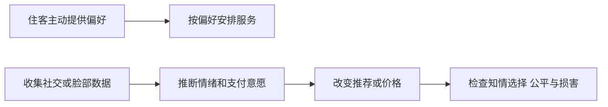
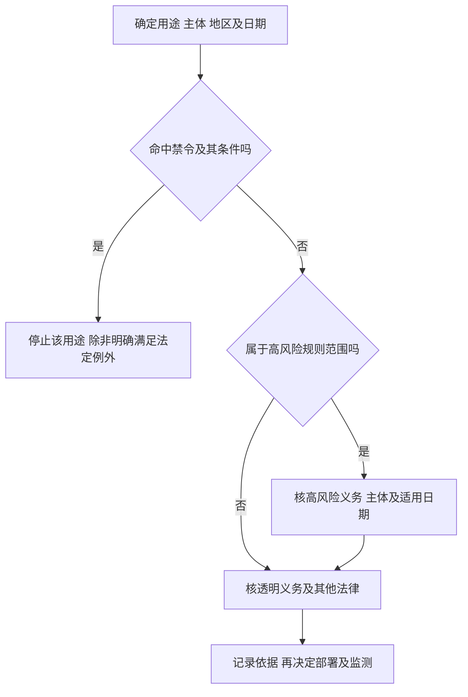
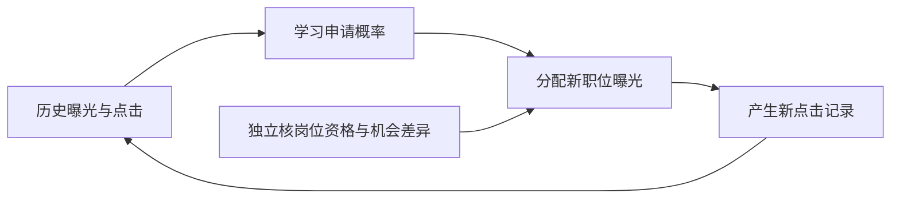

# M07 · 营销、招聘与员工监控：把伦理原则落实到业务决定

## 0. 三分钟速览

同一套 AI 可以帮助顾客找到商品，也可以利用顾客的弱点。可以帮助雇主发现人才，也可以把已有不平等重复一遍。本讲学习怎样分清这些情况，再为实际决定配置责任和保障。

- 能追踪“收集数据→推断特征→作出建议→改变机会”的链条。
- 能区分伦理判断、讲义的法律概述和核对过版本的法律规则。
- 能解释删掉性别字段为什么仍可能有性别偏差。
- 能逐问分析 LuxeStay 酒店与 OptiMax 员工监控案例。
- 能为一个具体系统选择暂停、重设计、人工复核和持续监测措施。

## 1. 开始之前 · 知识衔接

### 1.1 本讲会用到的旧知识

以下各项都是判断工具，不是要求你已经熟练掌握。

| 工具 | 先恢复这句话 | 本课前文 |
|---|---|---|
| 义务论（Deontology） | 有些做法侵犯人的权利，即使增加利润也不能因此自动合理化 | [[IS5113_AI_Ethics_and_Regulations/notes/M02-道德理论及其应用\|M02]] |
| 功利主义（Utilitarianism） | 比较可行方案对所有受影响者的利益和损害，不能只数公司收益 | [[IS5113_AI_Ethics_and_Regulations/notes/M02-道德理论及其应用\|M02]] |
| 公平（Fairness） | 先问机会怎样分配、差别是否有相关且可辩护的理由 | [[IS5113_AI_Ethics_and_Regulations/notes/M03-偏见与公平\|M03]] |
| 透明与问责 | 当事人要能知道发生了什么，并找到负责解释和纠错的人 | [[IS5113_AI_Ethics_and_Regulations/notes/M04-AI透明-从看得见到信得过\|M04]]、[[IS5113_AI_Ethics_and_Regulations/notes/M05-AI问责-责任链治理与救济\|M05]] |
| 隐私与监控 | 数据可取得，不等于可以用于任何目的 | [[IS5113_AI_Ethics_and_Regulations/notes/M06-隐私与监控-从数据采集到行为影响\|M06]] |

### 1.2 新概念放在哪里

操纵与个性化的区别在 §2.1。风险分类、提供者和部署者在 §2.2。合格评定和上市后监测在 §2.4。情绪推断在 §2.6。代理变量和目标函数偏差在 §2.8。

### 1.3 重排及来源边界

先看业务动作，再学法律分类和治理，最后完整做两个案例。讲义中的重复风险表合并解释，独有条件仍逐项保留。页码始终指物理页。本讲未取得转录，授课日期未知，不能推断老师略过哪页。

法律补充于 2026-10-28 核对 EUR-Lex **2026-07-27 合并文本**。法律变动与讲义口径分层呈现，不能把旧课件的简表直接用于现实合规判断。

## 2. 正文

### 2.1 个性化怎样变成操纵（讲义 p.2–5）

酒店根据你主动选择的无烟房安排房间，解决的是“偏好不同，服务怎么匹配”。这叫个性化（Personalization）：利用有关信息调整面向某人的服务或内容。营销定向（Targeting）则先决定把某条广告展示给谁。

💡 笔记补充：假设顾客勾选“安静房间”，酒店只用这项偏好安排房间。这项动作的目的、所需数据和结果容易解释。若酒店再从脸部图像推断顾客焦虑，并趁其脆弱时推销高价服务，动作已多了两层：推断内在状态，以及利用该状态改变选择。

操纵（Manipulation）的伦理问题在于削弱自主选择：当事人不了解影响方式，或其弱点被刻意利用。普通说服也会影响选择，但提供真实、相关、可拒绝的信息，与隐瞒机制、利用弱点，并不相同。不能把“广告有效”本身当成操纵证据。

沿下图从左到右读，每条箭头都代表一次需要说明用途的处理动作。

上方短链可以做到必要且可控。下方长链增加了错误推断、隐私侵入和不公平待遇的机会。图是笔记补充，不表示任何真实酒店已经执行这些步骤。

讲义 p.4–5 提出的四个问题要分开回答：隐私问“收集和用途是否正当”。操纵问“怎样影响选择”。偏差问“哪些群体承受不利”。透明问“谁能理解及挑战决定”。披露一行“我们使用 AI”不能自动解决其余三项。

### 2.2 先确定法律管谁，再分类（讲义 p.6–8）

欧盟《人工智能法》（EU AI Act）是一套按用途与风险安排义务的法规。提供者（Provider）通常指以自己名义把系统开发并投放／投入使用的一方。部署者（Deployer）是在业务中使用系统的一方。酒店购买外部系统，不会因此把自身的数据使用责任全部交给供应商。

🔗 法律补充：适用欧盟 Regulation (EU) 2024/1689，以下按 2026-07-27 合并文本 Article 2。须逐项核主体、市场或输出的欧盟连接。欧盟境外提供者在欧盟投放系统，或境外提供者／部署者的系统输出在欧盟使用，均可能进入范围。讲义“影响 EU residents 就适用”过于简化。“有一个欧盟国籍客户”不是完整测试。

讲义 p.7 列八类权利，可用它们检查受影响对象：尊严与自主、隐私及数据保护、不歧视与平等、表达与信息、和平集会与结社、有效救济与公平审判、儿童权利、脆弱群体保护。救济（Remedy）指能提出异议并获得实际纠错。“模型准确”不能代替这些权利。

先问是否触及禁令，再问是否是高风险用途，接着检查透明义务，最后才考虑低风险。这是学习用决策顺序。同一系统可能同时有高风险和透明义务，不是四个互不相交的盒子。

例如，招生排序改变受教育机会，与校园问路聊天机器人不同。分类依据是**预定用途及影响**，不是模型大小。模型换成简单算法也不自动解除高风险分类。

### 2.3 禁止的是哪些具体用法（讲义 p.9–14）

禁令（Prohibition）是达到规定条件后不能开展该用途，不是“多写一份风险报告便可继续”。下表依讲义顺序恢复八项，理由列是伦理解释，法律条件另见表后。

| 用法 | 对人的风险 | 判别时必须问 |
|---|---|---|
| 有害操纵或欺骗 | 破坏知情选择 | 是否实质改变行为并造成／很可能造成重大损害 |
| 利用脆弱性 | 利用年龄、残障或社会经济困境 | 脆弱性是否被利用来改变行为及造成损害 |
| 社会评分 | 跨领域或不成比例的不利待遇 | 分数怎样导致具体待遇 |
| 仅凭画像预测犯罪 | 把人格推断当犯罪证据 | 是否仅靠画像而缺直接可核事实 |
| 特定实时远程生物识别 | 大规模监视 | 是否属于公共空间执法及严格例外 |
| 敏感生物特征分类 | 推断种族、信仰等 | 推断的属性和法定例外是什么 |
| 无目标抓取脸部库 | 大规模无差别采集 | 是否从互联网／CCTV 无目标建立或扩大识别库 |
| 工作及教育情绪推断 | 侵入与不可靠评价 | 是否属于情绪推断，是否有医疗／安全例外 |

🔗 法律补充：Article 5 自 2025-02-02 起适用的上述条款，包含各自限定。p.11 把社会评分写成公共机关使用，范围过窄。条文并不把有关主体一概限于公共机关。犯罪风险判断也不能省掉“solely”——只依据画像／人格，而不是任何犯罪分析都被禁。

实时远程生物识别的严格例外包括特定受害者或失踪者搜寻、重大生命安全／恐袭威胁、规定严重犯罪嫌疑人的定位识别。还须核必要性、比例及授权条件。不能把“警方需要”当成足够例外。

Article 5(1)(f) 的工作／教育情绪推断禁令有医疗或安全用途例外。提醒使用者“这是 AI”不会使被禁止的用途合法。p.14 用自主、基本权利、隐私与尊严归纳禁令，是解释其规范理由，不是独立法定豁免测试。

当前合并文本还有 2026 年增补条款，本讲表并非法律全部禁令清单。相关新增条款的适用日期见 §9.4。课堂复习优先掌握本讲八项及条件，现实判断须回完整条文。

#### 2.3.1 分清身份、属性和情绪（讲义 p.9–13）

生物特征是可用于识别或分类的身体／行为特征。身份核验（Verification）问“是不是自称的这人”，例如本人刷脸核对自己的账户。身份识别（Identification）问“库里哪一个人”，例如远处摄像头把经过者与名单比对。生物特征分类（Biometric categorisation）则把人归到某种属性类，情绪推断是在估计内心状态。四种动作可能共用图像，但输出不同。

#### 2.3.2 分清收集建库与评分待遇（讲义 p.11–13）

闭路电视（Closed-circuit television，CCTV）指监控摄像系统。抓取（Scraping）是批量收集已有图像。建库是把图像组织成以后可搜索识别的集合。一次核验不自动等于批量抓取建库。Article 5(1)(e) 针对互联网／CCTV 人脸的无目标抓取建库或扩库，不能把“用户主动上传自己的照片核验账户”直接当作同一种行为。

💡 社会评分补充例：系统长期根据购物、社交行为给个人打“可信分”，再用与这些数据原收集情境无关的分数限制基本服务，或实施不合理、不成比例的不利待遇。这才接上“跨期行为／特征→社会分数→不利待遇”的条件链。普通会员累计消费积分并按事先规则兑换折扣，不因有一个分数便自动命中该禁令。

#### 2.3.3 检查重大损害及具体用途（讲义 p.10–14）

有害操纵要连上重大损害门槛：例如暗中利用无法察觉的手段，实质削弱作知情决定的能力，使人作出本不会作的决定并造成／很可能造成重大损害。利用脆弱性也须有利用年龄、残障或特定社会经济处境来实质改变行为及重大损害的链条。正常为长者放大界面字体并不是利用其弱点。

犯罪画像例是“只因某人格类型就预测此人会犯罪”。如果存在与具体犯罪直接相关、客观可核事实，系统只是支持人的判断，则不能机械按 solely profiling 套结论。敏感生物特征分类例是从脸部等生物数据推断种族、宗教或政治观点等规定敏感属性。不是所有外貌属性推断都自动等同该条，法定数据标注／执法例外仍须具体核。

实时公共空间执法识别涉及当场对人群找身份。工作场所情绪识别涉及从员工表现推断心情。前者先核公共空间、实时、远程及执法目的等条件。后者先核工作／教育用途及医疗／安全例外。酒店认出自愿登记的 VIP 不会只因“刷脸”就自动变成该实时执法禁令，但仍要另核数据处理、识别风险及情绪用途。

### 2.4 高风险系统为什么需要全生命周期治理（讲义 p.15–23）

高风险（High-risk）不是已证明系统恶意，而是某些错误可能严重影响健康、安全或基本权利。讲义列出生物识别、关键设施、教育、就业、基本服务、执法、移民边境、司法及民主程序八类用途。

分类仍须回 Article 6 与 Annex III 的具体用途和排除条件。例如，关键基础设施条目强调安全部件。信用条目不是所有保险定价。只确认“你是不是声称的这个人”的一对一生物核验，也不能直接等同所有远程识别。

#### 2.4.1 沿招聘流程核治理（讲义 p.15、17、20）

把招聘系统从构想到使用走一遍，就能理解 p.15、17、20 的要求：

1. 先写清输入是履历、输出是推荐名单、决策由谁负责。这是预定用途与技术文档的起点。
2. 检查历史履历是否漏掉某些群体、标签是否把既有偏见当“优秀”。数据治理（Data governance）管数据适当性，不只是文件能否读取。
3. 测试错误率和群体差异，同时记录模型、数据及阈值版本。日志（Logging）让一次争议有追查路径。
4. 安排真正有时间、信息和权限改变结果的人来复核。人类监督（Human oversight）不等于工作人员机械点击批准。
5. 部署后继续检查实际拒绝和申诉，发现误伤就暂停、改正并验证。上市后监测（Post-market monitoring）针对环境变化，不能由上线前测试永久替代。

#### 2.4.2 区分质量、评定与生命周期（讲义 p.15–23）

准确性（Accuracy）关注任务表现。稳健性（Robustness）关注输入噪声或分布变化下能否稳定工作。网络安全（Cybersecurity）关注攻击和未经授权访问。这三项不能互相替代。

合格评定（Conformity assessment）是按适用程序证明满足要求。并非所有系统都要由第三方认证，具体路线取决于系统类别与法律。技术文档、记录和监测还要区别提供者、部署者等主体的义务。

p.18、21 的大学例把治理分成部署前、运行中、部署后：先核训练数据和群体偏差，运行时由招生人员复核并留日志，之后审查结果、事故和重训。讲义提出“AI 不能自动拒绝”“年度审计”等，是该例的治理方案。不能把这些原句一概说成每个机构的统一法定频率。

p.19 的银行例强调贷款批准、信用额度和按揭资格。错误既可能错拒合格借款人，也可能把不适当债务推给无偿还能力的人。解释、验证、申诉和持续监测分别处理不同失败点。

p.22–23 的执行机制包括主管机关监督、适用的评定、注册／文档和事故报告。不合规时可能要求整改、限制使用、撤出市场或召回。整改是纠正不符合项，撤出是阻止继续提供，召回是针对已提供对象采取返回等措施，不能把它们全叫“罚款”。

🔗 时间限定：2026-07-27 合并文本 Article 113 已把 Annex III 高风险系统有关 Chapter III §§1–3 的适用安排至 **2027-12-02**，Annex I 产品相关高风险安排至 **2028-08-02**，并有具体例外与过渡条款。不能沿用旧版“所有高风险义务于 2026-08-02 全部适用”。分类、预备治理及其他现行法律仍须分别判断。

#### 2.4.3 八类用途怎样落到业务动作（讲义 p.16–21）

法律里的 Article 是条文编号，Annex 是附件清单。Annex I 连接受相关产品法规管理的产品／安全部件路径，Annex III 按特定用途列出高风险路径。它们不是两个模型算法。安全部件指承担安全功能、失效可能危及健康安全的部分。电网负荷的安全控制和办公室打印纸库存预测，不能只因都叫“优化”就同类。

下表先恢复讲义例，再注明不能省略的范围判断。

| 领域 | 输入怎样变成决定 | 机会／安全与边界 |
|---|---|---|
| 生物识别 | 生物数据→远程身份识别或规定分类／情绪结果 | 一对一核验排除与禁令须先分清 |
| 关键基础设施 | 电网等状态→安全相关控制 | 须核安全部件等具体用途 |
| 教育 | 文书、学业记录、面试→录取建议或评价 | 改变受教育机会；普通文档排版不同 |
| 就业 | 履历／工作记录→候选排序、晋升等 | 改变进入职位与职业机会 |
| 基本服务 | 个人资料→信用资格等规定决定 | 信用评估及寿险／健康险等条文用途有细分 |
| 执法 | 证据／犯罪资料→规定的风险或证据评估 | 纯画像禁令与合法辅助须分开 |
| 移民及边境 | 申请资料→签证／居留等规定评估 | 不能把一般文件整理直接当决定评估 |
| 司法及民主 | 案件／选举相关输入→规定司法辅助或影响选举行为 | 普通行政检索与实质决定辅助须区分 |

大学例的三个输入是申请文书、学业记录和面试结果，输出是录取建议。治理要检查每项输入是否与入学资格有关，不能只因有“人工最终决定”就免查建议的偏差。

责任分工也要落地：供应商作为提供者应按适用要求处理模型设计、技术资料和相应评定。大学／酒店作为部署者须按适用规则使用系统、安排监督和处理运行反馈。合同可以分工，不能把部署者自己的使用、告知和申诉责任写成“由模型负责”。

### 2.5 罚款、透明义务与低风险的边界（讲义 p.24–34）

讲义 p.24 的 3,500 万欧元／全球营业额 7% 是最高处罚口径，不是所有违规自动罚这个数。营业额（Turnover）是销售收入规模，不是利润。若普通企业上一财年全球营业额为 10 亿欧元，7% 为 7,000 万欧元，高于 3,500 万。这只说明该档上限比较，实际金额还要看违法情节与程序。

🔗 Article 99 区分禁令、有关其他义务、向机关提供不正确信息三档上限。还对中小企业等规定特别处理，不能对所有主体机械套“取高”。本段算例是笔记补充，不是处罚预测。

有限风险／透明风险（Limited / transparency risk）是讲义的教学分组。透明义务（Transparency obligations）让人知道交互或内容的性质，而不是要求公开所有模型参数。

Article 50 区分以下对象：

- 直接与人交互的系统，通常须让对方知道在与 AI 交互，条文保留“从情境已明显”等例外。
- 合成音频、图片、视频或文字的提供者，涉及技术可行范围内的机器可读标记与可检测性，也有普通辅助编辑等例外。
- 深度伪造（Deepfake）的部署者通常要披露人工生成／操纵。艺术、讽刺等作品有相应呈现安排。
- 公开传播公共利益事项的 AI 生成文字，另有披露和人工编辑责任条件。不能把“一切 AI 文字都必须同样标注”当成完整条文。
- 情绪识别／生物特征分类的使用者有告知等义务，但告知不能覆盖 Article 5 已禁止的使用。

p.29–30 的大学表完全重复，可合并读：校园问答关注交互披露。招生关注高风险。课堂情绪推断先核禁令。营销图片／视频要具体核生成方式、主体和适用的透明条款，不能只看“用途是营销”。

p.31–34 的最低风险（Minimal risk）例子包括垃圾邮件过滤、电子游戏、库存优化、娱乐推荐、拼写语法辅助、一般客户分组，以及非安全关键场景的预测维修。它们不因属于低风险就免除数据保护、消费者保护、产品安全、版权或反歧视法律。

#### 2.5.1 三档行为、校园例及透明的时间条件

讲义 p.25 的“不符合高风险义务”，例如没有记录模型版本或未安排监督，已经可以沿 §2.4 的具体流程定位缺哪一步。p.26 的另一类是向监管者／评定机构提供错误、误导或不完整信息：虚报测试会让审查人误以为性能达标，隐瞒已知故障会使风险无法被识别，不准确的合规资料会阻断追责。它们不能只归成一句“系统不准”。

🔗 Article 99 的法律补充，处罚章节一般自 2025-08-02 适用，但须同时核对应义务的适用日期：禁令违规最高 3,500 万欧元／7%。有关其他义务最高 1,500 万／3%。按要求向机关提供错误、不完整或误导信息最高 750 万／1%。普通企业按法定口径取高，中小企业包括初创有取低规则，特定中型企业在有关档位也有特别安排。以上是上限档位，不是实际处罚计算书。

p.34 的校园例可复用同一判断：图书馆搜索一般帮助找资料，语法工具帮助修改文字，通常属于较低风险。教学插图仍可能涉及生成内容透明要求。聊天机器人要查交互披露，招生筛选要查高风险，考试中推断情绪先查禁令。关键是具体用途，不能把“校园 AI”统一归类。

深度伪造（Deepfake）在本节指生成／操纵的图像、声音或视频，与真实人物、事物、地点或事件等相似，容易使人误认为真实。一般虚构卡通插图不因用 AI 制作就必然是 deepfake。机器可读标记是供软件识别的格式／标记，面向观众披露是让人明白内容来源，两者不是同一件事。

Article 50 一般自 2026-08-02 适用。合并文本 Article 111(4) 对 **2026-08-02 前已投放的有关生成系统提供者履行 Article 50(2)**，给到 2026-12-02 的特定过渡期。这不是所有聊天、deepfake 披露义务一律延期。当前为 2026-10-28，分析真实系统时必须把投放日期、条款及主体一并确认。

### 2.6 LuxeStay：先理解案例里的每一次数据使用（讲义 p.35–36）

LuxeStay／Guest360 是讲义案例，未提供可核现实事件出处。按教学情境分析，不冒称真实判决。

中文事实链是：历次入住、社交活动和第三方旅行 App 资料进入平台，形成偏好与情绪推断，再影响房间、餐饮、问候及到店服务。记者披露其识别 VIP 和推测心情的范围，住客此前未充分知情。

住客加入个性化计划，但不知道数据范围。平台还识别 VIP 并推断情绪。关键不是“有没有点 opt-in”，而是该选择覆盖了哪些具体处理。

为后续四问保留完整英文情境。

讲义 p.35 英文原情境

Case Study: "Personalization vs. Privacy – The AI Strategy at LuxeStay Hotels“

Background

- LuxeStay Hotels, a global luxury hotel chain, has launched an AI-driven personalization platform called Guest360. The system collects and analyzes guest data from previous stays, social media activity, and third-party travel apps to tailor services—such as room preferences, dining suggestions, and personalized greetings.
- Guests who opt into the program receive enhanced experiences, but many are unaware of the extent of data collection. Recently, a tech journalist revealed that Guest360 uses facial recognition to identify VIP guests upon arrival and predict mood for service adjustments. This revelation sparked debate about consent, data ethics, and surveillance.
- The company insists that personalization enhances guest satisfaction and loyalty. However, critics argue that LuxeStay may be violating privacy norms and risking reputational damage.

情绪画像（Emotional profiling）是把行为或表情转成关于情绪的推断，再拿来作服务决定。p.36 是脸部表情图片：标示 AU（Action Unit，脸部动作单元）与不同面部动作。图示说明可观察到脸部动作。它本身没有证明某张脸必然对应某种内心情绪，更没有提供酒店客户上的准确率。

💡 笔记补充：顾客皱眉可能在思考、受光照影响或身体不适。把“检测到眉部动作”直接写成“顾客愤怒”，已跨越未经验证的推断。错认情绪后改变报价，错误才进一步变成机会或财务影响。

### 2.7 LuxeStay 四问：完整原题与逐问作答（讲义 p.37–43）

以下原题要求评价、识别利益、平衡目标和提出具体策略。不是只问“AI 好不好”。

> Ethical Evaluation: Using an ethical framework (e.g., deontology, consequentialism, virtue ethics), assess the ethical implications of LuxeStay’s use of Guest360. Focus on consent, emotional profiling, and fairness.
>
> Stakeholder Analysis: Identify and analyze the interests and ethical concerns of key stakeholders (e.g., guests, employees, regulators, shareholders). How should LuxeStay prioritize these interests?
>
> Business vs. Ethics: How should LuxeStay balance its business goals (e.g., loyalty, revenue, brand differentiation) with ethical concerns in AI personalization?
>
> Strategic Recommendation: Propose a revised strategy for LuxeStay to ethically implement AI personalization. Include specific actions related to governance, guest communication, data handling, and cross-jurisdictional compliance.

#### 2.7.1 第一问：用义务论评价同意、情绪画像和公平

✅ 讲义 p.38 给出的评价是：当前做法侵犯自主、知情同意不足、有情绪操纵和监控风险，应重设计。下面展开其理由，不把评价当作法院裁定。

1. 事实：住客加入计划，却不知道完整数据及情绪推断范围。
2. 标准：义务论要求尊重人的自主与权利。知情同意（Informed consent）至少要让人理解具体用途，并能作真正选择。
3. 套用：笼统加入服务计划不能自动证明同意社交数据拼接和脸部情绪推断。隐藏处理使住客无法判断是否接受。若推断还导致某些群体持续被错误对待，公平问题另行成立。
4. 结论：按给定事实，现行方式缺乏伦理正当性，应停止有问题的处理并重设计。若清楚解释、可自由拒绝且只收集必要偏好，判断可能改善。不是“所有个性化都不道德”。

英文参考答案（笔记自拟）：“Guest360 is ethically problematic because enrolment does not establish informed consent to extensive profiling. Undisclosed emotional inference undermines autonomy and may produce unfair treatment. The hotel should redesign these practices even if personalization improves revenue.”

最强反驳是“住客享受更好的服务”。它提供收益理由，却没有回答住客是否能知情选择，因此不能直接推翻自主性前提。

#### 2.7.2 第二问：谁得到好处，谁承担风险

p.39 分析住客、员工、管理层、股东、监管者与社会。住客要便利，也要隐私与尊严。员工可能提高服务效率，也可能被迫执行错误的情绪判断。管理层及股东有收益，同时承担信任、法律与声誉损失。监管者和社会关心可接受的数据使用与监控常态化。

⚪ 参考作答：优先保障住客的基本权利与有效拒绝，再在这些约束内改善服务。受影响程度、是否可退出及是否有救济，比“谁带来更多收入”更适合决定保护优先级。员工也需要培训、质疑输出的权力和申报问题的通道。

英文参考答案：“LuxeStay should protect guest autonomy and privacy before optimizing commercial benefits. It should also support employees who challenge unreliable recommendations, while making management accountable for governance and providing regulators with auditable evidence.”

#### 2.7.3 第三问：怎样平衡业务与伦理

p.40 把满意度、复购和差异化，与信任流失、法律责任及负面宣传并列。它没有提供金额或实验，不能计算“总体收益一定更大”。

⚪ 参考作答：先停止不必要的情绪识别，保留住客主动填写的客房偏好。用小范围自愿试点比较满意度、投诉、退出与复购。业务价值要扣除治理成本及错误损害，并检查权利底线，不以利润抵消任何侵害。

英文参考答案：“The hotel should pursue useful personalization within clear privacy and autonomy constraints. A voluntary pilot can measure satisfaction and retention alongside complaints and opt-outs. Commercial benefits alone do not justify undisclosed emotional profiling.”

#### 2.7.4 第四问：把建议落实到负责人和动作

p.41 提出分项选择、必要数据、透明看板、人工监督和伦理委员会。p.42–43 补充跨地区法律与 GDPR／AI Act 的不同职责。

⚪ 参考作答：

- 治理：指定业务负责人，登记每个用途、数据来源、供应商和审核人。高风险推断可暂停，不只让委员会写原则。
- 沟通：入住时用清楚语言分别解释客房偏好、营销和识别用途。拒绝非必要处理不应失去基本服务。
- 数据：先用主动偏好完成任务，限制访问与保存时间。去标识不自动等于真正匿名，仍可重识别时继续按个人数据保护。
- 决策：人工能纠正服务建议，住客能查询、更正和申诉，记录处置是否完成。
- 跨法域：对实际服务地区、数据流向及供应商分工建清单，分别核当地法律。GDPR 是个人数据规则，AI Act 是系统／模型风险规则，二者可能同时适用。

英文参考答案：“LuxeStay should separate consent by purpose, minimize data collection, restrict retention and access, and give guests usable controls and complaint channels. Named owners should review harmful inferences and audit vendors. The company must assess the applicable rules in each jurisdiction rather than assume one global consent form is sufficient.”

讲义的 CCPA 指加利福尼亚消费者隐私法律，不是统一覆盖全美的 GDPR。FTC 是美国联邦监管机关，EEOC 是就业平等执法机关，二者不是全球通用法。此处仅做来源辨认，不给未核条款作确定适用结论。

改条件练习：若酒店仅保存顾客主动选择的无烟房且不做情绪推断，第一问的主要风险转向用途、保存和访问控制，不能继续照抄“情绪操纵已发生”。

#### 2.7.5 GDPR 与 AI Act 为什么不能二选一（讲义 p.43）

《通用数据保护条例》（General Data Protection Regulation，GDPR）关注个人数据处理，数据保护机关监督其数据义务。AI Act 关注规定的 AI 风险和对应主体，由有关 AI／市场监督体系等执行。问责原则要求证明数据处理为何正当，风险管理要求持续发现并减轻系统风险。两者互相补充。

隐私／数据保护影响评估是先检查数据处理可能给人造成什么高风险及如何保护。合格评定是按相应系统路径证明满足适用要求，不是一份隐私声明。二者都不是所有用途无条件必须做同一张表。

沿酒店例读：说明社交资料、脸部数据处理的依据与权利保障，回应 GDPR 线索。再分类具体识别／情绪用途并核系统义务，回应 AI Act。两法都有行政罚款。本讲 AI Act 还明确市场限制、撤出／召回等反应。不能因通过一种评估便认为另一套问题不存在。

### 2.8 招聘：删除性别字段为什么仍会不公平（讲义 p.44–51）

p.45–47 讨论履历筛选、表现分析与历史偏见。假设历史上某群体较少被录用，模型把“曾被录用”当成优秀标签，就可能把旧机会差异当成能力差异。

LinkedIn 案例 p.48–49 的匹配引擎使用三类资料：用户直接提供的信息、从类似用户赋予的信息、行为信息。讲义称它排除姓名、年龄、性别和种族，却仍从列举技能、回应招聘者等行为中捕捉群体差异。

代理变量（Proxy variable）指能间接携带某特征信息的变量。目标偏差则是优化了与想要的公平结果不同的量。若系统优化“谁更可能申请”，即使两个候选人能力一样，较积极点击者也会得到更多职位曝光。

💡 笔记补充：两人都具备岗位技能，甲平均每周点 10 次、乙点 2 次。若模型按点击倾向分配 8 次与 2 次曝光，它是在预测参与行为，不是证明甲能力为乙的 4 倍。若曝光又使甲更常点击，反馈会进一步加强原分配。

从甲乙输入走图：先固定真实资格，再查曝光和点击的差别来自哪里。不能仅凭总体准确率判断机会公平。p.51 的核心是机会、隐私和非歧视影响，讲义引用的“欧盟七项伦理要求”属于伦理治理框架，不等于一份已作出的违法裁定。

💡 性别代理的极小假设例：假设资格相同的男女各 10 人，其中男性有 8 人、女性有 2 人每周频繁回应招聘信息。模型虽看不到性别，却把“频繁回应”作为多给高级岗位曝光的理由。若每个频繁者获 8 次、其余获 2 次，男性组平均为 $(8\times8+2\times2)/10=6.8$ 次，女性组为 $(2\times8+8\times2)/10=3.2$ 次。差异由与性别相关的输入传到曝光，不需要直接输入性别。

这些人数和曝光量是笔记补充假设，不能说成 LinkedIn 实测。原讲义的可用机制例是技能列举／熟练度和回应行为的群体差异。这是讲义情境叙述，不是男女天生如此。直接输入性别、间接代理相关、选择申请概率目标，是三种不同的机制，需要分别核查。

p.51 还有两个机会关口：系统决定履历能否转交招聘者，错误会让合格人连人工筛选都到不了。游戏测评把游戏行为变成技能／岗位适配判断，须验证它是否真测到岗位所需能力。讲义据此批评不平等、隐私以及技术稳健与安全。本篇保留其伦理评价，同时指出公平的分配问题不等于一般数值稳定性，不能只查总体准确率就称没有歧视。

讲义 p.48–49 英文案例情境全文

> Background:
>                •   The goal of recruiting websites is to match qualified candidates with
>                    available positions. To organize all these openings and candidates,
>                    many platforms employ AI-powered recommendation algorithms.
>                    The algorithms, sometimes referred to as matching engines, process
> CASE STUDY –       information from both the job seeker and the employer to curate a
>                    list of recommendations for each.
>
> LINKEDIN       •   Most matching engines are optimized to generate applications.
>                    These systems base their recommendations on three categories of
>                    data: (1) information the user provides directly to the platform; (2)
>                    data assigned to the user based on others with similar skill sets,
>                    experiences, and interests; and (3) behavioral data, like how often a
>                    user responds to messages or interacts with job postings.
>                •   In LinkedIn’s case, these algorithms exclude a person’s name, age,
>                    gender, and race, because including these characteristics can
>                    contribute to bias in automated processes. Even so, the service’s
>                    algorithms could still detect behavioral patterns exhibited by groups
>                    with particular gender identities.
>                •   For example, men often include more skills on their résumés at a
>                    lower degree of proficiency than women, and they often engage
>                    more aggressively with recruiters on the platform.
>                •   The algorithm interprets this variation in behavior and adjusts its
>                    recommendations in a way that inadvertently disadvantages women.
>                •   The AI might be recommending, for example, more senior jobs to
>                    one group of people than another, even if they’re qualified at the
>                    same level
>
>                Those people might not get exposed to the same
>                opportunities. And that’s really the impact that we’re talking
>                about here.
>
>                Background:
>                • Several years ago, the employment-
>                  oriented social media platform – LinkedIn –
>                  discovered that the AI algorithm that was
> CASE STUDY –     used to match candidates with job
> LINKEDIN         opportunities was producing biased results
>                  independently from users’ professional
>                  experience and/or skills.
>
>                • More specifically, Linkedin’s AI algorithm
>                  was ranking its candidates based on how
>                  likely they were to apply for a position or
>                  respond to a recruiter.
>
>                • As a result, when professionals with similar
>                  experience and skills were scouting for a
>                  job, the algorithm was presenting
>                  /advertising more job posts to men than
>                  women simply because men are more
>                  aggressive in searching out new chances.
>                (LinkedIn was fined 310M Euros for GPDR violation in
>                2024 on its targeted advertising practice)

#### 2.8.1 讲义提问及英文参考答法

原题（p.51）：“What has been the impact on people/third parties of LinkedIn’s AI system?”

中文题意：不只看平台转化，要说明求职者及其他受影响者的机会怎样改变。⚪ 参考作答：资格相当的求职者可能看到不同数量或级别岗位。雇主也可能错过人才。若行为和推断数据使用不透明，当事人难以纠错。讲义并未给出这里各影响的估计规模。

英文参考答案：“A matching system optimized for application propensity can distribute opportunities unevenly among equally qualified candidates. This can disadvantage job seekers and deprive employers of suitable applicants. Opaque profiling also limits users’ ability to understand and challenge the recommendations.”

#### 2.8.2 不把广告罚款与招聘偏差混成一个案件

🔗 DPC 2024-10-24 官方公告核实了 LinkedIn **3.1 亿欧元**处罚，调查对象是行为分析与定向广告中的数据处理合法性、公平性和透明度。它不能证明 p.48–51 的招聘偏差已经由同一决定裁定违法。p.49 的“GPDR”应为 GDPR。

p.50 标为 late 2025／2025 figures。原列每年超过300万次新招聘／录用、每分钟超过9,000份申请、每天超过1,200万份申请、每周多达6,500万求职者、招聘者使用占比72%–87%、每周超过270万家发岗公司。它们是讲义给定且未标齐统计出处的数据。它们用来说明影响规模，不能当成本次核实的当前指标。

数字还可交叉核读：每分钟 9,000 次若全天恒定，乘 60 分钟和 24 小时得到每日 1,296 万，和“超过 1,200 万”数量级相容。这只核算术，不验证来源或全年恒定。300 万除 12 是月均 25 万，也不意味着每月相等。

### 2.9 OptiMax：监控能否证明员工投入（讲义 p.52–56）

中文事实链：物流公司 OptiMax 上线 WorkSight，收集按键、屏幕活动和摄像头脸部信息来评价员工。内部文件被举报者披露，显示某些脸部表现会被标“低投入”，员工因隐私、同意和压力提出异议，董事会要求伦理评估。先区分观测与解释：按键数是行为记录，“投入程度”是对工作状态的判断。脸部动作也不是工作贡献本身。讲义案例没有给出已核现实事件出处，按情境讨论。

讲义 p.52 英文原情境

"AI at Work – The Dilemma at OptiMax Corp“

Background:

- OptiMax Corp is a mid-sized logistics company that recently implemented an AI-powered employee monitoring system called WorkSight. The system tracks employee productivity using keystroke logging, screen activity, and biometric data (e.g., facial expressions via webcam) to assess engagement and performance.
- Management claims the system improves efficiency and identifies training needs. However, several employees have raised concerns about privacy, consent, and psychological stress. A whistleblower recently leaked internal documents showing that WorkSight flags employees for “low engagement” based on facial expressions, which may be influenced by cultural or neurodiverse traits.

The company is now facing public scrutiny, and the board has asked the ethics committee to evaluate the situation and recommend a course of action.

神经多样性（Neurodiversity）在此指人的认知、交流和表现方式存在差异。员工面部表现不同，不自动说明不认真。文化差异和任务类型也可能影响外在行为。

原题（p.53）：

> Ethical Analysis: Apply an ethical framework (e.g., utilitarianism, deontology, virtue ethics) to evaluate OptiMax’s use of WorkSight. Is it ethically justified?
>
> Stakeholder Impact: Identify key stakeholders and analyze how WorkSight affects each group. What ethical responsibilities does OptiMax have toward these stakeholders?
>
> Policy Recommendation: Propose a policy for responsible AI use in employee monitoring. Justify your recommendation with reference to ethical principles and business considerations.

#### 2.9.1 第一问：功利主义如何比较而不是只看效率

✅ 讲义 p.54 的立场是：隐私、压力、偏见和信任损害超过公司收益，除非重设计，否则不可辩护。讲义没有给损益测量，因此这是给定情境下的定性伦理评价，不是已算出的净效用。

1. 事实：管理层声称效率和培训收益。员工承受监控压力，情绪标签可能偏误。
2. 标准：功利主义比较所有受影响者在可行方案下的总体福利，包括持续损害，不能把员工福利权重设成零。
3. 套用：更少侵入的工作产出指标或自愿培训评估，也可能实现业务目的。因此不能只比较“现系统”与“完全不用 AI”。
4. 结论：依据材料，暂不支持现行情绪监控，先停用其惩罚性用途、评估替代方案。若能提供可靠收益证据且大幅减少损害，才重新评价。

英文参考答案：“WorkSight is not justified on the available evidence. Claimed productivity gains must be weighed against privacy intrusion, stress, biased assessments and loss of trust. OptiMax should compare less intrusive alternatives and suspend emotion-based adverse decisions while evaluating the harms.”

#### 2.9.2 第二问：利益相关者与责任

p.55 列员工、管理层、股东、客户及社会。员工可能获得培训，但承担被误评和失去自主的风险。管理层要提升效率，也要解释决定。股东需面对长期损失。客户可能担忧不当劳动管理。社会则承担监控成为常规的后果。

⚪ 参考作答：公司应给员工清楚说明、更正与申诉机制，不因拒绝非必要监控惩罚员工。管理层应证明指标与实际任务有关，并为处置结果负责。股东及客户利益不能被用来抹去基本尊严和公平。

英文参考答案：“OptiMax owes employees fair treatment, privacy protection and meaningful channels to contest assessments. Management and shareholders need reliable evidence of business value and long-term risks, while customers and society have an interest in responsible employment practices.”

#### 2.9.3 第三问：可以执行的政策

✅ p.56 提出透明、自愿选择、公平审计、人工监督和心理福祉保障。⚪ 笔记展开：先列允许和禁止的用途。移除脸部情绪评分与自动处罚。只保留必要、与岗位相关的指标。分别指定数据、复核和申诉负责人。定期测试群体误伤、员工压力和业务收益，达不到约定标准就暂停。

雇佣关系中的自愿选择尤其需要检验：如果拒绝就影响升职，“同意”可能受权力压力。人工复核须能推翻结论，不能把同一情绪分数原样复述。

英文参考答案：“The policy should prohibit emotion-based punitive decisions, limit monitoring to necessary job-related data, provide genuine choice where appropriate, and require independent human review and accessible appeals. Regular fairness and well-being checks should determine whether the system is continued, revised or suspended.”

改条件：员工长期思考导致按键少，但交付质量高。应检查指标是否测量了工作贡献，而不是教员工增加无意义按键。若适用欧盟范围及有关条款，还须先核工作场所情绪推断禁令。伦理建议不能代替该法律测试。

心理福祉保障在本案例还要落实为两项动作：上线前后匿名收集压力、被误评和不敢拒绝监控的反馈，检查哪些群体受影响更大。为员工提供不经直接考评上司的申诉／支持或求助通道。把这些反馈连到暂停、缩小用途和重新设计决定，不能把“建立支持系统”当成已经降低压力。此为 p.56 的心理影响评估／支持措施之具体展开，不进行医学诊断。

### 2.10 从原则到长期管理（讲义 p.57–59）

人类监督解决决定与责任，透明解决可理解与可质疑，减偏解决系统性不利，培训和利益相关者参与则让问题能被发现与反馈。四者需要同时接到具体流程，单有“伦理委员会”或“每年开课”不足以证明有效。

p.59 把法规变化、认证、领导责任及公众关切列为未来方向。伦理认证（Ethical certification）只说明按某标准和范围接受检查，不保证所有未来输出都正确，也不自动替代现行法律。管理者需要记录版本、重新判断用途变化，并安排申诉后的改进。

## 3. 一图看懂

按以下次序分析本讲任一情境：业务目的 → 数据及推断 → 影响谁 → 伦理标准 → 法域／条款／日期 → 替代方案 → 负责人及纠错。§2.2 的流程图展示法律判断分支。§2.8 的循环说明为什么好看的点击指标也能强化不公平。

## 4. 速查表

这张表压缩已讲清的判断动作，不能跳过右侧的条件。

| 遇到的说法 | 应补问什么 | 回指 |
|---|---|---|
| 用户点过同意 | 同意哪些用途，能否真正拒绝 | §2.6–2.7 |
| 没有性别字段 | 代理变量与目标是否仍分配不等机会 | §2.8 |
| 有人工负责 | 有无信息、时间、权限改结果 | §2.4 |
| 低风险所以不用管 | 是否仍受数据、消费者等法律约束 | §2.5 |
| 利润增加所以合理 | 权利底线及其他人的损害呢 | §2.7、2.9 |
| 最高罚款 7% | 主体、违规档、时间和特别规则呢 | §2.5 |

## 5. 双语术语卡

英文定义是笔记自拟，便于作答。不是教授原句。

| 中文 | English | 英文参考定义 | 首现 |
|---|---|---|---|
| 操纵 | Manipulation | Influence that undermines a person's informed and autonomous choice. | §2.1 |
| 知情同意 | Informed consent | A meaningful choice based on an understandable account of the specific processing. | §2.7 |
| 情绪画像 | Emotional profiling | Inferring emotional states and using those inferences to classify or treat people. | §2.6 |
| 代理变量 | Proxy variable | A variable that indirectly carries information about another characteristic. | §2.8 |
| 人类监督 | Human oversight | Informed and empowered human monitoring, intervention and correction of AI use. | §2.4 |
| 合格评定 | Conformity assessment | A process for demonstrating compliance with applicable requirements. | §2.4 |
| 上市后监测 | Post-market monitoring | Ongoing observation of a deployed system to identify risks and failures. | §2.4 |
| 利益相关者 | Stakeholder | A person or group affected by or able to affect a decision. | §2.7 |

## 6. 考点预判与答题框架

没有转录，本篇没有“教授明示必考”证据。以下为 🟡 笔记推断：LuxeStay 四问、WorkSight 三问、删敏感字段仍有偏差、分类与透明的边界适合案例分析。

英文作答可沿这条具体链展开：“The system uses [data] to infer [attribute] and make [decision]. Under [ethical principle], this is problematic because [facts and mechanism]. If [legal conditions] apply, [specific rule] must also be checked. A less intrusive alternative is [action], with [owner, review and remedy].” 方括号须用题面事实替换。这不是不看题就可复制的结论。

## 7. 自测

### 7.1 员工同意就可以情绪打分吗

答案与理由

不能只凭同意判断。先看拒绝是否有惩罚，再看情绪推断是否可靠、是否必要，以及适用法律是否禁止该用途。工作／教育禁令的用途限制不能由同意自动豁免。

### 7.2 平台预测申请概率很准，为什么仍可能不公平

答案与理由

准确回答“谁更可能点击／申请”，不等于公平回答“谁有资格获得机会”。历史曝光影响点击，新点击又训练新曝光。须固定资格核机会分配，检查代理变量和反馈。

### 7.3 顾客不喜欢服务，可否倒推操纵违法

答案与理由

不能。伦理上须检查知情选择、脆弱性和损害。法律上还须满足适用范围及具体禁令的构成条件。单一不满意不足以证明有害操纵条款成立。

## 8. 讲义页码映射

本表列学习去向。实质解释和原题答案均在 §2。课堂覆盖因无转录全部待核。

| 物理页 | 正文去向／处理 |
|---|---|
| 封面 p.1 | 课程主题见 §0 |
| 2–5 | §2.1 业务动作、个性化和四种伦理风险；p.3 分隔主题并入主线 |
| 6–8 | §2.2 适用范围、权利、风险分类 |
| 9–14 | §2.3 八种禁用法、限定与伦理理由 |
| 15–23 | §2.4 八类用途、三业务例、全生命周期及执行／整改 |
| 24–26 | §2.5 三类处罚与上限读法 |
| 27–30 | §2.5 透明义务；29/30 重复表合并 |
| 31–34 | §2.5 最低风险实例及其他法律 |
| 35–36 | §2.6 LuxeStay 完整情境、脸部动作图的证据边界 |
| 37–41 | §2.7 四问及讲义评价／建议 |
| 42–43 | §2.7.4 跨法域和 GDPR／AI Act 对照 |
| 44–47 | §2.8 HR 用途、历史偏见、监管角色；p.44 分隔页接主线 |
| 48–51 | §2.8 LinkedIn 机制、全部规模数字、题目和独立罚款事实 |
| 52–56 | §2.9 OptiMax 情境、三问及全部讲义评价／政策 |
| 57–59 | §2.10 策略、实践与未来方向；p.57 分隔页接主线 |

## 9. 延伸与勘误

### 9.1 课件有但课上略过

未取得转录，无法判断略过范围。

### 9.2 课上讲了但课件没有

待转录补充。本篇没有伪造课堂原话或时间戳。

### 9.3 讲义与证据的差异

- p.6 的域外适用概括、p.11 的社会评分主体、p.16 的用途类别、p.27–34 的透明例子须带 §2 的条件，不静默改原件。
- p.21 的年度审计及不自动拒绝是治理示例，不当成每个系统统一法定条款。
- p.49 招聘偏差与定向广告处罚分属不同证据。“GPDR”是拼写问题。
- p.50 平台规模数字仅作讲义给定。p.36 没有提供情绪识别准确率。
- 伦理上的伤害／不公判断与实际违法裁定不是同一个命题。

### 9.4 外部核对来源

🔗 [EUR-Lex 2026-07-27 合并文本](https://eur-lex.europa.eu/legal-content/EN/TXT/HTML/?uri=CELEX:02024R1689-20260727)，获取 2026-10-28：Article 2、5、6、50、99、113、Annex III。2026 年增补的 Article 5(1)(ba)/(bb) 等另定 2026-12-02 适用。本讲八项并非当前完整禁令清单。高风险延期安排见 §2.4，不能从法规一般适用日期推出每条同日生效。

🔗 [爱尔兰 DPC：LinkedIn 3.1 亿欧元决定公告](https://www.dataprotection.ie/en/news-media/press-releases/irish-data-protection-commission-fines-linkedin-ireland-eu310-million)，公告 2024-10-24，获取 2026-10-28。它核实处罚对象和处理活动，不核实本讲所有招聘叙述或当前上诉结果。

### 9.5 待核与材料限制

缺课堂转录、实际授课日期和案例的额外现实证据。CCPA、FTC、EEOC 在本篇仅辨认制度／机构角色，未展开未核条款。现实使用需另查法域、版本与事实。本篇参考答案不代表本人已作答、提交或掌握。
