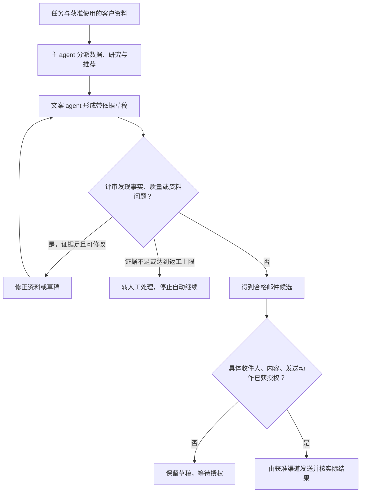

# M06 · 用 AI 重构营销：研究、创作、触达与测量

## 0. 三分钟速览

本讲把营销工作拆成发现、创作、激活和分析，展示 AI 在每一步帮助什么，以及怎样判断产出和效果。

学完应能完成这些动作：

- 按具体任务选择营销阶段，说明该阶段的输入、输出与人的责任。
- 区分 AI 访谈真人和 AI 模拟顾客，解释为何模型回答不能当真人样本。
- 沿家居素材演示说明“给资产→写任务→选候选→修改→预览”的过程。
- 读懂 CPE、CPV、完播率和 CTR，保留分母、基线与百分比/百分点的区别。
- 沿六角色邮件图追踪一次请求，区分草稿合格、动作授权与实际送达。

本篇是讲义稿 v0.9，转录待补。案例数字都是材料中的主张，不等于本次实测；日期沿课程日程，源文件的具体版本日期未明。教学独审、最终显示、正式写回与同步在各自回执记录，不由这个版本号证明。A04 反思与本篇学习笔记分别组织，不改变任何已有个人提交或学习状态。

## 1. 开始之前 · 知识衔接

### 1.1 当前用到的前置

下面每行说明当前需要恢复的意思，不把台账登记当成已经掌握。

| 概念 | 本讲要用的意思 | 课程回指 |
|---|---|---|
| 生成式 AI（Generative AI） | 根据输入生成文字、图像等候选，输出仍须检查 | [[IS5542_GenAI_in_Business/notes/M01-导论-生成式AI基础与企业落地\|M01]] |
| agent | 围绕任务选择工具和步骤的软件；角色名不自动授予权限 | [[IS5542_GenAI_in_Business/notes/M03-AI-agent-从harness到部署\|M03]] |
| 基线（baseline） | 用来比较的原做法/条件；变化值要与同口径基线相比 | [[IS5542_GenAI_in_Business/notes/M02-模型全景-基准评测与提示设计\|M02]] |
| 业务问题 | 先知道用户要做什么及哪里卡住，再选技术 | [[IS5542_GenAI_in_Business/notes/M04-设计思维-业务机会识别与AI创意工作坊\|M04]] |

例如“AI 版本便宜 80%”只有在交付范围一致时才有比较意义。如果一个版本交 1 支片，另一个交 5 支，必须先明确比较的是总成本还是每支片成本。

### 1.2 新概念与展开位置

营销四阶段在 p.7；定性访谈与合成人物在 p.9–10；信息综合与来源约束在 p.11–12；创意资产和品牌规范在 p.27–29；投入与结果指标在 p.43、50、52；个性化触达与评审回路在 p.62–66；测量计划在 p.68。§5 提供双语检索，不能代替这些页的具体操作。

### 1.3 来源、编号与三条学习路线

唯一教学主源为 Prisca Lam 的 68 页 PDF，来源 ID 为 M06-PRISCA，SHA-256 为 `4af6c3e8d7a553456a329b49821873fb4135654af785d6075ec2c547ffd180c5`。文件在 `course_files_export/`，名字没有扩展名，但实际为 PDF。下文 p.1–68 一律是这个文件的物理页号；页面没有贯穿全篇的印刷页码，不借别的课件补号。讲义只读。

预习从 §2 按页顺读；遇到图，先辨认对象，再跟中文解释检查本页新增。课中按 §8 任意页的一行直达对应标题，图可打开原尺寸。复习先看 §3–§6，再做 §7；答案都有理由和回指。正文保持源页顺序，没有把多页压成一个主题范围。

图片页很多，不能因文字提取为空就跳过。本 PDF 还含黑场、空页、未播放影片和不可见制作说明；它们在对应页与 §9 分开登记。原图标为“课件原页”，整页保留是为了不丢产品细节、界面文字和空间关系；这些是历史课堂材料，不是工具现行功能指南。所有“💡”和“参考作答”都是笔记补充/推断，不是嘉宾逐字原话。

## 2. 正文 · 按源页跟读

### 2.1 p.1 · Reimagining Marketing with AI

本讲要解决的问题是：营销团队怎样把生成式 AI 放进实际工作，而不是只多做几张图。封面署名为 Prisca Lam，职衔写作 Director, Ads Marketing, Google Greater China；这是讲义当时的自我介绍，不据此确认其现职。营销（marketing）包括了解顾客、设计信息、触达顾客和检查结果，不只等于付费广告。本讲来自 68 页 PDF，按课程日程归在 10/24 的第三场客座；文件自身版本日期未明，不能据日程保证每个产品画面都来自当天。

（来源：讲义物理 p.1；💡 段为笔记补充。）

### 2.2 p.2 · My Marketing Career

左栏 PREVIOUSLY 列 Microsoft、LinkedIn、Twilio，右栏 NOW 为 Google。这些 Logo 用来说明讲者自述的职业背景，不是这些公司都采纳同一营销流程的证据。读后续案例时，还要区分平台展示、客户证言和独立测量；讲者有行业经验，不会使案例数字自动成为普遍效果。

（来源：讲义物理 p.2；💡 段为笔记补充。）

### 2.3 p.3 · AI in my everyday work


课件原页 p.3；[打开清晰原图](figures/m06-marketing/page-03.png)。

原图有五个工作框：写作 Write、摘要 Summarise、分析 Analyze、创作 Create、排程 Schedule。写作和分析框出现 Gemini 图标，摘要框出现 NotebookLM，创作框标 Nano Banana Pro，排程框为服务选择界面。它在讲“把工作拆开以后选工具”，并未给这些工具的现行套餐、权限或可用地区。

💡 换个说法（笔记补充）：要写活动邀请函，输入是日期、对象和批准过的活动信息，AI 给出草稿，人核对日期和承诺后才发送。摘要则应从已有材料提取内容，不能把缺少的会议决定编出来。图中的工具名不等于已经完成上传、授权或排程；本笔记未执行这些动作。

（来源：讲义物理 p.3；💡 段为笔记补充。）

### 2.4 p.4 · There’s never been a more complex (and exciting) time to be a CMO

首席营销官（Chief Marketing Officer, CMO）要决定目标顾客、品牌信息、预算和评估方式。页上“更复杂也更令人兴奋”是讲者对行业处境的判断，不是可直接检验的统计结论。复杂来自一个任务可由人、模型和平台共同完成：负责人仍要决定该优化哪项业务结果，并核对输出是否准确、合适。

（来源：讲义物理 p.4；💡 段为笔记补充。）

### 2.5 p.5 · AI is revolutionizing marketing

本页是一句营销式总述，背景是两人围绕电脑工作。它没有新增模型机制、效果数字或可复做实验；背景照片不承担知识图示，故不另存。把这句话转成可检查问题，应问“哪一阶段、哪个动作改变、与什么基线比较”；后文四阶段框架才提供具体对象。

（来源：讲义物理 p.5；💡 段为笔记补充。）

### 2.6 p.6 · Where do we start?

中文读题入口：面对许多 AI 工具，团队应先从什么地方开始？原文完整问句是：

> Where do we start?

⚪ 参考作答（笔记推断，依据 p.7）：先列营销工作及其目标，再找当前卡住的动作。比如新品卖点不清，应先了解顾客；若卖点清楚但缺多语言素材，则进入创作。这样才能说清输入、输出和验收标准，避免从工具名称倒推需求。

英文参考答案（笔记自拟）：Start with a specific marketing task and its business objective. Identify the bottleneck, the available inputs, and the criteria for a useful output before selecting an AI tool.

改条件时仍用这个顺序：预算测量不清，优先修测量计划；不会因为新视频工具上线就先做视频。

（来源：讲义物理 p.6；💡 段为笔记补充。）

### 2.7 p.7 · AI opportunities at all stages of marketing work


课件原页 p.7；[打开清晰原图](figures/m06-marketing/page-07.png)。

从左到右读四个箭头：发现 Discover → 创作 Create → 激活 Activate → 分析 Analyze。Discover 是 Insights & Strategy：Culture & Trends、Brand & Product Insights、Competitive Insights、Strategy、Brief；依次是文化趋势、品牌与产品洞察、竞品洞察、策略和创作简报。简报（brief）是给执行者的任务说明，包含目标、对象、关键信息与限制。

Create 是 Development & Production：Ideation、Concepting、Creative Assets、Localize & Adapt，分别把想法变成概念、成品素材和本地化版本。Activate 是 Execution & Growth：Media & Launch、Versioning & Formats、O&O（e.g. web, email）、Social，即媒体发布、尺寸/版本适配、自有和运营渠道（Owned & Operated，如网站和邮件）以及社交触达。Analyze 是 Measurement & Optimization：Creative Testing、Measurement Plans、Reporting、Optimization、Media Mix Models，即创意测试、测量计划、报告、优化与媒体组合模型。

图底部 Productivity 横跨全程，表示效率提升可以发生在每一阶段。外围虚线从分析绕回发现，表示结果可改变下一轮策略；它不是“只要产生素材就自然增长”的因果保证。

💡 换个说法（笔记补充）：一家灯具店先访谈租房者，发现顾客怕安装麻烦；据此写“免工具安装”的简报，再制作短片和邮件，投放后检查询问和订单。若点击多却很少成交，下一轮应查承诺、价格或购买流程，而不是只继续增加图片。分析结果回到发现，才构成闭环。

（来源：讲义物理 p.7；💡 段为笔记补充。）

### 2.8 p.8 · Discover: Insights & Strategy with speed


课件原页 p.8；[打开清晰原图](figures/m06-marketing/page-08.png)。

本页重复 p.7 框架，但只把 Discover 栏保留蓝色，其余三栏淡化。课堂若指到本页，应从 Culture & Trends 一路读到 Brief：先找顾客/品牌/竞品信息，再形成策略和简报，输出是“有依据地决定做什么”，还不是广告成品。

相对 p.7 的增量是选择工作阶段，不是新增一种模型。下一页把其中的顾客研究拆成“AI 访谈真人”和“AI 模拟人物”；回答来自谁，决定它能支持哪类结论。

（来源：讲义物理 p.8；💡 段为笔记补充。）

### 2.9 p.9 · AI Powered Qual · AI Moderator + Platform


课件原页 p.9；[打开清晰原图](figures/m06-marketing/page-09.png)。

定性研究（qualitative research）主要追问人的理由、经历和语言，而非只报比例。本页的输入是研究者设计的问卷/访谈问题，AI 主持人（AI moderator）向真人参与者提问；平台再给仪表盘、指标、转录、摘要和可选追问聊天。右侧静态示例框接近空白，不能从该画面还原一次完整访谈或结果。

关键是“真人回答，AI 协助提问与整理”。图文强调多名参与者可并行、速度和规模提高，这是讲义对该类平台的描述；本页没有样本数、费用或对照时间。

💡 换个说法（笔记补充）：问五位顾客为何放弃购物，AI 可把“运费到最后才出现”归成同一主题，但要回转录核原话，检查是否漏了反例。访谈人数增多不自动使样本代表总体；若只邀请老顾客，仍可能看不到从未购买者的障碍。

（来源：讲义物理 p.9；💡 段为笔记补充。）

### 2.10 p.10 · AI Powered Quant · AI Persona Chatbots


课件原页 p.10；[打开清晰原图](figures/m06-marketing/page-10.png)。

这一页改用 AI 人物画像聊天机器人（AI persona chatbots）：模型模拟顾客群或某个消费者，讲义列 synthetic personas、digital twins、persona bots 三个称呼。输入可包括人口特征、心理特征、购买历史、线上行为和情绪数据；输出是对研究问题或情境的模拟回答。右图一半真人脸、一半网格，用来表达“人的特征被转成可交互的模型”，不是证明模拟与真人相同。

与 p.9 的根本差别是回答者换了：p.9 仍访问真人，p.10 让模型生成回答。虽然页标题写 Quant，正文没有给抽样、统计校准或准确率。合成人物（synthetic persona）可用于发现待验证的假设，不能把一千次模型回答当作一千位独立真实顾客。

💡 换个说法（笔记补充）：让“预算有限的租房者”画像评价灯具广告，可检查有没有遗漏安装成本；若真实访谈与模拟相反，应回到真人证据和画像数据查原因。只换角色名字而共用同一模型/数据，也不会形成独立样本。

（来源：讲义物理 p.10；💡 段为笔记补充。）

### 2.11 p.11 · AI Synthesis · Gemini Deep Research


课件原页 p.11；[打开清晰原图](figures/m06-marketing/page-11.png)。

信息综合（synthesis）要把不同来源组织成能回答问题的结论。按讲义描述，Gemini Deep Research 把复杂问题拆成子问题，搜索多个来源，分析和综合发现，最后生成报告；可以递归追问未解决的部分。右图的 Start research 是研究入口示意，不是本次运行记录。

💡 换个说法（笔记补充）：调查“香港租房者怎么买灯”，可分为居住条件、购买渠道和安装顾虑三个子问题。每个结论仍须带来源及适用人群；网上有十篇转引同一新闻，也不算十份独立证据。报告更长不保证来源更新、更全或结论正确。本页是讲义产品介绍，未核现行功能。

（来源：讲义物理 p.11；💡 段为笔记补充。）

### 2.12 p.12 · AI Synthesis · NotebookLM


课件原页 p.12；[打开清晰原图](figures/m06-marketing/page-12.png)。

按本页描述，NotebookLM 连接笔记、PDF、Google Docs 等资料，生成带引用摘要并接受问答。来源约束（grounding）在这里指让回答与所给材料建立证据关系：先找支持片段，再核结论有没有超出片段。它不同于 p.11 主动扩大网络搜索范围的研究任务。

本页文字称回答“based only on the information you provided”，又称不使用外部信息；但右图可见 Discover sources。应把前者读成讲义在强调当前回答的资料依据，不能据此推断所有模式都永远不接外部来源，也不能推断上传资料自动满足所有隐私要求。当前产品政策本轮未核。

💡 换个说法（笔记补充）：上传十份真实访谈后问“放弃购买的主要理由”，先检查每个主题的引用是否真来自这些访谈。若资料没记顾客收入，就不能以模型生成的收入分层当调查发现。引用存在仍要核它是否支持结论。

（来源：讲义物理 p.12；💡 段为笔记补充。）

### 2.13 p.13 · Create: New level of creativity at Scale


课件原页 p.13；[打开清晰原图](figures/m06-marketing/page-13.png)。

与 p.8 相同的原图这次把 Create 标红，表示从研究结论转到 Development & Production。四行动作是创意发想 Ideation、概念发展 Concepting、素材制作 Creative Assets、本地化和适配 Localize & Adapt。

规模化（at scale）说的是能产出更多版本，验收仍要看每个版本是否符合简报。研究已指出“安装方便”时，素材就要明确展示这个承诺；不能因模型擅长漂亮场景就把主题改成无关的奢华装修。

（来源：讲义物理 p.13；💡 段为笔记补充。）

### 2.14 p.14 · Creative AI Tool · Idea Generator


课件原页 p.14；[打开清晰原图](figures/m06-marketing/page-14.png)。

Idea Generator 被介绍为从简单提示生成 thought-starters，即帮助人开始讨论的创意起点。三栏依次回答 What it Is、How It Works、Why it is Different：输入提示，辅助人主导的头脑风暴、探索方向；讲义称工具使用其优秀创意案例训练并按 modern marketer 原则设计，但没有公开训练集、模型或效果比较。

从左到右读原图，会发现输出地位只是候选。人仍要筛选与任务相关、可执行且有证据支持的方向。💡 换个说法（笔记补充）：提示“给免安装灯具想三种短片开场”可得到演示、顾客故事和问题对比；其中任何未获证实的功能承诺都应退回修改，而不是因为文案吸引人就采用。

（来源：讲义物理 p.14；💡 段为笔记补充。）

### 2.15 p.15 · Incredible Creatives · 场景示例


课件原页 p.15；[打开清晰原图](figures/m06-marketing/page-15.png)。

原图是草地上的餐桌、花纹桌布、餐具与食物，上面写 Incredible Creatives。它把“创意素材”具体化为一个可识别的生活场景：背景、光线和物件共同传达氛围。

可从桌布花纹、产品形状和光影是否一致读图；这能帮助检查生成内容有没有改坏产品，但画面本身没有标输入、生成工具或实验结果。不能把这张静帧称为已验证的 AI 生成流程，更不能从美观推得销量提升。

（来源：讲义物理 p.15；💡 段为笔记补充。）

### 2.16 p.16 · 抽象透明棱体示例


课件原页 p.16；[打开清晰原图](figures/m06-marketing/page-16.png)。

画面为黑底上的透明三角棱体，带红色与彩色反射。它与 p.15 的生活方式场景不同，示范素材也可走抽象视觉方向；本页没有文字说明用途或工具。读图时区分视觉风格与产品事实：透明材质、折射和构图是可观察特征，品牌归属和传播效果则未给。该原图保留为例图，不能据它虚构视频内容。

（来源：讲义物理 p.16；💡 段为笔记补充。）

### 2.17 p.17 · 黑场与隐藏 briefing 文本

本页实际渲染为黑场。文本层仍含制作提示“Do not remove this briefing slide: For content owner to reference back later.”，以及“Great Creative drives 49% of Incremental Sales”和“I know, but how?”。这是导出材料的异常层，不是眼前可读的完整教学图；49% 未给研究、分母和计算方式，不当作经核实的效果结论。

隐藏问句原文保留为：

> I know, but how?

中文题意是“知道创意重要，但怎样做出来？”⚪ 参考作答（笔记推断，结合 p.27–34）：提供产品资产和品牌规则，写清受众与主题，生成候选，逐项检查和修改，选定方案再预览视频。英文参考答案（笔记自拟）：Provide product assets and brand guidelines, specify the audience and creative direction, and then review and refine the generated options before previewing a selected video.

若资产缺少真实产品细节，应补资产或限制输出，不能用“49%”替代质量检查。这一问在 p.20–21 文本层重复，不重复冒充三个独立课堂练习。

（来源：讲义物理 p.17；💡 段为笔记补充。）

### 2.18 p.18 · 花纹字形与家居视觉


课件原页 p.18；[打开清晰原图](figures/m06-marketing/page-18.png)。

本页把蓝、绿、粉红等花纹做成立体字形，主体是装饰纹样和材质。相对 p.16 的透明抽象形体，这里转向家居品牌常用的印花语言。读图先辨认花纹连续性和立体表面，再问纹样有没有被错误拉伸；图片没有给品牌名、工具和输入，故只保留可观察的风格示例。

（来源：讲义物理 p.18；💡 段为笔记补充。）

### 2.19 p.19 · Veo 3.1 · 视频入口静帧


课件原页 p.19；[打开清晰原图](figures/m06-marketing/page-19.png)。

画面是仓库门背景上的 Veo 3.1 字样，是从视觉素材转向视频工具的引子。版本号是原图上的历史标记，不代表目前最新版本。静态 PDF 没有提供可播放的完整序列、声音、提示词或参数；因此只能识别入口，不能根据门的画面描述后续镜头。

（来源：讲义物理 p.19；💡 段为笔记补充。）

### 2.20 p.20 · 家居靠垫的场景图


课件原页 p.20；[打开清晰原图](figures/m06-marketing/page-20.png)。

原图把同一蓝色花纹靠垫放进大小不同的沙发场景：从单件商品变为可想象的居家使用情境。读图时检查靠垫花纹、尺寸关系和材质是否在不同画面保持一致；场景变化不应变成产品本身变形。

文本层另有 Home Lifestyle Brand、49% 和 p.17 的隐藏问句，但可见画面没有给统计出处；该重复隐藏层统一按 [[#2.17 p.17 · 黑场与隐藏 briefing 文本|p.17]] 处理。原件未标输入/输出方向，笔记不擅自指定哪张是实拍、哪张是生成。

（来源：讲义物理 p.20；💡 段为笔记补充。）

### 2.21 p.21 · 家居织物的细节图


课件原页 p.21；[打开清晰原图](figures/m06-marketing/page-21.png)。

本页近看蓝绿白花纹织物及旁边玻璃器皿，比 p.20 更突出材质与图案细节。扩大创意版本时，真正需要保留的可能正是这些细节；读者可对照线条、颜色边界和玻璃反射查画面一致性。

隐藏层多了 Diverse Product Line，仍重复 49% 和同一问句。可据此知道制作材料提过“多样产品线”，但不能据看不见的统计标签推导增量销售。隐藏问句的中英参考与边界见 [[#2.17 p.17 · 黑场与隐藏 briefing 文本|p.17]]。

（来源：讲义物理 p.21；💡 段为笔记补充。）

### 2.22 p.22 · 跨品类家居产品线


课件原页 p.22；[打开清晰原图](figures/m06-marketing/page-22.png)。

画面从左至右有花纹靠垫、细长家居件、方形收纳盒、绿色托盘及图案手提袋。相对上一页的织物特写，它展示同一种装饰语言可出现在不同产品类别。读者要按“每件商品”核形状、开口、把手和纹样，不能把一类物件生成得正确就推及整条产品线。页上没有商品名称或材质清单，未明的物件不硬猜具体用途。

（来源：讲义物理 p.22；💡 段为笔记补充。）

### 2.23 p.23 · 多种场景与版式的素材拼贴


课件原页 p.23；[打开清晰原图](figures/m06-marketing/page-23.png)。

原图把多个产品/场景缩成倾斜圆角卡片，大小不一地散布在白底上。它展示可选择的创意空间，而非销量、准确率或随机样本。与 p.22 的同排商品相比，这里增加场景和构图变化；读图可选一个靠垫或手袋，检查它在不同裁切中是否仍可辨识，不能把卡片数量当作合格素材数。

（来源：讲义物理 p.23；💡 段为笔记补充。）

### 2.24 p.24 · 多场景素材矩阵


课件原页 p.24；[打开清晰原图](figures/m06-marketing/page-24.png)。

画面用几块较大场景并置：托盘/印花、蓝色纹样商品、红色室内布景、桌面器物和花园灯具。它把 p.23 的多选项拉近，方便比较色调、背景和产品呈现。可按同一简报检查各版是否都突出目标商品，而不只比较“好不好看”；本页没有标各版投放结果，也没有给哪张是原始素材。

（来源：讲义物理 p.24；💡 段为笔记补充。）

### 2.25 p.25 · 创作工具与产品素材组合


课件原页 p.25；[打开清晰原图](figures/m06-marketing/page-25.png)。

原图可辨 Pomelli、YouTube Studio、Product Studio，以及 Canva 和 Adobe 标识；旁边是靠垫、纹样、人物和房间场景。应按“任务/素材/工具入口”读这张拼贴，而不是把多个 Logo 读成同一产品内部架构。

图片暗示产品细节和品牌风格可被带入创作，但没有给各工具连接方式、权限或实际互通结果。💡 换个说法（笔记补充）：先整理批准的商品图和品牌规范，再按交付类型选择图像、排版或视频工具；不要假定把工具串起来就会自动保真。

（来源：讲义物理 p.25；💡 段为笔记补充。）

### 2.26 p.26 · 空白导出页

本页实际渲染只有浅灰背景和边框，文字提取为空，没有可辨认的知识、指令或图。按“空白导出页”登记，不补写假想动画。它位于工具拼贴和素材选择界面之间，不据位置推断课上跳页或具体演示动作。

（来源：讲义物理 p.26；💡 段为笔记补充。）

### 2.27 p.27 · 选择产品资产与 Brand Guidelines


课件原页 p.27；[打开清晰原图](figures/m06-marketing/page-27.png)。

横排缩略图有灯具/场景、两只被蓝色勾选的花纹靠垫、Brand Guidelines PDF 和其他产品。品牌规范（brand guidelines）说明可采用的文字、颜色、标志和风格等规则；产品资产（assets）则提供商品具体长相。二者职责不同，品牌风格正确不代表商品细节就正确。

从勾选标记读出用户挑了哪些输入，再检查规范文件是否也需要纳入。这个静帧不证明文件内容已获授权、已完整上传或系统已理解；它只提供“先给材料”的界面证据。

（来源：讲义物理 p.27；💡 段为笔记补充。）

### 2.28 p.28 · Describe your assets 与 Edit guidelines


课件原页 p.28；[打开清晰原图](figures/m06-marketing/page-28.png)。

上一页的选择现在进入输入框：顶部有灯具、场景、两只靠垫和 PDF 缩略图；框内有 Describe your assets…，下方可选 Edit guidelines，右侧是提交箭头。这一页的新增步骤是把资产与文字任务放到同一个请求里。

图片只让模型看到外观，文字要补商业目标、受众、主题和限制。若描述与图片不一致，例如要求红色灯罩而资产是蓝色靠垫，应先澄清；不能让模型任意选择哪一项才算真。

（来源：讲义物理 p.28；💡 段为笔记补充。）

### 2.29 p.29 · 写清主题、产品与受众的提示


课件原页 p.29；[打开清晰原图](figures/m06-marketing/page-29.png)。

图中完整提示词为演示输入，不是要求学生执行的题目。原文按画面转录如下：

```text
I’d like to create an ad campaign with a summery, colorful theme, focused on my new line of marbled lampshades and handcrafted home decor collection. I’m trying to reach design-conscious millennial home decorators.
```

中文意思是：制作夏日、色彩鲜明的广告活动，重点呈现新系列大理石纹灯罩和手工家居饰品，受众为注重设计的千禧一代家居布置者。先读 campaign 确定要做广告活动，再读 theme 确定气氛，最后对齐产品与受众。这里的 millennial 是目标群体标签，不能凭标签推断每个人有同一偏好。

💡 换个说法（笔记补充）：若同一商品改卖给预算有限的学生，受众条件和文案重点要改变；商品真实形状仍需保持。提示词没有给折扣、功效或销量，输出不应自行添加这些承诺。本页提取文字中还有给美化团队的后台制作说明，与可见提示不同，异常列 §9.3。

（来源：讲义物理 p.29；💡 段为笔记补充。）

### 2.30 p.30 · 生成多组创意候选


课件原页 p.30；[打开清晰原图](figures/m06-marketing/page-30.png)。

原图按主题行显示多张场景候选，可辨 A Creative Coastal Sanctuary、Golden Hour: Nurturing Your Inner Child、The Art of the Endless Summer Glow；底部可输入 Describe any changes you want to make… 并编辑 guidelines。行表示创意方向，行内卡片表示同方向的不同场景/版式，不能把每张卡片当成一种独立商业策略。

先对照 p.29 的夏日主题、灯罩/家居产品和受众，再筛选产品失真、主题不符或文案不当的候选。输出多只是选择空间变大；它没有展示广告测试或成交结果。文字层的制作备注要求删 Inner Child，但本页可见版本仍保留该词；下一页可见字样有所变化。

（来源：讲义物理 p.30；💡 段为笔记补充。）

### 2.31 p.31 · 修订后的候选与仍需人检的文案


课件原页 p.31；[打开清晰原图](figures/m06-marketing/page-31.png)。

本页的多行候选与 p.30 大体相同，但第二行可辨 Golden Hour: Nurturing Your Inner Quiet，展示文案能够修改。读图要把变化定位在标题文字，不能把同一批图误认为又完成一轮有效投放测试。

修改提示之后，还须重新看受影响的标题、图和品牌规范是否一致；不能只因某个敏感词消失，就宣布其余素材全部合格。静态画面不足以确定修改由人工输入、自动替换还是其他步骤完成。p.31 文字层重叠了两段制作团队说明，不是学生题干或课堂原话。

（来源：讲义物理 p.31；💡 段为笔记补充。）

### 2.32 p.32 · Video Generation


课件原页 p.32；[打开清晰原图](figures/m06-marketing/page-32.png)。

本页可见大字 Video Generation 和摄像机图标，把任务从静态素材扩展到视频生成（video generation）。输入不只是一张漂亮图，还可能包括选定的主题、关键镜头、字幕和节奏要求；后者是理解视频交付所需的笔记补充，本页没有实际列出这些参数。

应把它读成流程转换入口，而非已交付视频。文字层仍有制作动画的后台说明；不能依据这些说明声称动画已在课堂播放或当前 PDF 可播放。

（来源：讲义物理 p.32；💡 段为笔记补充。）

### 2.33 p.33 · Select videos to create


课件原页 p.33；[打开清晰原图](figures/m06-marketing/page-33.png)。

原图出现 Select videos to create，下方有 Life in Color、Endless Summer Glow、Golden Hour 等卡片及 Create video。Life in Color 的说明是“Showcase a cozy and calming environment where your lampshade is the center focus.”；Endless Summer Glow 的说明是“Highlight your lampshades in a warm and composed setting.”；最右说明被画面裁断，不补造后文。

读图从“选哪个方向”走到“为该方向创建视频”：同一组商品图可以服务不同叙事。用户要先决定哪个方向符合简报，生成后再看灯罩是否仍是焦点。文字层还写 Video 3:10 / Global version Link，但没有在本轮取得完整 3 分 10 秒影片，不能把静帧当完整播放证据。

（来源：讲义物理 p.33；💡 段为笔记补充。）

### 2.34 p.34 · Preview full video


课件原页 p.34；[打开清晰原图](figures/m06-marketing/page-34.png)。

本页可辨 Preview full video 和带播放按钮的缩略片段，表示从候选走到完整预览入口。预览（preview）要核连贯性、商品一致性、文字和声音配合，不能只检查封面漂亮。底部片段仍可见 inner child，说明不同画面可能来自不同制作版本；静态导出不提供修订历史。

本轮只看到了 PDF 静帧，没有打开影片或核听音轨。图上的播放按钮不是已播放的证据，也不代表素材已发布或已获平台批准。

（来源：讲义物理 p.34；💡 段为笔记补充。）

### 2.35 p.35 · 黑场导出页

本页实际渲染全黑，文字层也为空，无法识别影片或其他内容。保留为黑场缺口；不把它描述成创作结果或课上略过。与 p.17 不同，这页没有可引用的隐藏说明。

（来源：讲义物理 p.35；💡 段为笔记补充。）

### 2.36 p.36 · GenAI Leveraged Strategically


课件原页 p.36；[打开清晰原图](figures/m06-marketing/page-36.png)。

画面是 GenAI Leveraged Strategically，周围有 Google、YouTube/Shorts、Maps、Gmail 等图标。它强调把生成式 AI 放进传播组合，而不是只有单张创作。图标表示触达环境或服务语境，未给数据流、API 或跨服务授权，不能把它读成所有服务已连接到同一 agent。

从这一页进入案例时，要逐项问“品牌遇到什么限制、AI 做什么、人核什么、结果怎样测”。这个提问顺序属于笔记分析方法，不是本页隐藏了一份技术部署说明。

（来源：讲义物理 p.36；💡 段为笔记补充。）

### 2.37 p.37 · Hada Labo · AI Mode 视觉引子


课件原页 p.37；[打开清晰原图](figures/m06-marketing/page-37.png)。

背景是肌研极润 Premium Eye Cream 商品，前景为写 Hada Labo 的搜索框及 AI Mode。原图把品牌/商品与搜索式视觉符号结合，用来引入肌研案例；它没有展示真实搜索答案、排名或用户查询记录。

读图先认商品瓶身和品牌，再区分创意包装的搜索框与真实产品界面。不能因出现 AI Mode 就推断本案例的广告效果来自搜索模式，后文明确出现的创作工具是 Veo。

（来源：讲义物理 p.37；💡 段为笔记补充。）

### 2.38 p.38 · 肌研既有素材的多样呈现


课件原页 p.38；[打开清晰原图](figures/m06-marketing/page-38.png)。

画面拼列代言人、商品瓶、护肤动作与色彩背景，展示品牌可利用的人物和产品素材类型。其文字层只提 Pomelli，画面没有给具体 Pomelli 操作；不能据此把每张图都判定由该工具生成。

与 p.37 单品引子相比，这里增加多个传播资产。后续是否仍保留代言人、怎样加入生成视频，须看 p.40–44；不能把“用 AI 扩充素材”误写成“完全取消真人和既有品牌资产”。

（来源：讲义物理 p.38；💡 段为笔记补充。）

### 2.39 p.39 · Quality at Scale? · Resource Efficient Output?


课件原页 p.39；[打开清晰原图](figures/m06-marketing/page-39.png)。

这一页把两道问题放在护肤人物图上，要求同时考虑质量和资源。原文分别是：

> Quality at Scale?

> Resource Efficient Output?

中文第 1 问：素材数量扩大时，怎样保证每个版本仍合格？⚪ 参考作答（笔记推断）：把商品形状、品牌风格、代言人授权范围和可证实文案列成验收条件，逐版本检查，再用一致测量计划测试。英文参考答案（笔记自拟）：Maintain product and brand consistency across variants, check factual and usage constraints, and test the approved assets under a consistent measurement plan.

中文第 2 问：怎样判断产出是否节省资源？⚪ 参考作答（笔记推断）：比较同一交付范围下的制作时间、费用和返工，再看互动或业务结果，避免只数生成次数。英文参考答案（笔记自拟）：Compare production time, cost, and rework for the same deliverable scope, and relate those inputs to accepted creative and campaign outcomes.

改条件例（笔记补充）：若生成费下降但审核和返工增加，总成本未必下降；若把商品功效写错，省时也不能抵消质量不合格。

（来源：讲义物理 p.39；💡 段为笔记补充。）

### 2.40 p.40 · Veo · 肌研创作案例


课件原页 p.40；[打开清晰原图](figures/m06-marketing/page-40.png)。

原图以眼霜商品和 New 字样为中心，下方列 iPROSPECT、Hada Labo、Admazes，左上标 Veo。它给出品牌、合作方与工具的案例语境，不能从 Logo 的排列推断各方合同或内部职责。

可观察的创作目标是让商品在金色光影中成为焦点。画面中的商品标签、瓶形、标志是保真检查点；真正的制作输入、版本数和提示词未提供，不能据此复现整个生产过程。

（来源：讲义物理 p.40；💡 段为笔记补充。）

### 2.41 p.41 · 肌研护肤人物特写


课件原页 p.41；[打开清晰原图](figures/m06-marketing/page-41.png)。

这一页是一位人物拿化妆棉靠近眼部的特写，右上有肌研 Logo。相对 p.40 的商品镜头，它展示使用/护肤情境。读图可检查人物动作与眼部位置、品牌标志及商品使用关系；静帧不足以判定人物是否 AI 生成、是否授权或动作在视频中自然。图片不提供医学效果证据。

（来源：讲义物理 p.41；💡 段为笔记补充。）

### 2.42 p.42 · Testing assets · 肌研多创意测试


课件原页 p.42；[打开清晰原图](figures/m06-marketing/page-42.png)。

Testing assets 表明这些是候选测试素材。五块画面分别突出商品、人物、眼周、使用动作和胶囊状质地；标签包括令雙眼回復緊緻年輕、激活膠原增生、全新 premium 抗皺滋潤眼霜。图片内还有“魚尾紋 -30%”等广告字样，讲义未给研究条件；这里保留为原广告素材，不据此提供功效/医疗结论。

读图时先把每块归为它想传达的卖点，再问测量是否能区分不同创意。💡 换个说法（笔记补充）：若同时换素材、受众和预算，结果变化无法唯一归因给素材；要比较创意效果，应固定主要投放条件，记录各版表现。本页没有实验分组和原始数据，不能复算因果效果。

（来源：讲义物理 p.42；💡 段为笔记补充。）

### 2.43 p.43 · 肌研结果：互动成本、互动与广告记忆


课件原页 p.43；[打开清晰原图](figures/m06-marketing/page-43.png)。

三项原值分别为 Cost per Engagement −12.5%、Engagement +4%、Brand lift in Ad Recall +8.5%〔讲义所载客户案例，p.44 有客户证言；实验日期、样本和比较基线未给，本轮未外核〕。这里的互动（engagement）是平台定义的用户行动，具体口径未说明；每次互动成本（Cost per Engagement, CPE）是花费除以计入的互动次数。

💡 计算示例（笔记补充，非案例原始数据）：基线每次互动 HK\$8，下降 12.5% 后是 $8\times(1-0.125)=7$ 港元。分母是互动次数，不是销量；CPE 下降不能单独推出利润增长。+4% 和 +8.5% 未说明相对增幅还是百分点变化，保留原文，不擅自改写为“提升 4 个百分点”或“8.5 个百分点”。

广告记忆提升（brand lift in ad recall）关注人是否记得广告，和点击、购买是不同结果。原图把不同素材放在三个数字周围，并未提供每个素材对应哪项结果的明细；不能凭空间靠近自行配对。

（来源：讲义物理 p.43；💡 段为笔记补充。）

### 2.44 p.44 · 肌研客户证言的来源地位


课件原页 p.44；[打开清晰原图](figures/m06-marketing/page-44.png)。

p.44 署名 Den Tsui，Digital Manager，Mentholatum (Asia Pacific) Ltd.。证言称，与 Google 合作使用 Veo 生成式 AI，降低高制作成本，扩充可规模化视频素材以增强传统代言人内容，并实现 12.5% 更低的每次互动成本。它支持“客户这样报告”，不等于第三方独立验证。

相对上一页，增量是客户对制作方式的解释：生成素材补充代言人内容，不是证明一切内容无人参与。页中没有成本拆分、人工时或利润，不能以 CPE 变化替代这些缺失指标。

（来源：讲义物理 p.44；💡 段为笔记补充。）

### 2.45 p.45 · 黑场导出页

本页全黑，文字层为空，没有可辨识的案例信息。登记为静态材料缺口，既不把黑场当成新视频，也不认定现场没有讲。下一页才明确转到八达通。

（来源：讲义物理 p.45；💡 段为笔记补充。）

### 2.46 p.46 · Octopus · AI Mode 视觉引子


课件原页 p.46；[打开清晰原图](figures/m06-marketing/page-46.png)。

原图出现写有八達通 Octopus 的卡片、卡通人物背景和 AI Mode 搜索式外框。它与 p.37 用同样视觉方式切换品牌，不能当成实际搜索服务的测试记录。

本页说明的是案例主体变成八达通；卡片/支付品牌是业务对象，生成内容是传播素材。不能把制作支付品牌广告误解为 AI 已获准执行付款。

（来源：讲义物理 p.46；💡 段为笔记补充。）

### 2.47 p.47 · 八达通既有广告与功能画面


课件原页 p.47；[打开清晰原图](figures/m06-marketing/page-47.png)。

拼图展示促销、人物用手机、刷卡/拍卡、手机应用与节日视觉。左上原广告出现“828 樂悠悠節返嚟啦”和“\$828 萬現金回贈”等活动字样，它们是图中历史宣传信息，不是本笔记提供的当前优惠。

与 p.46 的品牌引子相比，这页呈现多种既有素材和日常支付情境。读图把“商品/服务怎么用”和“广告怎样表达”分开；它没有说这些照片全由 AI 生成，也没有给促销活动的现行条件。

（来源：讲义物理 p.47；💡 段为笔记补充。）

### 2.48 p.48 · Veo · 八达通生成创作场景


课件原页 p.48；[打开清晰原图](figures/m06-marketing/page-48.png)。

画面以夜间维港上的未来感交通工具为中心，标 Veo，并列 GreenTomato、八达通和 OMD。与上一页的现实使用画面不同，这里转向不易实拍的想象场景。

读图可检查城市景观、光线和品牌语境是否一致，但这不是实际交通技术演示。图上的未来设备属于创意叙事，不据此判断现实系统已建设或支付能力已升级。

（来源：讲义物理 p.48；💡 段为笔记补充。）

### 2.49 p.49 · 屏幕中的水下城市场景


课件原页 p.49；[打开清晰原图](figures/m06-marketing/page-49.png)。

本页把水下建筑/城市画面放在室内电视上，窗外是夜间城市。它增加“观众透过屏幕观看想象世界”的呈现方式；要辨认内层屏幕与外层现实背景，不把两层空间混读。

静帧没有提供完整影片、时长或生成步骤。它可说明复杂景观的创作方向，不能证明整段视频一致、物理准确或已经通过平台审核。

（来源：讲义物理 p.49；💡 段为笔记补充。）

### 2.50 p.50 · 八达通制作效率：时间与成本


课件原页 p.50；[打开清晰原图](figures/m06-marketing/page-50.png)。

原图给 Production Time −60%、Traditional Cost −80%〔讲义客户案例数字，日期、基线金额和工作范围未明，本轮未外核〕。两项比较的是制作投入，不能把它们相加成“节省 140%”，也不能直接当作营销收入增幅。

💡 计算示例（笔记补充）：若同范围传统制作需 10 天、HK\$100,000，则时间减少 60% 后为 $10\times0.40=4$ 天，成本减少 80% 后为 $100000\times0.20=20000$ 港元。这里的 10 天和十万港元是假设，原案例没有提供。若 AI 版少交了一半镜头，就要先对齐交付范围，不能直接沿用比例。

（来源：讲义物理 p.50；💡 段为笔记补充。）

### 2.51 p.51 · Testing assets · 八达通多镜头


课件原页 p.51；[打开清晰原图](figures/m06-marketing/page-51.png)。

画面把维港科幻交通、卡通人物和小章鱼、海边渔船、手机付款等素材并置。原标签为一「嘟」即發、萬能嘅八達通、外星科技巧遇第一張八達通；这些是不同叙事方向，不是技术功能清单。

与 p.42 的护肤测试一样，必须先明确要比较的创意与测量结果。读图时可沿“角色认识八达通→出现支付情境”的叙事核品牌联系；仅有可爱人物而看不出支付服务，可能虽吸引人却没有完成传播任务。这是笔记分析，不是讲义给定的测试结论。

（来源：讲义物理 p.51；💡 段为笔记补充。）

### 2.52 p.52 · 八达通结果：CPV、完播与 CTR


课件原页 p.52；[打开清晰原图](figures/m06-marketing/page-52.png)。

原图三项为 50% Reduction in CPV、5X Increase on Completion Rate、71% Lift in CTR〔讲义客户案例，日期、样本、对照和平台计数规则未给，本轮未外核〕。每次观看成本（Cost per View, CPV）比较花费与合格观看次数；完播率（completion rate）比较完成观看与约定的起始观看群体；点击率（Click-through Rate, CTR）通常比较点击与展示，本例具体统计口径仍待核。

💡 计算示例（笔记补充）：若 CPV 原为 HK\$0.40，减少 50% 后为 HK\$0.20。若 CTR 原为 1%，相对提升 71% 后是 $1\%\times1.71=1.71\%$，增加 0.71 个百分点，不是 72%。只有同一口径才可这样算。

5X Increase on Completion Rate 的表述存在歧义：常见“达到 5 倍”读法若基线 10%，新值为 50%；若严格把 increase 读成“另增五倍基线”，则新值为 60%。原件无底数，不能替讲者确定哪一种；英文作答可写 The slide reports 5X for completion rate, but the baseline and exact multiplier convention are not specified. 三种指标都不是收入或利润。

（来源：讲义物理 p.52；💡 段为笔记补充。）

### 2.53 p.53 · 八达通客户证言


课件原页 p.53；[打开清晰原图](figures/m06-marketing/page-53.png)。

署名 Jaslin Goh，Director, Marketing Communications & Data，Octopus。证言把 Google Veo3 的使用描述为持续创新和 AI-first creative approach，即优先考虑 AI 的创作方式；它称这种转变改变吸引受众的方式。

本页是客户态度与采用叙述，没有新增数值、样本或试验设计。要判断是否值得长期采用，仍须回到 p.50 的投入和 p.52 的传播结果，并补实际质量/审核成本；不能用 positive testimonial 替代比较证据。

（来源：讲义物理 p.53；💡 段为笔记补充。）

### 2.54 p.54 · WeLend · 带 AI 制作标记的影片静帧


课件原页 p.54；[打开清晰原图](figures/m06-marketing/page-54.png)。

画面左上为 WeLend，右上写“此影片影像以 Google Gemini 全 AI 製作”，主体为人物与播放按钮。这个标记是影片方/讲义的来源声明，本轮没有取得制作文件或逐帧核验，不能升级成独立认证。

它增加的是贷款品牌也使用生成影像的案例语境。人物的生活情境不构成贷款产品条款，画面未给审核、利率或用户效果；本笔记不从一张广告静帧推断这些事实。

（来源：讲义物理 p.54；💡 段为笔记补充。）

### 2.55 p.55 · 未署名的影片人物静帧


课件原页 p.55；[打开清晰原图](figures/m06-marketing/page-55.png)。

黑边画面是一位人物站在玻璃/门窗旁，画质较低，没有可辨品牌、提示或结果。它在相邻案例之间出现，但仅凭相邻位置不能确定属于 WeLend、Jeep 或其他品牌。

保留这一静帧及身份限制：可以识别人像、室内外光线与影片呈现，无法复原叙事、声音、制作工具或完整效果。它不是纯空白页，所以原图和页级入口都保留。

（来源：讲义物理 p.55；💡 段为笔记补充。）

### 2.56 p.56 · Jeep · Impossible Production 长篇叙事案例


课件原页 p.56；[打开清晰原图](figures/m06-marketing/page-56.png)。

原图按 Challenge → Approach → Results 读。案例品牌 Jeep、代理 High Dive、地区 Americas—United States，工具栏为 Veo 3。挑战是把生成式 AI 从短内容扩到有情绪的长篇品牌故事，同时保持越野能力的呈现、真实感和产品一致性。

Approach 描述 Tire Story：备用轮胎在小径脱落，经过泥地、河流和山地回家。讲义称团队用提示工程控制轮胎重量、摩擦、运动、特定胎纹、泥泞材质和红色 Rubicon 结构，使叙事从高强度旅程走到家庭式结尾。提示工程（prompt engineering）在这里是用文字约束具体画面；产品专家仍承担核验，不能理解成提示写长就自动正确。

Results 原文列四项：66% Production Speedup（6 months → 2 months）；7+ Days of Shoot Time Saved；100% Brand Specialist Approved（称 millimeter-level product accuracy）；Zero-to-One Creative Freedom（把原先成本过高的脚本实现）。全部是讲义案例自报，日期、底稿与独立测量未得。本页末尾明确“Exploring running on Google Media. Results to come.”，所以制作结果已叙述，不等于投放结果已给。

💡 核算（笔记补充）：按制作时间算，减少比例是 $(6-2)/6=2/3\approx66.7\%$，原文 66% 可视为近似。若谈单位时间产出速度，同量工作由 6 月变 2 月对应约 3 倍，不能把“省时 66%”和“速度增 66%”当精确同义。100% Approved 是所称专家批准比例，不能推出模型所有细节都有独立毫米级测量。改变条件时，若一半镜头仍需实拍，应把实拍和生成的成本/时间分开，再比较整体。右栏 Learn More 外链本轮未观看。

（来源：讲义物理 p.56；💡 段为笔记补充。）

### 2.57 p.57 · Reimagine Your Entertainment Experience


课件原页 p.57；[打开清晰原图](figures/m06-marketing/page-57.png)。

原图写 Wizard of Oz at Sphere powered by Google Cloud，并带 Google Cloud Next ’25 标记。它把生成式内容的应用从单支广告扩到娱乐体验/大型显示环境，但页面没有详细技术链、成本或观众结果。

按文字读出“作品—场地—技术合作”的三方关系即可；不能根据一个 powered by 标签确定具体模型、版权许可或现场成效。图片/引用是讲义示例，本轮未另外观看演出或相关影片。

（来源：讲义物理 p.57；💡 段为笔记补充。）

### 2.58 p.58 · Moncler Ads Creative by GenAI

这一页只有标题 Moncler Ads Creative by GenAI，没有附广告画面、链接内容、制作说明或结果。可确认讲义准备提 Moncler 广告创作，无法确认具体哪支影片及其工具和效果。

把它登记为案例线索，不用别的品牌广告填补。要补完整分析，至少需要作品/来源、制作参与方和评估条件。标题在场不等于案例证据齐全。

（来源：讲义物理 p.58；💡 段为笔记补充。）

### 2.59 p.59 · Activate: Execution & Growth


课件原页 p.59；[打开清晰原图](figures/m06-marketing/page-59.png)。

四阶段图把 Activate 标黄，具体工作为 Media & Launch、Versioning & Formats、O&O（如 web、email）、Social。也就是：选择媒体并发布，准备适配各渠道的版本，用自有网站/邮件和社交触达目标对象。

与 p.13 最大不同是输出开始面向外部顾客，错误承诺或错误收件人会产生实际后果。💡 换个说法（笔记补充）：批准了广告图，不等于批准向全部客户发邮件；发布前仍要核渠道、对象、素材版本和执行权限。下一组案例聚焦规模化个性化触达。

（来源：讲义物理 p.59；💡 段为笔记补充。）

### 2.60 p.60 · Hilton · 从灵感到意图


课件原页 p.60；[打开清晰原图](figures/m06-marketing/page-60.png)。

页标题称 AI 为 Hilton 带来 double-digit incremental revenue growth，即两位数的增量收入增长；图中有 Hilton × Google AI，并指向 Think with Google 的完整故事。这里是平台案例摘要，讲义没有给具体百分比、对照组、时间或收入定义，本轮未打开外链。

增量（incremental）关心与“没有这一措施”的比较结果，不能把所有投放后收入都算给 AI。💡 换个说法（笔记补充）：旅游旺季本来就会增加订单，若没有合适基线，观察到增长还不能确定新增部分来自 AI。该页只支持讲义作过这项案例主张，不能拿两位数估写成某个精确数字。

（来源：讲义物理 p.60；💡 段为笔记补充。）

### 2.61 p.61 · AI in Event Experience

原页写 AI in Event Experience (Show Gemini Cam, AI realtime translation)。它是“展示 Gemini Cam 与 AI 实时翻译”的活动体验演示提示，没有截图、交互记录或录音，不能据此声称现场演示成功。

按任务理解，前者指以相机/视觉交互辅助活动体验的线索，后者指把现场语言转成另一语言。实际输入、隐私权限、延迟和翻译准确性未提供；当前能力也未核，本页保留演示计划与证据缺口。

（来源：讲义物理 p.61；💡 段为笔记补充。）

### 2.62 p.62 · 活动后跟进的覆盖缺口


课件原页 p.62；[打开清晰原图](figures/m06-marketing/page-62.png)。

页标题说产品营销经理（Product Marketing Manager, PMM）无法在活动后逐个跟进中小企业（Small and Medium-sized Business, SMB）。左侧“only 1/30”说明亚太地区该客户群中，约每 30 个只有 1 个收到客户经理个性化的活动后邮件〔讲义案例自报，样本/期间未给〕；不是“只有 1/30 收到任何邮件”。右侧通用感谢信被标 Generic、Fails to drive action，强调缺少下一步行动。

💡 数量解释（笔记补充）：$1/30\approx3.33\%$，只是在相同定义下把比例换成百分数，不知道总客户数就不能算具体漏了多少人。通用信提 Ads Academy、AI Max、August 19th；正文是案例画面，不是本人的课程行政通知。

要改善的是“有业务依据的下一步建议”，而非只把称呼换成人名。若不了解客户业务/已采用产品，邮件很可能仍不相关。

（来源：讲义物理 p.62；💡 段为笔记补充。）

### 2.63 p.63 · The Mindful Agent · 六角色邮件工作流


课件原页 p.63；[打开清晰原图](figures/m06-marketing/page-63.png)。

标题称 Personalized email generation & delivery to 45K customers〔讲义案例自报，45K 即 45,000，日期与送达明细未给〕。从左侧 Main Agent 读起：主 agent 思考、计划、分派执行。右侧 Data Agent 写 SQL 查询并解释数据；Research Agent 研究客户业务；Rec Agent 生成产品建议。SQL 是查询结构化数据的语言，本讲只需理解它把“查哪个客户哪些记录”变成可执行查询，不需要默认读者会写代码。

资料框分内部数据 Internal Data（SMB profile、campaign spend、product adoption）与外部数据 External Data（SMB website and other）。箭头表示读/用资料，不表示客户私人数据可任意外传。下方 Copywriter Agent 写草稿，Critic Agent 做 safeguards 和 quality control，二者之间有往返箭头，最后指向 Email 输出。全图共主控、数据、研究、推荐、文案、评审六角色。

💡 追踪例（笔记补充，不是本轮真实发送）：为一个卖护肤品的商户生成跟进信。数据角色查其已启用的广告功能；研究角色从其网站识别商品；推荐角色只在证据支持时提出合适下一步；文案角色写信；评审角色检查业务信息、建议依据和不该透露的数据。若发现“已用功能”写错，返回相关证据/草稿修改，不能只改称呼就结束。

原图给了评审回路，却没有失败次数、人工升级或发送权限的细节。为使学习流程闭合，下面的补充流程只说明应如何处理这些边界，不冒称案例的内部实现：



图的读法是先做草稿质量判断，再做外部动作授权判断；两道门处理不同问题。评审通过仍可能共用错误来源，不能视为独立事实保证。若来源缺失，走人工出口而非无限循环；原课件没有规定返工次数，所以不编具体上限。发送后还须区分已尝试、已接受、已送达和顾客行动，本页标题不能替代这些证据。

（来源：讲义物理 p.63；💡 段为笔记补充。）

### 2.64 p.64 · The Mindful Agent · 界面中的进度


课件原页 p.64；[打开清晰原图](figures/m06-marketing/page-64.png)。

原图界面有 New Campaign、Dashboard、Library、Upload customer list、Generate 等入口；进度线依次写 Customer list uploaded、Data Agent、Research Agent、Copywriter Agent、Critic Agent、Completed。它把 p.63 的抽象工作流变成可跟踪状态，但没有单独列出 Main/Rec 两个角色，不能据 UI 列表判断它们不存在。

Completed 在画面里只说明流程界面显示完成，没有邮件送达/打开/成交日志。上传客户名单和点击 Generate 属于执行入口，本笔记只读图，未上传、生成或发送。角色进度可帮助定位卡在哪一步，但不能单独证明该步骤结果正确。

（来源：讲义物理 p.64；💡 段为笔记补充。）

### 2.65 p.65 · Before / After · 个性化改在哪里


课件原页 p.65；[打开清晰原图](figures/m06-marketing/page-65.png)。

左侧 Before 的主题是 Thank you for attending Google Ads Academy on AI Max，正文只是感谢参加 August 19th 的课程并希望更有信心；右侧 After 改为 Wellify, here are your AI Max next steps to drive more sales!。图上的七个标签依次是 Personal subject line、Empathy、Rich business context、Social proof、Know your user、Personalized plan、Personalized rec。

具体读右侧变化：称呼企业；写其目标是增加真实美妆、母婴和保健品销售；提到类似电商的经验；确认已设 Smart-bidding；建议采用 EC4W/EC4L；再提启用 AI Max 与 flexible targets 的机会。这些都需要客户资料和建议依据，远多于替换人名。原件未展开 EC4W/EC4L 的全称或适用条件，保留缩写，不据它给现实广告账户操作建议。

💡 检查顺序（笔记补充）：把每句个性化事实与相应来源对上；若“已设 Smart-bidding”没有内部记录，先删去或待确认。Social proof 是社会认同/同类经验说服，不能自动证明该客户也会有同样效果。情感化文案 Empathy 在这里是表达理解目标，不表示模型确实体验人的情绪。

（来源：讲义物理 p.65；💡 段为笔记补充。）

### 2.66 p.66 · 约 20k hours 的效率主张


课件原页 p.66；[打开清晰原图](figures/m06-marketing/page-66.png)。

页上写“~20k hours Of time unlocked after scaling across APAC”，即扩到亚太后释放约 20,000 小时〔讲义案例自报；基线人数、期间、核算方法和实际再分配未给〕。左边是个性化邮件版式，与 p.65 的写法相连。

这个量是时间，不是收入、现金节省或新增雇员数。💡 条件核算（笔记补充）：只有假定 p.63 的 45,000 位客户与这 20,000 小时属于同范围，平均才是 $20000/45000\times60\approx26.7$ 分钟/客户；原件没有确认这一同范围条件，不能把它写成案例实测均值。

若释放的时间用于检查、服务复杂客户或其他任务，仍须再量实际去向和结果，不能直接乘工资就当公司利润增加。

（来源：讲义物理 p.66；💡 段为笔记补充。）

### 2.67 p.67 · AI gives Marketers superpowers

这是讲义对前述工具和案例的总结性口号：AI 扩大营销者可处理的研究、素材与触达规模。结合 p.7 和 p.63，它的可检验含义应落在具体动作和结果上，而不是宣称人不再负责。

背景彩纸与图标不承担新的教学关系，故不另提取。来源核对、产品一致性、测量与外部动作授权仍须逐步完成；口号不能替代这些环节。

（来源：讲义物理 p.67；💡 段为笔记补充。）

### 2.68 p.68 · Analyze: Measurement & Optimization


课件原页 p.68；[打开清晰原图](figures/m06-marketing/page-68.png)。

最后一页把 Analyze 标绿，列 Creative Testing、Measurement Plans、Reporting、Optimization、Media Mix Models。先制订测量计划，明确目标、单位、比较基线和观察期间；再测试创意、报告结果并调整。媒体组合模型（media mix models）在这里是把营销投入与结果联系起来、辅助不同渠道预算判断的方法名称，本页未教具体模型、估计式或因果识别，不能声称已学会建模。

原图顺序沿用 p.7，外圈虚线提醒分析结果返回下一轮发现。💡 完整小例（笔记补充）：灯具店的两版广告投给可比较的受众，固定主要预算/期间，记录展示、点击、订单与制作成本；先按同口径算指标，再核是否只有素材不同。若点击上升、订单不动，就查落地页/价格/承诺匹配；若素材变好同时碰上促销，要把混杂影响列明，不能将全部增量给 AI。

本 PDF 在这一页结束，没有后续媒体组合模型步骤或结果数据。可学会“设哪些测量问题”，不能补造不存在的模型训练、实验或教授答案。

（来源：讲义物理 p.68；💡 段为笔记补充。）

## 3. 一图看懂

这张表把 p.7 的四阶段与一个灯具案例对齐。例子为笔记补充；每一行的输出成为下一阶段的输入，分析还会返回发现。

| 阶段 | 要完成的动作 | 灯具例子的输出 | 回到正文 |
|---|---|---|---|
| Discover | 查顾客理由和业务证据 | “怕安装麻烦”的已核访谈主题及创作简报 | [[#2.7 p.7 · AI opportunities at all stages of marketing work\|p.7]]、[[#2.9 p.9 · AI Powered Qual · AI Moderator + Platform\|p.9]] |
| Create | 生成并审核创意候选 | 保持商品保真、表达免安装的图和视频候选 | [[#2.29 p.29 · 写清主题、产品与受众的提示\|p.29]] |
| Activate | 面向获准渠道和对象触达 | 广告/邮件及其实际执行记录 | [[#2.63 p.63 · The Mindful Agent · 六角色邮件工作流\|p.63]] |
| Analyze | 同口径比较投入与结果 | 点击、订单和成本的证据及下一轮修正 | [[#2.68 p.68 · Analyze: Measurement & Optimization\|p.68]] |

素材数量只是创作环节的一个量；整个链条还要通过真实顾客证据、质量和测量检查。

## 4. 速查表

一行解决一个容易混淆的问题。数字须沿正文来源边界读取。

| 比较 | 判断规则 | 精确回指 |
|---|---|---|
| AI 主持 vs AI 人物 | 前者问真人，后者生成模拟回答，不能合算成真实样本 | [[#2.9 p.9 · AI Powered Qual · AI Moderator + Platform\|p.9]]、[[#2.10 p.10 · AI Powered Quant · AI Persona Chatbots\|p.10]] |
| 网络研究 vs 所给资料综合 | 都需核来源；报告/引用存在不等于结论正确 | [[#2.11 p.11 · AI Synthesis · Gemini Deep Research\|p.11]]、[[#2.12 p.12 · AI Synthesis · NotebookLM\|p.12]] |
| 资产 vs 品牌规范 | 前者给商品长相，后者给表达规则，两者都要核 | [[#2.27 p.27 · 选择产品资产与 Brand Guidelines\|p.27]] |
| CPE vs CPV | 分母分别是计入的互动次数和合格观看次数，不能直接互比数值 | [[#2.43 p.43 · 肌研结果：互动成本、互动与广告记忆\|p.43]]、[[#2.52 p.52 · 八达通结果：CPV、完播与 CTR\|p.52]] |
| 相对百分比 vs 百分点 | 基线 CTR 1%，相对 +71% 后为 1.71%，增加 0.71 个百分点 | [[#2.52 p.52 · 八达通结果：CPV、完播与 CTR\|p.52]] |
| 省时 vs 提速 | 同量工作 6 月变 2 月，时间约少 66.7%，单位时间速度约为原来的 3 倍 | [[#2.56 p.56 · Jeep · Impossible Production 长篇叙事案例\|p.56]] |
| 生成完成 vs 已送达 | 界面 Completed 不提供发送/送达日志，须另核 | [[#2.64 p.64 · The Mindful Agent · 界面中的进度\|p.64]] |
| 时间释放 vs 利润 | 20k 小时没有期间、成本和用途，不能直接换成现金或利润 | [[#2.66 p.66 · 约 20k hours 的效率主张\|p.66]] |

## 5. 双语术语卡

英文定义为笔记自拟的应试参考，不是讲者逐字定义。首次实际用于推理的词已在对应正文解释。

| 中文 | English | 英文参考定义 | 本篇位置 |
|---|---|---|---|
| 营销工作流 | Marketing workflow | A sequence of research, creation, activation, and measurement activities. | p.7 |
| 定性研究 | Qualitative research | Research that explores people's reasons, experiences, and meanings. | p.9 |
| AI 主持人 | AI moderator | An AI system that conducts a research conversation with human participants. | p.9 |
| 合成人物画像 | Synthetic persona | An AI simulation of a customer or segment, rather than an independent human respondent. | p.10 |
| 信息综合 | Synthesis | Combining evidence from sources to address a research question. | p.11 |
| 来源约束 | Grounding | Connecting a generated statement to relevant source evidence. | p.12 |
| 创作简报 | Creative brief | A task specification stating the objective, audience, message, and constraints. | p.7 |
| 品牌规范 | Brand guidelines | Rules for consistent brand expression across creative assets. | p.27 |
| 每次互动成本 | Cost per Engagement (CPE) | Cost divided by the number of counted engagements under a stated definition. | p.43 |
| 每次观看成本 | Cost per View (CPV) | Cost divided by the number of qualifying views. | p.52 |
| 完播率 | Completion rate | The proportion of the defined starting audience that completes a video. | p.52 |
| 点击率 | Click-through Rate (CTR) | Clicks as a proportion of impressions under a stated measurement definition. | p.52 |
| 增量效果 | Incremental effect | The difference attributable to an intervention relative to an appropriate counterfactual. | p.60 |
| 个性化 | Personalization | Adapting content or recommendations to supported information about a recipient. | p.65 |
| 评审 agent | Critic Agent | An agent that checks a draft against stated quality and safeguard criteria. | p.63 |
| 测量计划 | Measurement plan | A specification of outcomes, definitions, baselines, timing, and comparison conditions. | p.68 |

## 6. 考点预判与答题框架

本篇没有转录，因此不列教授明示。本课既有公告“客座内容进期末”不等于这些题目会原样出现。

🟡 CILO 反推：解释某一商业领域怎样应用生成式 AI，可用四阶段框架，并指出 AI 的动作、人的验收和业务结果。英文参考框架（笔记自拟）：The task is … . The system receives … and produces … . A person checks … . Success is measured against … under comparable conditions.

🟡 CILO 反推：比较业务效果时，区分制作投入、传播结果与增量收入。答题先写指标分母和基线，再写观察到的改变，最后说明能否归因。英文参考句（笔记自拟）：A lower cost per view is an efficiency result; it does not by itself establish incremental revenue or profit.

⚪ 笔记推断：合成人物的证据限制、生成素材保真和多 agent 邮件的治理，是可用于案例分析的切入点。若题目给不出真实客户资料或实验设计，应明确缺口，而非编造效果。

## 7. 自测

### 7.1 一千个模型回答算一千位顾客吗？

某团队用一个模型生成 1,000 个“预算有限租房者”的回答，再宣称访谈了 1,000 位顾客。哪一步有问题，怎样修正表述？

<details><summary>答案与理由</summary>

它把模型生成当成真人参与。应表述为“获得 1,000 次模拟回答，用于形成待验证假设”，再说明真实训练/画像资料、验证方式和误差；不能据数量获得独立顾客样本的证据地位。若改为 AI 向 1,000 位真实参与者访谈，则回答来自真人，但仍要核招募代表性和提问偏差。回到 [[#2.9 p.9 · AI Powered Qual · AI Moderator + Platform|p.9]]、[[#2.10 p.10 · AI Powered Quant · AI Persona Chatbots|p.10]]。

英文参考（笔记自拟）：The responses are synthetic outputs, not independent human interviews. They may generate hypotheses, but claims about customers require appropriate validation with real evidence.

</details>

### 7.2 百分比、成本与结果

在口径相同的补充例中，旧 CTR 为 2%，相对提升 50%；旧 CPV 为 HK\$0.80，下降 25%。各是多少？能否据此断定利润上升？

<details><summary>答案与理由</summary>

新 CTR 为 $2\%\times1.5=3\%$，增加 1 个百分点；新 CPV 为 $0.80\times0.75=0.60$ 港元。CTR 的分母是展示，CPV 的分母是合格观看，分别计算。缺订单、毛利、其他成本和可比基线，不能断定利润上升。这是假设算例，不是八达通实际数值。回到 [[#2.52 p.52 · 八达通结果：CPV、完播与 CTR|p.52]]。

英文参考（笔记自拟）：CTR becomes 3%, an increase of one percentage point. CPV becomes HK\$0.60. These measures alone do not establish a profit increase.

</details>

### 7.3 沿邮件图检查一次错误

资料查到客户没有开启某广告功能，但文案说“你已开启”。评审角色只检查语气后放行，UI 显示 Completed。应怎样处置，哪些状态不能宣称？

<details><summary>答案与理由</summary>

将文案中的事实与资料记录对上，修改错误事实或建议，重新核受影响句子；证据不足时转人工。语气正确不等于事实正确，Completed 不等于已获发送授权、已送达或已转化。原图没有给自动重试/升级实现，补充流程给的是可学习的控制边界。回到 [[#2.63 p.63 · The Mindful Agent · 六角色邮件工作流|p.63]]、[[#2.64 p.64 · The Mindful Agent · 界面中的进度|p.64]]。

英文参考（笔记自拟）：Correct the unsupported claim against the customer record and review the affected recommendation. Completion of generation does not establish permission to send, actual delivery, or business impact.

</details>

### 7.4 制作变快，能证明投放有效吗？

Jeep 案例从 6 个月变 2 个月，还说 Results to come。说明已给和未给的证据，并解释时间减少与速度倍数。

<details><summary>答案与理由</summary>

已给的是制作案例主张：同量工作假定下，时间约减少 $(6-2)/6=66.7\%$，单位时间速度约为 3 倍。未给的是后续 Google Media 投放结果，不能推断曝光、收入或投资回报。100% 专家批准也没有独立毫米级测量底稿。回到 [[#2.56 p.56 · Jeep · Impossible Production 长篇叙事案例|p.56]]。

英文参考（笔记自拟）：The slide reports a production-time reduction from six months to two, approximately 66.7%. It does not provide subsequent campaign outcomes, which are explicitly described as still to come.

</details>

### 7.5 换一个条件，怎样选择阶段？

灯具广告素材已获审核，但销售团队不知道顾客为何没下单。应先继续批量生成视频，还是处理另一个任务？

<details><summary>答案与理由</summary>

先处理 Discover 和 Analyze 的证据缺口：查顾客理由和购买路径，明确转化口径与比较条件，再决定要改创意、价格还是购买流程。更多视频不能回答缺失的顾客问题。若后来证据明确是缺少安装演示，再回 Create 设计相应素材。回到 [[#2.7 p.7 · AI opportunities at all stages of marketing work|p.7]]、[[#2.68 p.68 · Analyze: Measurement & Optimization|p.68]]。

英文参考（笔记自拟）：Investigate the customer and measurement evidence first. Generate new creative when the identified bottleneck actually calls for it.

</details>

## 8. 讲义页码映射

下表每行一个物理页，源 ID 均为 M06-PRISCA。没有可贯穿的印刷页码。无转录，全部页的实际课堂覆盖未知；不据 PDF 留白推断跳页。

| 物理页 | 原标题/页面身份 | 正文入口 | 原图/非内容处置 |
|---|---|---|---|
| p.1 | Reimagining Marketing with AI | [[#2.1 p.1 · Reimagining Marketing with AI\|p.1 正文]] | 封面身份；不保留装饰人像 |
| p.2 | My Marketing Career | [[#2.2 p.2 · My Marketing Career\|p.2 正文]] | 职业背景；文字列明公司，Logo 不另提取 |
| p.3 | AI in my everyday work | [[#2.3 p.3 · AI in my everyday work\|p.3 正文]] | M06-P03 全页原图；就地中文读图 |
| p.4 | There’s never been a more complex (and exciting) time to be a CMO | [[#2.4 p.4 · There’s never been a more complex (and exciting) time to be a CMO\|p.4 正文]] | 行业观点文字 |
| p.5 | AI is revolutionizing marketing | [[#2.5 p.5 · AI is revolutionizing marketing\|p.5 正文]] | 总述；背景照片为装饰 |
| p.6 | Where do we start? | [[#2.6 p.6 · Where do we start?\|p.6 正文]] | 原题文字 |
| p.7 | AI opportunities at all stages of marketing work | [[#2.7 p.7 · AI opportunities at all stages of marketing work\|p.7 正文]] | M06-P07 全页原图；就地中文读图 |
| p.8 | Discover: Insights & Strategy with speed | [[#2.8 p.8 · Discover: Insights & Strategy with speed\|p.8 正文]] | M06-P08 全页原图；就地中文读图 |
| p.9 | AI Powered Qual · AI Moderator + Platform | [[#2.9 p.9 · AI Powered Qual · AI Moderator + Platform\|p.9 正文]] | M06-P09 全页原图；就地中文读图 |
| p.10 | AI Powered Quant · AI Persona Chatbots | [[#2.10 p.10 · AI Powered Quant · AI Persona Chatbots\|p.10 正文]] | M06-P10 全页原图；就地中文读图 |
| p.11 | AI Synthesis · Gemini Deep Research | [[#2.11 p.11 · AI Synthesis · Gemini Deep Research\|p.11 正文]] | M06-P11 全页原图；就地中文读图 |
| p.12 | AI Synthesis · NotebookLM | [[#2.12 p.12 · AI Synthesis · NotebookLM\|p.12 正文]] | M06-P12 全页原图；就地中文读图 |
| p.13 | Create: New level of creativity at Scale | [[#2.13 p.13 · Create: New level of creativity at Scale\|p.13 正文]] | M06-P13 全页原图；就地中文读图 |
| p.14 | Creative AI Tool · Idea Generator | [[#2.14 p.14 · Creative AI Tool · Idea Generator\|p.14 正文]] | M06-P14 全页原图；就地中文读图 |
| p.15 | Incredible Creatives · 场景示例 | [[#2.15 p.15 · Incredible Creatives · 场景示例\|p.15 正文]] | M06-P15 全页原图；就地中文读图 |
| p.16 | 抽象透明棱体示例 | [[#2.16 p.16 · 抽象透明棱体示例\|p.16 正文]] | M06-P16 全页原图；就地中文读图 |
| p.17 | 黑场与隐藏 briefing 文本 | [[#2.17 p.17 · 黑场与隐藏 briefing 文本\|p.17 正文]] | 黑场与隐藏层，文字保真/限制 |
| p.18 | 花纹字形与家居视觉 | [[#2.18 p.18 · 花纹字形与家居视觉\|p.18 正文]] | M06-P18 全页原图；就地中文读图 |
| p.19 | Veo 3.1 · 视频入口静帧 | [[#2.19 p.19 · Veo 3.1 · 视频入口静帧\|p.19 正文]] | M06-P19 全页原图；就地中文读图 |
| p.20 | 家居靠垫的场景图 | [[#2.20 p.20 · 家居靠垫的场景图\|p.20 正文]] | M06-P20 全页原图；就地中文读图 |
| p.21 | 家居织物的细节图 | [[#2.21 p.21 · 家居织物的细节图\|p.21 正文]] | M06-P21 全页原图；就地中文读图 |
| p.22 | 跨品类家居产品线 | [[#2.22 p.22 · 跨品类家居产品线\|p.22 正文]] | M06-P22 全页原图；就地中文读图 |
| p.23 | 多种场景与版式的素材拼贴 | [[#2.23 p.23 · 多种场景与版式的素材拼贴\|p.23 正文]] | M06-P23 全页原图；就地中文读图 |
| p.24 | 多场景素材矩阵 | [[#2.24 p.24 · 多场景素材矩阵\|p.24 正文]] | M06-P24 全页原图；就地中文读图 |
| p.25 | 创作工具与产品素材组合 | [[#2.25 p.25 · 创作工具与产品素材组合\|p.25 正文]] | M06-P25 全页原图；就地中文读图 |
| p.26 | 空白导出页 | [[#2.26 p.26 · 空白导出页\|p.26 正文]] | 空白导出页，无可辨内容 |
| p.27 | 选择产品资产与 Brand Guidelines | [[#2.27 p.27 · 选择产品资产与 Brand Guidelines\|p.27 正文]] | M06-P27 全页原图；就地中文读图 |
| p.28 | Describe your assets 与 Edit guidelines | [[#2.28 p.28 · Describe your assets 与 Edit guidelines\|p.28 正文]] | M06-P28 全页原图；就地中文读图 |
| p.29 | 写清主题、产品与受众的提示 | [[#2.29 p.29 · 写清主题、产品与受众的提示\|p.29 正文]] | M06-P29 全页原图；就地中文读图 |
| p.30 | 生成多组创意候选 | [[#2.30 p.30 · 生成多组创意候选\|p.30 正文]] | M06-P30 全页原图；就地中文读图 |
| p.31 | 修订后的候选与仍需人检的文案 | [[#2.31 p.31 · 修订后的候选与仍需人检的文案\|p.31 正文]] | M06-P31 全页原图；就地中文读图 |
| p.32 | Video Generation | [[#2.32 p.32 · Video Generation\|p.32 正文]] | M06-P32 全页原图；就地中文读图 |
| p.33 | Select videos to create | [[#2.33 p.33 · Select videos to create\|p.33 正文]] | M06-P33 全页原图；就地中文读图 |
| p.34 | Preview full video | [[#2.34 p.34 · Preview full video\|p.34 正文]] | M06-P34 全页原图；就地中文读图 |
| p.35 | 黑场导出页 | [[#2.35 p.35 · 黑场导出页\|p.35 正文]] | 黑场，内容缺口 |
| p.36 | GenAI Leveraged Strategically | [[#2.36 p.36 · GenAI Leveraged Strategically\|p.36 正文]] | M06-P36 全页原图；就地中文读图 |
| p.37 | Hada Labo · AI Mode 视觉引子 | [[#2.37 p.37 · Hada Labo · AI Mode 视觉引子\|p.37 正文]] | M06-P37 全页原图；就地中文读图 |
| p.38 | 肌研既有素材的多样呈现 | [[#2.38 p.38 · 肌研既有素材的多样呈现\|p.38 正文]] | M06-P38 全页原图；就地中文读图 |
| p.39 | Quality at Scale? · Resource Efficient Output? | [[#2.39 p.39 · Quality at Scale? · Resource Efficient Output?\|p.39 正文]] | M06-P39 全页原图；就地中文读图 |
| p.40 | Veo · 肌研创作案例 | [[#2.40 p.40 · Veo · 肌研创作案例\|p.40 正文]] | M06-P40 全页原图；就地中文读图 |
| p.41 | 肌研护肤人物特写 | [[#2.41 p.41 · 肌研护肤人物特写\|p.41 正文]] | M06-P41 全页原图；就地中文读图 |
| p.42 | Testing assets · 肌研多创意测试 | [[#2.42 p.42 · Testing assets · 肌研多创意测试\|p.42 正文]] | M06-P42 全页原图；就地中文读图 |
| p.43 | 肌研结果：互动成本、互动与广告记忆 | [[#2.43 p.43 · 肌研结果：互动成本、互动与广告记忆\|p.43 正文]] | M06-P43 全页原图；就地中文读图 |
| p.44 | 肌研客户证言的来源地位 | [[#2.44 p.44 · 肌研客户证言的来源地位\|p.44 正文]] | M06-P44 全页原图；就地中文读图 |
| p.45 | 黑场导出页 | [[#2.45 p.45 · 黑场导出页\|p.45 正文]] | 黑场，内容缺口 |
| p.46 | Octopus · AI Mode 视觉引子 | [[#2.46 p.46 · Octopus · AI Mode 视觉引子\|p.46 正文]] | M06-P46 全页原图；就地中文读图 |
| p.47 | 八达通既有广告与功能画面 | [[#2.47 p.47 · 八达通既有广告与功能画面\|p.47 正文]] | M06-P47 全页原图；就地中文读图 |
| p.48 | Veo · 八达通生成创作场景 | [[#2.48 p.48 · Veo · 八达通生成创作场景\|p.48 正文]] | M06-P48 全页原图；就地中文读图 |
| p.49 | 屏幕中的水下城市场景 | [[#2.49 p.49 · 屏幕中的水下城市场景\|p.49 正文]] | M06-P49 全页原图；就地中文读图 |
| p.50 | 八达通制作效率：时间与成本 | [[#2.50 p.50 · 八达通制作效率：时间与成本\|p.50 正文]] | M06-P50 全页原图；就地中文读图 |
| p.51 | Testing assets · 八达通多镜头 | [[#2.51 p.51 · Testing assets · 八达通多镜头\|p.51 正文]] | M06-P51 全页原图；就地中文读图 |
| p.52 | 八达通结果：CPV、完播与 CTR | [[#2.52 p.52 · 八达通结果：CPV、完播与 CTR\|p.52 正文]] | M06-P52 全页原图；就地中文读图 |
| p.53 | 八达通客户证言 | [[#2.53 p.53 · 八达通客户证言\|p.53 正文]] | M06-P53 全页原图；就地中文读图 |
| p.54 | WeLend · 带 AI 制作标记的影片静帧 | [[#2.54 p.54 · WeLend · 带 AI 制作标记的影片静帧\|p.54 正文]] | M06-P54 全页原图；就地中文读图 |
| p.55 | 未署名的影片人物静帧 | [[#2.55 p.55 · 未署名的影片人物静帧\|p.55 正文]] | M06-P55 全页原图；就地中文读图 |
| p.56 | Jeep · Impossible Production 长篇叙事案例 | [[#2.56 p.56 · Jeep · Impossible Production 长篇叙事案例\|p.56 正文]] | M06-P56 全页原图；就地中文读图 |
| p.57 | Reimagine Your Entertainment Experience | [[#2.57 p.57 · Reimagine Your Entertainment Experience\|p.57 正文]] | M06-P57 全页原图；就地中文读图 |
| p.58 | Moncler Ads Creative by GenAI | [[#2.58 p.58 · Moncler Ads Creative by GenAI\|p.58 正文]] | 仅案例标题，未给作品 |
| p.59 | Activate: Execution & Growth | [[#2.59 p.59 · Activate: Execution & Growth\|p.59 正文]] | M06-P59 全页原图；就地中文读图 |
| p.60 | Hilton · 从灵感到意图 | [[#2.60 p.60 · Hilton · 从灵感到意图\|p.60 正文]] | M06-P60 全页原图；就地中文读图 |
| p.61 | AI in Event Experience | [[#2.61 p.61 · AI in Event Experience\|p.61 正文]] | 演示提示，未给实际演示 |
| p.62 | 活动后跟进的覆盖缺口 | [[#2.62 p.62 · 活动后跟进的覆盖缺口\|p.62 正文]] | M06-P62 全页原图；就地中文读图 |
| p.63 | The Mindful Agent · 六角色邮件工作流 | [[#2.63 p.63 · The Mindful Agent · 六角色邮件工作流\|p.63 正文]] | M06-P63 全页原图；就地中文读图 |
| p.64 | The Mindful Agent · 界面中的进度 | [[#2.64 p.64 · The Mindful Agent · 界面中的进度\|p.64 正文]] | M06-P64 全页原图；就地中文读图 |
| p.65 | Before / After · 个性化改在哪里 | [[#2.65 p.65 · Before / After · 个性化改在哪里\|p.65 正文]] | M06-P65 全页原图；就地中文读图 |
| p.66 | 约 20k hours 的效率主张 | [[#2.66 p.66 · 约 20k hours 的效率主张\|p.66 正文]] | M06-P66 全页原图；就地中文读图 |
| p.67 | AI gives Marketers superpowers | [[#2.67 p.67 · AI gives Marketers superpowers\|p.67 正文]] | 总结口号，彩纸图标为装饰 |
| p.68 | Analyze: Measurement & Optimization | [[#2.68 p.68 · Analyze: Measurement & Optimization\|p.68 正文]] | M06-P68 全页原图；就地中文读图 |

## 9. 延伸与勘误

### 9.1 课件有但课上略过

没有本讲转录，无法确定任何一页是否实际略过。p.17、26、35、45 的黑场/空白只描述导出件，不能转换为课堂覆盖结论。

### 9.2 课上讲了但课件没有

待取得可靠转录/录音及边界后再补。本篇不使用“嘉宾现场演示成功”“教授强调必考”等无来源说法。

### 9.3 课件自身的问题与口径

- p.17、35、45 渲染黑场，p.26 空白。p.17 文本层有 briefing 提示和无出处的 49% incremental sales；p.20–21 重复隐藏标签。黑场不补造影片，隐藏主张不当经核统计。
- p.29–32 文本层含给美化团队的 Slide Key Message / Slide Design Indication、Global Slide 编号和动画说明；它们不是学生题目或课堂原话。p.30 的 Inner Child、p.31 的 Inner Quiet、p.34 残留 inner child 表明可见素材有版本差异，不能假定是一条已完整修订的操作录像。
- p.3 的工具/版本名、p.19 的 Veo 3.1、p.25 的 Pomelli 等按源图保留；源 PDF 日期未明，课程日程日期不证明它们在同一时点已具现行能力。本轮没有查现行产品规格/政策。
- p.12 的“只依据提供资料”与图内 Discover sources 同存，不能扩大为所有模式绝不接外部资料或隐私保证。
- p.43 的 +4% / +8.5% 没有明确相对百分比还是百分点；p.52 的 5X Increase 也缺明确倍数约定，按正文条件保留歧义。
- p.56 原称 66% Production Speedup，但 6 月变 2 月按时间减少算约 66.7%；“省时比例”与“速度倍数”分开。100% Approved、millimeter-level accuracy 均是所载案例主张，未得底稿；投放结果明确未来待出。
- p.60 Hilton 只称 double-digit，未给精确增长值/比较设计。p.63 的 45K 客户与 p.66 的 ~20k 小时是否同范围未证，不作无条件人均换算。
- PDF 解析器报告 malformed number（`0.00-70`），文字层不能独自证明可见页面。68 页均需以实际渲染配合阅读；原件字节不改。

### 9.4 笔记补充的范围

灯具店贯穿例、CPE/CPV/CTR 与时间比例算例、六角色流程的停止/人工/授权出口和自测均为笔记补充。它们解释如何检查，不声称真实客户实验、已部署软件或现实发送已经发生。本篇未依赖外部网页来扩充产品现状，也未下载或播放讲义外链视频。

### 9.5 待核材料与学习边界

仍缺本讲转录、完整演示影片/音轨、p.55 影片身份、p.58 Moncler 具体作品、广告实验分组/原始指标、产品现行权限与政策。EC4W/EC4L 全称和当前适用规则也未由本材料给出。可学习的是本 PDF 可见与可核的框架、例子及其证据边界；不把未给的影片、原始数据或内部系统实现标成已完整讲解。

独立审查报告、逐页证据和图资产索引与正文分开保存；最终是否发布及各端同步以实际回执为准，不替本人勾选已通读、自测、复习、出席、提交或评分。
