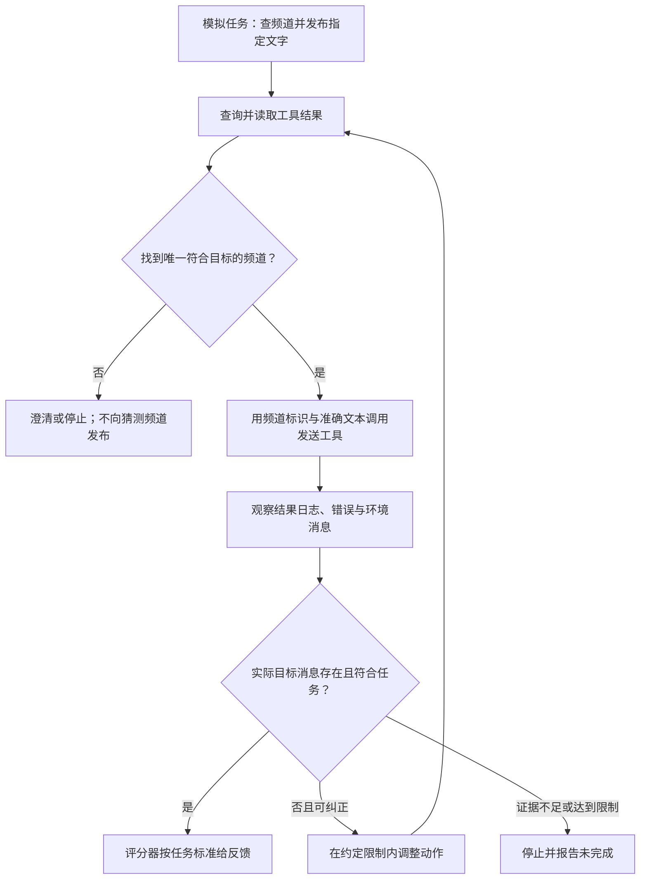
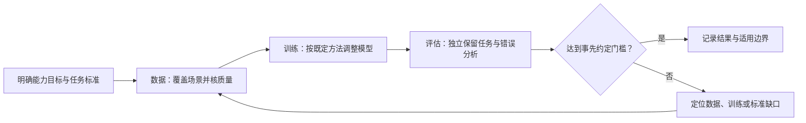
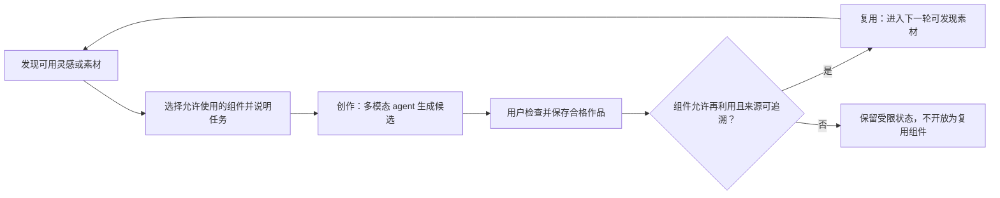

# M08 · AI 创作者平台：从研究型产品经理到发现、创作与复用

## 0. 三分钟速览

这场客座把模型能力建设的“数据—训练—评估”与创作者产品的“发现—创作—复用”连接起来，帮助我们分清技术投入、工作过程和用户想要的结果。

学完应能完成这些动作：

- 依据任务失败，判断应检查数据、算法/规模还是计算资源，并说明研究型产品经理怎样协作。
- 对照原图解释模拟环境中的任务、动作、观察、评分和奖励，指出“发出 Success”不证明真实部署成功。
- 区分预训练、监督微调、强化学习与一次普通工具调用，不把工具反馈都称为参数训练。
- 沿 harness 图追踪一次自拍转视频任务，辨认模型、工具、记录和核验分别做什么。
- 用成品与可复用组件说明产品目标，分开产品愿景、缺失 demo、已有证据与本人行为。

材料 v0.9，转录待补。日期沿课程日程；讲义只支持所载历史叙述，不提供所有人物经历或产品现状的独立证明。第五次反思的既有提交事实与本篇笔记制作分开：本篇不修改个人学习、出席、提交或评分状态。

## 1. 开始之前 · 知识衔接

### 1.1 当前需要恢复的前置

模型是把输入变为输出的计算系统；参数是训练会调整的数值。使用既有参数算一次回答，与训练改变参数，是两个动作。agent 则围绕目标选择步骤和工具；工具返回结果后，还需核对实际发生了什么。

这些概念的课程前文是 [[IS5542_GenAI_in_Business/notes/M01-导论-生成式AI基础与企业落地|M01]] 和 [[IS5542_GenAI_in_Business/notes/M03-AI-agent-从harness到部署|M03]]。本篇当页仍会恢复用于当前判断的含义，不需要先会写训练代码或 Slack 工具。

### 1.2 新概念怎样进入主线

研究型产品经理先在 p.8 提问，p.11 给协作分工，p.14–18 通过数据与环境展开；p.19 开始转到多模态应用，p.20 给发现/创作/复用，p.21 给系统框架，p.22–24 给用户目标、社区线索和愿景。英文词表在 §5 检索，不能代替这些当地解释。

### 1.3 来源、编号与三条学习路线

来源 ID 为 M08-MAK，唯一教学主源为 Markus Mak《A Founder Journey》，25 个 PDF 物理页。文件名含 social network for AI creators，Canvas Modules 称第五场客座，课程主题为 Digital Native；它们用于定位同一讲义。下文 p.1–25 都是此 PDF 的物理页，不借其他讲次补号。

预习按 §2 源页顺序读，先理解岗位和模型建设，再进入产品体验。课中用 §8 每页精确入口对应老师的当前页，图可打开原尺寸；复习用 §3–§6 归纳，再做 §7 的条件变式。没有跨页主题重排来取代逐页正文。

已见 p.22/23 的红叉占位和缺失图片，未取得转录、完整影片或真实产品运行日志。原件只读，所有“💡”和参考作答为笔记补充/推断；模拟行动没有在真实 Slack 或 yes& 执行。源版本哈希放在 §9 供追溯，具体教学/视觉/写回状态由各自回执记录。

## 2. 正文 · 按物理页跟读

### 2.1 p.1 · A Founder Journey

封面题为 A Founder Journey，署名 Markus Mak。本讲用讲者自述经历连接两个问题：研究型产品经理怎样参与模型能力建设，AI 创作者平台怎样围绕真实创作任务组织产品。它不是一份“只要模仿创业经历就会成功”的因果研究。

课程日程把 11/7 第五场客座标作 Digital Native；Canvas 文件标题是 social network for AI creators，正文封面则是本页标题。三者用于定位同一份 25 页讲义，不把文件名当成额外教学内容。讲义版本日期未明，人物经历与产品名均按源材料陈述。

（来源：讲义物理 p.1；💡 和参考作答为笔记补充。）

### 2.2 p.2 · A bit about me · St. Paul’s Co-educational College

讲者列 St. Paul’s Co-educational College (2018)，配学校建筑照片。这是其自述教育背景；括号年份原样保留，不擅自确定它指入学还是毕业。学校照片只承担背景身份说明，没有教学步骤或业务关系，因此用文字记录而不复制装饰图。

（来源：讲义物理 p.2；💡 和参考作答为笔记补充。）

### 2.3 p.3 · Go chess · strategy, tradeoffs and patience

课件原页 p.3；[打开清晰原图](figures/m08-creators/page-03.png)。

原页把围棋（Go）与 strategy、tradeoffs、patience 相连：策略是考虑多步目标，取舍是在有限资源下放弃某些选项，耐心是允许结果需要时间显现。棋盘黑白子示意提醒读者，一步的局部收益可能改变后续空间；本页并未给轮到谁、完整棋局或求最佳着法的题目。

💡 换个说法（笔记补充）：产品团队只有一周时间，可以先验证一个核心创作任务，也可以增加十个模型选项。选前者会放弃短期功能数量，换取“任务是否有用”的证据。这是取舍的产品例，不是围棋规则推导，也不是讲者已做过的实验。

（来源：讲义物理 p.3；💡 和参考作答为笔记补充。）

### 2.4 p.4 · UPenn · Physics + Business

原文为 UPenn, (Physics) + Business - friends, thinking (2023)，配 Penn 校园图。它说明讲者把物理/商业学习、朋友关系和思考联系起来；没有给正式学位、专业证书或成绩，不能把简短经历标签扩写成已验证学历组合。

与 p.3 的个人兴趣相接，这里仍是讲者回顾自己的能力来源。照片是地点背景，不承担可复做机制，故文字保留身份线索即可。

（来源：讲义物理 p.4；💡 和参考作答为笔记补充。）

### 2.5 p.5 · Research Product Manager at Bytedance

课件原页 p.5；[打开清晰原图](figures/m08-creators/page-05.png)。

页上写 Research Product Manager at Bytedance，配 SEEDANCE 2.0 影视式静帧。研究型产品经理（Research Product Manager）这个职务名是后面讨论的对象；静帧上的产品版本是材料当时的展示，不代表本笔记验证了当前发布情况或讲者在该产品的具体个人贡献。

先读文字认岗位，再看图片认它连接的是模型/生成内容研发环境。画面没有提示词、生成记录、基线或效果数字，不能只凭好看的静帧认定某个模型能力或生产效率。

（来源：讲义物理 p.5；💡 和参考作答为笔记补充。）

### 2.6 p.6 · Founder of yes&

本页列 Founder of yes& 并给 Logo，标出从研究型岗位转到创办应用的叙事节点。yes& 是后面 p.19–24 的产品主体，符号 & 是名称的一部分，不是两家公司的并列。

这里没有创立日期、融资、营收、用户规模或上线验收记录；“Founder”只按讲者自述登记，不为后面的产品愿景补造成熟度证明。Logo 不承担技术关系，因此不另提取。

（来源：讲义物理 p.6；💡 和参考作答为笔记补充。）

### 2.7 p.7 · Takeaway · 四项职业建议

讲义完整列四条：Stay at frontier；Take risks；Work hard + Smart；Develop relationships。可分别理解为关注前沿变化、承担经过考虑的风险、勤奋并改进工作方法、建立关系。这些是讲者个人建议，没有给对照研究证明它们必然带来创业成功。

💡 换个说法（笔记补充）：关注新模型后，挑一个小任务试其是否改善结果，是“关注前沿”的可检查动作；先限制投入与损失范围，再尝试未确定方向，是一种有边界的风险承担。建立关系可以帮助得到反馈，但不能替代产品证据，更不是绕过授权的理由。

（来源：讲义物理 p.7；💡 和参考作答为笔记补充。）

### 2.8 p.8 · What the heck is Research Product Manager?

中文读题入口：研究型产品经理究竟在模型研发中做什么？原文完整问句是：

> What the heck is Research Product Manager?

⚪ 参考作答（笔记推断，依据 p.11、14、17）：它在本讲里连接数据、训练和评估。先把要改善的能力转成可执行任务与数据要求，协调采集/标注和研究团队，再用评估结果判断是否真的改进；它不是只选择一个好听的模型名称。p.11 把数据工作分给 Researcher + Research Product Manager，但具体公司职责可能不同，不能把这张简表当所有企业的岗位标准。

英文参考答案（笔记自拟）：In this lecture, a Research Product Manager connects data, training, and evaluation. The role helps translate a capability goal into data and task requirements, coordinates with researchers, and uses evaluation evidence to guide the next iteration.

改条件例（笔记补充）：若问题是服务器吞吐不足，仍要与基础设施工程师合作；不能因为本岗位关注数据，就把所有问题都改成“多收数据”。

（来源：讲义物理 p.8；💡 和参考作答为笔记补充。）

### 2.9 p.9 · Attention to ChatGPT

课件原页 p.9；[打开清晰原图](figures/m08-creators/page-09.png)。

左侧三个小图比较连接方式。底部白圈 $x_1$ 等代表不同位置的输入，上方蓝圈代表处理后的表示，箭头/虚线表示哪些输入或前一状态参与计算。卷积神经网络（Convolutional Neural Network, CNN）图把邻近位置组合，逐层扩大可见范围；循环神经网络（Recurrent Neural Network, RNN）图沿左右蓝圈传递状态；自注意力（self-attention）图让不同位置的表示直接联系到多个输入位置。圆圈不是用户人数，连线不是社交关系。

💡 用三个词辨别（笔记补充）：处理“这件 灯具 好看”时，局部卷积先看相邻片段；循环处理把前面读到的信息传给后面；自注意力可以按相关程度利用多个位置的信息。此图是结构对照，没有权重、训练数据或实际计算结果；生成文本时还需按任务限制可见位置，不能从图上的全连接推断任何模型都可看到未来答案。完整数值机制可回到 [[IS5542_GenAI_in_Business/notes/M01-导论-生成式AI基础与企业落地|M01]]，本页只用这些差异理解研究工作的背景。

中间 Scale up 箭头把结构研究引向应用规模。右边是梗图，原文为“Me in 2040 dying in the operating table because my Doctor used ChatGPT To Pass medical school”。它表达对只靠工具过考试、缺少真实能力的担忧，不是医生行为调查、医疗建议或未来事件证据。扩规模到 ChatGPT 也不是仅乘一个数就足够的完整技术说明。

（来源：讲义物理 p.9；💡 和参考作答为笔记补充。）

### 2.10 p.10 · The Scaling Laws · Compute, Data, Model Size

课件原页 p.10；[打开清晰原图](figures/m08-creators/page-10.png)。

标题把扩展定律（scaling laws）与三项资源联系起来：算力 Compute、数据 Data、模型规模 Model Size。算力是可用于执行计算的资源；数据是模型训练用的样本；模型规模通常用可学习参数数量描述，参数是训练中被调整的数值。三者回答不同问题，买更多 GPU 不等于数据变得更正确。

原图是卡通示意：左边写 SCALE UP TRANSFORMER，右边 GPT-3，下方横轴 PARAMETERS、纵轴 ACCURACY，绿色折线向右上。读图只可得“讲义用更大规模与更高表现联系起来的直觉”；图无刻度、数据点、任务或拟合式，不能算多一倍参数会提高多少准确率，更不能保证所有任务单调改善。

💡 换个条件（笔记补充）：若新增样本全是重复错误答案，数据量虽大，目标能力未必变好；若算力固定，盲目扩大模型可能挤占可训练步数。研究判断要说明任务、数据质量与资源约束，再用评估检验。这里不补造扩展指数或当前模型排行。

（来源：讲义物理 p.10；💡 和参考作答为笔记补充。）

### 2.11 p.11 · How to improve a model?

本页原问和三项给定线索为：

> How to improve a model?
>
> - Algorithm + Model Size - Researcher + Infra Engineers
> - Data - Researcher + Research Product Manager
> - Compute - Infra Engineers

中文意思是：改善模型可以动哪三类条件，分别需要哪些协作者？算法与模型规模对应研究员和基础设施工程师；数据对应研究员和研究型产品经理；算力对应基础设施工程师（Infrastructure Engineers，原页缩写 Infra Engineers）。这是一份讲者的责任分工概括，不是严格互斥的组织边界。

⚪ 参考作答（笔记推断）：先在固定任务上找失败原因。若模型常误解专业答案，应检查数据/训练办法；若训练跑不动，要查计算与系统；若改架构或规模，要同时考虑研究设计与资源。英文参考答案（笔记自拟）：Improve a model by examining the algorithm and model size, the data, and the available compute. Diagnose the failure on a defined task and involve the relevant research, product, and infrastructure roles.

改变条件时不能固定只选一条：更多算力可能允许更复杂训练，但不会自动修好错误标签；更好的标签也不能消除服务器故障。

（来源：讲义物理 p.11；💡 和参考作答为笔记补充。）

### 2.12 p.12 · Compute · 从应用到底层资源

课件原页 p.12；[打开清晰原图](figures/m08-creators/page-12.png)。

原表从上到下读五层：Applications 是人使用的应用；AI models 学习并生成；Cloud providers 把计算资源提供出来；GPU servers & networks 执行大量运算并连接设备；Power & data centers 提供电力、散热与空间。图形处理器（Graphics Processing Unit, GPU）在这里是执行大量并行计算的硬件，不能与模型或应用混为一件东西。

💡 追踪例（笔记补充）：用户在视频应用按生成，应用把任务交给模型服务，模型计算需要服务器，服务器运行需要电力和散热。若数据中心容量不足，可能限制可运行任务；若应用上传接口坏了，增加 GPU 也不直接修好接口。这是说明依赖的例子，不是 yes& 已公开的部署架构或本轮真实请求。

表的上下表示基础设施依赖层，不表示某项成本可忽略，也没有给云平台价格、GPU 数量或能耗。

（来源：讲义物理 p.12；💡 和参考作答为笔记补充。）

### 2.13 p.13 · Algorithm + Model Size · 训练阶段

本页分预训练（pre-training）与后训练（post-training），后训练下列监督微调（Supervised Finetuning, SFT）和强化学习（Reinforcement Learning, RL）。训练要改变模型的可学习参数；一次使用模型生成视频/文字，则是在给定参数下计算输出，不能把每次生成都叫重新训练。

预训练从大量样本学习广泛模式。监督微调使用输入与示范答案，让模型朝这些示范调整；强化学习则让系统尝试动作/输出，按反馈奖励改善策略。💡 小例（笔记补充）：先学大量一般文本是广泛学习；再给“客服问题→经批准答案”示范，适合说明 SFT；让 agent 在模拟任务中行动，并由评分器核结果，连接下一页的 RL 环境。奖励设计若只看表面文字，可能鼓励表面达标而任务没完成。

这是阶段和数据角色的说明，不是完整优化算法或实际训练记录；讲义没有学习率、损失函数和参数更新数值。这里的核心是能分清示范、行动反馈和实际能力评估，不能声称已复现训练。

（来源：讲义物理 p.13；💡 和参考作答为笔记补充。）

### 2.14 p.14 · Data · 三类数据建设

原页列 Crowdsource Data、Expert Data、Complex Training Environments。众包数据（crowdsourced data）由较多参与者提供或标注，可覆盖多样表达；专家数据（expert data）来自有相关知识的人，用于需要专业判断的任务；复杂训练环境（complex training environments）提供可交互任务，让系统在多步行动中留下过程和结果。

💡 同一任务看区别（笔记补充）：普通用户可提供常见客服问法；专家可检查回答的专业准确性；模拟网站可让 agent 搜索、点击、检查订单状态，并记录它是否做完任务。数量、专业正确性和行动过程是不同价值，不能只按“数据越多越好”排序。三类都需说明来源、许可和质量检查；本页没有给供应商、样本量或成本。

（来源：讲义物理 p.14；💡 和参考作答为笔记补充。）

### 2.15 p.15 · Data · 模拟 Slack 的强化学习环境

课件原页 p.15；[打开清晰原图](figures/m08-creators/page-15.png)。

原图标题是 Example RL environment: Agent interacting with simulated Slack workspace，底部署 EPOCH AI | CC-BY 与 epoch.ai。左边 Task 的完整文字为：

> Find #engineering, post “Deployment status: Success”

这是一项图中模拟任务：找到指定频道，再发布指定文字；不是本笔记获准向真实 Slack 发消息的指令。频道（channel）是消息分组空间，`#engineering` 是要找的频道名。原图 Actions 线上有 `search_channel(query)` 和 `send_message(channel,text)`；前者查询频道，后者向指定频道写文本。

沿原图先从 Task 到 AGENT，再沿上方 Actions 到 ENVIRONMENT。环境在下方 Observations 回路返回 Tool results log 和 Error messages，即工具结果日志和错误消息；右边 Grader 根据环境/任务判定给 REWARD。评分器（grader）检查行为是否满足标准；奖励（reward）是反馈信号，不等于世界中所有事实都正确。

💡 手工追踪（笔记补充，未运行）：初始不知道频道位置。先调用 `search_channel` 查 engineering，读工具返回的频道标识，再将该标识和准确文字传给 `send_message`。如果工具返回成功，仍要核环境中目标频道是否出现这条消息；评分器据约定标准判任务成功。任务只是发布这句话，不证明现实部署真的成功。若查询无结果、同名频道无法区分或写入报错，就不能先报成功。

下面把原图的观察回路补成可执行的判断顺序；重试上限/转人工是笔记补充的控制边界，原图未给具体次数：

中文任务解析：对象是指定频道和指定文本，动作依次是查找、确认、发送、观察、核验。⚪ 英文参考（笔记自拟，非执行记录）：Search for the intended channel, use the returned channel identifier to post the exact text, and verify the message in the simulated environment. Report failure or uncertainty if the channel or tool result cannot be confirmed.

动作日志和奖励可成为训练资料，但原图没有画参数更新步骤；不能把“工具返回一次奖励”写成“模型权重已自动更新”。若评分器只找任何地方有 Success，却不查频道，系统可能拿到奖励仍违背任务，这是奖励标准需要检查的边界。

（来源：讲义物理 p.15；💡 和参考作答为笔记补充。）

### 2.16 p.16 · Data · 回到三类建设手段

本页再次完整列 Crowdsource Data、Expert Data、Complex Training Environments，文字与 p.14 相同，没有新增数量或第四类。相邻页的变化是：读过 p.15 后，“训练环境”不再只是抽象名词，而可指任务、动作、观察和评分共同构成的可交互系统。

按 [[#2.14 p.14 · Data · 三类数据建设|p.14]] 唤醒三类用途，再把 p.15 的日志与评分放回第三类。真实参与者提供数据、专家判标准、环境留下行为证据可以合作，不能把它们硬分成互不重叠的人群。此页为文字重复，复用解释，不复制一张无新增的文字图。

（来源：讲义物理 p.16；💡 和参考作答为笔记补充。）

### 2.17 p.17 · Research Product Manager · Data, Train, Eval

三条原词是 Data、Train、Eval。数据 Data 是用什么任务与样本；训练 Train 是怎样据样本/反馈调整参数；评估 Eval（evaluation）是用明确标准检查输出/行为是否满足目标。三者要连接，不能以“训练跑完”代替“能力提高”。

💡 一次闭环（笔记补充）：目标是把消息发到正确频道。先准备不同频道名与失败情境的数据，研究团队按既定方法训练，再用没有用于训练的保留任务评估。若在同名频道处常发错，回查任务与数据是否覆盖这种区别，并修正后重新比较。保留任务（held-out tasks）是先留出来检验的任务，不能训练时用其答案又称它独立检验。

下面箭头表示工作的反馈依赖，不保证每轮都会改善；达到事先约定的任务门槛后保留结果，不能无限用评估答案调到好看为止。

该图是解释三项怎样协作的笔记补充；讲义没给 yes& 或 ByteDance 的具体训练指标、门槛或成功率。

（来源：讲义物理 p.17；💡 和参考作答为笔记补充。）

### 2.18 p.18 · Biggest Questions in AI Model Training

原页给三项问题，不能只抄标题而不回答：

> How to get better and more data
>
> How to get more compute
>
> How to be recursive

第 1 问同时问质量与数量。⚪ 参考作答（笔记推断）：先定位欠缺的任务/人群，再按 p.14 的众包、专家或训练环境获取对应样本，检查错误、重复和来源；“更多”不抵消错误标注。英文参考：Obtain data targeted at observed capability gaps, using suitable contributors and environments, and check quality and coverage rather than counting samples alone.

第 2 问问怎样得到更多计算资源。⚪ 参考作答（笔记推断）：明确训练/使用任务需要什么资源，与基础设施团队评估云资源、服务器、网络和电力容量，再比较预算与瓶颈。这里不是建议购买某型号。英文参考：Assess the workload and bottleneck, and coordinate infrastructure capacity, including servers, networks, and data-center resources, within the available budget.

第 3 问的 recursive 未在讲义定义，不能假定指模型已能全自动自我改进。⚪ 有条件参考作答（笔记推断）：若它指利用一次结果开启下一轮，可用 p.17 的“评估→找缺口→改数据/训练→再评估”解释；每轮仍需外部任务标准和独立检查。英文参考：If recursive means using results to drive the next improvement cycle, feed evaluated failures back into data or training changes and check the next version independently. The slide does not define a fully autonomous self-improvement mechanism.

改条件例（笔记补充）：若评估题已被反复用于调参，得分提高可能只反映记住这些题；应另留未用于改进决策的检验材料，不把循环次数当通用能力证据。

（来源：讲义物理 p.18；💡 和参考作答为笔记补充。）

### 2.19 p.19 · yes& · Multimodal Application

这里从基础模型建设切换到多模态应用（multimodal application）。模态是信息形式，如文字、图片、音频和视频；多模态应用让任务涉及不止一种形式，例如给自拍与文字描述，输出视频。

本页只有 yes& 的产品类别标题，具体体验在 p.20、系统框架在 p.21、目标用户任务在 p.22。不能由应用采用多模态就推断它自研所有底层模型，也不能把标题当作已运行 demo。

（来源：讲义物理 p.19；💡 和参考作答为笔记补充。）

### 2.20 p.20 · Remix Native Platform · Discover, Create, Reuse

课件原页 p.20；[打开清晰原图](figures/m08-creators/page-20.png)。

左侧三步原文分别是：Discover — A Pinterest-style experience optimized for remix discovery.；Create — A multimodal agent turns inspiration into new assets.；Reuse — Content breaks down into building blocks and feeds back into the ecosystem. 右边是瀑布流式内容网格，作品卡片大小/排列帮助浏览灵感；小字不是完整产品操作记录。

再创作（remix）在这里指把已有创意或可用素材重新组合成新作品。“原生”（native）说明讲者希望发现、制作和复用在同一产品体验里相接，不是做完后再随意搬运。内容组件（building blocks）可以是可单独复用的素材/步骤；本页没具体列哪些对象可拆，所以不能声称每段音乐、人物或提示词都已开放复用。

💡 走一条补充例：用户发现一种海边光线风格，选自己有权使用的参考与自拍，描述要做的短片；agent 帮生成候选，用户核身份/画面后保存；只有允许复用且可追溯的部分才进入下一人的素材选择。下面图说明本页三步怎样回流，授权检查是笔记补充，不冒称 yes& 已实现全部控制：

能生成作品不等于别人可以复用，也不等于平台已取得全部权利。这里讲产品控制需要区分的状态，不提供具体法域的权利认定。

（来源：讲义物理 p.20；💡 和参考作答为笔记补充。）

### 2.21 p.21 · Multimodal Agent · harness 原图

课件原页 p.21；[打开清晰原图](figures/m08-creators/page-21.png)。

原图以 Model（reasons → decides）为中心，外虚线框写 Agent / HARNESS。模型负责推理并选择下一动作；运行支架（harness）指把上下文、控制、工具、持久记录和核验组织起来的周边系统，不能把虚线框里的全部功能都归给模型本体。

从上往下读 Context Injection：prompts、memory、skills、conversation 是注入的提示、记忆、技能和对话信息，箭头进入模型。左侧 Control 写 compaction、orchestration、ralph loops；当前需要理解前两者是压缩整理上下文与协调任务，ralph loops 是原图未展开的特定循环标签，不能凭名称补成已核实现。右侧 Action 的实线从模型向外，标 calls bash, tools, MCPs；虚线把 results back to context 返回，说明调用结果要再进入后续决策。Bash 是一种命令解释环境；模型上下文协议（Model Context Protocol, MCP）是连接工具/资料的一类接口约定，名称不等于获得无限权限。

下方 Persist 用 writes / reads 表示写入和读取 filesystem、git、progress files，即文件、版本记录和进度文件。右下 Observe & Verify 指浏览器截图、测试结果和日志，箭头让行动后的证据回到模型；不是模型说“已完成”就视作核验。图上的读写/回传方向要和动作联系，不把全部箭头当生成素材本身。

💡 追踪一个自拍转短片请求（笔记补充，未运行）：上下文给自拍、目标时长和风格；控制模块安排步骤；模型选择获准图像/视频工具；工具返回任务状态或失败；系统记录素材版本和进度；再看实际片段、时长和日志。若人物变形，返回修改；若工具报错或缺必要授权，就停止并说明缺口。模型可能只见工具结果摘要，是否真有截图/测试权限取决于环境，本图不证明 yes& 已逐项实现。

本页原图与 p.15 有共同的“行动→观察→后续决策”结构，但用途不同：p.15讨论训练环境与奖励，此处讨论应用运行。保存结果、读取记忆或接到工具反馈，都不自动表示模型参数重新训练。当前只解释原图职责与一个任务路径，没有执行 Bash、工具、MCP、Git 或上传。

（来源：讲义物理 p.21；💡 和参考作答为笔记补充。）

### 2.22 p.22 · Our Users · Who, Intent, Outcome

课件原页 p.22；[打开清晰原图](figures/m08-creators/page-22.png)。

原文三项为：Who — People with aesthetics, not people who compare models；Intent — “Turn this selfie into a cinematic lifestyle video”；Outcome — A 5–8 s polished video, ready to publish and remix。用户目标是得到符合审美的成品，模型比较不是其主要任务。这是讲者的目标用户定位，不证明所有用户都如此，也没有用户研究样本支持普遍结论。

把意图（intent）转成可验收结果（outcome）：输入是“这张自拍”和影视生活方式风格，输出目标是 5–8 秒视频。💡 笔记补充：还应和用户确认人物保真、画幅、动作、声音及可用素材；这些验收细节不是原页给定条件。5–8 s 指成品时长，不是生成延迟或用户等待时间。ready to publish and remix 是产品期望，不等于这份材料证明所有作品都已获发布/复用许可。

右边可见细框和红色交叉线，是未显示素材的占位，不是视频画面。保留原貌并登记缺口，不能编造用户表情、片段内容或成功 demo。

（来源：讲义物理 p.22；💡 和参考作答为笔记补充。）

### 2.23 p.23 · Community · 缺失素材占位

课件原页 p.23；[打开清晰原图](figures/m08-creators/page-23.png)。

本页标题 Community，右边同样是空框与红色交叉线，没有可识别社区截图、成员、互动数或功能标签。因此只能确认讲义把社区（community）作为话题，不能据占位框声称有评论、关注、收益分享或既定审核流程。

💡 与 p.20 的产品逻辑相连（笔记补充）：作品被发现、再创作并回流，可能给创作者持续参与的理由；是否形成社区还要看真实贡献和回访，不能用注册量代替。若要比较是否有帮助，可以先定义同口径的创作后回访或合格再创作记录；本页没有这些实测数据。

（来源：讲义物理 p.23；💡 和参考作答为笔记补充。）

### 2.24 p.24 · Vision · Marketplace, Camera + Social

原页列 Marketplace 和 Camera + Social，放在 Vision 标题之下。市场平台（marketplace）指让不同参与者交换产品/服务或创作组件的设想；相机加社交（Camera + Social）把拍摄/输入素材与互动传播相接。标题的地位是愿景，不是本轮确认的上线功能、商业模式或收费承诺。

💡 条件分析（笔记补充）：若未来允许组件交易，需要先定义卖的对象、可用范围、来源记录和分配方式；若只允许个人保存，就不能按可自由转售来设计。相机输入也要明确拍的是谁、允许怎样使用以及何时对外分享。此处只帮助识别产品选择，未读取真实平台规则、未开通交易或访问相机。

（来源：讲义物理 p.24；💡 和参考作答为笔记补充。）

### 2.25 p.25 · Questions · 结束与职业联系入口

本页只写 Questions，并给 Markus Mak 的职业联系卡和二维码，卡上有 Hiring | Ex-Bytedance Seed。没有具体提问题干、选项或答案，因此这是 Q&A 邀请，不编造成另一道课堂考试题。

职业联系卡不承担教学机制，未复制其中人像/二维码，也未扫描、关注、发消息或求职。课堂标题不改变本人求职外部操作的最终确认要求；本篇只到学习材料为止。

（来源：讲义物理 p.25；💡 和参考作答为笔记补充。）

## 3. 一图看懂

本讲有两条闭环，表中的箭头是工作反馈，不表示能力或业务结果必然提高。

| 闭环 | 先得到什么，再改变什么 | 应检查的证据 | 正文入口 |
|---|---|---|---|
| 能力建设 | 数据与训练→评估→定位缺口→下一轮数据/训练 | 保留任务上的行为与错误；是否泄漏了评估答案 | [[#2.17 p.17 · Research Product Manager · Data, Train, Eval\|p.17]] |
| 创作生态 | 发现灵感→生成合格作品→允许复用的组件→下一轮发现 | 成品质量、来源、可用范围与实际回流 | [[#2.20 p.20 · Remix Native Platform · Discover, Create, Reuse\|p.20]] |

p.15 的训练环境提供行动和反馈证据；p.21 的 harness 组织一次应用运行。两者都有观察回路，但应用中的反馈不自动等于训练参数更新。

## 4. 速查表

每行把一个容易误读的对象与判断条件配对。

| 对象 | 当前判断规则 | 回指 |
|---|---|---|
| 研究型产品经理 | 连接任务、数据、训练与评估；讲义分工不是各公司的统一岗位标准 | [[#2.8 p.8 · What the heck is Research Product Manager?\|p.8]] |
| 扩展图 | 无刻度的卡通示意不能给参数翻倍收益或所有任务保证 | [[#2.10 p.10 · The Scaling Laws · Compute, Data, Model Size\|p.10]] |
| 三类数据手段 | 众包覆盖多样表达，专家作相关专业判断，环境记录多步行为 | [[#2.14 p.14 · Data · 三类数据建设\|p.14]] |
| 训练环境 | 任务→动作→观察→评分；奖励标准本身也可能有缺口 | [[#2.15 p.15 · Data · 模拟 Slack 的强化学习环境\|p.15]] |
| 评估 | 先定标准并保留未用于训练/调节的材料，再比较版本 | [[#2.17 p.17 · Research Product Manager · Data, Train, Eval\|p.17]] |
| recursive | 原页未定义；条件式闭环解释不能变成已实现自主自我改进 | [[#2.18 p.18 · Biggest Questions in AI Model Training\|p.18]] |
| harness | 模型、上下文、控制、工具、持久记录和核验分工 | [[#2.21 p.21 · Multimodal Agent · harness 原图\|p.21]] |
| 5–8 s | 目标成品时长，不是生成等待时间或成功率 | [[#2.22 p.22 · Our Users · Who, Intent, Outcome\|p.22]] |
| Marketplace / Camera + Social | Vision 中的设想，不据标题认定现行功能 | [[#2.24 p.24 · Vision · Marketplace, Camera + Social\|p.24]] |

## 5. 双语术语卡

英文定义为笔记自拟应试参考，非嘉宾逐字定义；技术用途和边界在正文当地解释。

| 中文 | English | 英文参考定义 | 本篇展开 |
|---|---|---|---|
| 研究型产品经理 | Research Product Manager | A role connecting capability goals, data requirements, training collaboration, and evaluation evidence. | p.8、17 |
| 算力 | Compute | Computing resources available to execute a workload. | p.10、12 |
| 模型规模 | Model size | The size of a model, often described by its number of learnable parameters. | p.10 |
| 预训练 | Pre-training | Training on broad data to learn general patterns before later adaptation. | p.13 |
| 监督微调 | Supervised Finetuning (SFT) | Adjusting a model using input and target-response examples. | p.13 |
| 强化学习 | Reinforcement Learning (RL) | Learning a policy from feedback on actions or outputs under a reward criterion. | p.13、15 |
| 众包数据 | Crowdsourced data | Data or annotations obtained from a broad group of contributors. | p.14 |
| 专家数据 | Expert data | Data or judgments supplied by people with relevant domain knowledge. | p.14 |
| 训练环境 | Training environment | An interactive setting that supplies tasks, observations, action consequences, and feedback. | p.15 |
| 评分器 | Grader | A component that checks results against a stated task criterion. | p.15 |
| 奖励 | Reward | A feedback signal defined by a criterion; it is not a guarantee of general correctness. | p.15 |
| 评估 | Evaluation | Checking behavior or outputs against defined standards on suitable test tasks. | p.17 |
| 多模态 | Multimodal | Involving more than one information form, such as text, images, or video. | p.19 |
| 再创作 | Remix | Recombining usable creative elements into a new work. | p.20 |
| 内容组件 | Building blocks | Separately usable creative elements under defined scope and provenance. | p.20 |
| 运行支架 | Harness | The surrounding system that organizes context, control, tools, records, and verification. | p.21；沿 M03 既有概念 |

## 6. 考点预判与答题框架

本篇无转录，不列教授明示。客座内容进期末的既有公告不证明本篇提问会原样出题。

🟡 CILO 反推：解释商业应用与基础模型工作的联系，可以用“目标任务→数据/算力/训练选择→评估→可接受结果”。英文参考框架（笔记自拟）：The capability goal is … . The observed failure suggests a gap in … . The team changes … and evaluates the next version on … . This evidence supports … but does not establish … .

🟡 CILO 反推：分析多模态 agent 时，沿一次输入逐项写出上下文、模型决策、工具动作、观察证据和输出，不只列模型名。英文参考句（笔记自拟）：The model selects an action, while the surrounding harness manages context, tools, records, and verification. A tool response is checked against the task before completion is claimed.

⚪ 笔记推断：产品设计题可用“用户是谁、要得到什么、怎样验收、哪些部分可再利用、依据是什么”组织。ready to publish 是目标，材料中的红叉占位与 Vision 都不能证明部署和许可已经完成。

## 7. 自测

### 7.1 频道错了，奖励仍为正

模拟任务要求在 `#engineering` 发布指定文字。agent 发到另一个频道，评分器只搜到 Success 就给正奖励。该任务成功了吗？该改哪个判断？

答案与理由

没满足完整任务，因为目标包含频道和文本。评分器要核准确频道标识与实际消息，不能只匹配 Success。修评分标准和对应任务记录，再检查模型行为；高奖励不证明正确目标完成。即便发对，也只证明模拟发布任务，不证明真实部署健康。回到 [[#2.15 p.15 · Data · 模拟 Slack 的强化学习环境|p.15]]。

英文参考（笔记自拟）：The task is not satisfied because the message is in the wrong channel. The grader must check both the intended channel and the exact message, rather than the presence of the word Success alone.

### 7.2 扩规模能修哪类问题？

系统的专业答案标签大量错误；另一个系统因服务器资源不足不能完成训练。能否都只通过增加模型参数解决？

答案与理由

不能。前者先检查数据标准与专家核对，参数更多不使错误标签变真；后者先查计算和基础设施约束，扩大模型还可能增加资源需求。具体效果要固定任务比较，卡通扩展图不能给保证。回到 [[#2.10 p.10 · The Scaling Laws · Compute, Data, Model Size|p.10]]、[[#2.11 p.11 · How to improve a model?|p.11]]。

英文参考（笔记自拟）：Incorrect labels call for data-quality work, while a capacity bottleneck calls for infrastructure diagnosis. Increasing parameter count alone does not resolve either problem by definition.

### 7.3 已生成、已保存、已训练是同一件事吗？

多模态工具返回一段视频，harness 保存文件和日志。团队说“模型从这次反馈自动学会了新风格”。哪些证据还没有？

答案与理由

已有的是生成结果与持久记录。缺的是是否真的执行训练、用了哪些数据/反馈、参数怎样更新，以及独立评估是否显示能力改变。保存文件和给下次上下文提供记忆，不等于更新模型参数。先核真实训练过程和结果，不能凭 agent 回路推断。回到 [[#2.13 p.13 · Algorithm + Model Size · 训练阶段|p.13]]、[[#2.21 p.21 · Multimodal Agent · harness 原图|p.21]]。

英文参考（笔记自拟）：Generating and saving an asset does not establish a parameter update. Evidence of an actual training procedure and independent evaluation would be needed to claim a learned capability change.

### 7.4 5–8 秒与红叉框说明什么？

有人据 p.22 宣称 yes& 已现场在 5 秒内做出所有可自由复用的视频。指出这句话怎样越过材料。

答案与理由

5–8 s 是目标视频时长，没有生成延迟数据；红叉框不是实际播放，不能称现场成功；publish/remix 是预期结果，未提供对所有作品的权利/可用范围核验。应只说讲义将目标用户任务定位为把自拍变成 5–8 秒的精致视频，演示和许可细节待核。回到 [[#2.22 p.22 · Our Users · Who, Intent, Outcome|p.22]]。

英文参考（笔记自拟）：The slide specifies the intended output duration, not generation latency. Its placeholder does not verify a live demo or unrestricted reuse rights.

### 7.5 重复调评估题，得分上升算独立证据吗？

团队每轮看同一套题的答案来修改数据，再用同一套题宣布通用能力提高。应怎样保留有效检验？

答案与理由

这套题已参与改进决策，不再是独立于该过程的保留检验。可以继续用它诊断已知错误，但须另保留未用于这些决策的材料，按相同任务标准核新版本。不能用循环次数或同题分数单独支持泛化。回到 [[#2.17 p.17 · Research Product Manager · Data, Train, Eval|p.17]]、[[#2.18 p.18 · Biggest Questions in AI Model Training|p.18]]。

英文参考（笔记自拟）：Keep separate tasks that have not been used to guide those changes. Repeatedly optimizing against the same answers can improve that set without establishing broader capability.

## 8. 讲义页码映射

来源均为 M08-MAK，页码为物理页。未见贯穿全篇的独立印刷号；无转录，实际课堂覆盖未知。

| 物理页 | 原标题/页面身份 | 正文入口 | 图/非内容处置 |
|---|---|---|---|
| p.1 | A Founder Journey | [[#2.1 p.1 · A Founder Journey\|p.1 正文]] | 纯身份/背景；照片/Logo不承担机制 |
| p.2 | A bit about me · St. Paul’s Co-educational College | [[#2.2 p.2 · A bit about me · St. Paul’s Co-educational College\|p.2 正文]] | 纯身份/背景；照片/Logo不承担机制 |
| p.3 | Go chess · strategy, tradeoffs and patience | [[#2.3 p.3 · Go chess · strategy, tradeoffs and patience\|p.3 正文]] | M08-P03 原图及当地读法 |
| p.4 | UPenn · Physics + Business | [[#2.4 p.4 · UPenn · Physics + Business\|p.4 正文]] | 纯身份/背景；照片/Logo不承担机制 |
| p.5 | Research Product Manager at Bytedance | [[#2.5 p.5 · Research Product Manager at Bytedance\|p.5 正文]] | M08-P05 原图及当地读法 |
| p.6 | Founder of yes& | [[#2.6 p.6 · Founder of yes&\|p.6 正文]] | 纯身份/背景；照片/Logo不承担机制 |
| p.7 | Takeaway · 四项职业建议 | [[#2.7 p.7 · Takeaway · 四项职业建议\|p.7 正文]] | 文字教学已保留，不另搬文字图片 |
| p.8 | What the heck is Research Product Manager? | [[#2.8 p.8 · What the heck is Research Product Manager?\|p.8 正文]] | 文字教学已保留，不另搬文字图片 |
| p.9 | Attention to ChatGPT | [[#2.9 p.9 · Attention to ChatGPT\|p.9 正文]] | M08-P09 原图及当地读法 |
| p.10 | The Scaling Laws · Compute, Data, Model Size | [[#2.10 p.10 · The Scaling Laws · Compute, Data, Model Size\|p.10 正文]] | M08-P10 原图及当地读法 |
| p.11 | How to improve a model? | [[#2.11 p.11 · How to improve a model?\|p.11 正文]] | 文字教学已保留，不另搬文字图片 |
| p.12 | Compute · 从应用到底层资源 | [[#2.12 p.12 · Compute · 从应用到底层资源\|p.12 正文]] | M08-P12 原图及当地读法 |
| p.13 | Algorithm + Model Size · 训练阶段 | [[#2.13 p.13 · Algorithm + Model Size · 训练阶段\|p.13 正文]] | 文字教学已保留，不另搬文字图片 |
| p.14 | Data · 三类数据建设 | [[#2.14 p.14 · Data · 三类数据建设\|p.14 正文]] | 文字教学已保留，不另搬文字图片 |
| p.15 | Data · 模拟 Slack 的强化学习环境 | [[#2.15 p.15 · Data · 模拟 Slack 的强化学习环境\|p.15 正文]] | M08-P15 原图及当地读法 |
| p.16 | Data · 回到三类建设手段 | [[#2.16 p.16 · Data · 回到三类建设手段\|p.16 正文]] | 文字教学已保留，不另搬文字图片 |
| p.17 | Research Product Manager · Data, Train, Eval | [[#2.17 p.17 · Research Product Manager · Data, Train, Eval\|p.17 正文]] | 文字教学已保留，不另搬文字图片 |
| p.18 | Biggest Questions in AI Model Training | [[#2.18 p.18 · Biggest Questions in AI Model Training\|p.18 正文]] | 文字教学已保留，不另搬文字图片 |
| p.19 | yes& · Multimodal Application | [[#2.19 p.19 · yes& · Multimodal Application\|p.19 正文]] | 文字教学已保留，不另搬文字图片 |
| p.20 | Remix Native Platform · Discover, Create, Reuse | [[#2.20 p.20 · Remix Native Platform · Discover, Create, Reuse\|p.20 正文]] | M08-P20 原图及当地读法 |
| p.21 | Multimodal Agent · harness 原图 | [[#2.21 p.21 · Multimodal Agent · harness 原图\|p.21 正文]] | M08-P21 原图及当地读法 |
| p.22 | Our Users · Who, Intent, Outcome | [[#2.22 p.22 · Our Users · Who, Intent, Outcome\|p.22 正文]] | M08-P22 原图及当地读法 |
| p.23 | Community · 缺失素材占位 | [[#2.23 p.23 · Community · 缺失素材占位\|p.23 正文]] | M08-P23 原图及当地读法 |
| p.24 | Vision · Marketplace, Camera + Social | [[#2.24 p.24 · Vision · Marketplace, Camera + Social\|p.24 正文]] | 文字教学已保留，不另搬文字图片 |
| p.25 | Questions · 结束与职业联系入口 | [[#2.25 p.25 · Questions · 结束与职业联系入口\|p.25 正文]] | Q&A邀请/职业联系；二维码非教学机制，未复制/扫描 |

## 9. 延伸与勘误

### 9.1 课件有但课上略过

无本讲转录，不能判断哪些页被略过。p.22/23 的红叉只证明这份 PDF 未显示对应素材，不证明现场未播放或未讨论。

### 9.2 课上讲了但课件没有

待取得可靠转录再补；不编造 Q&A、嘉宾对 recursive 的具体口头定义、演示结果或教授考试承诺。

### 9.3 原件问题与概念口径

- 标题有课程主题 Digital Native、Canvas 文件名 social network for AI creators 与正文 A Founder Journey 三种定位；按同一 25 页原件处理，不假造额外讲义。
- p.9 是 CNN/RNN/self-attention 结构示意与梗图，不是完整架构史或医疗证据；p.10 坐标没有刻度/实测点，不能据它计算扩展收益。
- p.13 只有训练阶段名称，p.15 有环境反馈但无参数更新算法；当前只教职责和反馈机制，不冒称已复现模型训练。
- p.18 的 recursive 与 p.21 的 ralph loops 未展开定义。前者按条件作闭环解释，后者保留原标签和范围，不凭名称虚构技术实现。
- p.20 只说 building blocks，没有具体组件模式、开放权限或交易规则；p.21 是运行框架图，不证明 yes& 实际接通其列出的每种工具。
- p.22/23 可见红叉占位，缺实际成品/社区画面。5–8 s 是目标成品时长，不能当延迟。p.24 Vision 保留愿景地位；p.25 Questions 是开放邀请，不是给了具体题干。

### 9.4 笔记补充与来源追溯

原件相对路径：`IS5542_GenAI_in_Business/course_files_export/canvas-20261118/IS5542-GuestLecture-social network for AI creators.pdf`。SHA-256：`2288ab38a304e7179a5c6e20a3d46c6c5e0ec90be3c8279777b90b42e0461585`。

p.15 原图自带 Epoch AI / CC-BY / epoch.ai 署名，原图保留该归属；本轮只用所供讲义，未读取其网站原文。手工模拟轨迹、三张补充 Mermaid、灯具/客服例、评估隔离解释和自测均为笔记补充；来源/角色分工不冒充讲者逐字原话或公司已实施流程。没有外部产品现状、模型规格或法律现行性核验。

### 9.5 仍需的材料与状态

待补转录/课堂首尾、完整视频/产品交互、p.22/23 缺图、recursive/ralph loops 的来源定义、产品实际训练/评估方案、平台当前功能与组件可用范围。可学范围是本 PDF 已见框架、例子、原题与明确边界，不给未取得内容盖“完整”标签。

本篇未制作或提交正式反思稿。既有 A06 回执为 2026-11-07 13:50（香港时间）Canvas Submitted；本轮只回读本地权威任务说明承接该历史，没有再次上传/提交、未核新成绩。笔记、个人反思、本人通读和自测分别记状态。最终教学独审、显示、正文写回、课程元文件/Notion 与 Git 同步按实际回执记录。
