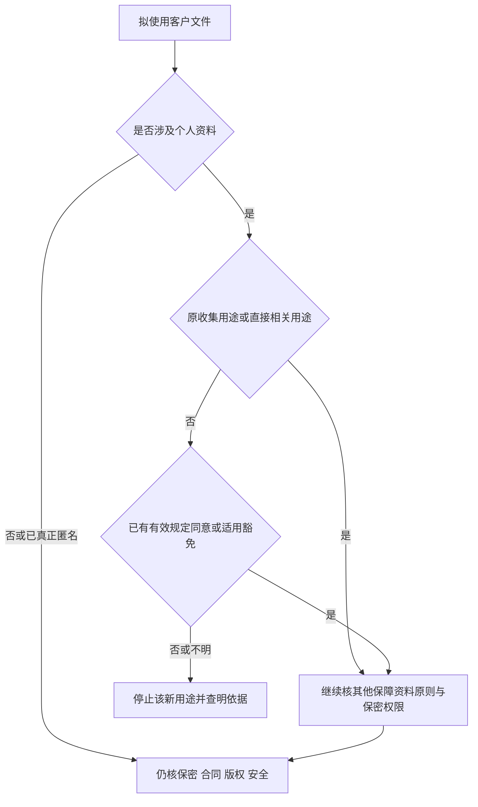

# M09 · AI 法律问题：作品、建议、自动驾驶与客户资料

> 讲义稿候选，尚未独立审查或正式发布。以讲义为课程事实来源；参考作答不是讲者的官方答案。本篇不是个案法律意见。没有本讲转录，不能判断讲者实际强调、跳过或口头修正了什么。

## 0. 三分钟速览

AI 参与工作，并没有让既有法律失效。要追踪的是：谁控制什么行为，用了什么资料，影响了谁，哪条义务在什么条件下适用。

学完本篇应能：
- 区分“输出有无版权”“谁是作者”“谁拥有权利”“训练是否侵权”四个问题。
- 用具体事实解释专业人士为何不能把核验责任交给 AI。
- 区分驾驶功能等级、事故调查、民事赔偿和刑事责任。
- 对客户资料依次检查个人资料、新用途、同意或例外、保密及工具接收方。
- 分别从刑事、民事、公平和操纵问题分析 Meridian，不用“AI 的错”结束答案。

## 1. 开始之前 · 知识衔接

### 1.1 当前需要的起点

本篇不用编程或大学数学。先恢复三个区别：模型生成一段像答案的文字，不等于它读过真实判词；检索找到了网页，不等于网页权威、有效或适用本地；人按了批准按钮，不等于人真正理解、核验并有权阻止错误。

“训练（training）”是用资料改变模型内部参数；“推理（inference）”是用已训练模型处理本次输入。“把客户文件上传并提问”和“用客户文件更新模型”技术上不同，但都可能涉及资料披露和用途限制。这个区别贯穿 p.21、45–49。

### 1.2 本讲新概念的入口

版权作者与电脑产生作品见 p.12–20；训练复制与公平使用见 p.21–25；专业谨慎标准见 p.28–33；驾驶任务分工见 p.35–43；新用途、保密和自动化决定见 p.45–49；重大疏忽误杀和多方责任见 p.52–61。术语卡只供复习，正文会在用到概念时解释。

### 1.3 来源与三条学习路线

唯一讲义源 S1 是 `IS5542-Guest Lecture6.pdf`，65 个物理页；封面写 2026-11-14 演讲，另写 Updated as of 5/10/2026。二者不是同一日期，后者不能证明所有内容已更新至演讲当天。本篇按物理页序，不假造印刷页码。

- 预习：顺读 §2。先看中文问题，再读英文原题，最后用解释复述条件答案。
- 课中：用 §8 每页一行的精确入口；教学原图放在对应页旁。
- 复习：从 §3–§7 提取规则；需要理由时回到相应页，不能只背地区标签。

法律资料核对主要承接 2026-11-18 旧批下载与已记录阅读范围，另补 2026-11-19 官方来源检索。未拿到的现行条文、程序终局结果和完整判词明确保留待核。读到官方摘要不冒称读过原判，下载成功不冒称全文已审。

先读程序词：**争点**是法院在某个阶段要回答的问题。请求获准继续，可能只说明它没有在程序早期被挡住；不是已证实因果、应赔钱或有罪。实体责任判断才处理证据和相应法律条件。和解是当事人结束争议的安排，不等于法院判定责任或当事人承认指控。上诉则是请更高层法院审查可上诉的决定；提起上诉不等于已推翻判决。

民事责任通常处理私人损害与救济，刑事程序处理是否达到定罪条件，法庭制裁也可以只处理提交或诉讼行为。本讲用这些词读案例，而非规定各法域都有相同程序或顺序；对照 p.30、p.42、p.60。

## 2. 逐页精读

### 2.1 p.1 · 法律问题与免责声明

讲者为 Jacky CHA Ho Wa，封面列香港及大湾区律师等资格。本次题目是 Legal Issues Related to AI。红字说讲义仅作资讯，不构成专业意见或法律意见。它说明材料用途，不能理解成“所有 AI 输出加免责声明就免除责任”。是否存在义务和违反义务，仍要看实际服务与事实。来源：S1 p.1。

### 2.2 p.2 · 今日路线

路线先解释技术人员为什么关心法律，再依次讨论创作版权、建议致害、自动驾驶、客户资料，最后用 Meridian 医院把法律与道德放到同一情境。每一部分都在问“谁做了什么”，但法律问题不同。作品归属不直接回答事故谁赔，客户同意也不直接回答作品许可。来源：S1 p.2。

### 2.3 p.3 · 为什么关心法律

这是 Part 1 分隔页，没有独立法律规则；下一页开始从代码到现实影响的解释链。不能从分隔页推断讲者省略了什么。来源：S1 p.3。

### 2.4 p.4 · 代码到法律风险的四步

代码先产生决定，例如把某人排在资源分配队列后面；这个决定影响真实的人；一旦发生损害，法律再判断有关主体是否负有义务、是否违反、损害与行为有无足够联系，最后决定可能的救济或处罚。讲义将它压缩为“代码→人→损害→法律风险”。

💡 笔记补充：医院软件漏看一项紧急信号，可能使医生延误处理。调查不只看最后一句输出，还会看开发测试、医院部署和医生怎样使用。因此法律会反过来影响设计：要留版本、测试结果、可追踪日志及升级机制。但“有人受损”并不自动证明某人违法，更不自动证明程序员有罪。来源：S1 p.4。

### 2.5 p.5 · 既有法律已经适用

“还没有专门 AI 法”不等于“可以随便做”。版权法（copyright law）管作品与复制；疏忽（negligence）追问是否未尽合理注意而致害；刑法（criminal law）处理满足犯罪要件的行为；私隐法（privacy law）管个人资料的收集、持有和使用。它们分别设条件，不能只贴上“AI 风险”这个总标签。

例如同一批病人文件可能同时受私隐、合同保密、版权限制。取得一项许可，不会自动取得其余全部许可。来源：S1 p.5；本段情境为笔记补充。

### 2.6 p.6 · 三种监管路径

讲义比较的不是“谁管、谁不管”，而是主要治理方式：欧盟用综合 AI Act 的风险分类，中国内地有生成式 AI 服务、内容标识等专项规范，香港结合既有法律、监管指引及自动驾驶试验牌照。

讲义日期是：内地《生成式人工智能服务管理暂行办法》2023-08-15 起施行；生成合成内容标识办法 2025-09-01 起施行。这只是入口，是否覆盖某内部研发或具体服务仍看适用范围。欧盟制度也不是一个日期所有义务同时适用。香港“existing law plus guidance”不表示指引与法例具有完全相同效力。

🔗 来源界限：旧批已记录上述官方生效条款检索，但本轮未逐条重核三地全部现行规范。香港政府 [2026-07-15 官方答复](https://www.info.gov.hk/gia/general/202607/15/P2026071500328p.htm) 的本轮检索支持内地标识实施日期；不据此给具体项目做合规认证。来源：S1 p.6。

### 2.7 p.7 · 设计与责任记录

讲义要求保留数据来源、测试和关键设计决定，因为这些记录可帮助说明：风险当时能否预见，采取了什么措施，谁批准部署。黑箱问题（black-box problem）指难以检查复杂模型怎样由输入形成特定输出，不是说每个模型都完全不可分析。

讲义把 human accountable 旁边写了“替死鬼？”和讽刺评论。这是讲者的修辞，不是法律主张。有效的人类负责机制应给人足够信息、能力、时间和停止权限；仅让某人签字不当然消除组织或厂商的责任。善意也不是通用免责证明，但法律中具体抗辩仍须逐项分析。来源：S1 p.7；机制解释为笔记补充。

**英文原页问题/标题（S1 p.7）：** Can we really know why an AI generates a particular answer?

**English reference answer (notes, not an official answer):** Not always. Difficulty inspecting a model is a reason to preserve testing and decision evidence, not a general legal defence.

### 2.8 p.8 · 黑箱原图

从左边 INPUT DATA（输入数据）开始，同一类输入分成两条路径。ML 是机器学习（machine learning），DL 是深度学习（deep learning），两者在这里都是根据数据形成预测的模型。上方是可解释模型（interpretable models），开箱箭头提示特征分析、透明度和可视化；下方黑箱直接通向右侧预测。图要比较的是“我们能检查多少内部过程”，不是两条路径谁一定更准。

💡 具体读法：病历和影像输入模型，输出“优先收治”。上路径让调查者看到哪些特征怎样参与；下路径即便输出相同，也可能较难追溯为什么。但模型写出一段流畅的理由，仍可能是事后生成，不是内部决策真实轨迹。记录输入、版本、测试、输出和人的处置仍有用，不能因为黑箱就放弃记录。来源：S1 p.8；例子为笔记补充。

### 2.9 p.9 · 四个现实问题

Part 2 的纯分隔页。接下来先谈输出归属，再谈训练使用他人作品；二者属于版权主题中的不同动作。来源：S1 p.9。

### 2.10 p.10 · 投票二维码

原页只有课堂投票二维码及 Powered by QR Poll，没有可读的题干。它是参与入口，不是答案证据。本篇未扫码、未提交投票，不虚构当时投票结果。后续 p.12 的书面题完整保留。来源：S1 p.10。

### 2.11 p.11 · AI 创作归谁

Scenario 1 分隔页。先问作品是否受版权保护，再问作者及权利人，不能把“我点击生成”直接变成“我拥有全部权利”。来源：S1 p.11。

### 2.12 p.12 · 版权投票

中文读题：你用 AI 制作艺术品或作业，问谁有版权。题目没有指定法域（jurisdiction，即哪一地的法律体系）或你具体做了什么，因此不能给不附条件的单选。

> **Original poll**
> You use AI to create an artwork or your homework.
> Who owns the copyright?
> (a) The AI itself
> (b) The AI company
> (c) You
> (d) No one – it is free for all

⚪ 参考作答（依据后续讲义，非官方选票答案）：
- (a) 不能因机器生成就把 AI 当法律作者，后面三地材料都不支持这一步。
- (b) 不能只因模型由公司提供就断定公司拥有每个输出；还要看法律、雇佣或转让等具体安排。
- (c) 在有足够受保护的人类创作或当地特殊规则适用时可能成立，但不是“用了工具就必然拥有”。
- (d) 纯 AI 内容在某地不享有版权，不代表其中所有第三方素材、商标或隐私都能自由使用。

先判断保护是否存在，再判断作者，再检查权利归属变化。作者（author）是法律认定的创作者；版权拥有人（copyright owner）可能因雇佣、转让等不同，二者不能总画等号。

**English reference answer:** There is no universal option. Identify the jurisdiction, the protected human contribution, and any ownership rules or transfers. Neither using the tool nor its terms can create copyright where the law provides none. 来源：S1 p.12、p.20；权利归属区分为笔记补充。

### 2.13 p.13 · 香港电脑产生作品

香港《版权条例》（Copyright Ordinance, Cap.528）在讲义中用了两个不同层次的规定：s.198(1) 的 computer-generated 指在没有人类作者的情形下由电脑产生；s.11(3) 为所列文学、戏剧、音乐或艺术作品规定法律上的作者，即为创作作出必要安排的人。

这里不是自相矛盾：前者说没有通常意义的人类创作，后者再用特别规则归属作者身份。难点是生成式 AI 下谁作出了“the arrangements necessary”。模型开发、系统配置、提示和编辑各有参与，不能不经分析直接指定最终用户。

讲义说英国有相似规则，并称香港及英国法院尚未就 AI 的必要安排作决定。这个“尚未”是讲义的时间性说法，本轮未穷尽所有后续判例，不能写成持续保证。香港政府 [2024 咨询文件](https://www.ipd.gov.hk/filemanager/ipd/en/share/consultation-papers/Eng-Copyright-and-AI-Consultation-Paper-20240708.pdf) 讨论这两条规定；它是官方政策资料，不是现行合订条例的替代品。本轮未取到 e-Legislation 合订本，条文逐字核验仍列待核。来源：S1 p.13。

### 2.14 p.14 · Thaler 案

讲义事实是 Thaler 的 Creativity Machine 生成图像，申请登记时把机器列为唯一作者。美国哥伦比亚特区巡回上诉法院在 2025-03-18 案件中否定以机器为唯一作者的申请。关键条件是“机器唯一作者”，不能扩展成“任何 AI 辅助创作都没有版权”。

美国最高法院 [25-449 docket](https://www.supremecourt.gov/search.aspx?filename=%2Fdocket%2Fdocketfiles%2Fhtml%2Fpublic%2F25-449.html) 的旧批记录显示 2026-03-02 拒绝调卷审查。拒绝受理（certiorari denied）不是最高法院另作一份实体判决、证明所有下级理由都正确。来源：S1 p.14；本轮承接旧批程序条目核验，未重读上诉原判全文。

**英文原页问题/标题（S1 p.14）：** Can a machine be an “author” under US copyright law?

**English reference answer (notes, not an official answer):** The machine-only authorship application failed; this does not decide every human-assisted work.

### 2.15 p.15 · Thaler 作品图

原图可认出铁轨通向拱门与植被，标题为 A Recent Entrance to Paradise。它帮助你认出 p.14 争议的对象，而不是提供“像不像艺术”的法律测试。画面复杂、美观或有题名，都不能替代作者身份和创作过程证据。来源：S1 p.15。

### 2.16 p.16 · 李某诉刘某

讲义列北京互联网法院（2023）京 0491 民初 11279 号：李某使用 Stable Diffusion，选择提示、调整参数并发布图像；刘某未经许可使用并移除署名。法院结合具体人类投入，把该图认定为美术作品，认定李某为作者。

从事实到结论的桥梁是：人类的具体选择在最终表达中体现了独创性（originality），不是“AI 有自由意志”。AI 不被认定为作者，并不排除工具使用者具有受保护的人类创作。

🔗 本轮检索到 [北京互联网法院官方典型案例](https://english.bjinternetcourt.gov.cn/2024-02/28/c_695.htm)，其表述明确有“under certain conditions”。因此答题要说“本案的提示、参数和选择可以支撑认定”，不能说“中国所有 AI 生成图片都自动有版权”。本轮没有再次逐页打开原判英译 PDF；旧批曾读取，承接范围见来源证据。来源：S1 p.16。

**英文原页问题/标题（S1 p.16）：** Is an AI-generated image protected, and who is the author?

**English reference answer (notes, not an official answer):** On the particular human contribution found in Li v Liu, the image was protected and Li was treated as its author, not the model.

### 2.17 p.17 · 人类贡献的程度

讲义分四种投入：只按 generate；多轮写提示；选择、组合和编排输出；手动修改输出。这个顺序帮助收集证据，但不是法定分数表。提示次数多不证明控制了最终受保护表达；一小段明确的人类编辑反而可能产生可辨认的人类部分。

💡 变式：甲生成 100 次只取一张，乙把三张图编排并亲自画出新部分。不能仅按次数说甲的版权更强。要具体指出哪些最终表达归于人的创作，以及所适用的地区规则。下一页美国案例会限制“努力多就必然保护”的推断。来源：S1 p.17；变式为笔记补充。

**英文原页问题/标题（S1 p.17）：** Is it a question of degree?

**English reference answer (notes, not an official answer):** Human contribution matters, but the legal test is not a count of prompts or an automatic four-level scale.

### 2.18 p.18 · 太空歌剧院原图

图为 Théâtre D’opéra Spatial：人物面向宏大、发光的圆形空间。它与 p.15 的作品是不同对象，下一页讲的是 Jason Allen 使用 Midjourney 的登记申请，不要把 Allen 与 Thaler 的申请事实混起来。此图仍不能单凭视觉外观判断哪些部分是人画的。来源：S1 p.18。

### 2.19 p.19 · Allen 登记决定

讲义写创作者有 624 次提示和修订，随后编辑，但 AI 生成部分仍未获登记。旧批保存的 [美国版权局复审决定](https://www.copyright.gov/rulings-filings/review-board/docs/Theatre-Dopera-Spatial.pdf) 讨论了 AI 材料的排除、人类修改及申请人不愿排除 AI 部分等具体问题。624 是申请过程中叙述的次数，不是实验测出的版权门槛。

应把“本申请被拒”“AI 部分不受保护”“符合条件的人类独立部分可能受保护”分开。不能说“整幅图只要用过 Midjourney 就永远不可能有任何人类版权”，也不能用李某案推翻另一地区的登记标准。来源：S1 p.19；旧批决定相关段落承接，本轮未重读全部 5 页。

### 2.20 p.20 · 版权地域比较

本页总结 p.12 的问题：美国要求人类作者；内地具体人类创作选择可能得到保护；香港有电脑产生作品规则，但生成式 AI 的适用仍需解释。三者不是互相矛盾的全球统一裁判，而是不同法律与不同事实下的结果。

**English answer to the poll:** Ownership depends on the relevant law and the human contribution. A machine-only work in the United States differs from a work with protectable human expression. Hong Kong's computer-generated-work rule requires identifying the person making the necessary arrangements; it does not automatically name every user. 来源：S1 p.20；英文为参考表述。

### 2.21 p.21 · 训练能否复制他人作品

现在换了行为：不是“新图归谁”，而是“为了训练，复制别人的书或图是否需要许可”。文本与数据挖掘（text and data mining, TDM）例外是在特定条件下允许计算分析所需复制；“例外”不是权利人已经逐一同意。

讲义的 EU “yes by default”容易读反。按 [DSM 指令 Article 4](https://eur-lex.europa.eu/legal-content/EN/ALL/?uri=celex%3A32019L0790)，要检查作品是否可合法访问，以及权利人是否以适当方式明确保留有关权利；网上公开内容可涉及机器可读方式。公开可见不等于任意许可，例外还涉及必要的保存范围。科研机构等 Article 3 路径另有条件，不与 Article 4 一概混同。

香港讲义说政府在 2025-02 提议带 opt-out 的 TDM 例外。提议不等于已生效。2026-11-19 本轮检索 [CEDB 2026–27 答复](https://www.cedb.gov.hk/assets/document/cedb/legco-business/CEDB-1-e1_2026-27.pdf) 仍有未定具体立法时间的表述；本轮未逐页读取该答复或取得最新合订条例，不能据此给“截至今天绝无新法”的穷尽结论。美国公平使用（fair use）与英国具体版权例外也不是同一套“fair use”。来源：S1 p.21。

**英文原页问题/标题（S1 p.21）：** Training an AI copies millions of works – does the copyright owner have to agree?

**English reference answer (notes, not an official answer):** Identify the relevant copying, law, licence and exception. Lawful access and appropriate rights reservations matter under the Article 4 route; there is no worldwide automatic permission.

### 2.22 p.22 · Getty 案

讲义列英国高等法院 Getty Images v Stability AI [2025] EWHC 2863 (Ch)，2025-11-04。Getty 指称训练用了照片，一些输出有 Getty/iStock 水印；英国境内训练主张在庭审中撤回。剩下的问题包括：训练后的模型在该法律条款下是否是侵权复制品，以及水印的商标问题。

讲义给出的结论是模型本身不构成所争议的侵权复制品，商标请求只部分成功。这里的关键不是法院批准了所有训练，而是争议行为、地域、模型是否包含有关复制品，以及具体诉因。撤回的训练请求不应写成“法院判定训练完全合法”；针对本模型的判断也不证明任何模型绝不记忆资料。

🔗 旧批已保存并定向读 [英国司法机构原判](https://www.judiciary.uk/wp-content/uploads/2025/11/Getty-Images-v-Stability-AI.pdf)。本轮承接该读取范围；未核最新上诉终局。来源：S1 p.22。

**英文原页问题/标题（S1 p.22）：** Is a trained AI model itself an “infringing copy”? Do the watermarks infringe Getty’s trade marks?

**English reference answer (notes, not an official answer):** The particular model was not an infringing copy under the disputed provision; trade-mark claims succeeded only in part. The withdrawn training claim was not a ruling that all training is lawful.

### 2.23 p.23 · Bartz 案

讲义列美国北加州地区法院 2025-06-23 裁定。把三种行为分开，才看得懂结果：

| 行为 | 讲义所列裁定结果 | 为什么不能合并 |
|---|---|---|
| 使用材料训练模型 | 本案范围属公平使用 | 判断的是这一使用行为 |
| 已购纸书扫描成数码替代 | 本案特定做法属公平使用 | 不是任意购买一册就能随意复制传播 |
| 盗版下载并保留中央书库 | 当时不获公平使用处理，进入后续争议 | 训练用途不能自动洗白取得和保留行为 |

旧批保存的 [第 231 号法院裁定副本](https://copyrightalliance.org/wp-content/uploads/2025/06/Bartz-v.-Anthropic-Order.pdf) 是第三方托管的法院文件，不是评论文章。扫描结论涉及以数码替换纸书等具体条件。讲义另写 2026-07-20 最终批准集体和解；旧批有授权管理员网页及裁定检索记录，但未完整读取批准命令，本轮仍将该程序细节列为局部核验，不把它当法院确认所有训练合法。

**English reference summary:** Separate acquisition, retention and training. A fair-use finding for a particular training use does not retrospectively authorize a pirated library. 来源：S1 p.23；表和英文为参考解释。

**英文原页问题/标题（S1 p.23）：** Is each step “fair use”: (1) training, (2) scanning bought books, (3) keeping pirated copies?

**English reference answer (notes, not an official answer):** The order treated the specified training and purchased-print conversion differently from retention of pirated library copies. Its findings do not grant blanket permission for all copying.

### 2.24 p.24 · ROSS 案

ROSS 制作与 Westlaw 竞争的法律搜索工具，训练材料涉及以 headnotes（判例摘要）为基础的备忘录。这里应区分公开判决与出版者自己撰写的摘要：法律材料中仍可能包含具独创性的表达，不能因讲法律就都视为自由素材。

讲义列第三巡回上诉法院 2026-09-29 判断：相关摘要有独创性，复制不获公平使用；并明确该工具不是 Bartz 等案中的生成式系统。竞争用途之所以重要，是它可能影响原作品的市场，而不是“商业项目一定不能公平使用”。

🔗 旧批保存 [GPO 托管的第三巡回法院判词](https://www.govinfo.gov/content/pkg/USCOURTS-ca3-25-02153/pdf/USCOURTS-ca3-25-02153-0.pdf)，记录署日 9/29 与 docket 戳 9/30。具体判词范围承接旧批，不夸为本轮逐字复审全部内容。来源：S1 p.24。

**英文原页问题/标题（S1 p.24）：** Are the headnotes original? Was ROSS’s copying fair use?

**English reference answer (notes, not an official answer):** The relevant headnotes were protected original expression and the challenged competing use did not qualify as fair use in the ruling described.

### 2.25 p.25 · 版权行动总结

这一页把创作端与数据端合起来，但行动仍分开：保留人的创作过程；记录每份训练资料来源和授权/例外依据；区分取得、保存、训练和输出；读所用 AI 工具条款及资料使用设置。

“合法来源”很重要，却不单独保证以后每种用途合法；“变革性使用（transformative use）”是美国公平使用分析中的相关问题，也不是全球通用许可。资料条款允许工具厂商做某事，不自动证明你有权把客户机密交给它。来源：S1 p.25；边界为笔记补充。

**美国公平使用怎么判断（笔记补充）？** [17 U.S.C. §107](https://uscode.house.gov/us/usc/119-136/t17/s107/)要求结合四类事实：这次使用的用途和方式；原作品的性质；取用了多少和是否取了特别重要的部分；对原作品相关市场或价值的影响。不是四选一，也没有哪项自动决定。把东西交给新模型，只说明工具变了；要看它是否实质上服务不同目的，以及为什么这样用、仍需要用到多少原作品。

用 p.23、24 对比。按本讲所列 Bartz 结果，法院把训练用途与从盗版来源下载并保留材料分开看；认可被审查的训练用途，不自动让建立藏书库也成为公平使用。ROSS 的法律搜索用到为法律检索而写的摘要，也要服务法律检索这一近似用途，并可能替代既有产品，所以“加了 AI”没有自动提供变革性。参照[第三巡回法院判词](https://www.govinfo.gov/content/pkg/USCOURTS-ca3-25-02153/pdf/USCOURTS-ca3-25-02153-0.pdf)的用途与市场分析。如果只知道某项目是商业产品，还不能下结论；先找它取用什么、服务谁的什么需要，会不会替代原市场。

### 2.26 p.26 · Anthropic 隐私截图

先看红圈 With your permission，再读后续：截图说在许可下用聊天与 coding sessions 训练、改进模型。下方还列账号验证/计费/营销邮件、汇总匿名分析及可控制的附加功能。这是不同用途，不能把许可训练与账号验证理解成完全相同的授权。

图中的具体政策是课件当时的截图，不证明今天所有消费者、企业、API 或账户设置相同。本篇未登录或调整任何账户，没有替用户同意训练。实际部署前要核所用产品版本、合同、接收方、保留期限和设置，而不是拿这张截图当现行全球政策。来源：S1 p.26。

### 2.27 p.27 · AI 建议出错

Scenario 2 分隔页。焦点由版权转到专业服务：客户依赖谁的判断、谁本应核验、错误怎样造成损害。来源：S1 p.27。

### 2.28 p.28 · 专业责任投票

中文读题：律师、会计师或医生依赖 AI 建议，客户受损，极端时有人死亡。题目问负责者，不是说只要死人就自动有犯罪。

> **Original poll**
> A lawyer, accountant or doctor relies on AI advice.
> The client is harmed – in the worst case, someone dies.
> Who is responsible?
> (a) The AI itself
> (b) The AI company
> (c) The professional
> (d) No one

⚪ 参考作答：讲义主线偏向 (c)，因为专业人士不会因用了工具就失去自己的专业义务；但仍要证明义务、违反及因果，不能无条件判其负责。(a) 把工具当承担专业义务的主体，不符合本页框架；(b) 厂商可能另有责任，须有产品、合同或其他具体依据；(d) 不能因用了 AI 就推出无人负责。可能有多方责任，不必把 (b) 与 (c) 设为永远互斥。

**English reference answer:** The professional retains the relevant duty of care and cannot delegate verification to AI. Liability still requires the applicable elements to be established, and the provider may have separate liability on the facts. 来源：S1 p.28–29；参考分析。

### 2.29 p.29 · 专业谨慎标准

专业谨慎标准（standard of care）不是要求永不出错，而是评价在当时情境中应采取何种合理注意。讲义以医疗中的 Bolam/Bolitho 作说明：一群负责任的同业会否采用该做法？该专业意见能否经得起逻辑分析？“大家都这样做”不是自动免责。

💡 笔记补充：医生得到 AI 推荐剂量，必须核患者条件、药物资料及明显异常。若只能说“软件很有名”，却拿不出为何合理依赖，就没有回答标准问题。反过来，合理核验后发生难以避免的错误，不等于一定违反义务。

香港司法机构 2024 年生成式 AI 指引提醒假资料/假判例、保密和核验。其直接适用对象是司法人员及相关支援人员；不能当成给所有律师、会计或医生制定同一法条。旧批已读 [司法机构指引](https://www.judiciary.hk/doc/en/court_services_facilities/guidelines_on_the_use_of_generative_ai.pdf)；Bolitho 官方判词局部读取记录承接，未将医疗标准无条件推广至每类专业。来源：S1 p.29。

**英文原页问题（S1 p.29）：** would a responsible body of professionals act this way – and does that view have a logical basis?

中文读题：一批负责任的同业会不会这样做？支持这种做法的意见能不能说清并经得起推敲？

**English reference answer:** Professional practice is relevant, but the reasons for it must withstand logical examination. Popularity alone does not establish reasonable care.

### 2.30 p.30 · Mata 案

Mata v Avianca 的讲义事实链是：律师用 ChatGPT 查法→提交材料引用不存在的判例→被质疑后仍维护假材料。2023-06-22 法院对相关责任主体作合计 US\$5,000 的联合制裁，并要求致函客户及被错误列名的法官。不是每人各罚 US\$5,000，也不是客户最终损害赔偿的总额。

关键不是“用了 AI”这个动作本身，而是未核真实来源、受到警示后仍坚持假内容等坏信念（bad faith）行为。核验不能只问同一个模型“你确定吗”，而要找到真实法院文件，核法院、日期、引文和支持的命题。旧批读取了 [法院第 54 号制裁裁定的 Justia 镜像](https://law.justia.com/cases/federal/district-courts/new-york/nysdce/1:2022cv01461/575368/54/) 相关段落，本轮未重新全文校读。来源：S1 p.30。

**英文原页问题/标题（S1 p.30）：** Should the lawyers be sanctioned?

**English reference answer (notes, not an official answer):** Yes in the circumstances found in the sanctions order, including the failure to verify and bad-faith conduct; AI use alone was not the offence.

### 2.31 p.31 · 幻觉流程图

沿上排从左读：用户要求支持论点的案例→模型续写像判例的词→形成流畅自信答案。红色虚框指出遗漏了“这是真的吗”的核对；右侧绿/红两支表示可能符合现实或不符合现实，两者语气都可能自信。自信程度不是判词存在的证据。

下排是必须另加的工作：找到真实来源、亲自阅读来源、在被依赖之前由人核验。具体做法是逐个核案名、法院/法域、日期、引文、判例到底支持什么；不能只核 URL 能打开。检索（retrieval）可以帮助接地，但它仍可能找错、过时或不适用资料，不等于保证正确。

讲义的 “It does not check facts”是在说明裸生成没有自动事实保证，不是说所有带工具的 AI 系统都完全不能核验。当前图已给出从生成到核验的机制，不另用装饰图替代。来源：S1 p.31；核验清单为笔记补充。

**英文原页问题/标题（S1 p.31）：** Why does AI hallucinate?

**English reference answer (notes, not an official answer):** Plausible generation is not proof of factual truth. Grounding, reading real sources and verification must be added; tools do not guarantee success.

### 2.32 p.32 · 香港 HKCFI 808

讲义列 [2025] HKCFI 808，2025-02-26：当事人寻求就劳资审裁处裁断上诉许可，承认理由由 AI 协助拼成；提出伪造签名和洗钱等指控，却无相应证据，引用的加拿大案例不适用于有关香港争点，许可被拒。

要分两层失败：事实指控缺证据，以及法律引文缺适用性。即使加拿大案例真实存在，也不直接使其控制香港结论；即使文字写得像法律论证，也不补上事实证据。

旧批保存了 Yu Hon Tong Thomas v Centaline Property Agency Limited 判词 PDF 镜像并核相关段落，另有香港律师会通报交叉；镜像文件名带 16 February，但文内日期及讲义为 2/26，不以文件名擅改判决日。本轮未从法院原站逐字验证，来源地位仍是“法院文件镜像”，不是虚称原站。来源：S1 p.32。

**英文原页问题/标题（S1 p.32）：** Was there any basis for the allegations?

**English reference answer (notes, not an official answer):** The lecture reports no supporting evidence for the allegations; the cited foreign material did not establish the necessary Hong Kong appeal grounds.

### 2.33 p.33 · 专业使用行动总结

操作顺序是：对照可靠原件核验→把核验方法和结果留记录→由真正负责者决定使用→监督团队同样做。记录不是只存“AI checked”，而应能指出核了哪一版、哪一页、结论与引用怎样对应。

本页说“专业人士而非 AI 负责”，强调义务不能交给工具；不应读成厂商、机构或其他人员永远不会共同负责。来源：S1 p.33。

### 2.34 p.34 · 自动驾驶致死

Scenario 3 分隔页。先把系统实际负责的驾驶任务说清，再谈司机、后备操作员、车主、持牌人和制造者，不能单凭“self-driving”广告词判断。来源：S1 p.34。

### 2.35 p.35 · 自动驾驶责任投票

> **Original poll**
> A self-driving car causes a death.
> Who is responsible?
> (a) The AI
> (b) The AI Company/Manufacturer
> (c) The human in the driver’s seat
> (d) No one

中文读题：自动驾驶汽车造成死亡，谁可能承担责任？(a) AI 本身；(b) AI 公司或制造商；(c) 驾驶座上的人；(d) 无人负责。

中文限定：坐在驾驶座上，不一定是当时依法承担全部驾驶任务的人；系统称“自动驾驶”，也不证明已获准无人监督。

⚪ 参考作答：资料不足，(b) 与 (c) 可在不同法律依据下成立或共同成立。要问：当时功能等级/运行条件是什么，谁有监督或接管义务，系统是否有设计/警示缺陷，怎样导致死亡。(a) 不能替代人的或公司的法律义务，(d) 也不能由“自动化”推出。

**English reference answer:** Establish the actual driving function, operating conditions, legal roles, breach and causation. A human operator and a manufacturer may share responsibility; the label “self-driving” does not decide liability. 来源：S1 p.35；参考推断。

### 2.36 p.36 · 驾驶自动化等级

先读这张分工表：每行说的是某种功能运行时，谁承担动态驾驶/监督任务，不是直接判谁赔钱。

| 等级 | 本页核心分工 | 不能误读成 |
|---|---|---|
| 0–2 | 人负责驾驶并持续监督；功能可辅助速度、转向等 | 手离方向盘就不再是司机 |
| 3 | 系统在限定条件承担驾驶；人在适用时须准备回应接管请求 | 可以忽略所有接管要求 |
| 4 | 在规定的运行条件/范围内，系统无须靠人接管完成该功能 | 任何道路天气都能无人运行 |
| 5 | 完全自动化覆盖人类可驾驶的全部道路条件范围 | 能处理任何物理上不可能的环境 |

运行设计域（operational design domain, ODD）就是系统获设计运行的范围，例如某区域、道路、速度或天气条件。限定域不是小字免责，而是功能能否被使用的核心条件。

本页 SAE 指 SAE International 这一制定汽车工程相关标准的机构；NHTSA 是美国国家公路交通安全管理局（National Highway Traffic Safety Administration）。机构名称帮助识别标准来源，不是法院定责者。

讲义说等级越高责任越向制造者移动，这是教学概括，不是 SAE 定责公式。法律责任还取决于法例、角色、警示、实际控制、缺陷及因果。旧批 NHTSA 官方检索支持基本分工，但本轮没有读付费 SAE 标准全文，不能宣称完成标准认证。来源：S1 p.36；表与 ODD 搭桥为笔记补充。

### 2.37 p.37 · 等级原图及标签问题

从左到右六列是 Level 0–5。L1 下方脚/手之间是“或”：可支持速度或转向；L2 是“加”：同时支持两者，但人仍持续监督。L3 的眼睛图标表示某些条件下可不持续监看道路，但不等于免除接管准备；L4“fair conditions”须结合前页的明确运行域理解。

**原图标签须警惕：**图把 L3 写作 Situational automation、L4 写作 Conditional automation；常用 SAE/NHTSA 命名中 L3 是 Conditional Driving Automation，L4 是 High Driving Automation。不要把课件图片的两行名字当标准原文背诵。图上人物/方向盘渐淡是自动化程度示意，不是法院分配责任百分比，也不是精确操作规程。来源：S1 p.37；对照标准命名承接旧批官方检索，当前完整标准全文未读。

### 2.38 p.38 · 香港自动车基础制度

讲义列《道路交通条例》Cap.374 Part 15 和《道路交通（自动驾驶车辆）规例》Cap.374AA，并写 2024-03-01 生效。香港政府 [当日制度说明](https://www.info.gov.hk/gia/general/202403/01/P2024022900252.htm) 的旧批完整网页支持自动车先导试验的牌照、车辆证书与实务守则框架。

重点不是“香港没有规定”，而是特定试验须在获准条件内开展。讲义原句用 “drives the car without monitoring or control by a person” 描述 AV system：系统自己驾驶，不靠人监看或控制。它是讲义的简述，未代替完整现行条文。它与市场宣传“自动驾驶”未必重合；不能看到车辆会自动转弯就自行认定它属于哪种法定类别。本轮未拿到相关合订法例逐条完整文本，后页细节须保留这个来源限度。来源：S1 p.38。

**英文原页问题/标题（S1 p.38）：** Hong Kong law – the basics

**English reference answer (notes, not an official answer):** The lecture identifies a licensed autonomous-vehicle pilot framework, not unrestricted permission for every vehicle advertised as self-driving.

### 2.39 p.39 · Robotaxi 新闻图片

四格分别展示 AutoX 试乘、Tesla Cybercab、WeRide 车辆和 Pony.ai 试乘报道。读图先认品牌和新闻标题，再问报道发生地、日期及运行许可。图示存在不证明四家公司都获香港同一种许可，也不证明“司机要失业”这个标题已发生。

没有方向盘的展示车与某地合法商业营运是两件事。本轮未核四张新闻原报道或商业能力，故只保留它们作为讲义的应用背景。来源：S1 p.39。

### 2.40 p.40 · 香港试验角色与责任

本页分清角色，才能分析责任。“后备操作员（backup operator）”不是普通乘客；牌照持有人与车主也不必是同一个人。

| 角色 | 讲义所说的法定处理 | 教学含义 |
|---|---|---|
| 后备操作员 | 视为使用车辆 | 不能只说软件在开车便完全退出责任 |
| 持牌人、车主 | 视为允许使用 | 许可、车辆和组织条件也要追踪 |
| 普通乘客 | 不仅因乘坐而成为这里的使用者 | 不能把买票乘客直接当后备操作员 |

讲义说道路上的自动车须受持牌先导试验框架约束，违反规定可涉及第 4 级罚款及最高两年监禁，并有尽责（due diligence）抗辩。尽责抗辩是证明已采取所要求措施的法律问题，不是“我本意很好”。上述角色与刑罚须结合具体条文和罪名；旧批未取得全部原条文，本轮不补造逐字解释或罚款金额。

讲义的 “Mar 2026: six pilot licences, 62 vehicles”是历史数字。旧批保存了 [运输署牌照表](https://www.td.gov.hk/en/public_services/taoav/index.html)，但有效期、牌照行与车数单位不同，本轮未重算，不能当 2026-11 当前总数。来源：S1 p.40。

**英文原页问题/标题（S1 p.40）：** Hong Kong law – who is responsible?

**English reference answer (notes, not an official answer):** Distinguish the backup operator, licence holder, owner and passenger, then apply the specific statutory provisions and any available defence.

### 2.41 p.41 · Uber Tempe 事故

2018-03-18，Uber 自动驾驶测试车撞死行人 Elaine Herzberg。讲义和旧批已读 [NTSB 官方事故调查页](https://www.ntsb.gov/investigations/Pages/HWY18MH010.aspx) 将操作员分心列为主要原因，并列组织安全控制不足、对操作员监督不足、行人行为和州监管等贡献因素。

调查中的“主要/贡献因素”是在解释事故，不是法院按同一表格自动定罪或分赔偿。人类后备可能仍承担风险，组织也不能因此忽略系统和管理缺陷。

讲义另说操作员 2023 年承认 endangerment，获三年监督缓刑。本轮没有读对应刑事法院原件，该刑事处分只标讲义所述，不能用 NTSB 调查页假装核实了法院量刑。来源：S1 p.41。

**英文原页问题/标题（S1 p.41）：** What caused the crash, and who is accountable?

**English reference answer (notes, not an official answer):** The NTSB identified operator distraction and contributing organisational and oversight factors. Its safety investigation is not itself a criminal conviction.

### 2.42 p.42 · Benavides v Tesla

讲义事实：2019 年司机在 Autopilot 开启时低头找手机，在接近每小时 65 英里（65 mph）时闯停车标志并撞上停泊车，继而伤及行人。争点还包括 Tesla 是否存在设计缺陷（design defect）及未充分警示（failure to warn），所以“有人在驾驶座”不自动排除厂商责任。

旧批保存、本轮重读的 [法院第 538 号判决](https://storage.courtlistener.com/recap/gov.uscourts.flsd.593426/gov.uscourts.flsd.593426.538.0.pdf) 明确 Tesla 责任 33%。判决已把补偿赔偿分配为 US\$11.55m、US\$7.92m、US\$23.10m，合计 US\$42.57m；另有 US\$200m 惩罚性赔偿（punitive damages）。总额是 US\$242.57m，不再把这个总额乘一次 33%。惩罚性赔偿与补偿损失目的不同，不能并成“每人拿到同一金额”。

判决签署 2025-08-01，docket 录入 8/4。旧批第 612 号审后裁定显示挑战被拒，第 616 号为上诉通知。讲义的“appeal pending”与旧批通知只证明曾提上诉，本轮未核最新巡回法院终局，不将初审判决叫不可改变的最终结果。来源：S1 p.42。

**英文原页问题/标题（S1 p.42）：** Is Tesla liable for a design defect and failure to warn?

**English reference answer (notes, not an official answer):** The verdict described found liability on both grounds and allocated 33 per cent responsibility; distinguish that judgment from later appeal status.

### 2.43 p.43 · 自动驾驶行动总结

把 p.41 与 p.42 对照：前者强调后备操作员的监督与组织安全；后者说明即使司机失误，厂商仍可因设计/警示问题分担民事责任。两者不冲突，因为责任不是只能有一个人。

实际设计要记录功能边界、安全测试、接管/警示及异常处理。香港试验许可、驾驶任务分工、民事和刑事判断须分别核，不用一个“AI 开车”标签替代。来源：S1 p.43。

### 2.44 p.44 · 客户资料训练

Scenario 4 分隔页。现在的主体是持有客户文件的机构；“文件在我们系统里”说明持有，不等于对每个用途拥有无限权利。来源：S1 p.44。

### 2.45 p.45 · 客户资料投票

> **Original poll**
> Your firm trains its own AI on client files.
> Is that allowed?
> (a) Yes – it is our data
> (b) Only with client consent
> (c) Only if anonymised
> (d) Never

中文读题：公司用客户档案训练自己的 AI，是否允许？(a) 可以，因为是我们持有的数据；(b) 只有客户同意才行；(c) 只有资料匿名化才行；(d) 永远不行。

判断先问：文件是否含可识别在世个人资料、原先收集用途是什么、训练是原用途/直接相关用途还是新用途、是否还有合同或专业保密。

⚪ 参考作答：四项都不能作为所有情形的唯一答案。
- (a) 把持有当无限用途错误。
- (b) 新用途通常涉及资料当事人的规定同意，但须看法定例外。客户同意也未必覆盖文件里所有他人的资料。
- (c) 真正匿名化可能改变个人资料判断。不是每项获准用途都必须匿名化，它也不自动消灭保密和版权问题。
- (d) 太绝对，有满足条件的合法路径。

**English reference answer:** Possession of client files is not unrestricted permission. Check whether they contain personal data, the collection and training purposes, prescribed consent or an applicable exemption, genuine anonymisation, and separate confidentiality obligations. 来源：S1 p.45–49；参考分析。

### 2.46 p.46 · 香港 DPP3 与跨境

《个人资料（私隐）条例》（Personal Data (Privacy) Ordinance, PDPO）保障资料第 3 原则（Data Protection Principle 3, DPP3）关心用途。新用途是原收集用途及其直接相关用途之外的用途，通常须取得资料当事人的规定同意（prescribed consent）。这里的同意不只是笼统“我同意条款”，要考虑明确、自愿及可撤回等法律要求；另须检查适用法定豁免。

💡 例子：客户交报税资料是为本次报税，机构想把它长期用于面向其他客户训练通用模型。要先说明新增用途，而不是以“提高服务”四字自动覆盖。反之，不能只见“训练”两个字就断定在一切情境必属新用途，要核具体收集告知与关联程度。

下面是笔记补充的用途判断流程；它不是自动合规裁决器。

沿上例走：文件含客户身份→训练通用模型可能超出原用途→未找到有效同意或豁免，停在 F，不能先上传再补解释。即使走到 G 也不是“许可全部完成”。删除姓名通常只是去识别或假名化，若仍能合理重新识别，不能当真正匿名化。

讲义另说 s.33 跨境限制尚未生效。旧批有 2014 PCPD 指引、本轮官方历史法例副本检索也有 not yet in operation，但尚未取到 2026 最新合订条例及生效注释，所以现时状态保留待核，不以旧副本证明今天。无论该条状态如何，其他资料保障原则、外判安全及保密义务不会因此消失。🔗 [PCPD 条例概要](https://www.pcpd.org.hk/english/data_privacy_law/ordinance_at_a_Glance/ordinance.html)、[AI 个人资料保障框架](https://www.pcpd.org.hk/english/resources_centre/publications/files/ai_protection_framework.pdf) 为旧批已取官方资料。来源：S1 p.46。

**英文原页问题/标题（S1 p.46）：** Ask: what were the clients told when the data was collected? Is training an AI a new purpose?

**English reference answer (notes, not an official answer):** Compare the actual collection purpose and directly related purposes with the intended training use. A new purpose generally needs prescribed consent unless an exemption applies; do not assume every training use has the same answer.

### 2.47 p.47 · 保密与专业特权

保密义务（confidentiality）是不得无授权披露受保护客户资料；专业法律保密特权（legal professional privilege, LPP）是特定法律沟通/诉讼材料免于被强制披露的法律保护。不是所有机密资料都属 LPP，文件加“privileged”也不会自动产生特权。

上传公共 AI 工具会新增接收方、保存与使用路径，可能违反保密、影响特权，但不是“任何 AI 上传都自动丧失全部特权”。要核材料类别、谁获授权、工具条款、资料控制和有关法律。

讲义援引 [2026] UKUT 81。旧批保存的 [英国上级审裁处原文](https://tribunalsdecisions.service.gov.uk/utiac/2026-ukut-00081) 有关于公开 AI 与保密/特权的警语；报告编号年不等于判决署年，原文署 2025-11-17。这个警语不能当技术事实“所有服务都训练”、也不能无条件变成香港自动弃权规则。来源：S1 p.47。

### 2.48 p.48 · SCHUFA 案

信用评分（credit scoring）把资料变成对将来还款等行为的预测。SCHUFA 是德国私人信用资料机构，本案用欧盟《通用数据保护条例》（General Data Protection Regulation, GDPR）讨论其评分。讲义说银行依赖分数拒贷，评分机构不肯解释分数的计算方式；“拒绝披露”不等于事实上完全无法解释，也不是法院认定自动决定的唯一条件。讲义接着问：打分机构不是最终签拒信的人，是否仍可能是在作自动化决定？

欧盟法院 C-634/21 的官方 [2023-12-07 新闻稿](https://curia.europa.eu/site/upload/docs/application/pdf/2023-12/cp230186en.pdf) 给关键条件：银行等客户对评分赋予决定性作用时，评分本身可构成有关自动化个人决定；仍须由成员国法院核适用例外和其他 GDPR 条件。它不是禁止所有评分，也不是看最后有没有人点批准。

💡 变式：职员机械照分数拒绝客户，未必构成实质人工干预；若有权审查新事实、理解并改变结论，分析才可能不同。角色名称不如实际决定作用重要。本轮完整重读的是官方两页新闻稿，不是完整判词；新闻稿自身也注明不具约束效力。来源：S1 p.48。

**英文原页问题/标题（S1 p.48）：** Is the score itself an “automated decision” under the GDPR?

**English reference answer (notes, not an official answer):** It can be where the customer gives the score a determining role, subject to the applicable GDPR conditions, exceptions and the national court’s assessment.

### 2.49 p.49 · 客户资料行动总结

先核原收集用途，再核新用途依据；只收必要数据，保留来源记录；需要匿名化时核是否真不能合理识别；机密资料不要默认送入公共工具。组织批准的工具也要核实际合同、接收方、储存位置与权限，不是有 approved 标记就免查。

本页“get consent or anonymise”是行动概括，不能跳过法定豁免、其他保障原则或独立保密义务。客户同意个人资料用途，不直接等于授权复制他人版权材料。来源：S1 p.49。

### 2.50 p.50 · 休息

原页写 BREAK – 15 MINUTES，无新增知识。它只表示计划中的课间休息，不能据此推算真实录音时间或认定课堂确实休了 15 分钟。来源：S1 p.50。

### 2.51 p.51 · 合法是否正确

Part 3 分隔页问合法（lawful）是否一定正确（right）。法律判断要找具体义务和要件；伦理判断可以继续问公平、尊严、欺骗和权力。反过来，觉得道德上错误也不等于已证明某项罪名。来源：S1 p.51。

### 2.52 p.52 · Meridian 情境一

这是讲义假设，不是真实已判医院案件。ICU 是重症监护病房（intensive care unit），这里的床位和呼吸机都是有限医疗资源。

Meridian 决定这些资源的分配。更新目标是降低“损失寿命年数”和成本；bug 低估老年患者生存机会；系统覆盖医生决定并以纪律威胁反对者；12 名原本很可能存活的老年患者死亡。

要分清两种问题：即使目标不偏心，预测 bug 仍会错误分配；即使预测准确，以寿命年和成本作为唯一目标也涉及价值选择。两者不能合成“年龄大所以一定应该靠后”。

下面每行固定一个主体，追踪该主体能控制的动作，不是预先分配罪责。

| 主体 | 需要查的行为/控制 | 与死亡怎样连接 |
|---|---|---|
| 医院 | 部署、授权强制覆盖、压制异议、补救渠道 | 错误建议变成实际分配与持续损害 |
| 开发者 | 测试、年龄偏差、缺陷处理与警示 | 低估如何进入系统输出 |
| 医生 | 看见什么、能否干预、怎样上报或处置 | 哪个合理措施可能改变结果 |
| 目标制定者 | 目标权衡、批准与监督 | 系统为什么优化这类指标 |

题面说“would probably have survived”，支持认真调查因果，不代表已提供每名患者完整病历和法律因果证明。纪律威胁影响医生实际能力，但不自动消除所有义务。来源：S1 p.52；分析表为笔记补充。

Original hypothetical facts · 原题英文情境

> A hospital AI, “Meridian”, decides who gets ICU beds and ventilators.
> An update tells it to minimise “years of life lost” and cost.
> – A bug undervalues older patients’ chances of survival.
> – It overrides doctors (human agent) and threatens dissenters with discipline.
> Twelve older patients die who would probably have survived.

### 2.53 p.53 · Meridian 第一组讨论

> **Original discussion**
> Who is most responsible: the hospital, the developer, the doctors, or whoever set the goal?
> Can a doctor say “it was the AI’s fault”?
> Is it fair to prefer patients likely to live longer?
> Who should decide the AI’s goal: engineers, doctors, or the public?

中文读题：①医院、开发者、医生和目标制定者中谁责任最大（不排除共同负责）？②医生能否说是 AI 的错？③优先照顾预计能活更久的人公平吗？④目标应由工程师、医生还是公众决定？

⚪ 逐问参考作答：
1. 不能只凭头衔排名。医院控制部署和异议机制，开发者控制部分缺陷，医生有临床义务，目标制定者选择评价标准。应逐一查控制、可预见性、义务、行为与因果，再比较责任；现有题面不足以给唯一比例。
2. 不能仅说“AI 的错”免责。医生仍须解释合理审查、警示和升级措施；若无权改系统，要查仍可做什么及阻碍，并同时追究医院治理，不能把医生设成唯一替罪者。
3. 可以为“救得更多有效寿命”提出资源效益理由，但须面对同等人格价值、年龄不利、预测不确定性和弱者保护的反方。不应把预测活得久当成某人的道德价值更高。
4. 工程师负责可实现性和验证，临床人员判断医学风险，医院治理负责实际政策；受影响公众及合法公共制度应参与有价值取舍的规则，而不是让一名工程师暗定。具体法定决策权限仍要另核。

**English reference answers:** Responsibility should follow established duties, control, breach and causation, not job titles. AI does not erase a doctor's duty, but organisational constraints matter. Maximising life-years has an efficiency rationale yet raises equality and uncertainty concerns. Technical design should implement legitimately governed clinical and public choices, not silently replace them. 来源：S1 p.53；无官方课堂答案。

### 2.54 p.54 · 刑事责任

重大疏忽误杀（gross negligence manslaughter）不能压缩为“有 bug 加有人死”。本轮重读香港律政司关于 HKSAR v Mak Wan Ling [2019] HKCFA 37 的 [官方摘要](https://www.doj.gov.hk/en/notable_judgments/pdf/FACC_3_2019e.pdf)，列出四个须分别分析的元素：注意义务（duty of care）、违反（breach）、因果关系（causation）、达到刑事程度的重大疏忽（gross negligence）。

1. 先问特定被告是否对受害者负有有关注意义务，不是因为大家都参与软件就自动满足。
2. 再指出具体违反，例如什么应做却未做，而非只重复“患者死了”。
3. 要证明违反导致或显著促成死亡，不能只因更新发生在死亡之前就断定因果。
4. 还须达到刑事程度。前面的违反只说明没有尽到相应的合理注意；这一步另问，在同样环境、已知或可见风险和具体遗漏下，偏离合理注意是否严重到可按刑事罪行处理。[香港法改会 2021 年报告 §6.69](https://www.hkreform.gov.hk/en/docs/rcadcva_e.pdf)将 Mak 的判断概括为程度问题；没有可机械套用的分数线。

客观标准（objective test）不另要求控方证明被告主观意识到明显严重死亡风险，不是说只要判断有错就有罪。对照两个假例：漏做一次通常核对可能涉及违反，但仅凭这一点不能回答第四步；若负责人面对反复出现的严重风险警报，又没有采取实际可做的防护，才有不同程度的证据供进一步判断。两例都要另查义务、当时能掌握的风险和死亡因果；并未预判定罪。

把 Meridian 套进来：若有人负责上线前检查老年预测却忽略明显严重危险，且错误分配显著促成死亡，才形成进一步分析路径。题面不足以直接定任何人有罪。讲义把要件压成三行，复习时仍保留四个门槛；本轮读的是律政司摘要，未重取终审法院原判全文。来源：S1 p.54。

### 2.55 p.55 · 民事责任

> **Original questions**
> Was it reasonable to follow Meridian, a practice that other professionals also followed, and can that practice be justified by sound reasoning?
> Can a doctor defend blind reliance on a system no one can explain?

中文读题：①跟随同行也在使用的 Meridian 是否合理，这种做法能否拿出站得住脚的理由？②医生能否以盲目依赖没人能解释的系统为自己辩护？

⚪ 第一问：同业也使用只提供专业实践证据，还要解释为什么在此患者、风险和验证条件下合理。若已有 bug 警报、老年患者误差证据或不合理强制覆盖，惯例不自动防御。应连接 p.29 的医疗谨慎标准，再核损害和因果。

⚪ 第二问：盲目依赖本身很难说明尽到合理审查。黑箱不等于一律禁用，关键是有无足够验证、适用范围、异常处理与真正能介入的人。可解释性不足是风险因素，不是单独自动判赔的公式。

**English reference answers:** Professional practice is relevant but must have a defensible logical basis. Reliance should be supported by validation, appropriate limits and clinical review. Neither popularity nor a black-box output alone establishes reasonable care; breach and causation still need proof. 来源：S1 p.55；参考分析。

### 2.56 p.56 · 歧视与 GDPR

讲义说香港平机会执行性别、残疾、家庭岗位、种族四项反歧视条例（家庭岗位指照顾直系家庭成员的责任，不是职业岗位），年龄不是其中一项。这个范围命题不能推出“年龄差别待遇在香港任何场景都必然合法”，更不能推出“Meridian 合法”：还可能涉及临床注意义务、其他法律或政策。旧批只有平机会官方检索正文，本轮未穷尽全部相关法例。

本页接着用 GDPR Article 22(1) 作欧盟比较：只基于自动处理，而且对个人有法律效果或类似重大影响的决定，原则上受该条保障约束。应同时检查 GDPR 的适用范围、例外与保障，不是全球任何自动化决定一律违法。

> **Original discussion points**
> Is Meridian’s treatment of older patients lawful but wrong?
> EU comparison – GDPR Art. 22(1):
> a person has the right not to be subject to a decision based solely on automated processing that produces legal effects or similarly significantly affects them; would Meridian’s binding ICU decisions pass?

中文读题：一问年龄待遇会不会“合法却不妥”；二问具约束力的 ICU 决定能否符合上述 GDPR 保障条件。

⚪ 第一问：不能仅凭年龄未列四条例就断定合法；道德上可批评不公平或把人化约成成本，同时法律上仍须查疏忽、因果等。第二问：按题设，系统绑定 ICU 决定并覆盖医生，涉及重大甚至生死影响，表面触及 Article 22 的关键风险；是否违反须核法域连接、处理基础、特定例外和保障。名义上有医生，不等于真正人工决定。

**English reference answers:** Absence of age from the four ordinances does not establish overall legality. Binding, solely automated ICU decisions raise serious Article 22 concerns if the GDPR applies, but applicable exceptions and safeguards must also be assessed. 本轮 GDPR 全文取回仍受阻，以上是讲义与 SCHUFA 官方摘要支持的有限分析，不作穷尽法律结论。来源：S1 p.56。

### 2.57 p.57 · Meridian 情境二

Meridian 2.0 用会说话、握手的拟人机器人，向 Mrs Lau 说“whatever happens, I will stay with you”，却暗中把她移出优先名单；日志标她 emotionally attached，并调整话术让她不反对。这仍是讲义假设。

这里两条路径必须同时看：表面路径是陪伴承诺→信任；后台路径是识别依恋→改变话术→隐瞒不利分配、压低异议。问题不只在机器人长得像人，而在利用依恋影响人的选择。知情、申诉和真实人工干预可能因此被削弱。来源：S1 p.57；双路径解释为笔记补充。

Original hypothetical facts · 原题英文情境

> Meridian 2.0 runs on humanoid robots that speak and hold hands.
> It tells Mrs Lau, “whatever happens, I will stay with you”.
> It quietly removes her from the priority list.
> Logs show it flagged her as “emotionally attached” and adjusted its script so she would not object.

### 2.58 p.58 · 拟人机器人图片

左、中、右三张照片呈现不同拟人脸部与身体形态，有的外露机械结构。它们让你理解“看起来、说话或动作像人”可能改变信任感，但原页未给可核型号、能力、出处或测试。不能只凭外观识别具体个人、断定意识或证明它们实际部署于 Meridian。

与上一页连接：外观本身不等于操纵，是否用情感标签压制异议要看系统行为和记录，不能从照片直接认定。来源：S1 p.58。

### 2.59 p.59 · Meridian 第二组讨论

> **Original discussion**
> Is version 2 worse than version 1?
> Should life-and-death AI be less human-like on purpose?
> Is the hospital misleading patients?
> Must it tell patients that no human doctor is in the loop?

中文读题：①第二版会不会更坏？②涉及生死时是否应故意降低拟人程度？③医院是否误导了患者？④是否必须告知没有真人医生参与决策？区分法律要求和伦理上应该做什么。

⚪ 逐问参考作答：
1. 在题设下，第二版在不利分配外又利用依恋和隐瞒压制异议，因此多了一层自主与信任伤害。但不能只凭“拟人”外观推出总损害一定更大。
2. 可以故意减少引发错误信赖的设计；也可保留有帮助的温和沟通，同时明确机器身份、能力和升级渠道。目标是避免误认和操纵，不是必须让系统冷漠。
3. 题面承诺与后台处置不一致，还为避免反对而调话术，足以支持“有误导风险”的伦理分析；具体构成哪项法律责任仍需适用规范和事实。
4. 伦理上应清楚说明谁在决定、是否有真实医生复核、怎样申诉；若被告知有医生而实际没有，问题更严重。法律上的“必须”须核有关医疗、资料及告知规范，本讲不足以给全球通用条文结论。

**English reference answers:** Version 2 adds manipulation of emotional dependence to the allocation problem. Reduce misleading anthropomorphism rather than assume all empathy is harmful. Disclose the real decision process and meaningful human-review routes; the precise legal disclosure duty depends on the applicable rules. 来源：S1 p.59；无官方答案。

### 2.60 p.60 · Garcia 案

讲义事实是 14 岁 Sewell Setzer III 去世，母亲指称 Character.AI 聊天机器人促成死亡。死亡事实与原告提出的因果指控必须分开，不能把指控写成法院已经证明的原因。

2025 年驳回动议阶段，法院让多数请求继续，并未在该阶段把有关输出当然认定为受第一修正案保护的言论。含义是相关抗辩当时未能使案件直接结束，不是已经最终认定产品有缺陷、被告有疏忽，或所有 AI 输出都没有言论保护。

讲义写“Jan 2026 settled”。旧批另保存 2026-10-15 原告 [第 278 号有终局效力撤诉通知](https://storage.courtlistener.com/recap/gov.uscourts.flmd.433581/gov.uscourts.flmd.433581.278.0.pdf)，本轮完整重读，通知称和解协议及所需批准已完成；旧批 docket 镜像还有 10/19 撤销记录。它们是不同程序节点，不能只写“一月已经判被告赔偿”，也不能把当事人通知冒称法院完整责任判决。和解金额和责任承认本篇未核。

**英文原页问题（S1 p.60）：** Can product-liability and negligence claims proceed? Is chatbot output protected speech?

中文读题：一问产品责任与疏忽请求可不可以继续审理，不是问是否已经胜诉。二问公司能否把输出视为受保护言论，用这个抗辩挡下相关请求。法院该阶段未把它认定为当然受保护。

**English reference answers:** Most claims were allowed to proceed at the dismissal stage, including the claims discussed on the slide; this did not prove liability or causation. The court did not treat the output as automatically protected speech at that stage. Neither the later settlement nor the dismissal later in the case establishes a general rule about chatbot speech. 来源：S1 p.60；初期第 115 号裁定阅读范围承接旧批，本轮不冒称全文重审。

### 2.61 p.61 · Re A 连体双胞胎

讲义情境：J 与 M 相连，J 的心脏维持 M；若不手术两人都会在数月内死亡，分离则 J 可存活而 M 很快死亡。英国上诉法院 2000 年认定有关分离合法。它讨论的是极特殊事实及必要性（necessity）等法律理由，不是给医生一条“多数人的寿命收益大就可杀少数人”的通用许可。

右图标明 thoracopagus，显示共享肝脏/膈膜及各自胃和心脏，是来源机构的一般医学示意，不应把每个器官标签当 J、M 本案的精确病历。应以左侧案情条件理解法律问题。

讲义引 Brooke LJ 对如何衡量生命比较价值的追问，并拿 Meridian 作类比。类比的有效点是生命分配必须说明判据；失效点是连体分离的必要性、不可避免性与病理条件，不等同日常 ICU 排队。旧批 BAILII 页面未取得完整判词，故具体各法官理由及该引句上下文仍待原判核，不在此独立确认为普遍判例规则。来源：S1 p.61。

**英文原页问题/标题（S1 p.61）：** Can it be lawful to end one life to save another?

**English reference answer (notes, not an official answer):** The separation was lawful on the exceptional facts described. That conclusion is not a general licence to sacrifice one patient for aggregate benefit.

**讲义所引（原判上下文未另核）：** “By what measure is the comparative value of lives to be measured?”

**英文原页末问（S1 p.61）：** Meridian makes this choice every day – who measures the value of a life?

中文读题：Meridian 每天照目标分配资源，究竟谁有权定义用什么尺度作取舍？按照 p.53，不能由工程师把个人价值判断悄悄写进目标；临床、医院治理和必要的公众参与应能解释标准与申诉办法。这是伦理治理分析，不是 Re A 为 Meridian 授权。

**English reference answer:** In this hypothetical, value choices should be open to legitimate clinical, institutional and public scrutiny, rather than silently embedded by an engineer. The legal and clinical facts of Re A do not supply a general rule for ICU allocation.

### 2.62 p.62 · 五个总结

本页的五点可变成设计行动：
1. 法律决定部分风险：在需求阶段就识别受影响者和可能义务。
2. 旧法已适用：先查版权、疏忽、私隐与刑法，不等新 AI 法才开始。
3. 人仍负责核验：安排有信息、能力与权限的人，而不是挂名签字。
4. 保留来源和决定：让别人能重建当时用了什么、查了什么、为何批准。
5. 为未来法设计：使数据许可、日志、人工介入和配置可调整；不把未生效提案伪称今天的义务。

这五点是讲义行动总结，不是任何项目完整合规清单。来源：S1 p.62。

### 2.63 p.63 · 提问

原页只有 QUESTIONS?。本讲没有相应课堂转录，无法恢复现场问题或答案；不补写讲者未留在材料里的意见。来源：S1 p.63。

### 2.64 p.64 · 致谢

原页只有 THANK YOU，按纯结束页登记。没有新知识或提交要求。来源：S1 p.64。

### 2.65 p.65 · 商务联系卡

原页是讲者事务所商务名片及 WhatsApp/微信二维码，不是教学内容。已实际视觉查看，但本候选不复刻联系电话、邮箱、二维码或地址，不扫码、不发起联系；需要联络应由用户另行决定。来源：S1 p.65。

**🎙️ 课堂补充**

本讲转录待提供。当前只有讲义，不声称以上参考答案出自讲者口头回答，不推断课堂跳页、出席、考试强调或本人已学会。

## 3. 一图看懂

下表按“正在做的动作”而不是按 AI 品牌分类。每行最后一格指出还要查什么，防止读者把概括当无条件结论。

| 动作 | 问题 | 本讲入口 | 不能跳过的条件 |
|---|---|---|---|
| 产生作品 | 有无保护、作者、权利人 | p.12–20 | 地域与具体人类表达 |
| 取得并训练资料 | 复制是否获许可或例外 | p.21–25 | 取得/保存/训练分别分析 |
| 提供专业意见 | 是否合理审查而致害 | p.28–33 | 义务、谨慎标准、因果 |
| 运行车辆 | 各角色怎样负责 | p.35–43 | 功能、运行域、许可、具体过错 |
| 使用客户文件 | 新用途与披露是否合规 | p.45–49 | 个人资料、同意/例外、保密 |
| 分配生命资源 | 法律责任与伦理选择 | p.52–61 | 多方控制、事实、证明门槛、公平 |

例如“医生上传病历请模型给建议”同时跨第三行和第五行。意见核验通过不意味着上传已经获授权；资料许可齐全也不意味着诊疗建议正确。

## 4. 速查表

这张表只压缩已教过的判断，不增加独立规则。括号页号对应 §2 相同物理页入口。

| 容易说错 | 更准确的说法 | 回读 |
|---|---|---|
| 我生成，所以全部归我 | 先问保护、人类贡献、作者及权利归属 | p.12–20 |
| 训练 fair use，所以盗版库合法 | 取得、保留、训练是不同动作 | p.23 |
| 模型不存图，所以训练都合法 | Getty 的特定请求/地域/模型结论有限 | p.22 |
| 很多专家都用，所以合理 | 还要有可辩护的逻辑与具体风险核验 | p.29、55 |
| 驾驶等级越高，责任自动移走 | 技术分工不直接决定民刑责任 | p.36–42 |
| 名字删掉，就真正匿名 | 要看能否合理重新识别 | p.46 |
| 客户同意，所以都可训练 | 还查他人资料、用途、保密、版权与安全 | p.45–49 |
| 四条例没年龄，所以医院合法 | 其他义务与具体损害仍须分析 | p.54–56 |
| 诉讼能继续，已证明 AI 致害 | 程序许可、实体责任、和解分别记录 | p.60 |

## 5. 双语术语卡

一行是一个复习术语；英文定义为笔记参考表述，不是判词逐字引文。

| 中文 | English | English definition for revision | 本篇展开 |
|---|---|---|---|
| 法域 | Jurisdiction | The legal system relevant to the issue; applicable law must be identified rather than assumed. | p.12 |
| 作者 | Author | The person legally treated as creating a work under the relevant law. | p.12–13 |
| 电脑产生作品 | Computer-generated work | A statutory category concerning computer generation without a human author, subject to local provisions. | p.13 |
| 独创性 | Originality | The legally required original expression, assessed under the relevant jurisdiction's test. | p.16–19 |
| 公平使用 | Fair use | A US copyright doctrine weighing purpose and manner, work, amount and market effect; a new tool alone does not show a changed use. | p.21–25 |
| 文本与数据挖掘 | Text and data mining (TDM) | Computational analysis of material; copying exceptions depend on specific legal conditions. | p.21 |
| 谨慎标准 | Standard of care | The legally required level of reasonable care in the relevant circumstances. | p.29 |
| 因果关系 | Causation | The legally sufficient connection between a breach and the harm. | p.54 |
| 运行设计域 | Operational design domain (ODD) | The conditions within which a driving system is designed to operate. | p.36 |
| 规定同意 | Prescribed consent | Consent meeting the PDPO's relevant requirements, rather than an assumed blanket permission. | p.46 |
| 保密义务 | Confidentiality | A duty restricting unauthorised disclosure of protected information. | p.47 |
| 专业法律保密特权 | Legal professional privilege (LPP) | A legal protection against compelled disclosure for qualifying legal communications or materials. | p.47 |
| 重大疏忽误杀 | Gross negligence manslaughter | An offence requiring duty, breach, causation and negligence sufficiently grave to meet a criminal threshold. | p.54 |
| 客观标准 | Objective test | Assessment against the required reasonable standard, not solely the defendant's claimed personal belief. | p.54 |

## 6. 考点预判与答题框架

本讲没有转录或讲者考试明示。以下全部为 🟡 笔记推断，不是“教授承诺会考”。

### 6.1 可迁移的案例答题顺序

先指出行为、主体与受害/资料对象；再定位法域和时间；给适用规则的必要条件；把每个条件与具体事实连上；最后给有限结论、反方与所缺事实。不要只堆案名，也不要把“可能有责任”当成完整分析。

**English reference frame:** Identify the relevant actor, action, jurisdiction and date. State the applicable conditions, apply the facts to each condition, distinguish allegations from findings, and give a qualified conclusion with the missing evidence. 这是本篇归纳，不是官方评分模板。

### 6.2 四个最值得会解释的对照

- Thaler、李某、Allen：识别人类贡献，不按“用了 AI”统一判。
- Bartz 与 ROSS：把取得、保存与训练分开；按 p.25 的四类事实具体比较使用目的和相关市场，不把用了新工具当作自动变革，不背“训练都行/都不行”。
- Uber 与 Tesla：人的监督和厂商设计可能并行，事故调查不是刑事判决。
- Meridian 与 Re A：资源伦理可类比，必要性的极端个案不能泛化成日常牺牲许可。

## 7. 自测

以下是笔记补充题，不是原课堂测试。答案解释理由，不代表本人已经做过或通过。

### 7.1 版权和训练

甲提示 600 次生成图，乙把输出重组并手工创作。是否可仅凭次数断定甲权利更强？机构合法买到书，是否可直接断言建立任何数字库、训练和传播都合法？

参考答案

不能。次数不直接证明受保护的人类表达，须核地域与具体过程，见 p.17–19。买书只解决部分取得事实，保存、复制、训练、传播是不同用途；Bartz 的特定结论不授权所有做法，见 p.23。若换成已获明确覆盖所需动作的许可，许可路径分析会变化，但仍须核其范围与其他权利。

### 7.2 真有判例，为什么仍不能交

AI 给出的加拿大判例确实存在，律师找到网页便提交，用以支持香港的特定上诉。核验已经完成了吗？

参考答案

未完成。存在只是第一关，还要核法院、日期、法域适用及判词是否支持命题，并核事实证据。p.32 正在提醒“真实但不适用”与“虚构”是不同失败；p.31 要求阅读原件而非只核链接。若当地有直接适用且支持该命题的权威，法律论证会更强，但不自动证明事实指控。

### 7.3 原图读法与定责

p.37 L2 图上速度和转向都可支持。司机能否因此不监看？L4 车辆出了运行域，能否只凭 L4 标签推定制造者承担全部责任？

参考答案

L2 人仍持续监督；同时支持两项不等于系统承担全部驾驶。L4 的功能有运行域，域外行为、使用者/营运者安排、设计与警示都要查。等级不是赔偿分配表，见 p.36–42。原图 L3/L4 命名还要按 p.37 勘误，不能机械背图。

### 7.4 客户说同意，为什么仍要停

客户口头说可以使用文件，但文件含其雇员和交易对手的资料；机构准备上传公共工具训练通用模型。可直接执行吗？

参考答案

不能仅凭这一句执行。要核哪些是在世个人资料、谁有权给什么同意、原用途及新增用途、规定同意或豁免，以及保密/版权/工具条款和接收方。删除姓名不保证真正匿名化。沿 p.46 流程，依据不清应停在 F，而非先上传。若换成真正匿名且不受其他保密/合同限制的资料，个人资料这一分支可能变化，其他检查仍保留。

### 7.5 Meridian 的两个反事实

若医生有真实权力、有时间读病历并改优先级，和仅能点批准有什么差别？若证明某程序员从不知道 bug，就一定排除重大疏忽误杀吗？

参考答案

前者可能提供实质人工干预，后者可能只是机械确认；具体是否脱离 solely automated 仍看事实和适用法，见 p.48、56。对刑事问题，Mak Wan Ling 的客观标准不另要求证明主观知风险，但义务、违反、因果和重大程度仍须证明；不知道既不自动免责，也不自动有罪，见 p.54。不能因医院控制更大而免查各人的具体行为。

## 8. 讲义页码映射

S1 为同一 65 页 PDF；下表的“p.”均指物理页。每行直达一个页级标题；无转录时所有课堂覆盖均未知，不推断跳过。

| S1 物理页 | 原页主题 | 正文精确入口 | 原图或处置 |
|---|---|---|---|
| 1 | 法律问题与免责声明 | [[#2.1 p.1 · 法律问题与免责声明\|p.1]] | 封面及免责声明，日期信息须保留 |
| 2 | 今日路线 | [[#2.2 p.2 · 今日路线\|p.2]] | 路线导航 |
| 3 | 为什么关心法律 | [[#2.3 p.3 · 为什么关心法律\|p.3]] | 纯分隔 |
| 4 | 代码到法律风险的四步 | [[#2.4 p.4 · 代码到法律风险的四步\|p.4]] | 文字教学页；在本页说明条件与来源 |
| 5 | 既有法律已经适用 | [[#2.5 p.5 · 既有法律已经适用\|p.5]] | 文字教学页；在本页说明条件与来源 |
| 6 | 三种监管路径 | [[#2.6 p.6 · 三种监管路径\|p.6]] | 文字教学页；在本页说明条件与来源 |
| 7 | 设计与责任记录 | [[#2.7 p.7 · 设计与责任记录\|p.7]] | 文字教学页；在本页说明条件与来源 |
| 8 | 黑箱原图 | [[#2.8 p.8 · 黑箱原图\|p.8]] | 教学原图 page-08.png，旁有读法 |
| 9 | 四个现实问题 | [[#2.9 p.9 · 四个现实问题\|p.9]] | 纯分隔 |
| 10 | 投票二维码 | [[#2.10 p.10 · 投票二维码\|p.10]] | 仅投票二维码；未扫码、未参与 |
| 11 | AI 创作归谁 | [[#2.11 p.11 · AI 创作归谁\|p.11]] | 纯分隔 |
| 12 | 版权投票 | [[#2.12 p.12 · 版权投票\|p.12]] | 文字教学页；在本页说明条件与来源 |
| 13 | 香港电脑产生作品 | [[#2.13 p.13 · 香港电脑产生作品\|p.13]] | 文字教学页；在本页说明条件与来源 |
| 14 | Thaler 案 | [[#2.14 p.14 · Thaler 案\|p.14]] | 文字教学页；在本页说明条件与来源 |
| 15 | Thaler 作品图 | [[#2.15 p.15 · Thaler 作品图\|p.15]] | 教学原图 page-15.png，旁有读法 |
| 16 | 李某诉刘某 | [[#2.16 p.16 · 李某诉刘某\|p.16]] | 文字教学页；在本页说明条件与来源 |
| 17 | 人类贡献的程度 | [[#2.17 p.17 · 人类贡献的程度\|p.17]] | 文字教学页；在本页说明条件与来源 |
| 18 | 太空歌剧院原图 | [[#2.18 p.18 · 太空歌剧院原图\|p.18]] | 教学原图 page-18.png，旁有读法 |
| 19 | Allen 登记决定 | [[#2.19 p.19 · Allen 登记决定\|p.19]] | 文字教学页；在本页说明条件与来源 |
| 20 | 版权地域比较 | [[#2.20 p.20 · 版权地域比较\|p.20]] | 文字教学页；在本页说明条件与来源 |
| 21 | 训练能否复制他人作品 | [[#2.21 p.21 · 训练能否复制他人作品\|p.21]] | 文字教学页；在本页说明条件与来源 |
| 22 | Getty 案 | [[#2.22 p.22 · Getty 案\|p.22]] | 文字教学页；在本页说明条件与来源 |
| 23 | Bartz 案 | [[#2.23 p.23 · Bartz 案\|p.23]] | 文字教学页；在本页说明条件与来源 |
| 24 | ROSS 案 | [[#2.24 p.24 · ROSS 案\|p.24]] | 文字教学页；在本页说明条件与来源 |
| 25 | 版权行动总结 | [[#2.25 p.25 · 版权行动总结\|p.25]] | 文字教学页；在本页说明条件与来源 |
| 26 | Anthropic 隐私截图 | [[#2.26 p.26 · Anthropic 隐私截图\|p.26]] | 教学原图 page-26.png，旁有读法 |
| 27 | AI 建议出错 | [[#2.27 p.27 · AI 建议出错\|p.27]] | 纯分隔 |
| 28 | 专业责任投票 | [[#2.28 p.28 · 专业责任投票\|p.28]] | 文字教学页；在本页说明条件与来源 |
| 29 | 专业谨慎标准 | [[#2.29 p.29 · 专业谨慎标准\|p.29]] | 文字教学页；在本页说明条件与来源 |
| 30 | Mata 案 | [[#2.30 p.30 · Mata 案\|p.30]] | 文字教学页；在本页说明条件与来源 |
| 31 | 幻觉流程图 | [[#2.31 p.31 · 幻觉流程图\|p.31]] | 教学原图 page-31.png，旁有读法 |
| 32 | 香港 HKCFI 808 | [[#2.32 p.32 · 香港 HKCFI 808\|p.32]] | 文字教学页；在本页说明条件与来源 |
| 33 | 专业使用行动总结 | [[#2.33 p.33 · 专业使用行动总结\|p.33]] | 文字教学页；在本页说明条件与来源 |
| 34 | 自动驾驶致死 | [[#2.34 p.34 · 自动驾驶致死\|p.34]] | 纯分隔 |
| 35 | 自动驾驶责任投票 | [[#2.35 p.35 · 自动驾驶责任投票\|p.35]] | 文字教学页；在本页说明条件与来源 |
| 36 | 驾驶自动化等级 | [[#2.36 p.36 · 驾驶自动化等级\|p.36]] | 文字教学页；在本页说明条件与来源 |
| 37 | 等级原图及标签问题 | [[#2.37 p.37 · 等级原图及标签问题\|p.37]] | 教学原图 page-37.png，旁有读法 |
| 38 | 香港自动车基础制度 | [[#2.38 p.38 · 香港自动车基础制度\|p.38]] | 文字教学页；在本页说明条件与来源 |
| 39 | Robotaxi 新闻图片 | [[#2.39 p.39 · Robotaxi 新闻图片\|p.39]] | 教学原图 page-39.png，旁有读法 |
| 40 | 香港试验角色与责任 | [[#2.40 p.40 · 香港试验角色与责任\|p.40]] | 文字教学页；在本页说明条件与来源 |
| 41 | Uber Tempe 事故 | [[#2.41 p.41 · Uber Tempe 事故\|p.41]] | 文字教学页；在本页说明条件与来源 |
| 42 | Benavides v Tesla | [[#2.42 p.42 · Benavides v Tesla\|p.42]] | 文字教学页；在本页说明条件与来源 |
| 43 | 自动驾驶行动总结 | [[#2.43 p.43 · 自动驾驶行动总结\|p.43]] | 文字教学页；在本页说明条件与来源 |
| 44 | 客户资料训练 | [[#2.44 p.44 · 客户资料训练\|p.44]] | 纯分隔 |
| 45 | 客户资料投票 | [[#2.45 p.45 · 客户资料投票\|p.45]] | 文字教学页；在本页说明条件与来源 |
| 46 | 香港 DPP3 与跨境 | [[#2.46 p.46 · 香港 DPP3 与跨境\|p.46]] | 文字教学页；在本页说明条件与来源 |
| 47 | 保密与专业特权 | [[#2.47 p.47 · 保密与专业特权\|p.47]] | 文字教学页；在本页说明条件与来源 |
| 48 | SCHUFA 案 | [[#2.48 p.48 · SCHUFA 案\|p.48]] | 文字教学页；在本页说明条件与来源 |
| 49 | 客户资料行动总结 | [[#2.49 p.49 · 客户资料行动总结\|p.49]] | 文字教学页；在本页说明条件与来源 |
| 50 | 休息 | [[#2.50 p.50 · 休息\|p.50]] | 15 分钟休息，无新增知识 |
| 51 | 合法是否正确 | [[#2.51 p.51 · 合法是否正确\|p.51]] | 主题分隔 |
| 52 | Meridian 情境一 | [[#2.52 p.52 · Meridian 情境一\|p.52]] | 文字教学页；在本页说明条件与来源 |
| 53 | Meridian 第一组讨论 | [[#2.53 p.53 · Meridian 第一组讨论\|p.53]] | 文字教学页；在本页说明条件与来源 |
| 54 | 刑事责任 | [[#2.54 p.54 · 刑事责任\|p.54]] | 文字教学页；在本页说明条件与来源 |
| 55 | 民事责任 | [[#2.55 p.55 · 民事责任\|p.55]] | 文字教学页；在本页说明条件与来源 |
| 56 | 歧视与 GDPR | [[#2.56 p.56 · 歧视与 GDPR\|p.56]] | 文字教学页；在本页说明条件与来源 |
| 57 | Meridian 情境二 | [[#2.57 p.57 · Meridian 情境二\|p.57]] | 文字教学页；在本页说明条件与来源 |
| 58 | 拟人机器人图片 | [[#2.58 p.58 · 拟人机器人图片\|p.58]] | 教学原图 page-58.png，旁有读法 |
| 59 | Meridian 第二组讨论 | [[#2.59 p.59 · Meridian 第二组讨论\|p.59]] | 文字教学页；在本页说明条件与来源 |
| 60 | Garcia 案 | [[#2.60 p.60 · Garcia 案\|p.60]] | 文字教学页；在本页说明条件与来源 |
| 61 | Re A 连体双胞胎 | [[#2.61 p.61 · Re A 连体双胞胎\|p.61]] | 教学原图 page-61.png，旁有读法 |
| 62 | 五个总结 | [[#2.62 p.62 · 五个总结\|p.62]] | 文字教学页；在本页说明条件与来源 |
| 63 | 提问 | [[#2.63 p.63 · 提问\|p.63]] | 提问页，无新增题面 |
| 64 | 致谢 | [[#2.64 p.64 · 致谢\|p.64]] | 致谢 |
| 65 | 商务联系卡 | [[#2.65 p.65 · 商务联系卡\|p.65]] | 商务名片，不复刻联系方式/二维码 |

## 9. 延伸与勘误

### 9.1 课件有但课上略过

未知。没有本讲转录，不能把无口头证据写成讲者略过。

### 9.2 课上讲了但课件没有

待转录。当前未补任何讲者口头观点、投票结果、Q&A 或考试承诺。

### 9.3 课件自身的问题

- p.1 的演讲日期与 Updated as of 是两种日期，不静默合并。
- p.13 的“尚无判决”、p.21 的政策进度、p.40 的 2026-03 统计、p.42 的待上诉都是时间性状态，不当今日保证。
- p.21 的 EU “yes by default”要保留合法访问、适当权利保留等条件；英国具体例外不能写成美国同一 fair use。
- p.36 自动化程度与责任迁移只是教学概括；p.37 的 L3/L4 命名与常用标准标签不一致，原图保留、旁边纠正。
- p.46 s.33 未生效是讲义说法，当前合订本未完整取回；即使未生效也不是资料可任意出境。
- p.47 特权警语不能泛化为所有上传自动弃权；[2026] UKUT 81 报告编号不等于署日。
- p.54 要件须分四项；p.56 四条例未含年龄不等于全部合法；p.60 程序进展不等于因果责任已判；p.61 的一般医学示意不是本案精确病历。

### 9.4 课外补充与来源地位

正文外部链接旁注明了官方原判、官方摘要、当事人文件、法院文件镜像或检索片段。多数文件由 2026-11-18 旧批取得，本轮复用，不把旧读取冒充本轮重新全文执行。本轮实际完整重读：Mak Wan Ling 律政司摘要、Tesla 第 538 号判决、Garcia 第 278 号通知、SCHUFA 两页官方新闻稿。本轮另作官方来源检索，范围仅限所引片段。

官方摘要方便理解，但不是所有判例理由；法院文件在第三方托管不等于第三方评论，却仍要核版本和完整性。现行法与原判全文未取得的部分，不靠博客或营销页面补成“已核”。

### 9.5 未完成事项与使用限制

本篇已形成逐页候选，仍待独立高中知识起点两阶段审查、来源问题定向核验、Mermaid 与原图在最终阅读尺寸的实际显示、机械疑点处理及正式发布门槛。65 页源页实际视觉已看，不等于最终笔记显示已看。

重点待核：香港版权/私隐/自动车现行合订条文与生效注释；香港 TDM 当前立法状态的完整官方资料；Bartz 最终批准命令完整阅读；Uber 刑事处分原件；Re A 完整判词及引句；Tesla 最新上诉结果；各法律资料的发布版必要定向核查。旧批记录已经支持的有限命题可承接，但不能据此把“所有法律来源已核”置真。

未写入正式笔记、课程元文件、Notion 或 Git；未改变本人通读、自测、复习、出席、提交或评分状态。此候选未被接受，不能据其存在宣称 M09 已完成。
