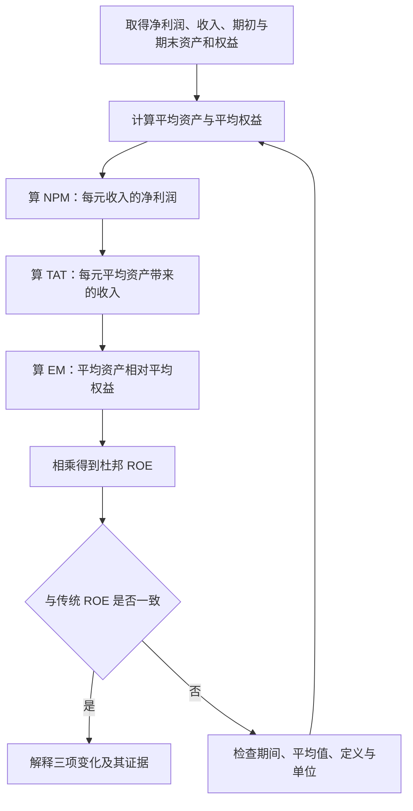
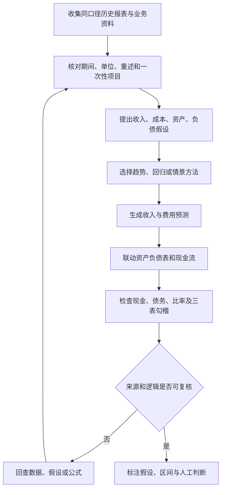
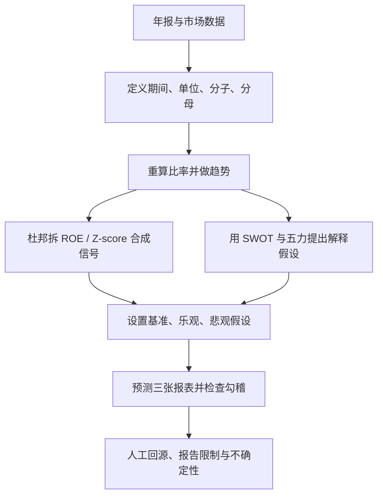

# M10 · AI 财务分析与比率核验

## 0. 三分钟速览

本讲把财务报表数字转成比率、趋势、竞争解释和预测输入，再讨论 AI 可以怎样协助生成分析。核心结论是：模型给出的数字必须能追溯到报表项目、期间、单位和计算口径；没有这些证据，答案看起来完整也不能核验。

学完你能：

- 对给定报表重算流动比率、速动比率、毛利率、ROE、周转率、偿息倍数、P/E 和 P/B，并指出每个分母的时点或期间。
- 把 ROE 拆成利润率、资产周转率和权益乘数，再用乘积核对传统 ROE。
- 区分横跨年度的绝对额、百分比变化、共同比和比率趋势。
- 说明 SWOT、波特五力、Z-score 与情景分析各自能回答什么、依赖什么输入、不能证明什么。
- 将预测问题拆成历史数据、假设、方法、三张报表联动和人工复核。

## 1. 开始之前 · 知识衔接

### 1.1 你已有的

| 概念 | 一句话唤醒 | 回链 |
|---|---|---|
| 利润表与资产负债表 | 利润表记录一段期间的收入与费用；资产负债表记录某一日的资源和资金来源。 | [[AC6761_Artificial_Intelligence_Accounting/notes/M03-年报分析\|M03 年报分析]] |
| 收入、销售成本、净利润 | 销售成本从收入中扣除得到毛利；净利润还扣除期间费用、利息与税。 | [[AC6761_Artificial_Intelligence_Accounting/notes/M03-年报分析\|M03 年报分析]] |
| 平均余额 | 常以期初与期末余额的平均值近似期间余额；须标明口径。 | 本讲在 §2.1.1 解释 |

### 1.2 本讲全新概念

比率分析、趋势分析、杜邦分析、SWOT、波特五力、Altman Z-score、情景分析与财务报表预测在 §2 按“先描述数字，再解释原因，再推演未来”的次序展开。它们都不是财报本身：分析者必须先确定数据和比较基准。

### 1.3 为什么这一讲放在这里 + 重排说明

Week 10 在 Week 9 利益相关者视角之后，转向可选分析模型。两份讲义把定义、Apple 提示词和补充比率拆开排列。本篇先统一计算输入与比率，再讲时间比较、杜邦分解、行业解释和前瞻模型；最后逐页回答讲义提示词。这样读者可先核对 AI 输出的数，再判断解释是否有证据。

## 2. 正文

本讲合并两份讲义，但页码各自从 p.1 开始：写作“主 p.n”时指 `Week 10 PPT.pptx`，“Ratio p.n”时指 `Week 10 PPT Ratio Analysis.pptx`。主讲义 p.1 和 Ratio p.1 都是各自的标题封面；本篇没有把两套编号合并为连续的 p.1–p.58。

### 2.1 财务比率：把两项报表数字变成可比较的关系（主 p.2–6；Ratio p.2–16）

假设公司有 300 元流动资产、150 元流动负债。流动比率为 2 倍，意思是报告日每 1 元短期负债对应 2 元流动资产。这个比值不能单独证明公司能按时付款，因为存货可能过时、应收款可能收不回。

- **是什么**：比率分析（ratio analysis）用两个相关财务量的比值衡量流动性、盈利、偿债、效率或市场估值。
- **为什么需要它**：公司规模不同，直接比较收入或资产总额容易把“大”误当成“好”；比例可以提供相对尺度。
- **课件原例**：主讲义 p.3 将其定义为财务指标之间的关系，并以历史趋势、竞争者和行业平均作比较基准；p.4 列五类比率。p.3 的比较例示是五年利润率趋势、Apple 与 Samsung 毛利率、科技行业 P/E；这些是比较对象的示意，未附可验证的公司数值。
- **🎙️ 课堂补充**：待转录补充；本轮未发现可用 Week 10 转录。
- **💡 换个说法（笔记补充）**：比率像“每 1 元分母对应多少分子”。分子、分母必须先对齐公司、期间、币种和会计定义。
- **常见误解**：比率高不自动代表好。存货积压会推高流动比率；低 P/E 也可能反映盈利前景差。
- **与其他概念的关系**：比率的年度变化进入趋势分析；ROE 可由杜邦分析拆解；行业解释需 SWOT 或波特五力提供背景。

#### 2.1.1 先确定分母，再计算：五类常用比率（主 p.4；Ratio p.2–16）

先认清表里的数字来自什么。流动资产是预计在经营周期或一年内变现 / 使用的资产。流动负债是近期需要结清的义务。

股东权益（shareholders’ equity）是资产扣除负债后的账面剩余权益。因此，同一报告日必须满足 $\text{资产}=\text{负债}+\text{权益}$。现金（cash）是已持有的钱；应收账款（accounts receivable）是已销售但客户还欠的钱；存货（inventory）是还未售出的商品成本。预付费用（prepaid expenses）是已经付款、以后才消耗的服务，例如预付保险；它不能直接拿来还债。

销售成本（cost of goods sold，COGS）是与本期已售商品或服务对应的成本。毛利（gross profit）是收入扣除销售成本后的差额；它还没有扣销售、管理等运营费用，所以不是最终净利润。

息税前利润（earnings before interest and taxes，EBIT）是扣利息与所得税前的收益口径。净利润还扣掉这些项目；本例 EBIT 120 减利息 20、再减假设所得税 20，得到净利润 80。

每股收益（earnings per share，EPS）把归属于普通股股东的期间收益分到每一股。基本每股收益（basic EPS）用本期实际普通股的加权平均股数作分母；股数若中途改变，持有时间越长的股数权重越大。稀释每股收益（diluted EPS）还考虑可转换债券、期权等可能转成普通股的工具，并按规则调整收益与股数；不能只随意增大分母。本例假设无优先股、无稀释工具，全年及期末均为 40 股，所以基本与稀释 EPS 相同。

每股账面价值（book value per share）回答“报告日每股对应多少账面普通股权益”，用当日普通股权益除以当日流通普通股数。它用的是报告日存量；EPS 用的是期间收益与加权平均股数，两者不能混用。本例期末权益 550 全属普通股，故每股账面价值为 $550/40=13.75$；EPS 为 $80/40=2$。它们都不是承诺每股可拿到的现金。

收入、净利润、COGS 和 EBIT 是一段期间累计的流量。现金、应收款、存货、负债、资产与权益是某一报告日的存量。

把期间流量除以存量时，期初和期末平均值可降低只取一个时点造成的偏差。只有每日余额数据才能精确得到期间平均。

| 类别 / ratio | 讲义所列计算 | 单位和时点 | 读一个值 |
|---|---|---|---|
| 流动比率 Current ratio | $\frac{\text{流动资产}}{\text{流动负债}}$ | 倍；两者均为报告日存量 | 2.0 倍表示每 1 元流动负债对应 2 元流动资产 |
| 速动比率 Quick ratio | $\frac{\text{现金 + 应收款}}{\text{流动负债}}$；Ratio 补充讲义称排除存货与预付费用 | 倍；报告日存量 | 1.0 倍表示列入速动资产的金额等于流动负债 |
| 毛利率 Gross margin | $\frac{\text{收入 − 销售成本}}{\text{收入}}$ | 百分比；期间流量 | 40% 表示每 100 元收入扣直接销售成本后剩 40 元 |
| 净资产收益率 Return on equity（ROE） | $\frac{\text{净利润}}{\text{股东权益}}$ | 百分比；利润为期间流量、权益为时点存量，宜注明期末或平均权益 | 16% 表示每 100 元权益对应 16 元期间利润，因果解释仍需谨慎 |
| 总资产收益率 Return on assets（ROA） | $\frac{\text{净利润}}{\text{总资产}}$ | 百分比；利润期间流量、资产时点存量，常用平均资产 | 9% 表示每 100 元平均资产对应约 9 元期间净利润 |
| 债务权益比 Debt-to-equity（D/E） | $\frac{\text{总债务}}{\text{总权益}}$ | 倍；报告日存量 | 约 0.73 倍表示每 1 元期末权益对应约 0.73 元所定义的债务 |
| 利息保障倍数 Interest coverage | $\frac{\text{EBIT}}{\text{利息费用}}$ | 倍；两个期间流量 | 6 倍表示息税前利润是利息费用的 6 倍 |
| 存货周转 Inventory turnover | $\frac{\text{销售成本}}{\text{平均存货}}$ | 次/期间；销售成本与平均存货 | 6 次/年表示平均存货账面额约被销售成本周转六次 |
| 应收款周转 Receivables turnover | $\frac{\text{净赊销额}}{\text{平均应收款}}$ | 次/期间；信用销售流量除平均存量 | 20 次/年表示信用销售相当于平均应收款的 20 倍 |
| 市盈率 Price-to-earnings（P/E） | $\frac{\text{每股市价}}{\text{每股收益}}$ | 倍；市价是指定日期，每股收益是指定期间 | 15 倍表示投资者以每股收益的 15 倍支付每股市价 |
| 市净率 Price-to-book（P/B） | $\frac{\text{每股市价}}{\text{每股账面价值}}$ | 倍；市价日期与账面价值报告日须注明 | 约 2.18 倍表示每股市价约为每股账面权益的 2.18 倍 |

读表时先看分子、再看分母，最后核对“期间流量 / 时点存量”。同一公司跨年比较也要维持定义一致；例如一年的债务若含租赁负债，另一年也应使用同一口径。

#### 2.1.2 比率样例：从原始数到可复算结论（主 p.4；笔记补充算例）

以下数据全部为笔记补充的虚构数值，单位为“虚构货币单位”，不是 Apple 事实。以下保留本次修正后的完整输入与主要计算；复算脚本和结果随本次审修回执交付，旧计算记录不替代本版本。

| 输入 | 值 | 期间 / 口径 |
|---|---:|---|
| 收入 / Revenue | 1,000 | 本年度流量 |
| 销售成本 / COGS | 600 | 本年度流量 |
| 净利润 / Net income | 80 | 本年度流量 |
| 流动资产 / 流动负债 | 300 / 150 | 年末存量 |
| 现金 / 应收款 / 存货 / 预付费用 | 110 / 60 / 110 / 20 | 年末流动资产，合计 300；假设无其他流动资产 |
| 期初 / 期末存货 | 90 / 110 | 存量；平均为 $100$ |
| 期初 / 期末应收款 | 40 / 60 | 存量；平均为 $50$ |
| 期初 / 期末总资产 | 800 / 1,000 | 存量；平均为 $900$ |
| 期初 / 期末权益 | 450 / 550 | 存量；平均为 $500$ |
| 总债务 / EBIT / 利息 | 400 / 120 / 20 | 年末存量 / 本年流量 / 本年流量 |
| 期末总负债 / 其中有息债务 | 450 / 400 | 同日报表存量；余下 50 为非有息经营负债 |
| 期末流动负债 / 非流动负债 | 150 / 300 | 合计 450；其中有息部分分别为 100 / 300 |
| 普通股加权平均股数 / 期末股数 | 40 / 40 | 假设全年股数不变，权益全属普通股 |
| 报告日股价 / 基本 EPS / 每股账面值 | 30 / 2 / 13.75 | 市价 / 本年每股收益 / 同日期末每股账面权益 |

先作同日勾稽：流动资产 $110+60+110+20=300$；非流动资产为 $1{,}000-300=700$。总资产 $1{,}000=450+550$，等于总负债加权益。债务 400 只是负债 450 中计息的部分，不能把两者混用。

期初也满足 $800=350+450$。本例只给汇总期初期末数，不据此推断权益增加 100 全来自净利润 80；其他权益变动的明细未给，不能凭汇总表补成现金流量表。§2.6 的 Z-score 另用明确独立输入，不与本例拼成一家公司。

**先算期间平均余额**

期初与期末平均数用于近似期间余额，不能代替每日余额的精确平均值。

1. **平均存货**：$(90+110)/2=100$。后续存货周转的分母取这 100。
2. **平均应收款**：$(40+60)/2=50$。后续应收款周转的分母取这 50。
3. **平均总资产**：$(800+1{,}000)/2=900$。后续 ROA 和资产周转使用这项平均余额。
4. **平均权益**：$(450+550)/2=500$。后续 ROE 和杜邦权益乘数使用这项平均余额。

**再算报告日偿债与期间回报**

5. **流动比率**：$300/150=2.0$ 倍。报告日每 1 元流动负债对应 2 元流动资产。
6. **速动比率**：按扣除存货和预付费用的口径，$(300-110-20)/150=170/150\approx1.13$ 倍。每 1 元流动负债对应约 1.13 元速动资产；本例也等于现金加应收款 $110+60=170$。Ratio 补充 p.4 排除两类项目；主讲义 p.4 的简式只列现金和应收款，实务中还须确认是否含短期投资。
7. **毛利率**：$(1{,}000-600)/1{,}000=40\%$。每 100 元收入扣除销售成本后，留下 40 元毛利。
8. **ROE**：$80/500=16\%$。每 100 元平均权益对应 16 元本期净利润。
9. **ROA**：$80/900\approx8.89\%$。每 100 元平均资产对应约 8.89 元本期净利润。
10. **债务权益比**：$400/550\approx0.7273$ 倍，保留两位小数约 0.73 倍。分子是期末有息债务，分母是同日期末权益 550；平均权益 500 只用于期间回报，不用于本报告日 D/E。
11. **利息保障倍数**：$120/20=6$ 倍。本期 EBIT 是利息费用的 6 倍。

**最后算周转与每股估值**

12. **存货周转**：$600/100=6$ 次/年，表示销售成本约相当于平均存货的 6 倍。存货天数直接用未舍入周转率：$365/(600/100)\approx60.83$ 天。
13. **应收款周转**：题目未给净赊销额，暂用收入作代理，$1{,}000/50=20$ 次/年。该代理只演示算法；有净赊销额时应优先使用。
14. **应收账款回收天数（days sales outstanding，DSO）**：使用未舍入的周转率，$365/(1{,}000/50)=18.25$ 天。它表示销售额约相当于平均应收款每 18.25 天周转一次。
15. **P/E**：$30/2=15$ 倍。每股市价是本例每股收益的 15 倍。
16. **P/B**：先由 $550/40=13.75$ 得每股账面价值，再算 $30/13.75\approx2.18$ 倍。也可用权益市值 $30\times40=1{,}200$ 除账面权益 $550$，得到同一结果。每股数据的拆股调整与日期必须一致。

结果自检：把期末存货从 110 改为 130、其他条件不变，则平均存货变成 $(90+130)/2=110$。这是只检验周转公式的局部变式；若要组成完整新报表，还须说明增加的存货由现金或负债等哪项配平。未舍入的存货周转为 $600/110$ 次/年，因此存货天数为 $365/(600/110)\approx66.9167$ 天，四舍五入到两位小数为 66.92 天。分母增大会令周转率下降、天数上升；若只改年末库存而公式使用期末值，结果会更敏感，因此必须标示平均口径。

#### 2.1.3 比率的判断边界与错误诊断（Ratio p.3–16）

Ratio 补充讲义 p.3 将流动比率 2.0 称为传统基准，并指出行业不同。低于 1.0 可能有流动性问题。

Ratio 补充讲义 p.4 将速动比率 1.0 作为常见参考。

Ratio 补充讲义 p.10 提醒：利息保障倍数低于 1.5 常被视作警号；低于 1.0 意味着 EBIT 不足以覆盖利息。它们是经验警示，不是适用于所有公司和时期的法律阈值。

- 高流动比率可能来自滞销存货；应进一步看存货账龄、应收款质量和现金流。
- 报告日偿还流动负债可能暂时抬高比率，之后恢复原状；Ratio 补充 p.3 称为 window dressing。需比较期内数据及现金流。
- ROE 高可能来自利润率改善、资产周转提高或权益基数低 / 杠杆高。应结合杜邦三因子、负债和回购等变化解释。
- 资产周转、存货天数、DSO 的分子分母须匹配。应收款周转最好用净赊销而非包含现金销售的总收入。
- Ratio p.6 把高毛利率与较强定价能力或直接成本控制联系起来；毛利率下降可能来自降价、原材料涨价或生产效率下降。需要查价格、数量和成本，不能仅凭利润率确认原因。
- Ratio p.9 将 D/E 上升视作债务风险信号；但 $\text{债务}/\text{权益}$ 上升也可能是回购或亏损令权益减少。应分别查分子和分母，再看利率、到期日和可支付现金。
- Ratio p.12–13 提醒周转的两端风险：存货周转低可能是积压或销售弱，高得异常也可能库存不足；DSO 上升可能是客户付款困难或收款变慢，也可能是客户组合与信用条款改变。

**怎样读市场估值比率（Ratio p.15–16，中文解释为笔记补充）**：先假定盈利和账面普通股权益为正，并保持股价日期、期间和每股口径一致。

**P/E：先看盈利预期，再选比较基准**

P/E 是市场愿为每 1 元本期或预期每股盈利付多少价格。Ratio p.15 说高 P/E 可能表示市场预期未来盈利增长快；也可能是当期盈利暂时偏低，或价格过于乐观。低 P/E 可能是低增长预期或经营问题，也可能有低估的可能，不能仅凭倍数决定。若 EPS 为零，P/E 除以零；EPS 为负时，不能当普通正倍数比较。

该页列出三个比较对象：公司自己的历史 P/E、直接竞争者的 P/E、整体市场平均 P/E。历史比较看自身预期是否改变；同业比较须控制业务与风险差异；市场平均更宽，行业结构差异也更大。增长预期并非保证，投资者还须判断未来盈利能否实现、风险是否值得承担。

**P/B：区分价格与账面值，再查原因**

P/B 大于 1 表示市价高于每股账面权益；小于 1 表示市价低于账面权益。用同一正账面值 10 作独立读数例：股价 15 时 P/B 为 1.5，股价 8 时为 0.8。这只是描述价格与账面值的关系，不是买卖结论，也不是 §2.1.2 的公司输入。

Ratio p.16 说高于 1 可能与品牌、人力等无形价值有关，因为某些自建能力未全部体现在账面资产中；高值本身不能证明这些能力存在或公司优秀。该页同时给低于 1 的两种解释：可能低估，也可能严重经营困难。例如市场可能低估可回收净资产，也可能预计存货减值、未来亏损吞掉权益；必须查资产质量和未来盈利，不能只看 0.8 就判便宜。权益为零时 P/B 无定义，权益为负时普通正倍数解释失效。
- 不同公司会计政策、财年长度、季节性、币种、一次性项目及股数变化都可能破坏可比性。

- **是什么**：比率是有定义的相对量，不是脱离口径的评分。
- **为什么需要它**：它把大额数字压缩成可比较信号，但压缩也会丢失质量和背景信息。
- **课件原例**：两份讲义列出上述类别、基准、滞销存货与 window dressing 风险（主讲义 p.4；Ratio p.3–16）。
- **🎙️ 课堂补充**：待转录补充。
- **💡 换个说法（笔记补充）**：同样 2 倍流动比率，现金占大头和过时存货占大头，付款能力并不相同。
- **常见误解**：把课件的基准当成保证；忽略报表日、分母单位、平均值与非经常性项目。
- **与其他概念的关系**：趋势和共同比帮助检查单年比率的方向；比率须结合竞争与经营机制解释。
- **所以呢**：AI 给出比率时，先要求它逐项列出源报表行、单位、期间、平均余额和公式，再评价。

### 2.1.4 价值链分析：主讲义只列名的补充概念（主 p.2）

若一家公司整体利润率下降，分析者还可以追问利润在哪个业务活动环节形成或流失。价值链分析把企业活动分成与产品 / 服务创造和交付有关的环节，协助定位成本、效率或差异化来源。

- **是什么**：价值链分析（value chain analysis）把企业的活动按价值创造过程拆开观察。
- **为什么需要它**：合并报表把多个产品和活动合在一起，整体比率可能掩盖具体环节的表现。
- **课件原例**：主讲义 p.2 只把 Value Chain Analysis 列为一种分析模型；课件没有给定义、步骤、活动清单或案例。
- **🎙️ 课堂补充**：待转录补充。
- **💡 换个说法（笔记补充）**：像顺着“设计 → 采购 / 生产 → 销售 → 服务”问价值和成本在哪一段形成；这串环节是说明性示例，不是本课件原文的模型清单。
- **常见误解**：单看分部收入或成本不能自动把变化归因到某个价值链环节；需要活动层面的成本与产出数据。
- **与其他概念的关系**：可为趋势分析提供定位问题的细分层级，和五力分析的行业层解释互补。
- **所以呢**：主讲义只列出名称，本单元是笔记补充性唤醒；如老师指定正式模型步骤，需课堂 / 指定教材来源补充后再扩展。

### 2.2 趋势分析：变化多少与结构怎样变（主 p.12–16）

假设收入由第 1 年的 800 增至第 2 年的 1,000。绝对增量为 200，增长率为 $200/800=25\%$。若收入增加但毛利率下降，规模增长与单位经济性可能朝不同方向变化。

- **是什么**：趋势分析（trend analysis）比较多个时期的金额、共同比或比率，寻找增长、异常或结构变化。
- **为什么需要它**：单年数字无法告诉我们变化方向，也无法区分公司变大与经营结构改善。主 p.12 列三个用途：支持战略与运营决策（informed decision-making）、及早识别财务问题以管理风险（risk management）、帮助投资者理解增长轨迹和财务稳定性（investor insights）；趋势提供线索，不保证提前发现一切风险。
- **课件原例**：主讲义 p.12–13 提到收入、费用、资产的变化；绝对变化为本期金额减基期金额，百分比变化为绝对变化除以基期金额。共同比可用收入或总资产作分母。
- **🎙️ 课堂补充**：待转录补充。
- **💡 换个说法（笔记补充）**：趋势分析同时问“盘子变大了吗”和“盘子里每一块占比变了吗”。
- **常见误解**：基期为零时增长率无定义；基期负数时百分比变化方向容易误导。不得直接把两者算作普通正增长率。
- **与其他概念的关系**：比率趋势追踪效率或风险；预测会把历史趋势当成输入，但不能假设未来必然延续。

#### 2.2.1 变化与共同比的复算（主 p.13）

下表每行表示一种趋势度量；“公式”列给出算法，“示例”列代入同单位数值，“解释”列说明百分比或金额的读法。

| 指标 | 公式 | 示例 | 解释 |
|---|---|---|---|
| 绝对变化 | 本期数减基期数 | $1{,}000-800=200$ | 增加 200 个货币单位 |
| 百分比变化 | 绝对变化除以基期数，再乘 100% | $200/800\times100\%=25\%$ | 相对基期增加 25% |
| 利润表共同比 | 行项目除以同期收入，再乘 100% | $600/1{,}000=60\%$ | 每 100 元收入中 60 元用于销售成本 |
| 资产负债表共同比 | 行项目除以同日报表总资产，再乘 100% | $110/1{,}000=11\%$ | 报告日总资产中 11% 为存货 |

计算时收入共同比的分母是本年度收入；资产共同比分母是同日总资产。不要用某年收入除另一年的成本。课件 p.13 给出毛利率下降可能与成本上升或价格压力有关、研发费用占比上升可能显示创新投入重点；这些只是待验证解释，不是由比率自动证明的因果。

- **所以呢**：读趋势时把金额趋势与比例趋势并排看，再寻找业务事实来验证原因。

### 2.3 杜邦分析：把 ROE 拆为三个可检查的来源（主 p.17–19；Ratio p.7）

ROE 是净利润相对权益的回报。若 ROE 上升，分析者需要判断变化来自利润率、资产使用效率，还是权益相对资产变小带来的杠杆效应。

- **是什么**：杜邦分析（DuPont analysis）将 ROE 拆为净利率、总资产周转率和权益乘数的乘积。
- **为什么需要它**：传统 ROE 只给结果；拆分后可以定位数学来源，避免把高杠杆造成的高 ROE 误说成经营利润改善。
- **课件原例**：主讲义 p.17 将 ROE 表示为 NPM、TAT 与 EM 三个因子的乘积；其中净利率（net profit margin，NPM）是净利润相对收入，总资产周转率（total asset turnover，TAT）是收入相对平均总资产，权益乘数（equity multiplier，EM）是资产相对股东权益。平均余额口径见本节下一小节。
- **🎙️ 课堂补充**：待转录补充。
- **💡 换个说法（笔记补充）**：每 1 元权益产生多少净利润，可以拆成三个部分相乘：每元收入留下的利润、每元资产带来的收入、每元权益支撑的资产。
- **常见误解**：三个因子中若资产与权益用时点口径不一致，乘积可能与传统 ROE 对不上；标准三因素公式的权益乘数应与同口径资产 / 权益匹配。
- **与其他概念的关系**：趋势分析解释各因子随时间变化；债务比率帮助判断权益乘数上升是否伴随财务风险。

#### 2.3.1 三因素的输入、计算和核对（主 p.17–19）

下表每行是一个杜邦因子；第二列指明分子、分母和平均余额口径，第三列写结果单位，第四列说明一个数值代表什么。

| 因子 | 公式 / 分母 | 单位 | 读法 |
|---|---|---|---|
| 净利率 NPM | $\frac{\text{净利润}}{\text{收入}}$ | % | 每 100 元收入留下多少净利润 |
| 总资产周转 TAT | $\frac{\text{收入}}{\text{平均总资产}}$ | 次/期间 | 每 1 元平均资产带来多少收入 |
| 权益乘数 EM | $\frac{\text{平均总资产}}{\text{平均股东权益}}$ | 倍 | 每 1 元平均权益支撑多少平均资产 |

本节示例取 §2.1 的虚构输入，按三个因子依次计算。

1. 净利率为 $80/1{,}000=0.08$。
2. 总资产周转率为 $1{,}000/900\approx1.1111$。
3. 权益乘数为 $900/500=1.8$。
4. 三项相乘得到 $0.08\times1.1111\times1.8\approx0.16$，即 $16\%$。传统 ROE 为 $80/500=16\%$，两者相同。

单位抵消后，乘积留下净利润相对权益的比例。

**控制流程图：**

读图从输入沿箭头向下：先统一平均余额口径，然后算三个因子。沿刚才的虚构数字，三个节点依次得到 $0.08$、约 $1.1111$ 和 $1.8$；相乘得到 $0.16$，与传统 ROE 一致。若不一致，就沿图中的“否”分支回查期间、平均值、定义和单位，不能调整数字让结果看似一致。

**文字替代与边界：**流程是“取输入 → 算平均资产 / 权益 → 算三个因子 → 相乘 → 与传统 ROE 对账 → 解释或回查”。若收入为零而平均资产非零，TAT 的分子为零，所以 TAT=0；NPM 的分母收入为零，所以 NPM 无定义，三因素乘积不能照常计算。若平均资产为零，TAT 无定义；若平均权益为零，传统 ROE 和 EM 无定义。若平均权益为负，ROE / EM 虽可能算出数值，正负方向却失去通常解释。分别报告是哪一项不可计算或不可按通常方式解释，不能把分子为零说成分母为零。

- **所以呢**：ROE 变化只是入口，结论要落到利润、资产效率或杠杆哪项改变，并列出报表证据。

### 2.4 SWOT：从财务证据组织战略问题（主 p.20–24）

公司可能有稳定现金和高利润率，也可能高度依赖单一产品。SWOT 把内部优势 / 劣势与外部机会 / 威胁分开，便于把报表趋势连到战略问题。

- **是什么**：SWOT 分析把 Strengths、Weaknesses、Opportunities、Threats 四类因素归纳成战略诊断。
- **为什么需要它**：财务比率告诉我们“出现了什么信号”，SWOT 提示应检查哪些内部能力或外部环境。
- **课件原例**：主讲义 p.20 为四类分别给出财务 / 业务线索：
  - Strengths：流动性较强、盈利能力较高。
  - Weaknesses：收入下降、债务过高、存货周转差、费用侵蚀利润。
  - Opportunities：新市场增长或监管 / 税制变化带来的扩张空间。
  - Threats：供应链中断与竞争压力。
- **🎙️ 课堂补充**：待转录补充。
- **💡 换个说法（笔记补充）**：先把证据按“公司内部能控制吗”和“来自外部吗”分成四格，避免把机会写成已发生收入。
- **常见误解**：把 AI 生成的品牌评价、消费者忠诚或市场份额当财报事实。没有来源时应列为待查假设。
- **与其他概念的关系**：趋势和比率提供内部财务信号；波特五力整理行业外部竞争结构。

| SWOT 项 | 讲义证据方向 | 需补查的事实 |
|---|---|---|
| Strength 优势 | 现金、流动比率、利润率、ROE | 与历史和同业可比吗？是否由一次性项目驱动？ |
| Weakness 劣势 | 收入下滑、债务高、周转慢、费用侵蚀利润 | 哪一产品、地区或期间造成变化？ |
| Opportunity 机会 | 新市场、服务需求、监管变化 | 市场规模、成本、进入条件和证据是什么？ |
| Threat 威胁 | 供应链、竞争、汇率、法规 | 暴露程度、发生概率和财务影响分别是什么？ |

- **所以呢**：每个 SWOT 项都要链接来源与不确定性；无数据的项保留为问题，不能伪装成结论。

### 2.5 波特五力：用行业结构解释财务结果（主 p.25–32）

利润率变化可能来自公司内部成本，也可能来自供应商涨价、客户议价或替代品竞争。波特五力把行业竞争压力拆成五种机制，帮助提出可核验的后续问题。

- **是什么**：波特五力（Porter’s Five Forces）分析新进入者威胁、供应商议价力、买方议价力、替代品威胁和现有竞争者竞争强度。
- **为什么需要它**：同一财务结果可能由不同外部机制造成；仅看比率不能区分这些机制。
- **课件原例**：主讲义 p.25–27 把五力与可能的财务迹象联系起来。
  - 新进入者威胁对应资本投入、研发 / 营销费用和毛利。
  - 供应商议价力对应 COGS、库存成本与预付现金。
  - 买方议价力对应折扣、利润率与应收款回收天数。
  - 替代品与现有竞争可能影响定价、研发费用、利润率与 ROE。
- **🎙️ 课堂补充**：待转录补充。
- **💡 换个说法（笔记补充）**：沿“外部力量变化 → 企业采取行动或议价条件变化 → 报表哪一行先变”追因果。
- **常见误解**：看到 COGS 上升就断定供应商议价力变强；销量结构、汇率、产品组合也可能解释变化。
- **与其他概念的关系**：SWOT 是归类框架，五力是行业竞争解释；两者都要由证据支撑。

| 力量 | 可能的财务迹象（需验证） | 不能直接推出 |
|---|---|---|
| 新进入者 | 资本支出、研发 / 营销费用、毛利变化 | 大额物业、厂房及设备（property, plant and equipment，PP&E）不单独证明进入壁垒高 |
| 供应商议价力 | COGS、存货成本、预付现金变化 | 成本上升不单独证明供应商集中 |
| 买方议价力 | 折扣、收入增长、毛利、DSO | DSO 上升也可能源于客户组合或信用政策 |
| 替代品威胁 | 定价、市场份额、研发投入 | 研发增加不证明存在特定替代品 |
| 现有竞争 | 价格、利润率、营销 / 研发及杠杆 | ROE 下降不单独证明价格战 |

**先定市场，再分类（笔记补充）**：把市场限定为“向某地区消费者销售智能手机”。已经卖手机的厂商是现有竞争者；尚未进入、准备开始卖手机的厂商是新进入者。平板或电脑若能满足某些用户同样的联网沟通需求，却采用市场外的解决方案，就可作为替代品分析。判断顺序是：先问顾客要解决什么需求，再问对方是否已在界定行业内经营，最后问它是行业外的另一种解决方案还是准备进入的经营者。

在这个智能手机市场边界中，Android 手机通常属于现有竞争；若对象改为 iOS 手机或生态，Android 方案又可作为替代选择。主 p.31 确实把 Android 放在替代品问题组中；保留该原题，并说明其分类依赖市场边界，不能同时用两个边界推出同一结论。

**议价怎样影响成本（笔记补充）**

主 p.26–27 列出供应商和买方改变价格、质量与付款条件的动作。以下用独立自拟数字展开。议价力（bargaining power）指交易一方凭自己的替代选择、对方的依赖等条件，能让对方接受更有利于自己的价格或付款条件。供应商议价是供应商对采购公司的能力；买方议价是顾客对销售公司的能力。

假设某厂商卖出 100 件产品，每件收入 10；每件组件成本 4、其他销售成本 2。收入 $100\times10=1{,}000$，销售成本 $100\times(4+2)=600$，毛利 400、毛利率 40%。现在只有一家合格组件供应商且短期无法更换，它要求组件每件涨到 5。厂商为了继续交货接受涨价；假设销量、售价与其他成本不变，则销售成本变为 $100\times(5+2)=700$，毛利 300、毛利率 30%。链条是“替换困难 → 更难拒绝供应商涨价 → 同销量单位成本增加 → 毛利率下降”。这些假设使例子可算，不是 Apple 采购事实。

若多出同等质量、产能足够且切换成本低的供应商，采购方能拒绝原涨价并改以 4 采购，以上成本上升就不必发生。反过来，即使供应商少，长期固定价合约也可能暂时阻断涨价传导，所以供应商集中不等于本期毛利一定下降。

**付款条件怎样改变现金**

供应商若要求预付款，采购方先减少现金、增加预付项目，收到并出售商品后才可能成为销售成本。买方若能要求降价，相同销量下收入和毛利会下降；若要求延长赊账期，收入可不变，但应收款占用现金、DSO 可能升高。替代品给可接受价格设上限；现有企业的价格战也可能压利润率，若借债维持竞争还可能增加 D/E。每条路径都需实际交易和披露验证。

- **所以呢**：分析者要用公司披露、市场和行业证据确认机制；财务迹象本身只是待检验线索。

### 2.6 Altman Z-score：按指定模型合成风险信号（主 p.33–35）

先认清两项输入。营运资本（working capital）为流动资产减流动负债，表示短期资产扣掉短期义务后的账面净额。留存收益（retained earnings）是累计利润中留在权益内、没有分配出去的部分；简化关系为 $\text{期末留存收益}=\text{期初留存收益}+\text{净利润}-\text{分红}$，实际还可能有更正等调整。例如期初 150、本期净利润 80、分红 30，则期末为 200。赚取利润可以增加应收款而尚未收到现金；因此留存收益 200 不表示银行里有现金 200。

权益市值（market value of equity）是指定日股价乘对应股数，是市场定价；账面权益则来自资产减负债。两者不必相等。

Z-score 把营运资本、留存收益、EBIT、市值权益、负债和销售额的指定比率加权合成一个分数。该分数不是违约事实，而是特定模型在适用范围内的风险分类信号。

- **是什么**：主讲义使用 Altman Z-score 形式：$Z=1.2X_1+1.4X_2+3.3X_3+0.6X_4+1.0X_5$。
- **为什么需要它**：多个财务维度被压成单一指标，便于筛查；同时会丢失各构件细节。
- **课件原例**：主讲义 p.33 给阈值：Z > 2.99 为 Safe Zone；1.81 ≤ Z ≤ 2.99 为 Gray Zone；Z < 1.81 为 Distress Zone。p.34 定义五个 X。p.33 在安全区括注 Apple、Microsoft，在困境区举中国市场 ST 公司；这些只是课件例示，没有配输入数据或日期，不能据此认证公司实际分类。
- **🎙️ 课堂补充**：待转录补充。
- **💡 换个说法（笔记补充）**：每个 X 先按总资产或总负债标准化，再乘权重并求和；输入的一处定义错误会传进总分。
- **常见误解**：把“within two years”说成必然破产预测，或把阈值不加模型适用范围地套到所有公司。不同版本针对不同公司类型，必须先确认模型版本及样本适用性；本讲义未说明这些边界。
- **与其他概念的关系**：Z-score 是比率的加权组合；趋势可追踪各构件，但风险判断还需现金、债务到期和披露信息。

| 构件 | 讲义公式 | 单位 / 分母 | 含义 |
|---|---|---|---|
| $X_1$ | $\frac{\text{营运资本}}{\text{总资产}}$ | 比值；报告日存量 | 短期净营运资源 |
| $X_2$ | $\frac{\text{留存收益}}{\text{总资产}}$ | 比值；报告日存量 | 留存利润相对资产规模 |
| $X_3$ | $\frac{\text{EBIT}}{\text{总资产}}$ | 比值；期间收益 / 时点资产 | 核心经营收益相对资产 |
| $X_4$ | $\frac{\text{权益市值}}{\text{总负债}}$ | 比值；指定日期市值 / 报告日负债 | 市场权益缓冲相对负债 |
| $X_5$ | $\frac{\text{销售额}}{\text{总资产}}$ | 比值；期间收入 / 时点资产 | 销售相对资产规模 |

**独立虚构示例，分步复算：**本节改用另一家公司，只演示 Z-score；不沿用 §2.1 的负债、权益或股数。期末总资产 1,000、总负债 500、账面权益 500，满足 $1{,}000=500+500$。流动资产 300、流动负债 150，故营运资本 150；留存收益 200 属于账面权益的一部分。另给本年 EBIT 120、销售额 1,000，指定日权益市值 750（独立假设股价 15、股数 50）。货币单位相同，余额与期间按上表对应。

1. **计算营运资本项。** $X_1=150/1{,}000=0.15$；乘权重后为 $1.2\times0.15=0.18$。这一项表示营运资本相对资产的规模。
2. **计算留存收益项。** $X_2=200/1{,}000=0.20$；加权贡献为 $1.4\times0.20=0.28$。这一项表示累计留存收益相对资产的规模。
3. **计算 EBIT 项。** $X_3=120/1{,}000=0.12$；加权贡献为 $3.3\times0.12=0.396$。这一项表示本期息税前收益相对资产的规模。
4. **计算市值权益项。** $X_4=750/500=1.50$；加权贡献为 $0.6\times1.50=0.90$。这一项比较指定日的市值权益与报告日总负债。
5. **计算销售额项。** $X_5=1{,}000/1{,}000=1.00$；加权贡献为 $1.0\times1.00=1.00$。这一项表示期间销售额相对总资产的规模。
6. **求模型总分。** $Z=0.18+0.28+0.396+0.90+1.00=2.756$。
7. **按讲义区间分类。** $1.81\leq2.756\leq2.99$，所以这个虚构示例落在 Gray Zone（灰区）。它只展示计算，不评定任何真实企业。

**改一个条件的迁移：**假定只有 EBIT 从 120 增至 200，资产及其余数据不变。此时 $X_3$ 从 0.12 变成 0.20，其余四个 $X$ 不变。分数增加 $3.3\times(0.20-0.12)=0.264$，新 $Z=2.756+0.264=3.020$，按讲义阈值进入 Safe Zone。这个敏感性演算说明权重会放大输入变化；它不证明 EBIT 上升会导致企业风险必然下降。

**失败诊断与边界：**计算前逐项核对以下内容。

- 营运资本是否按流动资产减流动负债取得。
- 市值对应的日期、股数和货币是否一致。
- $X_4$ 分母是总负债，而非只计有息债务。
- 资产采用期末还是平均余额。
- 若总负债为零，$X_4$ 的分母为零，无法计算。不能擅自把该项当成 0，也不能略去后照用原阈值。
- 负权益或异常留存收益会改变解释。讲义没有说明 Altman 版本和适用企业类别，因此真实企业分类前需要补核模型说明。

- **所以呢**：可以复算讲义形式的得分，但在模型版本和适用范围未核实前，不能将分区标签表述成概率或确定结论。

### 2.7 情景分析：让假设变化显式化（主 p.36–37；例示延伸至 p.39）

未来收入与成本存在不确定性。情景分析分别设置基准、乐观与悲观假设，检查同一企业在不同条件下可能出现的财务结果。

- **是什么**：情景分析（scenario analysis）在不同未来条件下重算业绩或现金流。
- **为什么需要它**：单一预测隐藏了不确定性；情景能显示哪些假设最影响结果。
- **课件原例**：主讲义 p.36 举 base case 5% 收入增长、bull case 15% 增长、bear case 销售下降 10% 与成本上涨；p.37 列 Apple 未来收入、消费者偏好、市场扰动、比率和股价问题。
- **🎙️ 课堂补充**：待转录补充。
- **💡 换个说法（笔记补充）**：保持模型相同，只替换一组假设，比较结果差异；每一组都要说明为何可能发生。
- **常见误解**：把最好 / 最坏情景当成概率最高或边界保证。情景未指定概率时不能声称其发生概率。
- **与其他概念的关系**：趋势分析提供历史基线；预测把情景参数传入三张报表；敏感性分析可逐项改变参数。

#### 2.7.1 三种情景的完整小例（主 p.36–37、p.39；计算为笔记补充）

以下从讲义 p.36 的 5% 基准增长、15% 乐观增长和 10% 悲观下滑开始，并借用 p.39 的原材料成本上涨示例。计算采用笔记补充的明确假设，所有金额都是虚构单位。为把收入增长率转换成成本数量，本例额外假定销售单价与产品组合不变，因此收入变动完全来自销量；全部销售成本随销量同比例变化，没有固定成本。Bear 的原材料单价另涨 20%。若这些条件改变，就不能直接把收入增长率乘到成本上。

下表每行是一种情景，依次列出收入 / 成本条件、财务结果，以及毛利率和简化现金代理。

| 情景 | 收入 / 成本假设 | 收入、销售成本、毛利 | 毛利率与现金收款代理 |
|---|---|---|---|
| Base | 收入增 5%，单位成本稳定，销售成本维持收入的 60% | 收入 1,050，销售成本 630，毛利 420 | 毛利率 40%，收款 945，期末应收 105，付成本 630，现金代理 315 |
| Bull | 收入增 15%，低通胀，仍假设销售成本率为 60% | 收入 1,150，销售成本 690，毛利 460 | 毛利率 40%，收款 1,035，期末应收 115，付成本 690，现金代理 345 |
| Bear | 售价和组合不变，销量及收入降 10%；一半基础成本为原材料，其单价涨 20% | 收入 900，销售成本 594，毛利 306 | 毛利率 34%，收款 810，期末应收 90，付成本 594，现金代理 216 |

**逐步重算：**每一步只改变一个输入或计算一个结果。各金额都是虚构单位。

1. **确定基准成本率。** $600/1{,}000=60\%$。按此假设，每 1 元收入对应 0.60 元销售成本。
2. **计算 Base 收入。** $1{,}000\times1.05=1{,}050$。收入比基准增加 5%。
3. **计算 Base 销售成本。** $1{,}050\times0.60=630$。成本率保持 60%。
4. **计算 Base 毛利。** $1{,}050-630=420$。这表示扣除销售成本后剩余 420。
5. **计算 Base 毛利率。** $420/1{,}050=40\%$。本例的毛利率与基准成本率相匹配。
6. **计算 Bull 收入。** $1{,}000\times1.15=1{,}150$。收入比基准增加 15%。
7. **计算 Bull 销售成本。** $1{,}150\times0.60=690$。成本率仍假设为 60%。
8. **计算 Bull 毛利和毛利率。** 毛利为 $1{,}150-690=460$；毛利率为 $460/1{,}150=40\%$。毛利增加，但比例不变。
9. **计算 Bear 收入。** $1{,}000\times0.90=900$。收入比基准减少 10%。
10. **拆分基准销售成本。** 假设 600 中有 300 为原材料，另 300 为其他成本。这个 50% 拆分是笔记补充假设。
11. **计算销量下降后的其他成本。** $300\times0.90=270$。销量下降 10%，假设单位成本不变。
12. **计算受原材料涨价影响的成本。** $300\times0.90\times1.20=324$。该项先随销量减少，再承受 20% 单价上涨。
13. **计算 Bear 销售成本。** $270+324=594$。这是两类成本的合计。
14. **计算 Bear 毛利。** $900-594=306$。收入扣除销售成本后剩 306。
15. **计算 Bear 毛利率。** $306/900=34\%$。成本冲击令毛利率低于 Base 与 Bull。

**改条件反例（笔记补充）**：若销量不变，只把售价降 10%，收入也为 900，但其他成本仍为 300，材料成本为 $300\times1.20=360$。销售成本 660、毛利 240、毛利率约 26.67%；此时不能使用上面的 594。收入下降不自动等于销量同比例下降。

现金金额还需要收款与付款假设。本例假定当期收入的 90% 收到现金、10% 留作期末应收；销售成本在本期全部付现；不计税、运营费用、存货 / 应付账款时点差、投资和融资现金流。

16. **计算 Base 现金收款。** $1{,}050\times0.90=945$。其余 105 留作期末应收款。
17. **计算 Base 经营现金代理。** $945-630=315$。这是收款减销售成本付现，不是完整经营活动现金流（cash flow from operating activities，CFO）。CFO 还要计入其他经营收付、税和营运资本的实际变化。
18. **计算 Bull 现金收款。** $1{,}150\times0.90=1{,}035$。其余 115 留作期末应收款。
19. **计算 Bull 经营现金代理。** $1{,}035-690=345$。本例条件下代理现金高于 Base。
20. **计算 Bear 现金收款。** $900\times0.90=810$。其余 90 留作期末应收款。
21. **计算 Bear 经营现金代理。** $810-594=216$。本例条件下代理现金低于 Base。

若改变收款率、供应商付款期或其他营运资本条件，现金结果也会变，即使毛利和收入假设不变。

- **所以呢**：情景结果只在列出的假设成立时成立；完整现金流还要补齐收款、付款和营运资本假设。

### 2.8 财务报表预测：从历史到可检查的未来模型（主 p.38–42）

预测要把销售、费用、资产、负债和现金联动起来。若收入增长假设导致应收款与存货上升，现金可能下降；因此不能只预测利润表而忽略资产负债表和现金流量表。

- **是什么**：财务报表预测（financial statement forecasting）用历史数据、市场趋势与战略假设推算未来财务表现。
- **为什么需要它**：管理决策、风险管理和资源分配需要面向未来的数字，但每项预测都依赖条件。
- **课件原例**：主讲义 p.38 定义预测；p.39 列趋势外推、回归和情景分析；p.40–42 依次问历史回顾、假设、收入、费用、现金流与报表联动。
- **🎙️ 课堂补充**：待转录补充。
- **💡 换个说法（笔记补充）**：先决定“明年销量 / 单价 / 成本怎样变”，再让这些业务假设推动三张报表，而不是凭空填未来总利润。
- **常见误解**：历史相关性不等于因果关系；短历史、结构变化和未说明假设都可能令外推失效。
- **与其他概念的关系**：趋势提供历史形状，回归提供变量关系，情景分析提供替代假设；最终由报表勾稽和人工判断检查。

#### 2.8.1 三种方法与输入输出（主 p.39）

下表每行是一种预测方法；“输入”列列出所需数据，“操作”列说明如何处理，“输出与主要限制”列说明结果类型及使用边界。

| 方法 | 输入 | 操作 | 输出与主要限制 |
|---|---|---|---|
| 趋势外推 Trend | 多期同口径历史数字 | 估计增长 / 变化并延伸到预测期 | 未来金额；结构突变时历史趋势不适用 |
| 回归 Regression | 结果变量 $Y$ 与解释变量 $X$ 的配对观测 | 拟合关系 $Y=BX+A$，用假设的 $X$ 推算 $Y$ | 条件预测；相关不证明因果，课件未指定估计方法和诊断 |
| 情景 Scenario | 基准数据及多组业务假设 | 每组假设分别驱动预测 | 多条条件路径；未给概率时不等于概率预测 |

**讲义业务原例（主 p.39）**：该页写“Links variables (e.g., ad spend → sales) via equation: Y = BX + A”，并举“Ad spend (X) vs. revenue(Y) correlation.”。中文意思是：把广告支出作为 $X$、收入作为 $Y$，研究两者关系。该页还用历史销售数据的线性延伸演示趋势预测，并用需求上下变化 10% 和原材料成本上涨 20% 演示情景变化。

广告支出和收入一起变动，可能也受节日、价格或需求共同影响；相关关系（correlation）不能单独证明多投广告必然造成收入增长。课件没有样本、单位、系数或诊断，故未提供一条已经估计好的模型。

**最小线性示例（笔记补充）**：沿用原例的变量对象，额外假设一条给定模型，目的只是练习代入；数值不是课件拟合结果。

| 符号 | 含义 | 本例取值 | 单位 / 角色 |
|---|---|---:|---|
| $X$ | 该期广告支出 | 20 | 虚构货币单位；输入 |
| $Y$ | 该期预测收入 | 待算 | 同一虚构货币单位；输出 |
| $B$ | 直线斜率，描述输入变动与模型输出变动的比例 | 2 | 输出单位 / 输入单位 |
| $A$ | $X=0$ 时直线的截距 | 10 | 输出单位 |

1. **代入给定的输入与系数。** 假设 $B=2$、$A=10$、$X=20$，代入 $Y=BX+A$。
2. **计算模型输出。** $Y=2\times20+10=50$。这表示给定广告支出 20 时，模型预测该期收入为 50 个虚构货币单位。
3. **读斜率和截距。** $B=2$ 表示 $X$ 每增加一个单位，模型输出增加两个单位；$A=10$ 表示 $X$ 为零时模型给出 10 个输出单位。
4. **检查能否相信预测。** 这个代入示例没有训练步骤或观测数据。实际评估还需要样本、单位、时期、异常值、残差以及未来 $X$ 的来源。

回归拟合与训练方法应结合后续 M08 / M11 学习；本讲只展示给定模型的代入，不把它说成模型训练。

**人工核验流程：**

**沿图走一遍：**取一笔赊销作最小核对例。公司赊销 100，售出存货成本为 60；这批存货在本期开始前已采购并付现。本例还假设没有其他费用、利息和税，故净利润为 40。

1. **利润表**：记录收入 100、销售成本 60，因此本例净利润为 40。
2. **资产负债表**：应收款增加 100、存货减少 60；假设本期没有分红，净利润 40 全部增加留存收益。资产净增 40，与权益增加 40 相等。留存收益随利润增加，但本期现金没有增加。
3. **现金流量表**：间接法（indirect method）先以净利润 40 为起点，再消除“计入利润却未在本期收付现金”的差异。收入 100 已增加利润，但客户未付款，所以减应收款增加 100。销售成本 60 已降低利润，可这批存货在以前期间付过款，本期没有再付 60，所以把存货减少 60 加回。得到 $40-100+60=0$，与本期没有经营现金收付一致。

下表只追踪这笔交易的两种采购时点；每行都在本期赊销 100、确认销售成本 60，不计其他交易。应收款变动均为增加 100，“变动”指期末减期初。

| 存货何时付款 | 本期存货净变动 | 间接法 CFO | 本期直接现金核对 |
|---|---:|---|---|
| 以前买入并付现，本期售出 | 减少 60 | $40-100+60=0$ | 本期无收款、无采购付款 |
| 本期付现 60 买入后全部售出 | 0 | $40-100-0=-60$ | 收款 0，采购付现 60 |

第二行存货先增加 60、再因出售减少 60，因此净变动为 0，不能仍加回 60。这说明间接法调节取决于本期余额的实际变化，不是固定口诀。若改为本期赊购 60 且未付供应商，存货净变动仍为 0，但应付账款增加 60；成本已扣利润而尚未付现，故再加应付增加 60，得到 $40-100+60=0$。

若改成顾客立即付现金，其他条件不变，资产负债表改为现金增加 100、存货减少 60、留存收益增加 40；间接法经营现金流变为 $40+60=100$。这个迁移说明收款时点改变现金，不改变本例确认的收入和毛利。

**读图文字替代：**先收集并核对历史输入，再提出预测假设并选择方法。根据假设生成收入费用，然后联动资产负债表与现金流量表并检查勾稽。若来源或逻辑不成立，就回查数据与假设；通过后才报告带假设和不确定性的结果。赊销例具体说明利润确认、应收款变化和现金流调节之间的关系。

**边界与诊断：**基础赊销例不含本期采购；上表及后文另显式加入本期现购或赊购的变式。所有例都未计税、其他费用、折旧、融资或投资。任一条件改变都要把相应行项目加进三表和现金流计算；不能把 40 的净利润说成 100 现金，也不能把此例扩展成完整公司预测。

- **所以呢**：预测必须能从来源数据和假设重算；给出一个精确数字却不披露条件，不算可审阅的财务预测。

### 2.9 讲义中的 AI 示例：怎样核验模型输出（主 p.7–11）

主讲义 p.7–11 把 Perplexity、Gemini、Kimi、DeepSeek 作为 Apple 2024 年报分析的工具示例。

讲义只展示提示词和回答目录，没有附完整回答或对应年报数据。因此本篇只能复述展示范围，不能据此比较准确率、计算 Apple 比率或判定工具优劣。工具名称只是课件案例，不构成产品推荐。

- **是什么**：人工智能辅助分析（AI-assisted analysis）可以帮助组织问题、摘要或提出计算；结果仍需回到年报逐项验证。
- **为什么需要它**：报表项目多且定义易混，AI 可加速整理；如果提示词、附件或期间不清，输出也会错得很完整。
- **课件原例**：p.8–11 的回答结构分别列出流动性、盈利、杠杆 / 偿债、效率、市场比率，以及细分业务 / 要点等标题；p.7 标识所用材料为 Apple Inc. 2024 Annual Report。
- **🎙️ 课堂补充**：待转录补充。
- **💡 换个说法（笔记补充）**：把 AI 输出当成待审草稿，逐条建立“结论 → 公式 → 报表行 / 页码 → 重算结果”的证据链。
- **常见误解**：不同工具给出类似章节标题，不等于其数字或推理已经被验证；提示词中写了“based on attached”也不能证明附件成功读取。
- **与其他概念的关系**：比率定义提供重算规则；趋势、杜邦和行业分析提供解释框架；人工回源负责质量过滤。
- **所以呢**：只凭当前两份讲义，可以说四个 AI 工具被作为示例并按若干主题组织答案，不能说任何一个算对或给出某 Apple 最新数值。

**四页共同英文提示词原文（主 p.8–11）：**

> Please analyze APPLE’s financial statements using ratio analysis models based on 2024 annual report as attached.

下表列出各页实际显示的回答目录。每行是一个工具示例，右列照录其章节名；它不是完整分析结果。

| 课件页 / 工具 | 回答目录原文 |
|---|---|
| 主 p.8 Perplexity | Profitability Ratios; Liquidity Ratios; Leverage Ratios; Efficiency Ratios; Market Ratios |
| 主 p.9 Gemini | Profitability ratios; Liquidity ratios; Solvency ratios; Activity ratios; Market ratios |
| 主 p.10 Kimi | Liquidity Ratios; Profitability Ratios; Leverage & Solvency; Activity / Efficiency; Market Ratios (as of 28 Sep 2024 close); Segment & Product Margin Snapshot; Key Takeaways |
| 主 p.11 DeepSeek | Liquidity Ratios; Profitability Ratios; Leverage Ratios; Efficiency Ratios; Market Value Ratios |

四份目录的排序和命名有差异，不能据此判定模型优劣。

**中文题意**：根据所附 Apple 2024 年报，用比率模型分析财务报表。当前源包未包含题目所说的年报附件，因此无法填入实际数字。

可执行的方法是逐个主题从年报取数并重算，记录报表行、期间、单位、分子和分母。市场比率还要指定股价日期；产品 / 分部利润率须先确认披露中是否有足够的对应收入和成本数据。

**英文参考答案（笔记自拟，数据受阻）：**

> “I would calculate each listed ratio from the attached 2024 annual report, citing the statement line and page, formula, period, unit, and denominator basis. Market ratios require a specified share-price date, and product-margin analysis requires sufficiently disaggregated cost data. The attachment is not available in the supplied materials, so I cannot report verified Apple figures.”

### 2.10 讲义中的 Apple 提示词：逐题保留与条件式作答（主 p.5–42；各题小节标明具体页码）

以下每个英文句子均为讲义原题（按原 slide 标页）。两份讲义没有附其所称的 2024 年报，也没有提供三年数字、市场价或行业数据库。因此每题的直接结论都是：当前材料不足以唯一给出 Apple 数值 / 公司事实。下方的分析步骤与英文句是笔记自拟的条件式参考答案；补入来源数据后应按步骤填数，不能把方括号里的待取值当成事实。

#### 2.10.1 流动、盈利、杠杆、效率与市场指标（主 p.5–6）

**原题 1（主 p.5）：**

> What is Apple's current ratio over the past three years, and how does it compare to industry benchmarks?

中文读题：求过去三年的流动比率并与行业基准比较。需要三年各年末流动资产、流动负债和同口径行业基准。逐年用流动资产除以流动负债；说明是报告日倍数。当前讲义无上述数值，无法填数。

英文参考答案（笔记自拟，待数据）：“The current ratio for year [t] is [current assets] divided by [current liabilities], or [x] times. I would compare the three consistently calculated annual figures with a same-period industry benchmark. The slides do not provide Apple's statement values or an industry dataset, so the numerical comparison cannot be determined from them alone.”

**原题 2（主 p.5）：**

> What is the quick ratio for Apple, and what does it indicate about the company's short-term financial health?

中文读题：求速动比率并解释短期流动性。需先在题目中选定速动资产口径；依 Ratio p.4 可从流动资产扣除存货和预付费用，再除以流动负债。检查应收款质量、现金流和到期日，不能只凭比率评健康。

英文参考答案（笔记自拟，待数据）：“Using the stated quick-asset definition, the quick ratio is [quick assets] divided by [current liabilities], equal to [x] times at [date]. This indicates the book amount of relatively liquid current assets per unit of short-term liabilities; collectability, payment timing, and cash flows must also be assessed.”

**原题 3（主 p.5）：**

> What are Apple's return on equity (ROE) and return on assets (ROA) for the last three years?

中文读题：求三年 ROE / ROA。要把期间净利润与平均权益 / 平均资产配对，并说明采用平均余额还是期末余额。按年报定义取数并复算；材料未给数字。

英文参考答案（笔记自拟，待数据）：“For each year, ROE is net income divided by [average or ending] shareholders' equity, and ROA is net income divided by [average or ending] total assets. The source statements and denominator convention are required before the three-year values can be reported.”

**原题 4（主 p.5）：**

> How has Apple's profit margin changed over the past three years, and what factors could have influenced this trend?

中文读题：比较三年利润率，并提出可能影响因素。先声明利润率定义（主讲义其他处区分毛利率、净利率）；重算各年后再查看价格、产品组合、销售成本、运营费用、税项及一次性项目。仅凭比率不能确认因果。

英文参考答案（笔记自拟，待数据）：“I would calculate the same profit-margin measure for each year and quantify both the percentage-point change and the underlying line-item changes. Possible explanations to investigate include pricing, product mix, direct costs, operating expenses, taxes, and one-off items; the ratios alone do not establish causation.”

**原题 5（主 p.5）：**

> What is the debt-to-equity ratio for Apple over the last three years, and what does it suggest about the company's financial risk?

中文读题：求三年债务权益比并解释风险。先定义 debt 是否包含短期借款、长期借款及租赁负债，按同一口径除以报告日权益。结合利息、到期结构、现金和偿债能力再判断风险。

英文参考答案（笔记自拟，待数据）：“Using a consistent definition of debt, the debt-to-equity ratio is total debt of [amount] divided by shareholders' equity of [amount], or [x] times at [date]. A rising ratio may indicate greater financing risk, but maturity, interest rates, cash resources, and operating cash flows are also relevant.”

**原题 6（主 p.5）：**

> How has Apple's interest coverage ratio evolved, and what does this indicate about its ability to meet interest obligations?

中文读题：比较利息保障倍数变化。逐年用 EBIT 除以同期间利息费用，检查利息费用是否包括同一范围；倍数下降表示利润缓冲缩小，但不等于已违约。

英文参考答案（笔记自拟，待数据）：“Interest coverage for each year is EBIT divided by interest expense for that same period. A declining ratio would mean a smaller operating-earnings cushion against interest, subject to the definition of EBIT and interest and a review of cash available for payment.”

**原题 7（主 p.6）：**

> What is the inventory turnover ratio for Apple, and how does it compare to previous years and competitors?

中文读题：求存货周转并与历史及竞争者比较。用 COGS 除以平均存货；竞争比较需相同财年长度、业务结构和会计口径。高周转可能反映效率，也可能代表库存偏少。

英文参考答案（笔记自拟，待数据）：“Inventory turnover is cost of goods sold divided by average inventory. I would calculate the same measure for Apple and selected peers over aligned periods and interpret it with product mix and stock-out risk. The slides contain no required amounts or peer data.”

**原题 8（主 p.6）：**

> What is Apple's accounts receivable turnover ratio, and what does it reveal about its credit policies and collection efficiency?

中文读题：求应收款周转并讨论信用政策 / 收款效率。分子优先用净赊销额，分母用平均应收款；再看 DSO、账龄、信用条件和客户组合。周转率本身不能唯一识别政策。

英文参考答案（笔记自拟，待数据）：“Receivables turnover is net credit sales divided by average accounts receivable. I would also calculate DSO and review receivables ageing and disclosed credit terms. The ratio can signal a change in collection speed, but it does not by itself identify the cause or the policy.”

**原题 9（主 p.6）：**

> What is Apple's earnings per share (EPS) trend over the last three years, and how does it compare with industry averages?

中文读题：比较三年每股收益 EPS（定义与分母见 §2.1.1）和行业水平。核对基本 / 稀释 EPS、财年、拆股调整与同业汇总方法；每股数值不能与未拆股价格混配。无年报和行业数据，受阻。

英文参考答案（笔记自拟，待数据）：“I would compare consistently defined basic or diluted EPS for each fiscal year, confirming split-adjusted presentation, with a clearly defined peer benchmark. The required EPS series and benchmark are absent from the supplied slides.”

**原题 10（主 p.6）：**

> What is the price-to-earnings (P/E) ratio for Apple, and how does it compare to competitors in the technology sector?

中文读题：计算某时点 P/E 并与科技同业比较。用指定日期每股市价除以明确期间 / 口径的 EPS，统一追踪或预期口径与股价日期。负 EPS 时常规 P/E 不可作普通倍数比较。

英文参考答案（笔记自拟，待数据）：“At [date], Apple's P/E is its share price of [amount] divided by [trailing or forward] EPS of [amount], equal to [x] times. A peer comparison requires aligned price dates, earnings definitions, and a defined competitor set.”

#### 2.10.2 趋势分析（主 p.14–16）

这些提示词询问三年收入、增长率、净利润、毛利 / 营业 / 净利率、运营费用与 COGS、SG&A 相对收入、资产 / 负债、D/E、CFO、CFI / CFF、EPS、股价与同业 / 外部因素。以下完整保留每个小问。

**原题 11（主 p.14）：**

> What has been the trend in Apple's total revenue over the last three years?

中文：列示三个财年的总收入，核对财年与币种；算绝对与百分比变化。英文参考（自拟）：“Revenue was [amount] in [year] and changed by [amount / percentage] in each subsequent year, based on Apple's consistently reported fiscal-year figures.” 无年报，现阶段不能确定。

**原题 12（主 p.14）：**

> How has Apple's revenue growth rate changed year over year, and what factors contributed to these changes?

中文：先算各年同比率，再用披露的销量、价格、地区、产品组合、汇率等解释。英文参考（自拟）：“Year-over-year growth is calculated as the change in revenue divided by prior-year revenue. The rate changed from [x] to [y]; disclosed volume, pricing, mix, geographic, or currency factors should be cited before attributing the change.” 当前无数据。

**原题 13（主 p.14）：**

> What is the trend in Apple's net income over the last three years?

中文：列示三年净利润与金额变化，并标记一次性 / 税项等影响。英文参考（自拟）：“Net income moved from [amount] to [amount] across the three fiscal years, a change of [amount / percentage]. The calculation uses the reported net-income line for each year.” 当前无数据。

**原题 14（主 p.14）：**

> How have profit margins (gross, operating, and net) trended during this period?

中文：毛利为收入减销售成本；营业利润（operating income）还扣除销售、管理、研发等运营费用；净利润再考虑利息、税等。分别把这三个利润额除同期收入，不混用口径。利润率从 30% 到 25% 是下降 5 个百分点，不能写成下降 5%。英文参考（自拟）：“Gross, operating, and net margins are calculated separately as gross profit, operating income, and net income divided by revenue. Their three-year directions and percentage-point changes are [results], based on aligned fiscal-year statements.” 当前无数据。

**原题 15（主 p.15）：**

> What trends can be observed in Apple's operating expenses and cost of goods sold (COGS) over the last three years?

中文：按报表原行展示金额，再比较占收入比率；核对成本分类有无重列。英文参考（自拟）：“I would compare the reported operating-expense and COGS amounts and their percentages of revenue over the three years. The observed changes are [results]; the figures must be checked against the annual reports.” 当前无数据。

**原题 16（主 p.15）：**

> How do selling, general, and administrative (SG&A) expenses trend in relation to revenue growth?

中文：销售、一般及行政费用（selling, general, and administrative expenses，SG&A）包括销售推广和总部管理等运营开支，须按年报实际分类取数。同时算其同比、收入同比和 SG&A/收入比率；例如费用从 10 增到 11，收入从 100 增到 120，费用率反而从 10% 降至约 9.17%，不能只因金额上涨就称效率恶化。英文参考（自拟）：“I would compare SG&A growth with revenue growth and track SG&A as a percentage of revenue. This shows whether the expense grew faster or slower than sales, but does not alone establish efficiency.” 当前无数据。

**原题 17（主 p.15）：**

> What has been the trend in Apple's total assets and total liabilities over the past three years?

中文：比较各年报告日存量金额；明确时点且留意财年 / 年报重列。英文参考（自拟）：“Total assets and total liabilities were [amounts] at each fiscal year-end. I would report absolute changes and compare liabilities with assets and equity without treating a balance-sheet change as a period flow.” 当前无数据。

**原题 18（主 p.15）：**

> How has the debt-to-equity ratio trended, and what does this indicate about Apple's financial leverage?

中文：统一债务范围后逐年计算 D/E，讨论杠杆信号并结合债务结构 / 现金流。英文参考（自拟）：“Using the same debt definition and year-end equity basis, debt-to-equity changed from [x] to [y]. This indicates a change in relative financing, while its risk implications depend on debt terms, liquidity, and cash generation.” 当前无数据。

**原题 19（主 p.16）：**

> What trends can be identified in Apple's cash flow from operating activities over the last three years?

中文：对齐经营活动现金流 CFO（卖货、提供服务及相关经营付款产生的净现金）三年期间，分开金额与同比。调查应收款、存货、应付等营运资本变动为何使它与净利润不同；§2.8.1 有交易和正负调节例。英文参考（自拟）：“Operating cash flow was [amount] in each fiscal year and changed by [percentage]. I would reconcile the trend with net income and working-capital movements.” 当前无数据。

**原题 20（主 p.16）：**

> How have investing and financing cash flows trended, and what implications does this have for Apple's strategy?

中文：投资活动现金流（cash flow from investing activities，CFI）包括购买或出售长期资产、投资等现金；融资活动现金流（cash flow from financing activities，CFF）包括借还款、股东投入与分配等现金。分别列净额及主要分项，例如购设备令 CFI 为负、借款令 CFF 为正；净流出不一定是坏事，净流入也不一定是经营好，不能只读符号推断战略。英文参考（自拟）：“I would examine investing and financing cash flows and their material components, then relate them to disclosed investment, borrowing, repayment, or shareholder-return activities. Cash-flow signs alone do not establish strategic intent.” 当前无数据。

**原题 21（主 p.16）：**

> How has Apple's earnings per share (EPS) trended over the past three years, and what does this suggest about shareholder value?

中文：统一 basic / diluted、拆股与期间后比较 EPS；股东价值不能由 EPS 单项决定。英文参考（自拟）：“EPS changed from [x] to [y] using a consistent split-adjusted definition. This describes earnings attributable per share; shareholder value also depends on price, risk, and future expectations.” 当前无数据。

**原题 22（主 p.16）：**

> What is the trend in Apple's stock price over the last three years, and how does it correlate with financial performance metrics?

中文：必须规定起止日期、价格调整方式和频率；相关分析需配对时间序列，相关不等于因果。英文参考（自拟）：“Using adjusted prices over [specified dates], I would compare the stock-price series with defined financial measures at a compatible frequency. The correlation is [value] for the stated sample and does not prove that financial performance caused price movements.” 当前未提供行情数据。

**原题 23（主 p.16）：**

> How do the trends in Apple's financial metrics compare with industry averages or key competitors?

中文：先定义同业名单、期间和指标口径，再比较增速 / 比率。英文参考（自拟）：“I would compare the same metrics for a defined peer group and period, after checking fiscal-year and accounting-definition differences. The supplied slides do not contain peer observations.”

**原题 24（主 p.16）：**

> What external factors (e.g., economic conditions, market trends) have influenced Apple's financial trends over the past three years?

中文：选择与指标时间一致且可追溯的宏观、市场资料，区分管理层披露与分析者推断。英文参考（自拟）：“Potential external factors should be linked to dated company disclosures or reliable market evidence. Without that evidence, I would present them as hypotheses rather than causes.” 当前资料无法确定。

#### 2.10.3 杜邦分析（主 p.18–19）

**原题 25（主 p.18）：**

> What is the breakdown of Apple's Return on Equity (ROE) into its components: profit margin, asset turnover, and equity multiplier for each of the last three years?

中文：逐年计算净利润率、平均资产周转率、权益乘数，并报告三因子及乘积，与传统 ROE 对账。英文参考（自拟）：“For each fiscal year, I would report net profit margin, revenue divided by average assets, and average assets divided by average equity. Their product should reconcile to ROE under consistent definitions; the annual-report inputs are not supplied here.”

**原题 26（主 p.18）：**

> How has Apple’s profit margin changed over the past three years, and what factors have contributed to any fluctuations?

中文：固定利润率定义，列百分点变化；因素需回到收入成本构成和披露内容。英文参考（自拟）：“The consistently defined margin changed by [percentage points]. I would attribute fluctuations only to documented movements in pricing, mix, costs, or expenses, and otherwise label explanations as hypotheses.” 当前无数据。

**原题 27（主 p.18）：**

> What is the trend in Apple's asset turnover ratio, and how does it compare to industry standards or key competitors?

中文：用收入除以平均资产，注明期间，并按一致企业 / 行业口径比较。英文参考（自拟）：“Asset turnover is revenue divided by average total assets. It changed from [x] to [y], compared with [defined benchmark]. The slides provide no benchmark data.”

**原题 28（主 p.18）：**

> How has the equity multiplier changed over the last three years, and what does this indicate about Apple's financial leverage?

中文：同口径平均资产除以平均权益；更高代表资产由相对较少权益支撑，但不等同于全部由债务融资。英文参考（自拟）：“The equity multiplier changed from [x] to [y] using average balances. This reflects assets relative to equity; I would inspect liabilities and financing details before describing the change as debt-driven leverage.” 当前无数据。

**原题 29（主 p.18）：**

> What are the implications of changes in each component of the DuPont analysis on Apple's overall financial health?

中文：分别解释利润率、资产效率、杠杆，并核其可持续性 / 风险，不把乘法分解当因果证明。英文参考（自拟）：“A margin change affects profit generated per unit of revenue; turnover reflects revenue relative to assets; the equity multiplier reflects assets relative to equity. Their implications depend on the underlying line items and financing risk.” 当前数值未给。

**原题 30（主 p.19）：**

> How does the ROE calculated using the DuPont analysis compare to the ROE calculated using traditional methods?

中文：同一净利润、期间、平均资产与平均权益下，杜邦乘积应与传统 ROE 相同；不相等先查公式定义。英文参考（自拟）：“Under consistent numerator and denominator definitions, the DuPont product should equal traditional ROE algebraically. I would report both calculations and investigate any difference in periods, averaging conventions, or line-item definitions.”

**原题 31（主 p.19）：**

> What external factors (e.g., market conditions, economic factors) might have impacted Apple's DuPont analysis components in the past three years?

中文：为因素指定影响路径：例如市场价格 / 组合可能影响利润率、需求可能影响资产周转；须用同期证据。英文参考（自拟）：“Possible external factors should be tied to a specific component and supported by dated evidence. I would distinguish a plausible mechanism from a demonstrated cause.” 当前无相关证据。

**原题 32（主 p.19）：**

> How do the results of the DuPont analysis compare with those of major competitors in the technology sector?

中文：先定义主要竞争者及相同财年 / 会计期间，再按同一公式算三因子。英文参考（自拟）：“I would calculate all three DuPont components for a defined set of peers with aligned periods and denominator conventions. No peer data are present in the supplied materials.”

**原题 33（主 p.19）：**

> Based on the DuPont analysis, what strengths and weaknesses can be identified in Apple's financial performance?

中文：只把三因子中有年报数支持的方向写成优势 / 弱点；高杠杆需同时说明风险。英文参考（自拟）：“The evidence would identify strengths or weaknesses in margin, asset turnover, or leverage only where the calculated component and supporting statements agree. The current materials do not support an Apple-specific conclusion.”

**原题 34（主 p.19）：**

> What strategic recommendations can be made to improve Apple’s ROE based on the findings from the DuPont analysis?

中文：建议须对应被验证的因子，先考虑经营可行性和风险；不得为提高 ROE 而盲目加杠杆或减少权益。英文参考（自拟）：“Any recommendation should target the evidenced driver—for example, sustainable margin improvement or more efficient asset use—and evaluate its cost and risk. I would not recommend additional leverage solely to raise ROE.” 当前未提供诊断数据，不能给 Apple 具体建议。

#### 2.10.4 SWOT 提示词（主 p.21–24）

**原题 35（主 p.21）：** “What are Apple's key competitive advantages as reflected in its financial performance over the last three years?”

中文：从三年财务趋势找可能支持优势的证据，再与市场 / 运营资料验证；财务表现不能单独证明竞争优势。英文参考：“I would identify candidate advantages from consistently calculated three-year metrics and corroborate them with market evidence. The supplied materials contain no Apple figures for this assessment.”

**原题 36（主 p.21）：** “How does Apple's brand value and customer loyalty contribute to its market position?”

中文：这是品牌 / 顾客行为问题，需品牌估值、留存、调查或市场资料；不能仅从年报比率推断。英文参考：“Brand value and customer loyalty should be assessed using independent valuation or customer evidence and linked to market outcomes. No such evidence is supplied here.”

**原题 37（主 p.21）：** “What innovations or product launches have significantly boosted Apple’s revenue and market share?”

中文：需指定期间、产品发布、对应产品收入与市场份额来源，区分同时发生与因果。英文参考：“I would match dated product launches with segment disclosures and independent market-share data, then test whether changes align in time. The slides do not provide this evidence.”

**原题 38（主 p.21）：** “How does Apple’s financial stability (e.g., cash reserves, profitability) enhance its operational strengths?”

中文：先核现金、利润和现金流，再说明这些资源可能支持投资 / 抗风险；不能由余额直接证明运营结果。英文参考：“Cash resources and profitability may support investment capacity and resilience, subject to liquidity needs and commitments. Apple's amounts and operational outcomes must be verified from source data.”

**原题 39（主 p.22）：** “What financial metrics indicate potential weaknesses in Apple's operations or market strategy?”

中文：先设定分析周期和指标，寻找持续恶化信号，再查业务披露；单项指标不定位战略原因。英文参考：“Potential weaknesses could be investigated through persistent deterioration in margins, turnover, liquidity, or cash generation, followed by source-based diagnosis. No Apple-specific conclusion can be drawn from the prompt alone.”

**原题 40（主 p.22）：** “Are there any areas where Apple has experienced declining sales or market share in the last three years?”

中文：分产品 / 地区对照销售额与独立市场份额，名义收入和份额是不同指标。英文参考：“I would examine segment or product sales and separately sourced market-share series for the same three-year period. These data are not in the supplied slides.”

**原题 41（主 p.22）：** “How does Apple’s dependence on specific products (e.g., iPhone) create vulnerabilities?”

中文：需产品收入集中度、利润贡献和替代 / 需求风险证据；“依赖”应量化。英文参考：“Product concentration can expose a company to demand, competition, or supply shocks in that product. I would quantify revenue and profit concentration before assessing the exposure.”

**原题 42（主 p.22）：** “What challenges has Apple faced in its supply chain or production costs that could impact profitability?”

中文：需年报风险因素、成本变化、供应商披露及对应利润率；把已披露事实与推断分开。英文参考：“I would cite disclosed supply-chain risks and connect them to observed cost or margin movements. The slides do not identify a specific challenge or quantify its impact.”

**原题 43（主 p.23）：** “What emerging market trends could provide growth opportunities for Apple in the coming years?”

中文：需界定市场、预测期间和趋势证据；机会不是已实现收入。英文参考：“Potential opportunities should be tied to a defined market, time horizon, and evidence of demand; they remain hypotheses until validated.”

**原题 44（主 p.23）：** “How can advancements in technology (e.g., AI, AR/VR) create new product lines or revenue streams for Apple?”

中文：提出技术到产品、顾客价值、定价与收入的机制，再验证可行性和成本。英文参考：“Such technologies could support new products or services if they solve a customer need and can be delivered profitably. This is a scenario to evaluate, not evidence of a launched Apple revenue stream.”

**原题 45（主 p.23）：** “What potential partnerships or acquisitions could enhance Apple’s market position?”

中文：题目要求建议，但需先定义战略目标、候选方、成本、监管与协同；当前讲义无对象与尽调资料。英文参考：“A recommendation would require a stated strategic objective, candidate-specific evidence, valuation, integration costs, and regulatory review. The supplied materials do not support naming a suitable partner or target.”

**原题 46（主 p.23）：** “How is the growing demand for services (e.g., Apple Music, iCloud) reflected in Apple's financial strategy?”

中文：需服务收入 / 利润披露和管理层策略说明；收入增长本身不证明策略动机。英文参考：“I would examine reported services revenue and margin disclosures and compare them with management's stated strategy. Demand and financial effects require dated supporting evidence.”

**原题 47（主 p.24）：** “What competitive threats have emerged in the technology sector that could impact Apple's market share?”

中文：明确市场边界，列竞品与相关份额变化的来源；不能把竞争存在写成份额已下降。英文参考：“I would define the product market, identify evidenced competitors, and examine dated share data before concluding that a threat affected Apple's position.”

**原题 48（主 p.24）：** “How do economic conditions (e.g., inflation, recession) pose risks to Apple's financial performance?”

中文：列传导路径，例如成本、消费需求、汇率和融资；使用相关期间经济数据，避免无时点泛论。英文参考：“Inflation or recession could affect input costs, demand, pricing, or financing. The effect should be tested against period-specific economic and company data rather than assumed.”

**原题 49（主 p.24）：** “What regulatory challenges or legal issues could affect Apple's operations and profitability?”

中文：需要明确具体司法辖区、案件 / 规则状态、潜在财务项目和材料日期；当前讲义没有案例事实。英文参考：“I would identify specific proceedings or rules, their status and jurisdiction, then assess disclosed financial exposure. The supplied materials do not establish a current legal or regulatory effect.”

**原题 50（主 p.24）：** “How does currency fluctuation impact Apple's international sales and profitability?”

中文：先查币种敞口，即哪些收入、成本或余额会随汇率变化。交易影响（transaction effect）关乎外币收付款价值变化；报表换算（translation）则是把外币报表换成本公司的报告币种。套期保值（hedging）是用合约等安排抵消部分风险，并不保证无损失。应把敞口、汇率期间、套保和披露敏感性对应，不能只凭国际销售额断定影响。英文参考：“Currency movements may affect translated revenue, local-currency pricing, costs, and hedging results. I would use disclosed currency sensitivity and exchange-rate data for the stated period.”

#### 2.10.5 Porter 五力提示词（主 p.28–32）

**原题 51（主 p.28）：** “What barriers to entry exist in the technology and consumer electronics markets that may affect new competitors entering the industry?”

中文：定义具体市场并核资本、技术、规模、生态 / 监管进入壁垒；不同产品市场不能混为一谈。英文参考：“I would assess entry barriers for a defined market using evidence on capital, technology, scale, distribution, ecosystem, and regulation. The lecture slides provide no market-specific evidence.”

**原题 52（主 p.28）：** “How does Apple’s brand strength and customer loyalty serve as a deterrent for new entrants?”

中文：用品牌认知、留存 / 转换成本与新进入者表现证据说明机制；没有证据时作为假设。英文参考：“Brand recognition and customer retention could raise the cost of attracting users, but their deterrent effect must be measured with customer and market evidence.”

**原题 53（主 p.28）：** “What capital requirements are necessary for new companies to compete effectively with Apple?”

中文：竞争市场与产品范围未限定，无法给唯一资本金额；需估算研发、供应链、产能、营销和分销投资。英文参考：“The required capital depends on the target product market and scale. I would estimate research, production, supply-chain, distribution, and marketing needs from a defined entry plan; no single amount follows from the slides.”

**原题 54（主 p.29）：** “How concentrated is Apple’s supplier base, and what impact does this have on its negotiating power?”

中文：核主要供应商集中度与采购份额，并区分公开披露和推测；集中可能削弱或增强双方议价，取决于替代性。英文参考：“I would measure supplier concentration using disclosed supplier or procurement data and assess substitutability. The slides do not provide supplier shares, so negotiating power cannot be quantified.”

**原题 55（主 p.29）：** “What alternative sourcing options does Apple have for critical components, and how does this affect supplier power?”

中文：逐项确认关键组件、合格替代商、切换成本与产能；没有公开信息时不臆测供应链。英文参考：“Supplier power depends on qualified alternatives, switching costs, capacity, and component criticality. These details require source evidence absent from the lecture materials.”

**原题 56（主 p.29）：** “How do fluctuations in raw material prices influence Apple's cost structure and supplier relationships?”

中文：沿原材料价格 → 采购成本 / 合约 → COGS / 存货 → 毛利率的链条分析，并检查套保与传导时滞。英文参考：“I would trace dated raw-material price changes through procurement arrangements and reported costs, allowing for hedging and timing. No specific effect can be quantified from the slides.”

**原题 57（主 p.30）：** “What is the level of customer loyalty towards Apple products, and how does this influence buyer power?”

中文：需顾客调查、续购 / 转换率证据；忠诚度高可能降低买方议价，但不自动消除选择权。英文参考：“Customer loyalty should be measured through reliable retention or survey evidence. Its effect on buyer power also depends on alternatives, switching costs, and price sensitivity.”

**原题 58（主 p.30）：** “How does the availability of alternative products affect customer bargaining power in the technology sector?”

中文：先确定产品类别和可替代产品，再比较价格、质量、兼容性和切换成本。英文参考：“More credible alternatives may increase customers' ability to switch or negotiate, depending on comparability and switching costs. The relevant alternatives must be defined by product market.”

**原题 59（主 p.30）：** “What role does pricing play in customer decision-making for Apple’s products compared to competitors?”

中文：要有同类产品价格、功能与消费者响应数据；不能单看标价判断购买决定。英文参考：“Pricing should be compared for functionally comparable products and interpreted alongside quality, ecosystem, financing, and customer demand evidence.”

**原题 60（主 p.31）：** “What substitute products exist in the market that could replace Apple’s offerings, and how do they compare in terms of price and quality?”

中文：定义 Apple 产品类别，再列可满足相近需求的替代品，使用同一时期价格与可比质量指标。英文参考：“I would define the customer need and compare plausible substitutes on dated prices and comparable quality measures. The prompt alone does not establish a complete substitute set.”

**原题 61（主 p.31）：** “How has the rise of competing technologies (e.g., Android devices) impacted Apple’s market share?”

中文：本题在源页的替代品组，但分类须先定边界：若分析整个智能手机行业，Android 手机通常是现有竞争者；若聚焦 iOS 生态，可作为替代方案（见 §2.5）。需按设备类别 / 地区 / 期间的份额序列，不把竞争技术出现直接当成 Apple 份额受损的证据。英文参考：“I would compare Apple's market share with a consistently defined Android or device-market series over time. The lecture slides contain no share data and cannot establish the impact.”

**原题 62（主 p.31）：** “What innovations or changes in consumer preferences could increase the threat of substitutes for Apple?”

中文：分别提出创新和偏好变化的机制，寻找用户需求与替代采用证据。英文参考：“A substitute threat could increase if innovation or changing preferences make alternatives satisfy the same need more effectively. This should be tested using consumer and adoption evidence.”

**原题 63（主 p.32）：** “How intense is the competition among existing players in the technology sector, particularly in smartphones and personal computing?”

中文：分别定义智能手机、个人电脑市场，比较竞争者数目、份额、价格 / 创新强度；不混为一个市场。英文参考：“I would assess rivalry separately in smartphones and personal computing using market definition, competitor shares, pricing, product cycles, and entry conditions.”

**原题 64（主 p.32）：** “What strategies are competitors employing to gain market share, and how is Apple responding?”

中文：需要指定竞争者与期间，并用对手公告及 Apple 行动披露核实；不把猜测写成策略事实。英文参考：“I would cite dated competitor actions and Apple's documented response, then examine subsequent market outcomes. The slides do not supply those sources.”

**原题 65（主 p.32）：** “How do pricing strategies among competitors impact Apple’s market positioning and profitability?”

中文：比较同类产品价格、折扣、产品组合和毛利变化；市场定位和利润影响均需数据支持。英文参考：“Competitor pricing may affect Apple's positioning or margins through customer substitution and price responses. I would test this with comparable price and financial data rather than infer causation from prices alone.”

#### 2.10.6 Z-score 提示词（主 p.35）

**原题 66：** “Can you provide the specific financial data (e.g., working capital, retained earnings, EBIT, market value of equity, total assets) needed to compute Apple's Z-Score?”

中文：要求列出输入数据。讲义给出五项比率公式；还需总负债、销售额和同一资产分母，以及市值日期 / 股数。请从对应年报和市场数据取数，题面所说的附件未提供。

英文参考答案（笔记自拟）：“The stated model requires working capital, retained earnings, EBIT, market value of equity, total liabilities, sales, and total assets, with a defined reporting date and model version. These inputs are not included in the supplied slides.”

**原题 67：** “What has been Apple's Z-Score over the past three years, and how does it indicate the company’s financial health?”

中文：若模型版本适用，逐年按同一公式计算和分类；不将讲义阈值改写成破产概率。英文参考：“The score for each year must be computed from consistently defined inputs using a stated model version. The lecture's zones are screening categories, not a company-specific probability; the required values are absent.”

**原题 68：** “How does Apple's Z-Score compare to industry benchmarks or key competitors?”

中文：模型版本、同业与期间必须一致；目前无竞品 / 基准数据。英文参考：“A meaningful comparison requires the same Z-score specification, eligible company type, and period for Apple and peers. No peer scores or benchmark data are provided.”

**原题 69：** “What factors have contributed to any significant changes in Apple's Z-Score during the analysis period?”

中文：分解权重贡献的变化，先指出哪个 X 项变动，再用原始行项目解释。英文参考：“I would decompose the score change into the weighted contributions of X1 through X5 and trace each material movement to its source statements. The data needed for this attribution are missing.”

**原题 70：** “Based on the Z-Score analysis, what strengths and weaknesses can be identified in Apple's financial position?”

中文：只依据经复算的构件说明其相对信号，注明模型适用限制，不扩大为完整财务诊断。英文参考：“The model may identify relative strengths or weaknesses in its selected financial dimensions, subject to its specification and applicability. It cannot replace liquidity, debt-maturity, cash-flow, and qualitative analysis.”

#### 2.10.7 情景分析提示词（主 p.37）

**原题 71：** “What are the best-case, worst-case, and most likely scenarios for Apple's revenue growth in the next few years?”

中文：设定预测年限、基线与三套收入驱动假设；“most likely”需要概率或明确判断依据。英文参考：“I would define a forecast horizon and build base, upside, and downside cases from explicit volume, price, and mix assumptions. A most-likely case requires evidence and is not supplied by the lecture slides.”

**原题 72：** “How would changes in consumer preferences (e.g., demand for sustainable products) affect Apple's financial performance in different scenarios?”

中文：明确偏好变化如何影响需求、成本和产品组合，在各情景分别重算；不能将举例写成已发生事实。英文参考：“I would model the effect through demand, pricing, product mix, and any related costs in each scenario. The sustainability preference is a prompt example, not evidence of a measured Apple effect.”

**原题 73：** “What potential market disruptions (e.g., new competitors, economic downturns) should be included in the scenario analysis?”

中文：选择与业务暴露相关且有依据的扰动，写明影响变量和期间。英文参考：“Candidate disruptions should be selected based on Apple's documented exposures and assigned explicit assumptions, such as demand, input costs, or supply. The list is a scenario design choice rather than a forecast fact.”

**原题 74：** “How would each scenario impact key financial metrics such as revenue, profit margins, and cash flow?”

中文：将场景假设输入收入、成本和营运资本模型，依次重算利润率与现金流。英文参考：“For each case, I would translate assumptions into revenue and cost drivers, calculate margins, and model working-capital and cash effects. No scenario values are specified in the slides.”

**原题 75：** “What are the potential effects on Apple's stock price and market capitalization under different scenarios?”

中文：股价、市值需估值假设、股数、市场预期与风险折现；仅预测利润不能唯一确定股价。英文参考：“Stock-price and market-capitalization effects require an explicit valuation method, share-count basis, and market assumptions. They cannot be derived from revenue scenarios alone.”

#### 2.10.8 财务报表预测提示词（主 p.40–42）

**原题 76（主 p.40）：** “What key financial metrics (e.g., revenue, net income, EPS) from the last three years should be considered for forecasting?”

中文：至少取收入、净利润、EPS，还应结合毛利率、费用率、现金流、营运资本和资产负债；统一口径并识别一次性项目。英文参考：“I would review revenue, net income, EPS, margins, operating cash flow, working capital, and relevant balance-sheet items over three comparable fiscal years, identifying one-off and restated figures.”

**原题 77（主 p.40）：** “How have Apple's historical growth rates in revenue and profit margins trended over the past three years?”

中文：逐年算收入同比和利润率百分点变化；利润率是比率而非增长率。英文参考：“I would calculate year-over-year revenue growth and separately track gross, operating, or net margin in percentage points, stating which margin is used. No historical values are supplied.”

**原题 78（主 p.40）：** “What assumptions should be made regarding market conditions, economic factors, and industry trends for the forecast period?”

中文：不给无证据的默认假设；明确预测期间、需求、通胀、汇率、竞争和行业变量的基准及范围。英文参考：“Assumptions should be explicit, dated, and linked to evidence, with base and alternative values for material drivers. The lecture does not provide a forecast horizon or numerical assumptions.”

**原题 79（主 p.40）：** “How should changes in consumer behavior (e.g., demand for new technology) be factored into the revenue projections?”

中文：将消费者变化映射到销量、价格、产品组合和采用率，分别设情景，并避免把偏好举例当事实。英文参考：“Consumer-behavior changes should enter the forecast through measurable drivers such as unit demand, adoption, price, and product mix, with supporting evidence and sensitivity ranges.”

**原题 80（主 p.41）：** “What methods can be used to project Apple’s future revenue growth (e.g., linear regression, percentage of sales)?”

中文：可选趋势、回归或情景，说明数据需求与模型限制。销售百分比法（percentage-of-sales method）是假定某项目随销售保持一定比例，例如应收款为收入的 10%，预测收入 1,050 时应收款为 105；这个比例本身不能凭空生成未来销售收入。若题目要求收入增长，先给历史趋势或销量、单价等驱动，再用比例法联动成本、资产与负债，不能把方法名当收入预测。英文参考：“Possible methods include trend extrapolation, regression with justified explanatory variables, percentage-of-sales assumptions, and scenarios. Method selection depends on data quality and structural stability.”

**原题 81（主 p.41）：** “How might new product launches or expansions into new markets impact revenue forecasts?”

中文：估计上市时间、可服务市场、销量 / 价格、蚕食、成本和执行概率；分别列假设。英文参考：“I would model launch timing, addressable demand, adoption, pricing, cannibalization, and related costs as explicit assumptions. The impact remains conditional until supported by product and market evidence.”

**原题 82（主 p.41）：** “What historical trends in operating expenses and cost of goods sold (COGS) should be considered when forecasting future expenses?”

中文：看金额、占收入比例、固定 / 变动特征、产品组合和异常项目；不可不加检查地直线外推。英文参考：“I would examine expense amounts and ratios to revenue, separating recurring, variable, and unusual components before projecting them. Historical patterns may not persist after structural changes.”

**原题 83（主 p.41）：** “How will anticipated changes in supply chain costs (e.g., raw materials, labor) affect future expenses?”

中文：把预期成本冲击映射到 COGS、运营费用、存货和现金支出，并注明时滞 / 传递能力。英文参考：“I would translate assumed material and labor cost changes into relevant expense lines, inventory, and cash timing, considering contracts and pass-through pricing. The prompt supplies no cost forecast.”

**原题 84（主 p.42）：** “How can cash flow from operating activities be projected based on historical trends and future expectations?”

中文：从净利润开始，按非现金项及营运资本变化调节，或按业务现金收付预测；与利润表假设一致。英文参考：“Operating cash flow can be projected from earnings adjusted for non-cash items and working-capital changes, or from operating cash receipts and payments. I would reconcile the method with the income-statement assumptions.”

**原题 85（主 p.42）：** “What factors should be considered when forecasting cash flows from investing and financing activities?”

中文：CFI 考虑资本开支、收购、投资处置；CFF 考虑借还款、发行 / 回购股票和股利，按预计时点列现金。英文参考：“Investing cash flows depend on capital expenditure, acquisitions, and investment purchases or disposals; financing cash flows depend on borrowing, repayment, equity transactions, and dividends. Timing and disclosed plans matter.”

**原题 86（主 p.42）：** “How will projected revenue and expenses impact the income statement, balance sheet, and cash flow statement?”

中文：收入费用确定损益；赊销影响应收款、收款影响现金；成本 / 采购影响存货和应付；净利润进入权益但现金要调非现金项与营运资本。英文参考：“Projected revenue and expenses affect profit, while collection and payment timing affects receivables, payables, inventory, and cash. The three statements must be linked through working capital, non-cash items, investment, financing, and retained earnings.”

**原题 87（主 p.42）：** “What key ratios (e.g., liquidity, profitability) should be monitored during the forecasting period to assess financial health?”

中文：选与决策相关且可复算的流动性、盈利、杠杆 / 偿息、周转比率，并使用预设警戒区间；阈值需行业化。英文参考：“I would monitor current and quick ratios, margins, return measures, leverage, interest coverage, and relevant turnover ratios using consistent definitions and context-specific thresholds.”

#### 2.10.9 所有 Prompt 的答题复核

每个提示词答案提交前逐项核对：公司与财年、报告日期、货币 / 单位、报表原行、分子分母、期末 / 平均余额、basic / diluted EPS、价格时点、同业定义、来源页码、计算复算、因果措辞和缺失信息。只有 prompt 而没有数据时，正确作答是保留不确定性并指出要取哪些数据，不是填入看似精确的当前数。

## 3. 一图看懂

下面流程把本讲的分析顺序连起来。图中“解释”须在计算后寻找披露或行业证据；不能从比率直接跳到因果结论。

## 4. 速查表

| 问题 | 下一步检查 |
|---|---|
| 这个比率是多少？ | 先区分报告日与期间：D/E 用同日期末值，ROE 例用平均权益；每股分母见 §2.1.1 |
| 为什么变化？ | 拆成利润率、周转、杠杆或共同比；寻找可验证业务证据 |
| 公司有什么优势 / 风险？ | SWOT 分内外部；五力先定市场边界，再追价格、成本或付款条件传导（§2.5） |
| Z-score 属于哪个区间？ | 先确认版本、输入定义和适用企业，再计算并说明模型边界 |
| 未来会怎样？ | 披露假设，区分基准 / 乐观 / 悲观，联动三张表并做敏感性核对 |
| AI 答案可信么？ | 抽取原始数据、逐项复算、验证引用、检查时间和定义；保留人工判断 |

## 5. 双语术语卡

| 中文 | English | 考试可用的英文定义 | 首现位置 |
|---|---|---|---|
| 财务比率分析 | Financial ratio analysis | It evaluates relationships between financial statement measures to assess liquidity, profitability, solvency, efficiency, and market valuation. | §2.1 |
| 流动比率 | Current ratio | Current assets divided by current liabilities. | §2.1.1 |
| 速动比率 | Quick ratio / Acid-test ratio | A liquidity measure that excludes less liquid current assets such as inventory and prepaid expenses. | §2.1.1 |
| 毛利率 | Gross profit margin | Gross profit divided by revenue. | §2.1.1 |
| 净资产收益率 | Return on equity (ROE) | Net income divided by shareholders’ equity, using a clearly stated equity basis. | §2.1.1 |
| 杜邦分析 | DuPont analysis | A decomposition of ROE into net profit margin, total asset turnover, and the equity multiplier. | §2.3 |
| 趋势分析 | Trend analysis | The analysis of changes in financial measures over time to identify patterns, anomalies, or structural shifts. | §2.2 |
| 共同比分析 | Common-size analysis | An analysis that expresses line items as percentages of a selected base figure. | §2.2.1 |
| SWOT 分析 | SWOT analysis | A framework that classifies internal strengths and weaknesses and external opportunities and threats. | §2.4 |
| 波特五力 | Porter’s Five Forces | A framework for assessing industry competitive forces that may affect profitability. | §2.5 |
| Altman Z-score | Altman Z-score | A weighted financial model that combines selected ratios into a risk-screening score. | §2.6 |
| 情景分析 | Scenario analysis | A forward-looking technique that evaluates financial outcomes under alternative assumptions. | §2.7 |
| 财务报表预测 | Financial statement forecasting | The projection of future financial performance using historical data, trends, and assumptions. | §2.8 |
| 利息保障倍数 | Interest coverage ratio | EBIT divided by interest expense. | §2.1.1 |
| 应收款周转率 | Receivables turnover | Net credit sales divided by average receivables. | §2.1.1 |
| 市盈率 | Price-to-earnings ratio (P/E) | Market price per share divided by earnings per share for a stated period. | §2.1.1 |
| 市净率 | Price-to-book ratio (P/B) | Market price per share divided by book value per ordinary share at the stated date. | §2.1.1 |
| 每股收益 | Earnings per share (EPS) | Earnings attributable to ordinary shareholders divided by the relevant weighted-average share count. | §2.1.1 |
| 应收账款回收天数 | Days sales outstanding (DSO) | The stated days per year divided by receivables turnover, using consistent inputs. | §2.1.2 |
| 留存收益 | Retained earnings | Accumulated earnings retained within equity after distributions and relevant adjustments; it is not a cash balance. | §2.6 |
| 经营活动现金流 | Cash flow from operating activities (CFO) | Net cash from operating receipts and payments, distinct from accrual profit. | §2.7.1 |

## 6. 考点预判与答题框架

本讲无可用课堂转录，以下均不是教授明示考点。Week 10 属于课程进度表主题，课程 ILO 涵盖财务分析与 AI 应用，但不据此推断具体考试题或分值。

- **🟡 ILO / 主题反推**：定义并计算财务分析指标，说明指标限制；比较趋势并解释可能机制；说明 AI 如何辅助而由人核验。依据为课程前置资料中 ILO 与 W10 主题记录，非考试确认。
- **⚪ 笔记推断**：给定两年报表，计算毛利率、流动 / 速动比率与周转率，明确基期和平均余额口径。
- **⚪ 笔记推断**：用杜邦公式分解 ROE 并与传统方法核对，指出高杠杆带来的解释风险。
- **⚪ 笔记推断**：区分 SWOT 四象限与 Porter 五力，分别说明内外部归类和行业竞争机制。
- **⚪ 笔记推断**：计算 Z-score 前先核实模型版本与适用范围；不可把区间直接写成违约概率。

英文答题模板：

> “I would first verify the reporting period, units, source line items, and denominator basis. I would then calculate [ratio] as [numerator] divided by [denominator]. The result indicates [limited interpretation]. It does not by itself prove [causal claim], so I would compare it with the company’s history and relevant peers and check [supporting evidence].”

## 7. 自测

### 7.1 计算与机制

1. 某公司年初 / 年末应收款为 40 / 60，期间净赊销额为 900。求平均应收款、周转率和 DSO。
2. 若 ROE 上升但净利率下降，杜邦其余因子必须怎样变化，才能令乘积仍上升？还需要核实什么？
3. 为什么流动比率高不一定表示短期偿债能力好？
4. 基期金额为 0 时，普通百分比变化为何不能计算？
5. 列出 AI 财务分析输出从来源到结论至少四个核验点。

答案

1. **求平均应收款。** $(40+60)/2=50$，所以期间平均应收款为 50。
   - **算周转率。** $900/50=18$ 次/年，表示净赊销额约为平均应收款的 18 倍。
   - **算 DSO。** $365/18\approx20.28$ 天，表示按 365 天口径估算，平均收款约需 20.28 天。此处用净赊销额而非总收入；365 天是本笔记的演示口径。
2. TAT 与 EM 的乘积必须上升到足以抵消 NPM 下降。分别计算三个因子，并核对平均资产 / 平均权益与期间是否一致；然后调查效率或杠杆变化的事实原因。
3. 流动资产可能主要是滞销存货或难以收回的应收款；比率只比较账面余额，未保证变现时间和金额。
4. 百分比变化的分母是基期。基期为 0 会导致除以 0，增长百分比无定义；应报告绝对变化并解释基数问题。
5. 可核对年报版本和页码、公司/币种/期间、分子分母行项目、单位与公式、平均余额和拆股口径、比较基准、引用对应关系、预测假设与三表勾稽。

### 7.2 改条件迁移

若公司把应收款的期末余额从 60 改为 100，其他值不变，试预测周转率和 DSO 会怎样变化。再说明为什么这个机械变化尚不能证明收款管理变差。

答案

平均应收款由 50 变为 $(40+100)/2=70$。周转率由 18 降为 $900/70\approx12.86$ 次，DSO 由约 20.28 天升为 $365/(900/70)\approx28.39$ 天（使用未舍入周转率，显示的 12.86 不进入下一步）。仍需检查赊销、客户组合、季节性、账龄和期后收款。若销售额季节集中，简单期初期末平均可能不代表全年平均。

## 8. 讲义页码映射

页码是各 PPT 的 slide 序号，两套独立。正文标题和原题标注提供“笔记 → 源页”方向；下表提供“源页 → 正文”方向。封面页采用例外，只索引不虚构教学内容；两份源均无纯学习目标页。无转录，所有页的课堂覆盖均未知。

### 8.1 主讲义：Week 10 PPT.pptx（42 页）

每行对应一页；题号指本篇 §2.10 的完整原题和中英条件式作答。

| 主页码 | 源页主题 | 本篇位置 |
|---:|---|---|
| 1 | 封面 | §0、frontmatter（封面例外） |
| 2 | 九种模型目录 | §1.2–1.3、§2.1–2.8（价值链见 §2.1.4） |
| 3 | 比率定义与三类比较例 | §2.1 |
| 4 | 五类比率与公式 | §2.1.1–2.1.3 |
| 5 | 比率原题 1–6 | §2.10.1 |
| 6 | 比率原题 7–10 | §2.10.1 |
| 7 | Apple 2024 年报材料名 | §2.9 |
| 8 | Perplexity 提示词与目录 | §2.9 |
| 9 | Gemini 提示词与目录 | §2.9 |
| 10 | Kimi 提示词、日期与目录 | §2.9 |
| 11 | DeepSeek 提示词与目录 | §2.9 |
| 12 | 趋势定义与三个用途 | §2.2 |
| 13 | 金额、共同比与比率趋势 | §2.2.1、§2.1.3 |
| 14 | 趋势原题 11–14 | §2.10.2 |
| 15 | 趋势原题 15–18 | §2.10.2 |
| 16 | 趋势原题 19–24 | §2.10.2 |
| 17 | 杜邦三因子 | §2.3–2.3.1 |
| 18 | 杜邦原题 25–29 | §2.10.3 |
| 19 | 杜邦原题 30–34 | §2.10.3 |
| 20 | SWOT 四象限 | §2.4 |
| 21 | 优势原题 35–38 | §2.10.4 |
| 22 | 劣势原题 39–42 | §2.10.4 |
| 23 | 机会原题 43–46 | §2.10.4 |
| 24 | 威胁原题 47–50 | §2.10.4 |
| 25 | 五力名称与用途 | §2.5 |
| 26 | 进入者、供应商动作与迹象 | §2.5 |
| 27 | 买方、替代品、竞争动作与迹象 | §2.5 |
| 28 | 进入壁垒原题 51–53 | §2.10.5 |
| 29 | 供应商原题 54–56 | §2.10.5 |
| 30 | 买方原题 57–59 | §2.10.5 |
| 31 | 替代品原题 60–62 | §2.10.5（市场边界见 §2.5） |
| 32 | 现有竞争原题 63–65 | §2.10.5 |
| 33 | Z-score 公式、阈值与公司例示 | §2.6 |
| 34 | Z-score 五项构件 | §2.6 |
| 35 | Z-score 原题 66–70 | §2.10.6 |
| 36 | Base/Bull/Bear 定义与原例 | §2.7–2.7.1 |
| 37 | 情景原题 71–75 | §2.10.7 |
| 38 | 预测定义与用途 | §2.8 |
| 39 | 趋势、广告回归与情景原例 | §2.8.1、§2.7.1 |
| 40 | 预测原题 76–79 | §2.10.8 |
| 41 | 预测原题 80–83 | §2.10.8 |
| 42 | 预测原题 84–87 | §2.10.8 |

### 8.2 Ratio 补充：Week 10 PPT Ratio Analysis.pptx（16 页）

每行对应补充讲义的一页；同一比率的公式、演算和边界分别定位。

| Ratio 页码 | 源页主题 | 本篇位置 |
|---:|---|---|
| 1 | 封面 | §2 引言（封面例外） |
| 2 | 流动 / 速动目录 | §2.1.1–2.1.2 |
| 3 | 流动基准、质量、修饰报表 | §2.1.3 |
| 4 | 速动定义与 1.0 基准 | §2.1.1–2.1.3 |
| 5 | 毛利 / ROE 目录 | §2.1.1–2.1.2 |
| 6 | 毛利率解释与下降原因 | §2.1.3 |
| 7 | ROE 与杜邦 | §2.3 |
| 8 | D/E / 偿息目录 | §2.1.1–2.1.2 |
| 9 | D/E 风险及趋势 | §2.1.3 |
| 10 | 偿息安全边际及阈值 | §2.1.3 |
| 11 | 存货 / 应收周转目录 | §2.1.1–2.1.2 |
| 12 | 库存周转、天数与两端风险 | §2.1.2–2.1.3、§9.3 |
| 13 | 应收周转、DSO 与原因 | §2.1.2–2.1.3 |
| 14 | P/E / P/B 目录 | §2.1.1–2.1.2 |
| 15 | P/E 增长预期与三类基准 | §2.1.3 |
| 16 | P/B 大小于 1 与解释边界 | §2.1.3、§9.3 |

## 9. 延伸与勘误

### 9.1 课件有但课堂略过

无转录，课堂是否讲过无法判断；不能标记课堂略过。

### 9.2 课上讲了但课件没有

待转录补充。本候选没有将讲义以外内容写成教授讲授。

### 9.3 课件自身的错误与口径不一致

- 主讲义 p.4 将 Quick Ratio 写为现金加应收款的合计除以流动负债；Ratio 补充 p.4 则解释为排除存货与预付费用。两种表达不必然等价，因为流动资产还可能含短期投资等项目。计算前须定口径。
- 主讲义 p.17 将 Equity Multiplier 定义为总资产除以股东权益，却未在公式行写“平均”；同页 TAT 明确使用平均总资产。为保持杜邦 ROE 恒等式，本篇示例将 EM 也用平均资产和平均权益，并标出口径假设。若题目要求期末权益，需按题面一致口径重算。
- 主讲义 p.33 把 Z-score 描述为预测两年内破产，并给阈值，但未给模型版本 / 公司类别适用范围。本文保留其讲义公式和区域，同时不推广成适用于任意公司或概率结论。
- 主讲义 p.39 用广告支出 $X$ 与收入 $Y$ 的关系示意回归 $Y=BX+A$，没有估计样本、单位、诊断或系数来源；这不是已拟合的预测模型。§2.8.1 保留该业务原例，数值为笔记补充。
- Ratio 补充 p.12 把“short of sale”接在很低的存货周转之后，语义不明，保留原词而不替课件认定含义；同页另将异常高周转与库存不足联系。Ratio p.16 英文 “signal a undervalued company” 语法不顺，且估值低于账面值并不单独证明低估。

### 9.4 课外补充

本篇计算例、迁移题、平均存量口径及回归演示均标为笔记补充，只用于展示计算和检查方法，不代表 Apple / 真实企业数据。未引入外部数据或实时模型推荐。

### 9.5 来源缺口与验收边界

- 未获得 Week 10 转录；因此课堂覆盖、教师强调、讲义外补充均待核，`transcript: pending`。
- 主讲义 p.7 提到 Apple 2024 Annual Report “as attached”，但本任务给定的两份讲义文本没有附件年报。笔记没有虚构 Apple 数值、公司现状、行业基准或 AI 输出；欲完成这些具体问法，需要该年报及完整工具输出。
- 两份原件共 58 页无实质 Speaker Notes；原件和历史渲染的核对范围见本批回执。本次候选沿用 3 张未改 Mermaid 图源，不能把历史浏览器查看记作本版本重新查看；最终显示仍由本次发布者核验，Obsidian 未直接查看。
- 本次回源逐条匹配 87/87 条有问号的源题，另保留主 p.8–11 共用命令式提示词和四个目录；条件式解析与真实公司结果分开。此计数只核原文定位，教学状态仍待原独审定向复核，不将缺年报的答案称为 Apple 实证分析完成。
